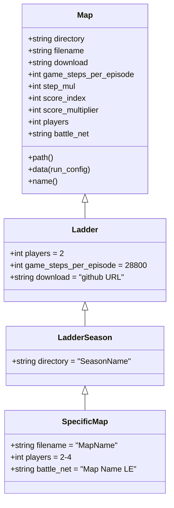
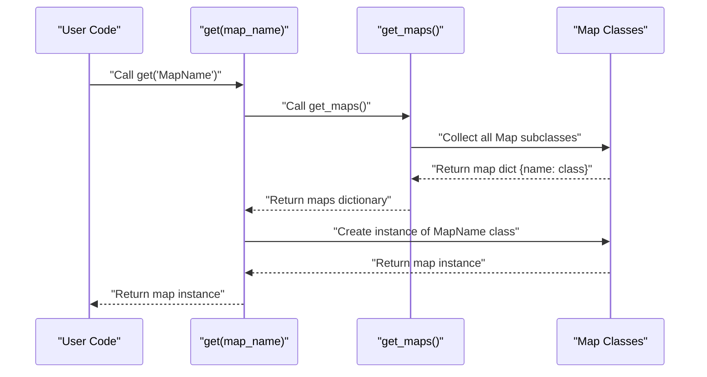
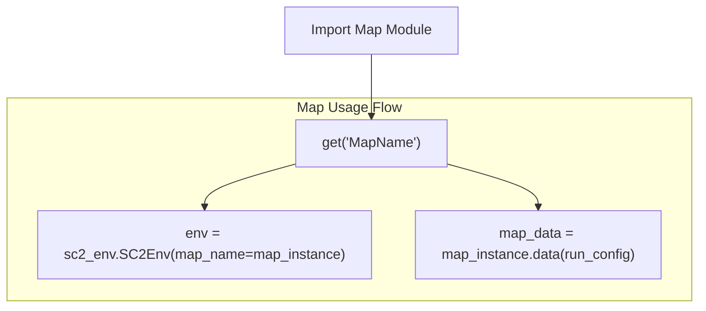

<!-- source: DeepWiki mcp.deepwiki.com · repo google-deepmind/pysc2 · page 7.2 Maps · fetched 2026-10-26 -->

# Maps

<details>
<summary>Relevant source files</summary>

The following files were used as context for generating this wiki page:

- [pysc2/maps/ladder.py](pysc2/maps/ladder.py)
- [pysc2/maps/lib.py](pysc2/maps/lib.py)

</details>


This document explains the map management system in PySC2, which provides classes and utilities for defining, retrieving, and managing StarCraft II maps. The Maps system provides a consistent way to reference maps by name, access map data files, and configure map-specific settings.

## Map Class Hierarchy

The Maps system is built around a class hierarchy that starts with the base `Map` class.



**Diagram: Map Class Hierarchy**

Sources: [pysc2/maps/lib.py:44-104](), [pysc2/maps/ladder.py:25-28](), [pysc2/maps/ladder.py:31-46](), [pysc2/maps/ladder.py:51-99]()

### The Base Map Class

The base `Map` class is defined in `lib.py` and serves as the foundation for all map definitions. It contains several key attributes:

| Attribute | Description | Default |
|-----------|-------------|---------|
| `directory` | Directory where the map file is located | `""` |
| `filename` | Name of the map file (without `.SC2Map` extension) | `None` |
| `download` | URL where the map can be downloaded | `None` |
| `game_steps_per_episode` | Maximum game steps per episode | `0` (no limit) |
| `step_mul` | How many game steps per agent step | `8` |
| `score_index` | Which score to use for this map | `-1` (win/loss reward) |
| `score_multiplier` | Multiplier for scores | `1` |
| `players` | Maximum number of players for this map | `None` |
| `battle_net` | The map name on Battle.net, if it exists | `None` |

Sources: [pysc2/maps/lib.py:44-70]()

The `Map` class also provides several useful methods:

- `path()`: Returns the full path to the map file
- `data(run_config)`: Returns the map data using the provided run configuration
- `name`: Returns the class name as the map name

Sources: [pysc2/maps/lib.py:72-93]()

## Map Registration and Retrieval

When you define a new map by subclassing `Map`, it is automatically registered in the system. Maps can be retrieved using the `get` function.



**Diagram: Map Retrieval Process**

Sources: [pysc2/maps/lib.py:115-138]()

### Creating and Using Custom Maps

To define a custom map, you can subclass the `Map` class and provide the required attributes:

```python
# Example (not actual code):
class MyCustomMap(lib.Map):
    directory = "custom_maps"
    filename = "my_custom_map"
    players = 2
```

Once defined, your map will be automatically registered and can be retrieved using `get("MyCustomMap")`.

Sources: [pysc2/maps/lib.py:14-29]()

## Ladder Maps

PySC2 includes a comprehensive collection of ladder maps from various seasons. These are structured in a hierarchy:

1. The `Ladder` class inherits from `Map` and sets defaults for ladder maps:
   - 2 players
   - 30-minute time limit (16 * 60 * 30 game steps)
   - Provides download link for map packs

2. Season classes inherit from `Ladder` and set the directory for maps from that season:
   - `Ladder2017Season1`, `Ladder2017Season2`, etc.

3. Individual map classes inherit from a specific season class and set map-specific properties:
   - Filename
   - Number of players
   - Battle.net name

Sources: [pysc2/maps/ladder.py:25-28](), [pysc2/maps/ladder.py:31-46](), [pysc2/maps/ladder.py:51-114]()

### Available Ladder Maps

The library includes numerous ladder maps across multiple seasons from 2017 to 2019. These maps are automatically registered when the `ladder.py` module is imported.

Some examples of available maps include:
- "16-Bit LE"
- "Abyssal Reef LE"
- "Acid Plant LE"
- "Acropolis LE"
- "Automaton LE"

Each map is represented by a class with a simplified name (e.g., "16Bit" for "16-Bit LE") that inherits from the appropriate season class.

Sources: [pysc2/maps/ladder.py:51-99]()

## Map Data and Usage

When you need to use a map in your environment, you typically:

1. Get the map instance using `maps.get("MapName")`
2. Use the map instance to get map data or configure the environment



**Diagram: Map Usage Flow**

Sources: [pysc2/maps/lib.py:81-89](), [pysc2/maps/lib.py:127-138]()

The `data` method retrieves the actual map data from the map file using the provided run configuration. If the map file is not found and a download URL is specified, an error message will suggest downloading the map.

## Map Discovery and Listing

The `get_maps()` function returns a dictionary of all available maps. This is useful for discovering what maps are available in the system:

```python
# Example (not actual code):
maps_dict = maps.get_maps()
print("Available maps:", list(maps_dict.keys()))
```

This function collects all subclasses of `Map` that have either a `filename` or `battle_net` attribute set.

Sources: [pysc2/maps/lib.py:115-124]()

## Summary

The Maps system in PySC2 provides a convenient way to define, organize, and access StarCraft II maps. It allows:

1. Using predefined ladder maps from various seasons
2. Creating custom maps by subclassing the `Map` class
3. Retrieving maps by name using the `get` function
4. Accessing map data for use in environments

The system automatically handles map file paths, extensions, and provides helpful error messages when maps cannot be found.

Sources: [pysc2/maps/lib.py](), [pysc2/maps/ladder.py]()

---

