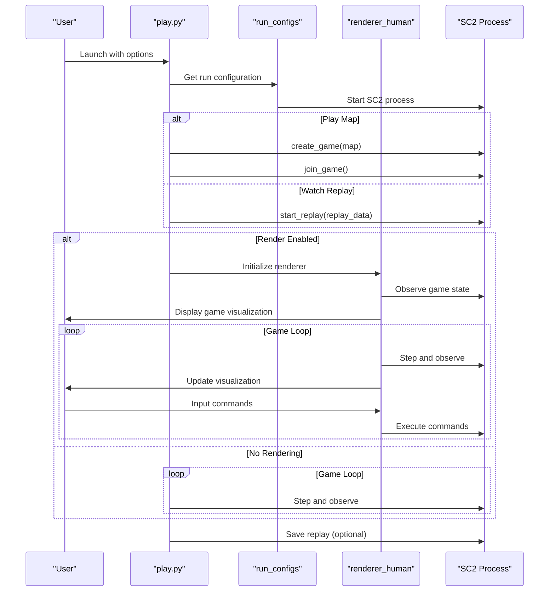
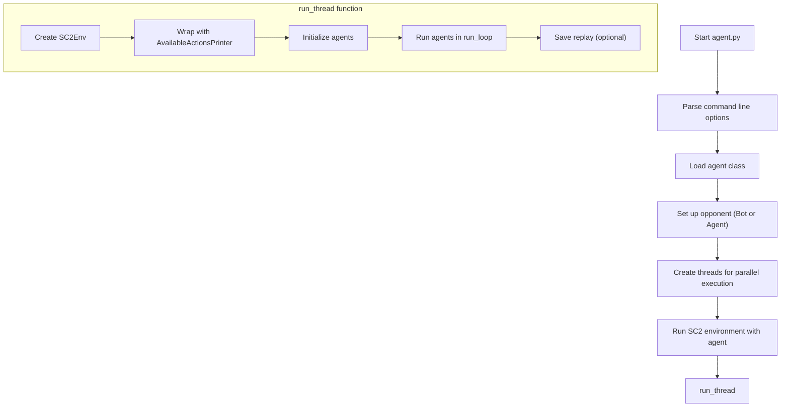
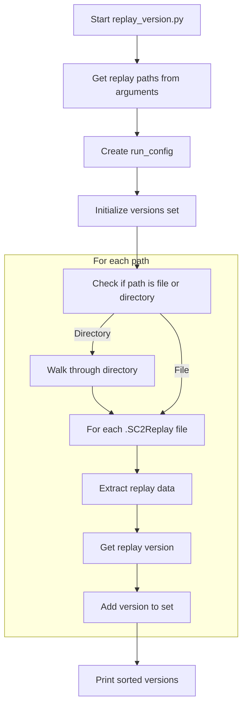
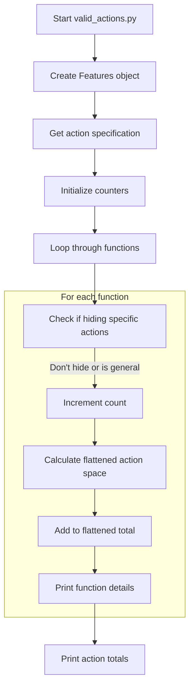
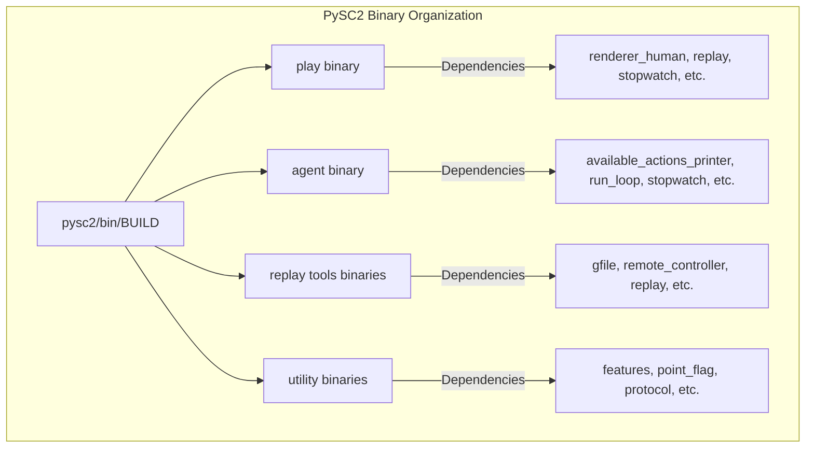

<!-- source: DeepWiki mcp.deepwiki.com · repo google-deepmind/pysc2 · page 8 Scripts and Tools · fetched 2026-10-26 -->

# Scripts and Tools

<details>
<summary>Relevant source files</summary>

The following files were used as context for generating this wiki page:

- [pysc2/bin/BUILD](pysc2/bin/BUILD)
- [pysc2/bin/agent.py](pysc2/bin/agent.py)
- [pysc2/bin/play.py](pysc2/bin/play.py)
- [pysc2/bin/replay_version.py](pysc2/bin/replay_version.py)
- [pysc2/bin/valid_actions.py](pysc2/bin/valid_actions.py)
- [pysc2/lib/BUILD](pysc2/lib/BUILD)

</details>


This page documents the various scripts and command-line tools provided with PySC2 that enable users to play games, run agents, analyze replays, and perform various utility tasks. For information about the core environment system, see [Environment System](#2), and for the testing framework, see [Development and Testing](#9).

## Overview

PySC2 includes a collection of executable scripts in the `pysc2/bin/` directory that provide functionality for different tasks within the StarCraft II environment. These scripts serve as entry points for common operations and testing scenarios.

```mermaid
graph TD
    subgraph "PySC2 Scripts and Tools"
        PlayScripts["Play Scripts"]
        AgentScripts["Agent Scripts"]
        ReplayTools["Replay Tools"]
        UtilityScripts["Utility Scripts"]
        MapScripts["Map Tools"]
    end

    PlayScripts -->|"play.py"| PlayGame["Run SC2 Game/Replay"]
    PlayScripts -->|"play_vs_agent.py"| PlayVsAgent["Human vs Agent"]
    
    AgentScripts -->|"agent.py"| RunAgent["Run Agent vs Bot/Agent"]
    AgentScripts -->|"agent_remote.py"| RemoteAgent["Run Agent Remotely"]
    
    ReplayTools -->|"replay_info.py"| ReplayInfo["Display Replay Info"]
    ReplayTools -->|"replay_version.py"| ReplayVersion["Extract Version Info"]
    ReplayTools -->|"replay_actions.py"| ReplayActions["Extract Actions"]
    ReplayTools -->|"reencode_replays.py"| ReencodeReplays["Re-encode Replays"]
    
    UtilityScripts -->|"valid_actions.py"| ValidActions["Print Valid Actions"]
    UtilityScripts -->|"mem_leak_check.py"| MemLeakCheck["Check Memory Leaks"]
    UtilityScripts -->|"gen_actions.py"| GenActions["Generate Actions"]
    UtilityScripts -->|"gen_data.py"| GenData["Generate Data"]
    
    MapScripts -->|"map_list.py"| MapList["List Available Maps"]
    MapScripts -->|"battle_net_maps.py"| BattleNetMaps["Battle.net Maps"]
```



Sources: [pysc2/bin/BUILD](), [pysc2/bin/play.py](), [pysc2/bin/agent.py]()

## Play Scripts

### play.py

The `play.py` script allows users to run StarCraft II to either play a game or watch a replay. It provides a human-playable interface to the game with customizable settings.



Key features:
- Play maps or watch replays with human interface
- Customizable resolution and interface options
- Supports various visualization modes (feature layers, rendered view)
- Can save games as replay files

Command line options:
| Option | Description |
|--------|-------------|
| `--map` | Name of a map to play |
| `--replay` | Path to a replay file to watch |
| `--render` | Enable pygame rendering |
| `--feature_screen_size` | Resolution for screen feature layers |
| `--rgb_screen_size` | Resolution for rendered screen |
| `--save_replay` | Whether to save a replay at the end |
| `--user_race` | Race for the human player |
| `--bot_race` | Race for the AI opponent |
| `--difficulty` | Bot's strength level |

Sources: [pysc2/bin/play.py:84-230]()

### agent.py

The `agent.py` script runs agent code against the StarCraft II environment. It provides a framework for testing and running AI agents against built-in bots or other agents.



Key features:
- Run any Python agent class against SC2
- Support for running against built-in bots or other agents
- Parallel execution of multiple instances
- Customizable environment settings
- Replay saving

Command line options:
| Option | Description |
|--------|-------------|
| `--agent` | Path to agent class (e.g., `pysc2.agents.random_agent.RandomAgent`) |
| `--map` | Name of a map to use |
| `--agent_race` | Race for the agent |
| `--agent2` | Second agent (either "Bot" or agent class) |
| `--difficulty` | Bot difficulty level |
| `--feature_screen_size` | Resolution for screen feature layers |
| `--parallel` | How many instances to run in parallel |
| `--save_replay` | Whether to save a replay at the end |

Example usage:
```
python -m pysc2.bin.agent --map Simple64 --agent pysc2.agents.random_agent.RandomAgent
```

Sources: [pysc2/bin/agent.py:83-159]()

## Replay Tools

PySC2 provides several tools for working with replay files, allowing users to extract information, analyze, and process replays.

### replay_version.py

The `replay_version.py` script extracts version information from StarCraft II replay files.



This script is useful for determining the game version of replay files, which is important when working with replays from different StarCraft II versions.

Sources: [pysc2/bin/replay_version.py:1-65]()

## Utility Scripts

### valid_actions.py

The `valid_actions.py` script prints all valid actions available in the StarCraft II environment, showing both the base actions and the total possible actions when flattened with all possible arguments.



This script is useful for understanding the action space available to agents in the StarCraft II environment.

Command line options:
| Option | Description |
|--------|-------------|
| `--screen_size` | Resolution for screen actions |
| `--minimap_size` | Resolution for minimap actions |
| `--hide_specific` | Hide the specific actions |

Sources: [pysc2/bin/valid_actions.py:1-56]()

## Build System and Script Organization

PySC2 uses Bazel as its build system, and the scripts are defined in the `pysc2/bin/BUILD` file. Each script is defined as a Python binary target with specific dependencies required for its functionality.



Each script in the `pysc2/bin/` directory is built as a standalone executable with its own set of dependencies, making it easy to run individual tools as needed.

Sources: [pysc2/bin/BUILD:1-325](), [pysc2/lib/BUILD:1-398]()

## Usage Examples

### Playing a Game

To play a map against a built-in AI:

```
python -m pysc2.bin.play --map Simple64
```

### Running an Agent

To run a random agent against a very easy AI opponent:

```
python -m pysc2.bin.agent --map Simple64 --agent pysc2.agents.random_agent.RandomAgent --agent_race terran --difficulty very_easy
```

### Viewing Replay Information

To view information about a replay file:

```
python -m pysc2.bin.play --replay path/to/replay.SC2Replay
```

### Getting Valid Actions

To print all valid actions in the environment:

```
python -m pysc2.bin.valid_actions
```

### Checking Replay Versions

To check the versions of all replays in a directory:

```
python -m pysc2.bin.replay_version path/to/replays/
```

Sources: [pysc2/bin/play.py:84-230](), [pysc2/bin/agent.py:83-159](), [pysc2/bin/valid_actions.py:1-56](), [pysc2/bin/replay_version.py:1-65]()

---

