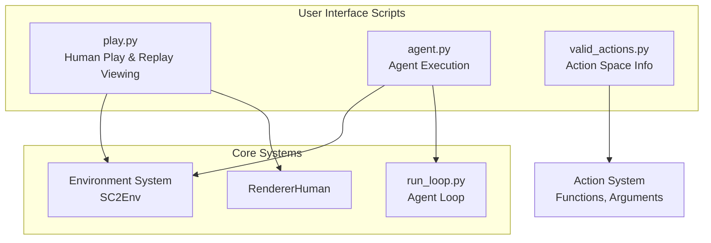
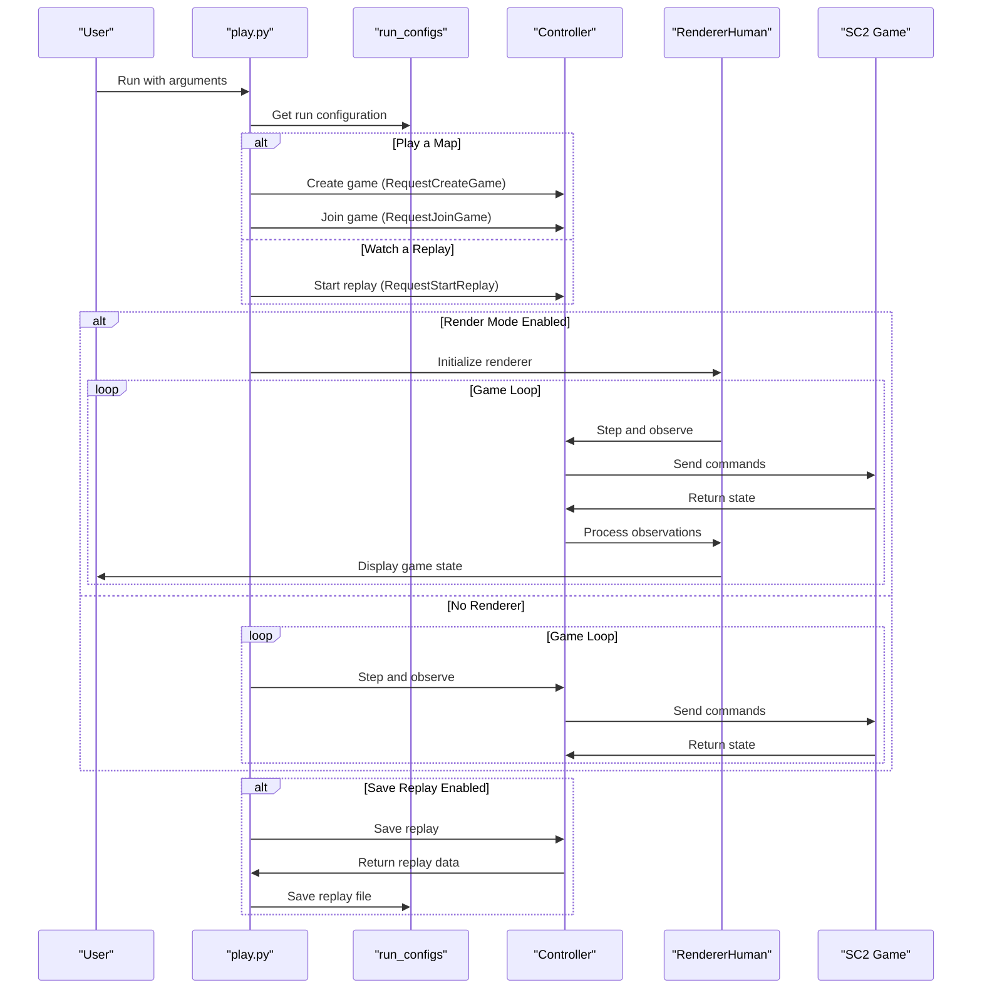
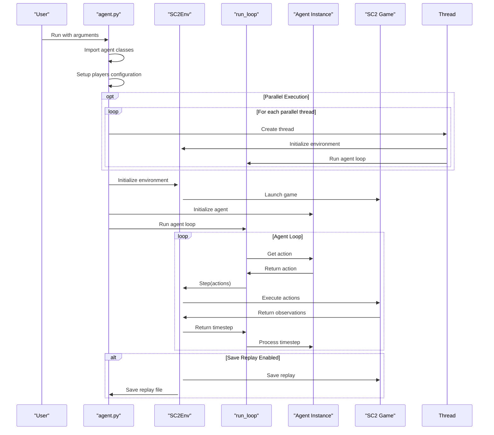
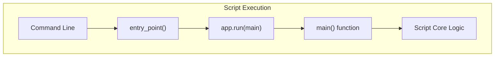
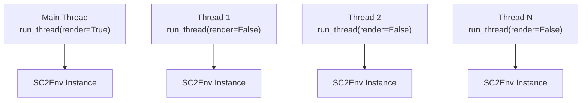

<!-- source: DeepWiki mcp.deepwiki.com · repo google-deepmind/pysc2 · page 8.1 Play and Agent Scripts · fetched 2026-10-26 -->

# Play and Agent Scripts

<details>
<summary>Relevant source files</summary>

The following files were used as context for generating this wiki page:

- [pysc2/bin/agent.py](pysc2/bin/agent.py)
- [pysc2/bin/play.py](pysc2/bin/play.py)
- [pysc2/bin/valid_actions.py](pysc2/bin/valid_actions.py)

</details>


## Purpose and Scope

This document describes the utility scripts provided by PySC2 for playing StarCraft II games and running agent code. Specifically, it covers the command-line scripts for human play, agent execution, and action space inspection. These scripts serve as entry points to interact with the PySC2 environment system.

For information about the environment system itself, see [Environment System](#2).

## Overview of Scripts

PySC2 provides three primary scripts in the `pysc2/bin` directory that serve as entry points for different use cases:

1. **play.py** - Allows human players to play StarCraft II against bots or watch replays
2. **agent.py** - Runs AI agents to play StarCraft II programmatically
3. **valid_actions.py** - Utility to print all valid actions available in the environment

### Scripts in the PySC2 Architecture



Sources: [pysc2/bin/play.py](), [pysc2/bin/agent.py](), [pysc2/bin/valid_actions.py]()

## 1. play.py Script

The `play.py` script allows a human user to play StarCraft II against a bot or watch a replay with various observation and rendering options.

### Key Features

- Launches StarCraft II for human play against a bot or for replay viewing
- Configures observation features (feature layers, RGB rendering)
- Controls the game's parameters (real-time mode, step multiplier, FPS)
- Saves replays of played games

### Execution Flow



Sources: [pysc2/bin/play.py:83-225]()

### Usage Examples

Play a game against a bot on the Simple64 map:
```
python -m pysc2.bin.play --map Simple64
```

Watch a replay file:
```
python -m pysc2.bin.play --replay path/to/replay.SC2Replay
```

### Key Configuration Options

| Flag | Description | Default |
|------|-------------|---------|
| `--map` | Map name to play | Required (if not using replay) |
| `--replay` | Path to replay file | Required (if not using map) |
| `--render` | Enable pygame rendering | True |
| `--realtime` | Run in realtime mode | False |
| `--feature_screen_size` | Resolution for screen feature layers | 84x84 |
| `--feature_minimap_size` | Resolution for minimap feature layers | 64x64 |
| `--rgb_screen_size` | Resolution for rendered screen | 256x192 |
| `--user_race` | Race for human player | random |
| `--bot_race` | Race for AI opponent | random |
| `--difficulty` | Bot difficulty level | very_easy |
| `--save_replay` | Save replay after game | True |

Sources: [pysc2/bin/play.py:34-81]()

## 2. agent.py Script

The `agent.py` script provides a command-line interface for running AI agents against the StarCraft II environment. It supports running agents against built-in bots or other agents.

### Key Features

- Launches StarCraft II with specified agent classes
- Configures observation and action spaces
- Supports agent vs. bot or agent vs. agent gameplay
- Can run multiple instances in parallel
- Saves replays of agent games

### Agent Execution Flow



Sources: [pysc2/bin/agent.py:83-105](), [pysc2/bin/agent.py:108-151]()

### Usage Examples

Run the random agent against a very easy bot:
```
python -m pysc2.bin.agent --map Simple64 --agent pysc2.agents.random_agent.RandomAgent
```

Run two agents against each other:
```
python -m pysc2.bin.agent --map Simple64 --agent pysc2.agents.random_agent.RandomAgent --agent2 pysc2.agents.scripted_agent.CollectMineralShards
```

### Key Configuration Options

| Flag | Description | Default |
|------|-------------|---------|
| `--map` | Map name to play | Required |
| `--render` | Enable pygame rendering | True |
| `--feature_screen_size` | Resolution for screen feature layers | 84x84 |
| `--feature_minimap_size` | Resolution for minimap feature layers | 64x64 |
| `--agent` | Python path to agent class | pysc2.agents.random_agent.RandomAgent |
| `--agent_race` | Race for first agent | random |
| `--agent2` | Second agent or "Bot" | Bot |
| `--agent2_race` | Race for second agent/bot | random |
| `--difficulty` | Bot difficulty (if agent2 is Bot) | very_easy |
| `--parallel` | Number of parallel instances | 1 |
| `--save_replay` | Save replay after game | True |

Sources: [pysc2/bin/agent.py:31-80]()

## 3. valid_actions.py Script

The `valid_actions.py` script prints all valid actions in the StarCraft II environment, helping developers understand the action space available to agents.

### Key Features

- Lists all available actions with their IDs and arguments
- Shows total number of base actions
- Shows total number of possible actions when all arguments are considered
- Option to hide specific (non-general) actions

### Usage Example

List all valid actions:
```
python -m pysc2.bin.valid_actions
```

List only general actions:
```
python -m pysc2.bin.valid_actions --hide_specific
```

Sources: [pysc2/bin/valid_actions.py:30-56]()

## Implementation Details

### Script Entry Points

Both `play.py` and `agent.py` have an `entry_point()` function to enable them to be called as scripts via setuptools. This allows the scripts to be called via command-line after installing the PySC2 package.



Sources: [pysc2/bin/play.py:225-230](), [pysc2/bin/agent.py:154-159]()

### Thread Management in agent.py

The `agent.py` script can run multiple instances of the environment in parallel using Python's threading module. One instance is always run in the main thread with rendering enabled (if specified), while additional instances are run in separate threads without rendering.



Sources: [pysc2/bin/agent.py:138-148]()

## Best Practices and Tips

1. **For human play**:
   - Use `play.py` with rendering enabled
   - Set appropriate screen and minimap resolutions
   - Save replays for later analysis

2. **For agent development**:
   - Use `agent.py` to test your agent implementation
   - Start with a single instance before using parallel execution
   - Compare agent performance against built-in bots of increasing difficulty

3. **For understanding the action space**:
   - Use `valid_actions.py` to see all available actions and their requirements
   - Note that the action space can change with different observation specifications

---

