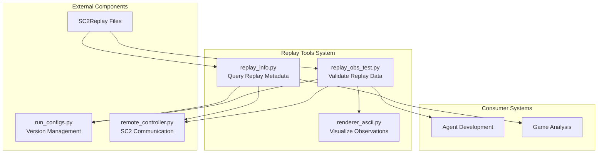
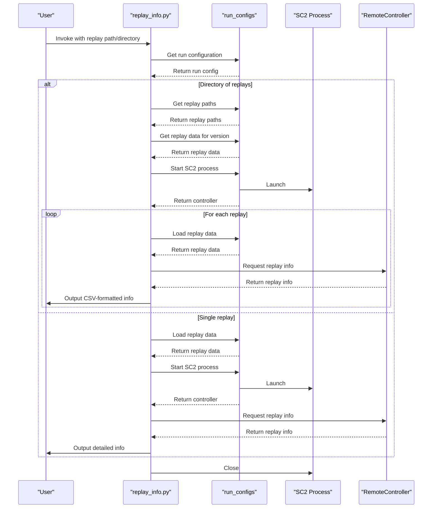
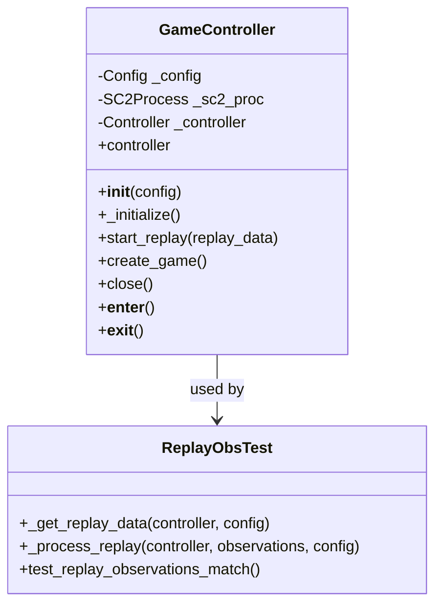
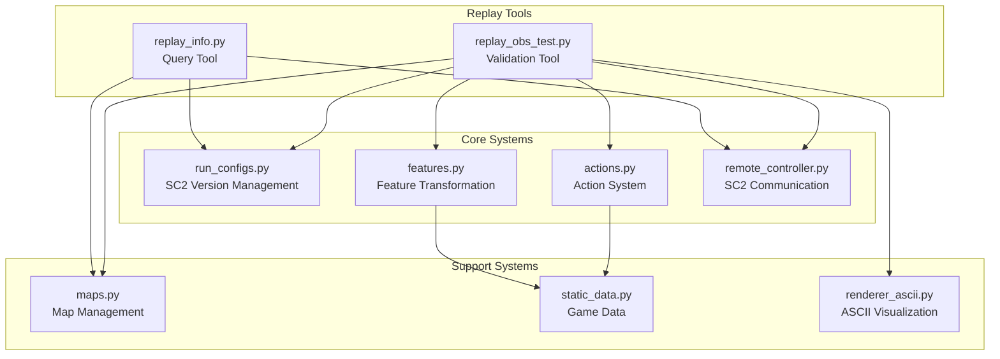
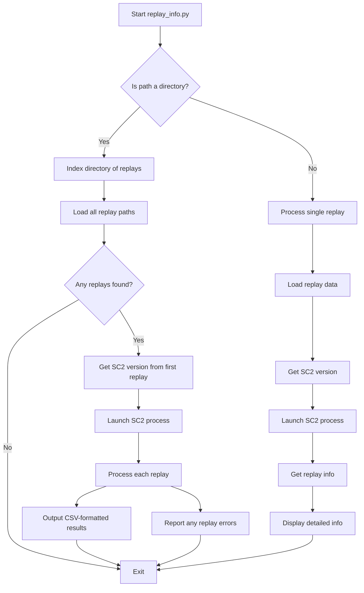

<!-- source: DeepWiki mcp.deepwiki.com · repo google-deepmind/pysc2 · page 8.2 Replay Tools · fetched 2026-10-26 -->

# Replay Tools

<details>
<summary>Relevant source files</summary>

The following files were used as context for generating this wiki page:

- [pysc2/bin/replay_info.py](pysc2/bin/replay_info.py)
- [pysc2/lib/renderer_ascii.py](pysc2/lib/renderer_ascii.py)
- [pysc2/tests/replay_obs_test.py](pysc2/tests/replay_obs_test.py)

</details>


## Purpose and Scope

This document covers the replay analysis and manipulation tools provided by PySC2. These tools allow users to extract information from StarCraft II replay files, verify replay data accuracy, and process replays for analysis. For information about the environment system that generates replay data during gameplay, see [Environment System](#2).

Sources: [pysc2/bin/replay_info.py:15-16]()

## Replay System Overview

The PySC2 replay tools are centered around extracting and processing information from StarCraft II replay files (`.SC2Replay`). The system provides utilities for querying replay metadata, validating replay observations, and processing replay data for analysis.



Sources: [pysc2/bin/replay_info.py:15-144](), [pysc2/tests/replay_obs_test.py:15-287]()

## Replay Information Tool

The primary tool for extracting information from replay files is `replay_info.py`, a command-line utility that can:

1. Process a single replay file to extract detailed information
2. Process an entire directory of replays to generate a summary index



### Single Replay Information

When querying a single replay file, the tool extracts detailed information including:
- Game version
- Map name
- Game duration (in game loops)
- Player information (race, APM, outcome)
- Various additional replay metadata

### Replay Directory Indexing

When processing an entire directory, the tool generates a CSV-formatted index with key information about each replay:
- Filename
- Game version
- Map name
- Game duration (in game loops)
- Number of players
- Player 1 outcome, race, and APM
- Player 2 race and APM (if applicable)

### Usage Example

To query information about a single replay:
```
python -m pysc2.bin.replay_info path/to/replay.SC2Replay
```

To index a directory of replays:
```
python -m pysc2.bin.replay_info path/to/replay/directory
```

Sources: [pysc2/bin/replay_info.py:32-102](), [pysc2/bin/replay_info.py:104-119](), [pysc2/bin/replay_info.py:122-143]()

## Replay Observation Testing

The PySC2 codebase includes a comprehensive framework for testing that observations from replays accurately match the original gameplay observations. This is critical for ensuring replays can be reliably used for agent training and analysis.

### GameController

The `GameController` class provides a wrapper for interacting with the StarCraft II game in both play and replay modes. It handles:
- Initializing game connections
- Starting replay playback
- Creating new games
- Managing the controller lifecycle



### Replay Observation Validation

The `ReplayObsTest` class implements tests to verify that observations from replays match the original gameplay observations. The test process:

1. Creates a new game with specific configuration
2. Executes a series of predefined actions
3. Records observations at each game step
4. Saves the game as a replay
5. Loads and plays the replay
6. Verifies that replay observations match the original observations

This ensures that replay data accurately represents the original game state and can be reliably used for training agents or analyzing gameplay.

Sources: [pysc2/tests/replay_obs_test.py:103-171](), [pysc2/tests/replay_obs_test.py:174-284]()

## Replay Visualization

The PySC2 system includes a simple ASCII renderer that can be used to visualize observations from replays. While not strictly a replay tool, it's useful for debugging and understanding replay data.

The renderer provides two main functions:
- `screen(obs)`: Renders the main game screen view in ASCII
- `minimap(obs)`: Renders the minimap view in ASCII

These visualizations include:
- Unit types, represented by characters
- Selection status
- Visibility information
- Player-relative positioning

Example of screen visualization output:
```
--------------- screen: p1; step: 1234; money: 350, 100; food: 15/23 ---------------
 . . . . . . . . . . . . . . . . . . . . . . . . . . . . . . . 
 . . . . . . . . . . . . . . . . . . . . . . . . . . . . . . . 
 . . . . . . . . $ $ $ . . . . . . . . . . . . . . . . . . . . 
 . . . . . . $ $ $ $ . . . . . . . . . . . . . . . . . . . . . 
 . . . . . . $ $ $ . . . . . . . . . . . . . . . . . . . . . . 
 . . . . . . . . . . . . . . . . . . . . . . . . . . . . . . . 
 . . . . . . . . . . . . . . (s) . . . . . . . . . . . . . . . 
 . . . . . . . . . D . . . . . . . . . . . . . . . . . . . . . 
 . . . . . . . . . . . . . . . . . . . . . . . . . . . . . . . 
 . . . . . . . . . . . . . . . . . . . . . . . . . . . . . . . 
```

The renderer uses a mapping of unit types to ASCII characters for visualization, making it easy to identify different units in the game state.

Sources: [pysc2/lib/renderer_ascii.py:1-122](), [pysc2/tests/replay_obs_test.py:203]()

## Integration with PySC2 Systems

The replay tools integrate with several other components of the PySC2 system:



### Key Integration Points:

1. **Version Management**: Replays are tied to specific StarCraft II versions. The replay tools use `run_configs` to ensure the correct version is used for processing replays.

2. **Feature Transformation**: When testing replay observations, the tools use the same feature extraction system as the main environment, ensuring consistency.

3. **Action System**: Replay validation tests verify that actions recorded in replays match the original actions executed during gameplay.

4. **Maps**: Replay processing requires access to the original map data, provided by the map management system.

5. **Visualization**: ASCII rendering allows for quick visual inspection of replay observations.

Sources: [pysc2/bin/replay_info.py:22-23](), [pysc2/tests/replay_obs_test.py:23-29]()

## Use Cases

The PySC2 replay tools support several important use cases:

| Use Case | Tool | Description |
|----------|------|-------------|
| Replay Metadata Extraction | replay_info.py | Extract game version, player information, map data, and other metadata from replays |
| Replay Dataset Creation | replay_info.py | Process directories of replays to create datasets for machine learning |
| Replay Validation | replay_obs_test.py | Verify that replay observations match original gameplay observations |
| Debugging Agents | renderer_ascii.py | Visualize agent observations from replays for debugging |
| Game Analysis | replay_info.py | Analyze player performance metrics like APM from replays |

Sources: [pysc2/bin/replay_info.py:15-144](), [pysc2/tests/replay_obs_test.py:15-287]()

## Technical Implementation

### Replay Information Extraction

The replay information tool uses the following process:

1. Load replay data from file
2. Determine the StarCraft II version from the replay data
3. Start an SC2 process with the correct version
4. Request replay information from the SC2 game engine
5. Parse and display the information

The tool handles both single replays and directories of replays with different processing paths:



Sources: [pysc2/bin/replay_info.py:32-102](), [pysc2/bin/replay_info.py:104-119](), [pysc2/bin/replay_info.py:122-143]()

### Replay Observation Testing

The replay observation testing framework uses a pre-defined set of actions to create a deterministic test scenario:

1. Create a new game with a specific configuration and seed
2. Execute pre-defined actions at specific game loop timestamps
3. Record observations at each step
4. Save the game as a replay
5. Load and play the replay
6. Compare observations from the replay with the original observations

This ensures that replays accurately capture the game state and can be reliably used for training agents or analyzing gameplay.

Sources: [pysc2/tests/replay_obs_test.py:174-284]()

## Conclusion

The PySC2 replay tools provide essential capabilities for working with StarCraft II replays. Whether extracting metadata for analysis, validating replay accuracy, or visualizing replay observations, these tools enable researchers and developers to effectively work with replay data in their agent development and game analysis workflows.

---

