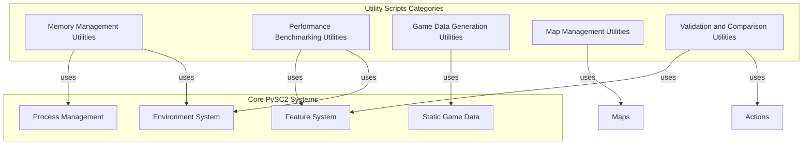
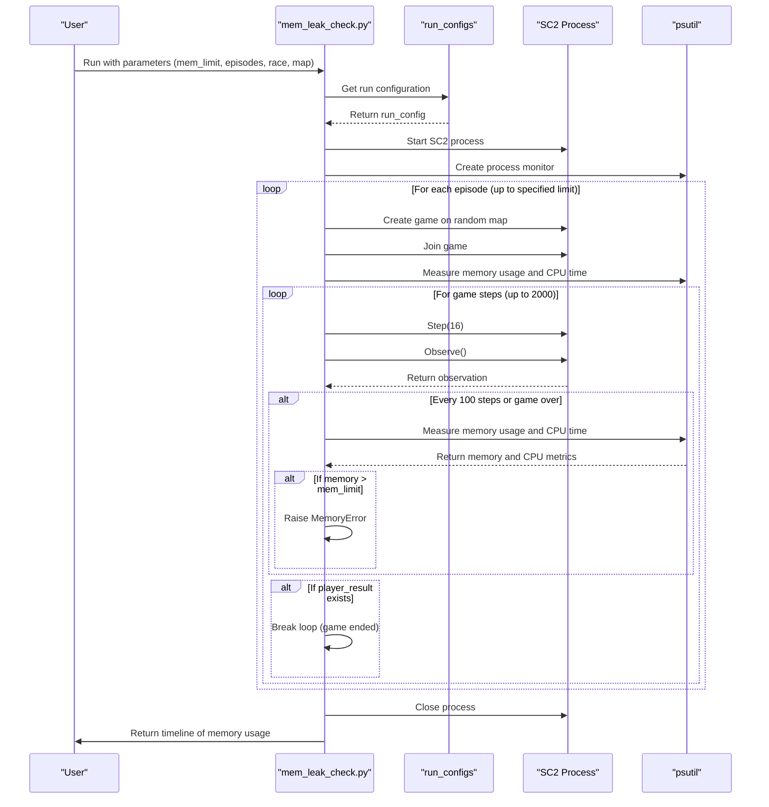
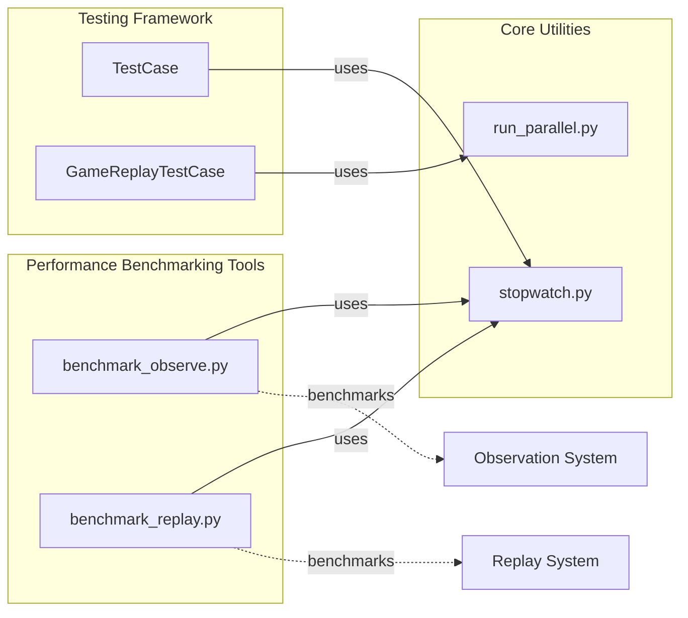
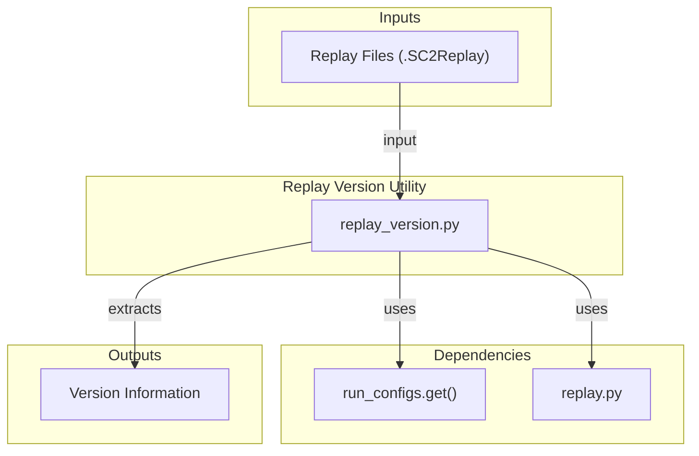

<!-- source: DeepWiki mcp.deepwiki.com · repo google-deepmind/pysc2 · page 8.3 Utility Scripts · fetched 2026-10-26 -->

# Utility Scripts

<details>
<summary>Relevant source files</summary>

The following files were used as context for generating this wiki page:

- [pysc2/bin/BUILD](pysc2/bin/BUILD)
- [pysc2/bin/mem_leak_check.py](pysc2/bin/mem_leak_check.py)
- [pysc2/bin/replay_version.py](pysc2/bin/replay_version.py)
- [pysc2/lib/BUILD](pysc2/lib/BUILD)
- [pysc2/lib/run_parallel_test.py](pysc2/lib/run_parallel_test.py)
- [pysc2/tests/observer_test.py](pysc2/tests/observer_test.py)
- [pysc2/tests/ping_test.py](pysc2/tests/ping_test.py)
- [pysc2/tests/utils.py](pysc2/tests/utils.py)

</details>


PySC2 includes a collection of utility scripts designed to assist with debugging, benchmarking, generating game data, and analyzing replays. These scripts serve as standalone tools that leverage the PySC2 library infrastructure to perform specific tasks outside the main agent-environment interaction loop. 

For information about playing SC2 and running agents, see [Play and Agent Scripts](#8.1). For replay analysis tools, see [Replay Tools](#8.2).

## Overview of Utility Scripts

PySC2 utility scripts are primarily located in the `pysc2/bin/` directory and are built as binary targets in the build system. They serve various purposes including performance testing, memory leak detection, and data generation.



Sources: [pysc2/bin/BUILD:1-325]()

## Memory Management Utilities

### Memory Leak Checker

The Memory Leak Checker utility (`mem_leak_check.py`) is designed to detect memory leaks in the StarCraft II game process by monitoring memory usage over multiple game episodes.



The Memory Leak Checker provides the following features:
- Creates multiple episodes of SC2 games with random maps
- Monitors CPU usage and memory consumption throughout execution
- Terminates if memory usage exceeds a specified limit
- Provides a detailed timeline of memory usage

#### Command Line Options

| Flag | Description | Default |
|------|-------------|---------|
| `--mem_limit` | Maximum memory usage in MB | 2000 |
| `--episodes` | Maximum number of episodes to run | 200 |
| `--race` | Race to play as (`random`, `protoss`, `terran`, `zerg`) | `random` |
| `--map` | List of maps to test on | `Catalyst` |

#### Usage Example:
```
python -m pysc2.bin.mem_leak_check --mem_limit=4000 --episodes=50 --race=terran --map=Acropolis,Catalyst
```

This command will run 50 game episodes on either Acropolis or Catalyst maps, playing as Terran, and will fail if memory usage exceeds 4000 MB.

Sources: [pysc2/bin/mem_leak_check.py:1-140]()

## Performance Benchmarking Utilities

PySC2 includes utilities for benchmarking the performance of various components of the system:

### Benchmark Observe

This utility (`benchmark_observe.py`) measures the performance of the observation system by repeatedly calling the observe function and measuring the time it takes. It helps identify bottlenecks in the observation pipeline.

### Benchmark Replay

The Benchmark Replay utility (`benchmark_replay.py`) tests the performance of the replay system, which is important for training agents on replay data. It uses the `stopwatch` module to collect timing information.



Sources: [pysc2/bin/BUILD:75-106](), [pysc2/lib/BUILD:338-354](), [pysc2/tests/utils.py:37-51]()

## Game Data Generation Utilities

PySC2 provides several utilities for generating game data:

### Generate Actions

The `gen_actions.py` script is used to generate the action space for PySC2. It queries the SC2 game for available actions and generates code for the actions module.

### Generate Data

The `gen_data.py` script generates static game data like unit types, upgrades, and buffs from the StarCraft II API.

### Generate Versions

The `gen_versions.py` script generates version information for different SC2 game versions, which is useful for compatibility testing.

Sources: [pysc2/bin/BUILD:29-56](), [pysc2/bin/BUILD:126-134]()

## Map Management Utilities

### Map List

The `map_list.py` utility displays a list of available maps in the PySC2 maps system.

### Battle.net Maps

The `battle_net_maps.py` utility provides information about maps available through Battle.net.

Sources: [pysc2/bin/BUILD:137-145](), [pysc2/bin/BUILD:277-286]()

## Validation and Comparison Utilities

These utilities help validate various aspects of the PySC2 system:

### Check APM

The `check_apm.py` utility validates the actions per minute (APM) calculation logic.

### Valid Actions

The `valid_actions.py` script validates the action space by checking which actions are valid in different game states.

### Compare Binaries

The `compare_binaries.py` utility compares different versions of the SC2 binary to identify differences in behavior.

Sources: [pysc2/bin/BUILD:58-73](), [pysc2/bin/BUILD:246-275]()

## Replay Utilities

While [Replay Tools](#8.2) covers the main replay analysis functionality, there are a few additional utilities:

### Replay Version 

The `replay_version.py` script extracts version information from replay files, which can be useful for compatibility checking.



The script scans through one or more directories of replay files, extracts version information from each valid replay, and outputs a sorted list of unique versions found.

Example usage:
```
python -m pysc2.bin.replay_version path/to/replays/
```

Sources: [pysc2/bin/replay_version.py:1-65]()

## Core Utility Classes

In addition to standalone scripts, PySC2 includes several core utility classes that are used throughout the codebase:

### RunParallel

The `RunParallel` class in `run_parallel.py` provides functionality for running multiple functions in parallel, which is particularly useful for controlling multiple SC2 processes simultaneously or for performance testing.

Key features of `RunParallel`:
- Thread pool management for parallel execution
- Timeout functionality to prevent deadlocks
- Exception handling to propagate errors from worker threads

Example usage from test cases:

```python
parallel = run_parallel.RunParallel()
results = parallel.run([func1, func2, func3])  # Run multiple functions
results = parallel.run((max, 0, i - 2) for i in range(5))  # Run with parameters
```

Sources: [pysc2/lib/run_parallel_test.py:1-97]()

### Stopwatch

The `Stopwatch` class in `stopwatch.py` provides timing utilities for benchmarking and performance testing. It's used extensively in the benchmark utilities and test cases.

Key features:
- Measures execution time of code blocks
- Accumulates statistics across multiple executions
- Provides formatted output of timing information

Sources: [pysc2/tests/utils.py:37-51](), [pysc2/tests/ping_test.py:1-40]()

## Conclusion

The utility scripts in PySC2 provide essential tools for developers working with the library. They assist with debugging, performance optimization, data generation, and validation. When developing or extending PySC2, these utilities can help ensure that the system is functioning correctly and efficiently.

For more information on developing and testing PySC2, see [Development and Testing](#9).

---

