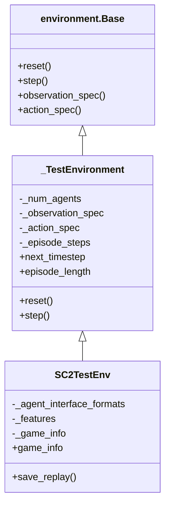
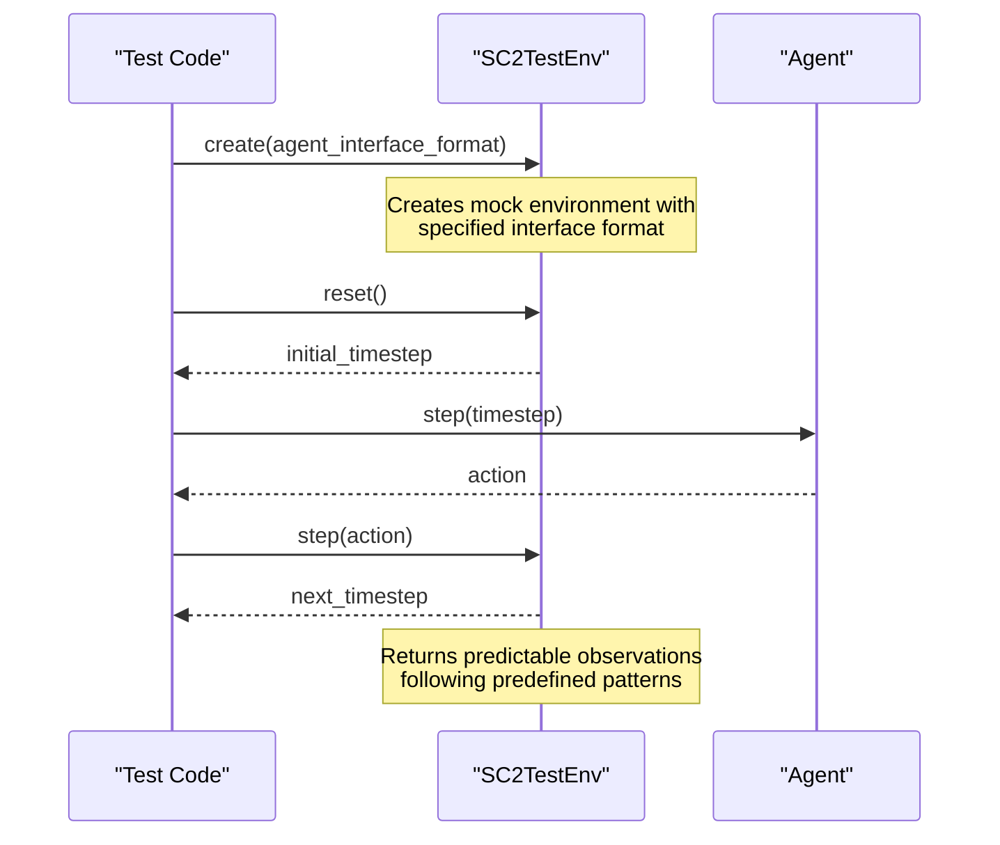
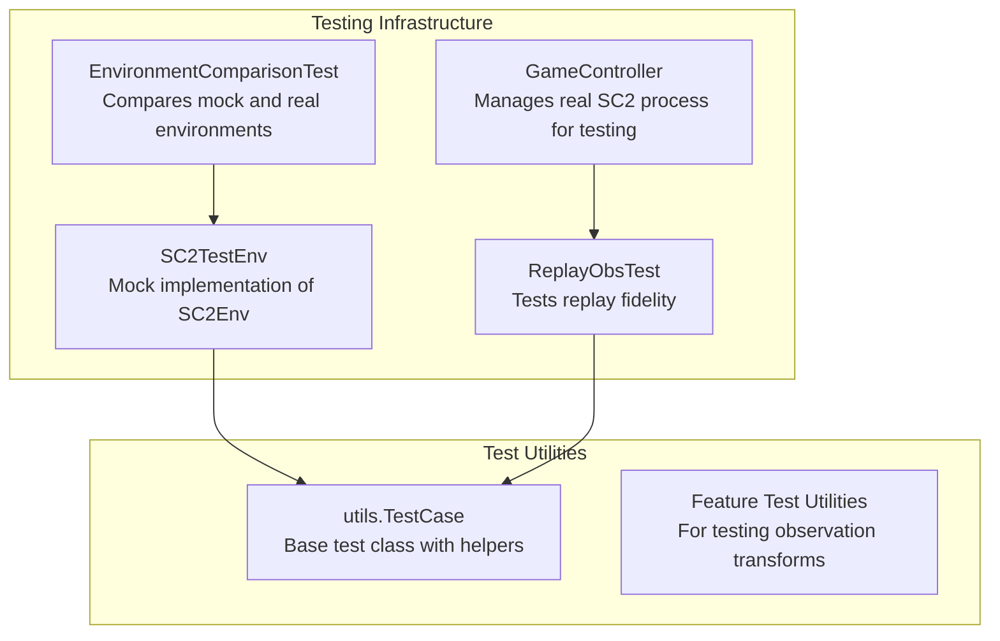
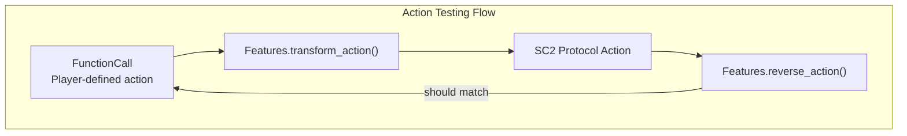
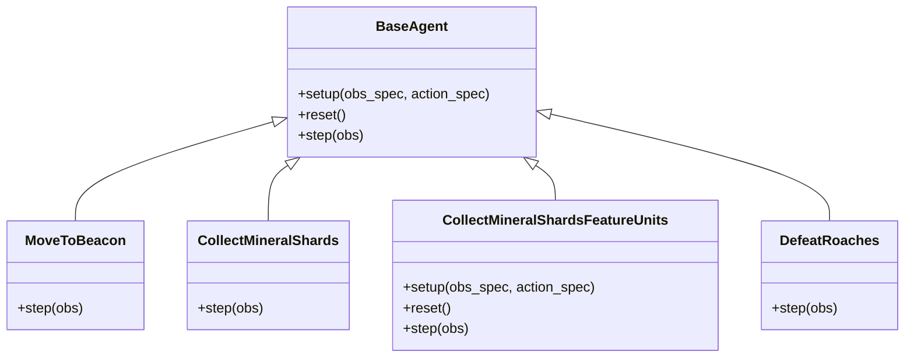
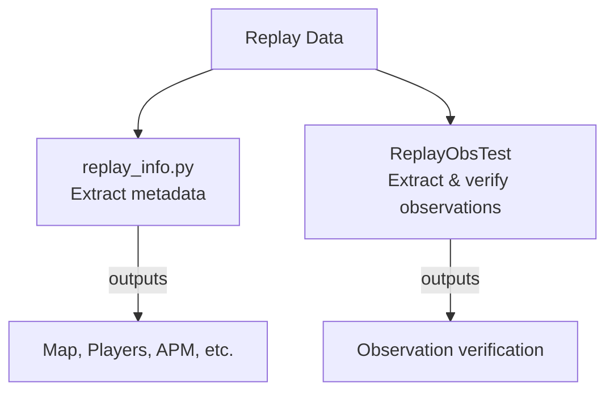

<!-- source: DeepWiki mcp.deepwiki.com · repo google-deepmind/pysc2 · page 9 Development and Testing · fetched 2026-10-26 -->

# Development and Testing

<details>
<summary>Relevant source files</summary>

The following files were used as context for generating this wiki page:

- [pysc2/agents/scripted_agent.py](pysc2/agents/scripted_agent.py)
- [pysc2/bin/check_apm.py](pysc2/bin/check_apm.py)
- [pysc2/bin/replay_info.py](pysc2/bin/replay_info.py)
- [pysc2/env/mock_sc2_env.py](pysc2/env/mock_sc2_env.py)
- [pysc2/env/mock_sc2_env_comparison_test.py](pysc2/env/mock_sc2_env_comparison_test.py)
- [pysc2/env/mock_sc2_env_test.py](pysc2/env/mock_sc2_env_test.py)
- [pysc2/lib/features_test.py](pysc2/lib/features_test.py)
- [pysc2/lib/renderer_ascii.py](pysc2/lib/renderer_ascii.py)
- [pysc2/tests/easy_scripted_test.py](pysc2/tests/easy_scripted_test.py)
- [pysc2/tests/multi_player_env_test.py](pysc2/tests/multi_player_env_test.py)
- [pysc2/tests/replay_obs_test.py](pysc2/tests/replay_obs_test.py)

</details>


This page provides guidance for developers who want to contribute to or extend PySC2. It covers the testing infrastructure, how to write effective tests, and development tools available in the codebase. For information about using PySC2 to build agents, see [Overview](#1).

## Testing Infrastructure

PySC2 includes a comprehensive testing framework designed to allow developers to test their code without needing to launch the StarCraft II game. This section describes the key components of this testing infrastructure.

### Mock Environment

The mock environment allows you to test code against a simulated StarCraft II environment without launching the actual game. This is particularly useful for unit testing, continuous integration, and environments where installing the full StarCraft II game isn't feasible.



The mock environment hierarchy provides a lightweight implementation of the SC2 environment suitable for testing:

- `_TestEnvironment`: Base test environment class that implements the core environment interface
- `SC2TestEnv`: Test environment specifically designed to replace `SC2Env` for testing

The mock environment generates predictable observations and handles actions in a deterministic way, making it ideal for testing agent logic without the variability of the actual game.

Sources: [pysc2/env/mock_sc2_env.py:30-350](pysc2/env/mock_sc2_env.py:30-350)

### Using the Mock Environment

To use the mock environment in tests, you can instantiate it directly or use it to patch the real `SC2Env` class:



The mock environment can be configured to return specific observations and to have specific behaviors, such as ending episodes after a set number of steps.

Sources: [pysc2/env/mock_sc2_env_test.py:92-142](pysc2/env/mock_sc2_env_test.py:92-142)

### Testing Framework Classes

The testing infrastructure includes several key components that help with different aspects of testing:



These classes work together to provide a comprehensive testing framework:

1. `SC2TestEnv`: Mock environment for testing without launching SC2
2. `GameController`: Manages a real SC2 process for testing with the actual game
3. `ReplayObsTest`: Tests that observations in replays match the original gameplay
4. Environment comparison tests: Ensure the mock environment behaves like the real one

Sources: [pysc2/env/mock_sc2_env.py:138-350](pysc2/env/mock_sc2_env.py:138-350), [pysc2/tests/replay_obs_test.py:103-172](pysc2/tests/replay_obs_test.py:103-172), [pysc2/env/mock_sc2_env_comparison_test.py:23-66](pysc2/env/mock_sc2_env_comparison_test.py:23-66)

## Writing Tests

This section provides guidance on writing effective tests for PySC2.

### Unit Tests

Unit tests in PySC2 typically use Python's `unittest` framework with the `absl.testing` extensions. Most test files follow a similar pattern:

```python
from absl.testing import absltest
from pysc2.tests import utils  # Common test utilities

class MyFeatureTest(utils.TestCase):
    def test_something(self):
        # Test implementation
        self.assertEqual(expected, actual)
```

The `utils.TestCase` class provides helpful assertions and utilities specific to PySC2 testing.

Sources: [pysc2/lib/features_test.py:30-58](pysc2/lib/features_test.py:30-58)

### Testing with Mock Environments

When testing agent code or other components that interact with the SC2 environment, you can use the mock environment to create predictable test scenarios:

1. Create a mock environment with the appropriate interface format
2. Configure the environment's behavior if needed
3. Run your agent or code against the mock environment
4. Verify the results

```python
def test_agent_behavior():
    env = mock_sc2_env.SC2TestEnv(
        map_name='test_map',
        agent_interface_format=features.AgentInterfaceFormat(
            feature_dimensions=features.Dimensions(screen=64, minimap=32)))
    
    # Optional: configure environment behavior
    env.episode_length = 10
    
    # Run agent against environment
    agent = MyAgent()
    obs = env.reset()
    for _ in range(10):
        action = agent.step(obs)
        obs = env.step([action])
        # Make assertions about agent behavior
```

Sources: [pysc2/env/mock_sc2_env_test.py:126-142](pysc2/env/mock_sc2_env_test.py:126-142)

### Testing Observations and Actions

PySC2 provides utilities for testing that observations and actions are correctly transformed:



The features test contains methods for verifying that actions are correctly transformed to SC2 protocol formats and back.

Sources: [pysc2/lib/features_test.py:431-461](pysc2/lib/features_test.py:431-461)

### Replay Testing

PySC2 includes specialized tests for verifying that replays correctly capture gameplay:

1. Play a game, recording observations and actions
2. Save the replay
3. Load and play back the replay
4. Verify that replay observations match the original observations

This approach ensures the fidelity of the replay system, which is important for imitation learning and debugging.

Sources: [pysc2/tests/replay_obs_test.py:174-283](pysc2/tests/replay_obs_test.py:174-283)

## Scripted Agents for Testing

PySC2 includes several scripted agents that can be used for testing and as reference implementations. These agents solve specific mini-games and demonstrate how to use the PySC2 API effectively.



These scripted agents provide reference implementations for solving specific mini-games:

- `MoveToBeacon`: Moves a single unit to a beacon
- `CollectMineralShards`: Controls units to collect mineral shards
- `CollectMineralShardsFeatureUnits`: Uses feature units to collect mineral shards
- `DefeatRoaches`: Controls marines to defeat roaches

Each agent demonstrates different aspects of the PySC2 API and can be used to test environment functionality or as starting points for more complex agents.

Sources: [pysc2/agents/scripted_agent.py:36-216](pysc2/agents/scripted_agent.py:36-216)

### Using Scripted Agents for Testing

The scripted agents can be used in tests to verify that the environment is working correctly:

```python
def test_move_to_beacon():
    with sc2_env.SC2Env(
        map_name="MoveToBeacon",
        players=[sc2_env.Agent(sc2_env.Race.terran)],
        agent_interface_format=sc2_env.AgentInterfaceFormat(
            feature_dimensions=sc2_env.Dimensions(screen=84, minimap=64)),
        step_mul=16) as env:
        agent = scripted_agent.MoveToBeacon()
        run_loop.run_loop([agent], env, steps=100)
        
    # Verify agent performed as expected
    self.assertGreater(agent.reward, 0)
```

These tests help ensure that changes to the environment don't break existing functionality.

Sources: [pysc2/tests/easy_scripted_test.py:29-45](pysc2/tests/easy_scripted_test.py:29-45)

## Development Tools

PySC2 includes several tools to help with development and debugging.

### Replay Analysis

The replay analysis tools help examine replays for debugging and analysis:



The replay tools can:
- Extract metadata from replays (players, map, game duration, APM)
- Verify that replays correctly capture the original gameplay

Sources: [pysc2/bin/replay_info.py:33-119](pysc2/bin/replay_info.py:33-119), [pysc2/tests/replay_obs_test.py:174-283](pysc2/tests/replay_obs_test.py:174-283)

### Performance Testing

PySC2 includes tools for testing the performance implications of different actions:

```python
# Testing APM for different action types
def test_apm():
    env = Env()
    for i, obs in env.check_apm("raw move, random probe, random location"):
        env.raw_unit_command("Move_screen", random_probe_tag(obs), rand_world_coord())
```

These tools help understand how different actions affect APM measurements and can be used to optimize agent performance.

Sources: [pysc2/bin/check_apm.py:56-208](pysc2/bin/check_apm.py:56-208)

### ASCII Renderer

For environments where a graphical interface isn't available, PySC2 provides an ASCII renderer for debugging:

```
----- screen: p1; step: [0]; money: 50, 0; food: 0/15 -----
 . . . . . . . . . . . . . . . . . . . . . . . . . . . . . 
 . . . . . . . . . . . . . . . . . . . . . . . . . . . . . 
 . . . . . . . . . . . . . . . . . . . . . . . . . . . . . 
 . . . . . . . . . . . . . . . . . . . . . . . . . . . . . 
 . . . . . . . . . . . . . . . . . . . . . . . . . . . . . 
 . . . . . . . . . . . . . (s s s s) . . . . . . . . . . . 
```

The ASCII renderer provides a simple way to visualize observations in terminal environments.

Sources: [pysc2/lib/renderer_ascii.py:60-122](pysc2/lib/renderer_ascii.py:60-122)

## Best Practices for Development

When developing for PySC2, follow these best practices:

1. **Use the Mock Environment**: For unit tests and quick iteration, use the mock environment to avoid the overhead of launching StarCraft II.

2. **Test with Real Environment**: For integration testing, verify that your code works with the actual StarCraft II environment.

3. **Verify Observation and Action Transformations**: When working with custom observations or actions, test both transformation directions:
   - From agent representation to SC2 protocol format
   - From SC2 protocol format back to agent representation

4. **Benchmark Performance**: Use the performance testing tools to understand the impact of your changes on APM and performance.

5. **Test with Replays**: For features that affect gameplay, verify that replays correctly capture the behavior.

## Conclusion

PySC2's development and testing infrastructure provides the tools needed to effectively contribute to and extend the library. The mock environment allows for testing without launching the game, the scripted agents provide reference implementations, and the various testing utilities help ensure that changes work as expected.

By following the testing patterns established in the codebase, you can develop robust extensions and contributions to PySC2.

---

