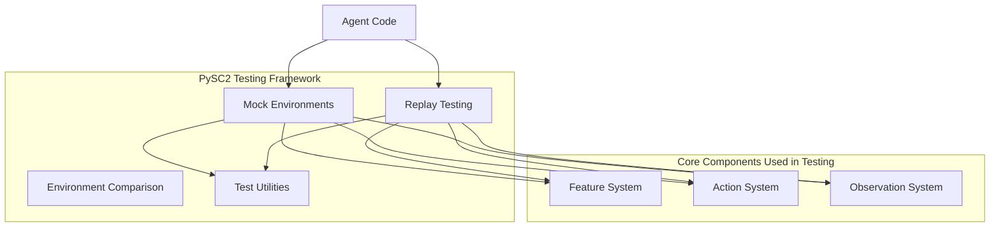
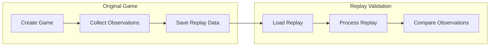

<!-- source: DeepWiki mcp.deepwiki.com · repo google-deepmind/pysc2 · page 9.1 Testing Framework · fetched 2026-10-26 -->

# Testing Framework

<details>
<summary>Relevant source files</summary>

The following files were used as context for generating this wiki page:

- [pysc2/bin/check_apm.py](pysc2/bin/check_apm.py)
- [pysc2/bin/replay_info.py](pysc2/bin/replay_info.py)
- [pysc2/env/mock_sc2_env.py](pysc2/env/mock_sc2_env.py)
- [pysc2/env/mock_sc2_env_comparison_test.py](pysc2/env/mock_sc2_env_comparison_test.py)
- [pysc2/env/mock_sc2_env_test.py](pysc2/env/mock_sc2_env_test.py)
- [pysc2/lib/renderer_ascii.py](pysc2/lib/renderer_ascii.py)
- [pysc2/tests/multi_player_env_test.py](pysc2/tests/multi_player_env_test.py)
- [pysc2/tests/replay_obs_test.py](pysc2/tests/replay_obs_test.py)

</details>


This document describes the testing infrastructure in PySC2, explaining how to use and extend the testing components for developing and validating PySC2 agents and environments. The testing framework provides tools for unit testing, environment mocking, replay validation, and game state verification without requiring a running StarCraft II instance.

For information about the scripted agent system used in testing, see [Scripted Agents](#9.2).

## Overview of the Testing Framework

The PySC2 testing framework consists of several key components:

1. **Mock Environments** - Allow testing without a live StarCraft II instance
2. **Replay Testing Tools** - Validate replay observation consistency
3. **Environment Comparison Tools** - Compare mock and real environments
4. **Test Utilities** - Helper functions and visualization for testing



Sources: [pysc2/env/mock_sc2_env.py:1-352](), [pysc2/tests/replay_obs_test.py:1-288](), [pysc2/env/mock_sc2_env_test.py:1-207]()

## Mock Environments

The mock environment system provides test-friendly alternatives to the real StarCraft II environment, eliminating the need for a running StarCraft II instance during testing.

### Core Mock Environment Classes

```mermaid
classDiagram
    class environment.Base {
        +reset()
        +step()
        +observation_spec()
        +action_spec()
    }
    
    class "_TestEnvironment" {
        -_num_agents
        -_observation_spec
        -_action_spec
        -_episode_steps
        +next_timestep
        +episode_length
        +reset()
        +step()
        +action_spec()
        +observation_spec()
        -_default_observation()
    }
    
    class "SC2TestEnv" {
        -_game_info
        -_agent_interface_formats
        -_features
        +game_info
        +save_replay()
        -_default_observation()
    }
    
    environment.Base <|-- "_TestEnvironment"
    "_TestEnvironment" <|-- "SC2TestEnv"
```

Sources: [pysc2/env/mock_sc2_env.py:30-157](), [pysc2/env/mock_sc2_env.py:138-298]()

### _TestEnvironment

The `_TestEnvironment` is a lightweight base implementation of the PySC2 environment interface that returns configurable timesteps. By default, it returns zero rewards and observations with the shape specified by the environment's specs.

Key attributes:
- `next_timestep`: The timestep to return on the next call
- `episode_length`: Number of transitions before forcing an episode end

Use this base class when you need a simple generic test environment with customizable behavior.

Sources: [pysc2/env/mock_sc2_env.py:30-136]()

### SC2TestEnv

The `SC2TestEnv` is a specialized mock environment that implements the same interface as `SC2Env` but works without requiring a StarCraft II installation. It provides predefined observations that mimic real SC2 observations, including feature layers, unit information, and minimaps.

Key features:
- Drop-in replacement for `SC2Env` in tests
- Configurable with the same parameters as the real environment
- Supports feature layers, RGB observations, and raw data
- Can simulate units and their properties
- Default episode length of 10 steps

Example usage:

```python
# In a test method
@mock.patch('pysc2.env.sc2_env.SC2Env', mock_sc2_env.SC2TestEnv)
def test_method(self):
    env = sc2_env.SC2Env(
        map_name="Dummy",
        players=[sc2_env.Agent(sc2_env.Race.terran)],
        agent_interface_format=features.AgentInterfaceFormat(
            feature_dimensions=features.Dimensions(screen=64, minimap=32)))
    
    # The env is actually an SC2TestEnv
    timestep = env.reset()
    # Test your agent with the mock environment
```

Sources: [pysc2/env/mock_sc2_env.py:138-298](), [pysc2/env/mock_sc2_env_test.py:126-142]()

## Replay Testing

PySC2 includes a framework for testing replay functionality, particularly to verify that replays accurately reproduce the observations and actions from the original gameplay.

### GameController Class

The `GameController` class provides a wrapper around the SC2 controller for testing with replays:

```mermaid
classDiagram
    class "GameController" {
        -_config
        -_sc2_proc
        -_controller
        +start_replay()
        +create_game()
        +controller
        +close()
    }
```

This class handles:
- Creating game instances for testing
- Starting and controlling replays
- Managing the SC2 process lifecycle

Sources: [pysc2/tests/replay_obs_test.py:103-172]()

### Replay Observation Testing

The `ReplayObsTest` class verifies that observations processed during replay match the original gameplay observations:

1. It runs a game, recording observations at each step
2. Saves the replay data
3. Loads and runs the replay
4. Verifies observations and actions match the original gameplay

This ensures the replay system faithfully reproduces gameplay and that observation transformations work consistently.



Sources: [pysc2/tests/replay_obs_test.py:174-284]()

## Environment Comparison Testing

To ensure the mock environments behave similarly to real SC2 environments, PySC2 includes tests that compare both environments.

### TestCompareEnvironments Class

This class creates both a real `SC2Env` and a mock `SC2TestEnv` with identical parameters and verifies:

1. Both environments have identical observation specifications
2. Both environments have identical action specifications

This ensures that agents developed and tested with the mock environment will work correctly with the real environment.

```python
def test_observation_spec(self):
    self.assertEqual(self._env.observation_spec(),
                     self._mock_env.observation_spec())

def test_action_spec(self):
    self.assertEqual(self._env.action_spec(), self._mock_env.action_spec())
```

Sources: [pysc2/env/mock_sc2_env_comparison_test.py:1-71]()

## Utility Functions for Testing

PySC2 provides several utility functions that simplify testing.

### ASCII Rendering

The `renderer_ascii` module provides functions to render observations as ASCII text, useful for debugging tests:

```
def screen(obs):
  """Give a crude ascii rendering of feature_screen."""
  # Implementation details...
  return out

def minimap(obs):
  """Give a crude ascii rendering of feature_minimap."""
  # Implementation details...
  return out
```

This allows you to visualize game state during tests without requiring a graphical interface.

Sources: [pysc2/lib/renderer_ascii.py:65-122]()

### Test Mixin Classes

The `_TestMixin` class provides helper methods for common testing tasks:

```python
def assert_spec(self, array, shape, dtype):
    # Verify array shape and type

def assert_reset(self, env):
    # Test environment reset behavior

def assert_mid_step(self, env):
    # Test mid-episode step behavior

def _test_episode(self, env):
    # Run through a full episode test
```

These utilities make it easier to write consistent and readable tests.

Sources: [pysc2/env/mock_sc2_env_test.py:32-90]()

## Best Practices for Testing with PySC2

When writing tests for your PySC2-based agents or environments, consider the following best practices:

### Using Mock Environments

1. **Patch SC2Env in tests**: Use `@mock.patch` to replace `SC2Env` with `SC2TestEnv`.
2. **Set custom episode length**: Override `episode_length` to control test duration.
3. **Customize observations**: Extend `SC2TestEnv` and override `_default_observation` for specific test scenarios.

### Testing Replay Functionality

1. **Use GameController**: The `GameController` class simplifies replay testing.
2. **Validate observation consistency**: Compare original and replay observations.
3. **Test feature transformations**: Ensure your custom feature transformations work in replays.

### Environment Compatibility Testing

1. **Test with both environments**: Run tests with both mock and real environments.
2. **Compare specifications**: Ensure your agent works with specifications from both environments.
3. **Test interface formats**: Verify different interface formats (feature layers, RGB) work as expected.

## Common Testing Patterns

### Testing Agent Behavior

```python
# Test an agent using the mock environment
@mock.patch('pysc2.env.sc2_env.SC2Env', mock_sc2_env.SC2TestEnv)
def test_agent_behavior(self):
    env = sc2_env.SC2Env(...)
    agent = MyAgent()
    
    obs = env.reset()[0]
    action = agent.step(obs)
    
    # Assert expected action properties
    self.assertEqual(action.function, expected_function)
```

### Testing Custom Features

```python
# Test custom feature extraction
def test_custom_features(self):
    env = mock_sc2_env.SC2TestEnv(...)
    feature_extractor = MyFeatureExtractor()
    
    obs = env.reset()[0]
    custom_features = feature_extractor.extract(obs)
    
    # Assert expected features
    self.assertEqual(custom_features.shape, expected_shape)
```

Sources: [pysc2/env/mock_sc2_env_test.py:91-125](), [pysc2/tests/replay_obs_test.py:174-284]()

---

