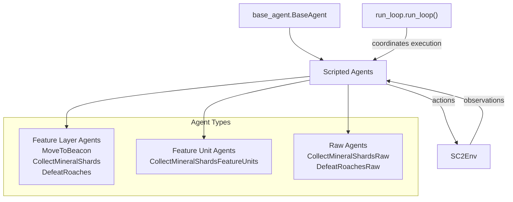
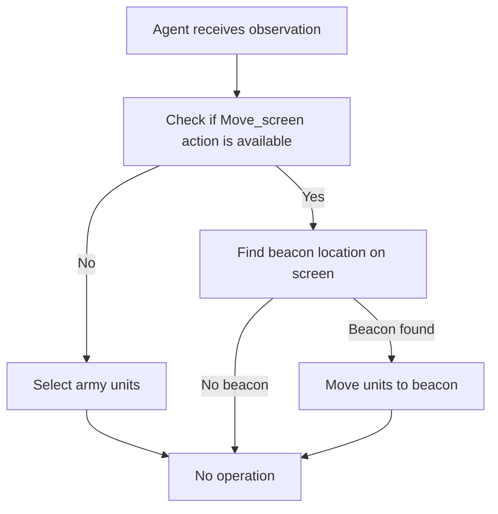
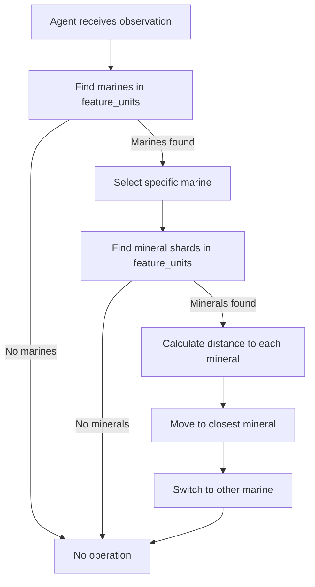
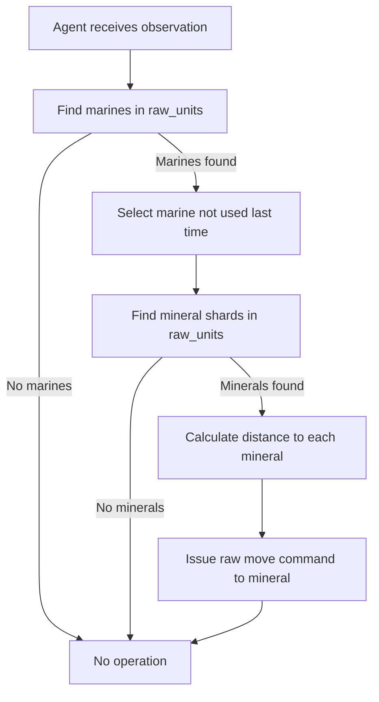
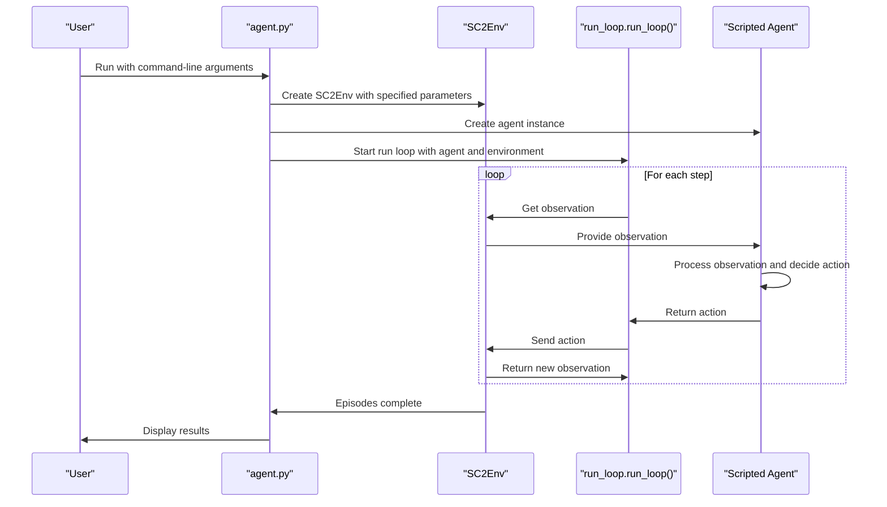
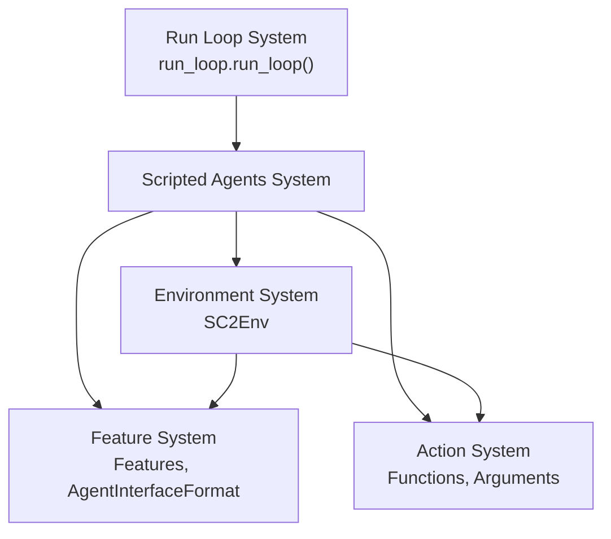

<!-- source: DeepWiki mcp.deepwiki.com · repo google-deepmind/pysc2 · page 9.2 Scripted Agents · fetched 2026-10-26 -->

# Scripted Agents

<details>
<summary>Relevant source files</summary>

The following files were used as context for generating this wiki page:

- [pysc2/agents/scripted_agent.py](pysc2/agents/scripted_agent.py)
- [pysc2/bin/agent.py](pysc2/bin/agent.py)
- [pysc2/bin/play.py](pysc2/bin/play.py)
- [pysc2/bin/valid_actions.py](pysc2/bin/valid_actions.py)
- [pysc2/lib/features_test.py](pysc2/lib/features_test.py)
- [pysc2/tests/easy_scripted_test.py](pysc2/tests/easy_scripted_test.py)

</details>


This documentation covers the scripted agents system in PySC2, which provides pre-programmed agents with hand-coded strategies for solving specific StarCraft II mini-games and test scenarios. These agents serve as examples, baselines, and testing mechanisms. For information about developing learning agents or training reinforcement learning models, see other sections of the documentation.

## 1. Overview

Scripted agents in PySC2 are deterministic agents with fixed, hand-crafted strategies that demonstrate how to interact with the StarCraft II environment. They inherit from the BaseAgent class and implement specific logic to solve particular mini-game scenarios. These agents showcase different approaches to observation processing and action selection, serving as useful examples and testing tools.



Sources: [pysc2/agents/scripted_agent.py:1-217](), [pysc2/env/run_loop.py]()

## 2. Available Scripted Agents

The following scripted agents are available in PySC2:

| Agent | Description | Observation Type | Maps |
|-------|-------------|------------------|------|
| MoveToBeacon | Selects army and moves to a beacon | Feature layers | MoveToBeacon |
| CollectMineralShards | Selects army and moves to nearest mineral shard | Feature layers | CollectMineralShards |
| CollectMineralShardsFeatureUnits | Controls two marines independently to collect minerals | Feature units | CollectMineralShards |
| CollectMineralShardsRaw | Controls two marines independently using raw actions | Raw units | CollectMineralShards |
| DefeatRoaches | Selects army and attacks enemy roaches | Feature layers | DefeatRoaches |
| DefeatRoachesRaw | Controls marines to attack roaches using raw actions | Raw units | DefeatRoaches |

Sources: [pysc2/agents/scripted_agent.py:36-217](), [pysc2/tests/easy_scripted_test.py:16-132]()

## 3. Agent Implementations

### 3.1 Feature Layer Agents

Feature layer agents operate on screen and minimap feature layers, which are grid-based representations of the game state. These agents use the `feature_screen` and `feature_minimap` observations to make decisions.

For example, the MoveToBeacon agent:



The implementation includes:
1. Checking available actions
2. Processing feature layers to find entities
3. Calculating target positions
4. Issuing commands to units

Sources: [pysc2/agents/scripted_agent.py:36-49](), [pysc2/agents/scripted_agent.py:175-194]()

### 3.2 Feature Unit Agents

Feature unit agents utilize the `feature_units` observation, which provides a structured list of visible units with attributes like position, health, and alliance. This allows for more precise unit control without relying on screen coordinates.

For example, the CollectMineralShardsFeatureUnits agent:



Sources: [pysc2/agents/scripted_agent.py:71-126]()

### 3.3 Raw Agents

Raw agents use the `raw_units` observation and raw actions, bypassing the feature layer representation entirely. This approach enables more direct control over units using their unit tags rather than screen positions.

For example, the CollectMineralShardsRaw agent:



Sources: [pysc2/agents/scripted_agent.py:128-172](), [pysc2/agents/scripted_agent.py:196-217]()

## 4. Running Scripted Agents

Scripted agents can be run using the `agent.py` script, which provides a command-line interface for setting up and executing agents.



Example command:

```
python -m pysc2.bin.agent --map MoveToBeacon --agent pysc2.agents.scripted_agent.MoveToBeacon
```

Sources: [pysc2/bin/agent.py:1-160](), [pysc2/env/run_loop.py]()

## 5. Testing with Scripted Agents

Scripted agents are used in the PySC2 testing framework to verify the functionality of the environment and ensure that agents can achieve expected outcomes in standardized scenarios.

The testing process:
1. Initialize the SC2 environment with a specific map
2. Create a scripted agent instance
3. Run the agent for a predefined number of steps
4. Verify that the agent achieves positive rewards and completes the expected number of steps

This approach provides regression testing for the PySC2 environment and ensures that the agent interfaces function correctly.

Sources: [pysc2/tests/easy_scripted_test.py:16-132]()

## 6. Creating Custom Scripted Agents

To create a custom scripted agent, extend the `base_agent.BaseAgent` class and implement the following methods:

1. `__init__`: Initialize agent-specific variables (optional)
2. `setup`: Configure agent with observation and action specifications (optional)
3. `reset`: Reset agent state at the beginning of an episode (optional)
4. `step`: Process observations and return actions (required)

```python
# Skeleton for a custom scripted agent
class MyCustomAgent(base_agent.BaseAgent):
    def setup(self, obs_spec, action_spec):
        super(MyCustomAgent, self).setup(obs_spec, action_spec)
        # Initialize agent-specific variables based on specs
        
    def reset(self):
        super(MyCustomAgent, self).reset()
        # Reset agent state variables
        
    def step(self, obs):
        super(MyCustomAgent, self).step(obs)
        # Process observations and decide on actions
        # Return a FunctionCall object
```

When implementing the `step` method, you'll typically:
1. Check available actions
2. Process observations to extract relevant information
3. Make a decision based on the current state
4. Return an action using the FUNCTIONS or RAW_FUNCTIONS constants

Sources: [pysc2/agents/scripted_agent.py:36-49](), [pysc2/agents/base_agent.py]()

## 7. Utility Functions for Scripted Agents

PySC2 provides several utility functions that are useful when implementing scripted agents:

| Function | Description | Example Usage |
|----------|-------------|---------------|
| `_xy_locs` | Extracts coordinates from a boolean mask | `_xy_locs(player_relative == _PLAYER_NEUTRAL)` |
| `numpy.mean` | Calculates the average position of units | `numpy.mean(marines, axis=0).round()` |
| `numpy.linalg.norm` | Calculates distances between points | `numpy.linalg.norm(numpy.array(minerals) - marine_xy, axis=1)` |
| `numpy.argmin` | Finds the index of the minimum value | `numpy.argmin(distances)` |

These utilities simplify common tasks like finding units on the screen, calculating positions, and determining the closest units.

Sources: [pysc2/agents/scripted_agent.py:30-34](), [pysc2/agents/scripted_agent.py:52-68]()

## 8. Limitations and Best Practices

When working with scripted agents, consider these limitations and best practices:

1. **Specificity**: Scripted agents are designed for specific maps and scenarios and may not generalize to other environments.

2. **Robustness**: Include error handling for edge cases, such as when no units are found.

3. **Observation Types**: Choose the appropriate observation type based on the task:
   - Feature layers for spatial reasoning and pattern recognition
   - Feature units for precise unit control
   - Raw units for direct unit management without screen positioning

4. **Action Availability**: Always check that an action is available before attempting to use it.

5. **Interface Format**: Ensure the agent's requirements match the environment configuration (e.g., feature units or raw units).

Sources: [pysc2/agents/scripted_agent.py:71-126](), [pysc2/agents/scripted_agent.py:128-172]()

## 9. Related Systems

The scripted agents system interacts with several other components in PySC2:



For more information about these related systems, see:
- Environment System [Environment System](#2)
- Feature System [Feature System](#3)
- Action System [Action System](#4)

Sources: [pysc2/agents/scripted_agent.py:1-217](), [pysc2/bin/agent.py:83-106]()