# Page: Overview

# Overview

<details>
<summary>Relevant source files</summary>

The following files were used as context for generating this wiki page:

- [pysc2/bin/update_battle_net_cache.py](pysc2/bin/update_battle_net_cache.py)
- [pysc2/env/sc2_env.py](pysc2/env/sc2_env.py)
- [pysc2/lib/features.py](pysc2/lib/features.py)
- [pysc2/lib/point_flag.py](pysc2/lib/point_flag.py)
- [pysc2/lib/replay.py](pysc2/lib/replay.py)
- [setup.py](setup.py)

</details>


PySC2 is DeepMind's Python component of the StarCraft II Learning Environment (SC2LE), providing an interface for reinforcement learning (RL) agents to interact with StarCraft II. It handles the communication with the StarCraft II API, transforms game observations into formats suitable for machine learning algorithms, and translates agent actions into game commands.

For installation and setup instructions, see [Installation and Setup](#1.1). For a more detailed explanation of the architecture, see [Architecture Overview](#1.2).

Sources: [setup.py:19-34]()

## System Purpose

PySC2 provides a standardized environment for reinforcement learning research using StarCraft II as a platform. It:

1. Abstracts away the complexity of communicating with the StarCraft II API
2. Provides observations in formats suitable for machine learning (feature layers, RGB pixels, raw unit data)
3. Defines an action space that allows agents to control units in the game
4. Supports both single-player and multi-player scenarios
5. Facilitates replay analysis and agent evaluation

As described in the setup file:
```
PySC2 is DeepMind's Python component of the StarCraft II Learning Environment
(SC2LE). It exposes Blizzard Entertainment's StarCraft II Machine Learning API
as a Python RL Environment. This is a collaboration between DeepMind and
Blizzard to develop StarCraft II into a rich environment for RL research. PySC2
provides an interface for RL agents to interact with StarCraft 2, getting
observations and sending actions.
```

Sources: [setup.py:19-34]()

## High-Level Architecture

### Core Components Diagram

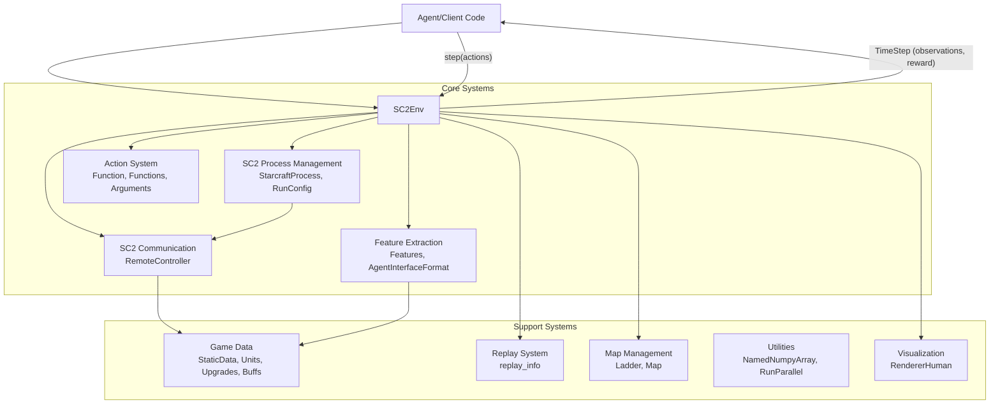

The central component is the Environment System (primarily the `SC2Env` class), which coordinates process management, communication, feature extraction, and action handling. Agent code interacts with the Environment to send actions and receive observations.

Sources: [pysc2/env/sc2_env.py:90-768]()

### Environment Interaction Flow

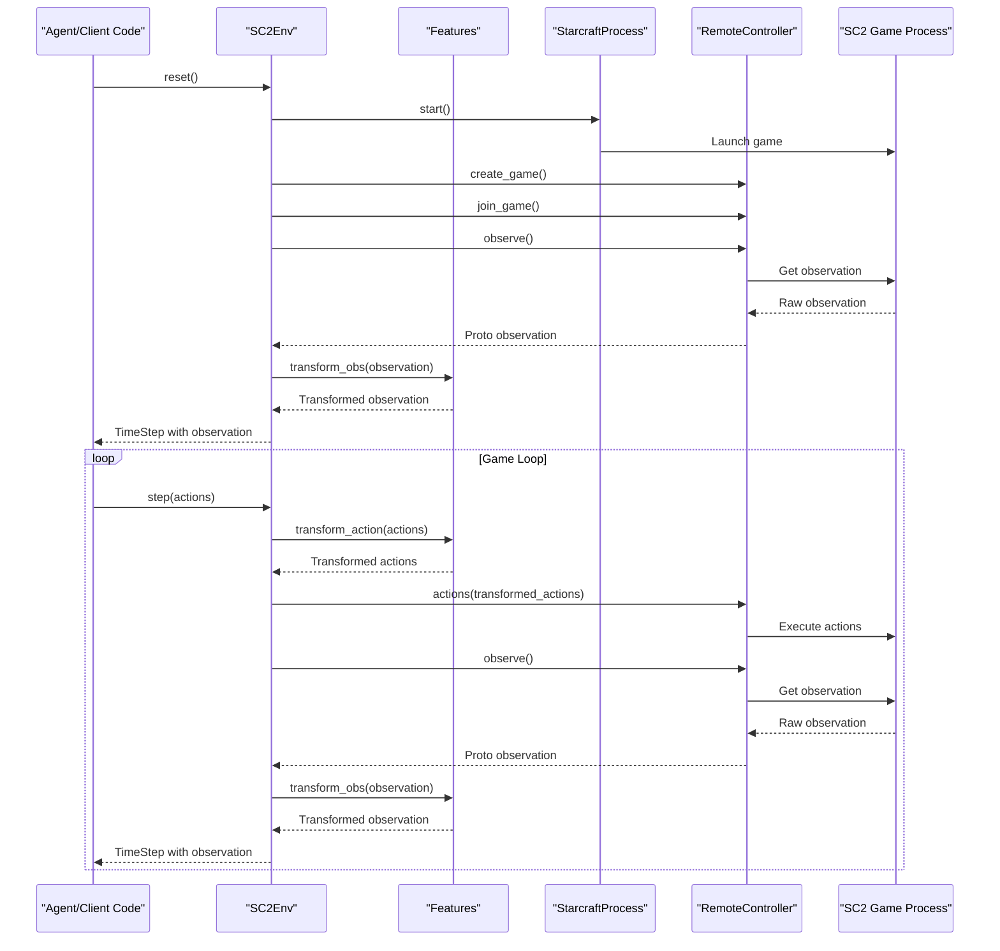

This diagram illustrates the interaction flow between an agent and the StarCraft II environment. The agent calls `reset()` to start a new episode and `step(actions)` to execute actions and receive observations.

Sources: 
- [pysc2/env/sc2_env.py:483-504]() - reset() method
- [pysc2/env/sc2_env.py:507-536]() - step() method
- [pysc2/env/sc2_env.py:615-626]() - _get_observations() method

## Environment System

The `SC2Env` class is the primary interface for agents, following the standard RL environment pattern with `reset()` and `step()` methods. The environment handles:

1. Setting up and managing StarCraft II game processes
2. Communicating with the game via the SC2 API
3. Transforming observations and actions
4. Managing game state and episode flow
5. Providing rewards based on game outcomes or score

### Key SC2Env Parameters

| Parameter | Description |
|-----------|-------------|
| map_name | Name of a SC2 map or Map instance |
| players | List of Agent and Bot instances specifying players |
| agent_interface_format | Specifies observation and action formats |
| step_mul | How many game steps per agent step |
| game_steps_per_episode | Maximum steps per episode (0 for no limit) |
| visualize | Whether to show game window |
| save_replay_episodes | Save a replay after this many episodes |
| score_index | Reward source (-1 for win/loss, ≥0 for score metrics) |

Sources: [pysc2/env/sc2_env.py:97-174]() - SC2Env.__init__ method

## Observation System

The observation system transforms game state into formats suitable for machine learning through the `Features` class and `AgentInterfaceFormat` configuration.

### Agent Interface Format

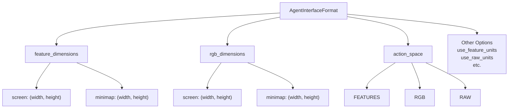

The `AgentInterfaceFormat` class configures how observations and actions are formatted, including:

- **Observation formats**: Feature layers, RGB pixels, raw unit data
- **Screen and minimap dimensions**: Size of spatial observations
- **Action space**: Which type of actions to use (feature-based, RGB-based, or raw)
- **Additional options**: Unit data, camera position, etc.

Sources: [pysc2/lib/features.py:465-729]() - AgentInterfaceFormat class

### Feature Layers

Feature layers provide spatial game information as 2D grids. Key layers include:

| Layer | Description |
|-------|-------------|
| height_map | Terrain height |
| visibility_map | Fog of war state |
| player_relative | Self, ally, neutral, enemy units |
| unit_type | Type IDs of units |
| unit_hit_points | Health of units |
| unit_density | Density of units |
| selected | Currently selected units |

Sources: [pysc2/lib/features.py:350-398]() - Screen and minimap feature definitions

## Action System

PySC2 structures actions as function calls with arguments, such as:
- `select_point` with arguments for screen coordinates and selection type
- `move_camera` with minimap coordinates
- `build_structure` with structure type and location

The action space is defined by:
1. **Functions**: What actions can be performed (select, move, build, etc.)
2. **Arguments**: Parameters for the functions (coordinates, unit types, etc.)
3. **Valid Actions**: What actions are available in the current game state

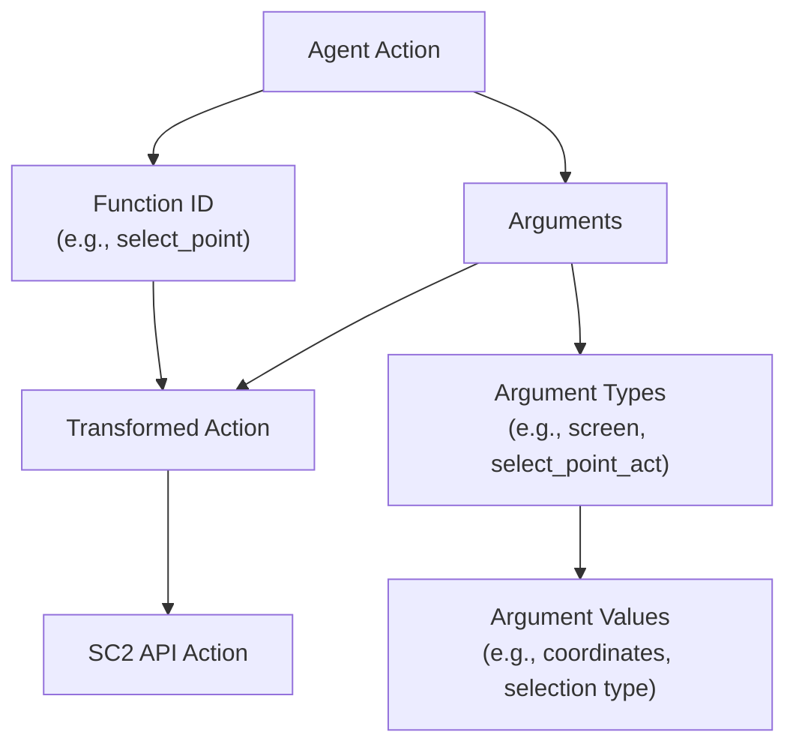

Sources: [pysc2/lib/features.py:884-917]() - Action system initialization

## Usage Example

A typical interaction with PySC2:

```python
from pysc2.env import sc2_env
from pysc2.lib import features, actions

# Create the environment
env = sc2_env.SC2Env(
    map_name="Simple64",
    players=[sc2_env.Agent(sc2_env.Race.terran),
             sc2_env.Bot(sc2_env.Race.random, sc2_env.Difficulty.medium)],
    agent_interface_format=features.AgentInterfaceFormat(
        feature_dimensions=features.Dimensions(
            screen=(84, 84),
            minimap=(64, 64)),
        use_feature_units=True),
    step_mul=8,
    visualize=True)

# Main loop
try:
    obs = env.reset()
    while True:
        # Agent selects action based on observation
        action = actions.FunctionCall(actions.FUNCTIONS.no_op.id, [])
        obs = env.step([action])
        if obs[0].last():  # Episode end
            obs = env.reset()
finally:
    env.close()
```

Sources: [pysc2/env/sc2_env.py:90-768](), [pysc2/lib/features.py:465-729]()

## Map and Replay Support

PySC2 includes systems for managing maps and replay files:

- **Map Management**: Locating, loading, and creating SC2 maps
- **Replay System**: Reading replay files for analysis or imitation learning
- **Battle.net Cache**: Utilities to download map data required for replays

Sources:
- [pysc2/lib/replay.py:17-34]() - Replay utilities
- [pysc2/bin/update_battle_net_cache.py:15-120]() - Battle.net cache updating

## Extension Points

PySC2 can be extended through:

1. **Custom Agents**: Implementing new AI algorithms
2. **Custom Maps**: Creating specialized scenarios
3. **Custom Features**: Defining new observation formats
4. **Custom Rewards**: Implementing domain-specific reward functions

For more detailed information on specific components, see the related wiki pages:
- [Environment System](#2) for details on SC2Env and environment variants
- [Feature System](#3) for observation specifications and transformations
- [Action System](#4) for action space details and transformations
- [Process Management](#5) for managing SC2 game processes

---

# Page: Installation and Setup

# Installation and Setup

<details>
<summary>Relevant source files</summary>

The following files were used as context for generating this wiki page:

- [pysc2/bin/BUILD](pysc2/bin/BUILD)
- [pysc2/bin/replay_version.py](pysc2/bin/replay_version.py)
- [pysc2/bin/update_battle_net_cache.py](pysc2/bin/update_battle_net_cache.py)
- [pysc2/lib/BUILD](pysc2/lib/BUILD)
- [pysc2/lib/point_flag.py](pysc2/lib/point_flag.py)
- [pysc2/lib/replay.py](pysc2/lib/replay.py)
- [setup.py](setup.py)

</details>


This document provides comprehensive instructions for installing PySC2 (Python StarCraft II Learning Environment) and setting up the required components for using it. It covers installation prerequisites, package installation, downloading StarCraft II, configuring the environment, and verifying the setup.

For an overview of the PySC2 architecture and capabilities, see [Overview](#1).

## Prerequisites

Before installing PySC2, ensure your system meets the following requirements:

| Requirement | Details |
|-------------|---------|
| **Python Version** | PySC2 supports Python 3.8, 3.9, 3.10, and 3.11 |
| **Operating System** | Linux, Windows, or macOS |
| **StarCraft II** | A compatible version must be installed (see below) |
| **Disk Space** | ~30GB for StarCraft II game installation |

Sources: [setup.py:98-101]()

## Installing PySC2

PySC2 can be installed via pip, directly from PyPI or from the source code.

### Installation from PyPI

The simplest way to install PySC2 is using pip:

```bash
pip install pysc2
```

This command installs the latest version of PySC2 (version 4.0.0 as of this documentation) along with all required dependencies.

### Installation from Source

To install from source code:

```bash
git clone https://github.com/google-deepmind/pysc2.git
cd pysc2
pip install -e .
```

Sources: [setup.py:45-104]()

## Dependencies

PySC2 requires the following Python dependencies, which are automatically installed with pip:

| Dependency | Purpose |
|------------|---------|
| `absl-py` | Google's Abseil Python Common Libraries |
| `deepdiff` | Deep difference calculation for Python data structures |
| `dm_env` | DeepMind environment interface |
| `mpyq` | MPQ archive file reader |
| `numpy` | Numerical computing library |
| `portpicker` | Tool for finding available network ports |
| `protobuf` | Protocol buffers for serializing data |
| `pygame` | Game development library (used for visualization) |
| `s2clientprotocol` | StarCraft II client protocol definitions |
| `s2protocol` | StarCraft II replay protocol parser |
| `sk-video` | Video processing utilities |
| `websocket-client` | WebSocket client library |

Sources: [setup.py:66-82]()

## Installing StarCraft II

PySC2 requires a StarCraft II installation to function. 

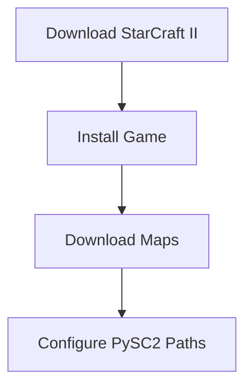

### Windows and macOS

1. Download and install StarCraft II from the [Blizzard website](https://starcraft2.com)
2. PySC2 should automatically find your StarCraft II installation in the standard location

### Linux

Linux requires a slightly different approach since StarCraft II doesn't natively provide Linux packages:

1. Download the Linux package from Blizzard:
   ```
   wget http://blzdistsc2-a.akamaihd.net/Linux/SC2.4.10.zip
   ```
2. Extract the package:
   ```
   unzip -P iagreetotheeula SC2.4.10.zip
   ```
3. Move the package to your preferred installation location

## Downloading Maps

StarCraft II maps used for machine learning research need to be downloaded separately:

```bash
# Example command to download maps
python -m pysc2.bin.download_maps
```

## Configuration

PySC2 uses a run configuration system to locate and manage the StarCraft II installation. The configuration automatically searches for the game in standard installation paths.

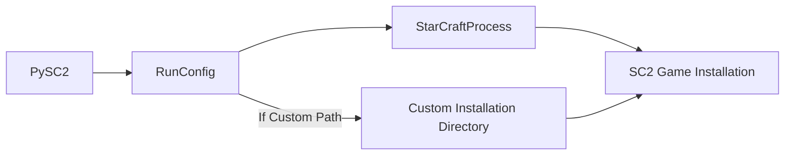

### Custom Game Location

If StarCraft II is installed in a non-standard location, you can specify it when initializing the run configuration:

```python
from pysc2 import run_configs
run_config = run_configs.get(game_version=None, base_build=None, data_dir="path/to/SC2")
```

Sources: [pysc2/bin/update_battle_net_cache.py:108-116]()

## Replay Support

To enable support for StarCraft II replays, you may need to update the Battle.net cache:

```bash
python -m pysc2.bin.update_battle_net_cache [path_to_replays]
```

This command downloads necessary cache files from Battle.net servers required to properly parse and play back replays.

Sources: [pysc2/bin/update_battle_net_cache.py:63-105](), [pysc2/lib/replay.py:16-34](), [pysc2/bin/replay_version.py:15-66]()

## Command-Line Tools

PySC2 comes with several command-line tools to help you work with the environment:

| Tool | Purpose |
|------|---------|
| `pysc2_agent` | Run agent-based experiments |
| `pysc2_play` | Play StarCraft II with PySC2 features |
| `pysc2_replay_info` | Display information about replay files |

Sources: [setup.py:83-89]()

## Verification

To verify your installation, run one of the example scripts:

```bash
python -m pysc2.bin.agent
```

This should launch StarCraft II and run a simple agent in the game environment. If the game launches and the agent works, your installation is correct.

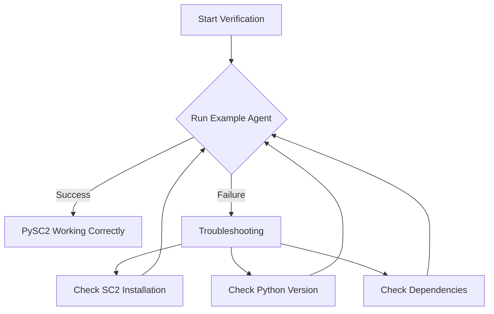

## Environment Setup Process

The following diagram illustrates the overall environment setup process:

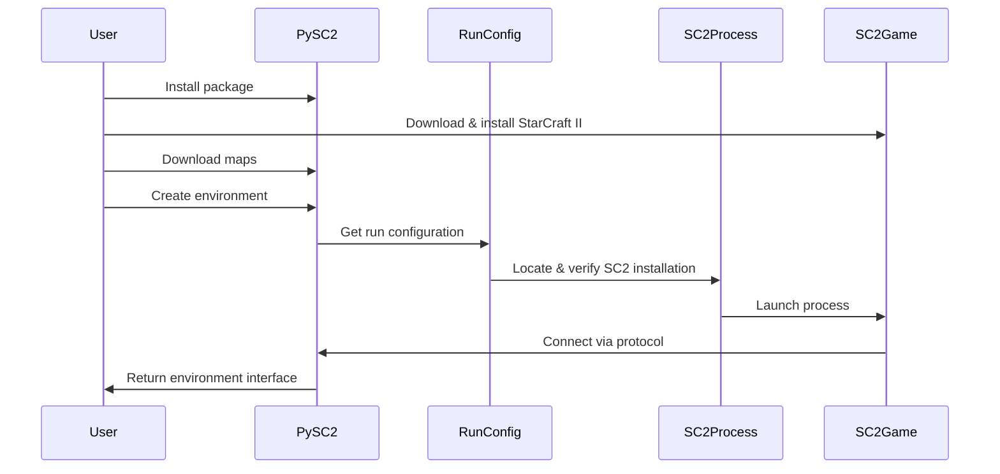

Sources: [pysc2/bin/BUILD:147-164](), [pysc2/lib/BUILD:300-311]()

This completes the installation and setup process for PySC2. After following these steps, you should have a working environment ready for running StarCraft II agents and experiments.

---

# Page: Architecture Overview

# Architecture Overview

<details>
<summary>Relevant source files</summary>

The following files were used as context for generating this wiki page:

- [pysc2/bin/reencode_replays.py](pysc2/bin/reencode_replays.py)
- [pysc2/env/sc2_env.py](pysc2/env/sc2_env.py)
- [pysc2/lib/features.py](pysc2/lib/features.py)
- [pysc2/lib/protocol.py](pysc2/lib/protocol.py)
- [pysc2/lib/remote_controller.py](pysc2/lib/remote_controller.py)
- [pysc2/lib/sc_process.py](pysc2/lib/sc_process.py)
- [pysc2/run_configs/__init__.py](pysc2/run_configs/__init__.py)
- [pysc2/run_configs/platforms.py](pysc2/run_configs/platforms.py)
- [pysc2/tests/protocol_error_test.py](pysc2/tests/protocol_error_test.py)

</details>


## Purpose and Scope

This document describes the high-level architecture of the PySC2 library, outlining the key components and their relationships. PySC2 provides a Python interface for interacting with StarCraft II, enabling reinforcement learning agents to play the game. This overview covers the major systems, their organization, and data flow patterns within the codebase. For detailed API documentation, see [Environment System](#2).

## High-Level Architecture

PySC2 follows a layered architecture that abstracts the complexity of communicating with the StarCraft II game process. The system is organized into core components that handle primary functionality and support systems that provide auxiliary capabilities.

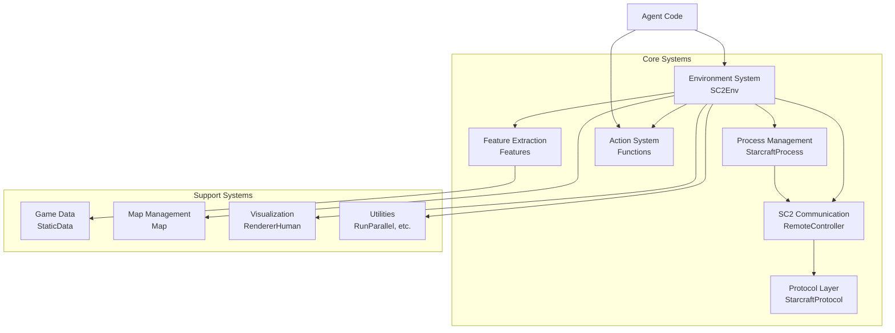

Sources: [pysc2/env/sc2_env.py:90-764](), [pysc2/lib/features.py:920-1201](), [pysc2/lib/sc_process.py:48-218]()

## Key Components

### 1. Environment System (SC2Env)

The `SC2Env` class is the central component acting as the primary interface between agent code and StarCraft II. It's an implementation of a Gym-like environment that manages game instances, handles observations and actions, and coordinates between different subsystems.

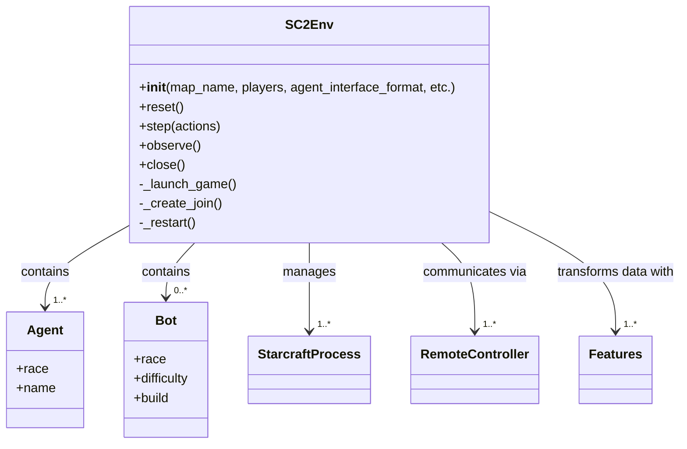

Sources: [pysc2/env/sc2_env.py:90-218](), [pysc2/env/sc2_env.py:383-446]()

### 2. Process Management

The `StarcraftProcess` class manages launching, monitoring, and terminating StarCraft II game processes. The `RunConfig` hierarchy handles platform-specific aspects of finding and launching the SC2 binary.

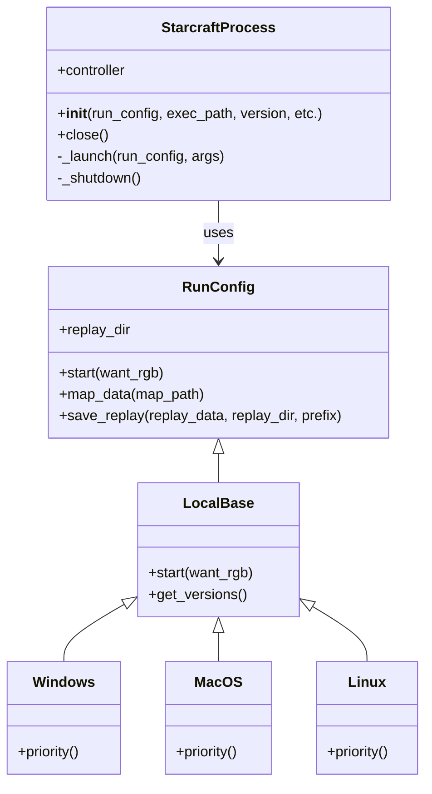

Sources: [pysc2/lib/sc_process.py:48-218](), [pysc2/run_configs/platforms.py:50-201]()

### 3. Communication System

The communication system handles the exchange of messages between Python and the StarCraft II process. It consists of the `RemoteController` class, which provides a high-level API for game control, and the `StarcraftProtocol` class, which manages the WebSocket connection and protocol details.

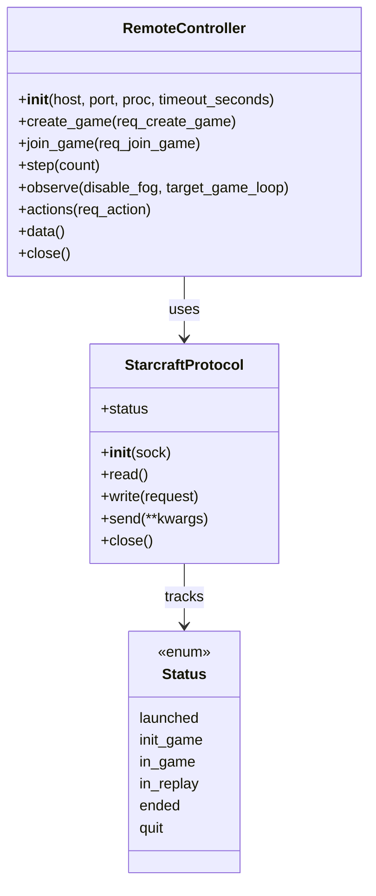

Sources: [pysc2/lib/remote_controller.py:128-382](), [pysc2/lib/protocol.py:72-192]()

### 4. Feature System

The feature system transforms raw SC2 observations into formats suitable for agent consumption. It defines how to render feature layers and provides specifications for observations and actions.

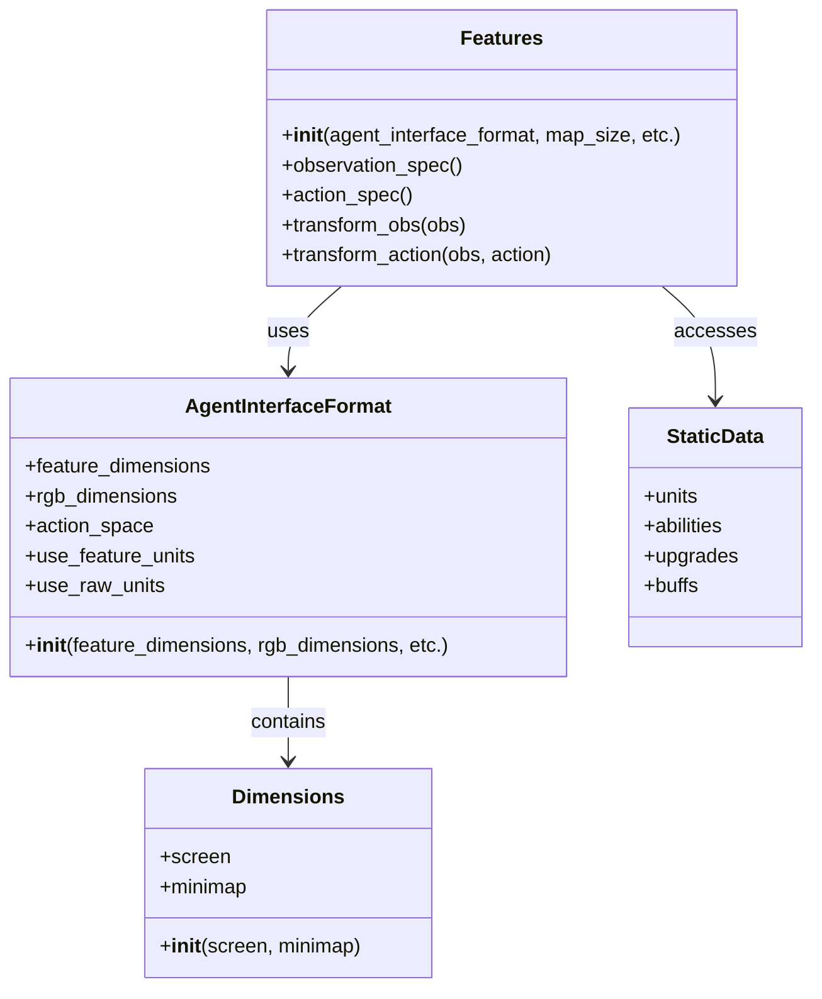

Sources: [pysc2/lib/features.py:426-788](), [pysc2/lib/features.py:920-1201]()

## Data Flow

The diagram below illustrates how data flows through the PySC2 system during a typical interaction cycle:

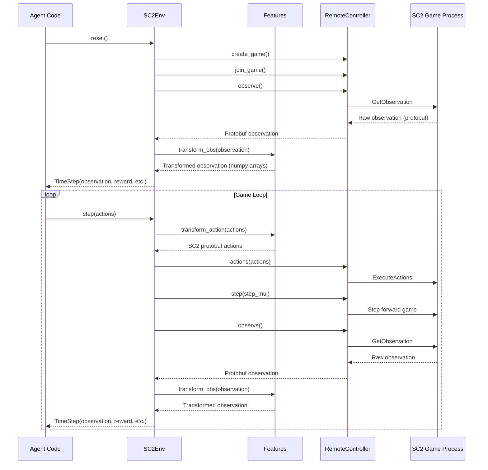

Sources: [pysc2/env/sc2_env.py:483-721](), [pysc2/lib/remote_controller.py:242-273]()

## Implementation Details

### SC2Env Initialization and Game Creation

The environment setup process involves initializing the SC2 processes, creating a game, and joining it:

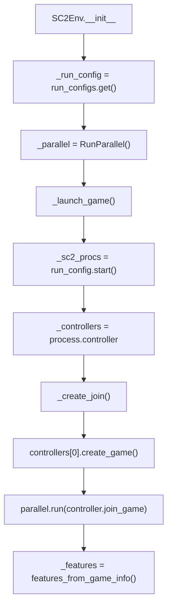

Sources: [pysc2/env/sc2_env.py:97-266](), [pysc2/env/sc2_env.py:328-365]()

### Observation and Action Processing

A key functionality is transforming between agent-friendly formats and SC2's internal representations:

1. **Actions**: Agent actions are transformed into SC2 protocol buffer format
2. **Observations**: SC2 observations are transformed into numpy arrays with named fields

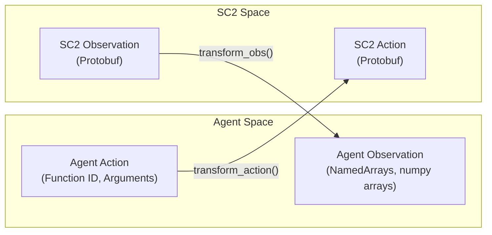

Sources: [pysc2/lib/features.py:1229-1305](), [pysc2/lib/features.py:1306-1479]()

## Platform Support

PySC2 supports multiple platforms through platform-specific `RunConfig` implementations that handle finding and launching the SC2 binary.

| Platform | Class | Description |
|----------|-------|-------------|
| Windows | `Windows` | Handles Windows-specific paths and executable naming |
| MacOS | `MacOS` | Handles MacOS-specific paths and app bundle structure |
| Linux | `Linux` | Handles Linux-specific library dependencies and rendering options |
| Cygwin | `Cygwin` | Special handling for running Windows binaries under Cygwin |

Sources: [pysc2/run_configs/platforms.py:109-201]()

## Error Handling

PySC2 implements several error handling mechanisms to deal with communication issues, protocol errors, and game state changes:

1. `ConnectionError`: When there are issues with the WebSocket connection
2. `ProtocolError`: When SC2 responds with an error due to an invalid request
3. `RequestError`: When a specific request fails with an error code

The system includes decorators like `catch_game_end`, `valid_status`, and `skip_status` to handle specific error conditions gracefully.

Sources: [pysc2/lib/remote_controller.py:44-52](), [pysc2/lib/protocol.py:48-55](), [pysc2/lib/remote_controller.py:75-125]()

---

# Page: Environment System

# Environment System

<details>
<summary>Relevant source files</summary>

The following files were used as context for generating this wiki page:

- [pysc2/bin/agent_remote.py](pysc2/bin/agent_remote.py)
- [pysc2/bin/play_vs_agent.py](pysc2/bin/play_vs_agent.py)
- [pysc2/env/lan_sc2_env.py](pysc2/env/lan_sc2_env.py)
- [pysc2/env/remote_sc2_env.py](pysc2/env/remote_sc2_env.py)
- [pysc2/env/sc2_env.py](pysc2/env/sc2_env.py)
- [pysc2/lib/features.py](pysc2/lib/features.py)

</details>


The Environment System is the core interface between agents and StarCraft II in PySC2. It provides a standardized way to setup, connect to, and interact with StarCraft II game instances. The environment handles game initialization, observation processing, action execution, and game state management. For information about specific feature extraction and observation formats, see [Feature System](#3).

## Overview

The Environment System establishes communication with StarCraft II, manages the game lifecycle, and provides a reinforcement learning-compatible interface for agents. It supports multiple usage modes including single-player against built-in AI, multiplayer over LAN, and connecting to remote StarCraft II instances.

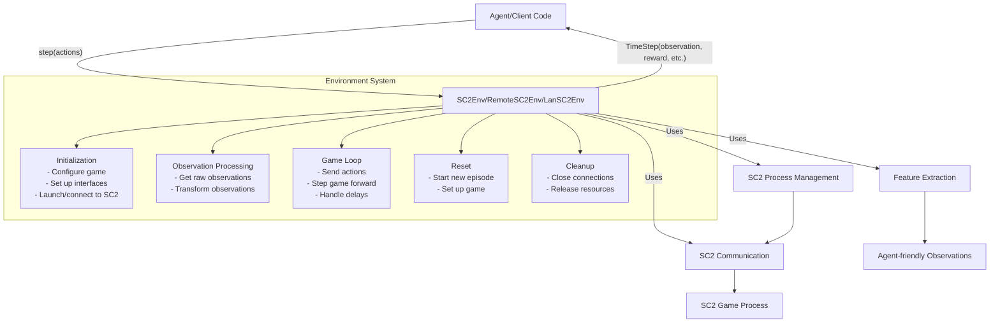

Sources: [pysc2/env/sc2_env.py:90-766]()

## Core Environment Classes

The Environment System is composed of three main environment classes, each designed for different use cases.

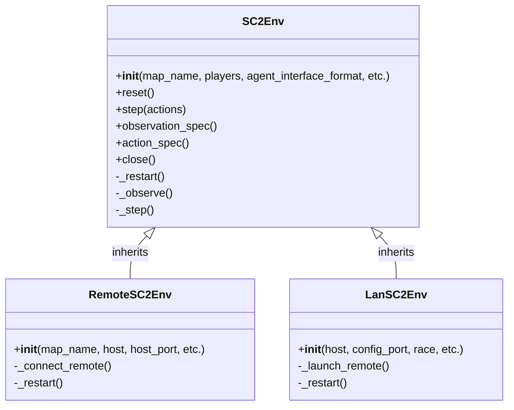

Sources: [pysc2/env/sc2_env.py:90-766](), [pysc2/env/remote_sc2_env.py:33-214](), [pysc2/env/lan_sc2_env.py:199-363]()

### SC2Env

`SC2Env` is the primary environment class that launches and controls StarCraft II instances directly. It's typically used for single-player agent training against built-in AI or for local multi-agent scenarios.

Key features:
- Launches StarCraft II processes
- Creates and joins games based on configuration
- Processes observations and actions
- Controls game stepping
- Handles episode resets and process cleanup

```python
# Example usage
env = SC2Env(
    map_name="Simple64",
    players=[Agent(Race.terran), Bot(Race.protoss, Difficulty.medium)],
    agent_interface_format=AgentInterfaceFormat(
        feature_dimensions=Dimensions(screen=84, minimap=64)
    ),
    step_mul=8
)
```

Sources: [pysc2/env/sc2_env.py:90-766]()

### RemoteSC2Env

`RemoteSC2Env` connects to an already-running StarCraft II instance rather than launching a new one. This is useful for connecting to games started by other systems, such as remote servers or the SC2AI ladder.

Key differences from `SC2Env`:
- Doesn't launch StarCraft II processes
- Connects to a remote host via WebSocket
- Used primarily for competitions and ladder play

Sources: [pysc2/env/remote_sc2_env.py:33-214]()

### LanSC2Env

`LanSC2Env` is designed for LAN games, typically for human vs. agent matches. It connects to a game that has been set up by another script and handles port forwarding and networking.

Key differences from `SC2Env`:
- Optimized for human vs. agent play
- Handles TCP/UDP communication for LAN games
- Used in conjunction with scripts like `play_vs_agent.py`

Sources: [pysc2/env/lan_sc2_env.py:199-363](), [pysc2/bin/play_vs_agent.py:107-282]()

## Environment Workflow

The environment follows a specific workflow from initialization to termination, providing a standard reinforcement learning interface.

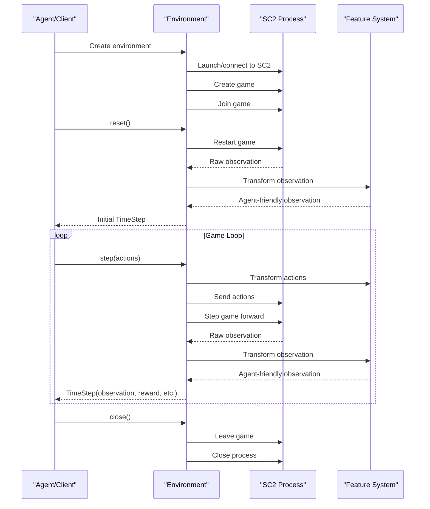

Sources: [pysc2/env/sc2_env.py:483-521](), [pysc2/env/sc2_env.py:506-552](), [pysc2/env/sc2_env.py:739-766]()

### Initialization

Environment initialization involves several key steps:

1. Validating configuration parameters
2. Setting up interface formats for communication with SC2
3. Launching SC2 processes or connecting to existing ones
4. Creating and joining a game

The most important configuration parameters include:
- `map_name`: The SC2 map to play on
- `players`: List of players (agents and/or bots)
- `agent_interface_format`: Defines observation and action formats
- `step_mul`: Number of game steps per agent step

Sources: [pysc2/env/sc2_env.py:97-285]()

### Observation and Reward Processing

Observations in the environment system follow this flow:

1. Raw observations are received from SC2
2. Observations are transformed using the Feature System
3. Rewards are calculated based on game state or score
4. A `TimeStep` is created with the observation, reward, and other information

The following table outlines key components of the observation:

| Component | Description | Source |
|-----------|-------------|--------|
| Feature Layers | 2D grids representing game state | Feature System |
| RGB Frames | Visual representation of the game | Feature System |
| Game Data | Score, resources, unit counts, etc. | Raw SC2 Observation |
| Game Loop | Current game simulation step | Raw SC2 Observation |
| Player Data | Resources, supply, etc. | Raw SC2 Observation |
| Unit Data | Unit types, positions, health, etc. | Raw SC2 Observation |

Sources: [pysc2/env/sc2_env.py:615-637](), [pysc2/env/sc2_env.py:657-720]()

### Action Processing

Actions flow from the agent to StarCraft II as follows:

1. Agent provides actions in the agent-friendly format
2. Environment transforms actions to SC2 protocol format
3. Actions are sent to SC2 for execution
4. Delayed actions are handled if configured

The environment can also handle delayed actions, which are useful for simulating realistic human reaction times:

```python
# Example of configuring delayed actions
agent_interface_format = AgentInterfaceFormat(
    feature_dimensions=Dimensions(screen=84, minimap=64),
    action_delay_fn=lambda: random.randint(1, 3)  # Random delay of 1-3 steps
)
```

Sources: [pysc2/env/sc2_env.py:506-552](), [pysc2/env/sc2_env.py:554-605]()

### Reset and Termination

The environment provides methods to reset (start a new episode) and close (clean up resources):

- `reset()`: Starts a new episode, restarts the game if needed
- `close()`: Cleans up resources, closes connections, and terminates processes

Sources: [pysc2/env/sc2_env.py:483-521](), [pysc2/env/sc2_env.py:739-766]()

## Interface Formats

The Environment System uses `AgentInterfaceFormat` to define how observations and actions are structured. This configuration determines what data is available to agents and how they can interact with the game.

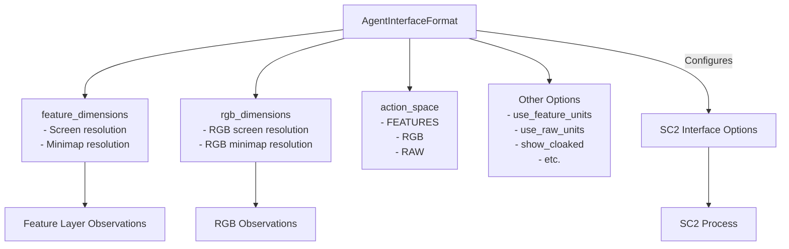

The main components of `AgentInterfaceFormat` include:

- `feature_dimensions`: Resolution for feature layers
- `rgb_dimensions`: Resolution for RGB rendering
- `action_space`: Which action space to use (FEATURES, RGB, or RAW)
- Various flags for enabling additional observation data

Sources: [pysc2/lib/features.py:465-629](), [pysc2/env/sc2_env.py:52-56]()

## Integration with Other PySC2 Systems

The Environment System integrates with several other PySC2 components to provide a complete interface to StarCraft II.

```mermaid
flowchart LR
    Env["Environment System"] --> |"Uses"| PM["Process Management\nLaunches and controls SC2"]
    Env --> |"Uses"| Comm["SC2 Communication\nSends/receives protocol messages"]
    Env --> |"Uses"| Feat["Feature System\nTransforms observations and actions"]
    Env --> |"Uses"| Act["Action System\nDefines available actions"]
    
    PM --> SC2["SC2 Process"]
    Comm --> SC2
    
    Agent["Agent/Client Code"] --> Env
    Agent --> |"Uses"| Act
    
    Feat --> |"Provides"| ObsSpec["Observation Spec"]
    Act --> |"Provides"| ActSpec["Action Spec"]
    
    ObsSpec --> Agent
    ActSpec --> Agent
```

Key integration points:

1. **Process Management**: The environment uses the Run Config system to launch and manage SC2 processes
2. **Communication**: Uses SC2 protocol (protobuf) to communicate with the game
3. **Feature System**: Transforms raw SC2 observations into agent-friendly formats
4. **Action System**: Defines available actions and transforms agent actions to SC2 protocol format

Sources: [pysc2/env/sc2_env.py:235-236](), [pysc2/env/sc2_env.py:427-429]()

## Usage Examples

Here are some common usage patterns for the Environment System:

### Basic Single-Player Environment

```python
from pysc2.env import sc2_env
from pysc2.lib import actions, features

env = sc2_env.SC2Env(
    map_name="Simple64",
    players=[sc2_env.Agent(sc2_env.Race.terran),
             sc2_env.Bot(sc2_env.Race.random, sc2_env.Difficulty.medium)],
    agent_interface_format=features.AgentInterfaceFormat(
        feature_dimensions=features.Dimensions(screen=84, minimap=64),
        use_feature_units=True),
    step_mul=8,
    game_steps_per_episode=0,
    visualize=True)

observation = env.reset()
for _ in range(1000):
    action = # agent selects action
    observation = env.step(action)
env.close()
```

### Remote Environment for Competition

```python
from pysc2.env import remote_sc2_env
from pysc2.lib import features

env = remote_sc2_env.RemoteSC2Env(
    host="competition-server.example",
    host_port=4567,
    lan_port=5678,
    race=sc2_env.Race.terran,
    agent_interface_format=features.AgentInterfaceFormat(
        feature_dimensions=features.Dimensions(screen=84, minimap=64)))
```

Sources: [pysc2/env/sc2_env.py:90-766](), [pysc2/env/remote_sc2_env.py:33-214]()

---

# Page: SC2Env

# SC2Env

<details>
<summary>Relevant source files</summary>

The following files were used as context for generating this wiki page:

- [pysc2/env/sc2_env.py](pysc2/env/sc2_env.py)
- [pysc2/lib/features.py](pysc2/lib/features.py)

</details>


SC2Env is the primary environment class for interacting with StarCraft II in the PySC2 library. It provides a reinforcement learning-friendly interface that handles game execution, action processing, and observation transformation.

For information about remote environments for networked play, see [Remote and LAN Environments](#2.2).

## Overview

SC2Env serves as the main point of interaction between agent code and the StarCraft II game. It manages game processes, transforms observations between SC2's protocol format and agent-friendly data structures, and handles action execution.

```mermaid
graph TD
    A["Agent/Client Code"] --> |"step(actions)"| B["SC2Env"]
    B --> |"Launch/Control"| C["StarCraft II Process"]
    B --> |"Communicate"| D["SC2 Protocol"]
    B --> |"Transform Observation"| E["Features"]
    C --> |"Raw Observation"| D
    D --> |"Protocol Observation"| B
    B --> |"Transformed Observation"| A
    
    subgraph "Key Components"
        B
        E
    end
```

Sources: [pysc2/env/sc2_env.py:90-92](). [pysc2/env/sc2_env.py:486-562]()

## Initialization and Configuration

SC2Env is initialized with a variety of parameters that configure the game environment, from map selection to interface format and scoring mechanisms.

### Key Parameters

| Parameter | Description | Default |
|-----------|-------------|---------|
| `map_name` | Name of SC2 map or Map instance | Required |
| `players` | List of Agent and Bot instances | Required |
| `agent_interface_format` | How observations/actions are formatted | Required |
| `step_mul` | Game steps per agent step | Map default |
| `realtime` | Use realtime mode instead of step-based | False |
| `game_steps_per_episode` | Steps before episode ends | Map default |
| `disable_fog` | Whether to disable fog of war | False |
| `visualize` | Show human visualization | False |
| `save_replay_episodes` | Save replay after n episodes | 0 |

### Initialization Flow

```mermaid
sequenceDiagram
    participant Client as "Client Code"
    participant SC2Env as "SC2Env"
    participant RunConfig as "run_configs"
    participant Proc as "SC2Process"
    participant Features as "Features"
    
    Client->>SC2Env: "Create(map_name, players, agent_interface_format, ...)"
    SC2Env->>RunConfig: "get(version)"
    RunConfig-->>SC2Env: "RunConfig instance"
    SC2Env->>Proc: "start() for each player"
    Proc-->>SC2Env: "SC2Process with controller"
    SC2Env->>SC2Env: "_create_join()"
    SC2Env->>Features: "features_from_game_info()"
    Features-->>SC2Env: "Features instance"
    SC2Env-->>Client: "SC2Env instance"
```

Sources: [pysc2/env/sc2_env.py:97-175](). [pysc2/env/sc2_env.py:261-264](). [pysc2/env/sc2_env.py:328-429]()

## Core API Methods

SC2Env implements the core environment API methods that agents interact with:

### reset()

Resets the environment to start a new episode. Returns the initial observation.

```mermaid
graph TD
    R["reset()"] --> EP["Increment episode count"]
    EP --> RS["_restart() if needed"]
    RS --> OBS["_observe(target_game_loop=0)"]
    OBS --> RET["Return TimeStep with observation"]
```

Sources: [pysc2/env/sc2_env.py:483-504]() 

### step(actions, step_mul=None)

Applies actions to the environment, advances the game state, and returns observations.

```mermaid
graph TD
    S["step(actions, step_mul)"] --> TR["Transform actions"]
    TR --> AP["Apply action delays (if not realtime)"]
    AP --> EX["Execute actions"]
    EX --> ST["_step(step_mul)"]
    ST --> ADV["Advance to target_game_loop"]
    ADV --> OBS["_observe(target_game_loop)"]
    OBS --> RET["Return TimeStep with observation"]
```

Sources: [pysc2/env/sc2_env.py:506-535](). [pysc2/env/sc2_env.py:537-552]()

### observation_spec() and action_spec()

Return specifications of the observation and action spaces:

- `observation_spec()`: Returns the structure of observations
- `action_spec()`: Returns the valid action space

Sources: [pysc2/env/sc2_env.py:449-455]()

### close()

Cleans up all resources, including SC2 processes and network connections.

Sources: [pysc2/env/sc2_env.py:739-766]()

## Game Flow and State Transitions

SC2Env manages the game state through a series of steps and observations:

```mermaid
stateDiagram-v2
    [*] --> FIRST: reset()
    FIRST --> MID: step()
    MID --> MID: step() (normal gameplay)
    MID --> LAST: episode end condition
    LAST --> FIRST: reset() or next step()
    LAST --> [*]: close()
    
    note right of FIRST: Initial observation
    note right of MID: Game in progress
    note right of LAST: Terminal state
```

Sources: [pysc2/env/sc2_env.py:483-504](). [pysc2/env/sc2_env.py:506-535](). [pysc2/env/sc2_env.py:657-721]()

## Observation and Action Processing

SC2Env converts between SC2's protocol format and agent-friendly formats using the `Features` class.

### Observation Flow

```mermaid
graph TD
    GO["Game observation (protobuf)"] --> FT["Features.transform_obs()"]
    FT --> FE["Extract feature layers"]
    FE --> BF["Build feature arrays"]
    BF --> NS["Named arrays with semantic labels"]
    NS --> TO["TimeStep with agent observation"]
```

Sources: [pysc2/env/sc2_env.py:615-626](). [pysc2/lib/features.py:1126-1541]()

### Action Flow

```mermaid
graph TD
    AA["Agent action"] --> FT["Features.transform_action()"]
    FT --> VA["Validate action"]
    VA --> CV["Convert to SC2 protocol format"]
    CV --> SA["SC2 action (protobuf)"]
```

Sources: [pysc2/env/sc2_env.py:524-526](). [pysc2/lib/features.py:1574-1676]()

## Real-time vs Step-Based Execution

SC2Env supports two execution modes:

1. **Step-based execution** (default): The environment advances by a fixed number of game steps with each call to `step()`
2. **Real-time execution**: The game simulation advances automatically at real-time speed, with `step()` capturing the current state

In real-time mode, SC2Env provides additional tracking of action delays to help understand how the simulation's timing affects agent performance.

```mermaid
graph TD
    subgraph "Step-Based Mode"
        S1["step(actions)"] --> E1["Execute actions"]
        E1 --> W1["Wait for game steps × step_mul"]
        W1 --> O1["Get observation"]
        O1 --> R1["Return to agent"]
    end
    
    subgraph "Real-time Mode"
        S2["step(actions)"] --> E2["Execute actions"]
        E2 --> O2["Get observation at current time"]
        O2 --> T2["Track action delays"]
        T2 --> R2["Return to agent"]
    end
```

Sources: [pysc2/env/sc2_env.py:152-158](). [pysc2/env/sc2_env.py:537-552](). [pysc2/env/sc2_env.py:638-655]()

## Feature Layers and Interfaces

SC2Env uses the `AgentInterfaceFormat` class to configure how the game state is represented to the agent. This includes:

1. Feature layer representations (spatial grid observations)
2. RGB representations (screen and minimap images)
3. Raw unit data
4. Entity-based observations (feature units)

```mermaid
graph TD
    SC["SC2Env"] --> AIF["AgentInterfaceFormat"]
    AIF --> FL["Feature Layers"]
    AIF --> RGB["RGB Observations"]
    AIF --> RU["Raw Unit Data"]
    AIF --> FU["Feature Units"]
    
    FL --> FD["Feature Dimensions"]
    RGB --> RD["RGB Dimensions"]
    RU --> RW["Raw World Resolution"]
    
    SC --> F["Features System"]
    F --> TO["Transform Observations"]
    F --> TA["Transform Actions"]
```

Sources: [pysc2/env/sc2_env.py:247-259](). [pysc2/lib/features.py:465-628]()

## Internal Components

SC2Env orchestrates several internal components to provide its functionality:

```mermaid
graph TD
    SC["SC2Env"] --> RC["RunConfig"]
    SC --> P["SC2Process (per player)"]
    SC --> C["Controllers (per player)"]
    SC --> F["Features (per player)"]
    SC --> PL["Parallel Runner"]
    SC --> R["Renderer (optional)"]
    
    P --> C
    C --> PBUF["SC2 Protocol Messages"]
    F --> OBST["Observation Transformations"]
    F --> ACTT["Action Transformations"]
    
    subgraph "Game Communication"
        C
        PBUF
    end
    
    subgraph "Feature Processing"
        F
        OBST
        ACTT
    end
```

Sources: [pysc2/env/sc2_env.py:235-262](). [pysc2/env/sc2_env.py:419-429]()

## Multiplayer Support

SC2Env supports both single-player and multi-player configurations:

```mermaid
graph TD
    SC["SC2Env"] --> SP["Single Player Mode"]
    SC --> MP["Multiplayer Mode"]
    
    SP --> OA["One Agent"]
    SP --> OC["One SC2 Process"]
    
    MP --> MA["Multiple Agents"]
    MP --> MC["Multiple SC2 Processes"]
    MP --> PP["Port Management"]
    
    PP --> JOIN["_create_join() Configuration"]
```

Sources: [pysc2/env/sc2_env.py:181-195](). [pysc2/env/sc2_env.py:328-417]()

## Usage Example

While this page doesn't provide example code, here's the typical usage pattern for SC2Env:

1. Create an `AgentInterfaceFormat` object defining observation and action formats
2. Initialize SC2Env with map, players, and interface format
3. Implement an agent loop that calls `reset()` and `step(actions)`
4. Call `close()` when finished

For detailed usage examples, see the scripts in the PySC2 repository.

Sources: [pysc2/env/sc2_env.py:97-175]()

---

# Page: Remote and LAN Environments

# Remote and LAN Environments

<details>
<summary>Relevant source files</summary>

The following files were used as context for generating this wiki page:

- [pysc2/bin/agent_remote.py](pysc2/bin/agent_remote.py)
- [pysc2/bin/play_vs_agent.py](pysc2/bin/play_vs_agent.py)
- [pysc2/env/lan_sc2_env.py](pysc2/env/lan_sc2_env.py)
- [pysc2/env/remote_sc2_env.py](pysc2/env/remote_sc2_env.py)

</details>


## Purpose and Overview

The PySC2 library provides specialized environment classes for playing StarCraft II across networks: `RemoteSC2Env` and `LanSC2Env`. These environments extend the base `SC2Env` class (covered in [SC2Env](#2.1)) but are designed specifically for network play scenarios where the SC2 instances may be running on different machines.

These environments enable:
- Playing against other agents or humans over networks
- Participating in ladder matches (sc2ai.net)
- Testing agents in distributed environments
- Creating multiplayer training scenarios

Sources: [pysc2/env/remote_sc2_env.py:33-42](), [pysc2/env/lan_sc2_env.py:199-201]()

## Environment Architecture

### Relationship to Standard Environment

```mermaid
graph TD
    subgraph "Core Environments"
        SC2Env["SC2Env (Base Class)"]
        RemoteSC2Env["RemoteSC2Env"] -.-> |"extends"| SC2Env
        LanSC2Env["LanSC2Env"] -.-> |"extends"| SC2Env
    end

    subgraph "Network Components"
        RemoteController["RemoteController"]
        TCP["TCP Server/Client"]
        UDP["UDP Proxy"]
    end

    RemoteSC2Env --> |"uses"| RemoteController
    LanSC2Env --> |"uses"| TCP
    LanSC2Env --> |"may use"| UDP

    RemoteController --> |"connects to"| External["External SC2 Instance"]
    TCP --> |"communicates with"| RemoteClient["Remote SC2 Client"]
    UDP --> |"forwards game data to"| RemoteClient
```

Sources: [pysc2/env/remote_sc2_env.py:33-41](), [pysc2/env/lan_sc2_env.py:199-201]()

## RemoteSC2Env

`RemoteSC2Env` connects to a remote SC2 instance that is already running. Unlike the standard `SC2Env`, it doesn't start any SC2 instances itself but only connects to an existing one.

### Key Features

- Connects to an already running SC2 process
- Joins an existing game (doesn't create one)
- Assumes a 2-player game configuration
- Works best with `play_vs_agent.py` or for ladder matches

### Initialization Parameters

| Parameter | Type | Description |
|-----------|------|-------------|
| `map_name` | str/Map | Name of an SC2 map or Map instance |
| `save_map` | bool | Whether to save map data before joining |
| `host` | str | Host where the SC2 process is running (default: "127.0.0.1") |
| `host_port` | int | WebSocket port for the SC2 process |
| `lan_port` | int/sequence | LAN ports for game connection |
| `race` | Race | Race for this agent (default: random) |
| `name` | str | Name of the agent for replays |
| `agent_interface_format` | AgentInterfaceFormat | Format for agent-environment communication |
| `discount` | float | Discount factor returned as part of observation |
| `visualize` | bool | Whether to show a window with camera and feature layers |
| `step_mul` | int | Game steps per agent step |
| `realtime` | bool | Whether to use realtime mode |
| `replay_dir` | str | Directory to save replays |
| `replay_prefix` | str | Prefix for replay files |

Sources: [pysc2/env/remote_sc2_env.py:42-107]()

### Connection Flow

```mermaid
sequenceDiagram
    participant Agent as "Agent Code"
    participant RemoteSC2Env as "RemoteSC2Env"
    participant RemoteController as "RemoteController"
    participant SC2 as "External SC2 Instance"
    
    Agent->>RemoteSC2Env: __init__(host, host_port, lan_port, ...)
    RemoteSC2Env->>RemoteController: Create(host, host_port)
    RemoteController->>SC2: Connect to WebSocket
    
    alt If map_inst and save_map
        RemoteSC2Env->>RemoteController: save_map(map_inst.path, map_inst.data)
        RemoteController->>SC2: Save map data
    end
    
    Note over RemoteSC2Env: Create join request
    RemoteSC2Env->>RemoteController: join_game(join)
    RemoteController->>SC2: Join game
    SC2-->>RemoteController: Game joined
    RemoteController-->>RemoteSC2Env: Return game_info
    
    RemoteSC2Env->>RemoteSC2Env: Create features from game_info
    RemoteSC2Env-->>Agent: Environment ready
```

Sources: [pysc2/env/remote_sc2_env.py:174-209]()

### Important Implementation Details

- The `_connect_remote` method handles the connection to the remote SC2 instance and joining the game
- Cannot restart games (`_restart` raises `RestartError`)
- The `close` method properly leaves the game so that another game can be created in the same SC2 process
- LAN ports can be specified either as a base port (from which others are implied) or as an explicit list of 4 ports

Sources: [pysc2/env/remote_sc2_env.py:156-172](), [pysc2/env/remote_sc2_env.py:174-209](), [pysc2/env/remote_sc2_env.py:211-214]()

## LanSC2Env

`LanSC2Env` is specifically designed for playing LAN games against humans. It handles the complex networking required for connecting two SC2 instances over a network.

### Key Features

- Designed for human vs agent gameplay over LAN
- Sets up TCP and UDP communication channels
- Handles port forwarding between machines
- Meant to be used with the `play_vs_agent.py` script

### Initialization Parameters

| Parameter | Type | Description |
|-----------|------|-------------|
| `host` | str | Host IP (must be localhost: "127.0.0.1" or "::1") |
| `config_port` | int | Port for configuration sharing |
| `race` | Race | Race for this agent (default: random) |
| `name` | str | Name of the agent for replays |
| `agent_interface_format` | AgentInterfaceFormat | Format for agent-environment communication |
| `discount` | float | Discount factor returned as part of observation |
| `visualize` | bool | Whether to show a window with camera and feature layers |
| `step_mul` | int | Game steps per agent step |
| `realtime` | bool | Whether to use realtime mode |
| `replay_dir` | str | Directory to save replays |
| `replay_prefix` | str | Prefix for replay files |

Sources: [pysc2/env/lan_sc2_env.py:206-256]()

### Network Communication

```mermaid
graph TD
    subgraph "Machine 1 (Human)"
        Human["Human Player"]
        SC2Human["SC2 Instance"]
        TCPServer["TCP Server"]
        UDPServer["UDP Server"]
    end

    subgraph "Machine 2 (Agent)"
        Agent["Agent Code"]
        LanEnv["LanSC2Env"]
        SC2Agent["SC2 Instance"]
        TCPClient["TCP Client"]
    end

    Human --> SC2Human
    SC2Human --> UDPServer
    UDPServer --> |"Game Data"| TCPServer
    
    TCPServer <--> |"Settings\nGame Data"| TCPClient
    TCPClient --> LanEnv
    LanEnv --> Agent
    LanEnv --> SC2Agent

    style TCPServer fill:none
    style UDPServer fill:none
    style TCPClient fill:none
    style Human fill:none
    style Agent fill:none
    style SC2Human fill:none
    style SC2Agent fill:none
    style LanEnv fill:none
```

Sources: [pysc2/env/lan_sc2_env.py:300-346](), [pysc2/bin/play_vs_agent.py:152-222]()

### Launch Process

1. The `_launch_remote` method establishes a connection to the TCP server to receive game settings
2. If the game is remote, it sets up UDP server and creates daemon threads for UDP-TCP communication
3. It starts the SC2 process with appropriate ports
4. Creates a join request with the correct game and base ports
5. Saves the map and joins the game
6. Retrieves game info and creates feature extractors

Sources: [pysc2/env/lan_sc2_env.py:299-346]()

### Network Helpers

`LanSC2Env` includes several helper functions and classes to manage network communication:

- `Addr` class: Encapsulates an IP address and port
- `daemon_thread`: Creates daemon threads for async communication
- `udp_server`/`tcp_server`: Create respective server sockets
- `tcp_client`: Connects to a TCP server and retrieves settings
- `udp_to_tcp`/`tcp_to_udp`: Helper functions for data forwarding
- `forward_ports`: Sets up SSH port forwarding between machines

Sources: [pysc2/env/lan_sc2_env.py:40-192]()

## Helper Scripts

### play_vs_agent.py

This script facilitates playing against an agent over LAN:

```mermaid
sequenceDiagram
    participant Human as "Human (--human flag)"
    participant Agent as "Agent (without --human flag)"
    participant System as "System Process"
    
    Human->>System: Run with --human --map <map> --remote <agent ip>
    System->>System: Start SC2 process
    System->>System: Create game
    System->>System: Set up TCP server with settings
    System->>System: Set up port forwarding if needed
    
    Agent->>System: Run with --agent <agent_path>
    System->>Human: Connect using LanSC2Env
    System->>System: Join game
    
    loop Game Loop
        Human->>System: Human actions
        System->>Agent: Forward observations
        Agent->>System: Agent actions
        System->>Human: Forward observations
    end
```

Key features:
- Must be called twice: once for the human (`--human` flag) and once for the agent
- Human plays on the host machine, agent runs on potentially a different machine
- Sets up SSH tunneling if the agent is on a remote machine
- Handles UDP proxying since SSH doesn't forward UDP

Sources: [pysc2/bin/play_vs_agent.py:15-34](), [pysc2/bin/play_vs_agent.py:107-152](), [pysc2/bin/play_vs_agent.py:153-222]()

### agent_remote.py

This script allows running an agent with an SC2 instance that isn't owned:

- Can be used for the sc2ai.net ladder
- Handles human vs agent games
- Port forwards between machines if needed

When used for ladder play:
```bash
python -m pysc2.bin.agent_remote --agent <import path> --host_port <GamePort> --lan_port <StartPort>
```

When playing vs humans:
```bash
python -m pysc2.bin.agent_remote --human --map <MapName>
```

Sources: [pysc2/bin/agent_remote.py:15-41](), [pysc2/bin/agent_remote.py:120-148](), [pysc2/bin/agent_remote.py:151-226]()

## Usage Examples

### RemoteSC2Env for Ladder Play

```python
# Connect to a ladder match
env = RemoteSC2Env(
    host="127.0.0.1",
    host_port=game_port,  # WebSocket port provided by ladder
    lan_port=start_port,  # Base port provided by ladder
    race=sc2_env.Race.terran,
    agent_interface_format=sc2_env.AgentInterfaceFormat(
        feature_dimensions=sc2_env.Dimensions(
            screen=84,
            minimap=64
        )
    )
)
```

### LanSC2Env for Human vs Agent Play

```python
# On the agent machine, after the human has started the game
env = LanSC2Env(
    host="127.0.0.1",
    config_port=14380,  # Port shown by play_vs_agent.py on human side
    race=sc2_env.Race.zerg,
    agent_interface_format=sc2_env.AgentInterfaceFormat(
        feature_dimensions=sc2_env.Dimensions(
            screen=84,
            minimap=64
        )
    )
)
```

## Limitations and Considerations

1. **Restart Limitation**: Neither `RemoteSC2Env` nor `LanSC2Env` can restart games since coordinating restarts between multiple machines would be complex.

2. **Port Requirements**: 
   - `RemoteSC2Env` requires 4 consecutive ports for LAN play (2 for server, 2 for client)
   - `LanSC2Env` requires a config port plus 4 game ports

3. **Network Restrictions**:
   - SC2 only allows LAN games on localhost
   - SSH tunneling or other port forwarding is needed for remote play
   - UDP communication must be properly handled (SC2 uses UDP for game data)

4. **Platform Differences**:
   - There can be observation differences between Mac/Win and Linux
   - Mac may experience performance issues when running background instances

Sources: [pysc2/env/remote_sc2_env.py:211-214](), [pysc2/env/lan_sc2_env.py:347-350](), [pysc2/bin/agent_remote.py:26-41]()

---

# Page: Mock Environment

# Mock Environment

<details>
<summary>Relevant source files</summary>

The following files were used as context for generating this wiki page:

- [pysc2/bin/check_apm.py](pysc2/bin/check_apm.py)
- [pysc2/env/mock_sc2_env.py](pysc2/env/mock_sc2_env.py)
- [pysc2/env/mock_sc2_env_comparison_test.py](pysc2/env/mock_sc2_env_comparison_test.py)
- [pysc2/env/mock_sc2_env_test.py](pysc2/env/mock_sc2_env_test.py)
- [pysc2/tests/multi_player_env_test.py](pysc2/tests/multi_player_env_test.py)

</details>


## Purpose and Scope

The Mock Environment system in PySC2 provides a way to simulate the StarCraft II environment without requiring an actual running game instance. This is particularly useful for testing agent code, running unit tests, and development scenarios where launching the full StarCraft II game would be unnecessary or impractical. This document covers the mock environment implementation, its usage patterns, and how it relates to the real environment system described in [SC2Env](#2.1) and [Remote and LAN Environments](#2.2).

Sources: [pysc2/env/mock_sc2_env.py:14-14]()

## Mock Environment Architecture

The Mock Environment system includes two primary classes that form a hierarchy:

1. `_TestEnvironment` - A lightweight base implementation that provides configurable timesteps
2. `SC2TestEnv` - A specific implementation that mimics the `SC2Env` class by returning mock observations

```mermaid
classDiagram
    direction TB
    class "environment.Base" {
        +reset()
        +step()
        +observation_spec()
        +action_spec()
    }
    class "_TestEnvironment" {
        -_num_agents
        -_observation_spec
        -_action_spec
        -_episode_steps
        +next_timestep
        +episode_length
        +reset()
        +step()
        +action_spec()
        +observation_spec()
        -_default_observation()
    }
    class "SC2TestEnv" {
        -_game_info
        -_agent_interface_formats
        -_features
        +game_info
        +save_replay()
        -_default_observation()
    }
    "environment.Base" <|-- "_TestEnvironment"
    "_TestEnvironment" <|-- "SC2TestEnv"
```

Sources: [pysc2/env/mock_sc2_env.py:30-135](), [pysc2/env/mock_sc2_env.py:138-297]()

## How Mock Environment Fits in PySC2

The Mock Environment serves as a testing substitute for the real SC2Env in the PySC2 architecture:

```mermaid
flowchart TB
    subgraph "PySC2 Environment System"
        SC2Env["SC2Env<br>Real StarCraft II Environment"]
        RemoteSC2Env["RemoteSC2Env<br>Network-connected Environment"]
        MockSC2Env["SC2TestEnv<br>Mock Environment for Testing"]
        
        subgraph "Common Interface"
            EnvBase["environment.Base<br>Common Environment Interface"]
        end
        
        EnvBase <-- "extends" --> SC2Env
        EnvBase <-- "extends" --> RemoteSC2Env
        EnvBase <-- "extends via<br>_TestEnvironment" --> MockSC2Env
    end
    
    Agent["Agent Code"] --> EnvBase
    
    TestCode["Test Code"] --> MockSC2Env
```

Sources: [pysc2/env/mock_sc2_env.py:30-31](), [pysc2/env/mock_sc2_env.py:138-140]()

## _TestEnvironment Class

The `_TestEnvironment` class is a generic test environment base class that implements the `environment.Base` interface. It provides configurable behavior for testing.

### Key Features

- Returns the same timesteps on every observation call (configurable via `next_timestep` attribute)
- Supports customizable episode length
- Generates default observations of zeros with the correct shape and data type
- Tracks episode progress

### Configuration Properties

| Property | Description | Default Value |
|----------|-------------|---------------|
| `next_timestep` | The timesteps to return on the next call to `step()` | Zeros with correct shapes |
| `episode_length` | Episode length in number of transitions | `float('inf')` |

Sources: [pysc2/env/mock_sc2_env.py:30-135]()

## SC2TestEnv Class

The `SC2TestEnv` class extends `_TestEnvironment` and specifically mimics the `SC2Env` class from the main environment system. It is designed to be a drop-in replacement for unit tests and development scenarios.

### Key Features

- Mimics the interface of `SC2Env`
- Provides mock observations with the correct structure
- Supports feature layers, RGB observations, and feature units
- Has a default episode length of 10 steps
- Includes dummy game information

### Initialization Parameters

The `SC2TestEnv` constructor accepts most of the same parameters as `SC2Env`, including:

- `map_name` - Ignored in the mock environment
- `players` - List of agent and bot specifications
- `agent_interface_format` - Specifies observation and action spaces
- Various other parameters that are recorded but ignored in the mock implementation

Example initialization:

```python
mock_env = SC2TestEnv(
    map_name='nonexistent_map',
    agent_interface_format=features.AgentInterfaceFormat(
        feature_dimensions=features.Dimensions(screen=64, minimap=32),
        use_feature_units=True),
    players=[sc2_env.Agent(sc2_env.Race.protoss, 'player')])
```

Sources: [pysc2/env/mock_sc2_env.py:138-256](), [pysc2/env/mock_sc2_env_test.py:126-142]()

## Mock Observations

The mock environment generates dummy observations that match the structure of real observations but contain minimal data.

### Feature Screen and Minimap Observations

Mock observations include feature screen and minimap layers with appropriate dimensions. The minimap camera is simulated with a bounding box in the top left of the minimap.

### Feature Units

If `use_feature_units=True` is specified in the agent interface format, the mock environment will include a basic feature unit (a neutral LabBot) in the observation.

```mermaid
flowchart TB
    subgraph "SC2TestEnv"
        BuildObs["_default_observation()"]
        DummyBuilder["dummy_observation.Builder"]
        AddFeatureUnits["Add Feature Units<br>if configured"]
        Transform["features.transform_obs()"]
        AddCamera["Add minimap camera<br>in top left"]
    end
    
    BuildObs --> DummyBuilder
    DummyBuilder --> AddFeatureUnits
    AddFeatureUnits --> Transform
    Transform --> AddCamera
    AddCamera --> Observation["Return Mock<br>Observation"]
```

Sources: [pysc2/env/mock_sc2_env.py:264-297]()

## Game Information

The mock environment generates dummy game information to match what would be returned by a real SC2 environment:

- Start location and map size are set to predefined constants
- Player information reflects the configured players
- Interface options match what was requested in `agent_interface_format`

The dummy map size is defined as a constant:

```python
DUMMY_MAP_SIZE = 256
```

Sources: [pysc2/env/mock_sc2_env.py:27-27](), [pysc2/env/mock_sc2_env.py:300-350]()

## Usage in Tests

The primary use case for the mock environment is in unit tests, where it can replace the real SC2 environment. This is typically done using Python's `mock.patch` to substitute the `SC2TestEnv` for `SC2Env`.

Example usage pattern:

```python
@mock.patch('pysc2.env.sc2_env.SC2Env', mock_sc2_env.SC2TestEnv)
def test_something():
    env = sc2_env.SC2Env(...)  # Actually creates a SC2TestEnv
    # Test code here
```

Sources: [pysc2/env/mock_sc2_env.py:144-153](), [pysc2/env/mock_sc2_env_comparison_test.py:23-66]()

## Comparing Mock and Real Environments

The mock environment is designed to be API-compatible with the real environment, meaning they should have the same method signatures and return similar data structures.

To verify this, the `mock_sc2_env_comparison_test.py` file contains tests that compare the observation and action specifications between the real and mock environments.

Key comparisons:
- Both should return identical `observation_spec()` results
- Both should return identical `action_spec()` results
- The shape and type of observations should match

Sources: [pysc2/env/mock_sc2_env_comparison_test.py:61-66]()

## Episode Structure

Like the real environment, the mock environment follows the episode structure of the RL environment model:

1. `reset()` - Returns a `FIRST` timestep
2. Repeated calls to `step(actions)` - Returns `MID` timesteps
3. After `episode_length` steps - Returns a `LAST` timestep, followed by another `FIRST` timestep on the next call

The episode length in `SC2TestEnv` defaults to 10 steps, but can be modified through the `episode_length` attribute.

Sources: [pysc2/env/mock_sc2_env.py:80-120](), [pysc2/env/mock_sc2_env_test.py:141-142]()

## Limitations

The mock environment has some notable limitations:

1. It does not simulate game dynamics or logic - actions don't affect future observations
2. It returns the same observation pattern repeatedly
3. It doesn't support the realtime mode available in the real environment
4. It can't actually save replays, though it provides a non-functional `save_replay()` method

Sources: [pysc2/env/mock_sc2_env.py:224-225](), [pysc2/env/mock_sc2_env.py:261-262]()

## Summary

The Mock Environment system provides a lightweight, configurable replacement for the real StarCraft II environment. It supports the same interface but doesn't require the actual game to be running, making it ideal for testing and development. By using the `SC2TestEnv` class, developers can test agent code and environment interactions without the overhead of launching the StarCraft II game.

---

# Page: Converter System

# Converter System

<details>
<summary>Relevant source files</summary>

The following files were used as context for generating this wiki page:

- [pysc2/env/converter/cc/python/BUILD](pysc2/env/converter/cc/python/BUILD)
- [pysc2/env/converter/cc/python/converter.cc](pysc2/env/converter/cc/python/converter.cc)
- [pysc2/env/converter/converter.py](pysc2/env/converter/converter.py)

</details>


The Converter System in PySC2 translates between SC2 API formats and agent-friendly formats, enabling standard interaction between machine learning agents and the StarCraft II environment. This system enriches observations and standardizes the interface for both observations and actions, allowing developers to work with more convenient data structures rather than dealing directly with the raw SC2 API.

This page documents the purpose, architecture, and usage of the Converter System. For information about the Environment System that uses this converter, see [Environment System](#2).

## Overview and Purpose

The Converter System serves as a transformation layer that:

1. Converts SC2 API observations into structured, agent-friendly formats
2. Transforms agent actions into valid SC2 API action requests
3. Provides standardized specifications for observations and actions
4. Supports different interface modes (visual and raw) based on agent requirements

```mermaid
flowchart LR
    subgraph "Agent Space"
        AgentObs["Agent-friendly Observations"]
        AgentActions["Agent-friendly Actions"]
    end

    subgraph "Converter System"
        ConvertObs["convert_observation()"]
        ConvertAction["convert_action()"]
    end

    subgraph "SC2 API Space"
        SC2Obs["SC2 API Observations"]
        SC2Actions["SC2 API Actions"]
    end

    SC2Obs --> ConvertObs
    ConvertObs --> AgentObs
    AgentActions --> ConvertAction
    ConvertAction --> SC2Actions
```

Sources: [pysc2/env/converter/converter.py:14-19](), [pysc2/env/converter/converter.py:33-49]()

## Architecture

The Converter System consists of a Python wrapper around a C++ implementation. This design provides both performance and ease of use:

1. The C++ core handles the computationally intensive transformation operations
2. The Python wrapper provides a user-friendly interface that works with NumPy arrays and dm_env specs
3. Protocol Buffers (protos) are used for serialization/deserialization at the language boundary

```mermaid
flowchart TD
    subgraph "Python Layer"
        PyConverter["Converter Class"]
        ObsSpec["observation_spec()"]
        ActSpec["action_spec()"]
        ConvObs["convert_observation()"]
        ConvAct["convert_action()"]
    end

    subgraph "C++ Layer"
        CppConverter["ConverterWrapper Class"]
        ObsSpecCpp["ObservationSpec()"]
        ActSpecCpp["ActionSpec()"]
        ConvObsCpp["ConvertObservation()"]
        ConvActCpp["ConvertAction()"]
        MakeConverter["MakeConverter()"]
    end

    PyConverter --> |"uses"| CppConverter
    ObsSpec --> |"calls"| ObsSpecCpp
    ActSpec --> |"calls"| ActSpecCpp
    ConvObs --> |"calls"| ConvObsCpp
    ConvAct --> |"calls"| ConvActCpp
    
    subgraph "Protocol Buffers"
        ConverterSettings["ConverterSettings Proto"]
        EnvironmentInfo["EnvironmentInfo Proto"]
        ObservationProto["Observation Proto"]
        ActionProto["Action Proto"]
    end
    
    ConverterSettings --> MakeConverter
    EnvironmentInfo --> MakeConverter
    MakeConverter --> CppConverter
```

Sources: [pysc2/env/converter/converter.py:33-49](), [pysc2/env/converter/cc/python/converter.cc:27-109]()

## Key Components

### Converter Class

The `Converter` class is the main entry point for the Converter System. It provides methods for:

- Getting observation and action specifications
- Converting observations from SC2 API format to agent format
- Converting actions from agent format to SC2 API format

The converter maintains state throughout an episode, so a new converter should be created for each episode.

```python
# Example instantiation
converter = Converter(settings=converter_settings, environment_info=env_info)

# Get specifications
obs_spec = converter.observation_spec()
action_spec = converter.action_spec()

# Convert observation
agent_observation = converter.convert_observation(sc2_observation)

# Convert action
sc2_action = converter.convert_action(agent_action)
```

Sources: [pysc2/env/converter/converter.py:33-138]()

### Interface Types

The Converter System supports two primary interface types:

| Interface Type | Description | Best For |
|----------------|-------------|----------|
| Visual | Focuses on spatial features and actions similar to human gameplay, including camera positioning | Agents that learn from human-like inputs |
| Raw | Emphasizes numeric unit data and direct unit control, with less emphasis on spatial representation | Agents focused on strategic decision-making |

These interface types are configured through the `ConverterSettings` proto when initializing the converter.

Sources: [pysc2/env/converter/converter.py:33-49]()

## Data Flow

The following diagram illustrates how data flows through the Converter System during a typical interaction cycle:

```mermaid
sequenceDiagram
    participant Environment as "SC2Env"
    participant PyConverter as "Python Converter"
    participant CppConverter as "C++ Converter"
    participant Agent as "Agent"

    Environment->>PyConverter: SC2 Observation
    PyConverter->>CppConverter: Serialized Observation Proto
    CppConverter-->>PyConverter: Serialized Converted Observation
    PyConverter-->>Agent: NumPy Arrays/Scalars
    
    Agent->>PyConverter: NumPy Actions
    PyConverter->>CppConverter: Serialized Action Tensors
    CppConverter-->>PyConverter: Serialized SC2 Action Proto
    PyConverter-->>Environment: SC2 Action Request
```

Sources: [pysc2/env/converter/converter.py:83-138](), [pysc2/env/converter/cc/python/converter.cc:60-93]()

## Technical Implementation

### Python-C++ Boundary

The Converter System uses pybind11 to expose the C++ implementation to Python. Protocol Buffers are serialized and deserialized at this boundary:

1. When Python calls C++: Objects are serialized to string format
2. When C++ returns to Python: Results are serialized to string format
3. In the Python layer: Serialized data is converted to Python-friendly types (NumPy arrays, scalars)

```mermaid
flowchart LR
    subgraph "Python Side"
        PyObjects["Python Objects\n(NumPy, dm_env specs)"]
        SerializedPy["Serialized Protos"]
    end

    subgraph "C++ Side"
        SerializedCpp["Serialized Protos"]
        CppObjects["C++ Objects\n(Protos, dm_env_rpc)"]
    end

    PyObjects --> |"pack_tensor()"| SerializedPy
    SerializedPy --> |"pybind11 boundary"| SerializedCpp
    SerializedCpp --> |"ParseFromString()"| CppObjects
    
    CppObjects --> |"SerializeToString()"| SerializedCpp
    SerializedCpp --> |"pybind11 boundary"| SerializedPy
    SerializedPy --> |"unpack_tensor()"| PyObjects
```

Sources: [pysc2/env/converter/cc/python/converter.cc:27-109](), [pysc2/env/converter/converter.py:97-133]()

### ConverterWrapper

The `ConverterWrapper` class in C++ handles the serialization and deserialization at the pybind11 boundary. It wraps the core `Converter` C++ implementation and provides the following methods:

- `ObservationSpec()`: Returns the specifications for observations
- `ActionSpec()`: Returns the specifications for actions
- `ConvertObservation()`: Transforms SC2 observations to agent format
- `ConvertAction()`: Transforms agent actions to SC2 API format

Sources: [pysc2/env/converter/cc/python/converter.cc:28-94]()

### Creating a Converter

The converter is created using the `MakeConverter` function, which takes serialized `ConverterSettings` and `EnvironmentInfo` protos:

```mermaid
flowchart TD
    Settings["ConverterSettings Proto\n- Interface type (visual/raw)\n- Configuration options"]
    EnvInfo["EnvironmentInfo Proto\n- Game details\n- Map information\n- Player details"]
    MakeConverter["MakeConverter()"]
    Converter["Converter instance"]
    
    Settings --> MakeConverter
    EnvInfo --> MakeConverter
    MakeConverter --> Converter
```

Sources: [pysc2/env/converter/cc/python/converter.cc:96-109](), [pysc2/env/converter/converter.py:51-56]()

## Usage Guidelines

### Lifecycle Management

The Converter System maintains state throughout an episode, which means:

1. A new converter should be created for each episode
2. `convert_observation` and `convert_action` should be called alternately
3. The converter should not be reused across episodes

### Error Handling

The Converter System includes error handling for:

- Parsing failures when deserializing protos
- Conversion failures when processing observations or actions
- Invalid specifications

Errors are propagated as exceptions with descriptive messages to help diagnose issues.

Sources: [pysc2/env/converter/converter.py:97-108](), [pysc2/env/converter/cc/python/converter.cc:86-89]()

### Integration with Environment

The Converter System is typically used within the Environment System, but it can also be used independently for specific conversion tasks. When used with an environment, the typical pattern is:

1. Environment receives raw observation from SC2
2. Converter transforms the observation for the agent
3. Agent processes the observation and produces an action
4. Converter transforms the agent action into SC2 API format
5. Environment sends the action to SC2

## Summary

The Converter System provides a crucial translation layer between the SC2 API and agent code, standardizing the interface and making it easier to develop machine learning agents for StarCraft II. By supporting different interface types and handling the complexity of converting between formats, it allows developers to focus on agent design rather than API integration.

---

# Page: Feature System

# Feature System

<details>
<summary>Relevant source files</summary>

The following files were used as context for generating this wiki page:

- [pysc2/bin/gen_data.py](pysc2/bin/gen_data.py)
- [pysc2/env/sc2_env.py](pysc2/env/sc2_env.py)
- [pysc2/lib/buffs.py](pysc2/lib/buffs.py)
- [pysc2/lib/features.py](pysc2/lib/features.py)
- [pysc2/lib/static_data.py](pysc2/lib/static_data.py)
- [pysc2/lib/units.py](pysc2/lib/units.py)
- [pysc2/lib/upgrades.py](pysc2/lib/upgrades.py)

</details>


The Feature System is a core component of PySC2 that transforms raw StarCraft II observations into formats suitable for machine learning agents. It converts complex game state data into structured observations like feature layers (grid-based representations), RGB pixels, or raw unit data. This system acts as the interface between the low-level SC2 game engine and the high-level agent code, ensuring that observations and actions are properly formatted for consumption by learning algorithms.

For information about how agents interact with the environment, see [Environment System](#2). For details on how agents execute actions, see [Action System](#4).

## Architecture Overview

The Feature System's primary responsibility is to translate between the game's native representation and agent-friendly formats, making it an essential bridge between the StarCraft II game engine and reinforcement learning agents.

```mermaid
graph TD
    Raw["SC2 Raw Observation 
    (Proto Format)"] --> Features["Features Class
    features_from_game_info()"]
    Features --> Observations["Agent Observation
    (Numpy Arrays, NamedArrays)"]
    
    Agent[/"Agent Code"/] --> |"Receives"| Observations
    Agent --> |"Sends"| Actions["Agent Actions
    (Function Call Format)"]
    Actions --> Features2["Features Class
    transform_action()"]
    Features2 --> RawActions["SC2 Raw Actions
    (Proto Format)"]
    
    subgraph "Feature System"
        Features
        Features2
        AgentFormat["AgentInterfaceFormat
        Configures observation & action space"]
        StaticData["StaticData
        Units, Upgrades, Buffs"]
        FeatureTypes["Feature Definitions
        Screen, Minimap, Scalar features"]
    end
    
    AgentFormat --> Features
    AgentFormat --> Features2
    StaticData --> Features
    FeatureTypes --> Features
```

Sources:
- [pysc2/lib/features.py:920-1150]()
- [pysc2/env/sc2_env.py:427-465]()

## Feature Types and Definition

The Feature System defines various categories of features that represent different aspects of the game state. These are organized into screen features (for the visible game area), minimap features (for the entire map), and non-spatial features like player statistics and unit counts.

### Screen and Minimap Features

Screen and minimap features are grid-based representations of the game state, where each grid cell contains information about that location in the game world.

```mermaid
classDiagram
    class Feature {
        +index: int
        +name: str
        +layer_set: str
        +full_name: str
        +scale: int
        +type: FeatureType
        +palette: array
        +clip: bool
        +unpack()
        +unpack_layer()
        +color()
    }
    
    class ScreenFeatures {
        +height_map
        +visibility_map
        +creep
        +power
        +player_id
        +player_relative
        +unit_type
        +selected
        +unit_hit_points
        +unit_hit_points_ratio
        +unit_energy
        +unit_energy_ratio
        +unit_shields
        +unit_shields_ratio
        +unit_density
        +unit_density_aa
        +effects
        +hallucinations
        +cloaked
        +blip
        +buffs
        +buff_duration
        +active
        +build_progress
        +pathable
        +buildable
        +placeholder
    }
    
    class MinimapFeatures {
        +height_map
        +visibility_map
        +creep
        +camera
        +player_id
        +player_relative
        +selected
        +unit_type
        +alerts
        +pathable
        +buildable
    }
    
    class FeatureType {
        <<enumeration>>
        SCALAR
        CATEGORICAL
    }
    
    ScreenFeatures --|> Feature : contains
    MinimapFeatures --|> Feature : contains
```

Sources:
- [pysc2/lib/features.py:239-302]()
- [pysc2/lib/features.py:303-383]()
- [pysc2/lib/features.py:350-382]()
- [pysc2/lib/features.py:385-398]()

### Feature Categories

Features are classified into two main types:

| Feature Type | Description | Examples |
|--------------|-------------|----------|
| **Scalar** | Continuous values that represent quantities | health, energy, height map |
| **Categorical** | Discrete values that represent categories or states | unit types, player IDs, visibility |

Each feature has a defined scale (maximum value), a feature type, and methods for unpacking the raw observation data into numpy arrays.

Sources:
- [pysc2/lib/features.py:39-42]()

## Agent Interface Format

The `AgentInterfaceFormat` class is the central configuration component that determines what observations an agent receives and what actions it can take. It allows customization of:

1. Feature layers (screen and minimap dimensions)
2. RGB render views (screen and minimap dimensions)
3. Raw unit data options
4. Action space configuration

```mermaid
classDiagram
    class AgentInterfaceFormat {
        +feature_dimensions: Dimensions
        +rgb_dimensions: Dimensions
        +use_feature_units: bool
        +use_raw_units: bool
        +raw_resolution: Point
        +action_space: ActionSpace
        +camera_width_world_units: int
        +use_unit_counts: bool
        +use_camera_position: bool
        +show_cloaked: bool
        +show_burrowed_shadows: bool
        +show_placeholders: bool
        +hide_specific_actions: bool
        +action_delay_fn: Callable
    }
    
    class Dimensions {
        +screen: Point
        +minimap: Point
    }
    
    class ActionSpace {
        <<enumeration>>
        FEATURES
        RGB
        RAW
    }
    
    AgentInterfaceFormat --> Dimensions : has
    AgentInterfaceFormat --> ActionSpace : uses
```

Sources:
- [pysc2/lib/features.py:426-453]()
- [pysc2/lib/features.py:465-729]()

The `parse_agent_interface_format` function provides a convenient way to create an `AgentInterfaceFormat` from keyword arguments:

```python
# Example usage
agent_interface = parse_agent_interface_format(
    feature_screen=84,
    feature_minimap=64,
    rgb_screen=None,
    use_feature_units=True,
    action_space="FEATURES"
)
```

Sources:
- [pysc2/lib/features.py:732-800]()

## Features Class and Observation Transformation

The `Features` class is the core component responsible for transforming between SC2 observation protos and agent-friendly observation formats. It handles both the conversion of observations from SC2 to the agent and actions from the agent to SC2.

```mermaid
classDiagram
    class Features {
        +agent_interface_format: AgentInterfaceFormat
        +map_size: Point
        +map_name: str
        +static_data: StaticData
        +observation_spec()
        +action_spec()
        +transform_obs()
        +transform_action()
    }
    
    class StaticData {
        +units: dict
        +upgrades: dict
        +abilities: dict
        +general_abilities: set
    }
    
    class PlayerRelative {
        <<enumeration>>
        NONE
        SELF
        ALLY
        NEUTRAL
        ENEMY
    }
    
    class Visibility {
        <<enumeration>>
        HIDDEN
        SEEN
        VISIBLE
    }
    
    Features --> StaticData : uses
    Features --> PlayerRelative : references
    Features --> Visibility : references
```

The `features_from_game_info` function is used to create a `Features` object based on the game information:

```python
# Creation of Features object from game info
features = features_from_game_info(
    game_info=game_info,
    agent_interface_format=agent_interface_format,
    map_name="MapName"
)
```

Sources:
- [pysc2/lib/features.py:803-881]()
- [pysc2/lib/features.py:920-1150]()

## Observation Structure

When the Feature System transforms raw observations, it creates a structured observation with multiple components:

| Component | Description | Type |
|-----------|-------------|------|
| **feature_screen** | Screen feature layers | NamedNumpyArray with layers like unit_type, player_relative, etc. |
| **feature_minimap** | Minimap feature layers | NamedNumpyArray with layers like visibility_map, player_relative, etc. |
| **player** | Player-specific information | NamedNumpyArray with values like minerals, vespene, food_used, etc. |
| **available_actions** | Actions available in the current state | Array of action IDs |
| **unit_counts** | Counts of each unit type | Array of (unit_type, count) pairs |
| **feature_units** | Detailed information about visible units | Array of unit features |
| **raw_units** | Raw unit data | Array of unit data including units outside the screen |
| **game_loop** | Current game time in loops | Integer |

Sources:
- [pysc2/lib/features.py:1055-1086]() 
- [pysc2/lib/features.py:166-214]() (FeatureUnit enum)
- [pysc2/lib/features.py:134-148]() (Player enum)

## Static Data Integration

The Feature System includes integration with static game data to interpret unit types, buffs, and upgrades. This data is accessed through the `StaticData` class.

```mermaid
graph TD
    FeatureSystem["Feature System"] --> StaticData["StaticData class"]
    StaticData --> Units["Unit Types
    (e.g., Marine, Zealot, Zergling)"]
    StaticData --> Upgrades["Upgrades
    (e.g., Stimpack, Charge)"]
    StaticData --> Buffs["Buffs
    (e.g., BlindingCloud, GuardianShield)"]
    
    Units --> UnitTypes["Terran, Protoss, Zerg, Neutral
    Unit Type Enumerations"]
    Upgrades --> UpgradeTypes["Upgrade Type Enumerations"]
    Buffs --> BuffTypes["Buff Type Enumerations"]
```

Sources:
- [pysc2/lib/static_data.py:17-51]()
- [pysc2/lib/units.py:20-300]()
- [pysc2/lib/upgrades.py:20-110]()
- [pysc2/lib/buffs.py:20-68]()

## Feature Layers vs Raw Observations

The Feature System supports multiple observation formats to accommodate different agent designs:

| Format | Description | Advantages | Use Case |
|--------|-------------|------------|----------|
| **Feature Layers** | Grid-based representation with different semantic channels | Structured for convolutional networks, human-interpretable | ML agents using CNN architectures |
| **RGB Observations** | Visual representation of the game similar to what humans see | Realistic visual input, useful for transfer learning | Computer vision approaches, human-like agents |
| **Raw Units** | Direct access to unit data including position and properties | Complete information, no spatial discretization | Algorithmic agents, structured approaches |

Each format has different requirements for the agent interface configuration.

Sources:
- [pysc2/lib/features.py:465-547]()
- [pysc2/lib/features.py:1090-1110]()

## Using the Feature System in the Environment

The Feature System is integrated into the `SC2Env` environment, which uses it to transform observations and actions:

```python
# Example of environment initialization with feature system configuration
env = SC2Env(
    map_name="Simple64",
    players=[Agent(Race.terran)],
    agent_interface_format=features.AgentInterfaceFormat(
        feature_dimensions=features.Dimensions(screen=84, minimap=64),
        use_feature_units=True
    )
)

# Environment creates Features instance
self._features = [
    features.features_from_game_info(
        game_info=g, 
        agent_interface_format=aif, 
        map_name=self._map_name
    )
    for g, aif in zip(self._game_info, self._interface_formats)
]

# Feature System used to transform observations during environment step
obs, agent_obs = parallel_observe(c, f)  # c=controller, f=features

# Feature System used to transform actions
actions = [[f.transform_action(o.observation, a, skip_available=skip)
            for a in to_list(acts)]
           for f, o, acts in zip(self._features, self._obs, actions)]
```

Sources:
- [pysc2/env/sc2_env.py:427-429]()
- [pysc2/env/sc2_env.py:617-625]()
- [pysc2/env/sc2_env.py:524-527]()

## Customizing the Feature System

To customize the Feature System for different agent designs, you can configure the `AgentInterfaceFormat`:

```python
# Feature layers only
agent_interface = features.AgentInterfaceFormat(
    feature_dimensions=features.Dimensions(screen=84, minimap=64)
)

# RGB only
agent_interface = features.AgentInterfaceFormat(
    rgb_dimensions=features.Dimensions(screen=256, minimap=128)
)

# Raw units
agent_interface = features.AgentInterfaceFormat(
    use_raw_units=True,
    raw_resolution=64
)

# Combined observation spaces
agent_interface = features.AgentInterfaceFormat(
    feature_dimensions=features.Dimensions(screen=84, minimap=64),
    rgb_dimensions=features.Dimensions(screen=256, minimap=128),
    use_raw_units=True,
    action_space=actions.ActionSpace.FEATURES  # Specify which to use for actions
)
```

This configuration flexibility allows you to tailor the observation space to the specific requirements of your agent.

Sources:
- [pysc2/lib/features.py:465-628]()

---

# Page: Observation Specification

# Observation Specification

<details>
<summary>Relevant source files</summary>

The following files were used as context for generating this wiki page:

- [pysc2/agents/scripted_agent.py](pysc2/agents/scripted_agent.py)
- [pysc2/env/sc2_env.py](pysc2/env/sc2_env.py)
- [pysc2/lib/features.py](pysc2/lib/features.py)
- [pysc2/lib/features_test.py](pysc2/lib/features_test.py)
- [pysc2/tests/easy_scripted_test.py](pysc2/tests/easy_scripted_test.py)

</details>


This document details the observation specification system in PySC2, which defines the structure and content of the data that agents receive from the StarCraft II environment at each timestep. Understanding this specification is essential for developing agents that can process and interpret the game state correctly.

For information about the action system that allows agents to control units in the game, see [Action System](#4) and [Action Specification](#4.1).

## Overview of Observation Structure

The observation specification defines the format, dimensions, and types of data available to agents. PySC2 provides several observation formats, allowing you to choose between feature layers, RGB pixels, or raw game data depending on your agent's needs.

```mermaid
graph TD
    A["SC2Environment"] --> |"returns"| B["TimeStep"]
    B --> |"contains"| C["Observation"]
    
    C --> D["Feature Layers"]
    C --> E["RGB Frames"]
    C --> F["Raw Game Data"]
    C --> G["Game State Info"]
    
    D --> D1["Screen Layers"]
    D --> D2["Minimap Layers"]
    
    E --> E1["RGB Screen"]
    E --> E2["RGB Minimap"]
    
    F --> F1["Raw Units"]
    F --> F2["Raw Effects"]
    
    G --> G1["Score/Resources"]
    G --> G2["Available Actions"]
    G --> G3["Game Loop Counter"]
    G --> G4["Player Data"]
```

Sources: [pysc2/env/sc2_env.py:448-452](), [pysc2/lib/features.py:1033-1111]()

## Configuring the Observation Space

Before receiving observations, you must configure the observation space through the `AgentInterfaceFormat` class, which specifies what data you want to receive.

```mermaid
graph TD
    A["AgentInterfaceFormat"] --> |"configures"| B["feature_dimensions"]
    A --> |"configures"| C["rgb_dimensions"]
    A --> |"enables"| D["use_feature_units"]
    A --> |"enables"| E["use_raw_units"]
    A --> |"enables"| F["use_unit_counts"]
    A --> |"enables"| G["use_camera_position"]
    
    B --> B1["screen dimensions"]
    B --> B2["minimap dimensions"]
    
    C --> C1["screen dimensions"]
    C --> C2["minimap dimensions"]
```

Sources: [pysc2/lib/features.py:465-729]()

### Example Configuration

When creating an environment, you specify the observation format:

```python
agent_interface_format = sc2_env.AgentInterfaceFormat(
    feature_dimensions=sc2_env.Dimensions(screen=84, minimap=64),
    use_feature_units=True,
    use_raw_units=False,
    rgb_dimensions=None
)

env = sc2_env.SC2Env(
    map_name="CollectMineralShards",
    players=[sc2_env.Agent(sc2_env.Race.terran)],
    agent_interface_format=agent_interface_format
)
```

Sources: [pysc2/tests/easy_scripted_test.py:30-39](), [pysc2/tests/easy_scripted_test.py:63-74]()

## Feature Layer Observations

Feature layers provide a structured, spatial representation of the game state. They consist of 2D grids where each cell represents information about that location in the game.

### Screen Feature Layers

Screen feature layers provide detailed information about the visible play area:

| Layer Name | Description | Value Range | Type |
|------------|-------------|------------|------|
| height_map | Terrain height | 0-255 | Scalar |
| visibility_map | Fog of war | 0-3 | Categorical |
| creep | Zerg creep | 0-1 | Categorical |
| power | Protoss power | 0-1 | Categorical |
| player_id | Controlling player | 0-16 | Categorical |
| player_relative | Relationship to player | 0-4 | Categorical |
| unit_type | Type of unit | 0-max unit types | Categorical |
| selected | Selected units | 0-1 | Categorical |
| unit_hit_points | Unit health | 0-1600 | Scalar |
| unit_hit_points_ratio | Unit health ratio | 0-255 | Scalar |
| unit_energy | Unit energy | 0-1000 | Scalar |
| unit_shields | Unit shields | 0-1000 | Scalar |
| unit_density | Unit density | 0-16 | Scalar |
| effects | Active effects | 0-16 | Categorical |

Sources: [pysc2/lib/features.py:303-382]()

### Minimap Feature Layers

Minimap feature layers provide a zoomed-out view of the game map:

| Layer Name | Description | Value Range | Type |
|------------|-------------|------------|------|
| height_map | Terrain height | 0-255 | Scalar |
| visibility_map | Fog of war | 0-3 | Categorical |
| creep | Zerg creep | 0-1 | Categorical |
| camera | Current camera view | 0-1 | Categorical |
| player_id | Controlling player | 0-16 | Categorical |
| player_relative | Relationship to player | 0-4 | Categorical |
| selected | Selected units | 0-1 | Categorical |

Sources: [pysc2/lib/features.py:328-399]()

### Player Relative Values

The `player_relative` feature layer indicates the relationship between units and the player:

```mermaid
graph TD
    A["PlayerRelative Enum"] --> B["NONE = 0"]
    A --> C["SELF = 1"]
    A --> D["ALLY = 2"]
    A --> E["NEUTRAL = 3"]
    A --> F["ENEMY = 4"]
```

Sources: [pysc2/lib/features.py:44-50](), [pysc2/agents/scripted_agent.py:22-24]()

## RGB Observations

RGB observations provide raw pixel data of the screen and minimap, similar to what a human player would see.

| Name | Shape | Description |
|------|-------|-------------|
| rgb_screen | (height, width, 3) | RGB pixel values of the screen |
| rgb_minimap | (height, width, 3) | RGB pixel values of the minimap |

Sources: [pysc2/lib/features.py:1079-1085]()

## Raw Unit Observations

Raw units provide direct access to unit data without having to interpret feature layers.

```mermaid
classDiagram
    class FeatureUnit {
        unit_type
        alliance
        health
        shield
        energy
        cargo_space_taken
        build_progress
        health_ratio
        shield_ratio
        energy_ratio
        display_type
        owner
        x
        y
        facing
        radius
        cloak
        is_selected
        is_blip
        is_powered
    }
```

Sources: [pysc2/lib/features.py:166-214]()

## Non-Spatial Observations

In addition to spatial data, PySC2 provides several non-spatial observations:

| Name | Shape | Description |
|------|-------|-------------|
| game_loop | (1,) | Current game tick |
| player | (11,) | Player resources and supply |
| score_cumulative | (13,) | Cumulative score and resource metrics |
| available_actions | (0,) | Set of available action IDs |
| single_select | (0, 7) | Information about a selected unit |
| multi_select | (0, 7) | Information about multiple selected units |
| build_queue | (0, 7) | Units being produced |
| control_groups | (10, 2) | Saved unit selections |

Sources: [pysc2/lib/features.py:1046-1063]()

## Observation Transformation Process

The following diagram illustrates how raw SC2 observations are transformed into the agent-friendly format:

```mermaid
sequenceDiagram
    participant SC2 as "SC2 Game Process"
    participant Controller as "RemoteController"
    participant Features as "Features Class"
    participant Agent as "Agent Code"
    
    SC2->>Controller: Raw observation proto
    Controller->>Features: transform_obs(observation)
    
    Note over Features: Process feature layers
    Note over Features: Process RGB data
    Note over Features: Process raw units
    Note over Features: Format game state data
    
    Features->>Agent: Transformed observation
```

Sources: [pysc2/env/sc2_env.py:615-626](), [pysc2/lib/features.py:1126-1546]()

## Accessing Observations

When interacting with the environment, observations are accessed through the `TimeStep` object returned by the `step()` method:

```python
# Example of accessing observations
timestep = env.step(actions)
observation = timestep.observation

# Access feature layers
screen_features = observation["feature_screen"]
minimap_features = observation["feature_minimap"]

# Access unit information if enabled
if "feature_units" in observation:
    units = observation["feature_units"]

# Access game state
available_actions = observation["available_actions"]
player_resources = observation["player"]
```

Sources: [pysc2/env/sc2_env.py:507-521](), [pysc2/agents/scripted_agent.py:39-49]()

## Observation Value Ranges

Feature layers contain both scalar and categorical data. Understanding the value ranges is important for correct interpretation:

- **Scalar features**: Represent continuous values (e.g., health, height) scaled to a specific range.
- **Categorical features**: Represent discrete categories (e.g., unit type, player relationship).

For example, in `player_relative`, the value 4 indicates an enemy unit, while 1 indicates your own units.

Sources: [pysc2/lib/features.py:39-42](), [pysc2/lib/features.py:350-382]()

## Building Custom Agents

When building agents, you need to process these observations to make decisions. Here's a simple example of how an agent might use the `player_relative` feature to locate and move toward neutral units (minerals):

```python
def step(self, obs):
    # Check if Move action is available
    if FUNCTIONS.Move_screen.id in obs.observation.available_actions:
        # Get player_relative feature layer
        player_relative = obs.observation.feature_screen.player_relative
        
        # Find neutral units (minerals)
        neutral_units = (player_relative == PLAYER_NEUTRAL)
        neutral_unit_locations = neutral_units.nonzero()
        
        # Get coordinates of neutral units
        y, x = neutral_unit_locations
        locations = list(zip(x, y))
        
        if locations:
            # Move to closest neutral unit
            target = locations[0]
            return FUNCTIONS.Move_screen("now", target)
            
    # If no action available or no target, do nothing
    return FUNCTIONS.no_op()
```

Sources: [pysc2/agents/scripted_agent.py:36-49]()

## Additional Considerations

1. **Observation Processing Overhead**: Processing feature layers can be computationally expensive. Consider which format is most appropriate for your agent.

2. **Resolution Trade-offs**: Higher resolution observations provide more detail but increase computational requirements and potentially slow down learning.

3. **Observation Combinations**: You can enable multiple observation types simultaneously (e.g., feature layers and raw units) to give your agent different perspectives on the game state.

Sources: [pysc2/lib/features.py:559-596]()

---

# Page: Static Data

# Static Data

<details>
<summary>Relevant source files</summary>

The following files were used as context for generating this wiki page:

- [pysc2/bin/gen_data.py](pysc2/bin/gen_data.py)
- [pysc2/lib/buffs.py](pysc2/lib/buffs.py)
- [pysc2/lib/static_data.py](pysc2/lib/static_data.py)
- [pysc2/lib/units.py](pysc2/lib/units.py)
- [pysc2/lib/upgrades.py](pysc2/lib/upgrades.py)

</details>


The Static Data system in PySC2 provides access to StarCraft II game data in a structured and easily accessible format. This system transforms raw protocol buffer data from the StarCraft II API into Python-friendly data structures containing information about units, upgrades, buffs, and abilities. For information about how these data are used in observations, see [Observation Specification](#3.1).

## Overview

The Static Data system serves as a centralized repository for constants and game entity information that remains unchanged throughout gameplay. This includes:

1. Unit types and their properties
2. Available upgrades and their IDs
3. Status effects (buffs) and their IDs
4. Abilities and their mappings

These data are essential for interpreting observations, making informed decisions in agent code, and translating between human-readable names and internal game IDs.

```mermaid
graph TD
    A["SC2 Game Process"] -->|"Raw Proto Data"| B["StaticData Class"]
    B --> C["Units"]
    B --> D["Upgrades"]
    B --> E["Buffs"]
    B --> F["Abilities"]
    
    C -.->|"references"| G["Units Enum"]
    D -.->|"references"| H["Upgrades Enum"]
    E -.->|"references"| I["Buffs Enum"]
    
    J["Agent/Client Code"] -->|"accesses"| G
    J -->|"accesses"| H
    J -->|"accesses"| I
    J -->|"accesses"| B
```

**Static Data System Overview**

Sources: [pysc2/lib/static_data.py:17-51](), [pysc2/lib/units.py:19-300](), [pysc2/lib/upgrades.py:20-110](), [pysc2/lib/buffs.py:20-68]()

## StaticData Class

The core of this system is the `StaticData` class, which processes and exposes game data in a more accessible format than the raw protocol buffers.

```python
class StaticData(object):
    def __init__(self, data):
        """Takes data from RequestData."""
        self._units = {u.unit_id: u.name for u in data.units}
        self._unit_stats = {u.unit_id: u for u in data.units}
        self._upgrades = {a.upgrade_id: a for a in data.upgrades}
        self._abilities = {a.ability_id: a for a in data.abilities}
        self._general_abilities = {a.remaps_to_ability_id
                                 for a in data.abilities
                                 if a.remaps_to_ability_id}
```

The `StaticData` class provides several properties for accessing different categories of game data:

| Property | Returns | Description |
|----------|---------|-------------|
| `units` | dict | Maps unit IDs to unit names |
| `unit_stats` | dict | Maps unit IDs to full unit data objects |
| `upgrades` | dict | Maps upgrade IDs to upgrade data objects |
| `abilities` | dict | Maps ability IDs to ability data objects |
| `general_abilities` | set | Set of general ability IDs |

Sources: [pysc2/lib/static_data.py:17-51]()

## Units

The units component provides enumerations for all unit types in the game, organized by race. This allows for more readable code by using symbolic names rather than numeric IDs.

```mermaid
classDiagram
    class "enum.IntEnum" {
        +int value
        +str name
    }
    
    class "Neutral" {
        +MineralField
        +VespeneGeyser
        +XelNagaTower
        +etc...
    }
    
    class "Protoss" {
        +Probe
        +Zealot
        +Stalker
        +etc...
    }
    
    class "Terran" {
        +SCV
        +Marine
        +Marauder
        +etc...
    }
    
    class "Zerg" {
        +Drone
        +Zergling
        +Hydralisk
        +etc...
    }
    
    "enum.IntEnum" <|-- "Neutral"
    "enum.IntEnum" <|-- "Protoss"
    "enum.IntEnum" <|-- "Terran" 
    "enum.IntEnum" <|-- "Zerg"
```

**Unit Type Enumeration Hierarchy**

Units are categorized into four enumerations:

1. `Neutral` - Resource nodes, destructible objects, and neutral entities
2. `Protoss` - All Protoss units, buildings, and structures
3. `Terran` - All Terran units, buildings, and structures
4. `Zerg` - All Zerg units, buildings, and structures

The `get_unit_type` utility function takes a unit ID and returns the corresponding enum value by checking each race's enumeration.

```python
def get_unit_type(unit_id):
    for race in (Neutral, Protoss, Terran, Zerg):
        try:
            return race(unit_id)
        except ValueError:
            pass  # Wrong race.
```

Sources: [pysc2/lib/units.py:19-300]()

## Upgrades and Buffs

Similar to units, upgrades and buffs are also represented as integer enumerations for consistent and readable reference.

### Upgrades

The `Upgrades` enumeration provides symbolic names for all upgrades in the game. These include weapon and armor upgrades, ability unlocks, and unit-specific enhancements.

```python
class Upgrades(enum.IntEnum):
    """The list of upgrades, as generated by bin/gen_data.py."""
    AdaptiveTalons = 293
    AdrenalGlands = 65
    AdvancedBallistics = 140
    # ... and many more
```

Sources: [pysc2/lib/upgrades.py:20-110]()

### Buffs

The `Buffs` enumeration represents temporary status effects that can be applied to units.

```python
class Buffs(enum.IntEnum):
    """The list of buffs, as generated by bin/gen_data.py."""
    BansheeCloak = 7
    BlindingCloud = 83
    # ... and many more
```

Sources: [pysc2/lib/buffs.py:20-68]()

## Generating Static Data

The static data enumerations are generated using the `gen_data.py` script, which:

1. Connects to a StarCraft II game instance
2. Retrieves raw data through the protocol
3. Processes it into enumerations
4. Outputs Python code for the enumeration classes

This process ensures that the static data reflects the current version of StarCraft II.

```mermaid
flowchart TD
    A["bin/gen_data.py"] -->|"launches"| B["SC2 Game Process"]
    B -->|"RequestData"| C["Raw Game Data"]
    C -->|"filtered by UNIT_TYPES"| D["generate_py_units()"]
    C -->|"filtered by BUFFS"| E["generate_py_buffs()"]
    C -->|"filtered by UPGRADES"| F["generate_py_upgrades()"]
    D -->|"generates"| G["units.py"]
    E -->|"generates"| H["buffs.py"]
    F -->|"generates"| I["upgrades.py"]
```

**Static Data Generation Process**

Sources: [pysc2/bin/gen_data.py:28-94]()

## Static Data Lists

The `static_data.py` file also contains predefined lists of valid entity IDs that have been observed in-game:

1. `ABILITIES` - A list of all ability IDs found in replay analysis
2. `UNIT_TYPES` - A list of known unit type IDs
3. `BUFFS` - A list of observed buff IDs
4. `UPGRADES` - A list of observed upgrade IDs

These lists serve as filters during the enum generation process to include only valid and relevant game entities.

Sources: [pysc2/lib/static_data.py:54-128]()

## Integration with the PySC2 Environment

The Static Data system interacts with the broader PySC2 architecture in the following ways:

```mermaid
graph LR
    A["SC2 Environment"] -->|"initialization"| B["SC2 Controller"]
    B -->|"RequestData"| C["StaticData"]
    
    C -->|"provides data for"| D["Feature Extraction"]
    C -->|"provides data for"| E["Action System"]
    
    F["Agent Code"] -->|"references"| G["Units"]
    F -->|"references"| H["Upgrades"]
    F -->|"references"| I["Buffs"]
    
    G -.->|"backed by"| C
    H -.->|"backed by"| C
    I -.->|"backed by"| C
```

**Static Data Integration**

1. During environment initialization, the SC2 controller requests static data from the game
2. The `StaticData` instance is created with this information
3. Feature extraction uses this data to interpret raw observations
4. The action system uses this data to validate and transform actions
5. Agent code directly references the enum values for clarity and type safety

Sources: [pysc2/lib/static_data.py:17-51]()

## Using Static Data in Agent Code

Here's a practical example of how static data is used in agent implementation:

```python
# Checking if a unit is a Marine
if unit.unit_type == units.Terran.Marine:
    # Issue a Stimpack command
    return actions.FUNCTIONS.Effect_Stim_quick("now")

# Checking for upgrades
if upgrades.Upgrades.Stimpack in observation.upgrades:
    # We have researched Stimpack
    pass

# Checking for buffs
if buffs.Buffs.Stimpack in unit.buff_ids:
    # This unit is under the effect of Stimpack
    pass
```

By using these enumerations, agent code becomes more readable and less error-prone compared to using raw numeric IDs.

Sources: [pysc2/lib/units.py:19-300](), [pysc2/lib/upgrades.py:20-110](), [pysc2/lib/buffs.py:20-68]()

---

# Page: Action System

# Action System

<details>
<summary>Relevant source files</summary>

The following files were used as context for generating this wiki page:

- [pysc2/bin/gen_actions.py](pysc2/bin/gen_actions.py)
- [pysc2/bin/replay_actions.py](pysc2/bin/replay_actions.py)
- [pysc2/lib/actions.py](pysc2/lib/actions.py)

</details>


The Action System is a core component of PySC2 that provides the interface for agents to control units and execute commands in StarCraft II. It transforms high-level commands (like "Attack" or "Build") into the precise format that the StarCraft II API understands, allowing agents to interact with the game environment effectively.

This document covers the Action System architecture, the different action spaces, function representations, argument handling, and how to properly use the action system to control units in StarCraft II.

For information about processing observations from the game, see [Feature System](#3).

Sources: [pysc2/lib/actions.py:14-25]()

## System Overview

The Action System acts as the translation layer between agent commands and the StarCraft II engine. It defines a structured set of functions that map to game actions and provides mechanisms to specify arguments for those functions.

```mermaid
graph TD
    subgraph "Agent Code"
        A[Python Agent]
    end
    
    subgraph "Action System"
        B["Functions Container<br>(FunctionCall)"]
        C["ArgumentTypes<br>(TYPES, RAW_TYPES)"]
        D["Functions<br>(Function objects)"]
        E["Implementation Functions<br>(cmd_screen, raw_cmd, etc.)"]
    end
    
    subgraph "SC2 Engine"
        F["SC2 API Proto Messages"]
        G["Game State"]
    end
    
    A -->|"Select function"| B
    A -->|"Provide arguments"| C
    B -->|"Maps to"| D
    D -->|"Uses"| C
    D -->|"Calls"| E
    E -->|"Constructs"| F
    F -->|"Modifies"| G
```

The Action System consists of several key components:
1. **ActionSpace** - Defines the different spaces in which actions can be performed
2. **ArgumentType** - Represents types of arguments that functions accept
3. **Function** - Represents individual actions available to agents
4. **Functions** - A container for all available functions

Sources: [pysc2/lib/actions.py:27-42](), [pysc2/lib/actions.py:463-533]()

## Action Spaces

PySC2 defines three action spaces, each representing a different way to interact with the game:

```mermaid
classDiagram
    class ActionSpace {
        <<enum>>
        FEATURES: 1
        RGB: 2
        RAW: 3
    }
```

- **FEATURES** - Act in feature layer pixel space using screen/minimap coordinates
- **RGB** - Act in RGB pixel space using screen/minimap coordinates 
- **RAW** - Act with unit tags, directly referencing specific units

The action space determines how actions are encoded and which arguments they require. For FEATURES and RGB spaces, screen coordinates are used to target positions, while RAW actions use unit tags to identify units.

Sources: [pysc2/lib/actions.py:27-31]()

## Arguments System

Arguments provide the parameters for executing actions. The Action System defines structured argument types to ensure proper validation and conversion.

### Argument Types

The `ArgumentType` class represents a single argument type with information about its dimensions, conversion functions, and valid values.

```mermaid
classDiagram
    class ArgumentType {
        +id: int
        +name: string
        +sizes: tuple
        +fn: function
        +values: enum
        +count: int
    }
    
    class TYPES {
        +screen: ArgumentType
        +minimap: ArgumentType
        +screen2: ArgumentType
        +queued: ArgumentType
        +control_group_act: ArgumentType
        +control_group_id: ArgumentType
        +select_point_act: ArgumentType
        +select_add: ArgumentType
        +select_unit_act: ArgumentType
        +select_unit_id: ArgumentType
        +select_worker: ArgumentType
        +build_queue_id: ArgumentType
        +unload_id: ArgumentType
    }
    
    class RAW_TYPES {
        +world: ArgumentType
        +queued: ArgumentType
        +unit_tags: ArgumentType
        +target_unit_tag: ArgumentType
    }
    
    TYPES -- ArgumentType : contains
    RAW_TYPES -- ArgumentType : contains
```

The system defines two sets of argument types:
1. **TYPES** - For feature layer and RGB actions
2. **RAW_TYPES** - For raw actions

Sources: [pysc2/lib/actions.py:216-273](), [pysc2/lib/actions.py:397-421]()

### Argument Specifications

Each argument type has specific characteristics:

| Argument Type | Description | Used In | Possible Values |
|---------------|-------------|---------|----------------|
| screen | Point on screen | FEATURES, RGB | Coordinates (x,y) |
| minimap | Point on minimap | FEATURES, RGB | Coordinates (x,y) |
| queued | Queue command | All | now (0), queued (1) |
| control_group_act | Control group action | FEATURES, RGB | recall, set, append, set_and_steal, append_and_steal |
| unit_tags | Unit identifiers | RAW | List of unit tag integers |
| world | World coordinates | RAW | Coordinates (x,y) |

Sources: [pysc2/lib/actions.py:345-394](), [pysc2/lib/actions.py:397-421]()

## Function System

The `Function` class represents individual actions that agents can perform. Each function has a unique ID, name, and set of required arguments.

```mermaid
classDiagram
    class Function {
        +id: int
        +name: string
        +ability_id: int
        +general_id: int
        +function_type: function
        +args: list[ArgumentType]
        +avail_fn: function
        +raw: bool
        
        +ui_func()
        +ability()
        +raw_ability()
        +raw_ui_func()
        +__call__(args)
    }
    
    class Functions {
        -_func_list: list
        -_func_dict: dict
        
        +__getattr__(name)
        +__getitem__(key)
        +__iter__()
    }
    
    Functions o-- Function : contains
```

Functions are classified into several types:
1. **UI Functions** - Interface actions like selection, camera movement
2. **Ability Functions** - Unit abilities like attack, build, train
3. **Raw Functions** - Direct unit control with unit tags

Sources: [pysc2/lib/actions.py:463-533](), [pysc2/lib/actions.py:535-572]()

## Function Categories

PySC2 provides hundreds of functions representing different actions in StarCraft II. These functions are logically grouped into categories:

1. **Selection Functions** - Select units, control groups, etc.
   - Examples: `select_point`, `select_rect`, `select_army`

2. **Command Functions** - Issue commands to selected units
   - Examples: `Attack_screen`, `Move_screen`, `Patrol_minimap`  

3. **Build Functions** - Construct buildings
   - Examples: `Build_SupplyDepot_screen`, `Build_Pylon_screen`

4. **Training Functions** - Train new units
   - Examples: `Train_Marine_quick`, `Train_Zealot_quick`  

5. **Research Functions** - Research upgrades
   - Examples: `Research_Stimpack_quick`, `Research_WarpGate_quick`

6. **Effect Functions** - Use special abilities
   - Examples: `Effect_Stim_quick`, `Effect_PsiStorm_screen`

Sources: [pysc2/lib/actions.py:578-1158]()

## Using the Action System

To use the Action System, agents create function calls with appropriate arguments:

```python
# Example (not actual code):
# Move camera to coordinates [30, 40] on minimap
actions.FunctionCall(actions.FUNCTIONS.move_camera.id, [[30, 40]])

# Attack with selected units at screen position [20, 30]
actions.FunctionCall(actions.FUNCTIONS.Attack_screen.id, [[0], [20, 30]])
  # [0] = not queued, [20, 30] = screen coordinates
```

The action flow proceeds as follows:

```mermaid
sequenceDiagram
    participant Agent as "Agent"
    participant Functions as "Functions Container"
    participant Function as "Function Object"
    participant Action as "SC2 Action Proto"
    participant Game as "SC2 Game Engine"
    
    Agent->>Functions: Select function by name/id
    Agent->>Function: Call with arguments
    Function->>Function: Validate arguments
    Function->>Action: Create action proto
    Function->>Action: Set fields using function_type
    Action->>Game: Send to game engine
    Game->>Game: Execute action
```

Sources: [pysc2/lib/actions.py:521-523]()

## Function and Argument Validation

The Action System validates function calls to ensure they have the correct arguments before sending them to the game:

1. Each function has a predefined list of required argument types
2. Arguments must match the expected dimensions and types
3. Some functions are only available in certain game states

For example, `Attack_screen` requires a `queued` argument and a `screen` coordinate argument.

Sources: [pysc2/lib/actions.py:423-449]()

## Action Generation

The function definitions in `actions.py` are partially generated using `gen_actions.py`, which extracts ability information from the StarCraft II API. This ensures the Action System accurately reflects the current version of the game.

```mermaid
graph TD
    A["gen_actions.py<br>Script"] -->|"Connects to"| B["StarCraft II Game"]
    B -->|"Extracts"| C["Ability Data"]
    C -->|"Generates"| D["Function Definitions"]
    D -->|"Added to"| E["actions.py"]
```

Sources: [pysc2/bin/gen_actions.py:14-177]()

## Relationship to Other Systems

The Action System interacts with other PySC2 components:

```mermaid
graph TD
    A["Agent Code"] --> B["Action System"]
    B -->|"Sends actions to"| C["Environment System<br>SC2Env"]
    C -->|"Communicates with"| D["SC2 Process"]
    D -->|"Returns observations to"| E["Feature System"]
    E -->|"Translates for"| A
    
    B -->|"Defines available actions in"| E
    F["Renderer System"] -->|"Visualizes"| B
```

The Environment System uses the Action System to process agent commands, and the Feature System uses it to determine what actions are available based on the current game state.

Sources: [pysc2/bin/replay_actions.py:290-311]()

## Conclusion

The Action System is the primary interface for controlling units in StarCraft II through PySC2. It provides a comprehensive set of functions that map to game commands and a structured way to specify arguments for those functions. By understanding the Action System, agent developers can create sophisticated strategies and behaviors for their StarCraft II agents.

For more details on argument specifications and function definitions, see [Action Specification](#4.1).

---

# Page: Action Specification

# Action Specification

<details>
<summary>Relevant source files</summary>

The following files were used as context for generating this wiki page:

- [pysc2/lib/actions.py](pysc2/lib/actions.py)

</details>


This document details the action specification system in PySC2, which defines how agent actions are represented, validated, and converted into StarCraft II game commands. For information about how actions are generated and defined in the system, see [Action Generation](#4.2).

## 1. Action System Overview

The action system in PySC2 provides a structured way for agents to interact with the StarCraft II environment. Actions are represented as function calls with specific arguments, which are then translated into appropriate commands for the game.

```mermaid
graph TD
    Agent["Agent Code"] --> FunctionCall["FunctionCall\n(function_id, arguments)"]
    FunctionCall --> ActionSystem["Action System"]
    
    subgraph "Action System Components"
        ActionSystem --> ActionSpace["ActionSpace\n(FEATURES, RGB, RAW)"]
        ActionSystem --> Function["Function\n(id, name, ability_id, function_type, args)"]
        ActionSystem --> ArgumentTypes["Argument Types\n(screen, minimap, queued, etc.)"]
        ActionSystem --> PredefinedFunctions["Predefined Functions\n(FUNCTIONS, RAW_FUNCTIONS)"]
    end
    
    ActionSystem --> SC2API["SC2 API Commands"]
    SC2API --> GameState["StarCraft II Game State"]
```

Sources: [pysc2/lib/actions.py:27-30](), [pysc2/lib/actions.py:463-573](), [pysc2/lib/actions.py:216-337]()

### Action Spaces

PySC2 supports three distinct action spaces that determine how agents interact with the game:

```mermaid
graph LR
    ActionSpace["ActionSpace Enum"] --> Features["FEATURES\nAct in feature layer pixel space"]
    ActionSpace --> RGB["RGB\nAct in RGB pixel space"]
    ActionSpace --> Raw["RAW\nAct with unit tags"]
```

| Action Space | Description | Use Case |
|--------------|-------------|----------|
| `FEATURES` | Actions in feature layer pixel space | For agents that work with processed feature layers |
| `RGB` | Actions in RGB pixel space | For agents that work with raw visual data |
| `RAW` | Actions with unit tags | For agents that work directly with game entities |

Sources: [pysc2/lib/actions.py:27-30]()

## 2. Function Structure

Functions in PySC2 represent the available actions an agent can take. Each function is uniquely identified and includes information about the required arguments and how to convert the action to StarCraft II API commands.

```mermaid
classDiagram
    class Function {
        id: int
        name: string
        ability_id: int
        general_id: int
        function_type: callable
        args: list
        avail_fn: callable
        raw: bool
        
        ui_func()
        ability()
        raw_ability()
        raw_ui_func()
        spec()
    }
    
    class Functions {
        _func_list: list
        _func_dict: dict
        
        __getattr__()
        __getitem__()
    }
    
    Function --> Functions: collected in
```

Sources: [pysc2/lib/actions.py:463-532](), [pysc2/lib/actions.py:535-573]()

### Function Categories

Functions in PySC2 are organized into categories based on their functionality:

1. **UI Functions** - Interface actions like selection and control groups
2. **Ability Functions** - Game unit abilities like attack, build, research
3. **Raw Functions** - Direct unit control using tags rather than screen coordinates

Examples of common functions include:

| Category | Function Name | Description |
|----------|---------------|-------------|
| UI | `no_op` | Do nothing |
| UI | `select_point` | Select a unit at a point |
| UI | `select_army` | Select the entire army |
| Ability | `Attack_screen` | Attack at a screen position |
| Ability | `Build_Barracks_screen` | Build a barracks at a screen position |
| Ability | `Research_Stimpack_quick` | Research stimpack technology |
| Raw | `raw_cmd_unit` | Issue a raw command to a unit |
| Raw | `raw_move_camera` | Move the camera using raw commands |

Sources: [pysc2/lib/actions.py:578-1161](), [pysc2/lib/actions.py:1181-1746]()

## 3. Argument Types

Actions require specific arguments depending on their function type. The argument system provides a way to define, validate, and process these arguments.

```mermaid
classDiagram
    class ArgumentType {
        id: int
        name: string
        sizes: tuple
        fn: callable
        values: enum
        count: int
        
        enum()
        scalar()
        point()
        spec()
        unit_tags()
    }
    
    class Arguments {
        screen
        minimap
        screen2
        queued
        control_group_act
        control_group_id
        select_point_act
        select_add
        select_unit_act
        select_unit_id
        select_worker
        build_queue_id
        unload_id
    }
    
    class RawArguments {
        world
        queued
        unit_tags
        target_unit_tag
    }
    
    ArgumentType --> Arguments: defines types in
    ArgumentType --> RawArguments: defines types in
```

Sources: [pysc2/lib/actions.py:216-273](), [pysc2/lib/actions.py:276-308](), [pysc2/lib/actions.py:314-337]()

### Common Argument Types

The most frequently used argument types include:

| Argument | Description | Example Usage |
|----------|-------------|---------------|
| `screen` | A point on the screen | Specify target location for building placement |
| `minimap` | A point on the minimap | Moving camera or commanding units across the map |
| `queued` | Boolean for action queuing | Whether to execute immediately or queue after other actions |
| `control_group_id` | Which control group to use | Assigning units to control groups 0-9 |
| `unit_tags` | List of unit tags | Identifying specific units for raw commands |

Sources: [pysc2/lib/actions.py:398-414](), [pysc2/lib/actions.py:416-421]()

### Enum Argument Types

Some arguments use enum types to represent specific choices:

```mermaid
graph TD
    EnumTypes["Enum Argument Types"] --> Queued["Queued\n- now\n- queued"]
    EnumTypes --> ControlGroupAct["ControlGroupAct\n- recall\n- set\n- append\n- set_and_steal\n- append_and_steal"]
    EnumTypes --> SelectPointAct["SelectPointAct\n- select\n- toggle\n- select_all_type\n- add_all_type"]
    EnumTypes --> SelectAdd["SelectAdd\n- select\n- add"]
    EnumTypes --> SelectWorker["SelectWorker\n- select\n- add\n- select_all\n- add_all"]
```

Sources: [pysc2/lib/actions.py:346-394]()

## 4. Function Calls

Function calls are the primary way agents interact with the StarCraft II environment. They combine a function identifier with specific arguments to form a complete action.

```mermaid
classDiagram
    class FunctionCall {
        function: int
        arguments: list
        
        init_with_validation()
        all_arguments()
    }
    
    class Function {
        id: int
        name: string
        args: list
    }
    
    FunctionCall --> Function: references
```

### Creating Function Calls

There are multiple ways to create function calls:

1. **Direct creation** using the function ID and argument list:
   ```python
   FunctionCall(FUNCTIONS.Move_screen.id, [[1], [23, 46]])
   ```

2. **Validation-based creation** for safer operation:
   ```python
   FunctionCall.init_with_validation(
       function=FUNCTIONS.Attack_screen.id,
       arguments=[[0], [30, 40]]
   )
   ```

3. **Using function objects** for cleaner code:
   ```python
   FUNCTIONS.select_army(select_add=False)
   ```

Sources: [pysc2/lib/actions.py:1767-1851](), [pysc2/lib/actions.py:521-523]()

## 5. Implementation Details

### Function Type Mapping

Functions are mapped to their implementation based on function types:

```mermaid
graph TD
    FunctionType["Function Types"] --> UICommands["UI Commands\n- no_op\n- move_camera\n- select_point\n- control_group"]
    FunctionType --> AbilityCommands["Ability Commands\n- cmd_quick\n- cmd_screen\n- cmd_minimap\n- autocast"]
    FunctionType --> RawCommands["Raw Commands\n- raw_cmd\n- raw_cmd_pt\n- raw_cmd_unit\n- raw_autocast"]
```

Each function type defines how the arguments are processed and converted to StarCraft II protocol commands.

Sources: [pysc2/lib/actions.py:33-190](), [pysc2/lib/actions.py:425-448]()

### Pre-defined Functions

PySC2 provides over 500 pre-defined functions for common game actions. These functions are organized in the `FUNCTIONS` and `RAW_FUNCTIONS` collections.

Examples of pre-defined functions include:
- Basic commands: `no_op`, `move_camera`
- Unit selection: `select_point`, `select_rect`, `select_army`
- Building construction: `Build_Barracks_screen`, `Build_Pylon_screen`
- Unit training: `Train_Marine_quick`, `Train_Zealot_quick`
- Research: `Research_Stimpack_quick`, `Research_WarpGate_quick`
- Abilities: `Effect_Stim_quick`, `Effect_PsiStorm_screen`

Sources: [pysc2/lib/actions.py:578-1161](), [pysc2/lib/actions.py:1181-1746]()

## 6. Using the Action System in Agent Code

To use the action system in agent code, you typically:

1. **Import the necessary components**:
   ```python
   from pysc2.lib import actions
   ```

2. **Check valid actions** in the current state:
   ```python
   available_actions = obs.observation.available_actions
   ```

3. **Create and return function calls** based on your agent's decision:
   ```python
   if actions.FUNCTIONS.Move_screen.id in available_actions:
       return actions.FUNCTIONS.Move_screen("now", [x, y])
   ```

4. **Handle raw actions** if using the raw action space:
   ```python
   if actions.RAW_FUNCTIONS.Attack_unit.id in available_actions:
       return actions.RAW_FUNCTIONS.Attack_unit("now", [my_units], enemy_unit_tag)
   ```

Sources: [pysc2/lib/actions.py:1767-1851](), [pysc2/lib/actions.py:463-573]()

## 7. Action Validation and Available Actions

StarCraft II restricts which actions are available in any given game state. For example, you can't train a unit if you don't have the required building, or research a technology without the prerequisite structure.

The environment provides a list of available actions in each observation:

```python
available_actions = obs.observation.available_actions
```

The `Function` class includes an `avail_fn` attribute that determines when a function is available. For UI functions, this checks conditions like:

- `select_idle_worker`: Available when there are idle workers
- `select_army`: Available when there are army units
- `select_warp_gates`: Available when there are warp gates

Sources: [pysc2/lib/actions.py:583-597]()

## 8. Relationship with Feature Layers

Actions in the FEATURES and RGB action spaces often require coordinates on the screen or minimap. These coordinates correspond to the feature layers provided in the observation, allowing agents to process visual information and act on it.

The feature system (see [Observation Specification](#3.1)) provides spatial observations that agents use to determine where to apply their actions.

Sources: [pysc2/lib/actions.py:33-40](), [pysc2/lib/actions.py:127-141]()

---

# Page: Action Generation

# Action Generation

<details>
<summary>Relevant source files</summary>

The following files were used as context for generating this wiki page:

- [pysc2/bin/gen_actions.py](pysc2/bin/gen_actions.py)
- [pysc2/bin/replay_actions.py](pysc2/bin/replay_actions.py)

</details>


## Purpose and Scope

This document explains how PySC2 generates action definitions that agents can use to interact with the StarCraft II environment. It covers the process of extracting raw ability information from StarCraft II and transforming it into Python functions that agents can call. For information about how to use these actions in your agent, see [Action Specification](#4.1).

## Overview

The action generation system in PySC2 bridges the gap between StarCraft II's internal ability system and the higher-level function calls that agents use. This automatic generation process ensures that all valid StarCraft II actions are properly exposed to agents with appropriate targeting methods and arguments.

```mermaid
flowchart TD
    SC2Game["StarCraft II Game"]
    GenActions["gen_actions.py"]
    ActionsPy["actions.py"]
    AgentCode["Agent Code"]

    SC2Game -->|"Raw Ability Data"| GenActions
    GenActions -->|"Generates Function definitions"| ActionsPy
    ActionsPy -->|"Exposes Functions"| AgentCode
```

Sources: [pysc2/bin/gen_actions.py:15-24]()

## Action Generation Process

### Step 1: Retrieving Ability Data

The process begins by connecting to StarCraft II and retrieving raw ability data. The system launches a StarCraft II instance, creates a game, and extracts information about all available abilities, including:

- Ability IDs
- Targeting requirements
- Friendly names
- Button names
- Minimap compatibility
- Autocast options

```mermaid
sequenceDiagram
    participant GenActions as "gen_actions.py"
    participant RunConfig as "run_configs.get()"
    participant Controller as "SC2 Controller"
    participant SC2 as "StarCraft II Game"
    
    GenActions->>RunConfig: get run configuration
    RunConfig-->>GenActions: run_config
    GenActions->>RunConfig: start()
    RunConfig->>SC2: launch game instance
    RunConfig-->>GenActions: controller
    GenActions->>Controller: create_game()
    GenActions->>Controller: join_game()
    GenActions->>Controller: data()
    Controller->>SC2: request data
    SC2-->>Controller: ability data
    Controller-->>GenActions: data
```

Sources: [pysc2/bin/gen_actions.py:36-52]()

### Step 2: Transforming Abilities into Functions

Once the raw ability data is retrieved, it's processed to generate Python function definitions. Each StarCraft II ability can result in multiple function definitions depending on its targeting capabilities:

- `_quick` - For abilities that require no target or can target the current selection
- `_screen` - For abilities that target a point on the screen
- `_minimap` - For abilities that can target a point on the minimap
- `_autocast` - For abilities that support autocast

The generator assigns unique function IDs to each action variant and creates appropriate function names based on the ability names.

```mermaid
flowchart TD
    AbilityData["Ability Data"]
    ProcessAbilities["Process Each Ability"]
    GenerateVariants["Generate Function Variants"]
    AssignIDs["Assign Function IDs"]
    CreateDefinitions["Create Function Definitions"]
    
    AbilityData --> ProcessAbilities
    ProcessAbilities --> GenerateVariants
    GenerateVariants --> AssignIDs
    AssignIDs --> CreateDefinitions
    
    subgraph "Function Variants"
        Quick["_quick variant"]
        Screen["_screen variant"]
        Minimap["_minimap variant"]
        Autocast["_autocast variant"]
    end
    
    GenerateVariants --> Quick
    GenerateVariants --> Screen
    GenerateVariants --> Minimap
    GenerateVariants --> Autocast
```

Sources: [pysc2/bin/gen_actions.py:124-154]()

### Function Generation Rules

The system applies specific rules to determine which function variants to generate:

1. If the ability requires no target or can target the current selection, a `_quick` variant is created
2. If the ability requires a target point, a `_screen` variant is created
3. If the ability allows minimap targeting, a `_minimap` variant is also created
4. If the ability supports autocast, an `_autocast` variant is created

These rules ensure that each ability is properly exposed with all appropriate targeting methods.

| Ability Target Type | Generated Function Variants |
|---------------------|----------------------------|
| None/PointOrNone | `_quick` |
| Not None | `_screen` |
| Allow Minimap = True | `_screen`, `_minimap` |
| Allow Autocast = True | `+ _autocast` variant |

Sources: [pysc2/bin/gen_actions.py:142-154]()

## Action Function Structure

Each generated function includes:

1. A unique function ID
2. A human-readable name derived from the ability name
3. A function type (cmd_quick, cmd_screen, cmd_minimap, or autocast)
4. The original SC2 ability ID
5. Optionally, a reference to the general ability it remaps to

```mermaid
classDiagram
    class Function {
        function_id: int
        name: string
        function_type: string
        ability_id: int
        general_id: int (optional)
    }
    
    note for Function "Example:\nFunction.ability(\n  23,\n  'Attack_screen',\n  'cmd_screen',\n  3674\n)"
```

Sources: [pysc2/bin/gen_actions.py:126-130]()

## Command-line Tools

### gen_actions.py

The `gen_actions.py` script is the primary tool for generating action definitions. It connects to StarCraft II, extracts ability data, and outputs either:

- Python code for inclusion in `actions.py` (when run with `--command=python`)
- CSV data for analysis and documentation (when run with `--command=csv`)

Example usage:
```
python -m pysc2.bin.gen_actions --command=python --map=Acropolis
```

Sources: [pysc2/bin/gen_actions.py:30-33](), [pysc2/bin/gen_actions.py:157-164]()

### replay_actions.py

The `replay_actions.py` script analyzes StarCraft II replay files to gather statistics about action usage. This tool is valuable for understanding which actions are commonly used in real games and how they're triggered, which can inform the action generation process.

The script reports statistics including:
- Actions and abilities used by players
- Units, buffs, upgrades, and effects observed
- Camera movements and selection commands
- Valid vs. actually used actions

Example usage:
```
python -m pysc2.bin.replay_actions --replays=/path/to/replays --parallel=4
```

Sources: [pysc2/bin/replay_actions.py:15-24](), [pysc2/bin/replay_actions.py:357-406]()

## Action Generation During Build Process

The action generation process is typically run during the build process of PySC2, generating the action definitions that are then included in the library. This ensures that the library has up-to-date definitions that match the current version of StarCraft II.

```mermaid
flowchart TD
    Builder["Build Process"]
    GenActions["gen_actions.py"]
    SC2["StarCraft II"]
    ActionsModule["actions.py"]
    PySC2["PySC2 Library"]
    
    Builder -->|"Run"| GenActions
    GenActions -->|"Connect to"| SC2
    SC2 -->|"Provide ability data"| GenActions
    GenActions -->|"Generate definitions"| ActionsModule
    ActionsModule -->|"Include in"| PySC2
```

Sources: [pysc2/bin/gen_actions.py:157-164]()

## Special Cases and Exclusions

Some abilities are intentionally excluded from the generation process:

1. **Frivolous actions** - Actions like Dance and Cheer that have no strategic value
2. **Cancel slot actions** - These require a slot ID and are exposed differently
3. **Unload unit actions** - These also require special handling

These exclusions are defined in the `skip_abilities` set in `gen_actions.py`.

Sources: [pysc2/bin/gen_actions.py:168-173]()

## Integration with Feature System

The action generation system works in conjunction with the feature system ([Feature System](#3)) to provide a complete interface between agents and the StarCraft II environment:

1. The action system defines what actions an agent can take
2. The feature system translates observations from StarCraft II into a format agents can understand
3. Together, they provide a complete interface for reinforcement learning agents

Sources: [pysc2/bin/replay_actions.py:290-294]()

---

# Page: Process Management

# Process Management

<details>
<summary>Relevant source files</summary>

The following files were used as context for generating this wiki page:

- [pysc2/lib/gfile.py](pysc2/lib/gfile.py)
- [pysc2/lib/sc_process.py](pysc2/lib/sc_process.py)
- [pysc2/run_configs/__init__.py](pysc2/run_configs/__init__.py)
- [pysc2/run_configs/lib.py](pysc2/run_configs/lib.py)
- [pysc2/run_configs/platforms.py](pysc2/run_configs/platforms.py)

</details>


The Process Management system in PySC2 is responsible for launching, configuring, and managing StarCraft II game processes. It handles finding the appropriate StarCraft II executable, configuring platform-specific parameters, and establishing communication with the game processes across different operating systems.

For information about communicating with the SC2 process after it's launched, see [Remote Controller](#5.2).

## Overview

The Process Management system launches StarCraft II as a subprocess, configures its command-line parameters based on the user's platform and requirements, and establishes a communication channel to control the game. This system provides a unified interface that works across Windows, macOS, and Linux, abstracting away platform-specific details and ensuring proper resource cleanup.

### System Architecture

```mermaid
graph TD
    A["Client Code"] --> B["run_configs.get()"]
    B --> C["RunConfig"]
    
    C --> D["StarcraftProcess"]
    D --> E["SC2 Game Process"]
    D --> F["RemoteController"]
    F --> E
    
    subgraph "Platform-specific RunConfigs"
        G["Windows"]
        H["MacOS"]
        I["Linux"]
        J["Cygwin"]
    end
    
    G --> D
    H --> D
    I --> D
    J --> D
```

Sources: [pysc2/run_configs/__init__.py:27-43](), [pysc2/lib/sc_process.py:48-218]()

## Core Components

### StarcraftProcess

The `StarcraftProcess` class is the primary component responsible for launching and managing SC2 processes:

```mermaid
classDiagram
    class StarcraftProcess {
        -_proc: subprocess.Popen
        -_controller: RemoteController
        -_tmp_dir: str
        -_host: str
        -_port: int
        -_version: Version
        +__init__(run_config, exec_path, version, ...)
        +close()
        +_launch(run_config, args)
        +_shutdown()
        +controller: RemoteController
        +host: str
        +port: int
        +version: Version
        +running: bool
        +pid: int
    }
```

Sources: [pysc2/lib/sc_process.py:48-218]()

The `StarcraftProcess` class:
- Validates the SC2 executable path
- Creates a temporary directory for SC2 to use
- Selects an available port for communication
- Constructs command-line arguments for SC2
- Launches the SC2 process as a subprocess
- Establishes a connection via a `RemoteController`
- Manages process cleanup on close

### RunConfig System

The `RunConfig` class serves as a base class for platform-specific configurations:

```mermaid
classDiagram
    RunConfig <|-- LocalBase
    LocalBase <|-- Windows
    LocalBase <|-- MacOS
    LocalBase <|-- Linux
    LocalBase <|-- Cygwin
    
    class RunConfig {
        +replay_dir: str
        +data_dir: str
        +tmp_dir: str
        +version: Version
        +start(want_rgb, **kwargs): StarcraftProcess
        +map_data(map_name, players): bytes
        +replay_data(replay_path): bytes
        +save_replay(replay_data, replay_dir, prefix): str
        +get_versions(containing): dict
    }
    
    class LocalBase {
        +base_dir: str
        +exec_name: str
        +start(**kwargs): StarcraftProcess
        +get_versions(containing): dict
    }
    
    class Windows {
        +priority(): int
    }
    
    class MacOS {
        +priority(): int
    }
    
    class Linux {
        +priority(): int
        +known_gl_libs: list
    }
    
    class Cygwin {
        +priority(): int
    }
```

Sources: [pysc2/run_configs/lib.py:108-237](), [pysc2/run_configs/platforms.py:50-201]()

Each platform-specific implementation:
- Detects the SC2 installation location
- Sets up platform-specific environment variables
- Provides a priority method for automatic platform detection
- Configures platform-specific rendering options

## Process Lifecycle

The lifecycle of an SC2 process involves several stages:

```mermaid
sequenceDiagram
    participant Client as "Client Code"
    participant RunCfg as "RunConfig"
    participant Process as "StarcraftProcess"
    participant SC2 as "SC2 Process"
    participant Controller as "RemoteController"
    
    Client->>RunCfg: start()
    RunCfg->>Process: new StarcraftProcess()
    Process->>Process: _check_exists()
    Process->>Process: Create temp directory
    Process->>Process: Select port
    Process->>Process: Build command args
    Process->>Process: _launch()
    Process->>SC2: Launch process
    Process->>Controller: new RemoteController()
    Controller->>SC2: Establish connection
    Process-->>RunCfg: Return StarcraftProcess
    RunCfg-->>Client: Return StarcraftProcess
    
    Note over Client,SC2: Normal operation phase
    
    Client->>Process: close()
    Process->>Controller: quit()
    Controller->>SC2: Send quit command
    Process->>SC2: _shutdown()
    Process->>SC2: Terminate process
    Note over Process,SC2: Wait up to 3 seconds
    alt Process still running
        Process->>SC2: Kill process
    end
    Process->>Process: Clean up resources
```

Sources: [pysc2/lib/sc_process.py:58-142](), [pysc2/lib/sc_process.py:144-182](), [pysc2/lib/sc_process.py:220-232]()

### Process Initialization

The initialization process:
1. The client calls `run_configs.get()` to obtain a platform-specific `RunConfig`
2. The client calls `run_config.start()` to start an SC2 process
3. The `RunConfig` implementation constructs and returns a `StarcraftProcess`
4. The `StarcraftProcess` constructor launches the SC2 process and establishes communication

### Process Shutdown

The shutdown process:
1. The client calls `process.close()` (or exits a context manager)
2. The `StarcraftProcess.close()` method:
   - Tells SC2 to quit via the `RemoteController`
   - Terminates the process if it doesn't exit promptly
   - Kills the process if termination doesn't work
   - Releases the port used for communication
   - Cleans up temporary directories

## Version Management

StarCraft II versions are managed using the `Version` class:

```python
Version(game_version, build_version, data_version, binary)
```

Where:
- `game_version`: Semantic version string (e.g., "4.10.0")
- `build_version`: Build number (e.g., 75689)
- `data_version`: MD5 hash of game data
- `binary`: Optional binary version information

The system maintains a dictionary of supported versions in `VERSIONS` and can automatically select the appropriate version based on user requests.

Sources: [pysc2/run_configs/lib.py:23-26](), [pysc2/run_configs/lib.py:35-105]()

## Platform-Specific Configurations

### Windows Configuration

Windows configuration detects SC2 in standard installation paths:
- Checks `SC2PATH` environment variable
- Reads from `~/Documents/StarCraft II/ExecuteInfo.txt`
- Falls back to `C:/Program Files (x86)/StarCraft II`

### MacOS Configuration

MacOS configuration finds SC2 in:
- `SC2PATH` environment variable
- `~/Library/Application Support/Blizzard` (reading ExecuteInfo.txt)
- `/Applications/StarCraft II`

### Linux Configuration

Linux requires additional configuration for graphics rendering:
- Sets up the `LD_LIBRARY_PATH` to include SC2's library directory
- Detects available OpenGL libraries for hardware rendering
- Falls back to software rendering with OSMesa if available
- Uses headless mode if no rendering libraries are found

Sources: [pysc2/run_configs/platforms.py:109-201]()

## Usage Examples

### Basic Usage

```python
import pysc2.run_configs as run_configs

# Get default run config for the current platform
run_config = run_configs.get()

# Start a StarCraft II process
with run_config.start() as controller:
    # Use controller to interact with SC2
    controller.create_game(...)
```

### Using a Specific Version

```python
import pysc2.run_configs as run_configs

# Use a specific version
run_config = run_configs.get(version="4.10.0")

# Start SC2 with this version
with run_config.start() as controller:
    # Controller now connects to SC2 version 4.10.0
    pass
```

### Platform-Specific Configuration

```python
# Use command-line flags to control SC2 process
# --sc2_verbose: Enable SC2 verbose logging
# --sc2_port: Connect to existing SC2 instance instead of launching one
# --sc2_version: Specify which version to use
```

## Best Practices

1. **Always clean up processes**: Use context managers (`with` statements) to ensure proper cleanup.
2. **Handle version compatibility**: Specify compatible versions when needed.
3. **Platform awareness**: Be mindful of platform-specific requirements, especially on Linux.
4. **Port management**: Let the system handle port selection to avoid conflicts.
5. **Temporary directories**: Use the built-in temporary directory management.

Sources: [pysc2/lib/sc_process.py:144-182]()

## Related Pages

For more information about interacting with SC2 processes:
- [StarCraft Process](#5.1): Details on how SC2 processes are launched and managed
- [Remote Controller](#5.2): Documentation of the communication protocol with SC2 processes
- [Run Configurations](#5.3): Guide to run configurations for different platforms and versions

---

# Page: StarCraft Process

# StarCraft Process

<details>
<summary>Relevant source files</summary>

The following files were used as context for generating this wiki page:

- [pysc2/lib/sc_process.py](pysc2/lib/sc_process.py)
- [pysc2/run_configs/__init__.py](pysc2/run_configs/__init__.py)
- [pysc2/run_configs/platforms.py](pysc2/run_configs/platforms.py)

</details>


This document explains the StarCraft II process management system in PySC2, which is responsible for launching, configuring, and communicating with StarCraft II game instances. The `StarcraftProcess` class is the core component that handles the lifecycle of SC2 processes across different platforms. For information about the communication protocol with SC2 processes, see [Remote Controller](#5.2).

## Overview

The StarCraft Process management system provides the following capabilities:

- Launching SC2 executables with appropriate command-line arguments
- Managing the lifecycle of SC2 processes (start, monitor, terminate)
- Setting up communication channels between PySC2 and SC2
- Platform-specific configurations (Windows, MacOS, Linux, Cygwin)
- Temporary file management
- Graceful process termination

This system serves as the foundation for the Environment system that provides the interface between agents and the StarCraft II game.

Sources: [pysc2/lib/sc_process.py:14-14](), [pysc2/lib/sc_process.py:48-53]()

## Architecture

The StarCraft Process management system integrates with other PySC2 components as shown below:

```mermaid
graph TD
    RunConfig["RunConfig (Platforms)"] -->|creates| StarcraftProcess
    StarcraftProcess -->|launches| SC2["SC2 Game Process"]
    StarcraftProcess -->|creates| RemoteController
    RemoteController -->|communicates with| SC2
    Environment["SC2Env"] -->|uses| RunConfig
    Environment -->|interacts with| RemoteController
```

Sources: [pysc2/lib/sc_process.py:48-56](), [pysc2/run_configs/platforms.py:83-84]()

## StarcraftProcess Class

The `StarcraftProcess` class ([pysc2/lib/sc_process.py:48-218]()) is the central component responsible for launching and managing StarCraft II processes.

### Initialization

When a `StarcraftProcess` is created, it:

1. Creates a temporary directory for SC2
2. Selects a port for WebSocket communication
3. Builds command-line arguments for SC2
4. Launches the SC2 process
5. Establishes a `RemoteController` for communication

```mermaid
sequenceDiagram
    participant RunConfig
    participant StarcraftProcess
    participant Subprocess
    participant RemoteController
    participant SC2["SC2 Game Process"]
    
    RunConfig->>StarcraftProcess: start()
    StarcraftProcess->>StarcraftProcess: _check_exists(exec_path)
    StarcraftProcess->>StarcraftProcess: create tmp_dir
    StarcraftProcess->>StarcraftProcess: build args list
    StarcraftProcess->>Subprocess: Popen(args)
    Subprocess-->>StarcraftProcess: process object
    StarcraftProcess->>RemoteController: create(host, port)
    RemoteController->>SC2: establish connection
    SC2-->>RemoteController: connection established
    RemoteController-->>StarcraftProcess: controller object
    StarcraftProcess-->>RunConfig: return StarcraftProcess
```

Sources: [pysc2/lib/sc_process.py:58-141]()

### Key Parameters

The `StarcraftProcess` initialization accepts several key parameters:

| Parameter | Description | Default |
|-----------|-------------|---------|
| `run_config` | RunConfig instance with platform settings | Required |
| `exec_path` | Path to the SC2 executable | Required |
| `version` | Version object containing SC2 version info | Required |
| `full_screen` | Whether to launch SC2 in full screen | False |
| `host` | IP address for the WebSocket server | "127.0.0.1" |
| `port` | Port number for the WebSocket server | Auto-selected |
| `connect` | Whether to create a RemoteController | True |
| `window_size` | Screen dimensions if not full screen | (640, 480) |
| `extra_args` | Additional command-line args for SC2 | None |

Sources: [pysc2/lib/sc_process.py:58-78]()

### Process Lifecycle

The `StarcraftProcess` class provides methods for managing the SC2 process lifecycle:

```mermaid
stateDiagram-v2
    [*] --> Initialized: __init__()
    Initialized --> Running: _launch()
    Running --> Terminated: close() or __exit__()
    Running --> Running: check running
    Terminated --> [*]
```

Key lifecycle methods include:

- **Initialization**: `__init__` sets up and launches the process
- **Shutdown**: `close` terminates the process and cleans up resources
- **Status Check**: `running` property checks if the process is still active
- **Context Manager**: `__enter__` and `__exit__` support the `with` statement pattern

Sources: [pysc2/lib/sc_process.py:143-182](), [pysc2/lib/sc_process.py:208-217]()

## Platform-Specific Configurations

The RunConfig system provides platform-specific implementations for launching SC2 on different operating systems:

```mermaid
classDiagram
    RunConfig <|-- LocalBase
    LocalBase <|-- Windows
    LocalBase <|-- Cygwin
    LocalBase <|-- MacOS
    LocalBase <|-- Linux
    
    class RunConfig {
        <<abstract>>
        +start(want_rgb, **kwargs)
        +get_versions(containing)
    }
    
    class LocalBase {
        +data_dir
        +replay_dir
        +tmp_dir
        +version
        +start(want_rgb, **kwargs)
        +get_versions(containing)
    }
    
    class Windows {
        +priority()
    }
    
    class Cygwin {
        +priority()
    }
    
    class MacOS {
        +priority()
    }
    
    class Linux {
        +known_gl_libs
        +priority()
        +start(want_rgb, **kwargs)
    }
```

Each platform implementation:
1. Determines the default installation path for SC2
2. Provides the appropriate executable name
3. Sets up any platform-specific environment variables
4. Adds platform-specific command-line arguments

Sources: [pysc2/run_configs/platforms.py:50-201]()

### Windows Configuration

For Windows, SC2 is typically found in `C:\Program Files (x86)\StarCraft II` or can be discovered through the `ExecuteInfo.txt` file. The executable is `SC2_x64.exe` located in the `Support64` directory.

Sources: [pysc2/run_configs/platforms.py:109-123]()

### MacOS Configuration

For MacOS, SC2 is typically found in `/Applications/StarCraft II` or can be discovered through the `ExecuteInfo.txt` file. The executable is located at `SC2.app/Contents/MacOS/SC2`.

Sources: [pysc2/run_configs/platforms.py:140-154]()

### Linux Configuration

Linux requires additional configuration for graphics libraries. The system will:
1. Check for available OpenGL libraries (EGL or OSMesa)
2. Set up the `LD_LIBRARY_PATH` to include SC2's library directory
3. Add appropriate command-line arguments for rendering

If no suitable graphics libraries are found, it will default to headless mode without rendering.

Sources: [pysc2/run_configs/platforms.py:157-201]()

## Launching Process

The process of launching SC2 happens in several stages:

```mermaid
flowchart TD
    A["get() from run_configs/__init__.py"] --> B["Select appropriate platform RunConfig"]
    B --> C["RunConfig.start()"]
    C --> D["Create StarcraftProcess"]
    D --> E["StarcraftProcess._launch()"]
    E --> F["subprocess.Popen() creates SC2 process"]
    D --> G["Create RemoteController"]
    G --> H["Connect to SC2 via WebSocket"]
```

1. The `get()` function in `run_configs/__init__.py` selects the appropriate platform configuration
2. `RunConfig.start()` is called to initialize the process
3. The platform-specific `start()` method creates a `StarcraftProcess`
4. `StarcraftProcess._launch()` uses `subprocess.Popen()` to create the actual process
5. A `RemoteController` is created to communicate with the SC2 process

Sources: [pysc2/run_configs/__init__.py:27-43](), [pysc2/run_configs/platforms.py:67-84](), [pysc2/lib/sc_process.py:191-199]()

## Common Usage Pattern

The recommended way to use `StarcraftProcess` is through the context manager pattern, which ensures proper cleanup of resources:

```python
# Example usage (not actual code)
run_config = run_configs.get()
with run_config.start() as controller:
    # Use controller to interact with SC2
    controller.create_game(...)
    controller.join_game(...)
    # Game interactions...
# When the with block exits, StarcraftProcess is automatically closed
```

The context manager ensures that:
1. The SC2 process is properly terminated
2. The temporary directory is cleaned up
3. The network port is released
4. The controller connection is closed

Sources: [pysc2/lib/sc_process.py:174-178]()

## Process Termination

When a `StarcraftProcess` is closed, it follows a specific shutdown sequence:

1. Attempt to quit gracefully through the controller
2. Close the controller connection
3. Terminate the process with a grace period
4. Force kill the process if it doesn't exit within the timeout
5. Clean up temporary files and release the port

The `_shutdown_proc()` function implements a graduated shutdown approach, first trying to terminate gracefully and then forcing termination if necessary.

Sources: [pysc2/lib/sc_process.py:143-156](), [pysc2/lib/sc_process.py:201-206](), [pysc2/lib/sc_process.py:220-232]()

## Error Handling

The system includes specific error handling for common failure scenarios:

- `SC2LaunchError`: Custom exception for SC2 launch failures
- Executable validation: Checks if the executable exists and is executable
- Path validation: Verifies that the SC2 installation directory exists
- Version compatibility: Ensures that the SC2 version supports the API

Sources: [pysc2/lib/sc_process.py:44-45](), [pysc2/lib/sc_process.py:184-189](), [pysc2/run_configs/platforms.py:62-64](), [pysc2/run_configs/platforms.py:70-75]()

---

# Page: Remote Controller

# Remote Controller

<details>
<summary>Relevant source files</summary>

The following files were used as context for generating this wiki page:

- [pysc2/bin/reencode_replays.py](pysc2/bin/reencode_replays.py)
- [pysc2/lib/protocol.py](pysc2/lib/protocol.py)
- [pysc2/lib/remote_controller.py](pysc2/lib/remote_controller.py)
- [pysc2/tests/protocol_error_test.py](pysc2/tests/protocol_error_test.py)

</details>


The Remote Controller system is the core communication layer between Python client code and the StarCraft II (SC2) game process in PySC2. It handles establishing connections, sending commands, receiving observations, and managing the protocol state.

For information about launching and managing SC2 processes, see [StarCraft Process](#5.1). For configurations across different platforms, see [Run Configurations](#5.3).

## 1. Purpose and Functionality

The Remote Controller provides a Python interface to interact with the SC2 binary through a WebSocket connection. All operations are implemented as blocking calls, waiting for responses before returning results to ensure synchronous behavior.

```mermaid
flowchart TD
    subgraph "Python Client Code"
        Agent["Agent/User Code"]
        Env["SC2Env"]
    end
    
    subgraph "Remote Controller System"
        RC["RemoteController"]
        SP["StarcraftProtocol"]
    end
    
    subgraph "SC2 Game Process"
        SC2["StarCraft II Binary"]
    end
    
    Agent -->|"Calls methods"| Env
    Env -->|"Uses"| RC
    RC -->|"Uses"| SP
    SP <-->|"WebSocket Communication"| SC2
```

Sources: [pysc2/lib/remote_controller.py:128-138](). [pysc2/lib/protocol.py:72-73]()

## 2. System Architecture

The Remote Controller system consists of two main components:

1. **RemoteController** - High-level interface providing methods for game operations
2. **StarcraftProtocol** - Low-level protocol handler managing WebSocket communication

### 2.1 Communication Flow

```mermaid
sequenceDiagram
    participant Client as "Client Code"
    participant RC as "RemoteController"
    participant SP as "StarcraftProtocol"
    participant SC2 as "SC2 Game Process"
    
    Client->>RC: Method call (e.g., create_game)
    RC->>SP: send(request)
    SP->>SP: Package request with ID
    SP->>SC2: WebSocket send
    SC2-->>SP: WebSocket receive
    SP->>SP: Parse response, check errors
    SP-->>RC: Return response object
    RC-->>Client: Return processed result
```

Sources: [pysc2/lib/remote_controller.py:140-146](). [pysc2/lib/protocol.py:124-153]()

### 2.2 State Management

The RemoteController maintains and enforces a state machine that tracks the current status of the connection and game. Operations are only allowed in specific states.

```mermaid
stateDiagram-v2
    [*] --> launched: Initialize
    launched --> init_game: create_game
    launched --> in_replay: start_replay
    init_game --> in_game: join_game
    in_game --> in_game: step/observe/actions
    in_game --> ended: Game End/leave
    in_replay --> in_replay: step/observe
    in_replay --> ended: Replay End
    ended --> in_game: restart
    ended --> in_replay: start_replay
    any --> quit: quit
    quit --> [*]
```

Sources: [pysc2/lib/remote_controller.py:85-97](). [pysc2/lib/protocol.py:42]()

## 3. Key Components

### 3.1 RemoteController Class

The `RemoteController` class is the primary interface for SC2 communication, providing methods for all game operations:

| Category | Methods | Description |
|----------|---------|-------------|
| Game Creation | `create_game`, `join_game` | Create and join SC2 games |
| Game Control | `restart`, `leave`, `quit` | Control game lifecycle |
| Observation | `observe`, `data`, `game_info` | Get game state information |
| Actions | `actions`, `act` | Send commands to units in-game |
| Replay | `start_replay`, `save_replay`, `replay_info` | Manage replay functionality |
| Debug | `debug`, `query` | Debug commands and queries |

Sources: [pysc2/lib/remote_controller.py:128-382]()

### 3.2 StarcraftProtocol Class

The `StarcraftProtocol` class handles the low-level communication protocol:

- Manages WebSocket connection and communication
- Handles message serialization/deserialization
- Provides error handling and status tracking
- Maps between request and response objects

Sources: [pysc2/lib/protocol.py:72-192]()

## 4. Communication Protocol

### 4.1 Request-Response Pattern

All communication with the SC2 process follows a request-response pattern:

```mermaid
flowchart LR
    subgraph "Remote Controller"
        req["Create Request"]
        send["Send Request"]
        wait["Wait for Response"]
        process["Process Response"]
    end
    
    subgraph "SC2 Process"
        sc2_receive["Receive Request"]
        sc2_process["Process Request"]
        sc2_response["Send Response"]
    end
    
    req --> send
    send --> sc2_receive
    sc2_receive --> sc2_process
    sc2_process --> sc2_response
    sc2_response --> wait
    wait --> process
```

Sources: [pysc2/lib/remote_controller.py:188-190](). [pysc2/lib/protocol.py:124-153]()

### 4.2 Protocol Buffers

The communication uses Protocol Buffers (protobuf) for serialization:

- Requests and responses are defined in `s2clientprotocol` package
- `sc_pb` (sc2api_pb2) contains the main API definitions
- Messages are serialized to binary before transmission
- Responses are parsed and validated after reception

Sources: [pysc2/lib/remote_controller.py:29-30](). [pysc2/lib/protocol.py:29]()

## 5. Error Handling

The RemoteController implements several error handling mechanisms:

### 5.1 Connection Errors

- `ConnectError`: Raised when connection to SC2 fails
- `ConnectionError`: Handles WebSocket connection issues
- Timeout mechanism to prevent indefinite waiting

Sources: [pysc2/lib/remote_controller.py:44-45](). [pysc2/lib/protocol.py:48-49]()

### 5.2 Protocol Errors

- `RequestError`: Raised when SC2 returns an error in response
- `ProtocolError`: Indicates protocol violations or unexpected states
- Decorators to enforce valid state transitions and error checking

Sources: [pysc2/lib/remote_controller.py:48-52](). [pysc2/lib/protocol.py:53-54](). [pysc2/tests/protocol_error_test.py:29-75]()

## 6. Usage Examples

### 6.1 Creating and Joining a Game

```python
# Create a game with specific settings
create_game_request = sc_pb.RequestCreateGame(...)
controller.create_game(create_game_request)

# Join the game
join_game_request = sc_pb.RequestJoinGame(...)
controller.join_game(join_game_request)
```

### 6.2 Game Loop

```python
# Main game loop
while True:
    # Get observation
    obs = controller.observe()
    
    # Determine actions
    actions = determine_actions(obs)
    
    # Send actions
    controller.actions(sc_pb.RequestAction(actions=actions))
    
    # Step simulation forward
    controller.step()
```

Sources: [pysc2/lib/remote_controller.py:242-246](). [pysc2/lib/remote_controller.py:281-283](). [pysc2/lib/remote_controller.py:289-297]()

## 7. Advanced Features

### 7.1 Replay Handling

The RemoteController provides methods to save and load replays:

- `save_replay()`: Saves the current game as a replay
- `replay_info()`: Extracts metadata from a replay file
- `start_replay()`: Loads and plays back a replay

Sources: [pysc2/lib/remote_controller.py:337-342](). [pysc2/lib/remote_controller.py:374-378](). [pysc2/bin/reencode_replays.py:53-61]()

### 7.2 Debugging Tools

Debug functionality is available via:

- `debug()`: Send debug commands to the game
- `query()`: Query game state information
- Verbose protocol logging with the `sc2_verbose_protocol` flag

Sources: [pysc2/lib/remote_controller.py:346-350](). [pysc2/lib/remote_controller.py:354-356](). [pysc2/lib/protocol.py:32-35]()

## 8. Performance Considerations

The RemoteController includes several performance-enhancing features:

- Caching of last observation to handle stubs
- Decorators to track timing via the `stopwatch` module
- Support for targeted observation requests

Sources: [pysc2/lib/remote_controller.py:247-273](). [pysc2/lib/remote_controller.py:147]()

## 9. Implementation Details

### 9.1 Connection Establishment

The RemoteController automatically establishes a WebSocket connection to the SC2 process:

```python
url = "ws://%s:%s/sc2api" % (host, port)
sock = websocket.create_connection(url, timeout=timeout_seconds)
```

It implements retry logic with increasing delays to handle the case where the SC2 process is still starting up.

Sources: [pysc2/lib/remote_controller.py:147-176]()

### 9.2 Decorator Pattern

The code makes extensive use of decorators to:

1. Validate state before executing operations
2. Check for errors in responses
3. Track performance with stopwatch
4. Handle special cases (e.g., game end conditions)

```python
@valid_status(Status.in_game, Status.in_replay)
@catch_game_end
@sw.decorate
def step(self, count=1):
    # Method implementation
```

Sources: [pysc2/lib/remote_controller.py:75-125]()

---

# Page: Run Configurations

# Run Configurations

<details>
<summary>Relevant source files</summary>

The following files were used as context for generating this wiki page:

- [pysc2/lib/gfile.py](pysc2/lib/gfile.py)
- [pysc2/run_configs/lib.py](pysc2/run_configs/lib.py)

</details>


Run Configurations in PySC2 provide platform-specific implementations for managing StarCraft II processes across different operating systems and game versions. This system handles the launching, version management, and file system interactions needed to run StarCraft II programmatically.

For information about StarCraft process management, see [StarCraft Process](#5.1). For details on communication with SC2 processes, see [Remote Controller](#5.2).

## Overview

Run configurations serve as a bridge between platform-agnostic environment code and the platform-specific requirements for running StarCraft II. They provide unified interfaces for:

1. Locating and launching the StarCraft II binary
2. Managing game versions and compatibility
3. Handling file system operations (maps, replays)
4. Providing appropriate environment variables and working directories

```mermaid
graph TD
    subgraph "Process Management System"
        RunConfig["RunConfig (Base Class)"]
        SC2Process["SC2Process"]
        VersionManager["Version Management"]
        
        PlatformConfigs["Platform-specific Configs<br>WindowsRunConfig, LinuxRunConfig, etc."]
    end
    
    Environment["SC2Env"]
    Controller["RemoteController"]
    
    Environment --> RunConfig
    RunConfig --> SC2Process
    RunConfig --> VersionManager
    PlatformConfigs --> RunConfig
    SC2Process --> Controller
```

Sources: [pysc2/run_configs/lib.py:108-238]()

## Version Management

StarCraft II versions are represented by the `Version` class, which contains:

- `game_version`: The human-readable version (e.g., "4.10.0")
- `build_version`: The internal build number
- `data_version`: A hash representing the data files version
- `binary`: The binary path or command (platform-specific)

The `VERSIONS` dictionary maps game version strings to their corresponding `Version` objects. PySC2 maintains a comprehensive list of supported game versions from 3.13.0 to 5.0.9.

```mermaid
classDiagram
    class Version {
        +str game_version
        +int build_version
        +str data_version
        +str binary
    }
    
    class VERSIONS {
        +Dict~str, Version~ versions
    }
    
    VERSIONS --> Version: contains
```

Sources: [pysc2/run_configs/lib.py:23-105]()

## RunConfig Base Class

The `RunConfig` class serves as an abstract base class that platform-specific run configurations extend. It provides common functionality for:

### Key Properties

- **Directory Management**: Handles replay, data, and temporary directories
- **Version Selection**: Validates and retrieves specific game versions
- **Map Loading**: Loads map data from the filesystem
- **Replay Handling**: Saves and loads replay files

### Notable Methods

| Method | Purpose |
|--------|---------|
| `map_data(map_name, players)` | Retrieves map data by name or path |
| `replay_data(replay_path)` | Reads replay file data |
| `save_replay(replay_data, replay_dir, prefix)` | Saves replay data to a file |
| `start(version, **kwargs)` | Launches the game process |
| `get_versions(containing)` | Returns available game versions |
| `_get_version(game_version)` | Resolves version references to full Version objects |

```mermaid
classDiagram
    class RunConfig {
        +str replay_dir
        +str data_dir
        +str tmp_dir
        +str cwd
        +dict env
        +Version version
        +map_data(map_name, players)
        +abs_replay_path(replay_path)
        +replay_data(replay_path)
        +replay_paths(replay_dir)
        +save_replay(replay_data, replay_dir, prefix)
        +start(version, **kwargs)*
        +get_versions(containing)
        +_get_version(game_version)
        +name()$
        +priority()$
        +all_subclasses()$
    }
    
    class PlatformRunConfig {
        +start(version, **kwargs)
        +priority()$
    }
    
    RunConfig <|-- PlatformRunConfig
```

Sources: [pysc2/run_configs/lib.py:108-238]()

## Initialization and Configuration

When creating a `RunConfig` instance, you need to provide several directories and configuration parameters:

```python
RunConfig(
    replay_dir,  # Where to find replays
    data_dir,    # Where SC2 should find data and battle.net cache
    tmp_dir,     # Temporary directory
    version,     # Game version to run
    cwd=None,    # Current working directory
    env=None     # Environment variables
)
```

The system automatically selects the appropriate platform-specific implementation based on the current operating system. Each platform implementation defines a `priority()` method - the one with the highest priority that's valid for the current system is selected.

```mermaid
sequenceDiagram
    participant Client as "Client Code"
    participant Factory as "RunConfig Factory"
    participant Config as "Platform RunConfig"
    participant SC2Process as "SC2Process"
    participant SC2 as "StarCraft II"
    
    Client->>Factory: Get platform-specific RunConfig
    Factory->>Factory: Find highest priority implementation
    Factory-->>Client: Return concrete RunConfig
    Client->>Config: start(version="4.10.0")
    Config->>Config: _get_version("4.10.0")
    Config->>SC2Process: Create process with binary path
    SC2Process->>SC2: Launch game binary
    SC2Process-->>Client: Return SC2Process instance
```

Sources: [pysc2/run_configs/lib.py:111-128](), [pysc2/run_configs/lib.py:194-196](), [pysc2/run_configs/lib.py:198-213]()

## Working with Game Files

### Map Management

The `RunConfig` class provides methods for working with map files:

- `map_data(map_name, players=None)`: Retrieves the map data by name
  - Automatically looks for player-count specific versions (e.g., "(2)Example.SC2Map")
  - Raises `ValueError` if the map cannot be found

### Replay Handling

Several methods support working with replay files:

- `abs_replay_path(replay_path)`: Converts relative paths to absolute paths
- `replay_data(replay_path)`: Reads and returns the contents of a replay file
- `replay_paths(replay_dir)`: Generator yielding paths to all replays in a directory
- `save_replay(replay_data, replay_dir, prefix=None)`: Saves replay data to a file
  - Automatically generates timestamped filenames
  - Returns the path to the saved replay

```mermaid
graph TD
    RunConfig["RunConfig"]
    
    subgraph "File Operations"
        MapOps["Map Operations<br>map_data()"]
        ReplayOps["Replay Operations<br>replay_data()<br>replay_paths()<br>save_replay()"]
    end
    
    subgraph "File System"
        Maps["SC2 Maps<br>/Maps/"]
        Replays["SC2 Replays<br>*.SC2Replay"]
    end
    
    RunConfig --> MapOps
    RunConfig --> ReplayOps
    MapOps --> Maps
    ReplayOps --> Replays
    
    Maps -.-> gfile["gfile<br>OS-abstracted file operations"]
    Replays -.-> gfile
```

Sources: [pysc2/run_configs/lib.py:130-193](), [pysc2/lib/gfile.py:1-28]()

## Extending for Custom Configurations

The `RunConfig` system is designed to be extensible. Platform-specific subclasses must implement:

1. The `start(version=None, **kwargs)` method to launch SC2 processes
2. The `priority()` class method to determine selection order

Custom run configurations can be created by subclassing `RunConfig` and implementing these methods. The `all_subclasses()` class method is used internally to discover all available implementations.

Sources: [pysc2/run_configs/lib.py:194-213]()

## Usage Examples

### Basic Usage

When creating an SC2 environment, a run configuration is automatically selected based on your platform:

```python
from pysc2.env import sc2_env

env = sc2_env.SC2Env(
    map_name="Simple64",
    players=[sc2_env.Agent(sc2_env.Race.terran), 
             sc2_env.Bot(sc2_env.Race.random, sc2_env.Difficulty.easy)],
    agent_interface_format=features.AgentInterfaceFormat(
        feature_dimensions=features.Dimensions(screen=84, minimap=64),
        use_feature_units=True),
    # The run configuration is automatically selected
)
```

### Explicit Run Configuration

For more control, you can explicitly create a run configuration:

```python
from pysc2.run_configs import configs

# Get the appropriate run config for your platform
run_config = configs.get()

# Start a specific version
with run_config.start(version="4.10.0") as controller:
    # Use the controller to interact with SC2
    controller.create_game(...)
```

Sources: [pysc2/run_configs/lib.py:194-196]()

## Platform-Specific Considerations

Different platforms have unique requirements for running StarCraft II:

- **Windows**: Uses registry keys to locate installations
- **Linux**: Requires Wine or a native Linux build
- **MacOS**: Uses application bundles in standard locations

Each platform implementation handles these differences while providing a consistent interface to the rest of the PySC2 system.

Sources: [pysc2/run_configs/lib.py:108-109]()

---

# Page: Visualization

# Visualization

<details>
<summary>Relevant source files</summary>

The following files were used as context for generating this wiki page:

- [pysc2/bin/benchmark_observe.py](pysc2/bin/benchmark_observe.py)
- [pysc2/lib/colors.py](pysc2/lib/colors.py)
- [pysc2/lib/point.py](pysc2/lib/point.py)
- [pysc2/lib/point_test.py](pysc2/lib/point_test.py)
- [pysc2/lib/renderer_human.py](pysc2/lib/renderer_human.py)

</details>


The Visualization system in PySC2 provides tools for rendering StarCraft II game states in a human-readable format. This system allows users to visualize game observations, interact with the rendered game environment, and understand agent behavior. For information on the underlying Feature Extraction system that generates the data to be visualized, see [Feature System](#3).

## Overview

The visualization system centers around rendering game observations in various formats, including feature layers and RGB. It uses pygame as the underlying graphics engine and offers both interactive and non-interactive visualization capabilities.

```mermaid
graph TD
    A["Agent/Client Code"] --> |"Step(observation)"| B["Visualization System"]
    B --> |"Renders"| C["Human-readable Game Display"]
    
    subgraph "Visualization Components"
        B --> D["RendererHuman"]
        B --> E["Colors System"]
        D --> F["Surface Management"]
        D --> G["Input Handling"]
        D --> H["Camera Control"]
        D --> I["Video Recording"]
    end
    
    subgraph "Rendered Elements"
        C --> J["Feature Layers"]
        C --> K["RGB View"]
        C --> L["Minimap"]
        C --> M["UI Elements"]
    end
```

Sources: [pysc2/lib/renderer_human.py:14-48](), [pysc2/lib/renderer_human.py:253-308]()

## Core Components

### RendererHuman

The primary class that manages visualization is `RendererHuman`. This class handles initialization of pygame windows, rendering of game observations, and processing of user input for interactive visualization.

```mermaid
classDiagram
    class RendererHuman {
        +__init__(fps, step_mul, render_sync, render_feature_grid, video)
        +init(game_info, static_data)
        +close()
        +get_actions(run_config, controller)
        +render_thread()
        +draw_screen(surf)
        +draw_mini_map(surf)
        +draw_feature_layer(surf, feature)
        +draw_raw_layer(surf, obs, layer_name, color_map)
    }
    
    class _Surface {
        +surf
        +surf_type
        +surf_rect
        +world_to_surf
        +world_to_obs
        +draw
        +draw_line()
        +draw_circle()
        +draw_rect()
        +blit_np_array()
        +write_screen()
        +write_world()
    }
    
    RendererHuman --> _Surface : "creates"
    RendererHuman --> "Colors" : "uses"
    RendererHuman --> "Point/Rect" : "uses for geometry"
```

Sources: [pysc2/lib/renderer_human.py:253-308](), [pysc2/lib/renderer_human.py:119-198]()

The `RendererHuman` offers several configuration options:

- `fps`: Controls the frames per second for rendering
- `step_mul`: Number of game steps per observation
- `render_sync`: Whether to wait for rendering before continuing
- `render_feature_grid`: Whether to display the grid of feature layers
- `video`: Path to write video output (enables render_sync when specified)

Sources: [pysc2/lib/renderer_human.py:301-313]()

### Surface System

The visualization system uses a concept of "surfaces" to manage different rendering areas. Each surface represents a specific part of the visualization (e.g., main screen, minimap, feature layer grid) and has associated properties for rendering and interaction.

```mermaid
graph TD
    A["RendererHuman"] -->|"creates"| B["_Surface Instances"]
    
    subgraph "Surface Types"
        B -->|"SurfType.CHROME"| C["UI Elements"]
        B -->|"SurfType.SCREEN"| D["Main Game Screen"]
        B -->|"SurfType.MINIMAP"| E["Game Minimap"]
        B -->|"SurfType.FEATURE"| F["Feature Layers"]
        B -->|"SurfType.RGB"| G["RGB Rendering"]
    end
    
    B -->|"has methods"| H["Drawing Methods"]
    
    subgraph "Drawing Capabilities"
        H --> I["draw_line()"]
        H --> J["draw_circle()"]
        H --> K["draw_rect()"]
        H --> L["blit_np_array()"]
        H --> M["write_screen()"]
        H --> N["write_world()"]
    end
```

Sources: [pysc2/lib/renderer_human.py:82-89](), [pysc2/lib/renderer_human.py:119-198]()

### Coordinate Transformations

The visualization system handles multiple coordinate systems and provides transformations between them:

1. **World Coordinates**: The native game space coordinates
2. **Screen Coordinates**: Pixel coordinates in the rendered view
3. **Observer Coordinates**: Coordinates used for camera manipulation

The system uses the `Point` and `Rect` classes for geometric operations and coordinate transformations.

Sources: [pysc2/lib/renderer_human.py:446-569](), [pysc2/lib/point.py:21-151]()

## Color System

The visualization uses a comprehensive color system to represent different game elements. The `colors.py` module provides:

- Basic colors (black, white, red, etc.)
- Gradient generators for continuous values
- Special palettes for game-specific features

```mermaid
graph TD
    A["colors.py Module"] --> B["Color Class"]
    A --> C["Color Palettes"]
    A --> D["Palette Generators"]
    
    subgraph "Game-Specific Palettes"
        C --> E["PLAYER_RELATIVE_PALETTE"]
        C --> F["PLAYER_ABSOLUTE_PALETTE"]
        C --> G["VISIBILITY_PALETTE"]
        C --> H["CAMERA_PALETTE"]
        C --> I["CREEP_PALETTE"]
        C --> J["POWER_PALETTE"]
    end
    
    subgraph "Palette Generators"
        D --> K["smooth_hue_palette()"]
        D --> L["shuffled_hue()"]
        D --> M["piece_wise_linear()"]
        D --> N["height_map()"]
        D --> O["winter()"]
        D --> P["hot()"]
    end
```

Sources: [pysc2/lib/colors.py:25-61](), [pysc2/lib/colors.py:171-208]()

## Usage Patterns

### Initialization and Rendering

To use the visualization system:

1. Create a `RendererHuman` instance with desired configuration
2. Initialize it with game information
3. Push observations to the renderer
4. Process user input if needed

```python
# Example initialization (conceptual)
renderer = RendererHuman(fps=22.4, render_feature_grid=True)
renderer.init(game_info, static_data)

# Game loop
while True:
    actions = renderer.get_actions(run_config, controller)
    if actions == ActionCmd.QUIT:
        break
    # Process actions, get new observations...
    renderer.render(observations)
```

Sources: [pysc2/lib/renderer_human.py:301-344](), [pysc2/lib/renderer_human.py:751-845]()

### Performance Considerations

The visualization system can impact performance, especially when rendering feature layers or RGB views. For performance-critical applications:

- Consider using `render_sync=False` to avoid blocking on rendering
- Adjust `fps` and `step_mul` to control rendering frequency
- Disable `render_feature_grid` if all feature layers aren't needed

A benchmark utility is available to measure observation and rendering times:

Sources: [pysc2/bin/benchmark_observe.py:15-150]()

## Interactive Features

The visualization system provides interactive features through keyboard and mouse input:

- Camera movement with arrow keys
- Zoom in/out with Ctrl+Plus/Minus
- Selection of units with mouse clicks
- Issuing commands through hotkeys
- Saving replays
- Toggling between RGB and feature layer rendering

The system also provides a help screen with keyboard shortcuts.

Sources: [pysc2/lib/renderer_human.py:255-292](), [pysc2/lib/renderer_human.py:751-886]()

## Video Recording

The visualization system supports recording videos of gameplay or agent behavior. This is useful for documenting agent performance or creating demonstrations.

To enable video recording, provide a filename to the `video` parameter when creating the `RendererHuman` instance:

```python
renderer = RendererHuman(video="agent_gameplay.mp4")
```

This automatically enables synchronized rendering and writes frames to the specified video file.

Sources: [pysc2/lib/renderer_human.py:301-333]()

## Advanced Usage: Integration with Feature Layers

The visualization system can render both RGB views and feature layers. Feature layers provide semantic information about the game state, such as unit types, visibility, and player-relative positioning.

The table below shows common feature layers and their visualization:

| Feature Layer | Description | Visualization Method |
|---------------|-------------|---------------------|
| player_relative | Shows units by player relationship (self, ally, neutral, enemy) | PLAYER_RELATIVE_PALETTE |
| visibility | Shows map visibility (hidden, fog, visible) | VISIBILITY_PALETTE |
| height_map | Shows terrain height | height_map() palette |
| creep | Shows zerg creep coverage | CREEP_PALETTE |
| power | Shows protoss power fields | POWER_PALETTE |

Sources: [pysc2/lib/renderer_human.py:654-665](), [pysc2/lib/colors.py:171-208]()

---

# Page: Human Renderer

# Human Renderer

<details>
<summary>Relevant source files</summary>

The following files were used as context for generating this wiki page:

- [pysc2/bin/benchmark_observe.py](pysc2/bin/benchmark_observe.py)
- [pysc2/lib/colors.py](pysc2/lib/colors.py)
- [pysc2/lib/point.py](pysc2/lib/point.py)
- [pysc2/lib/point_test.py](pysc2/lib/point_test.py)
- [pysc2/lib/renderer_human.py](pysc2/lib/renderer_human.py)

</details>


The Human Renderer is a visualization system in PySC2 that provides an interactive graphical interface for viewing and interacting with StarCraft II observations. It uses pygame to render game states, allowing users to observe the game environment, control units, and execute commands through a graphical user interface. This component bridges the gap between raw StarCraft II data and human-readable visualizations, making it invaluable for debugging agents, analyzing game states, and manual play testing.

Sources: [pysc2/lib/renderer_human.py:14-14](), [pysc2/lib/renderer_human.py:253-254]()

## Architecture Overview

The Human Renderer transforms StarCraft II observations into visual representations and handles user inputs to generate game actions. It supports both feature layer and RGB rendering modes, providing flexibility for different visualization needs.

```mermaid
graph TD
    subgraph "Human Renderer System"
        RendererHuman["RendererHuman Class"]
        Surface["_Surface Class"]
        MousePos["MousePos Class"]
        PastAction["PastAction Class"]
        
        RendererHuman --> Surface
        RendererHuman --> MousePos
        RendererHuman --> PastAction
    end
    
    subgraph "External Systems"
        Features["Feature System"]
        Controller["SC2 Controller"]
        Colors["Colors System"]
        Point["Point System"]
        Transform["Transform System"]
    end
    
    subgraph "User Interface"
        Window["Pygame Window"]
        KeyboardInput["Keyboard Input"]
        MouseInput["Mouse Input"]
    end
    
    RendererHuman --> Features
    RendererHuman --> Controller
    RendererHuman --> Colors
    RendererHuman --> Point
    RendererHuman --> Transform
    
    RendererHuman --> Window
    KeyboardInput --> RendererHuman
    MouseInput --> RendererHuman
```

Sources: [pysc2/lib/renderer_human.py:253-336](), [pysc2/lib/renderer_human.py:120-197](), [pysc2/lib/renderer_human.py:200-211](), [pysc2/lib/renderer_human.py:222-226]()

## Core Components

### RendererHuman Class

The `RendererHuman` class is the main component responsible for visualization and user interaction. It manages the pygame window, handles input events, and renders the game state.

```mermaid
classDiagram
    class RendererHuman {
        -_fps: float
        -_step_mul: int
        -_render_sync: bool
        -_raw_actions: bool
        -_render_player_relative: bool
        -_render_rgb: bool
        -_render_feature_grid: bool
        -_window: Surface
        +__init__(fps, step_mul, render_sync, render_feature_grid, video)
        +init(game_info, static_data)
        +init_window()
        +get_actions(run_config, controller)
        +close()
        -_update_camera(camera_center)
        -draw_screen(surf)
        -draw_mini_map(surf)
        -draw_feature_layer(surf, feature)
    }

    class _Surface {
        +surf: pygame.Surface
        +surf_type: SurfType
        +surf_rect: Rect
        +world_to_surf: Transform
        +world_to_obs: Transform
        +draw: function
        +draw_line(color, start_loc, end_loc, thickness)
        +draw_circle(color, world_loc, world_radius, thickness)
        +write_world(font, color, world_loc, text)
    }

    class MousePos {
        +world_pos: Point
        +surf: _Surface
        +surf_pos: Point
        +obs_pos: Point
        +action_spatial(action)
    }

    RendererHuman --* _Surface : creates
    RendererHuman --* MousePos : uses
```

Sources: [pysc2/lib/renderer_human.py:253-726](), [pysc2/lib/renderer_human.py:120-197](), [pysc2/lib/renderer_human.py:200-211]()

### Surface Types and Rendering Areas

The renderer divides the game view into different surface types, each with specific purposes:

```mermaid
graph TD
    subgraph "Surface Types"
        CHROME["SurfType.CHROME<br>UI elements"]
        SCREEN["SurfType.SCREEN<br>Main game screen"]
        MINIMAP["SurfType.MINIMAP<br>Minimap view"]
        FEATURE["SurfType.FEATURE<br>Feature layer view"]
        RGB["SurfType.RGB<br>RGB rendering view"]
    end
    
    subgraph "Renderer Window"
        MainScreen["Main Screen"]
        MiniMap["Mini Map"]
        FeatureGrid["Feature Layer Grid"]
        HelpScreen["Help Screen"]
    end
    
    SCREEN --> MainScreen
    MINIMAP --> MiniMap
    FEATURE --> FeatureGrid
    RGB --> MainScreen
    RGB --> MiniMap
    CHROME --> HelpScreen
```

Sources: [pysc2/lib/renderer_human.py:82-89](), [pysc2/lib/renderer_human.py:410-701]()

## Initialization and Usage

### Creating and Initializing the Renderer

To use the Human Renderer, you need to create an instance and initialize it with game information and static data:

```python
renderer = RendererHuman(fps=22.4, step_mul=1, render_sync=False, 
                         render_feature_grid=True, video=None)
renderer.init(game_info, static_data)
```

The initialization process sets up the pygame window, configures the rendering surfaces, and establishes coordinate transformations for rendering game elements.

Sources: [pysc2/lib/renderer_human.py:302-408](), [pysc2/lib/renderer_human.py:346-408]()

### Rendering Parameters

The renderer supports several configuration options:

| Parameter | Description | Default |
|-----------|-------------|---------|
| fps | Frames per second target | 22.4 |
| step_mul | Game steps per observation | 1 |
| render_sync | Wait for observation to render before continuing | False |
| render_feature_grid | Show grid of feature layers when both RGB and features are available | True |
| video | Filename to save video (enables render_sync) | None |

Sources: [pysc2/lib/renderer_human.py:302-325]()

## Coordinate Transformations

The renderer uses several coordinate systems and transformations between them:

1. **World Coordinates**: The native StarCraft II world coordinates
2. **Screen Coordinates**: Pixel coordinates in the rendering window
3. **Observation Coordinates**: Coordinates used in the observation data

```mermaid
graph LR
    World["World Coordinates<br>(StarCraft II)"] --> WorldTL["World TL Coordinates<br>(Origin at top-left)"]
    WorldTL --> CameraRel["Camera-Relative<br>Coordinates"]
    
    subgraph "Feature Layer Transforms"
        CameraRel --> FeatureScreen["Feature Screen<br>Coordinates"]
        WorldTL --> FeatureMinimap["Feature Minimap<br>Coordinates"]
    end
    
    subgraph "RGB Transforms"
        CameraRel --> RGBScreen["RGB Screen<br>Coordinates"]
        WorldTL --> RGBMinimap["RGB Minimap<br>Coordinates"]
    end
    
    FeatureScreen --> FeatureScreenPx["Feature Screen<br>Pixel Coordinates"]
    FeatureMinimap --> FeatureMinimapPx["Feature Minimap<br>Pixel Coordinates"]
    RGBScreen --> RGBScreenPx["RGB Screen<br>Pixel Coordinates"]
    RGBMinimap --> RGBMinimapPx["RGB Minimap<br>Pixel Coordinates"]
```

The renderer implements these transformations to correctly map game world points to screen positions and handle user input mapping back to game coordinates.

Sources: [pysc2/lib/renderer_human.py:461-566](), [pysc2/lib/point.py:15-152]()

## User Interaction

### Keyboard Shortcuts

The Human Renderer provides numerous keyboard shortcuts for interacting with the game:

| Key | Function |
|-----|----------|
| F1 | Select idle worker |
| F2 | Select army |
| F3 | Select larva (zerg) or warp gates (protoss) |
| F4 | Quit the game |
| F5 | Restart the map |
| F8 | Save a replay |
| F9 | Toggle RGB rendering |
| F10 | Toggle rendering the player_relative layer |
| F11 | Toggle synchronous rendering |
| F12 | Toggle raw/feature layer actions |
| Ctrl++ | Zoom in |
| Ctrl+- | Zoom out |
| PgUp/PgDn | Increase/decrease the max game speed |
| Ctrl+PgUp/PgDn | Increase/decrease the step multiplier |
| Pause | Pause the game |
| ? | Show help screen |
| Arrow keys | Move camera |
| 0-9 | Control groups |

Sources: [pysc2/lib/renderer_human.py:275-292](), [pysc2/lib/renderer_human.py:255-263](), [pysc2/lib/renderer_human.py:751-884]()

### Mouse Interactions

The renderer supports several mouse interactions:

1. **Left-click**:
   - On minimap: Move camera
   - On screen with no queued action: Start unit selection
   - On screen with queued action: Execute the action at target location

2. **Right-click**:
   - Issue a "Smart" command to selected units
   - Cancel queued action

3. **Mouse wheel**:
   - Used for scrolling through options

Sources: [pysc2/lib/renderer_human.py:73-80](), [pysc2/lib/renderer_human.py:857-884]()

## Action Processing

The Human Renderer translates user inputs into StarCraft II actions that are sent to the game:

```mermaid
sequenceDiagram
    participant User
    participant Renderer as "RendererHuman"
    participant Controller as "SC2 Controller"
    participant Game as "StarCraft II Game"
    
    User->>Renderer: Keyboard/Mouse Input
    Renderer->>Renderer: Process Input
    Renderer->>Renderer: Create SC2 Action
    Renderer->>Controller: Act(action)
    Controller->>Game: Execute Action
    Game->>Controller: Updated State
    Controller->>Renderer: New Observation
    Renderer->>User: Visual Feedback
```

The `get_actions` method processes user inputs and returns appropriate actions to be executed by the controller.

Sources: [pysc2/lib/renderer_human.py:751-885](), [pysc2/lib/renderer_human.py:887-970]()

## Rendering Capabilities

### Feature Layer Rendering

The renderer can visualize feature layers that represent different aspects of the game state, such as:
- Unit types
- Player relative (self, ally, neutral, enemy)
- Visibility
- Terrain height
- Pathing grid
- Placement grid

Each feature layer is rendered with appropriate color maps to distinguish different values.

Sources: [pysc2/lib/renderer_human.py:596-688](), [pysc2/lib/colors.py:171-177](), [pysc2/lib/colors.py:199-208]()

### RGB Rendering

When RGB rendering is enabled, the renderer displays the game using the RGB observations provided by the StarCraft II client, providing a more visually realistic representation.

Sources: [pysc2/lib/renderer_human.py:573-592]()

## Performance Considerations

The renderer includes performance monitoring capabilities to track rendering times and game frame rates:

```python
self._game_times = collections.deque(maxlen=100)  # Avg FPS over 100 frames
self._render_times = collections.deque(maxlen=100)
```

It also uses the `stopwatch` utility to measure and report performance metrics, which can be valuable for debugging and optimization.

Sources: [pysc2/lib/renderer_human.py:328-329](), [pysc2/lib/benchmark_observe.py:15-150]()

## Integration with PySC2

The Human Renderer integrates with the broader PySC2 system, particularly with:

1. **Environment System**: The renderer works with the SC2Env to visualize observations
2. **Feature System**: It relies on the Feature system to interpret and display feature layers
3. **Controller**: It sends actions to the StarCraft II game through the controller

To use the renderer within the environment system, typically:

```python
env = SC2Env(...)
renderer = RendererHuman()
renderer.init(env.game_info(), env.static_data())

# In the game loop
obs = env.step(actions)
renderer.render(obs)
cmd = renderer.get_actions(env.run_config, env.controller)
```

Sources: [pysc2/lib/renderer_human.py:752-885]()

## Conclusion

The Human Renderer provides a powerful visualization and interaction interface for StarCraft II observations in PySC2. It allows users to view the game state in different formats (feature layers or RGB), interact with the game through a familiar keyboard and mouse interface, and visualize complex game data in an intuitive way. This makes it an essential tool for debugging agents, analyzing gameplay, and testing new strategies manually.

---

# Page: Utilities

# Utilities

<details>
<summary>Relevant source files</summary>

The following files were used as context for generating this wiki page:

- [pysc2/lib/named_array.py](pysc2/lib/named_array.py)
- [pysc2/lib/named_array_test.py](pysc2/lib/named_array_test.py)
- [pysc2/lib/run_parallel.py](pysc2/lib/run_parallel.py)
- [pysc2/maps/ladder.py](pysc2/maps/ladder.py)
- [pysc2/maps/lib.py](pysc2/maps/lib.py)
- [pysc2/tests/debug_test.py](pysc2/tests/debug_test.py)

</details>


The PySC2 library includes several utility classes and functions that provide common functionality used throughout the codebase. This page documents these utilities, with a focus on the `NamedNumpyArray` class for named indexing of NumPy arrays and the `RunParallel` class for concurrent execution. For information about map management utilities, see [Maps and Map Management](#7.2).

## NamedNumpyArray

The `NamedNumpyArray` class provides a powerful extension to NumPy arrays by allowing array dimensions to be accessed by name rather than just by numeric indices. This makes code more readable and less error-prone, especially when working with complex, multi-dimensional observations.

```mermaid
classDiagram
    class "numpy.ndarray" {
        +shape
        +dtype
        +__getitem__(indices)
        +__setitem__(indices, value)
    }
    
    class "NamedNumpyArray" {
        -_index_names : list
        +__new__(values, names, *args, **kwargs)
        +__getattr__(name)
        +__setattr__(name, value)
        +__getitem__(indices)
        +__setitem__(indices, value)
        -_indices(indices)
        -_get_index(dim, index)
    }
    
    "numpy.ndarray" <|-- "NamedNumpyArray" : extends
```

Sources: [pysc2/lib/named_array.py:39-272]()

### Key Features

- **Named Indexing**: Access array elements using named indices (`array.element_name` or `array["element_name"]`)
- **Compatibility with NumPy**: Preserves all standard NumPy functionality while adding named access
- **Multiple Dimensions**: Supports naming each dimension independently
- **Flexible Name Sources**: Names can be defined as lists, tuples, namedtuples, or IntEnums
- **Slicing Support**: Full support for array slicing while preserving names
- **Pickling Support**: Can be pickled and unpickled
- **Representation**: Custom string representation showing array values along with their names

### Usage Examples

```mermaid
flowchart LR
    A["Regular NumPy Array"] -->|"array[0, 1]"| B["Access by indices only"]
    C["NamedNumpyArray"] -->|"array.player_1"| D["Access by name"]
    C -->|"array['player_1', 'minerals']"| E["Mixed access"]
    C -->|"array.player_1.minerals"| F["Chained attribute access"]
    C -->|"array[0, 1]"| G["Standard index access still works"]
```

Sources: [pysc2/lib/named_array.py:39-272](), [pysc2/lib/named_array_test.py:92-123]()

#### Basic Usage

```python
# Create a 1D named array
units = NamedNumpyArray([5, 10, 15], ["marines", "marauders", "medivacs"])
units.marines  # Returns 5
units["marauders"]  # Returns 10
units[2]  # Returns 15 (standard numeric indexing still works)

# Create a 2D named array (first dimension named, second dimension unnamed)
resources = NamedNumpyArray([[100, 0], [200, 50]], [["player_1", "player_2"], None])
resources.player_1  # Returns [100, 0]
resources["player_2", 1]  # Returns 50
```

Sources: [pysc2/lib/named_array_test.py:81-123]()

#### Advanced Usage

```python
# Using enums for names
units = NamedNumpyArray([5, 10, 15], [UnitEnum])  # UnitEnum.MARINE = 0, etc.
units.MARINE  # Returns 5

# Multi-dimensional naming
game_state = NamedNumpyArray(
    [[[[0, 1], [2, 3]], [[4, 5], [6, 7]]],
     [[[8, 9], [10, 11]], [[12, 13], [14, 15]]]],
    [["player_1", "player_2"], ["base_1", "base_2"], ["mineral", "gas"], ["current", "max"]]
)
game_state.player_1.base_2.mineral.current  # Returns 4
```

Sources: [pysc2/lib/named_array_test.py:278-298]()

### Implementation Details

The `NamedNumpyArray` class is implemented as a subclass of NumPy's `ndarray` with additional functionality for named indexing. The class stores the mapping between names and indices in the `_index_names` attribute, which is a list of dictionaries (one per dimension) mapping names to indices.

Key methods include:
- `__new__`: Initializes the named array and validates the names
- `__getattr__` and `__setattr__`: Handle attribute-style access
- `__getitem__` and `__setitem__`: Overridden to handle named indexing
- `_indices` and `_get_index`: Convert string indices to numeric indices

Sources: [pysc2/lib/named_array.py:39-272]()

## RunParallel

The `RunParallel` class provides a simple interface for executing multiple functions in parallel using a thread pool. This is particularly useful for running multiple instances of StarCraft II environments concurrently.

```mermaid
classDiagram
    class "RunParallel" {
        -_timeout : number
        -_executor : ThreadPoolExecutor
        -_workers : number
        +__init__(timeout=None)
        +run(funcs)
        +shutdown(wait=True)
    }
    
    class "ThreadPoolExecutor" {
        +submit()
        +shutdown()
    }
    
    "RunParallel" --> "ThreadPoolExecutor" : uses
```

Sources: [pysc2/lib/run_parallel.py:24-86]()

### Key Features

- **Parallel Execution**: Run multiple functions concurrently
- **Timeout Control**: Optional timeout for function execution
- **Dynamic Sizing**: Thread pool size adapts to the number of functions
- **Exception Handling**: Propagates the first exception encountered in any function
- **Resource Management**: Properly cleans up resources when no longer needed

### Usage Examples

```mermaid
sequenceDiagram
    participant Client as "Client Code"
    participant RunParallel as "RunParallel"
    participant ThreadPool as "ThreadPoolExecutor"
    participant Function1 as "Function 1"
    participant Function2 as "Function 2"
    
    Client->>RunParallel: run([func1, func2])
    RunParallel->>ThreadPool: submit(func1)
    RunParallel->>ThreadPool: submit(func2)
    ThreadPool->>Function1: execute()
    ThreadPool->>Function2: execute()
    Function1-->>ThreadPool: result1
    Function2-->>ThreadPool: result2
    ThreadPool-->>RunParallel: [result1, result2]
    RunParallel-->>Client: [result1, result2]
```

Sources: [pysc2/lib/run_parallel.py:32-77]()

#### Basic Usage

```python
# Create the parallel runner
runner = RunParallel()

# Define functions to run in parallel
def func1():
    return "result1"
    
def func2(arg):
    return f"result2: {arg}"

# Run functions in parallel
results = runner.run([
    func1,                  # Direct function reference
    (func2, "argument")     # Function with arguments via functools.partial
])
# results = ["result1", "result2: argument"]
```

Sources: [pysc2/lib/run_parallel.py:32-77]()

#### Common Use Case: Multiple SC2 Environments

```python
# Create environments
envs = [sc2_env.SC2Env(...) for _ in range(4)]

# Create runner
runner = RunParallel()

# Reset all environments in parallel
timesteps = runner.run([(env.reset,) for env in envs])

# Step all environments in parallel
actions = [get_action(timestep) for timestep in timesteps]
next_timesteps = runner.run([(env.step, [action]) for env, action in zip(envs, actions)])
```

Sources: [pysc2/lib/run_parallel.py:32-77]()

### Implementation Details

The `RunParallel` class uses Python's `concurrent.futures.ThreadPoolExecutor` to manage the thread pool. The main method is `run`, which takes an iterable of functions or function arguments and returns their results in the same order.

Key implementation aspects:
- The thread pool is lazily initialized and grown as needed
- Single-function calls bypass the thread pool for efficiency
- Exceptions from any function are propagated to the caller
- Resources are properly cleaned up through the `shutdown` method

Sources: [pysc2/lib/run_parallel.py:24-86]()

## NamedDict

The `NamedDict` class is a simple utility that extends the standard Python dictionary to allow attribute-style access to dictionary elements.

```mermaid
classDiagram
    class "dict" {
        +__getitem__(key)
        +__setitem__(key, value)
    }
    
    class "NamedDict" {
        +__init__(*args, **kwargs)
    }
    
    "dict" <|-- "NamedDict" : extends
```

Sources: [pysc2/lib/named_array.py:27-32]()

### Usage Example

```python
# Create a named dictionary
config = NamedDict(width=800, height=600, title="Window")

# Access elements using attribute notation
config.width      # Returns 800
config["height"]  # Returns 600 (standard dictionary access still works)

# Add new elements
config.depth = 32
config["fullscreen"] = False
```

Sources: [pysc2/lib/named_array.py:27-32](), [pysc2/lib/named_array_test.py:28-37]()

## Utilities Relationships

The following diagram illustrates how the utility classes relate to the broader PySC2 system:

```mermaid
flowchart TD
    subgraph "Core PySC2 System"
        Environment["Environment System<br>SC2Env"]
        Features["Feature System"]
        Observations["Observation Data"]
    end
    
    subgraph "Utility Layer"
        NamedArray["NamedNumpyArray"]
        RunParallel["RunParallel"]
        NamedDict["NamedDict"]
        MapUtilities["Map Utilities"]
    end
    
    Observations -->|"uses for structure"| NamedArray
    Environment -->|"uses for parallelism"| RunParallel
    Features -->|"may use"| NamedDict
    Environment -->|"loads maps via"| MapUtilities
```

Sources: [pysc2/lib/named_array.py:39-272](), [pysc2/lib/run_parallel.py:24-86](), [pysc2/lib/named_array.py:27-32](), [pysc2/maps/lib.py:44-113]()

This diagram shows how the utility classes support the core PySC2 system. The `NamedNumpyArray` class is used to structure observation data, making it easier to access. The `RunParallel` class enables parallelism in the environment system, allowing multiple SC2 environments to run concurrently. The map utilities provide map loading and management functionality.

---

# Page: NamedNumpyArray and RunParallel

# NamedNumpyArray and RunParallel

<details>
<summary>Relevant source files</summary>

The following files were used as context for generating this wiki page:

- [pysc2/lib/named_array.py](pysc2/lib/named_array.py)
- [pysc2/lib/named_array_test.py](pysc2/lib/named_array_test.py)
- [pysc2/lib/run_parallel.py](pysc2/lib/run_parallel.py)
- [pysc2/tests/debug_test.py](pysc2/tests/debug_test.py)

</details>


This page documents two important utility classes in the PySC2 codebase: `NamedNumpyArray` and `RunParallel`. These utilities provide enhanced data structures and parallel execution capabilities that are used throughout the PySC2 system.

## Purpose and Scope

`NamedNumpyArray` extends NumPy arrays with named indexing capabilities, allowing for more readable and maintainable code when working with complex multi-dimensional data. `RunParallel` provides a simple thread pool implementation for executing multiple functions concurrently, which is particularly useful for operations with synchronization barriers.

These utilities are part of PySC2's support infrastructure and are used by various components of the system, including observation handling, feature extraction, and agent execution.

## NamedNumpyArray

`NamedNumpyArray` is a subclass of `numpy.ndarray` that allows naming dimensions and accessing elements by these names, while maintaining all the functionality of regular NumPy arrays.

### Key Features

- Access array elements using both numeric indices and named indices
- Support for multi-dimensional arrays with names for any dimension
- Compatible with standard NumPy operations (slicing, masking, etc.)
- Names can be specified as lists, tuples, namedtuples, or IntEnum instances
- Preserves names through operations like slicing and masking when possible

Sources: [pysc2/lib/named_array.py:39-272]()

### Structure and Implementation

```mermaid
classDiagram
    class "numpy.ndarray" {
        +shape
        +dtype
        +__getitem__(indices)
        +__setitem__(indices, value)
    }
    
    class "NamedNumpyArray" {
        -_index_names
        +__new__(values, names, *args, **kwargs)
        +__array_finalize__(obj)
        +__getattr__(name)
        +__setattr__(name, value)
        +__getitem__(indices)
        +__setitem__(indices, value)
        -_indices(indices)
        -_get_index(dim, index)
    }
    
    class "NamedDict" {
        +__init__(*args, **kwargs)
    }
    
    "numpy.ndarray" <|-- "NamedNumpyArray"
    "dict" <|-- "NamedDict"
```

The `NamedNumpyArray` class uses several key implementation details:

1. It stores names for each dimension in a private `_index_names` attribute
2. It overrides `__getitem__` and `__setitem__` to handle named indexing
3. It implements `__getattr__` and `__setattr__` to allow attribute-style access
4. It includes pickling support for serialization

Sources: [pysc2/lib/named_array.py:39-272]()

### Usage Examples

Creating a simple 1D named array:

```python
# Create a named array with dimension ['a', 'b', 'c']
array = NamedNumpyArray([1, 3, 6], ["a", "b", "c"])

# Access by numeric indices
array[0]  # returns 1
array[1]  # returns 3

# Access by named indices
array.a   # returns 1
array["b"]  # returns 3
```

Creating a multi-dimensional named array:

```python
# Create a 2D named array with names for the first dimension
array = NamedNumpyArray([[1, 3], [6, 8]], [["a", "b"], None])

# Access full rows
array.a   # returns [1, 3]
array["b"]  # returns [6, 8]

# Access specific elements
array["a", 1]  # returns 3
array["b", 0]  # returns 6
```

Using with enums or namedtuples:

```python
class UnitType(enum.IntEnum):
    Marine = 0
    Marauder = 1

unit_counts = NamedNumpyArray([10, 5], UnitType)
unit_counts.Marine  # returns 10
unit_counts[UnitType.Marauder]  # returns 5
```

Sources: [pysc2/lib/named_array_test.py:92-156](), [pysc2/lib/named_array_test.py:180-236]()

### Common Operations

`NamedNumpyArray` supports all standard NumPy operations while maintaining named access:

| Operation | Example | Result |
|-----------|---------|--------|
| Slicing | `array[1:3]` | Sub-array with preserved names |
| Masking | `array[array > 3]` | Elements matching condition |
| Adding a dimension | `array[np.newaxis]` | Array with added dimension |
| Indexing with lists | `array[[0, 2]]` | Array with selected indices |

Sources: [pysc2/lib/named_array_test.py:126-146](), [pysc2/lib/named_array_test.py:239-244]()

### Data Flow

```mermaid
flowchart TD
    A["NumPy Array Data"] --> B["NamedNumpyArray Creation"]
    C["Names<br>(List/Tuple/Enum/NamedTuple)"] --> B
    B --> D["Named Array<br>with _index_names"]
    D --> E["Access by Index<br>array[0]"]
    D --> F["Access by Name<br>array.name or array['name']"]
    D --> G["Access by Multiple Indices<br>array['name', 0]"]
    D --> H["Standard NumPy Operations<br>(slicing, masking, etc.)"]
    H --> I["Result with<br>Preserved Names"]
```

Sources: [pysc2/lib/named_array.py:39-272]()

## RunParallel

`RunParallel` is a thread pool utility for running a set of functions in parallel. It's particularly useful for operations where multiple functions need to be executed concurrently and their results collected.

### Key Features

- Simple API for running multiple functions in parallel
- Automatic handling of thread pool creation and management
- Support for timeouts when waiting for function results
- Proper propagation of exceptions from worker threads
- Automatic cleanup of resources

Sources: [pysc2/lib/run_parallel.py:24-86]()

### Structure and Implementation

```mermaid
classDiagram
    class "RunParallel" {
        -_timeout
        -_executor
        -_workers
        +__init__(timeout=None)
        +run(funcs)
        +shutdown(wait=True)
        +__del__()
    }
    
    class "ThreadPoolExecutor" {
        +submit(fn)
        +shutdown(wait)
    }
    
    "RunParallel" --> "ThreadPoolExecutor" : uses
```

The implementation details include:

1. Lazy initialization of the thread pool, only created when needed
2. Dynamic sizing of the thread pool based on the number of functions
3. Handling of exceptions by propagating the first exception encountered
4. Proper cleanup of resources through the `shutdown` method
5. Special handling for single-function calls (bypasses threading)

Sources: [pysc2/lib/run_parallel.py:24-86]()

### Usage Pattern

```mermaid
sequenceDiagram
    participant Client as "Client Code"
    participant RP as "RunParallel"
    participant TPE as "ThreadPoolExecutor"
    participant Func as "Functions"
    
    Client->>RP: create RunParallel(timeout)
    Client->>RP: run([func1, func2, ...])
    
    alt First call or need more workers
        RP->>TPE: create ThreadPoolExecutor
    end
    
    loop For each function
        RP->>TPE: submit(func)
        TPE->>Func: execute
    end
    
    RP->>TPE: wait for all results
    
    alt Exception occurs
        TPE-->>RP: propagate exception
        RP-->>Client: raise exception
    else All successful
        TPE-->>RP: return results
        RP-->>Client: return results list
    end
    
    Client->>RP: shutdown()
    RP->>TPE: shutdown()
```

Sources: [pysc2/lib/run_parallel.py:32-77]()

### Usage Examples

Basic usage:

```python
# Create a RunParallel instance
runner = RunParallel()

# Define functions to run
def func1():
    return "result1"
    
def func2():
    return "result2"

# Run functions in parallel
results = runner.run([func1, func2])
# results = ["result1", "result2"]
```

With timeout:

```python
# Create a RunParallel instance with a timeout
runner = RunParallel(timeout=10)  # 10 second timeout

# Run functions in parallel with timeout
results = runner.run([func1, func2])
```

With partial functions:

```python
# Using functools.partial to pass arguments
from functools import partial

def process_data(data):
    return data * 2

# Run with different data for each function
results = runner.run([
    partial(process_data, 5),
    partial(process_data, 10)
])
# results = [10, 20]
```

Sources: [pysc2/lib/run_parallel.py:32-77]()

### Applications in PySC2

In PySC2, `RunParallel` is primarily used for operations that require running multiple game instances or agents in parallel, such as:

1. Running multiple environments in parallel for faster training or evaluation
2. Executing simultaneous operations across multiple StarCraft II instances
3. Processing multiple observations or generating multiple actions concurrently

Sources: [pysc2/tests/debug_test.py:29-96]()

## Integration in the PySC2 System

Both utilities play supporting roles in the larger PySC2 architecture:

```mermaid
flowchart TD
    subgraph "Core Systems"
        Env["Environment System"]
        Features["Feature Extraction"]
        Actions["Action System"]
    end
    
    subgraph "Support Utilities"
        NNA["NamedNumpyArray"]
        RP["RunParallel"]
    end
    
    Features -->|"Uses for structured observations"| NNA
    Actions -->|"Uses for structured action specs"| NNA
    Env -->|"Uses for parallel environment steps"| RP
    
    Agent["Agent Code"] -->|"Interacts with"| Env
    Agent -->|"Processes"| NNA
```

Key integration points:

1. `NamedNumpyArray` is used to structure observations, making it easier to access specific observation data with meaningful names
2. It also helps structure action specifications, allowing agents to reference actions by name
3. `RunParallel` enables concurrent execution of environment steps, especially when running multiple agent evaluations

Sources: [pysc2/lib/named_array.py:14-18](), [pysc2/lib/run_parallel.py:14-18]()

## Summary

`NamedNumpyArray` and `RunParallel` are utility classes that enhance the functionality of the PySC2 library:

- `NamedNumpyArray` extends NumPy arrays with named indexing capabilities, making it easier to work with complex multi-dimensional data structures like game observations.
- `RunParallel` provides a simple thread pool implementation for concurrent execution, enabling parallel operations across multiple environments or agents.

Together, these utilities contribute to the efficiency, readability, and maintainability of the PySC2 codebase.

---

# Page: Maps

# Maps

<details>
<summary>Relevant source files</summary>

The following files were used as context for generating this wiki page:

- [pysc2/maps/ladder.py](pysc2/maps/ladder.py)
- [pysc2/maps/lib.py](pysc2/maps/lib.py)

</details>


This document explains the map management system in PySC2, which provides classes and utilities for defining, retrieving, and managing StarCraft II maps. The Maps system provides a consistent way to reference maps by name, access map data files, and configure map-specific settings.

## Map Class Hierarchy

The Maps system is built around a class hierarchy that starts with the base `Map` class.

```mermaid
classDiagram
    class Map {
        +string directory
        +string filename
        +string download
        +int game_steps_per_episode
        +int step_mul
        +int score_index
        +int score_multiplier
        +int players
        +string battle_net
        +path()
        +data(run_config)
        +name()
    }
    
    class Ladder {
        +int players = 2
        +int game_steps_per_episode = 28800
        +string download = "github URL"
    }
    
    class LadderSeason {
        +string directory = "SeasonName"
    }
    
    class SpecificMap {
        +string filename = "MapName"
        +int players = 2-4
        +string battle_net = "Map Name LE"
    }
    
    Map <|-- Ladder
    Ladder <|-- LadderSeason
    LadderSeason <|-- SpecificMap
```

**Diagram: Map Class Hierarchy**

Sources: [pysc2/maps/lib.py:44-104](), [pysc2/maps/ladder.py:25-28](), [pysc2/maps/ladder.py:31-46](), [pysc2/maps/ladder.py:51-99]()

### The Base Map Class

The base `Map` class is defined in `lib.py` and serves as the foundation for all map definitions. It contains several key attributes:

| Attribute | Description | Default |
|-----------|-------------|---------|
| `directory` | Directory where the map file is located | `""` |
| `filename` | Name of the map file (without `.SC2Map` extension) | `None` |
| `download` | URL where the map can be downloaded | `None` |
| `game_steps_per_episode` | Maximum game steps per episode | `0` (no limit) |
| `step_mul` | How many game steps per agent step | `8` |
| `score_index` | Which score to use for this map | `-1` (win/loss reward) |
| `score_multiplier` | Multiplier for scores | `1` |
| `players` | Maximum number of players for this map | `None` |
| `battle_net` | The map name on Battle.net, if it exists | `None` |

Sources: [pysc2/maps/lib.py:44-70]()

The `Map` class also provides several useful methods:

- `path()`: Returns the full path to the map file
- `data(run_config)`: Returns the map data using the provided run configuration
- `name`: Returns the class name as the map name

Sources: [pysc2/maps/lib.py:72-93]()

## Map Registration and Retrieval

When you define a new map by subclassing `Map`, it is automatically registered in the system. Maps can be retrieved using the `get` function.

```mermaid
sequenceDiagram
    participant User as "User Code"
    participant GetFunc as "get(map_name)"
    participant GetMaps as "get_maps()"
    participant MapClass as "Map Classes"
    
    User->>GetFunc: "Call get('MapName')"
    GetFunc->>GetMaps: "Call get_maps()"
    GetMaps->>MapClass: "Collect all Map subclasses"
    MapClass-->>GetMaps: "Return map dict {name: class}"
    GetMaps-->>GetFunc: "Return maps dictionary"
    GetFunc->>MapClass: "Create instance of MapName class"
    MapClass-->>GetFunc: "Return map instance"
    GetFunc-->>User: "Return map instance"
```

**Diagram: Map Retrieval Process**

Sources: [pysc2/maps/lib.py:115-138]()

### Creating and Using Custom Maps

To define a custom map, you can subclass the `Map` class and provide the required attributes:

```python
# Example (not actual code):
class MyCustomMap(lib.Map):
    directory = "custom_maps"
    filename = "my_custom_map"
    players = 2
```

Once defined, your map will be automatically registered and can be retrieved using `get("MyCustomMap")`.

Sources: [pysc2/maps/lib.py:14-29]()

## Ladder Maps

PySC2 includes a comprehensive collection of ladder maps from various seasons. These are structured in a hierarchy:

1. The `Ladder` class inherits from `Map` and sets defaults for ladder maps:
   - 2 players
   - 30-minute time limit (16 * 60 * 30 game steps)
   - Provides download link for map packs

2. Season classes inherit from `Ladder` and set the directory for maps from that season:
   - `Ladder2017Season1`, `Ladder2017Season2`, etc.

3. Individual map classes inherit from a specific season class and set map-specific properties:
   - Filename
   - Number of players
   - Battle.net name

Sources: [pysc2/maps/ladder.py:25-28](), [pysc2/maps/ladder.py:31-46](), [pysc2/maps/ladder.py:51-114]()

### Available Ladder Maps

The library includes numerous ladder maps across multiple seasons from 2017 to 2019. These maps are automatically registered when the `ladder.py` module is imported.

Some examples of available maps include:
- "16-Bit LE"
- "Abyssal Reef LE"
- "Acid Plant LE"
- "Acropolis LE"
- "Automaton LE"

Each map is represented by a class with a simplified name (e.g., "16Bit" for "16-Bit LE") that inherits from the appropriate season class.

Sources: [pysc2/maps/ladder.py:51-99]()

## Map Data and Usage

When you need to use a map in your environment, you typically:

1. Get the map instance using `maps.get("MapName")`
2. Use the map instance to get map data or configure the environment

```mermaid
flowchart TD
    A["Import Map Module"] --> B["Get Map Instance"]
    B --> C["Configure Environment"]
    B --> D["Get Map Data"]
    
    subgraph "Map Usage Flow"
        B["get('MapName')"]
        C["env = sc2_env.SC2Env(map_name=map_instance)"]
        D["map_data = map_instance.data(run_config)"]
    end
```

**Diagram: Map Usage Flow**

Sources: [pysc2/maps/lib.py:81-89](), [pysc2/maps/lib.py:127-138]()

The `data` method retrieves the actual map data from the map file using the provided run configuration. If the map file is not found and a download URL is specified, an error message will suggest downloading the map.

## Map Discovery and Listing

The `get_maps()` function returns a dictionary of all available maps. This is useful for discovering what maps are available in the system:

```python
# Example (not actual code):
maps_dict = maps.get_maps()
print("Available maps:", list(maps_dict.keys()))
```

This function collects all subclasses of `Map` that have either a `filename` or `battle_net` attribute set.

Sources: [pysc2/maps/lib.py:115-124]()

## Summary

The Maps system in PySC2 provides a convenient way to define, organize, and access StarCraft II maps. It allows:

1. Using predefined ladder maps from various seasons
2. Creating custom maps by subclassing the `Map` class
3. Retrieving maps by name using the `get` function
4. Accessing map data for use in environments

The system automatically handles map file paths, extensions, and provides helpful error messages when maps cannot be found.

Sources: [pysc2/maps/lib.py](), [pysc2/maps/ladder.py]()

---

# Page: Scripts and Tools

# Scripts and Tools

<details>
<summary>Relevant source files</summary>

The following files were used as context for generating this wiki page:

- [pysc2/bin/BUILD](pysc2/bin/BUILD)
- [pysc2/bin/agent.py](pysc2/bin/agent.py)
- [pysc2/bin/play.py](pysc2/bin/play.py)
- [pysc2/bin/replay_version.py](pysc2/bin/replay_version.py)
- [pysc2/bin/valid_actions.py](pysc2/bin/valid_actions.py)
- [pysc2/lib/BUILD](pysc2/lib/BUILD)

</details>


This page documents the various scripts and command-line tools provided with PySC2 that enable users to play games, run agents, analyze replays, and perform various utility tasks. For information about the core environment system, see [Environment System](#2), and for the testing framework, see [Development and Testing](#9).

## Overview

PySC2 includes a collection of executable scripts in the `pysc2/bin/` directory that provide functionality for different tasks within the StarCraft II environment. These scripts serve as entry points for common operations and testing scenarios.

```mermaid
graph TD
    subgraph "PySC2 Scripts and Tools"
        PlayScripts["Play Scripts"]
        AgentScripts["Agent Scripts"]
        ReplayTools["Replay Tools"]
        UtilityScripts["Utility Scripts"]
        MapScripts["Map Tools"]
    end

    PlayScripts -->|"play.py"| PlayGame["Run SC2 Game/Replay"]
    PlayScripts -->|"play_vs_agent.py"| PlayVsAgent["Human vs Agent"]
    
    AgentScripts -->|"agent.py"| RunAgent["Run Agent vs Bot/Agent"]
    AgentScripts -->|"agent_remote.py"| RemoteAgent["Run Agent Remotely"]
    
    ReplayTools -->|"replay_info.py"| ReplayInfo["Display Replay Info"]
    ReplayTools -->|"replay_version.py"| ReplayVersion["Extract Version Info"]
    ReplayTools -->|"replay_actions.py"| ReplayActions["Extract Actions"]
    ReplayTools -->|"reencode_replays.py"| ReencodeReplays["Re-encode Replays"]
    
    UtilityScripts -->|"valid_actions.py"| ValidActions["Print Valid Actions"]
    UtilityScripts -->|"mem_leak_check.py"| MemLeakCheck["Check Memory Leaks"]
    UtilityScripts -->|"gen_actions.py"| GenActions["Generate Actions"]
    UtilityScripts -->|"gen_data.py"| GenData["Generate Data"]
    
    MapScripts -->|"map_list.py"| MapList["List Available Maps"]
    MapScripts -->|"battle_net_maps.py"| BattleNetMaps["Battle.net Maps"]
```

Sources: [pysc2/bin/BUILD](), [pysc2/bin/play.py](), [pysc2/bin/agent.py]()

## Play Scripts

### play.py

The `play.py` script allows users to run StarCraft II to either play a game or watch a replay. It provides a human-playable interface to the game with customizable settings.

```mermaid
sequenceDiagram
    participant User as "User"
    participant Play as "play.py"
    participant RunConfig as "run_configs"
    participant Renderer as "renderer_human"
    participant SC2 as "SC2 Process"
    
    User->>Play: Launch with options
    Play->>RunConfig: Get run configuration
    RunConfig->>SC2: Start SC2 process
    
    alt Play Map
        Play->>SC2: create_game(map)
        Play->>SC2: join_game()
    else Watch Replay
        Play->>SC2: start_replay(replay_data)
    end
    
    alt Render Enabled
        Play->>Renderer: Initialize renderer
        Renderer->>SC2: Observe game state
        Renderer->>User: Display game visualization
        loop Game Loop
            Renderer->>SC2: Step and observe
            Renderer->>User: Update visualization
            User->>Renderer: Input commands
            Renderer->>SC2: Execute commands
        end
    else No Rendering
        loop Game Loop
            Play->>SC2: Step and observe
        end
    end
    
    Play->>SC2: Save replay (optional)
```

Key features:
- Play maps or watch replays with human interface
- Customizable resolution and interface options
- Supports various visualization modes (feature layers, rendered view)
- Can save games as replay files

Command line options:
| Option | Description |
|--------|-------------|
| `--map` | Name of a map to play |
| `--replay` | Path to a replay file to watch |
| `--render` | Enable pygame rendering |
| `--feature_screen_size` | Resolution for screen feature layers |
| `--rgb_screen_size` | Resolution for rendered screen |
| `--save_replay` | Whether to save a replay at the end |
| `--user_race` | Race for the human player |
| `--bot_race` | Race for the AI opponent |
| `--difficulty` | Bot's strength level |

Sources: [pysc2/bin/play.py:84-230]()

### agent.py

The `agent.py` script runs agent code against the StarCraft II environment. It provides a framework for testing and running AI agents against built-in bots or other agents.

```mermaid
flowchart TD
    Start["Start agent.py"] --> ParseOpts["Parse command line options"]
    ParseOpts --> LoadAgent["Load agent class"]
    LoadAgent --> SetupOpponent["Set up opponent (Bot or Agent)"]
    SetupOpponent --> CreateThreads["Create threads for parallel execution"]
    CreateThreads --> RunEnvironment["Run SC2 environment with agent"]
    
    subgraph "run_thread function"
        CreateEnv["Create SC2Env"] --> WrapEnv["Wrap with AvailableActionsPrinter"]
        WrapEnv --> InitAgents["Initialize agents"]
        InitAgents --> RunLoop["Run agents in run_loop"]
        RunLoop --> SaveReplay["Save replay (optional)"]
    end
    
    RunEnvironment --> run_thread
```

Key features:
- Run any Python agent class against SC2
- Support for running against built-in bots or other agents
- Parallel execution of multiple instances
- Customizable environment settings
- Replay saving

Command line options:
| Option | Description |
|--------|-------------|
| `--agent` | Path to agent class (e.g., `pysc2.agents.random_agent.RandomAgent`) |
| `--map` | Name of a map to use |
| `--agent_race` | Race for the agent |
| `--agent2` | Second agent (either "Bot" or agent class) |
| `--difficulty` | Bot difficulty level |
| `--feature_screen_size` | Resolution for screen feature layers |
| `--parallel` | How many instances to run in parallel |
| `--save_replay` | Whether to save a replay at the end |

Example usage:
```
python -m pysc2.bin.agent --map Simple64 --agent pysc2.agents.random_agent.RandomAgent
```

Sources: [pysc2/bin/agent.py:83-159]()

## Replay Tools

PySC2 provides several tools for working with replay files, allowing users to extract information, analyze, and process replays.

### replay_version.py

The `replay_version.py` script extracts version information from StarCraft II replay files.

```mermaid
flowchart TD
    Start["Start replay_version.py"] --> GetPaths["Get replay paths from arguments"]
    GetPaths --> CreateRunConfig["Create run_config"]
    CreateRunConfig --> InitVersionSet["Initialize versions set"]
    
    subgraph "For each path"
        CheckPath["Check if path is file or directory"]
        CheckPath -->|"Directory"| WalkDir["Walk through directory"]
        WalkDir --> ScanFile["For each .SC2Replay file"]
        CheckPath -->|"File"| ScanFile
        ScanFile --> ExtractData["Extract replay data"]
        ExtractData --> GetVersion["Get replay version"]
        GetVersion --> AddToSet["Add version to set"]
    end
    
    InitVersionSet --> CheckPath
    AddToSet --> PrintVersions["Print sorted versions"]
```

This script is useful for determining the game version of replay files, which is important when working with replays from different StarCraft II versions.

Sources: [pysc2/bin/replay_version.py:1-65]()

## Utility Scripts

### valid_actions.py

The `valid_actions.py` script prints all valid actions available in the StarCraft II environment, showing both the base actions and the total possible actions when flattened with all possible arguments.

```mermaid
flowchart TD
    Start["Start valid_actions.py"] --> CreateFeatures["Create Features object"]
    CreateFeatures --> GetActionSpec["Get action specification"]
    GetActionSpec --> InitCounters["Initialize counters"]
    InitCounters --> LoopFunctions["Loop through functions"]
    
    subgraph "For each function"
        CheckHide["Check if hiding specific actions"]
        CheckHide -->|"Don't hide or is general"| IncCount["Increment count"]
        IncCount --> CalcFlattened["Calculate flattened action space"]
        CalcFlattened --> AddToTotal["Add to flattened total"]
        AddToTotal --> PrintFunc["Print function details"]
    end
    
    LoopFunctions --> CheckHide
    PrintFunc --> PrintTotals["Print action totals"]
```

This script is useful for understanding the action space available to agents in the StarCraft II environment.

Command line options:
| Option | Description |
|--------|-------------|
| `--screen_size` | Resolution for screen actions |
| `--minimap_size` | Resolution for minimap actions |
| `--hide_specific` | Hide the specific actions |

Sources: [pysc2/bin/valid_actions.py:1-56]()

## Build System and Script Organization

PySC2 uses Bazel as its build system, and the scripts are defined in the `pysc2/bin/BUILD` file. Each script is defined as a Python binary target with specific dependencies required for its functionality.

```mermaid
graph TD
    subgraph "PySC2 Binary Organization"
        BUILD["pysc2/bin/BUILD"] --> PlayBin["play binary"]
        BUILD --> AgentBin["agent binary"]
        BUILD --> ReplayTools["replay tools binaries"]
        BUILD --> UtilityBins["utility binaries"]
        
        PlayBin -->|"Dependencies"| PlayDeps["renderer_human, replay, stopwatch, etc."]
        AgentBin -->|"Dependencies"| AgentDeps["available_actions_printer, run_loop, stopwatch, etc."]
        ReplayTools -->|"Dependencies"| ReplayDeps["gfile, remote_controller, replay, etc."]
        UtilityBins -->|"Dependencies"| UtilDeps["features, point_flag, protocol, etc."]
    end
```

Each script in the `pysc2/bin/` directory is built as a standalone executable with its own set of dependencies, making it easy to run individual tools as needed.

Sources: [pysc2/bin/BUILD:1-325](), [pysc2/lib/BUILD:1-398]()

## Usage Examples

### Playing a Game

To play a map against a built-in AI:

```
python -m pysc2.bin.play --map Simple64
```

### Running an Agent

To run a random agent against a very easy AI opponent:

```
python -m pysc2.bin.agent --map Simple64 --agent pysc2.agents.random_agent.RandomAgent --agent_race terran --difficulty very_easy
```

### Viewing Replay Information

To view information about a replay file:

```
python -m pysc2.bin.play --replay path/to/replay.SC2Replay
```

### Getting Valid Actions

To print all valid actions in the environment:

```
python -m pysc2.bin.valid_actions
```

### Checking Replay Versions

To check the versions of all replays in a directory:

```
python -m pysc2.bin.replay_version path/to/replays/
```

Sources: [pysc2/bin/play.py:84-230](), [pysc2/bin/agent.py:83-159](), [pysc2/bin/valid_actions.py:1-56](), [pysc2/bin/replay_version.py:1-65]()

---

# Page: Play and Agent Scripts

# Play and Agent Scripts

<details>
<summary>Relevant source files</summary>

The following files were used as context for generating this wiki page:

- [pysc2/bin/agent.py](pysc2/bin/agent.py)
- [pysc2/bin/play.py](pysc2/bin/play.py)
- [pysc2/bin/valid_actions.py](pysc2/bin/valid_actions.py)

</details>


## Purpose and Scope

This document describes the utility scripts provided by PySC2 for playing StarCraft II games and running agent code. Specifically, it covers the command-line scripts for human play, agent execution, and action space inspection. These scripts serve as entry points to interact with the PySC2 environment system.

For information about the environment system itself, see [Environment System](#2).

## Overview of Scripts

PySC2 provides three primary scripts in the `pysc2/bin` directory that serve as entry points for different use cases:

1. **play.py** - Allows human players to play StarCraft II against bots or watch replays
2. **agent.py** - Runs AI agents to play StarCraft II programmatically
3. **valid_actions.py** - Utility to print all valid actions available in the environment

### Scripts in the PySC2 Architecture

```mermaid
graph TD
    subgraph "User Interface Scripts"
        Play["play.py<br>Human Play & Replay Viewing"]
        Agent["agent.py<br>Agent Execution"]
        ValidActions["valid_actions.py<br>Action Space Info"]
    end
    
    subgraph "Core Systems"
        Environment["Environment System<br>SC2Env"]
        RunLoop["run_loop.py<br>Agent Loop"]
        Renderer["RendererHuman"]
    end
    
    Play --> Environment
    Play --> Renderer
    Agent --> Environment
    Agent --> RunLoop
    ValidActions --> ActionSystem["Action System<br>Functions, Arguments"]
```

Sources: [pysc2/bin/play.py](), [pysc2/bin/agent.py](), [pysc2/bin/valid_actions.py]()

## 1. play.py Script

The `play.py` script allows a human user to play StarCraft II against a bot or watch a replay with various observation and rendering options.

### Key Features

- Launches StarCraft II for human play against a bot or for replay viewing
- Configures observation features (feature layers, RGB rendering)
- Controls the game's parameters (real-time mode, step multiplier, FPS)
- Saves replays of played games

### Execution Flow

```mermaid
sequenceDiagram
    participant User as "User"
    participant Play as "play.py"
    participant RunConfig as "run_configs"
    participant Controller as "Controller"
    participant Renderer as "RendererHuman"
    participant SC2 as "SC2 Game"
    
    User->>Play: Run with arguments
    Play->>RunConfig: Get run configuration
    
    alt Play a Map
        Play->>Controller: Create game (RequestCreateGame)
        Play->>Controller: Join game (RequestJoinGame)
    else Watch a Replay
        Play->>Controller: Start replay (RequestStartReplay)
    end
    
    alt Render Mode Enabled
        Play->>Renderer: Initialize renderer
        loop Game Loop
            Renderer->>Controller: Step and observe
            Controller->>SC2: Send commands
            SC2->>Controller: Return state
            Controller->>Renderer: Process observations
            Renderer->>User: Display game state
        end
    else No Renderer
        loop Game Loop
            Play->>Controller: Step and observe
            Controller->>SC2: Send commands
            SC2->>Controller: Return state
        end
    end
    
    alt Save Replay Enabled
        Play->>Controller: Save replay
        Controller->>Play: Return replay data
        Play->>RunConfig: Save replay file
    end
```

Sources: [pysc2/bin/play.py:83-225]()

### Usage Examples

Play a game against a bot on the Simple64 map:
```
python -m pysc2.bin.play --map Simple64
```

Watch a replay file:
```
python -m pysc2.bin.play --replay path/to/replay.SC2Replay
```

### Key Configuration Options

| Flag | Description | Default |
|------|-------------|---------|
| `--map` | Map name to play | Required (if not using replay) |
| `--replay` | Path to replay file | Required (if not using map) |
| `--render` | Enable pygame rendering | True |
| `--realtime` | Run in realtime mode | False |
| `--feature_screen_size` | Resolution for screen feature layers | 84x84 |
| `--feature_minimap_size` | Resolution for minimap feature layers | 64x64 |
| `--rgb_screen_size` | Resolution for rendered screen | 256x192 |
| `--user_race` | Race for human player | random |
| `--bot_race` | Race for AI opponent | random |
| `--difficulty` | Bot difficulty level | very_easy |
| `--save_replay` | Save replay after game | True |

Sources: [pysc2/bin/play.py:34-81]()

## 2. agent.py Script

The `agent.py` script provides a command-line interface for running AI agents against the StarCraft II environment. It supports running agents against built-in bots or other agents.

### Key Features

- Launches StarCraft II with specified agent classes
- Configures observation and action spaces
- Supports agent vs. bot or agent vs. agent gameplay
- Can run multiple instances in parallel
- Saves replays of agent games

### Agent Execution Flow

```mermaid
sequenceDiagram
    participant User as "User"
    participant Agent as "agent.py"
    participant SC2Env as "SC2Env"
    participant RunLoop as "run_loop"
    participant AgentClass as "Agent Instance"
    participant SC2 as "SC2 Game"
    
    User->>Agent: Run with arguments
    
    Agent->>Agent: Import agent classes
    Agent->>Agent: Setup players configuration
    
    opt Parallel Execution
        loop For each parallel thread
            Agent->>Thread: Create thread
            Thread->>+SC2Env: Initialize environment
            Thread->>RunLoop: Run agent loop
        end
    end
    
    Agent->>+SC2Env: Initialize environment
    SC2Env->>SC2: Launch game
    
    Agent->>AgentClass: Initialize agent
    Agent->>RunLoop: Run agent loop
    
    loop Agent Loop
        RunLoop->>AgentClass: Get action
        AgentClass->>RunLoop: Return action
        RunLoop->>SC2Env: Step(actions)
        SC2Env->>SC2: Execute actions
        SC2->>SC2Env: Return observations
        SC2Env->>RunLoop: Return timestep
        RunLoop->>AgentClass: Process timestep
    end
    
    alt Save Replay Enabled
        SC2Env->>SC2: Save replay
        SC2Env->>Agent: Save replay file
    end
```

Sources: [pysc2/bin/agent.py:83-105](), [pysc2/bin/agent.py:108-151]()

### Usage Examples

Run the random agent against a very easy bot:
```
python -m pysc2.bin.agent --map Simple64 --agent pysc2.agents.random_agent.RandomAgent
```

Run two agents against each other:
```
python -m pysc2.bin.agent --map Simple64 --agent pysc2.agents.random_agent.RandomAgent --agent2 pysc2.agents.scripted_agent.CollectMineralShards
```

### Key Configuration Options

| Flag | Description | Default |
|------|-------------|---------|
| `--map` | Map name to play | Required |
| `--render` | Enable pygame rendering | True |
| `--feature_screen_size` | Resolution for screen feature layers | 84x84 |
| `--feature_minimap_size` | Resolution for minimap feature layers | 64x64 |
| `--agent` | Python path to agent class | pysc2.agents.random_agent.RandomAgent |
| `--agent_race` | Race for first agent | random |
| `--agent2` | Second agent or "Bot" | Bot |
| `--agent2_race` | Race for second agent/bot | random |
| `--difficulty` | Bot difficulty (if agent2 is Bot) | very_easy |
| `--parallel` | Number of parallel instances | 1 |
| `--save_replay` | Save replay after game | True |

Sources: [pysc2/bin/agent.py:31-80]()

## 3. valid_actions.py Script

The `valid_actions.py` script prints all valid actions in the StarCraft II environment, helping developers understand the action space available to agents.

### Key Features

- Lists all available actions with their IDs and arguments
- Shows total number of base actions
- Shows total number of possible actions when all arguments are considered
- Option to hide specific (non-general) actions

### Usage Example

List all valid actions:
```
python -m pysc2.bin.valid_actions
```

List only general actions:
```
python -m pysc2.bin.valid_actions --hide_specific
```

Sources: [pysc2/bin/valid_actions.py:30-56]()

## Implementation Details

### Script Entry Points

Both `play.py` and `agent.py` have an `entry_point()` function to enable them to be called as scripts via setuptools. This allows the scripts to be called via command-line after installing the PySC2 package.

```mermaid
graph TD
    subgraph "Script Execution"
        CommandLine["Command Line"] --> EntryPoint["entry_point()"]
        EntryPoint --> AppRun["app.run(main)"]
        AppRun --> MainFunction["main() function"]
        MainFunction --> ScriptCore["Script Core Logic"]
    end
```

Sources: [pysc2/bin/play.py:225-230](), [pysc2/bin/agent.py:154-159]()

### Thread Management in agent.py

The `agent.py` script can run multiple instances of the environment in parallel using Python's threading module. One instance is always run in the main thread with rendering enabled (if specified), while additional instances are run in separate threads without rendering.

```mermaid
graph TD
    MainThread["Main Thread<br>run_thread(render=True)"] --> SC2Env1["SC2Env Instance"]
    Thread1["Thread 1<br>run_thread(render=False)"] --> SC2Env2["SC2Env Instance"]
    Thread2["Thread 2<br>run_thread(render=False)"] --> SC2Env3["SC2Env Instance"]
    ThreadN["Thread N<br>run_thread(render=False)"] --> SC2EnvN["SC2Env Instance"]
```

Sources: [pysc2/bin/agent.py:138-148]()

## Best Practices and Tips

1. **For human play**:
   - Use `play.py` with rendering enabled
   - Set appropriate screen and minimap resolutions
   - Save replays for later analysis

2. **For agent development**:
   - Use `agent.py` to test your agent implementation
   - Start with a single instance before using parallel execution
   - Compare agent performance against built-in bots of increasing difficulty

3. **For understanding the action space**:
   - Use `valid_actions.py` to see all available actions and their requirements
   - Note that the action space can change with different observation specifications

---

# Page: Replay Tools

# Replay Tools

<details>
<summary>Relevant source files</summary>

The following files were used as context for generating this wiki page:

- [pysc2/bin/replay_info.py](pysc2/bin/replay_info.py)
- [pysc2/lib/renderer_ascii.py](pysc2/lib/renderer_ascii.py)
- [pysc2/tests/replay_obs_test.py](pysc2/tests/replay_obs_test.py)

</details>


## Purpose and Scope

This document covers the replay analysis and manipulation tools provided by PySC2. These tools allow users to extract information from StarCraft II replay files, verify replay data accuracy, and process replays for analysis. For information about the environment system that generates replay data during gameplay, see [Environment System](#2).

Sources: [pysc2/bin/replay_info.py:15-16]()

## Replay System Overview

The PySC2 replay tools are centered around extracting and processing information from StarCraft II replay files (`.SC2Replay`). The system provides utilities for querying replay metadata, validating replay observations, and processing replay data for analysis.

```mermaid
graph TD
    subgraph "Replay Tools System"
        ReplayInfo["replay_info.py<br>Query Replay Metadata"]
        ReplayTest["replay_obs_test.py<br>Validate Replay Data"]
        RendererASCII["renderer_ascii.py<br>Visualize Observations"]
    end

    subgraph "External Components"
        SC2Replays["SC2Replay Files"]
        RunConfig["run_configs.py<br>Version Management"]
        RemoteController["remote_controller.py<br>SC2 Communication"]
    end

    subgraph "Consumer Systems"
        Agents["Agent Development"]
        Analysis["Game Analysis"]
    end

    SC2Replays --> ReplayInfo
    SC2Replays --> ReplayTest
    
    ReplayInfo --> RunConfig
    ReplayInfo --> RemoteController
    
    ReplayTest --> RunConfig
    ReplayTest --> RemoteController
    ReplayTest --> RendererASCII
    
    ReplayInfo --> Analysis
    ReplayTest --> Agents
```

Sources: [pysc2/bin/replay_info.py:15-144](), [pysc2/tests/replay_obs_test.py:15-287]()

## Replay Information Tool

The primary tool for extracting information from replay files is `replay_info.py`, a command-line utility that can:

1. Process a single replay file to extract detailed information
2. Process an entire directory of replays to generate a summary index

```mermaid
sequenceDiagram
    participant User as "User"
    participant ReplayInfo as "replay_info.py"
    participant RunConfig as "run_configs"
    participant SC2Process as "SC2 Process"
    participant Controller as "RemoteController"
    
    User->>ReplayInfo: Invoke with replay path/directory
    ReplayInfo->>RunConfig: Get run configuration
    RunConfig-->>ReplayInfo: Return run config
    
    alt Directory of replays
        ReplayInfo->>RunConfig: Get replay paths
        RunConfig-->>ReplayInfo: Return replay paths
        ReplayInfo->>RunConfig: Get replay data for version
        RunConfig-->>ReplayInfo: Return replay data
        ReplayInfo->>RunConfig: Start SC2 process
        RunConfig->>SC2Process: Launch
        RunConfig-->>ReplayInfo: Return controller
        
        loop For each replay
            ReplayInfo->>RunConfig: Load replay data
            RunConfig-->>ReplayInfo: Return replay data
            ReplayInfo->>Controller: Request replay info
            Controller-->>ReplayInfo: Return replay info
            ReplayInfo->>User: Output CSV-formatted info
        end
    else Single replay
        ReplayInfo->>RunConfig: Load replay data
        RunConfig-->>ReplayInfo: Return replay data
        ReplayInfo->>RunConfig: Start SC2 process
        RunConfig->>SC2Process: Launch
        RunConfig-->>ReplayInfo: Return controller
        ReplayInfo->>Controller: Request replay info
        Controller-->>ReplayInfo: Return replay info
        ReplayInfo->>User: Output detailed info
    end
    
    ReplayInfo->>SC2Process: Close
```

### Single Replay Information

When querying a single replay file, the tool extracts detailed information including:
- Game version
- Map name
- Game duration (in game loops)
- Player information (race, APM, outcome)
- Various additional replay metadata

### Replay Directory Indexing

When processing an entire directory, the tool generates a CSV-formatted index with key information about each replay:
- Filename
- Game version
- Map name
- Game duration (in game loops)
- Number of players
- Player 1 outcome, race, and APM
- Player 2 race and APM (if applicable)

### Usage Example

To query information about a single replay:
```
python -m pysc2.bin.replay_info path/to/replay.SC2Replay
```

To index a directory of replays:
```
python -m pysc2.bin.replay_info path/to/replay/directory
```

Sources: [pysc2/bin/replay_info.py:32-102](), [pysc2/bin/replay_info.py:104-119](), [pysc2/bin/replay_info.py:122-143]()

## Replay Observation Testing

The PySC2 codebase includes a comprehensive framework for testing that observations from replays accurately match the original gameplay observations. This is critical for ensuring replays can be reliably used for agent training and analysis.

### GameController

The `GameController` class provides a wrapper for interacting with the StarCraft II game in both play and replay modes. It handles:
- Initializing game connections
- Starting replay playback
- Creating new games
- Managing the controller lifecycle

```mermaid
classDiagram
    class GameController {
        -Config _config
        -SC2Process _sc2_proc
        -Controller _controller
        +__init__(config)
        +_initialize()
        +start_replay(replay_data)
        +create_game()
        +controller
        +close()
        +__enter__()
        +__exit__()
    }
    
    class ReplayObsTest {
        +_get_replay_data(controller, config)
        +_process_replay(controller, observations, config)
        +test_replay_observations_match()
    }
    
    GameController --> ReplayObsTest: used by
```

### Replay Observation Validation

The `ReplayObsTest` class implements tests to verify that observations from replays match the original gameplay observations. The test process:

1. Creates a new game with specific configuration
2. Executes a series of predefined actions
3. Records observations at each game step
4. Saves the game as a replay
5. Loads and plays the replay
6. Verifies that replay observations match the original observations

This ensures that replay data accurately represents the original game state and can be reliably used for training agents or analyzing gameplay.

Sources: [pysc2/tests/replay_obs_test.py:103-171](), [pysc2/tests/replay_obs_test.py:174-284]()

## Replay Visualization

The PySC2 system includes a simple ASCII renderer that can be used to visualize observations from replays. While not strictly a replay tool, it's useful for debugging and understanding replay data.

The renderer provides two main functions:
- `screen(obs)`: Renders the main game screen view in ASCII
- `minimap(obs)`: Renders the minimap view in ASCII

These visualizations include:
- Unit types, represented by characters
- Selection status
- Visibility information
- Player-relative positioning

Example of screen visualization output:
```
--------------- screen: p1; step: 1234; money: 350, 100; food: 15/23 ---------------
 . . . . . . . . . . . . . . . . . . . . . . . . . . . . . . . 
 . . . . . . . . . . . . . . . . . . . . . . . . . . . . . . . 
 . . . . . . . . $ $ $ . . . . . . . . . . . . . . . . . . . . 
 . . . . . . $ $ $ $ . . . . . . . . . . . . . . . . . . . . . 
 . . . . . . $ $ $ . . . . . . . . . . . . . . . . . . . . . . 
 . . . . . . . . . . . . . . . . . . . . . . . . . . . . . . . 
 . . . . . . . . . . . . . . (s) . . . . . . . . . . . . . . . 
 . . . . . . . . . D . . . . . . . . . . . . . . . . . . . . . 
 . . . . . . . . . . . . . . . . . . . . . . . . . . . . . . . 
 . . . . . . . . . . . . . . . . . . . . . . . . . . . . . . . 
```

The renderer uses a mapping of unit types to ASCII characters for visualization, making it easy to identify different units in the game state.

Sources: [pysc2/lib/renderer_ascii.py:1-122](), [pysc2/tests/replay_obs_test.py:203]()

## Integration with PySC2 Systems

The replay tools integrate with several other components of the PySC2 system:

```mermaid
graph TD
    subgraph "Replay Tools"
        ReplayInfo["replay_info.py<br>Query Tool"]
        ReplayTest["replay_obs_test.py<br>Validation Tool"]
    end
    
    subgraph "Core Systems"
        RunConfig["run_configs.py<br>SC2 Version Management"]
        Features["features.py<br>Feature Transformation"]
        Actions["actions.py<br>Action System"]
        RemoteController["remote_controller.py<br>SC2 Communication"]
    end
    
    subgraph "Support Systems"
        Maps["maps.py<br>Map Management"]
        StaticData["static_data.py<br>Game Data"]
        RendererASCII["renderer_ascii.py<br>ASCII Visualization"]
    end
    
    ReplayInfo --> RunConfig
    ReplayInfo --> RemoteController
    ReplayInfo --> Maps
    
    ReplayTest --> RunConfig
    ReplayTest --> Features
    ReplayTest --> Actions
    ReplayTest --> RemoteController
    ReplayTest --> Maps
    ReplayTest --> RendererASCII
    
    Features --> StaticData
    Actions --> StaticData
```

### Key Integration Points:

1. **Version Management**: Replays are tied to specific StarCraft II versions. The replay tools use `run_configs` to ensure the correct version is used for processing replays.

2. **Feature Transformation**: When testing replay observations, the tools use the same feature extraction system as the main environment, ensuring consistency.

3. **Action System**: Replay validation tests verify that actions recorded in replays match the original actions executed during gameplay.

4. **Maps**: Replay processing requires access to the original map data, provided by the map management system.

5. **Visualization**: ASCII rendering allows for quick visual inspection of replay observations.

Sources: [pysc2/bin/replay_info.py:22-23](), [pysc2/tests/replay_obs_test.py:23-29]()

## Use Cases

The PySC2 replay tools support several important use cases:

| Use Case | Tool | Description |
|----------|------|-------------|
| Replay Metadata Extraction | replay_info.py | Extract game version, player information, map data, and other metadata from replays |
| Replay Dataset Creation | replay_info.py | Process directories of replays to create datasets for machine learning |
| Replay Validation | replay_obs_test.py | Verify that replay observations match original gameplay observations |
| Debugging Agents | renderer_ascii.py | Visualize agent observations from replays for debugging |
| Game Analysis | replay_info.py | Analyze player performance metrics like APM from replays |

Sources: [pysc2/bin/replay_info.py:15-144](), [pysc2/tests/replay_obs_test.py:15-287]()

## Technical Implementation

### Replay Information Extraction

The replay information tool uses the following process:

1. Load replay data from file
2. Determine the StarCraft II version from the replay data
3. Start an SC2 process with the correct version
4. Request replay information from the SC2 game engine
5. Parse and display the information

The tool handles both single replays and directories of replays with different processing paths:

```mermaid
flowchart TD
    Start["Start replay_info.py"] --> CheckPath{"Is path a directory?"}
    
    CheckPath -->|Yes| IndexDir["Index directory of replays"]
    CheckPath -->|No| SingleReplay["Process single replay"]
    
    IndexDir --> LoadPaths["Load all replay paths"]
    LoadPaths --> CheckEmpty{"Any replays found?"}
    CheckEmpty -->|No| Exit["Exit"]
    CheckEmpty -->|Yes| GetVersion["Get SC2 version from first replay"]
    GetVersion --> LaunchSC2["Launch SC2 process"]
    LaunchSC2 --> ProcessReplays["Process each replay"]
    ProcessReplays --> OutputCSV["Output CSV-formatted results"]
    ProcessReplays --> ReportErrors["Report any replay errors"]
    
    SingleReplay --> LoadData["Load replay data"]
    LoadData --> GetVersion2["Get SC2 version"]
    GetVersion2 --> LaunchSC2_2["Launch SC2 process"]
    LaunchSC2_2 --> GetInfo["Get replay info"]
    GetInfo --> DisplayInfo["Display detailed info"]
    
    OutputCSV --> Exit
    ReportErrors --> Exit
    DisplayInfo --> Exit
```

Sources: [pysc2/bin/replay_info.py:32-102](), [pysc2/bin/replay_info.py:104-119](), [pysc2/bin/replay_info.py:122-143]()

### Replay Observation Testing

The replay observation testing framework uses a pre-defined set of actions to create a deterministic test scenario:

1. Create a new game with a specific configuration and seed
2. Execute pre-defined actions at specific game loop timestamps
3. Record observations at each step
4. Save the game as a replay
5. Load and play the replay
6. Compare observations from the replay with the original observations

This ensures that replays accurately capture the game state and can be reliably used for training agents or analyzing gameplay.

Sources: [pysc2/tests/replay_obs_test.py:174-284]()

## Conclusion

The PySC2 replay tools provide essential capabilities for working with StarCraft II replays. Whether extracting metadata for analysis, validating replay accuracy, or visualizing replay observations, these tools enable researchers and developers to effectively work with replay data in their agent development and game analysis workflows.

---

# Page: Utility Scripts

# Utility Scripts

<details>
<summary>Relevant source files</summary>

The following files were used as context for generating this wiki page:

- [pysc2/bin/BUILD](pysc2/bin/BUILD)
- [pysc2/bin/mem_leak_check.py](pysc2/bin/mem_leak_check.py)
- [pysc2/bin/replay_version.py](pysc2/bin/replay_version.py)
- [pysc2/lib/BUILD](pysc2/lib/BUILD)
- [pysc2/lib/run_parallel_test.py](pysc2/lib/run_parallel_test.py)
- [pysc2/tests/observer_test.py](pysc2/tests/observer_test.py)
- [pysc2/tests/ping_test.py](pysc2/tests/ping_test.py)
- [pysc2/tests/utils.py](pysc2/tests/utils.py)

</details>


PySC2 includes a collection of utility scripts designed to assist with debugging, benchmarking, generating game data, and analyzing replays. These scripts serve as standalone tools that leverage the PySC2 library infrastructure to perform specific tasks outside the main agent-environment interaction loop. 

For information about playing SC2 and running agents, see [Play and Agent Scripts](#8.1). For replay analysis tools, see [Replay Tools](#8.2).

## Overview of Utility Scripts

PySC2 utility scripts are primarily located in the `pysc2/bin/` directory and are built as binary targets in the build system. They serve various purposes including performance testing, memory leak detection, and data generation.

```mermaid
flowchart TD
    subgraph "Utility Scripts Categories"
        MemUtils["Memory Management Utilities"]
        PerfUtils["Performance Benchmarking Utilities"]
        DataGenUtils["Game Data Generation Utilities"]
        MapUtils["Map Management Utilities"]
        ValidationUtils["Validation and Comparison Utilities"]
    end

    subgraph "Core PySC2 Systems"
        Environment["Environment System"]
        Features["Feature System"]
        ProcessMgmt["Process Management"]
        StaticData["Static Game Data"]
    end

    MemUtils -->|uses| ProcessMgmt
    MemUtils -->|uses| Environment
    PerfUtils -->|uses| Features
    PerfUtils -->|uses| Environment
    DataGenUtils -->|uses| StaticData
    MapUtils -->|uses| Maps
    ValidationUtils -->|uses| Features
    ValidationUtils -->|uses| Actions
```

Sources: [pysc2/bin/BUILD:1-325]()

## Memory Management Utilities

### Memory Leak Checker

The Memory Leak Checker utility (`mem_leak_check.py`) is designed to detect memory leaks in the StarCraft II game process by monitoring memory usage over multiple game episodes.

```mermaid
sequenceDiagram
    participant User as "User"
    participant MemCheck as "mem_leak_check.py"
    participant RunConfig as "run_configs"
    participant SC2Process as "SC2 Process"
    participant PSUtil as "psutil"
    
    User->>MemCheck: Run with parameters (mem_limit, episodes, race, map)
    MemCheck->>RunConfig: Get run configuration
    RunConfig-->>MemCheck: Return run_config
    MemCheck->>SC2Process: Start SC2 process
    MemCheck->>PSUtil: Create process monitor
    
    loop For each episode (up to specified limit)
        MemCheck->>SC2Process: Create game on random map
        MemCheck->>SC2Process: Join game
        MemCheck->>PSUtil: Measure memory usage and CPU time
        
        loop For game steps (up to 2000)
            MemCheck->>SC2Process: Step(16)
            MemCheck->>SC2Process: Observe()
            SC2Process-->>MemCheck: Return observation
            
            alt Every 100 steps or game over
                MemCheck->>PSUtil: Measure memory usage and CPU time
                PSUtil-->>MemCheck: Return memory and CPU metrics
                
                alt If memory > mem_limit
                    MemCheck->>MemCheck: Raise MemoryError
                end
            end
            
            alt If player_result exists
                MemCheck->>MemCheck: Break loop (game ended)
            end
        end
    end
    
    MemCheck->>SC2Process: Close process
    MemCheck->>User: Return timeline of memory usage
```

The Memory Leak Checker provides the following features:
- Creates multiple episodes of SC2 games with random maps
- Monitors CPU usage and memory consumption throughout execution
- Terminates if memory usage exceeds a specified limit
- Provides a detailed timeline of memory usage

#### Command Line Options

| Flag | Description | Default |
|------|-------------|---------|
| `--mem_limit` | Maximum memory usage in MB | 2000 |
| `--episodes` | Maximum number of episodes to run | 200 |
| `--race` | Race to play as (`random`, `protoss`, `terran`, `zerg`) | `random` |
| `--map` | List of maps to test on | `Catalyst` |

#### Usage Example:
```
python -m pysc2.bin.mem_leak_check --mem_limit=4000 --episodes=50 --race=terran --map=Acropolis,Catalyst
```

This command will run 50 game episodes on either Acropolis or Catalyst maps, playing as Terran, and will fail if memory usage exceeds 4000 MB.

Sources: [pysc2/bin/mem_leak_check.py:1-140]()

## Performance Benchmarking Utilities

PySC2 includes utilities for benchmarking the performance of various components of the system:

### Benchmark Observe

This utility (`benchmark_observe.py`) measures the performance of the observation system by repeatedly calling the observe function and measuring the time it takes. It helps identify bottlenecks in the observation pipeline.

### Benchmark Replay

The Benchmark Replay utility (`benchmark_replay.py`) tests the performance of the replay system, which is important for training agents on replay data. It uses the `stopwatch` module to collect timing information.

```mermaid
flowchart LR
    subgraph "Performance Benchmarking Tools"
        BenchObs["benchmark_observe.py"]
        BenchReplay["benchmark_replay.py"]
    end
    
    subgraph "Core Utilities"
        Stopwatch["stopwatch.py"]
        RunParallel["run_parallel.py"]
    end
    
    subgraph "Testing Framework"
        TestCase["TestCase"]
        GameReplayTestCase["GameReplayTestCase"]
    end
    
    BenchObs -->|uses| Stopwatch
    BenchReplay -->|uses| Stopwatch
    TestCase -->|uses| Stopwatch
    GameReplayTestCase -->|uses| RunParallel
    
    BenchObs -.->|benchmarks| ObserveSystem["Observation System"]
    BenchReplay -.->|benchmarks| ReplaySystem["Replay System"]
```

Sources: [pysc2/bin/BUILD:75-106](), [pysc2/lib/BUILD:338-354](), [pysc2/tests/utils.py:37-51]()

## Game Data Generation Utilities

PySC2 provides several utilities for generating game data:

### Generate Actions

The `gen_actions.py` script is used to generate the action space for PySC2. It queries the SC2 game for available actions and generates code for the actions module.

### Generate Data

The `gen_data.py` script generates static game data like unit types, upgrades, and buffs from the StarCraft II API.

### Generate Versions

The `gen_versions.py` script generates version information for different SC2 game versions, which is useful for compatibility testing.

Sources: [pysc2/bin/BUILD:29-56](), [pysc2/bin/BUILD:126-134]()

## Map Management Utilities

### Map List

The `map_list.py` utility displays a list of available maps in the PySC2 maps system.

### Battle.net Maps

The `battle_net_maps.py` utility provides information about maps available through Battle.net.

Sources: [pysc2/bin/BUILD:137-145](), [pysc2/bin/BUILD:277-286]()

## Validation and Comparison Utilities

These utilities help validate various aspects of the PySC2 system:

### Check APM

The `check_apm.py` utility validates the actions per minute (APM) calculation logic.

### Valid Actions

The `valid_actions.py` script validates the action space by checking which actions are valid in different game states.

### Compare Binaries

The `compare_binaries.py` utility compares different versions of the SC2 binary to identify differences in behavior.

Sources: [pysc2/bin/BUILD:58-73](), [pysc2/bin/BUILD:246-275]()

## Replay Utilities

While [Replay Tools](#8.2) covers the main replay analysis functionality, there are a few additional utilities:

### Replay Version 

The `replay_version.py` script extracts version information from replay files, which can be useful for compatibility checking.

```mermaid
flowchart TD
    subgraph "Replay Version Utility"
        ReplayVersion["replay_version.py"]
    end
    
    subgraph "Inputs"
        ReplayFiles["Replay Files (.SC2Replay)"]
    end
    
    subgraph "Dependencies"
        RunConfig["run_configs.get()"]
        ReplayLib["replay.py"]
    end
    
    subgraph "Outputs"
        VersionInfo["Version Information"]
    end
    
    ReplayFiles -->|input| ReplayVersion
    ReplayVersion -->|uses| RunConfig
    ReplayVersion -->|uses| ReplayLib
    ReplayVersion -->|extracts| VersionInfo
```

The script scans through one or more directories of replay files, extracts version information from each valid replay, and outputs a sorted list of unique versions found.

Example usage:
```
python -m pysc2.bin.replay_version path/to/replays/
```

Sources: [pysc2/bin/replay_version.py:1-65]()

## Core Utility Classes

In addition to standalone scripts, PySC2 includes several core utility classes that are used throughout the codebase:

### RunParallel

The `RunParallel` class in `run_parallel.py` provides functionality for running multiple functions in parallel, which is particularly useful for controlling multiple SC2 processes simultaneously or for performance testing.

Key features of `RunParallel`:
- Thread pool management for parallel execution
- Timeout functionality to prevent deadlocks
- Exception handling to propagate errors from worker threads

Example usage from test cases:

```python
parallel = run_parallel.RunParallel()
results = parallel.run([func1, func2, func3])  # Run multiple functions
results = parallel.run((max, 0, i - 2) for i in range(5))  # Run with parameters
```

Sources: [pysc2/lib/run_parallel_test.py:1-97]()

### Stopwatch

The `Stopwatch` class in `stopwatch.py` provides timing utilities for benchmarking and performance testing. It's used extensively in the benchmark utilities and test cases.

Key features:
- Measures execution time of code blocks
- Accumulates statistics across multiple executions
- Provides formatted output of timing information

Sources: [pysc2/tests/utils.py:37-51](), [pysc2/tests/ping_test.py:1-40]()

## Conclusion

The utility scripts in PySC2 provide essential tools for developers working with the library. They assist with debugging, performance optimization, data generation, and validation. When developing or extending PySC2, these utilities can help ensure that the system is functioning correctly and efficiently.

For more information on developing and testing PySC2, see [Development and Testing](#9).

---

# Page: Development and Testing

# Development and Testing

<details>
<summary>Relevant source files</summary>

The following files were used as context for generating this wiki page:

- [pysc2/agents/scripted_agent.py](pysc2/agents/scripted_agent.py)
- [pysc2/bin/check_apm.py](pysc2/bin/check_apm.py)
- [pysc2/bin/replay_info.py](pysc2/bin/replay_info.py)
- [pysc2/env/mock_sc2_env.py](pysc2/env/mock_sc2_env.py)
- [pysc2/env/mock_sc2_env_comparison_test.py](pysc2/env/mock_sc2_env_comparison_test.py)
- [pysc2/env/mock_sc2_env_test.py](pysc2/env/mock_sc2_env_test.py)
- [pysc2/lib/features_test.py](pysc2/lib/features_test.py)
- [pysc2/lib/renderer_ascii.py](pysc2/lib/renderer_ascii.py)
- [pysc2/tests/easy_scripted_test.py](pysc2/tests/easy_scripted_test.py)
- [pysc2/tests/multi_player_env_test.py](pysc2/tests/multi_player_env_test.py)
- [pysc2/tests/replay_obs_test.py](pysc2/tests/replay_obs_test.py)

</details>


This page provides guidance for developers who want to contribute to or extend PySC2. It covers the testing infrastructure, how to write effective tests, and development tools available in the codebase. For information about using PySC2 to build agents, see [Overview](#1).

## Testing Infrastructure

PySC2 includes a comprehensive testing framework designed to allow developers to test their code without needing to launch the StarCraft II game. This section describes the key components of this testing infrastructure.

### Mock Environment

The mock environment allows you to test code against a simulated StarCraft II environment without launching the actual game. This is particularly useful for unit testing, continuous integration, and environments where installing the full StarCraft II game isn't feasible.

```mermaid
classDiagram
    class environment.Base {
        +reset()
        +step()
        +observation_spec()
        +action_spec()
    }
    
    class _TestEnvironment {
        -_num_agents
        -_observation_spec
        -_action_spec
        -_episode_steps
        +next_timestep
        +episode_length
        +reset()
        +step()
    }
    
    class SC2TestEnv {
        -_agent_interface_formats
        -_features
        -_game_info
        +game_info
        +save_replay()
    }
    
    environment.Base <|-- _TestEnvironment
    _TestEnvironment <|-- SC2TestEnv
```

The mock environment hierarchy provides a lightweight implementation of the SC2 environment suitable for testing:

- `_TestEnvironment`: Base test environment class that implements the core environment interface
- `SC2TestEnv`: Test environment specifically designed to replace `SC2Env` for testing

The mock environment generates predictable observations and handles actions in a deterministic way, making it ideal for testing agent logic without the variability of the actual game.

Sources: [pysc2/env/mock_sc2_env.py:30-350](pysc2/env/mock_sc2_env.py:30-350)

### Using the Mock Environment

To use the mock environment in tests, you can instantiate it directly or use it to patch the real `SC2Env` class:

```mermaid
sequenceDiagram
    participant Test as "Test Code"
    participant MockEnv as "SC2TestEnv"
    participant Agent as "Agent"
    
    Test->>MockEnv: create(agent_interface_format)
    Note over MockEnv: Creates mock environment with<br>specified interface format
    Test->>MockEnv: reset()
    MockEnv-->>Test: initial_timestep
    Test->>Agent: step(timestep)
    Agent-->>Test: action
    Test->>MockEnv: step(action)
    MockEnv-->>Test: next_timestep
    Note over MockEnv: Returns predictable observations<br>following predefined patterns
```

The mock environment can be configured to return specific observations and to have specific behaviors, such as ending episodes after a set number of steps.

Sources: [pysc2/env/mock_sc2_env_test.py:92-142](pysc2/env/mock_sc2_env_test.py:92-142)

### Testing Framework Classes

The testing infrastructure includes several key components that help with different aspects of testing:

```mermaid
graph TD
    subgraph "Testing Infrastructure"
        SC2TestEnv["SC2TestEnv<br>Mock implementation of SC2Env"]
        GameController["GameController<br>Manages real SC2 process for testing"]
        ReplayObsTest["ReplayObsTest<br>Tests replay fidelity"]
        ComparisonTest["EnvironmentComparisonTest<br>Compares mock and real environments"]
    end
    
    subgraph "Test Utilities"
        TestCase["utils.TestCase<br>Base test class with helpers"]
        FeatureTestUtils["Feature Test Utilities<br>For testing observation transforms"]
    end
    
    SC2TestEnv --> TestCase
    GameController --> ReplayObsTest
    ReplayObsTest --> TestCase
    ComparisonTest --> SC2TestEnv
```

These classes work together to provide a comprehensive testing framework:

1. `SC2TestEnv`: Mock environment for testing without launching SC2
2. `GameController`: Manages a real SC2 process for testing with the actual game
3. `ReplayObsTest`: Tests that observations in replays match the original gameplay
4. Environment comparison tests: Ensure the mock environment behaves like the real one

Sources: [pysc2/env/mock_sc2_env.py:138-350](pysc2/env/mock_sc2_env.py:138-350), [pysc2/tests/replay_obs_test.py:103-172](pysc2/tests/replay_obs_test.py:103-172), [pysc2/env/mock_sc2_env_comparison_test.py:23-66](pysc2/env/mock_sc2_env_comparison_test.py:23-66)

## Writing Tests

This section provides guidance on writing effective tests for PySC2.

### Unit Tests

Unit tests in PySC2 typically use Python's `unittest` framework with the `absl.testing` extensions. Most test files follow a similar pattern:

```python
from absl.testing import absltest
from pysc2.tests import utils  # Common test utilities

class MyFeatureTest(utils.TestCase):
    def test_something(self):
        # Test implementation
        self.assertEqual(expected, actual)
```

The `utils.TestCase` class provides helpful assertions and utilities specific to PySC2 testing.

Sources: [pysc2/lib/features_test.py:30-58](pysc2/lib/features_test.py:30-58)

### Testing with Mock Environments

When testing agent code or other components that interact with the SC2 environment, you can use the mock environment to create predictable test scenarios:

1. Create a mock environment with the appropriate interface format
2. Configure the environment's behavior if needed
3. Run your agent or code against the mock environment
4. Verify the results

```python
def test_agent_behavior():
    env = mock_sc2_env.SC2TestEnv(
        map_name='test_map',
        agent_interface_format=features.AgentInterfaceFormat(
            feature_dimensions=features.Dimensions(screen=64, minimap=32)))
    
    # Optional: configure environment behavior
    env.episode_length = 10
    
    # Run agent against environment
    agent = MyAgent()
    obs = env.reset()
    for _ in range(10):
        action = agent.step(obs)
        obs = env.step([action])
        # Make assertions about agent behavior
```

Sources: [pysc2/env/mock_sc2_env_test.py:126-142](pysc2/env/mock_sc2_env_test.py:126-142)

### Testing Observations and Actions

PySC2 provides utilities for testing that observations and actions are correctly transformed:

```mermaid
flowchart TD
    subgraph "Action Testing Flow"
        function_call["FunctionCall<br>Player-defined action"]
        transform["Features.transform_action()"]
        sc2_action["SC2 Protocol Action"]
        reverse["Features.reverse_action()"]
        
        function_call --> transform
        transform --> sc2_action
        sc2_action --> reverse
        reverse --> |"should match"|function_call
    end
```

The features test contains methods for verifying that actions are correctly transformed to SC2 protocol formats and back.

Sources: [pysc2/lib/features_test.py:431-461](pysc2/lib/features_test.py:431-461)

### Replay Testing

PySC2 includes specialized tests for verifying that replays correctly capture gameplay:

1. Play a game, recording observations and actions
2. Save the replay
3. Load and play back the replay
4. Verify that replay observations match the original observations

This approach ensures the fidelity of the replay system, which is important for imitation learning and debugging.

Sources: [pysc2/tests/replay_obs_test.py:174-283](pysc2/tests/replay_obs_test.py:174-283)

## Scripted Agents for Testing

PySC2 includes several scripted agents that can be used for testing and as reference implementations. These agents solve specific mini-games and demonstrate how to use the PySC2 API effectively.

```mermaid
classDiagram
    class BaseAgent {
        +setup(obs_spec, action_spec)
        +reset()
        +step(obs)
    }
    
    class MoveToBeacon {
        +step(obs)
    }
    
    class CollectMineralShards {
        +step(obs)
    }
    
    class CollectMineralShardsFeatureUnits {
        +setup(obs_spec, action_spec)
        +reset()
        +step(obs)
    }
    
    class DefeatRoaches {
        +step(obs)
    }
    
    BaseAgent <|-- MoveToBeacon
    BaseAgent <|-- CollectMineralShards
    BaseAgent <|-- CollectMineralShardsFeatureUnits
    BaseAgent <|-- DefeatRoaches
```

These scripted agents provide reference implementations for solving specific mini-games:

- `MoveToBeacon`: Moves a single unit to a beacon
- `CollectMineralShards`: Controls units to collect mineral shards
- `CollectMineralShardsFeatureUnits`: Uses feature units to collect mineral shards
- `DefeatRoaches`: Controls marines to defeat roaches

Each agent demonstrates different aspects of the PySC2 API and can be used to test environment functionality or as starting points for more complex agents.

Sources: [pysc2/agents/scripted_agent.py:36-216](pysc2/agents/scripted_agent.py:36-216)

### Using Scripted Agents for Testing

The scripted agents can be used in tests to verify that the environment is working correctly:

```python
def test_move_to_beacon():
    with sc2_env.SC2Env(
        map_name="MoveToBeacon",
        players=[sc2_env.Agent(sc2_env.Race.terran)],
        agent_interface_format=sc2_env.AgentInterfaceFormat(
            feature_dimensions=sc2_env.Dimensions(screen=84, minimap=64)),
        step_mul=16) as env:
        agent = scripted_agent.MoveToBeacon()
        run_loop.run_loop([agent], env, steps=100)
        
    # Verify agent performed as expected
    self.assertGreater(agent.reward, 0)
```

These tests help ensure that changes to the environment don't break existing functionality.

Sources: [pysc2/tests/easy_scripted_test.py:29-45](pysc2/tests/easy_scripted_test.py:29-45)

## Development Tools

PySC2 includes several tools to help with development and debugging.

### Replay Analysis

The replay analysis tools help examine replays for debugging and analysis:

```mermaid
flowchart TD
    ReplayData["Replay Data"] --> ReplayInfo["replay_info.py<br>Extract metadata"]
    ReplayData --> ReplayObs["ReplayObsTest<br>Extract & verify observations"]
    
    ReplayInfo --> |"outputs"| Metadata["Map, Players, APM, etc."]
    ReplayObs --> |"outputs"| ObsVerification["Observation verification"]
```

The replay tools can:
- Extract metadata from replays (players, map, game duration, APM)
- Verify that replays correctly capture the original gameplay

Sources: [pysc2/bin/replay_info.py:33-119](pysc2/bin/replay_info.py:33-119), [pysc2/tests/replay_obs_test.py:174-283](pysc2/tests/replay_obs_test.py:174-283)

### Performance Testing

PySC2 includes tools for testing the performance implications of different actions:

```python
# Testing APM for different action types
def test_apm():
    env = Env()
    for i, obs in env.check_apm("raw move, random probe, random location"):
        env.raw_unit_command("Move_screen", random_probe_tag(obs), rand_world_coord())
```

These tools help understand how different actions affect APM measurements and can be used to optimize agent performance.

Sources: [pysc2/bin/check_apm.py:56-208](pysc2/bin/check_apm.py:56-208)

### ASCII Renderer

For environments where a graphical interface isn't available, PySC2 provides an ASCII renderer for debugging:

```
----- screen: p1; step: [0]; money: 50, 0; food: 0/15 -----
 . . . . . . . . . . . . . . . . . . . . . . . . . . . . . 
 . . . . . . . . . . . . . . . . . . . . . . . . . . . . . 
 . . . . . . . . . . . . . . . . . . . . . . . . . . . . . 
 . . . . . . . . . . . . . . . . . . . . . . . . . . . . . 
 . . . . . . . . . . . . . . . . . . . . . . . . . . . . . 
 . . . . . . . . . . . . . (s s s s) . . . . . . . . . . . 
```

The ASCII renderer provides a simple way to visualize observations in terminal environments.

Sources: [pysc2/lib/renderer_ascii.py:60-122](pysc2/lib/renderer_ascii.py:60-122)

## Best Practices for Development

When developing for PySC2, follow these best practices:

1. **Use the Mock Environment**: For unit tests and quick iteration, use the mock environment to avoid the overhead of launching StarCraft II.

2. **Test with Real Environment**: For integration testing, verify that your code works with the actual StarCraft II environment.

3. **Verify Observation and Action Transformations**: When working with custom observations or actions, test both transformation directions:
   - From agent representation to SC2 protocol format
   - From SC2 protocol format back to agent representation

4. **Benchmark Performance**: Use the performance testing tools to understand the impact of your changes on APM and performance.

5. **Test with Replays**: For features that affect gameplay, verify that replays correctly capture the behavior.

## Conclusion

PySC2's development and testing infrastructure provides the tools needed to effectively contribute to and extend the library. The mock environment allows for testing without launching the game, the scripted agents provide reference implementations, and the various testing utilities help ensure that changes work as expected.

By following the testing patterns established in the codebase, you can develop robust extensions and contributions to PySC2.

---

# Page: Testing Framework

# Testing Framework

<details>
<summary>Relevant source files</summary>

The following files were used as context for generating this wiki page:

- [pysc2/bin/check_apm.py](pysc2/bin/check_apm.py)
- [pysc2/bin/replay_info.py](pysc2/bin/replay_info.py)
- [pysc2/env/mock_sc2_env.py](pysc2/env/mock_sc2_env.py)
- [pysc2/env/mock_sc2_env_comparison_test.py](pysc2/env/mock_sc2_env_comparison_test.py)
- [pysc2/env/mock_sc2_env_test.py](pysc2/env/mock_sc2_env_test.py)
- [pysc2/lib/renderer_ascii.py](pysc2/lib/renderer_ascii.py)
- [pysc2/tests/multi_player_env_test.py](pysc2/tests/multi_player_env_test.py)
- [pysc2/tests/replay_obs_test.py](pysc2/tests/replay_obs_test.py)

</details>


This document describes the testing infrastructure in PySC2, explaining how to use and extend the testing components for developing and validating PySC2 agents and environments. The testing framework provides tools for unit testing, environment mocking, replay validation, and game state verification without requiring a running StarCraft II instance.

For information about the scripted agent system used in testing, see [Scripted Agents](#9.2).

## Overview of the Testing Framework

The PySC2 testing framework consists of several key components:

1. **Mock Environments** - Allow testing without a live StarCraft II instance
2. **Replay Testing Tools** - Validate replay observation consistency
3. **Environment Comparison Tools** - Compare mock and real environments
4. **Test Utilities** - Helper functions and visualization for testing

```mermaid
flowchart TD
    subgraph "PySC2 Testing Framework"
        MockEnv["Mock Environments"]
        ReplayTest["Replay Testing"]
        EnvCompare["Environment Comparison"]
        TestUtils["Test Utilities"]
    end
    
    Agent["Agent Code"] --> MockEnv
    Agent --> ReplayTest
    
    MockEnv --> TestUtils
    ReplayTest --> TestUtils
    
    subgraph "Core Components Used in Testing"
        Features["Feature System"]
        Actions["Action System"]
        Observations["Observation System"]
    end
    
    MockEnv --> Features
    MockEnv --> Actions
    MockEnv --> Observations
    ReplayTest --> Features
    ReplayTest --> Actions
    ReplayTest --> Observations
```

Sources: [pysc2/env/mock_sc2_env.py:1-352](), [pysc2/tests/replay_obs_test.py:1-288](), [pysc2/env/mock_sc2_env_test.py:1-207]()

## Mock Environments

The mock environment system provides test-friendly alternatives to the real StarCraft II environment, eliminating the need for a running StarCraft II instance during testing.

### Core Mock Environment Classes

```mermaid
classDiagram
    class environment.Base {
        +reset()
        +step()
        +observation_spec()
        +action_spec()
    }
    
    class "_TestEnvironment" {
        -_num_agents
        -_observation_spec
        -_action_spec
        -_episode_steps
        +next_timestep
        +episode_length
        +reset()
        +step()
        +action_spec()
        +observation_spec()
        -_default_observation()
    }
    
    class "SC2TestEnv" {
        -_game_info
        -_agent_interface_formats
        -_features
        +game_info
        +save_replay()
        -_default_observation()
    }
    
    environment.Base <|-- "_TestEnvironment"
    "_TestEnvironment" <|-- "SC2TestEnv"
```

Sources: [pysc2/env/mock_sc2_env.py:30-157](), [pysc2/env/mock_sc2_env.py:138-298]()

### _TestEnvironment

The `_TestEnvironment` is a lightweight base implementation of the PySC2 environment interface that returns configurable timesteps. By default, it returns zero rewards and observations with the shape specified by the environment's specs.

Key attributes:
- `next_timestep`: The timestep to return on the next call
- `episode_length`: Number of transitions before forcing an episode end

Use this base class when you need a simple generic test environment with customizable behavior.

Sources: [pysc2/env/mock_sc2_env.py:30-136]()

### SC2TestEnv

The `SC2TestEnv` is a specialized mock environment that implements the same interface as `SC2Env` but works without requiring a StarCraft II installation. It provides predefined observations that mimic real SC2 observations, including feature layers, unit information, and minimaps.

Key features:
- Drop-in replacement for `SC2Env` in tests
- Configurable with the same parameters as the real environment
- Supports feature layers, RGB observations, and raw data
- Can simulate units and their properties
- Default episode length of 10 steps

Example usage:

```python
# In a test method
@mock.patch('pysc2.env.sc2_env.SC2Env', mock_sc2_env.SC2TestEnv)
def test_method(self):
    env = sc2_env.SC2Env(
        map_name="Dummy",
        players=[sc2_env.Agent(sc2_env.Race.terran)],
        agent_interface_format=features.AgentInterfaceFormat(
            feature_dimensions=features.Dimensions(screen=64, minimap=32)))
    
    # The env is actually an SC2TestEnv
    timestep = env.reset()
    # Test your agent with the mock environment
```

Sources: [pysc2/env/mock_sc2_env.py:138-298](), [pysc2/env/mock_sc2_env_test.py:126-142]()

## Replay Testing

PySC2 includes a framework for testing replay functionality, particularly to verify that replays accurately reproduce the observations and actions from the original gameplay.

### GameController Class

The `GameController` class provides a wrapper around the SC2 controller for testing with replays:

```mermaid
classDiagram
    class "GameController" {
        -_config
        -_sc2_proc
        -_controller
        +start_replay()
        +create_game()
        +controller
        +close()
    }
```

This class handles:
- Creating game instances for testing
- Starting and controlling replays
- Managing the SC2 process lifecycle

Sources: [pysc2/tests/replay_obs_test.py:103-172]()

### Replay Observation Testing

The `ReplayObsTest` class verifies that observations processed during replay match the original gameplay observations:

1. It runs a game, recording observations at each step
2. Saves the replay data
3. Loads and runs the replay
4. Verifies observations and actions match the original gameplay

This ensures the replay system faithfully reproduces gameplay and that observation transformations work consistently.

```mermaid
flowchart LR
    subgraph "Original Game"
        CreateGame["Create Game"]
        CollectObs["Collect Observations"]
        SaveReplay["Save Replay Data"]
    end
    
    subgraph "Replay Validation"
        LoadReplay["Load Replay"]
        ProcessReplay["Process Replay"]
        CompareObs["Compare Observations"]
    end
    
    CreateGame --> CollectObs
    CollectObs --> SaveReplay
    SaveReplay --> LoadReplay
    LoadReplay --> ProcessReplay
    ProcessReplay --> CompareObs
```

Sources: [pysc2/tests/replay_obs_test.py:174-284]()

## Environment Comparison Testing

To ensure the mock environments behave similarly to real SC2 environments, PySC2 includes tests that compare both environments.

### TestCompareEnvironments Class

This class creates both a real `SC2Env` and a mock `SC2TestEnv` with identical parameters and verifies:

1. Both environments have identical observation specifications
2. Both environments have identical action specifications

This ensures that agents developed and tested with the mock environment will work correctly with the real environment.

```python
def test_observation_spec(self):
    self.assertEqual(self._env.observation_spec(),
                     self._mock_env.observation_spec())

def test_action_spec(self):
    self.assertEqual(self._env.action_spec(), self._mock_env.action_spec())
```

Sources: [pysc2/env/mock_sc2_env_comparison_test.py:1-71]()

## Utility Functions for Testing

PySC2 provides several utility functions that simplify testing.

### ASCII Rendering

The `renderer_ascii` module provides functions to render observations as ASCII text, useful for debugging tests:

```
def screen(obs):
  """Give a crude ascii rendering of feature_screen."""
  # Implementation details...
  return out

def minimap(obs):
  """Give a crude ascii rendering of feature_minimap."""
  # Implementation details...
  return out
```

This allows you to visualize game state during tests without requiring a graphical interface.

Sources: [pysc2/lib/renderer_ascii.py:65-122]()

### Test Mixin Classes

The `_TestMixin` class provides helper methods for common testing tasks:

```python
def assert_spec(self, array, shape, dtype):
    # Verify array shape and type

def assert_reset(self, env):
    # Test environment reset behavior

def assert_mid_step(self, env):
    # Test mid-episode step behavior

def _test_episode(self, env):
    # Run through a full episode test
```

These utilities make it easier to write consistent and readable tests.

Sources: [pysc2/env/mock_sc2_env_test.py:32-90]()

## Best Practices for Testing with PySC2

When writing tests for your PySC2-based agents or environments, consider the following best practices:

### Using Mock Environments

1. **Patch SC2Env in tests**: Use `@mock.patch` to replace `SC2Env` with `SC2TestEnv`.
2. **Set custom episode length**: Override `episode_length` to control test duration.
3. **Customize observations**: Extend `SC2TestEnv` and override `_default_observation` for specific test scenarios.

### Testing Replay Functionality

1. **Use GameController**: The `GameController` class simplifies replay testing.
2. **Validate observation consistency**: Compare original and replay observations.
3. **Test feature transformations**: Ensure your custom feature transformations work in replays.

### Environment Compatibility Testing

1. **Test with both environments**: Run tests with both mock and real environments.
2. **Compare specifications**: Ensure your agent works with specifications from both environments.
3. **Test interface formats**: Verify different interface formats (feature layers, RGB) work as expected.

## Common Testing Patterns

### Testing Agent Behavior

```python
# Test an agent using the mock environment
@mock.patch('pysc2.env.sc2_env.SC2Env', mock_sc2_env.SC2TestEnv)
def test_agent_behavior(self):
    env = sc2_env.SC2Env(...)
    agent = MyAgent()
    
    obs = env.reset()[0]
    action = agent.step(obs)
    
    # Assert expected action properties
    self.assertEqual(action.function, expected_function)
```

### Testing Custom Features

```python
# Test custom feature extraction
def test_custom_features(self):
    env = mock_sc2_env.SC2TestEnv(...)
    feature_extractor = MyFeatureExtractor()
    
    obs = env.reset()[0]
    custom_features = feature_extractor.extract(obs)
    
    # Assert expected features
    self.assertEqual(custom_features.shape, expected_shape)
```

Sources: [pysc2/env/mock_sc2_env_test.py:91-125](), [pysc2/tests/replay_obs_test.py:174-284]()

---

# Page: Scripted Agents

# Scripted Agents

<details>
<summary>Relevant source files</summary>

The following files were used as context for generating this wiki page:

- [pysc2/agents/scripted_agent.py](pysc2/agents/scripted_agent.py)
- [pysc2/bin/agent.py](pysc2/bin/agent.py)
- [pysc2/bin/play.py](pysc2/bin/play.py)
- [pysc2/bin/valid_actions.py](pysc2/bin/valid_actions.py)
- [pysc2/lib/features_test.py](pysc2/lib/features_test.py)
- [pysc2/tests/easy_scripted_test.py](pysc2/tests/easy_scripted_test.py)

</details>


This documentation covers the scripted agents system in PySC2, which provides pre-programmed agents with hand-coded strategies for solving specific StarCraft II mini-games and test scenarios. These agents serve as examples, baselines, and testing mechanisms. For information about developing learning agents or training reinforcement learning models, see other sections of the documentation.

## 1. Overview

Scripted agents in PySC2 are deterministic agents with fixed, hand-crafted strategies that demonstrate how to interact with the StarCraft II environment. They inherit from the BaseAgent class and implement specific logic to solve particular mini-game scenarios. These agents showcase different approaches to observation processing and action selection, serving as useful examples and testing tools.

```mermaid
graph TD
    BaseAgent["base_agent.BaseAgent"]
    ScriptedAgents["Scripted Agents"]
    
    subgraph "Agent Types"
        FeatureAgent["Feature Layer Agents<br>MoveToBeacon<br>CollectMineralShards<br>DefeatRoaches"]
        FeatureUnitAgent["Feature Unit Agents<br>CollectMineralShardsFeatureUnits"]
        RawAgent["Raw Agents<br>CollectMineralShardsRaw<br>DefeatRoachesRaw"]
    end
    
    Environment["SC2Env"]
    RunLoop["run_loop.run_loop()"]
    
    BaseAgent --> ScriptedAgents
    ScriptedAgents --> FeatureAgent
    ScriptedAgents --> FeatureUnitAgent
    ScriptedAgents --> RawAgent
    
    Environment --> |"observations"| ScriptedAgents
    ScriptedAgents --> |"actions"| Environment
    RunLoop --> |"coordinates execution"| ScriptedAgents
```

Sources: [pysc2/agents/scripted_agent.py:1-217](), [pysc2/env/run_loop.py]()

## 2. Available Scripted Agents

The following scripted agents are available in PySC2:

| Agent | Description | Observation Type | Maps |
|-------|-------------|------------------|------|
| MoveToBeacon | Selects army and moves to a beacon | Feature layers | MoveToBeacon |
| CollectMineralShards | Selects army and moves to nearest mineral shard | Feature layers | CollectMineralShards |
| CollectMineralShardsFeatureUnits | Controls two marines independently to collect minerals | Feature units | CollectMineralShards |
| CollectMineralShardsRaw | Controls two marines independently using raw actions | Raw units | CollectMineralShards |
| DefeatRoaches | Selects army and attacks enemy roaches | Feature layers | DefeatRoaches |
| DefeatRoachesRaw | Controls marines to attack roaches using raw actions | Raw units | DefeatRoaches |

Sources: [pysc2/agents/scripted_agent.py:36-217](), [pysc2/tests/easy_scripted_test.py:16-132]()

## 3. Agent Implementations

### 3.1 Feature Layer Agents

Feature layer agents operate on screen and minimap feature layers, which are grid-based representations of the game state. These agents use the `feature_screen` and `feature_minimap` observations to make decisions.

For example, the MoveToBeacon agent:

```mermaid
flowchart TD
    Start["Agent receives observation"]
    CheckAvailable["Check if Move_screen action is available"]
    SelectArmy["Select army units"]
    FindBeacon["Find beacon location on screen"]
    MoveToBeacon["Move units to beacon"]
    NoOp["No operation"]
    
    Start --> CheckAvailable
    CheckAvailable -->|"Yes"| FindBeacon
    CheckAvailable -->|"No"| SelectArmy
    SelectArmy --> NoOp
    FindBeacon -->|"Beacon found"| MoveToBeacon
    FindBeacon -->|"No beacon"| NoOp
    MoveToBeacon --> NoOp
```

The implementation includes:
1. Checking available actions
2. Processing feature layers to find entities
3. Calculating target positions
4. Issuing commands to units

Sources: [pysc2/agents/scripted_agent.py:36-49](), [pysc2/agents/scripted_agent.py:175-194]()

### 3.2 Feature Unit Agents

Feature unit agents utilize the `feature_units` observation, which provides a structured list of visible units with attributes like position, health, and alliance. This allows for more precise unit control without relying on screen coordinates.

For example, the CollectMineralShardsFeatureUnits agent:

```mermaid
flowchart TD
    Start["Agent receives observation"]
    FindMarines["Find marines in feature_units"]
    SelectMarine["Select specific marine"]
    FindMinerals["Find mineral shards in feature_units"]
    CalcDistance["Calculate distance to each mineral"]
    MoveToMineral["Move to closest mineral"]
    SwitchMarine["Switch to other marine"]
    NoOp["No operation"]
    
    Start --> FindMarines
    FindMarines -->|"Marines found"| SelectMarine
    FindMarines -->|"No marines"| NoOp
    SelectMarine --> FindMinerals
    FindMinerals -->|"Minerals found"| CalcDistance
    FindMinerals -->|"No minerals"| NoOp
    CalcDistance --> MoveToMineral
    MoveToMineral --> SwitchMarine
    SwitchMarine --> NoOp
```

Sources: [pysc2/agents/scripted_agent.py:71-126]()

### 3.3 Raw Agents

Raw agents use the `raw_units` observation and raw actions, bypassing the feature layer representation entirely. This approach enables more direct control over units using their unit tags rather than screen positions.

For example, the CollectMineralShardsRaw agent:

```mermaid
flowchart TD
    Start["Agent receives observation"]
    FindMarines["Find marines in raw_units"]
    SelectMarine["Select marine not used last time"]
    FindMinerals["Find mineral shards in raw_units"]
    CalcDistance["Calculate distance to each mineral"]
    MoveToMineral["Issue raw move command to mineral"]
    NoOp["No operation"]
    
    Start --> FindMarines
    FindMarines -->|"Marines found"| SelectMarine
    FindMarines -->|"No marines"| NoOp
    SelectMarine --> FindMinerals
    FindMinerals -->|"Minerals found"| CalcDistance
    FindMinerals -->|"No minerals"| NoOp
    CalcDistance --> MoveToMineral
    MoveToMineral --> NoOp
```

Sources: [pysc2/agents/scripted_agent.py:128-172](), [pysc2/agents/scripted_agent.py:196-217]()

## 4. Running Scripted Agents

Scripted agents can be run using the `agent.py` script, which provides a command-line interface for setting up and executing agents.

```mermaid
sequenceDiagram
    participant User as "User"
    participant AgentScript as "agent.py"
    participant Environment as "SC2Env"
    participant RunLoop as "run_loop.run_loop()"
    participant Agent as "Scripted Agent"
    
    User->>AgentScript: Run with command-line arguments
    AgentScript->>Environment: Create SC2Env with specified parameters
    AgentScript->>Agent: Create agent instance
    AgentScript->>RunLoop: Start run loop with agent and environment
    
    loop For each step
        RunLoop->>Environment: Get observation
        Environment->>Agent: Provide observation
        Agent->>Agent: Process observation and decide action
        Agent->>RunLoop: Return action
        RunLoop->>Environment: Send action
        Environment->>RunLoop: Return new observation
    end
    
    Environment->>AgentScript: Episodes complete
    AgentScript->>User: Display results
```

Example command:

```
python -m pysc2.bin.agent --map MoveToBeacon --agent pysc2.agents.scripted_agent.MoveToBeacon
```

Sources: [pysc2/bin/agent.py:1-160](), [pysc2/env/run_loop.py]()

## 5. Testing with Scripted Agents

Scripted agents are used in the PySC2 testing framework to verify the functionality of the environment and ensure that agents can achieve expected outcomes in standardized scenarios.

The testing process:
1. Initialize the SC2 environment with a specific map
2. Create a scripted agent instance
3. Run the agent for a predefined number of steps
4. Verify that the agent achieves positive rewards and completes the expected number of steps

This approach provides regression testing for the PySC2 environment and ensures that the agent interfaces function correctly.

Sources: [pysc2/tests/easy_scripted_test.py:16-132]()

## 6. Creating Custom Scripted Agents

To create a custom scripted agent, extend the `base_agent.BaseAgent` class and implement the following methods:

1. `__init__`: Initialize agent-specific variables (optional)
2. `setup`: Configure agent with observation and action specifications (optional)
3. `reset`: Reset agent state at the beginning of an episode (optional)
4. `step`: Process observations and return actions (required)

```python
# Skeleton for a custom scripted agent
class MyCustomAgent(base_agent.BaseAgent):
    def setup(self, obs_spec, action_spec):
        super(MyCustomAgent, self).setup(obs_spec, action_spec)
        # Initialize agent-specific variables based on specs
        
    def reset(self):
        super(MyCustomAgent, self).reset()
        # Reset agent state variables
        
    def step(self, obs):
        super(MyCustomAgent, self).step(obs)
        # Process observations and decide on actions
        # Return a FunctionCall object
```

When implementing the `step` method, you'll typically:
1. Check available actions
2. Process observations to extract relevant information
3. Make a decision based on the current state
4. Return an action using the FUNCTIONS or RAW_FUNCTIONS constants

Sources: [pysc2/agents/scripted_agent.py:36-49](), [pysc2/agents/base_agent.py]()

## 7. Utility Functions for Scripted Agents

PySC2 provides several utility functions that are useful when implementing scripted agents:

| Function | Description | Example Usage |
|----------|-------------|---------------|
| `_xy_locs` | Extracts coordinates from a boolean mask | `_xy_locs(player_relative == _PLAYER_NEUTRAL)` |
| `numpy.mean` | Calculates the average position of units | `numpy.mean(marines, axis=0).round()` |
| `numpy.linalg.norm` | Calculates distances between points | `numpy.linalg.norm(numpy.array(minerals) - marine_xy, axis=1)` |
| `numpy.argmin` | Finds the index of the minimum value | `numpy.argmin(distances)` |

These utilities simplify common tasks like finding units on the screen, calculating positions, and determining the closest units.

Sources: [pysc2/agents/scripted_agent.py:30-34](), [pysc2/agents/scripted_agent.py:52-68]()

## 8. Limitations and Best Practices

When working with scripted agents, consider these limitations and best practices:

1. **Specificity**: Scripted agents are designed for specific maps and scenarios and may not generalize to other environments.

2. **Robustness**: Include error handling for edge cases, such as when no units are found.

3. **Observation Types**: Choose the appropriate observation type based on the task:
   - Feature layers for spatial reasoning and pattern recognition
   - Feature units for precise unit control
   - Raw units for direct unit management without screen positioning

4. **Action Availability**: Always check that an action is available before attempting to use it.

5. **Interface Format**: Ensure the agent's requirements match the environment configuration (e.g., feature units or raw units).

Sources: [pysc2/agents/scripted_agent.py:71-126](), [pysc2/agents/scripted_agent.py:128-172]()

## 9. Related Systems

The scripted agents system interacts with several other components in PySC2:

```mermaid
graph TD
    ScriptedAgents["Scripted Agents System"]
    
    EnvironmentSystem["Environment System<br>SC2Env"]
    FeatureSystem["Feature System<br>Features, AgentInterfaceFormat"]
    ActionSystem["Action System<br>Functions, Arguments"]
    RunLoopSystem["Run Loop System<br>run_loop.run_loop()"]
    
    ScriptedAgents --> EnvironmentSystem
    ScriptedAgents --> FeatureSystem
    ScriptedAgents --> ActionSystem
    RunLoopSystem --> ScriptedAgents
    
    EnvironmentSystem --> FeatureSystem
    EnvironmentSystem --> ActionSystem
```

For more information about these related systems, see:
- Environment System [Environment System](#2)
- Feature System [Feature System](#3)
- Action System [Action System](#4)

Sources: [pysc2/agents/scripted_agent.py:1-217](), [pysc2/bin/agent.py:83-106]()