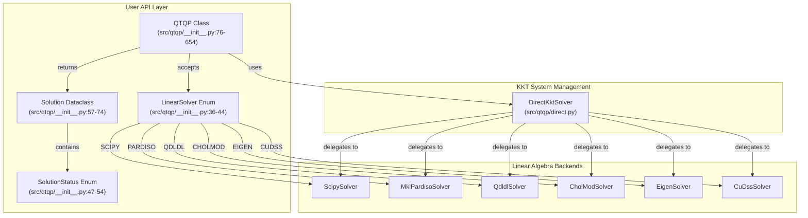
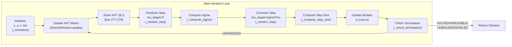
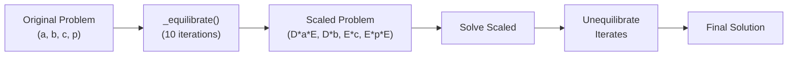
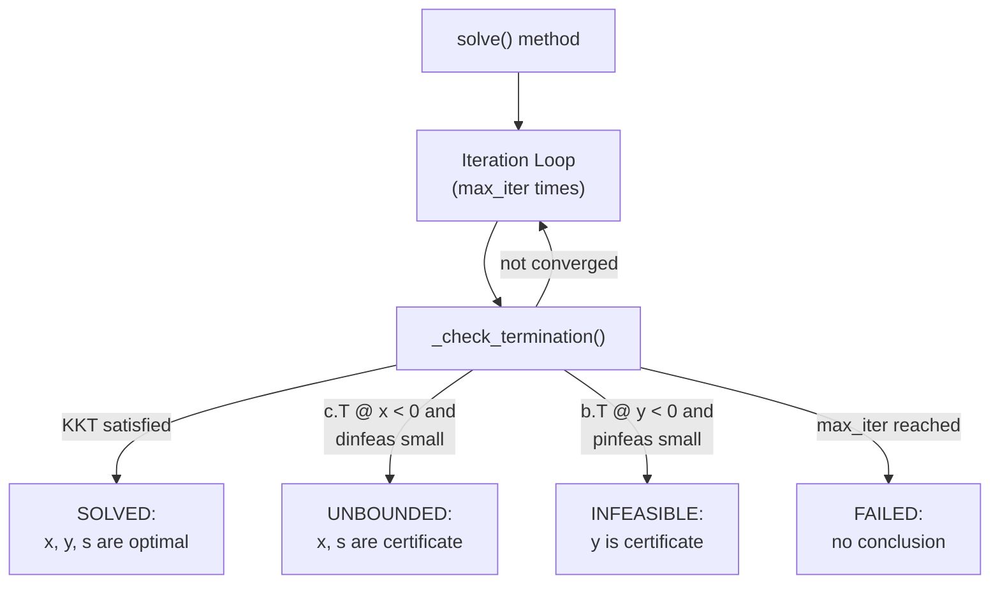

<!-- source: DeepWiki mcp.deepwiki.com · repo google-deepmind/qtqp · page 1 Overview · fetched 2026-10-26 -->

# Overview

<details>
<summary>Relevant source files</summary>

The following files were used as context for generating this wiki page:

- [README.md](README.md)
- [src/qtqp/__init__.py](src/qtqp/__init__.py)

</details>


This page introduces the QTQP solver repository, explaining what quadratic programming is, what the solver does, and the key architectural components of this implementation. For installation instructions and usage examples, see [Getting Started](#2). For detailed algorithm explanations, see [Architecture](#3).

## Purpose and Scope

QTQP is a Python package that implements a **primal-dual interior point method** for solving convex quadratic programs (QPs). The solver is designed to handle both feasible and infeasible problems, automatically detecting and certifying infeasibility or unboundedness when a solution does not exist. The current release is version 0.0.2 and is described as an "early research prototype."

**Sources:** [README.md:1-27](), [src/qtqp/__init__.py:16-29]()

## Quadratic Programming Problem Formulation

QTQP solves optimization problems in the following standard form:

**Primal Problem:**
```
minimize    (1/2) x.T @ p @ x + c.T @ x
subject to  a @ x + s = b
            s[:z] == 0
            s[z:] >= 0
```

**Dual Problem:**
```
maximize    -(1/2) x.T @ p @ x - b.T @ y
subject to  p @ x + a.T @ y = -c
            y[z:] >= 0
```

Where:
- `x` ∈ ℝⁿ is the primal decision variable
- `y` ∈ ℝᵐ is the dual variable
- `s` ∈ ℝᵐ is the slack variable
- `a` is an m×n constraint matrix (sparse CSC format)
- `b` is an m-dimensional right-hand-side vector
- `c` is an n-dimensional cost vector
- `p` is an n×n positive semidefinite quadratic cost matrix (sparse CSC format)
- `z` is the number of equality constraints (the first `z` rows of `a @ x + s = b` must hold with equality)

**Sources:** [src/qtqp/__init__.py:79-89](), [README.md:6-21]()

## Core Components

The QTQP repository consists of three primary layers:



**Core Class: `QTQP`**

The main solver class is instantiated with problem data and provides a single public method `solve()`:

| Component | Location | Purpose |
|-----------|----------|---------|
| `QTQP.__init__()` | [src/qtqp/__init__.py:91-141]() | Validates and stores problem data (a, b, c, p, z) |
| `QTQP.solve()` | [src/qtqp/__init__.py:145-373]() | Executes primal-dual interior point algorithm |
| `Solution` | [src/qtqp/__init__.py:57-74]() | Container for solution vectors (x, y, s), status, and iteration statistics |
| `SolutionStatus` | [src/qtqp/__init__.py:47-54]() | Enum with values: SOLVED, INFEASIBLE, UNBOUNDED, FAILED, UNFINISHED |
| `LinearSolver` | [src/qtqp/__init__.py:36-44]() | Enum for selecting backend: SCIPY, PARDISO, QDLDL, CHOLMOD, EIGEN, CUDSS |

**Sources:** [src/qtqp/__init__.py:36-141]()

## Algorithm Overview

The solver implements a **predictor-corrector primal-dual interior point method** with **homogeneous self-dual embedding**. The algorithm operates on augmented variables that include a homogenization variable `tau` to enable unified detection of optimality, primal infeasibility, and dual infeasibility.



Key algorithmic components:

| Function | Location | Purpose |
|----------|----------|---------|
| `_normalize()` | [src/qtqp/__init__.py:523-527]() | Normalizes homogeneous iterates to unit scale |
| `_newton_step()` | [src/qtqp/__init__.py:449-484]() | Solves augmented KKT system for search direction |
| `_compute_sigma()` | [src/qtqp/__init__.py:431-447]() | Mehrotra's heuristic for centering parameter |
| `_compute_step_size()` | [src/qtqp/__init__.py:529-533]() | Maximum step maintaining conic interiority |
| `_check_termination()` | [src/qtqp/__init__.py:535-622]() | Evaluates KKT conditions and infeasibility certificates |

**Sources:** [src/qtqp/__init__.py:262-373](), [src/qtqp/__init__.py:431-622]()

## Key Features

### 1. Homogeneous Self-Dual Embedding

The solver uses a homogeneous embedding technique that introduces an additional variable `tau` to unify the detection of three possible outcomes:
- **Optimal solution** (`tau > 0`): Returns `(x/tau, y/tau, s/tau)`
- **Primal infeasibility** (`tau → 0`, `b.T @ y < 0`): Returns certificate `y`
- **Dual infeasibility** (`tau → 0`, `c.T @ x < 0`): Returns certificate `(x, s)`

**Sources:** [src/qtqp/__init__.py:230-238](), [src/qtqp/__init__.py:353-370]()

### 2. Multiple Linear Solver Backends

The `DirectKktSolver` abstracts the KKT system solution and supports six different sparse linear algebra backends:

| Backend | Enum Value | Hardware | Installation |
|---------|------------|----------|--------------|
| SciPy | `LinearSolver.SCIPY` | CPU | Default (scipy ≥ 1.9) |
| MKL Pardiso | `LinearSolver.PARDISO` | CPU (Intel) | conda: pydiso |
| QDLDL | `LinearSolver.QDLDL` | CPU | pip: qdldl |
| CHOLMOD | `LinearSolver.CHOLMOD` | CPU | conda: scikit-sparse |
| Eigen | `LinearSolver.EIGEN` | CPU | conda: eigenpy |
| cuDSS | `LinearSolver.CUDSS` | GPU (NVIDIA) | pip: nvidia-cudss-cu12 |

**Sources:** [README.md:190-240](), [src/qtqp/__init__.py:36-44]()

### 3. Numerical Stability Features

**Ruiz Equilibration**

When `equilibrate=True` (default), the solver applies Ruiz equilibration to improve numerical conditioning:



The method computes diagonal scaling matrices `D` (m×m) and `E` (n×n) to balance row and column norms of the constraint matrix.

**Iterative Refinement**

The `DirectKktSolver` employs iterative refinement to achieve high accuracy despite ill-conditioned KKT systems. This is controlled by:
- `max_iterative_refinement_steps` (default: 50)
- `linear_solver_atol` (default: 1e-12)
- `linear_solver_rtol` (default: 1e-12)

**Static Regularization**

A minimum diagonal regularization (`min_static_regularization`, default: 1e-7) is added to the KKT matrix for robustness.

**Sources:** [src/qtqp/__init__.py:375-412](), [src/qtqp/__init__.py:145-164]()

### 4. Warm Starting

The solver accepts optional initial values for `x`, `y`, and `s` through the `solve()` method parameters. These must satisfy conic interiority constraints:
- `y[z:] > 0` (inequality dual variables must be positive)
- `s[z:] > 0` (inequality slack variables must be positive)
- `s[:z] == 0` (equality slack variables must be zero)

**Sources:** [src/qtqp/__init__.py:161-163](), [src/qtqp/__init__.py:211-238]()

## Solution Status and Outputs

The `Solution` dataclass contains:

| Field | Type | Description |
|-------|------|-------------|
| `x` | `np.ndarray` (n,) | Primal solution or unboundedness certificate |
| `y` | `np.ndarray` (m,) | Dual solution or infeasibility certificate |
| `s` | `np.ndarray` (m,) | Slack variables or unboundedness certificate |
| `status` | `SolutionStatus` | SOLVED, INFEASIBLE, UNBOUNDED, or FAILED |
| `stats` | `List[Dict[str, Any]]` | Per-iteration statistics (residuals, gap, mu, time, etc.) |

**Possible Status Values:**



**Sources:** [src/qtqp/__init__.py:57-74](), [src/qtqp/__init__.py:535-622]()

## Repository Structure

The package uses a modern Python src-layout:

```
qtqp/
├── src/qtqp/
│   ├── __init__.py        # QTQP class, Solution, enums (654 lines)
│   └── direct.py          # DirectKktSolver and backend implementations
├── tests/
│   └── test_qtqp.py       # Comprehensive test suite
├── .github/workflows/
│   └── ci.yml             # CI/CD pipeline (3 OS × 4 Python versions)
├── pyproject.toml         # Package configuration and dependencies
└── README.md              # User documentation
```

**Dependencies:**

| Type | Package | Version | Purpose |
|------|---------|---------|---------|
| Required | numpy | ≥ 1.23 | Array operations |
| Required | scipy | ≥ 1.9 | Sparse matrices and default solver |
| Optional | pydiso | - | Intel MKL Pardiso backend |
| Optional | qdldl | - | QDLDL backend |
| Optional | scikit-sparse | - | CHOLMOD backend |
| Optional | eigenpy | - | Eigen backend |
| Optional | nvidia-cudss | - | GPU-accelerated solver |

**Sources:** [README.md:29-61](), [pyproject.toml (inferred from README)]

## Development Status

The package is currently at **version 0.0.2** and is described as an "early research prototype, not ready for prime time." It is released under the Apache License 2.0 and developed by Google DeepMind.

The repository includes:
- Comprehensive CI/CD testing across 3 operating systems (Ubuntu, macOS, Windows) and 4 Python versions (3.10-3.13)
- Automated PyPI publishing using OIDC-based trusted publishing
- Parameterized test suite validating all solver backends
- Dependabot for automated dependency updates

For contributing guidelines, see [Contributing](#7.3). For the CI/CD pipeline details, see [CI/CD Pipeline](#7.2).

**Sources:** [README.md:27-28](), [README.md:259-278](), [src/qtqp/__init__.py:29]()

---

