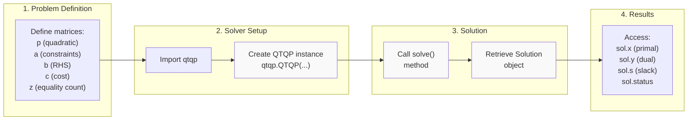
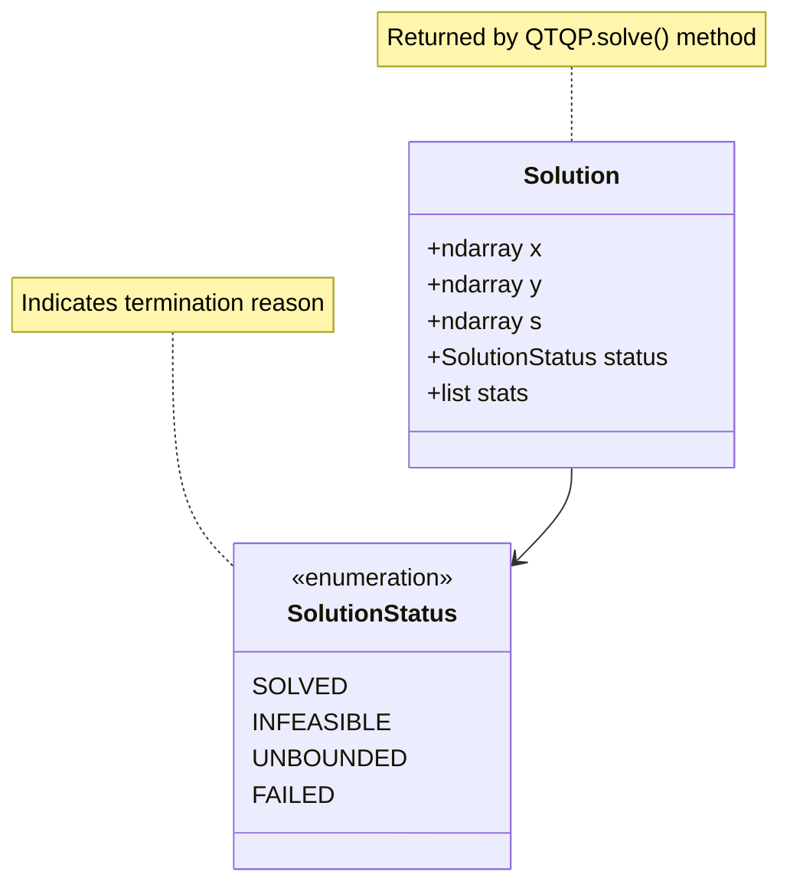
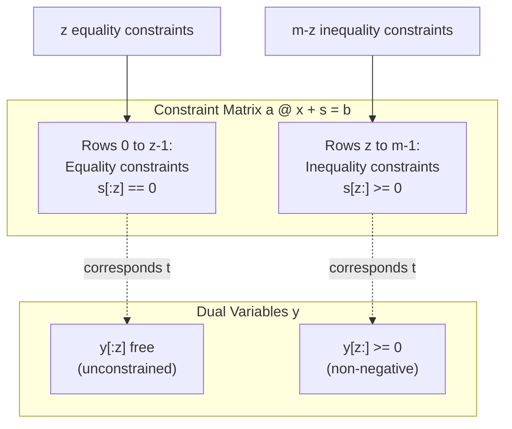
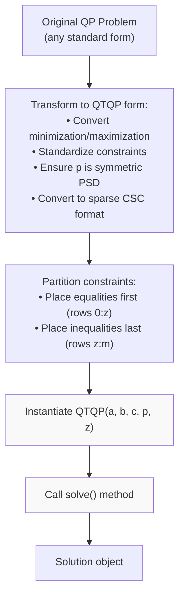

<!-- source: DeepWiki mcp.deepwiki.com · repo google-deepmind/qtqp · page 2 Getting Started · fetched 2026-10-26 -->

# Getting Started

<details>
<summary>Relevant source files</summary>

The following files were used as context for generating this wiki page:

- [README.md](README.md)
- [pyproject.toml](pyproject.toml)

</details>


This page provides an introduction to using the QTQP solver. It covers installation procedures, a quick start example demonstrating basic usage, and an explanation of how to formulate quadratic programming problems for the solver. 

For detailed information on solver internals and algorithm implementation, see [Architecture](#3). For complete API documentation including all configuration parameters, see [API Reference](#4). For advanced usage patterns such as warm starting and equilibration, see [Advanced Topics](#5).

---

## Installation

The QTQP package can be installed through multiple methods depending on your needs. The core package requires only `numpy` and `scipy`, but additional linear solver backends are available as optional dependencies.

### Basic Installation

Install the latest release from PyPI:

```bash
python -m pip install qtqp
```

This installs the core package with the default `SCIPY` linear solver backend. The package requires Python 3.9 or later and automatically installs the following dependencies:

| Dependency | Minimum Version | Purpose |
|------------|----------------|---------|
| `numpy` | 1.23 | Array operations and numerical computation |
| `scipy` | 1.9 | Sparse matrix support and default linear solver |

**Sources:** [README.md:29-35](), [pyproject.toml:12-18]()

### Installation from Source

For development or to use the latest unreleased features:

```bash
git clone https://github.com/google-deepmind/qtqp.git
cd qtqp
python -m pip install .
```

It is recommended to use a conda environment to isolate dependencies:

```bash
conda create -n qtqp-env python=3.12
conda activate qtqp-env
python -m pip install .
```

**Sources:** [README.md:37-55]()

### Optional Linear Solver Backends

The QTQP solver supports multiple linear algebra backends through the `qtqp.LinearSolver` enumeration. Each backend has different performance characteristics and platform requirements:

#### Installation Methods by Backend

| Backend | Enum Value | Installation Command | Platform Notes |
|---------|-----------|---------------------|----------------|
| SciPy (default) | `LinearSolver.SCIPY` | Included with core package | Cross-platform |
| MKL Pardiso | `LinearSolver.PARDISO` | `conda install pydiso -c conda-forge` | Intel CPUs only |
| Eigen | `LinearSolver.EIGEN` | `conda install eigenpy -c conda-forge` | Cross-platform |
| QDLDL | `LinearSolver.QDLDL` | `python -m pip install qdldl` | Cross-platform |
| CHOLMOD | `LinearSolver.CHOLMOD` | `conda install scikit-sparse -c conda-forge` | Cross-platform |
| Nvidia cuDSS | `LinearSolver.CUDSS` | `python -m pip install nvidia-cudss-cu12 nvmath-python[cu12]` | CUDA GPU required |

**Example:** Installing multiple backends for performance comparison:

```bash
# Install CPU-based solvers
conda install pydiso eigenpy scikit-sparse -c conda-forge
python -m pip install qdldl

# Install GPU solver (requires CUDA)
python -m pip install nvidia-cudss-cu12 nvmath-python[cu12]
```

**Note:** Tests will fail for backends that are not installed. This is expected behavior and does not indicate a problem with the core solver.

**Sources:** [README.md:190-240](), [README.md:63]()

---

## Quick Start Guide

This section demonstrates basic usage of the QTQP solver through a simple quadratic programming example.

### Workflow Overview



**Sources:** [README.md:65-108]()

### Basic Example

The following example solves a simple convex quadratic program:

```python
import qtqp
import scipy.sparse
import numpy as np

# Define problem data
p = scipy.sparse.csc_matrix([[3.0, -1.0], [-1.0, 2.0]])
a = scipy.sparse.csc_matrix([[-1.0, 1.0], [1.0, 0.0], [0.0, 1.0]])
b = np.array([-1, 0.3, -0.5])
c = np.array([-1.0, -1.0])

# Create solver instance
solver = qtqp.QTQP(p=p, a=a, b=b, c=c, z=1)

# Solve the problem
sol = solver.solve()

# Access results
print(f'{sol.x=}')  # Primal variable
print(f'{sol.y=}')  # Dual variable
print(f'{sol.s=}')  # Slack variable
```

**Sources:** [README.md:70-88]()

### Understanding the Output

When `verbose=True` (default), the solver prints a detailed iteration table:

```
| QTQP v0.0.2: m=3, n=2, z=1, nnz(A)=4, nnz(P)=4, linear_solver=SCIPY
|------|------------|------------|----------|----------|----------|----------|----------|----------|----------|----------|----------|
| iter |      pcost |      dcost |     pres |     dres |      gap |   infeas |       mu |    sigma |    alpha |  q, p, c |     time |
|------|------------|------------|----------|----------|----------|----------|----------|----------|----------|----------|----------|
|    0 |  1.205e+00 |  1.298e+00 | 2.18e-01 | 6.17e-01 | 9.36e-02 | 1.67e+00 | 1.09e+00 | 5.69e-04 | 1.00e+00 |  1, 1, 1 | 1.39e-02 |
|    1 |  1.161e+00 |  1.211e+00 | 3.16e-02 | 5.23e-02 | 5.01e-02 | 1.35e+00 | 1.04e-01 | 1.65e-03 | 9.04e-01 |  1, 1, 1 | 1.46e-02 |
...
| Solved
```

#### Iteration Table Columns

| Column | Description |
|--------|-------------|
| `iter` | Iteration number |
| `pcost` | Primal objective value: (1/2) x.T @ p @ x + c.T @ x |
| `dcost` | Dual objective value: -(1/2) x.T @ p @ x - b.T @ y |
| `pres` | Primal residual norm |
| `dres` | Dual residual norm |
| `gap` | Duality gap magnitude |
| `infeas` | Infeasibility measure |
| `mu` | Barrier parameter |
| `sigma` | Centering parameter |
| `alpha` | Step size taken |
| `q, p, c` | Predictor/corrector step indicators |
| `time` | Cumulative wall-clock time |

The solver terminates with status `SOLVED` when both primal and dual residuals fall below the specified tolerances (default `atol=1e-7`, `rtol=1e-8`).

**Sources:** [README.md:92-107]()

### Solution Object Structure



**Sources:** [README.md:180-188]()

---

## Problem Formulation

The QTQP solver addresses convex quadratic programs in a specific standard form. Understanding this formulation is essential for correctly encoding problems.

### Primal Problem Form

The solver minimizes the primal objective:

```
minimize    (1/2) x.T @ p @ x + c.T @ x
subject to  a @ x + s = b
            s[:z] == 0
            s[z:] >= 0
```

Where:
- `x` ∈ ℝⁿ is the primal variable (decision variable)
- `s` ∈ ℝᵐ is the slack variable
- `p` ∈ ℝⁿˣⁿ is a symmetric positive semidefinite matrix (quadratic cost)
- `c` ∈ ℝⁿ is the linear cost vector
- `a` ∈ ℝᵐˣⁿ is the constraint matrix
- `b` ∈ ℝᵐ is the right-hand side vector
- `z` ∈ ℤ with 0 ≤ z < m specifies the number of equality constraints

**Sources:** [README.md:5-13]()

### Dual Problem Form

The corresponding dual problem is:

```
maximize    -(1/2) x.T @ p @ x - b.T @ y
subject to  p @ x + a.T @ y = -c
            y[z:] >= 0
```

Where:
- `y` ∈ ℝᵐ is the dual variable (Lagrange multipliers)
- The first `z` components of `y` are free (equality constraint multipliers)
- The remaining components `y[z:]` are non-negative (inequality constraint multipliers)

**Sources:** [README.md:15-21]()

### Constraint Structure

The parameter `z` partitions the constraint system:



**Sources:** [README.md:5-21]()

### Data Requirements and Matrix Formats

The `QTQP` constructor requires the following data types:

| Parameter | Type | Shape | Description | Optional |
|-----------|------|-------|-------------|----------|
| `a` | `scipy.sparse.csc_matrix` | m × n | Constraint matrix | No |
| `b` | `np.ndarray` | (m,) | RHS vector | No |
| `c` | `np.ndarray` | (n,) | Linear cost vector | No |
| `z` | `int` | scalar | Number of equality constraints | No |
| `p` | `scipy.sparse.csc_matrix` | n × n | Quadratic cost matrix | Yes (defaults to zero matrix for LP) |

**Key requirements:**
- Matrices `a` and `p` must be in CSC (Compressed Sparse Column) format
- Matrix `p` must be symmetric and positive semidefinite
- Constraint count `z` must satisfy 0 ≤ z < m

**Sources:** [README.md:119-137]()

### Encoding Common Problem Types

#### Linear Program (LP)

For linear programs without quadratic cost, set `p=None`:

```python
# Minimize c.T @ x subject to a @ x + s = b, s[:z] == 0, s[z:] >= 0
solver = qtqp.QTQP(a=a, b=b, c=c, z=z, p=None)
```

#### All Inequality Constraints

For problems with only inequality constraints (a @ x <= b), set `z=0`:

```python
solver = qtqp.QTQP(a=a, b=b, c=c, z=0, p=p)
```

#### All Equality Constraints

For problems with only equality constraints (a @ x = b), set `z=m`:

```python
solver = qtqp.QTQP(a=a, b=b, c=c, z=m, p=p)
```

#### Mixed Constraints

For problems with both equality and inequality constraints, order the rows of `a` and `b` so that equality constraints appear first (rows 0 to z-1), followed by inequality constraints (rows z to m-1).

**Sources:** [README.md:5-137]()

### Problem Transformations



**Sources:** [README.md:5-137]()

### Verification Example

To verify problem formulation, check dimensions and structure:

```python
import scipy.sparse

# Problem dimensions
m = a.shape[0]  # Number of constraints
n = a.shape[1]  # Number of variables

# Verify dimensions
assert a.shape == (m, n)
assert b.shape == (m,)
assert c.shape == (n,)
assert p is None or p.shape == (n, n)
assert 0 <= z < m

# Verify matrix formats
assert scipy.sparse.isspmatrix_csc(a)
assert p is None or scipy.sparse.isspmatrix_csc(p)

# Verify p is symmetric (if provided)
if p is not None:
    assert np.allclose(p.toarray(), p.toarray().T)
```

This ensures the problem is correctly encoded before solving.

**Sources:** [README.md:119-137]()

---

