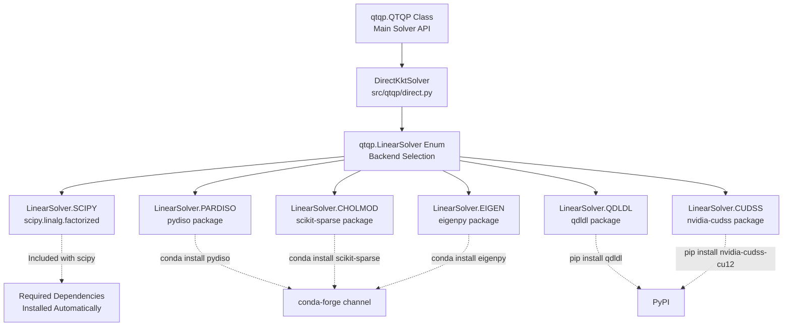
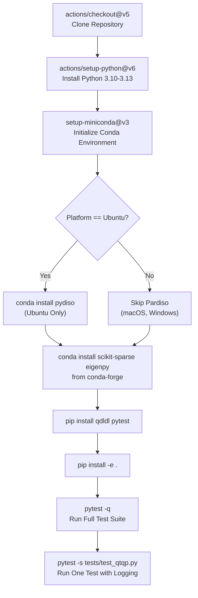

<!-- source: DeepWiki mcp.deepwiki.com · repo google-deepmind/qtqp · page 2.1 Installation · fetched 2026-10-26 -->

# Installation

<details>
<summary>Relevant source files</summary>

The following files were used as context for generating this wiki page:

- [.github/workflows/ci.yml](.github/workflows/ci.yml)
- [README.md](README.md)
- [pyproject.toml](pyproject.toml)

</details>


## Purpose and Scope

This document provides comprehensive installation instructions for the QTQP solver package. It covers installing the core package via PyPI, optional linear solver backends for improved performance, platform-specific considerations, and source installation for development. For information about using QTQP after installation, see [Quick Start Guide](#2.2). For guidance on choosing which linear solver backend to use, see [Linear Solver Backends](#3.3) and [Performance Tuning](#5.5).

---

## System Requirements

### Python Version

QTQP requires Python 3.9 or later. The package is tested against Python 3.10, 3.11, 3.12, and 3.13 on Ubuntu, macOS, and Windows platforms.

**Sources:** [pyproject.toml:12](), [.github/workflows/ci.yml:18]()

### Platform Support

The core package runs on:
- **Ubuntu/Linux**: All features supported
- **macOS**: All features except MKL Pardiso
- **Windows**: All features except MKL Pardiso

The CI pipeline validates functionality across these platforms with a 12-configuration test matrix (3 operating systems × 4 Python versions).

**Sources:** [.github/workflows/ci.yml:17](), [.github/workflows/ci.yml:37-41]()

### Hardware Considerations

- **CPU**: All linear solvers except cuDSS run on CPU
- **GPU**: The cuDSS backend requires an NVIDIA GPU with CUDA support
- **Intel CPUs**: MKL Pardiso provides optimized performance on Intel processors

---

## Core Package Installation

### Installation via PyPI

The simplest installation method uses pip:

```bash
python -m pip install qtqp
```

This installs the QTQP package along with its required runtime dependencies:
- `numpy>=1.23`: Array operations and numerical computing
- `scipy>=1.9`: Sparse matrix support and default SciPy linear solver

After installation, the package is imported as:

```python
import qtqp
```

The public API includes the `qtqp.QTQP` class, `qtqp.LinearSolver` enum, `qtqp.SolutionStatus` enum, and `qtqp.Solution` dataclass.

**Sources:** [README.md:31-35](), [pyproject.toml:14-18](), [README.md:111-117]()

### Package Structure

The installed package follows the src-layout structure:

```
qtqp/
├── src/qtqp/
│   ├── __init__.py      # Public API exports
│   └── direct.py        # DirectKktSolver implementation
└── pyproject.toml       # Package configuration
```

**Sources:** [pyproject.toml:27](), [pyproject.toml:30-32]()

---

## Optional Linear Solver Backends

The core installation uses `scipy.linalg.factorized` as the default linear solver. For improved performance or specific hardware, install additional backends. The following diagram shows the relationship between QTQP and its linear solver options:

### Linear Solver Backend Architecture



**Sources:** [README.md:190-198](), [src/qtqp/direct.py](), [.github/workflows/ci.yml:28-50]()

### Linear Solver Installation Matrix

| Backend | Enum Value | Installation Command | Platform Availability | Package Manager |
|---------|------------|---------------------|----------------------|-----------------|
| **SciPy** (default) | `LinearSolver.SCIPY` | Included with `scipy>=1.9` | Ubuntu, macOS, Windows | pip (automatic) |
| **MKL Pardiso** | `LinearSolver.PARDISO` | `conda install -c conda-forge pydiso` | Ubuntu only | conda |
| **QDLDL** | `LinearSolver.QDLDL` | `pip install qdldl` | Ubuntu, macOS, Windows | pip |
| **CHOLMOD** | `LinearSolver.CHOLMOD` | `conda install -c conda-forge scikit-sparse` | Ubuntu, macOS, Windows | conda |
| **Eigen** | `LinearSolver.EIGEN` | `conda install -c conda-forge eigenpy` | Ubuntu, macOS, Windows | conda |
| **NVIDIA cuDSS** | `LinearSolver.CUDSS` | `pip install nvidia-cudss-cu12`<br/>`pip install nvmath-python[cu12]` | Ubuntu, macOS, Windows (GPU required) | pip |

**Sources:** [README.md:200-240](), [.github/workflows/ci.yml:38-50]()

### Installing Optional Backends

#### MKL Pardiso (Intel CPUs, Ubuntu Only)

Pardiso provides optimized performance on Intel CPUs but is only available on Ubuntu/Linux:

```bash
conda install -c conda-forge pydiso
```

**Limitation**: The CI pipeline explicitly skips Pardiso installation on macOS and Windows due to compatibility issues.

**Sources:** [README.md:200-207](), [.github/workflows/ci.yml:37-41]()

#### QDLDL

A lightweight LDL factorization solver:

```bash
python -m pip install qdldl
```

**Sources:** [README.md:217-223](), [.github/workflows/ci.yml:49]()

#### CHOLMOD (via scikit-sparse)

Provides the CHOLMOD sparse Cholesky solver:

```bash
conda install -c conda-forge scikit-sparse
```

**Sources:** [README.md:225-231](), [.github/workflows/ci.yml:46]()

#### Eigen

C++ Eigen library bindings via EigenPy:

```bash
conda install -c conda-forge eigenpy
```

**Sources:** [README.md:209-215](), [.github/workflows/ci.yml:47]()

#### NVIDIA cuDSS (GPU Accelerated)

For GPU-accelerated solving (requires NVIDIA GPU with CUDA):

```bash
python -m pip install nvidia-cudss-cu12
python -m pip install nvmath-python[cu12]
```

**Sources:** [README.md:233-240]()

---

## Installation from Source

### Cloning the Repository

```bash
git clone https://github.com/google-deepmind/qtqp.git
cd qtqp
```

**Sources:** [README.md:37-42]()

### Setting Up a Development Environment

The recommended approach uses conda to manage dependencies:

```bash
conda create -n qtqp-dev python=3.12
conda activate qtqp-dev
```

**Sources:** [README.md:44-49]()

### Installing Dependencies

Install optional linear solver backends before installing the package:

```bash
# Install conda-based backends
conda install -y -c conda-forge scikit-sparse
conda install -y -c conda-forge eigenpy

# Install pip-based backends
python -m pip install qdldl pytest

# Install QTQP in editable mode
python -m pip install -e .
```

The `-e` flag installs the package in editable mode, allowing you to modify source files without reinstalling.

**Sources:** [.github/workflows/ci.yml:43-50](), [README.md:52-55]()

### CI/CD Installation Flow

The following diagram illustrates how the GitHub Actions CI pipeline installs and tests QTQP:



**Sources:** [.github/workflows/ci.yml:20-57]()

---

## Verifying Installation

### Running the Test Suite

After installation, verify functionality by running the test suite:

```bash
pytest -q
```

**Note**: Tests will fail for linear solver backends not installed on your system. This is expected behavior.

To run a single test with verbose output and logging:

```bash
pytest -s tests/test_qtqp.py::test_solve[LinearSolver.SCIPY-seed0-True]
```

**Sources:** [README.md:57-63](), [.github/workflows/ci.yml:52-57]()

### Checking Available Backends

Import QTQP and attempt to instantiate a solver with different backends to verify which are available:

```python
import qtqp
import numpy as np
import scipy.sparse

# Create a minimal problem
a = scipy.sparse.csc_matrix([[1.0]])
b = np.array([1.0])
c = np.array([1.0])
solver = qtqp.QTQP(a=a, b=b, c=c, z=0)

# Test which backends are available
backends_to_test = [
    qtqp.LinearSolver.SCIPY,
    qtqp.LinearSolver.QDLDL,
    qtqp.LinearSolver.CHOLMOD,
    qtqp.LinearSolver.EIGEN,
    qtqp.LinearSolver.PARDISO,
    qtqp.LinearSolver.CUDSS,
]

for backend in backends_to_test:
    try:
        solver.solve(linear_solver=backend, max_iter=1, verbose=False)
        print(f"{backend.name}: Available")
    except ImportError as e:
        print(f"{backend.name}: Not available ({e})")
```

**Sources:** [README.md:190-198](), [src/qtqp/__init__.py]()

---

## Platform-Specific Notes

### Ubuntu/Linux

- **Full Support**: All linear solver backends are available
- **MKL Pardiso**: Only platform supporting Pardiso (Intel CPU optimization)
- **Testing**: Primary CI platform with 4 Python versions tested

**Sources:** [.github/workflows/ci.yml:37-41]()

### macOS

- **Limited Support**: MKL Pardiso unavailable due to Intel CPU requirements
- **Available Backends**: SciPy, QDLDL, CHOLMOD, Eigen, cuDSS
- **Testing**: CI validates Python 3.10-3.13 on `macos-latest`

**Sources:** [.github/workflows/ci.yml:17-18](), [.github/workflows/ci.yml:37-38]()

### Windows

- **Limited Support**: MKL Pardiso unavailable (noted as "failing on Windows")
- **Available Backends**: SciPy, QDLDL, CHOLMOD, Eigen, cuDSS
- **Testing**: CI validates Python 3.10-3.13 on `windows-latest`

**Sources:** [.github/workflows/ci.yml:17-18](), [.github/workflows/ci.yml:37]()

### Conda vs. Pip Dependencies

The installation strategy mixes conda and pip package managers:

| Package Manager | Packages | Rationale |
|----------------|----------|-----------|
| **conda** | pydiso, scikit-sparse, eigenpy | Binary dependencies with complex C/C++ builds |
| **pip** | qtqp, qdldl, pytest, nvidia-cudss | Pure Python or well-packaged binary wheels |

The CI pipeline initializes conda first, installs conda-based backends, then uses pip for remaining packages.

**Sources:** [.github/workflows/ci.yml:28-50]()

---

## Troubleshooting

### Import Errors for Optional Backends

If you encounter `ImportError` when using a specific `linear_solver` option, the corresponding backend is not installed. Install it following the instructions in the [Linear Solver Installation Matrix](#linear-solver-installation-matrix).

### Test Failures

The test suite expects all installed backends to function correctly. If tests fail:

1. Verify the backend is properly installed
2. Check platform compatibility (e.g., Pardiso on Ubuntu only)
3. Review the specific test error message for missing dependencies

**Sources:** [README.md:63]()

### Conda Environment Conflicts

When mixing conda and pip installations:

1. Always activate the conda environment first
2. Install conda packages before pip packages
3. Use `pip install -e .` for editable installs, not `pip install -e .[test]` if it fails

**Sources:** [.github/workflows/ci.yml:43-50]()

---

