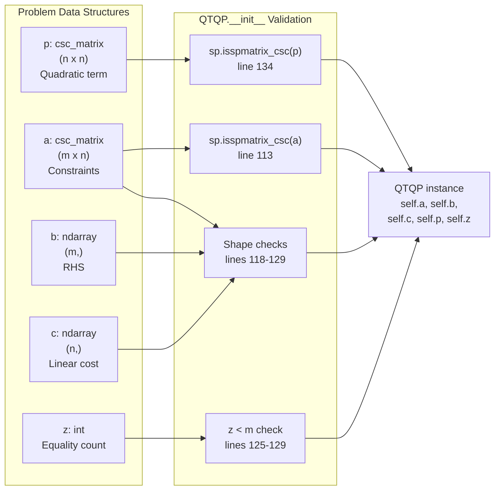
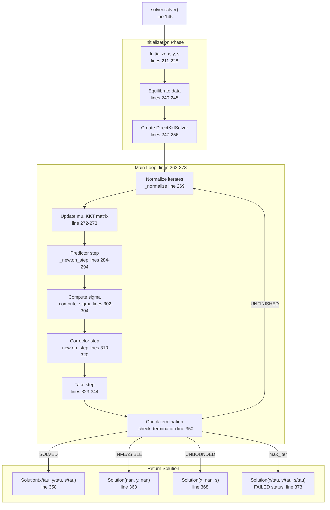
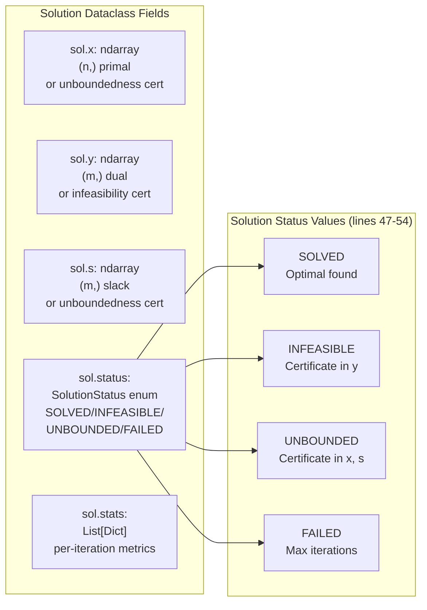

<!-- source: DeepWiki mcp.deepwiki.com · repo google-deepmind/qtqp · page 2.2 Quick Start Guide · fetched 2026-10-26 -->

# Quick Start Guide

<details>
<summary>Relevant source files</summary>

The following files were used as context for generating this wiki page:

- [README.md](README.md)
- [src/qtqp/__init__.py](src/qtqp/__init__.py)

</details>


## Purpose and Scope

This guide walks through a minimal working example of defining and solving a quadratic program using QTQP. It covers problem setup, solver invocation, and interpreting the solution output. For detailed problem formulation rules and constraint specification, see [Problem Formulation](#2.3). For advanced solver configuration options, see [Configuration Parameters](#4.4). For understanding how the solver selects different backends, see [Linear Solver Backends](#3.3).

**Sources:** [README.md:65-108]()

---

## Problem Definition

We demonstrate QTQP with a simple quadratic program example. The problem has:
- 2 primal variables (`n=2`)
- 3 constraints (`m=3`)
- 1 equality constraint (`z=1`)
- A quadratic objective term (`p` matrix)

The example solves:
```
min. (1/2) x.T @ p @ x + c.T @ x
s.t. -x[0] + x[1] + s[0] = -1     (equality: s[0] = 0)
     x[0] + s[1] = 0.3             (inequality: s[1] >= 0)
     x[1] + s[2] = -0.5            (inequality: s[2] >= 0)
```

**Sources:** [README.md:67-88]()

---

## Step-by-Step Setup

### Step 1: Import Required Modules

```python
import qtqp
import scipy.sparse
import numpy as np
```

The solver requires `scipy.sparse` for constraint matrices and `numpy` for vectors. The `qtqp` module provides the `QTQP` solver class and related enums/dataclasses.

**Sources:** [README.md:71-73](), [src/qtqp/__init__.py:24-26]()

---

### Step 2: Define Problem Data

```python
# Quadratic cost matrix (n x n)
p = scipy.sparse.csc_matrix([[3.0, -1.0], [-1.0, 2.0]])

# Constraint matrix (m x n)
a = scipy.sparse.csc_matrix([[-1.0, 1.0], [1.0, 0.0], [0.0, 1.0]])

# Right-hand side vector (m,)
b = np.array([-1, 0.3, -0.5])

# Linear cost vector (n,)
c = np.array([-1.0, -1.0])
```

The matrices must be in CSC (Compressed Sparse Column) format. The `QTQP` constructor validates matrix dimensions and formats at instantiation.



**Diagram: Problem Data Validation Flow**

**Sources:** [README.md:75-79](), [src/qtqp/__init__.py:91-140]()

---

### Step 3: Initialize Solver

```python
solver = qtqp.QTQP(p=p, a=a, b=b, c=c, z=1)
```

This creates a `QTQP` instance by calling the constructor at [src/qtqp/__init__.py:91-108](). The constructor:
1. Stores problem dimensions: `self.m = 3`, `self.n = 2`, `self.z = 1`
2. Validates matrix formats (must be CSC)
3. Validates vector shapes match matrix dimensions
4. Initializes internal buffers like `self._r_buffer` for linear system RHS

The `z=1` parameter indicates the first constraint is an equality (zero-cone), while constraints 2 and 3 are inequalities (positive cone).

**Sources:** [README.md:82](), [src/qtqp/__init__.py:91-144]()

---

### Step 4: Solve the Problem

```python
sol = solver.solve()
```

The `solve()` method with no arguments uses default parameters:
- `atol=1e-7`, `rtol=1e-8`: Convergence tolerances
- `max_iter=100`: Maximum iterations
- `linear_solver=LinearSolver.SCIPY`: Default backend
- `verbose=True`: Print iteration log
- `equilibrate=True`: Apply Ruiz equilibration

The method returns a `Solution` dataclass containing primal-dual variables and iteration statistics.



**Diagram: solve() Method Execution Flow**

**Sources:** [README.md:84](), [src/qtqp/__init__.py:145-373]()

---

## Understanding the Iteration Log

When `verbose=True`, the solver prints a table tracking convergence metrics:

```
| QTQP v0.0.2: m=3, n=2, z=1, nnz(A)=4, nnz(P)=4, linear_solver=SCIPY
|------|------------|------------|----------|----------|----------|----------|----------|----------|----------|----------|----------|
| iter |      pcost |      dcost |     pres |     dres |      gap |   infeas |       mu |    sigma |    alpha |  q, p, c |     time |
|------|------------|------------|----------|----------|----------|----------|----------|----------|----------|----------|----------|
|    0 |  1.205e+00 |  1.298e+00 | 2.18e-01 | 6.17e-01 | 9.36e-02 | 1.67e+00 | 1.09e+00 | 5.69e-04 | 1.00e+00 |  1, 1, 1 | 1.39e-02 |
|    1 |  1.161e+00 |  1.211e+00 | 3.16e-02 | 5.23e-02 | 5.01e-02 | 1.35e+00 | 1.04e-01 | 1.65e-03 | 9.04e-01 |  1, 1, 1 | 1.46e-02 |
|    2 |  1.234e+00 |  1.235e+00 | 3.77e-04 | 8.61e-04 | 6.64e-04 | 1.30e+00 | 7.67e-03 | 4.87e-06 | 9.98e-01 |  1, 1, 1 | 1.52e-02 |
|    3 |  1.235e+00 |  1.235e+00 | 3.78e-06 | 8.62e-06 | 6.65e-06 | 1.30e+00 | 1.25e-04 | 8.80e-12 | 1.00e+00 |  1, 1, 1 | 1.57e-02 |
|    4 |  1.235e+00 |  1.235e+00 | 3.78e-08 | 8.62e-08 | 6.65e-08 | 1.30e+00 | 1.25e-06 | 8.80e-18 | 1.00e+00 |  1, 1, 1 | 1.63e-02 |
|------|------------|------------|----------|----------|----------|----------|----------|----------|----------|----------|----------|
| Solved
```

### Column Definitions

| Column | Variable | Description | Code Reference |
|--------|----------|-------------|----------------|
| `iter` | `stats_i['iter']` | Iteration number | [src/qtqp/__init__.py:597]() |
| `pcost` | `stats_i['pcost']` | Primal objective value: `(c.T @ x + 0.5 * x.T @ p @ x) / tau` | [src/qtqp/__init__.py:549]() |
| `dcost` | `stats_i['dcost']` | Dual objective value: `(-b.T @ y - 0.5 * x.T @ p @ x) / tau` | [src/qtqp/__init__.py:550]() |
| `pres` | `stats_i['pres']` | Primal residual: `‖(a @ x + s)/tau - b‖_∞` | [src/qtqp/__init__.py:553]() |
| `dres` | `stats_i['dres']` | Dual residual: `‖(p @ x + a.T @ y)/tau + c‖_∞` | [src/qtqp/__init__.py:554]() |
| `gap` | `stats_i['gap']` | Duality gap: `\|(c.T @ x + b.T @ y + x.T @ p @ x)/tau\|` | [src/qtqp/__init__.py:555]() |
| `infeas` | `min(pinfeas, dinfeas)` | Infeasibility measure | [src/qtqp/__init__.py:632]() |
| `mu` | `stats_i['mu']` | Complementary slackness: `(y @ s) / (x @ x + y @ y + tau @ tau)` | [src/qtqp/__init__.py:272]() |
| `sigma` | `stats_i['sigma']` | Centering parameter from Mehrotra's heuristic | [src/qtqp/__init__.py:302-304]() |
| `alpha` | `stats_i['alpha']` | Step size (fraction to boundary) | [src/qtqp/__init__.py:331]() |
| `q, p, c` | Solver counts | Number of linear solves for q-system, predictor, corrector | [src/qtqp/__init__.py:638-642]() |
| `time` | `stats_i['time']` | Elapsed time in seconds | [src/qtqp/__init__.py:618]() |

Convergence occurs when `pres`, `dres`, and `gap` all fall below tolerance thresholds (`atol` and `rtol`). The example converges in 5 iterations with final residuals around `10^-8`.

**Sources:** [README.md:92-103](), [src/qtqp/__init__.py:628-650]()

---

## Interpreting the Solution

### Accessing Solution Fields

```python
print(f'{sol.x=}')  # Primal variables
print(f'{sol.y=}')  # Dual variables
print(f'{sol.s=}')  # Slack variables
```

Output:
```
sol.x=array([ 0.29999999, -0.69999997])
sol.y=array([2.69999964e+00, 2.09999968e+00, 3.86572055e-07])
sol.s=array([0.00000000e+00, 7.13141634e-09, 1.99999944e-01])
```



**Diagram: Solution Object Structure**

### Verification

For a `SOLVED` status, the solution satisfies:
1. **Primal feasibility**: `a @ x + s = b` and `s[z:] >= 0`
2. **Dual feasibility**: `p @ x + a.T @ y = -c` and `y[z:] >= 0`
3. **Complementarity**: `y[z:] * s[z:] ≈ 0`

In this example:
- `x[0] = 0.3`, `x[1] = -0.7` satisfy the constraints
- `s[0] = 0` enforces the equality constraint
- `s[1] ≈ 0`, `s[2] = 0.2` represent inequality slacks
- `y[0] = 2.7`, `y[1] = 2.1` are dual multipliers for constraints 1-2
- `y[2] ≈ 0` indicates constraint 3 is not tight

**Sources:** [README.md:104-107](), [src/qtqp/__init__.py:57-74]()

---

## Solution Status Interpretation

The `sol.status` field indicates the outcome:

| Status | Meaning | When x/y/s are Valid |
|--------|---------|---------------------|
| `SolutionStatus.SOLVED` | Optimal solution found | `x`, `y`, `s` are the optimal primal-dual-slack variables |
| `SolutionStatus.INFEASIBLE` | Primal infeasible, dual unbounded | `y` is a certificate of primal infeasibility (scaled), `x` and `s` are NaN |
| `SolutionStatus.UNBOUNDED` | Primal unbounded, dual infeasible | `x` and `s` are certificates of dual infeasibility (scaled), `y` is NaN |
| `SolutionStatus.FAILED` | Max iterations reached | `x`, `y`, `s` are best iterates found, but not proven optimal |

The termination logic is implemented in [src/qtqp/__init__.py:535-622]() via the `_check_termination` method, which evaluates:
- Optimality conditions (lines 579-584)
- Unboundedness detection (lines 585-588)
- Infeasibility detection (lines 589-592)

**Sources:** [src/qtqp/__init__.py:47-54](), [src/qtqp/__init__.py:353-373](), [src/qtqp/__init__.py:535-622]()

---

## Next Steps

Now that you've run a basic example, you can:

1. **Formulate your own problems**: See [Problem Formulation](#2.3) for guidelines on encoding constraints and objectives
2. **Adjust solver parameters**: See [Configuration Parameters](#4.4) for tuning tolerances, iteration limits, and solver options
3. **Try different linear solvers**: See [Linear Solver Backends](#3.3) for performance comparisons and installation instructions
4. **Use warm-starting**: See [Warm Starting](#5.2) for accelerating sequences of related problems
5. **Improve numerical stability**: See [Equilibration and Numerical Stability](#5.1) for handling ill-conditioned problems

**Sources:** [README.md:65-108]()

---

