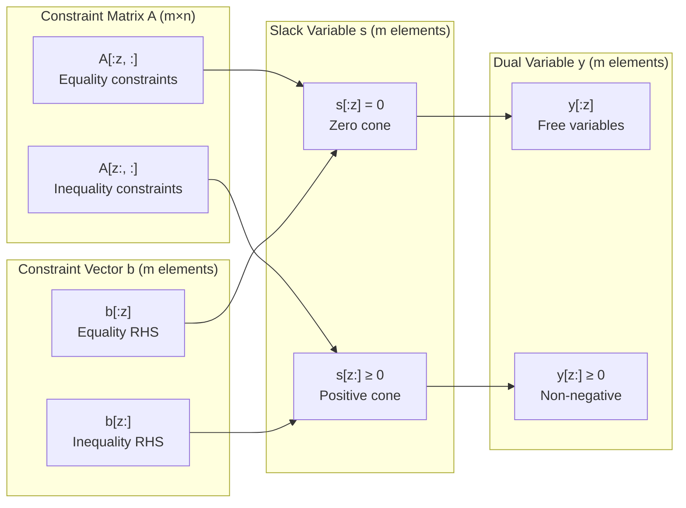
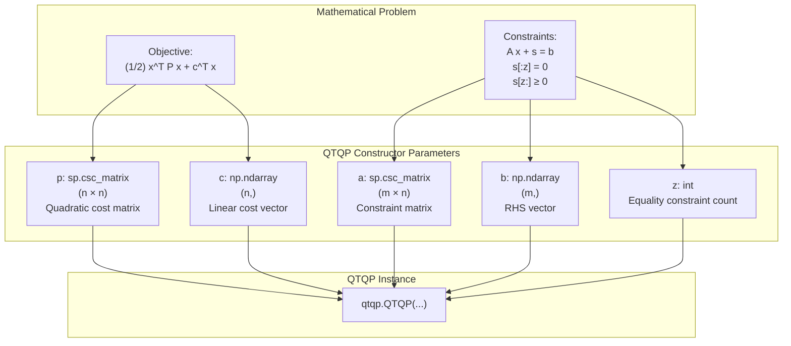
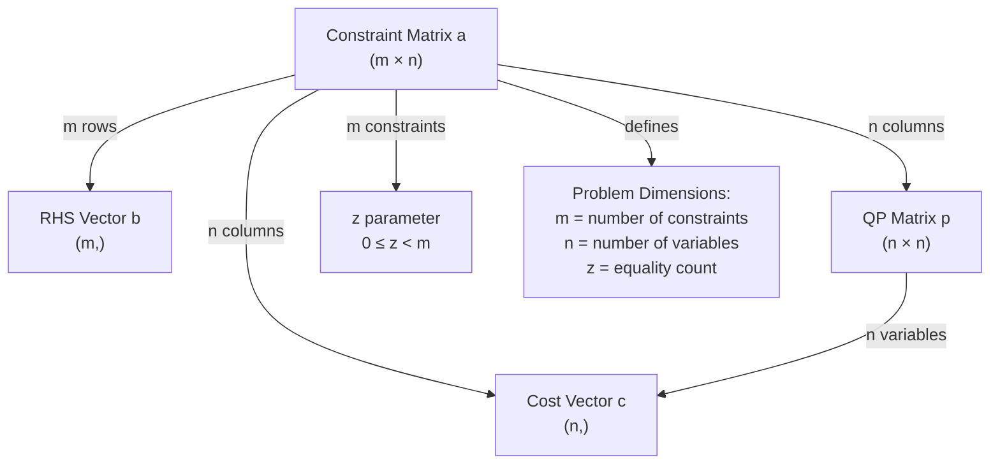
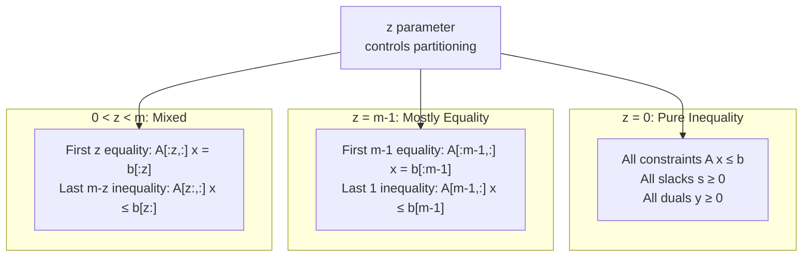
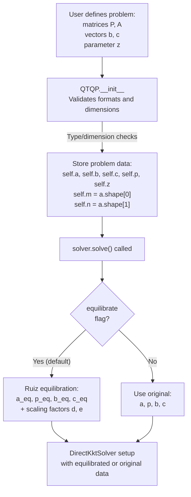
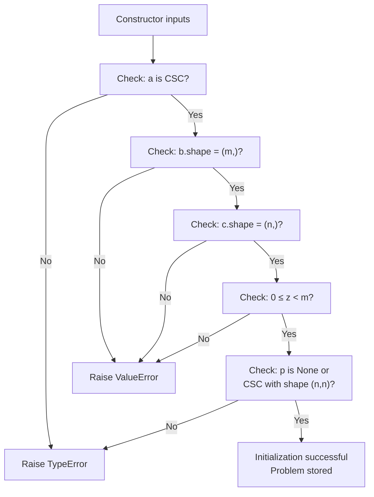

<!-- source: DeepWiki mcp.deepwiki.com · repo google-deepmind/qtqp · page 2.3 Problem Formulation · fetched 2026-10-26 -->

# Problem Formulation

<details>
<summary>Relevant source files</summary>

The following files were used as context for generating this wiki page:

- [README.md](README.md)
- [src/qtqp/__init__.py](src/qtqp/__init__.py)

</details>


## Purpose and Scope

This page explains the mathematical formulation of quadratic programming (QP) problems that QTQP solves, including both primal and dual forms. It describes how to encode problem data as matrices and vectors for the QTQP constructor, with particular attention to the constraint partitioning mechanism controlled by the `z` parameter.

For step-by-step examples of using these formulations, see [Quick Start Guide](#2.2). For detailed API parameter documentation, see [QTQP Class](#4.1). For understanding how the solver internally processes these formulations using KKT conditions, see [QTQP Solver: Primal-Dual Interior Point Method](#3.1).

## Mathematical Formulation

### Primal Problem

QTQP solves convex quadratic programs in the following standard form:

```
minimize    (1/2) x^T P x + c^T x
subject to  A x + s = b
            s[:z] = 0       (equality constraints)
            s[z:] ≥ 0       (inequality constraints)
```

Where:
- **x** ∈ ℝⁿ is the primal variable (decision variable)
- **s** ∈ ℝᵐ is the slack variable
- **P** ∈ ℝⁿˣⁿ is a symmetric positive semidefinite matrix (quadratic cost term)
- **c** ∈ ℝⁿ is the linear cost vector
- **A** ∈ ℝᵐˣⁿ is the constraint matrix
- **b** ∈ ℝᵐ is the right-hand side vector
- **z** ∈ ℤ with 0 ≤ z < m is the number of equality constraints

### Dual Problem

The corresponding dual problem is:

```
maximize    -(1/2) x^T P x - b^T y
subject to  P x + A^T y = -c
            y[z:] ≥ 0
```

Where:
- **y** ∈ ℝᵐ is the dual variable (Lagrange multipliers)
- **y[:z]** are free (unconstrained) for equality constraints
- **y[z:]** are non-negative for inequality constraints

**Sources:** [src/qtqp/__init__.py:77-89](), [README.md:6-21]()

## Constraint Structure and the z Parameter

### Zero Cone and Positive Cone Partitioning



**Diagram: Constraint Partitioning by z Parameter**

The parameter `z` partitions the m constraints into two cones:

| Index Range | Constraint Type | Slack Cone | Dual Variable | Interpretation |
|-------------|----------------|------------|---------------|----------------|
| `0` to `z-1` | Equality: `A[i,:] @ x = b[i]` | `s[i] = 0` (zero cone) | `y[i]` free | First z rows of A |
| `z` to `m-1` | Inequality: `A[i,:] @ x ≤ b[i]` | `s[i] ≥ 0` (positive cone) | `y[i] ≥ 0` | Remaining m-z rows of A |

The constraint `z < m` is enforced at initialization to ensure at least one inequality constraint exists, which is required for the interior point method's homogeneous embedding.

**Sources:** [src/qtqp/__init__.py:82-88](), [src/qtqp/__init__.py:125-129]()

## Encoding Problems for QTQP

### Mapping Mathematical Notation to Constructor Parameters



**Diagram: Mapping from Mathematical Formulation to QTQP Constructor**

The QTQP constructor requires the following parameters:

```python
qtqp.QTQP(
    a=<constraint_matrix>,    # sp.csc_matrix (m × n)
    b=<rhs_vector>,          # np.ndarray (m,)
    c=<cost_vector>,         # np.ndarray (n,)
    z=<num_equalities>,      # int
    p=<quadratic_matrix>     # sp.csc_matrix (n × n) or None
)
```

**Sources:** [src/qtqp/__init__.py:91-108]()

### Required Matrix Formats and Dimensions

| Parameter | Type | Dimensions | Format | Notes |
|-----------|------|------------|--------|-------|
| `a` | `scipy.sparse.csc_matrix` | m × n | CSC sparse | Must be CSC format |
| `b` | `numpy.ndarray` | (m,) | Dense | Converted to float64 |
| `c` | `numpy.ndarray` | (n,) | Dense | Converted to float64 |
| `z` | `int` | scalar | - | Must satisfy 0 ≤ z < m |
| `p` | `scipy.sparse.csc_matrix` or `None` | n × n | CSC sparse | If None, treated as zero matrix (LP) |

The solver validates these dimensions and formats at initialization. If `p` is `None`, the solver constructs a zero sparse matrix, effectively solving a linear program.

**Sources:** [src/qtqp/__init__.py:109-140]()

### Dimension Relationships



**Diagram: Dimensional Consistency Requirements**

**Sources:** [src/qtqp/__init__.py:109-140]()

## Problem Types

### Linear Programs (LP)

For linear programs (no quadratic term), set `p=None`:

```python
# Linear Program: min c^T x subject to A x ≤ b
solver = qtqp.QTQP(a=a, b=b, c=c, z=0, p=None)
```

When `p=None`, the solver creates a zero sparse matrix internally, and the objective becomes purely linear: `c^T x`.

**Sources:** [src/qtqp/__init__.py:131-132]()

### Quadratic Programs (QP)

For quadratic programs, provide a symmetric positive semidefinite matrix `p`:

```python
# QP: min (1/2) x^T P x + c^T x subject to A x ≤ b
p = scipy.sparse.csc_matrix([[2.0, 0.0], [0.0, 2.0]])
solver = qtqp.QTQP(a=a, b=b, c=c, z=0, p=p)
```

The matrix `p` must be in CSC format and have dimensions n × n.

**Sources:** [src/qtqp/__init__.py:134-140]()

### Constraint Type Examples



**Diagram: Different Problem Types Based on z Parameter**

| z Value | Problem Structure | Use Case |
|---------|------------------|----------|
| `z = 0` | Pure inequality constraints | Standard LP/QP with bounds |
| `z = m-1` | m-1 equalities, 1 inequality | Nearly equality-constrained with one slack |
| `0 < z < m` | Mixed equality and inequality | General constrained optimization |

The solver requires `z < m` (strictly less than) to ensure at least one inequality constraint exists, which is necessary for the homogeneous embedding technique used in the interior point method.

**Sources:** [src/qtqp/__init__.py:125-129]()

## Converting Standard Forms to QTQP Format

### Inequality Constraints: Ax ≤ b

Standard form:
```
A x ≤ b
```

QTQP encoding:
```python
# Introduce slack: A x + s = b with s ≥ 0
# Set z = 0 to make all constraints inequalities
solver = qtqp.QTQP(a=A, b=b, c=c, z=0, p=p)
```

The slack variable `s` is introduced automatically by the solver.

### Equality Constraints: Ax = b

Standard form:
```
A x = b
```

QTQP encoding:
```python
# Need at least one inequality for homogeneous embedding
# Add a dummy inequality constraint, e.g., x[0] ≤ large_value
# Set z = m-1 (all but last constraint are equalities)
a_augmented = sp.vstack([A_eq, a_dummy])
b_augmented = np.concatenate([b_eq, [large_value]])
solver = qtqp.QTQP(a=a_augmented, b=b_augmented, c=c, z=m-1, p=p)
```

**Note:** Pure equality-constrained problems (z = m) are not supported due to the interior point method's requirements.

### Mixed Constraints

For problems with both equality and inequality constraints:

```python
# Given:
# A_eq @ x = b_eq  (z_eq equality constraints)
# A_ineq @ x ≤ b_ineq  (m_ineq inequality constraints)

a = sp.vstack([A_eq, A_ineq])  # Stack equality constraints first
b = np.concatenate([b_eq, b_ineq])
z = A_eq.shape[0]  # Number of equality constraints

solver = qtqp.QTQP(a=a, b=b, c=c, z=z, p=p)
```

**Critical ordering:** Equality constraints must appear first in the matrix `a` (rows 0 to z-1), followed by inequality constraints (rows z to m-1).

**Sources:** [src/qtqp/__init__.py:82-88]()

## Problem Data Flow



**Diagram: Problem Data Flow from User Input to Solver Initialization**

The problem data flows through validation, storage, optional equilibration, and finally to the KKT solver setup. The `equilibrate` parameter in the `solve` method controls whether Ruiz equilibration is applied for numerical stability.

**Sources:** [src/qtqp/__init__.py:91-140](), [src/qtqp/__init__.py:240-256](), [src/qtqp/__init__.py:375-412]()

## Example: Encoding a Canonical QP

Consider the example from the README:

```
minimize    (1/2) x^T P x + c^T x
subject to  -x₁ + x₂ = -1     (equality)
            x₁ ≤ 0.3           (inequality)
            x₂ ≤ -0.5          (inequality)
```

Matrix encoding:

```python
import scipy.sparse as sp
import numpy as np

# Quadratic term: P = [[3, -1], [-1, 2]]
p = sp.csc_matrix([[3.0, -1.0], [-1.0, 2.0]])

# Constraints: first row is equality, next two are inequalities
# -x₁ + x₂ = -1  =>  [-1, 1] @ x + s[0] = -1, s[0] = 0
# x₁ ≤ 0.3       =>  [1, 0] @ x + s[1] = 0.3, s[1] ≥ 0
# x₂ ≤ -0.5      =>  [0, 1] @ x + s[2] = -0.5, s[2] ≥ 0
a = sp.csc_matrix([
    [-1.0, 1.0],   # Equality constraint (row 0)
    [1.0, 0.0],    # Inequality constraint (row 1)
    [0.0, 1.0]     # Inequality constraint (row 2)
])

b = np.array([-1.0, 0.3, -0.5])  # RHS values
c = np.array([-1.0, -1.0])        # Linear cost

# z = 1: first constraint is equality, remaining 2 are inequalities
solver = qtqp.QTQP(p=p, a=a, b=b, c=c, z=1)
```

Problem dimensions:
- n = 2 (two decision variables: x₁, x₂)
- m = 3 (three constraints total)
- z = 1 (one equality constraint)
- s has 3 elements: s[0] = 0 (zero cone), s[1:] ≥ 0 (positive cone)
- y has 3 elements: y[0] free, y[1:] ≥ 0

**Sources:** [README.md:67-88]()

## Validation and Error Handling

The QTQP constructor performs comprehensive validation:

| Validation Check | Error Type | Error Condition |
|------------------|------------|-----------------|
| Matrix format | `TypeError` | `a` not in CSC format |
| Matrix format | `TypeError` | `p` not in CSC format or None |
| Vector dimensions | `ValueError` | `b.shape != (m,)` |
| Vector dimensions | `ValueError` | `c.shape != (n,)` |
| Matrix dimensions | `ValueError` | `p.shape != (n, n)` |
| Parameter range | `ValueError` | `z >= m` (must have at least one inequality) |



**Diagram: QTQP Constructor Validation Flow**

All arrays are automatically converted to `float64` dtype for numerical consistency.

**Sources:** [src/qtqp/__init__.py:112-140]()

---

