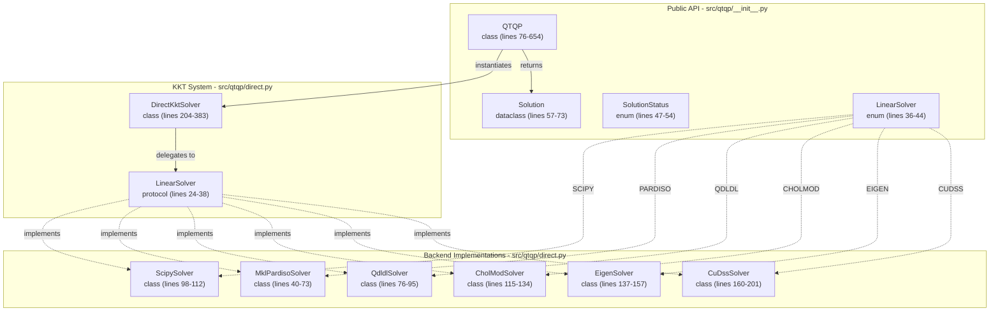
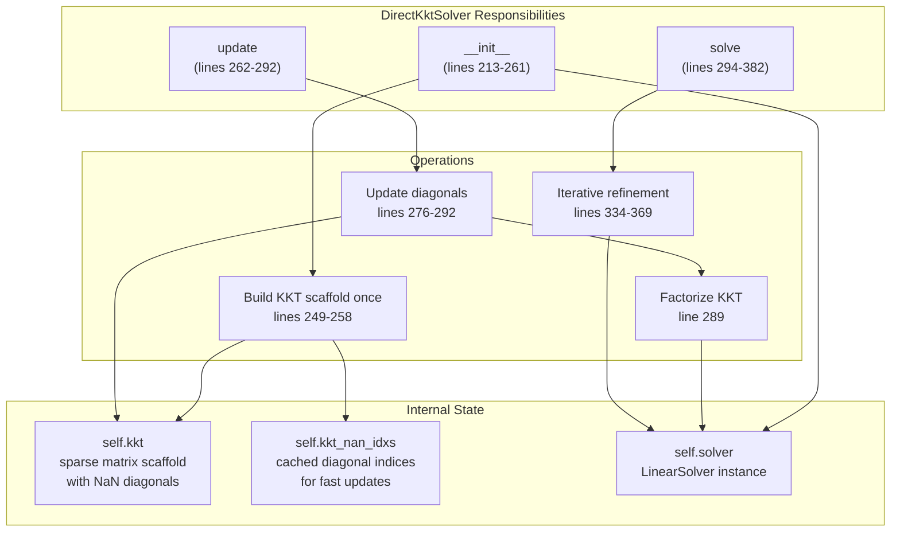
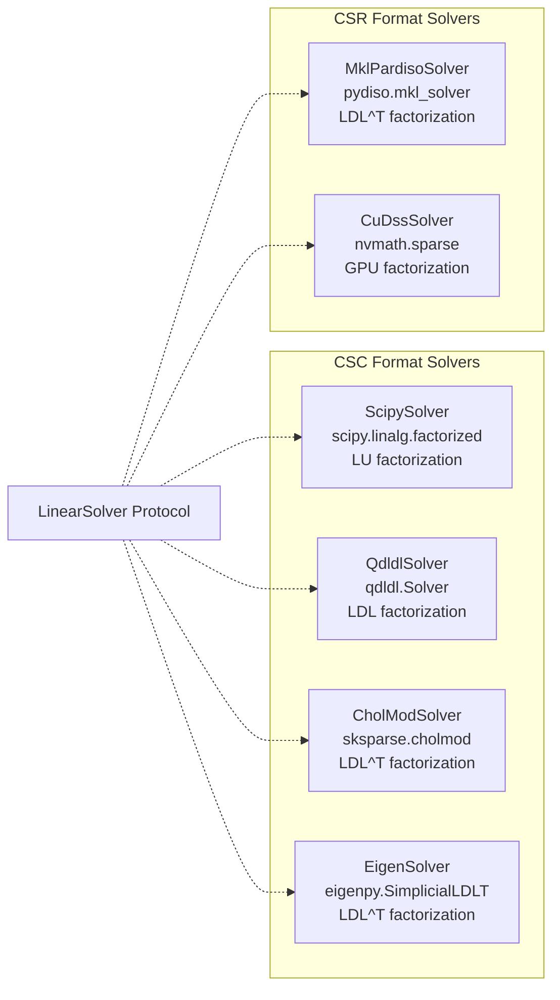
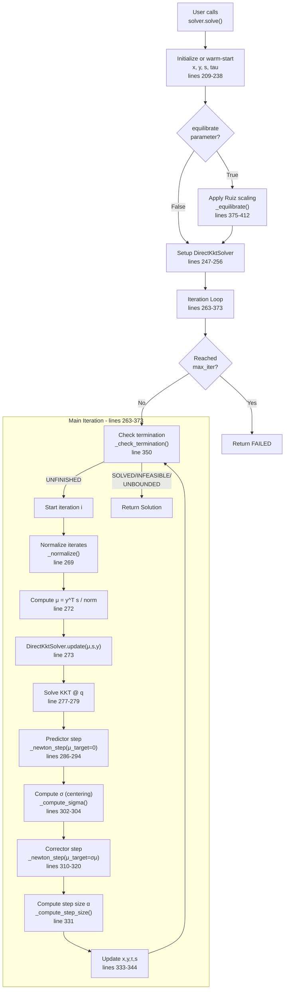
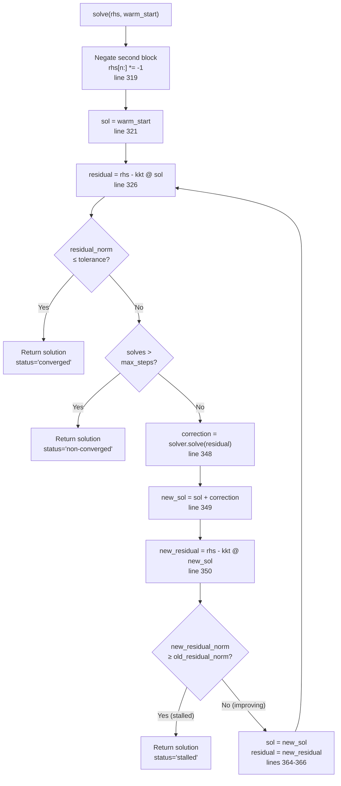

<!-- source: DeepWiki mcp.deepwiki.com · repo google-deepmind/qtqp · page 3 Architecture · fetched 2026-10-26 -->

# Architecture

<details>
<summary>Relevant source files</summary>

The following files were used as context for generating this wiki page:

- [src/qtqp/__init__.py](src/qtqp/__init__.py)
- [src/qtqp/direct.py](src/qtqp/direct.py)

</details>


This document provides a detailed explanation of the QTQP repository's system architecture, describing how the major components interact and the design patterns employed. This page focuses on the structural organization and component relationships. For algorithmic details of the primal-dual interior point method, see [QTQP Solver](#3.1). For KKT system management specifics, see [DirectKktSolver](#3.2). For individual linear solver backend implementations, see [Linear Solver Backends](#3.3).

## System Overview

The QTQP codebase implements a primal-dual interior point method for quadratic programming using a three-layer architecture:

1. **Algorithm Layer**: The `QTQP` class implements the optimization algorithm (predictor-corrector interior point method with homogeneous self-dual embedding)
2. **Linear System Layer**: The `DirectKktSolver` class manages KKT matrix construction, updates, and iterative refinement
3. **Backend Layer**: Six `LinearSolver` implementations provide pluggable numerical linear algebra backends

This separation enables the optimization algorithm to remain independent of the underlying numerical solver, allowing the same code to execute on different hardware (CPU/GPU) and with different factorization methods without modification to the core solver logic.

Sources: [src/qtqp/__init__.py:76-89](), [src/qtqp/direct.py:204-211]()

## Component Hierarchy

The following diagram maps the conceptual system components to their concrete implementations in the codebase:



Sources: [src/qtqp/__init__.py:1-654](), [src/qtqp/direct.py:1-384]()

## Core Components

### QTQP Class

The `QTQP` class [src/qtqp/__init__.py:76-654]() is the main entry point for solving quadratic programs. It encapsulates:

| Responsibility | Implementation |
|----------------|----------------|
| Problem definition | `__init__()` [lines 91-141]() stores matrices `a`, `p`, vectors `b`, `c`, and constraint count `z` |
| Equilibration | `_equilibrate()` [lines 375-412]() performs Ruiz scaling for numerical conditioning |
| Main iteration loop | `solve()` [lines 145-373]() implements predictor-corrector algorithm |
| Termination checking | `_check_termination()` [lines 535-622]() evaluates convergence criteria |
| Homogeneous embedding | `_solve_for_tau()` [lines 486-521]() solves quadratic equation for embedding variable |

The class maintains internal state including:
- Problem data matrices: `self.a`, `self.p`, `self.b`, `self.c`, `self.z`
- Equilibration factors: `self.d`, `self.e` (if equilibration is enabled)
- Linear solver instance: `self._linear_solver` (DirectKktSolver)
- Iteration statistics: accumulated in `stats` list

Sources: [src/qtqp/__init__.py:76-654]()

### DirectKktSolver Class

The `DirectKktSolver` class [src/qtqp/direct.py:204-383]() manages the Karush-Kuhn-Tucker system of equations. Its architecture consists of:



The KKT system has the form:
```
[ P + μI       A^T    ] [ x ]   [ rhs_x ]
[   A    -(D + μI)    ] [ y ] = [ rhs_y ]
```

where `D` is diagonal and varies each iteration based on slacks `s` and duals `y`.

**Key optimization**: The `update()` method [lines 262-292]() uses a temporary diagonal injection technique:
1. Replace NaN diagonal entries with regularized values
2. Factorize the matrix
3. Restore true (unregularized) diagonal values for accurate residual computation in `solve()`

This avoids copying the full sparse matrix structure each iteration.

Sources: [src/qtqp/direct.py:204-383]()

### LinearSolver Protocol and Implementations

The `LinearSolver` protocol [src/qtqp/direct.py:24-38]() defines the interface that all backend implementations must satisfy:

| Method | Signature | Purpose |
|--------|-----------|---------|
| `update` | `(kkt: sp.spmatrix) -> None` | Factorize or refactorize the matrix |
| `solve` | `(rhs: np.ndarray) -> np.ndarray` | Solve the linear system |
| `format` | `() -> str` | Return required sparse format ("csc" or "csr") |

The six implementations follow a wrapper pattern, adapting external libraries to this interface:



Each implementation manages its own factorization state and handles backend-specific error conditions. For example:
- `MklPardisoSolver` [lines 49-70]() catches `PardisoError` and re-analyzes the matrix
- `CuDssSolver` [lines 189-193]() converts RHS to Fortran-contiguous format
- `ScipySolver` [lines 104-106]() converts to CSC format if needed

Sources: [src/qtqp/direct.py:24-201]()

## Data Flow Through solve() Method

The following diagram illustrates how data flows through a complete `solve()` call:



Each iteration performs three KKT solves:
1. **q-solve** [line 277-279](): Solve `KKT @ kkt_inv_q = q` (reused across steps)
2. **Predictor solve** [lines 286-294](): Affine scaling direction with `μ_target = 0`
3. **Corrector solve** [lines 310-320](): Centering direction with `μ_target = σμ`

The corrector includes a Mehrotra correction term [line 308]() to handle nonlinearity in the complementarity conditions.

Sources: [src/qtqp/__init__.py:145-373]()

## Iterative Refinement in DirectKktSolver

The `DirectKktSolver.solve()` method [lines 294-382]() implements iterative refinement to improve accuracy:



Tolerance is computed as `atol + rtol * ||rhs||_∞` [line 323](). The refinement allows the solver to achieve high accuracy even when the KKT matrix is ill-conditioned, since regularization is applied during factorization but residuals are computed with the true (unregularized) matrix.

Sources: [src/qtqp/direct.py:294-382]()

## Design Patterns

### Protocol-Based Backend Abstraction

The `LinearSolver` protocol [lines 24-38]() enables structural subtyping (duck typing with static checking). This allows:
- Adding new backends without modifying `DirectKktSolver`
- Runtime selection via the `LinearSolver` enum [src/qtqp/__init__.py:36-44]()
- Type checking of backend implementations

### Sparse Matrix Scaffold with In-Place Updates

The KKT matrix structure is built once [src/qtqp/direct.py:249-261]() with NaN placeholders in diagonal positions. Each iteration:
1. Updates only diagonal values via indexed assignment [line 288, 292]()
2. Avoids reconstructing the sparse structure
3. Preserves sparsity pattern across iterations

This optimization is critical since KKT matrix construction would otherwise dominate runtime for small problems.

### Homogeneous Self-Dual Embedding

The `QTQP` class maintains a homogeneous variable `tau` [src/qtqp/__init__.py:232]() which enables:
- Unified detection of optimal, infeasible, and unbounded cases
- Certificate generation for infeasibility/unboundedness
- Numerical stability through normalization [lines 523-527]()

The embedding solves a modified system where optimality corresponds to `tau > 0` and infeasibility/unboundedness correspond to `tau → 0` with specific residual properties.

### Predictor-Corrector Algorithm

Each iteration computes two search directions:
1. **Predictor** [lines 286-294](): Pure Newton step (`μ_target = 0`)
2. **Corrector** [lines 310-320](): Centering step with `μ_target = σμ`

The centering parameter `σ` [lines 431-447]() is computed using Mehrotra's heuristic, which adaptively balances progress toward optimality with maintaining interiority.

Sources: [src/qtqp/__init__.py:76-654](), [src/qtqp/direct.py:24-383]()

## Module Structure

The package uses a flat two-file architecture:

| File | Purpose | Key Exports |
|------|---------|-------------|
| `src/qtqp/__init__.py` | Public API and main solver | `QTQP`, `Solution`, `SolutionStatus`, `LinearSolver` enum |
| `src/qtqp/direct.py` | KKT system management and backends | `DirectKktSolver`, 6 `LinearSolver` implementations |

The `__init__.py` imports from `direct` module [line 27]() but does not re-export internal classes like `DirectKktSolver`, maintaining a clean public interface. Users interact only with:
- `qtqp.QTQP` class for problem definition and solving
- `qtqp.LinearSolver` enum for backend selection
- `qtqp.Solution` dataclass for results
- `qtqp.SolutionStatus` enum for termination status

This design minimizes the public API surface while keeping implementation details accessible for advanced users who import from `qtqp.direct` directly.

Sources: [src/qtqp/__init__.py:1-29](), [src/qtqp/direct.py:1-384]()

## Dependency Graph

The following table summarizes external dependencies for each component:

| Component | Required | Optional Backends |
|-----------|----------|-------------------|
| `QTQP` | `numpy`, `scipy` | (uses backends through DirectKktSolver) |
| `DirectKktSolver` | `numpy`, `scipy` | (delegates to LinearSolver implementations) |
| `ScipySolver` | `scipy.sparse.linalg` | - |
| `MklPardisoSolver` | - | `pydiso.mkl_solver` |
| `QdldlSolver` | - | `qdldl` |
| `CholModSolver` | - | `sksparse.cholmod` |
| `EigenSolver` | - | `eigenpy` |
| `CuDssSolver` | - | `nvmath.sparse` (NVIDIA GPU required) |

The core solver (SciPy backend) has minimal dependencies, while specialized backends are optional and can be installed separately based on hardware and performance requirements.

Sources: [src/qtqp/__init__.py:24-26](), [src/qtqp/direct.py:17-21, 44, 80, 119, 141, 164]()

---

