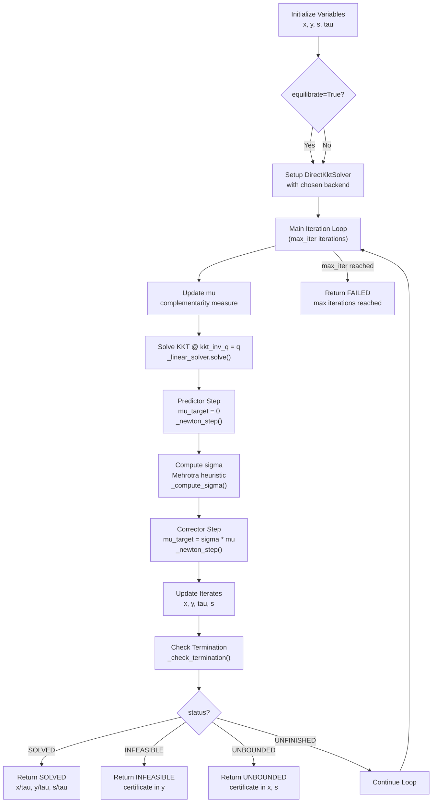
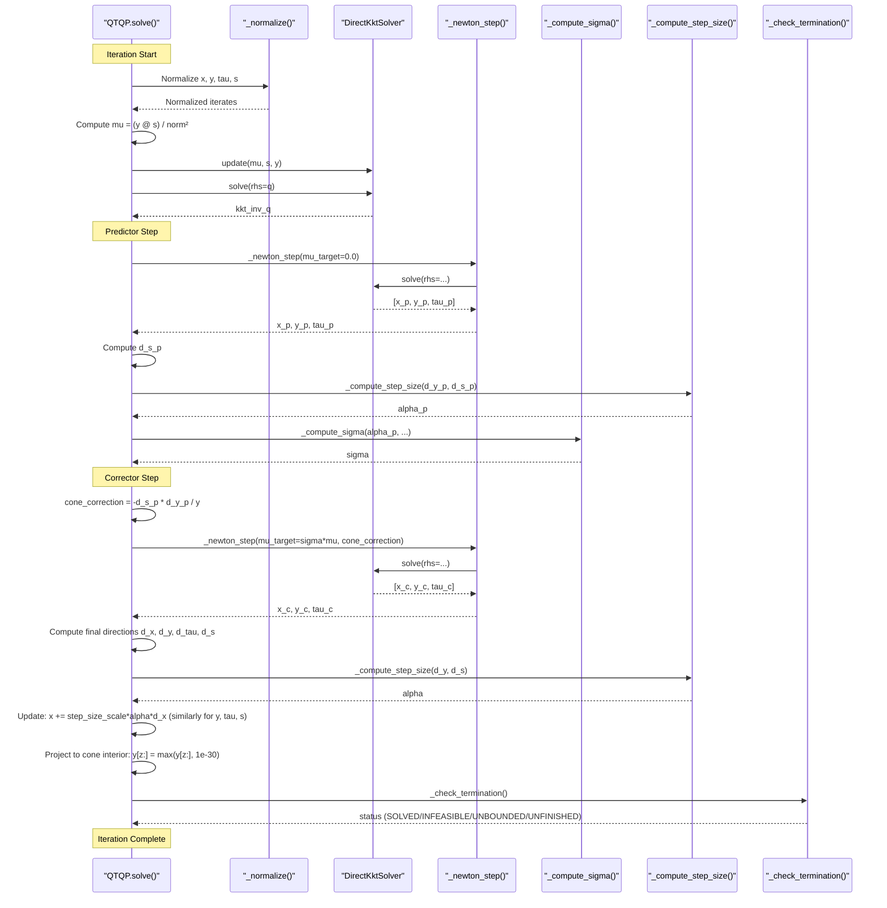
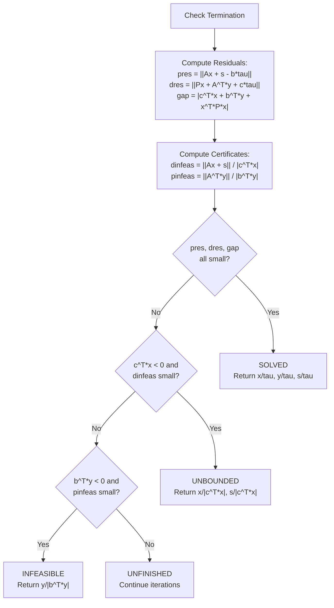

<!-- source: DeepWiki mcp.deepwiki.com · repo google-deepmind/qtqp · page 3.1 QTQP Solver: Primal-Dual Interior Point Method · fetched 2026-10-26 -->

# QTQP Solver: Primal-Dual Interior Point Method

<details>
<summary>Relevant source files</summary>

The following files were used as context for generating this wiki page:

- [src/qtqp/__init__.py](src/qtqp/__init__.py)

</details>


## Purpose and Scope

This document describes the main QTQP solver algorithm implemented in the `QTQP` class. It explains the primal-dual interior point method with predictor-corrector steps and homogeneous self-dual embedding used to solve quadratic programs. 

For details on how the KKT linear systems are constructed and solved, see [DirectKktSolver: KKT System Management](#3.2). For information on the underlying linear algebra implementations, see [Linear Solver Backends](#3.3). For guidance on using equilibration and warm-starting features, see [Equilibration and Numerical Stability](#5.1) and [Warm Starting](#5.2).

**Sources:** [src/qtqp/__init__.py:1-655]()

---

## Problem Formulation

The `QTQP` class solves quadratic programs in the following form:

### Primal Problem

```
minimize    (1/2) x^T P x + c^T x
subject to  A x + s = b
            s[:z] = 0     (equality constraints)
            s[z:] ≥ 0     (inequality constraints)
```

### Dual Problem

```
maximize    -(1/2) x^T P x - b^T y
subject to  P x + A^T y = -c
            y[z:] ≥ 0
```

### Problem Data

| Parameter | Type | Dimension | Description |
|-----------|------|-----------|-------------|
| `a` | `sp.csc_matrix` | m × n | Constraint matrix (sparse CSC format) |
| `b` | `np.ndarray` | m | Right-hand side vector |
| `c` | `np.ndarray` | n | Linear cost coefficient vector |
| `p` | `sp.csc_matrix` | n × n | Quadratic cost matrix (sparse CSC, optional) |
| `z` | `int` | scalar | Number of equality constraints (zero-cone size) |

The first `z` constraints are equality constraints (`s[:z] = 0`), and the remaining `m - z` are inequality constraints (`s[z:] ≥ 0`).

**Sources:** [src/qtqp/__init__.py:76-141]()

---

## Algorithm Overview

The solver implements a **primal-dual interior point method** with the following key features:

1. **Homogeneous Self-Dual Embedding**: Uses a homogeneous variable `tau` to handle infeasible and unbounded problems uniformly
2. **Predictor-Corrector Steps**: Mehrotra's predictor-corrector algorithm for faster convergence
3. **Iterative Refinement**: High-accuracy KKT solutions via the `DirectKktSolver`
4. **Equilibration**: Optional Ruiz equilibration for improved numerical conditioning
5. **Warm Starting**: Supports user-provided initial iterates



**Diagram: Overall QTQP Solver Algorithm Flow**

**Sources:** [src/qtqp/__init__.py:145-373]()

---

## Homogeneous Self-Dual Embedding

The solver uses **homogeneous self-dual embedding** to handle infeasible and unbounded problems without a priori knowledge of feasibility. This approach introduces an additional variable `tau` that homogenizes the problem.

### Variables

| Variable | Dimension | Cone | Description |
|----------|-----------|------|-------------|
| `x` | n | ℝⁿ | Primal variables |
| `y` | m | ℝᶻ × ℝ₊ᵐ⁻ᶻ | Dual variables (first z free, rest non-negative) |
| `s` | m | {0}ᶻ × ℝ₊ᵐ⁻ᶻ | Slack variables (first z zero, rest non-negative) |
| `tau` | 1 | ℝ₊ | Homogeneous embedding variable |

### Interpretation

- **If `tau > 0` at convergence**: The solution is `(x/tau, y/tau, s/tau)` and the problem is feasible
- **If `tau → 0` and `c^T x < 0`**: The problem is **primal unbounded** (certificate in x, s)
- **If `tau → 0` and `b^T y < 0`**: The problem is **primal infeasible** (certificate in y)

### Normalization

At each iteration, the variables are normalized to maintain numerical stability:

```
scale = sqrt(m - z + 1) / ||[x; y; tau]||₂
x ← x * scale
y ← y * scale  
tau ← tau * scale
s ← s * scale
```

This keeps the iterate vector on a sphere of radius approximately `sqrt(m - z + 1)`.

**Sources:** [src/qtqp/__init__.py:230-233](), [src/qtqp/__init__.py:269-270](), [src/qtqp/__init__.py:523-527](), [src/qtqp/__init__.py:333-345]()

---

## Main Iteration Loop

Each iteration of the solver performs the following steps:



**Diagram: Sequence of Operations in One Iteration**

### Key Quantities

**Complementarity Measure (mu)**

```python
mu = (y @ s) / max(eps, x @ x + y @ y + tau @ tau)
```

The complementarity measure `mu` quantifies how far the current iterate is from satisfying complementarity conditions (`y_i * s_i = 0` for all i). As the algorithm converges, `mu → 0`.

**Sources:** [src/qtqp/__init__.py:262-373]()

---

## Predictor-Corrector Steps

The algorithm uses **Mehrotra's predictor-corrector** approach, which combines two Newton steps per iteration:

### Predictor Step (Affine Step)

The predictor step computes the **affine scaling direction** by solving the KKT system with `mu_target = 0.0`:

```
Find (x_p, y_p, tau_p) such that the Newton system is satisfied with mu = 0
```

This step aims directly at the optimal solution without centering. The corresponding slack direction is:

```python
d_s_p[z:] = -y_p[z:] * s[z:] / y[z:]
```

**Sources:** [src/qtqp/__init__.py:282-298]()

### Centering Parameter (sigma)

After computing the predictor step, the algorithm computes the **centering parameter** `sigma` using Mehrotra's heuristic:

```python
mu_curr = (y @ s) / max(eps, x @ x + y @ y + tau @ tau)
mu_aff = (y_aff @ s_aff) / max(eps, norm(x_aff, y_aff, tau_aff)²)
sigma = (mu_aff / mu_curr)³
sigma = clip(sigma, 0.0, 1.0)
```

Where `(x_aff, y_aff, tau_aff, s_aff)` are the iterates after taking the full predictor step with step size `alpha_p`.

- **If `mu_aff << mu_curr`**: The predictor step makes good progress, so use small `sigma` (aggressive)
- **If `mu_aff ≈ mu_curr`**: The predictor step makes little progress, so use large `sigma` (centering)

**Sources:** [src/qtqp/__init__.py:301-304](), [src/qtqp/__init__.py:431-447]()

### Corrector Step

The corrector step solves the KKT system with `mu_target = sigma * mu` and includes the **Mehrotra correction term**:

```python
cone_correction = -d_s_p[z:] * d_y_p[z:] / y[z:]
```

This correction term accounts for the nonlinearity in the complementarity condition and typically improves convergence.

**Sources:** [src/qtqp/__init__.py:306-329]()

### Combined Step

The final step direction uses the corrector solution:

```python
d_x = x_c - x
d_y = y_c - y
d_tau = tau_c - tau
d_s[z:] = sigma * mu / y[z:] + cone_correction - y_c[z:] * s[z:] / y[z:]
```



```mermaid
graph LR
    subgraph "Predictor Step"
        P1["Solve KKT system<br/>mu_target = 0"]
        P2["Compute d_s_p"]
        P3["Compute alpha_p"]
        P1 --> P2 --> P3
    end
    
    subgraph "Centering"
        S1["Project with alpha_p"]
        S2["Compute mu_aff"]
        S3["sigma = (mu_aff/mu_curr)³"]
        P3 --> S1 --> S2 --> S3
    end
    
    subgraph "Corrector Step"
        C1["cone_correction =<br/>-d_s_p * d_y_p / y"]
        C2["Solve KKT system<br/>mu_target = sigma*mu<br/>with cone_correction"]
        C3["Compute final d_x, d_y, d_tau, d_s"]
        S3 --> C1 --> C2 --> C3
    end
    
    subgraph "Update"
        U1["Compute alpha"]
        U2["x += alpha*d_x<br/>y += alpha*d_y<br/>etc."]
        C3 --> U1 --> U2
    end
```

**Diagram: Predictor-Corrector Algorithm Structure**

**Sources:** [src/qtqp/__init__.py:282-338]()

---

## Newton Step Computation

The `_newton_step()` method computes a search direction by solving the augmented KKT system for the homogeneous problem.

### Right-Hand Side Construction

The right-hand side vector is constructed as:

```python
r = zeros(n + m)
r[n+z:] = mu_target / y[z:] + s[z:] + cone_correction  # (if provided)
r += (mu - mu_target) * rhs_anchor
```

Where `rhs_anchor = [x; y]` for the predictor step and `[x_p; y_p]` for the corrector step.

**Sources:** [src/qtqp/__init__.py:449-468]()

### Solving for Tau

The homogeneous variable `tau` is determined by solving a quadratic equation derived from the KKT conditions:

```
t_a * tau² + t_b * tau + t_c = 0
```

The coefficients depend on the solution `m_r` of the KKT system and the quadratic cost matrix `P`:

```python
v = equilibrated_p @ [m_r[:n], kinv_q[:n]]
p_kinv_r, p_kinv_q = v[:, 0], v[:, 1]

t_a = mu + kinv_q @ q - kinv_q[:n] @ p_kinv_q
t_b = -r_tau - m_r @ q + m_r[:n] @ p_kinv_q + kinv_q[:n] @ p_kinv_r
t_c = -m_r[:n] @ p_kinv_r - mu_target

tau = (-t_b + sqrt(t_b² - 4*t_a*t_c)) / (2*t_a)
```

The theory guarantees `t_a > 0` and `t_c ≤ 0`, ensuring a valid positive root exists.

**Sources:** [src/qtqp/__init__.py:486-521]()

### Reconstructing the Step

The full search direction is reconstructed from the KKT solution and the computed `tau`:

```python
vec_plus = m_r - kkt_inv_q * tau_plus
x_plus = vec_plus[:n]
y_plus = vec_plus[n:]
```

**Sources:** [src/qtqp/__init__.py:481-483]()

---

## Step Size Computation and Safeguards

### Maximum Step Size

The `_max_step_size()` method finds the largest step `alpha ∈ [0, 1]` such that all variables remain in their respective cones:

```python
# For y + alpha * d_y ≥ 0:
idx = d_y < -eps
alpha_y = min(1.0, min(-y[idx] / d_y[idx]))

# Similarly for s
alpha_s = ...

alpha = min(alpha_y, alpha_s)
```

**Sources:** [src/qtqp/__init__.py:420-429](), [src/qtqp/__init__.py:529-533]()

### Step Size Scaling

The actual step taken is scaled by `step_size_scale` (default 0.99) to maintain strict interiority:

```python
step_size = step_size_scale * alpha
x += step_size * d_x
y += step_size * d_y
# etc.
```

**Sources:** [src/qtqp/__init__.py:331-338]()

### Cone Projection

After the update, variables are explicitly projected back into the cone interior to handle numerical errors:

```python
y[z:] = np.maximum(y[z:], 1e-30)
s[z:] = np.maximum(s[z:], 1e-30)
tau = np.maximum(tau, 1e-30)
```

This ensures all iterates remain strictly feasible despite floating-point arithmetic.

**Sources:** [src/qtqp/__init__.py:340-344]()

---

## Termination Conditions

The `_check_termination()` method checks four possible outcomes:



**Diagram: Termination Decision Flow**

### SOLVED Condition

The problem is considered **SOLVED** when all residuals are small:

```python
gap < atol + rtol * min(abs(pcost), abs(dcost))
pres < atol + rtol * prelrhs
dres < atol + rtol * drelrhs
```

Where:
- `pcost = (c^T*x + 0.5*x^T*P*x) / tau²` (primal objective)
- `dcost = -(b^T*y + 0.5*x^T*P*x) / tau²` (dual objective)
- `gap = |c^T*x + b^T*y + x^T*P*x| / tau²` (duality gap)
- `pres = ||A*x + s - b*tau|| / tau` (primal feasibility residual)
- `dres = ||P*x + A^T*y + c*tau|| / tau` (dual feasibility residual)

**Sources:** [src/qtqp/__init__.py:579-584]()

### UNBOUNDED Condition

The problem is considered **UNBOUNDED** (primal unbounded / dual infeasible) when:

```python
ctx < -eps  and  dinfeas < atol_infeas + rtol_infeas * norm_x / abs(ctx)
```

Where:
- `ctx = c^T * x`
- `dinfeas = max(||A*x + s|| / |c^T*x|, ||P*x|| / |c^T*x|)`

In this case, `tau → 0` and `(x, s)` form a certificate of unboundedness.

**Sources:** [src/qtqp/__init__.py:585-588]()

### INFEASIBLE Condition

The problem is considered **INFEASIBLE** (primal infeasible / dual unbounded) when:

```python
bty < -eps  and  pinfeas < atol_infeas + rtol_infeas * norm_y / abs(bty)
```

Where:
- `bty = b^T * y`
- `pinfeas = ||A^T*y|| / |b^T*y|`

In this case, `tau → 0` and `y` forms a certificate of infeasibility.

**Sources:** [src/qtqp/__init__.py:589-592]()

### FAILED Condition

If the maximum number of iterations is reached without meeting any termination condition, the solver returns status **FAILED**.

**Sources:** [src/qtqp/__init__.py:372-373]()

---

## Equilibration

The solver supports **Ruiz equilibration** to improve the numerical conditioning of the problem data.

### Algorithm

Ruiz equilibration alternates between row and column scaling for a fixed number of iterations (default 10):

```python
for i in range(num_iters):
    # Row scaling
    d_i = 1.0 / sqrt(||A_row||_inf)
    d_i = clip(d_i, min_scale, max_scale)
    
    # Column scaling  
    e_i = 1.0 / sqrt(max(||A_col||_inf, ||P_col||_inf))
    e_i = clip(e_i, min_scale, max_scale)
    
    # Apply scaling
    A = diag(d_i) @ A @ diag(e_i)
    P = diag(e_i) @ P @ diag(e_i)
    
    # Accumulate
    d *= d_i
    e *= e_i
```

**Sources:** [src/qtqp/__init__.py:375-412]()

### Transformation

When equilibration is enabled, the problem data is transformed:

```python
A_eq = diag(d) @ A @ diag(e)
P_eq = diag(e) @ P @ diag(e)
b_eq = d * b
c_eq = e * c
```

And iterates are transformed between equilibrated and original spaces:

```python
# To equilibrated space
x_eq = x / e
y_eq = y / d
s_eq = s * d

# From equilibrated space
x = e * x_eq
y = d * y_eq
s = s_eq / d
```

**Sources:** [src/qtqp/__init__.py:240-245](), [src/qtqp/__init__.py:414-418]()

---

## Configuration Parameters

The `solve()` method accepts 16 configuration parameters that control the solver behavior:

| Parameter | Type | Default | Description |
|-----------|------|---------|-------------|
| `atol` | float | 1e-7 | Absolute tolerance for primal/dual/gap residuals |
| `rtol` | float | 1e-8 | Relative tolerance for primal/dual/gap residuals |
| `atol_infeas` | float | 1e-8 | Absolute tolerance for infeasibility detection |
| `rtol_infeas` | float | 1e-9 | Relative tolerance for infeasibility detection |
| `max_iter` | int | 100 | Maximum number of iterations |
| `step_size_scale` | float | 0.99 | Step size scaling factor (0, 1) |
| `min_static_regularization` | float | 1e-7 | Minimum diagonal regularization for KKT matrix |
| `max_iterative_refinement_steps` | int | 50 | Maximum refinement iterations in linear solver |
| `linear_solver_atol` | float | 1e-12 | Absolute tolerance for linear system solver |
| `linear_solver_rtol` | float | 1e-12 | Relative tolerance for linear system solver |
| `linear_solver` | LinearSolver | SCIPY | Which linear solver backend to use |
| `verbose` | bool | True | Whether to print iteration log |
| `equilibrate` | bool | True | Whether to apply Ruiz equilibration |
| `x` | np.ndarray | None | Initial primal solution (warm start) |
| `y` | np.ndarray | None | Initial dual solution (warm start) |
| `s` | np.ndarray | None | Initial slack values (warm start) |

**Sources:** [src/qtqp/__init__.py:145-197]()

---

## Code Entity Map

This table maps algorithm concepts to their implementations in the codebase:

| Concept | Class/Method | Location |
|---------|--------------|----------|
| Main solver | `QTQP` class | [src/qtqp/__init__.py:76-654]() |
| Problem initialization | `QTQP.__init__()` | [src/qtqp/__init__.py:91-143]() |
| Main solver loop | `QTQP.solve()` | [src/qtqp/__init__.py:145-373]() |
| Predictor step | `QTQP.solve()` lines 282-298 | [src/qtqp/__init__.py:282-298]() |
| Corrector step | `QTQP.solve()` lines 306-329 | [src/qtqp/__init__.py:306-329]() |
| Newton step solver | `QTQP._newton_step()` | [src/qtqp/__init__.py:449-484]() |
| Tau quadratic solve | `QTQP._solve_for_tau()` | [src/qtqp/__init__.py:486-521]() |
| Centering parameter | `QTQP._compute_sigma()` | [src/qtqp/__init__.py:431-447]() |
| Step size computation | `QTQP._compute_step_size()` | [src/qtqp/__init__.py:529-533]() |
| Maximum step size | `QTQP._max_step_size()` | [src/qtqp/__init__.py:420-429]() |
| Normalization | `QTQP._normalize()` | [src/qtqp/__init__.py:523-527]() |
| Termination checking | `QTQP._check_termination()` | [src/qtqp/__init__.py:535-622]() |
| Equilibration | `QTQP._equilibrate()` | [src/qtqp/__init__.py:375-412]() |
| Equilibrate iterates | `QTQP._equilibrate_iterates()` | [src/qtqp/__init__.py:417-418]() |
| Unequilibrate iterates | `QTQP._unequilibrate_iterates()` | [src/qtqp/__init__.py:414-415]() |
| Solution status | `SolutionStatus` enum | [src/qtqp/__init__.py:47-54]() |
| Solution dataclass | `Solution` | [src/qtqp/__init__.py:57-73]() |
| Linear solver enum | `LinearSolver` enum | [src/qtqp/__init__.py:36-44]() |

**Sources:** [src/qtqp/__init__.py:1-655]()

---

