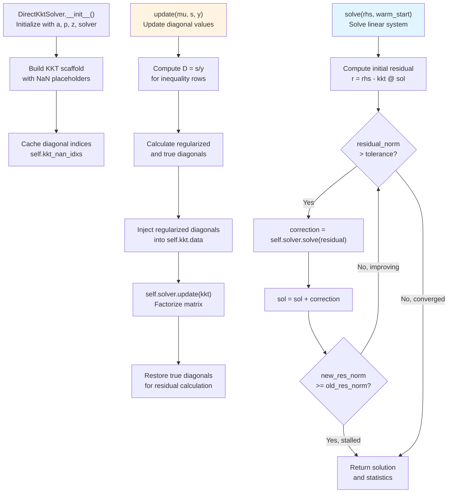
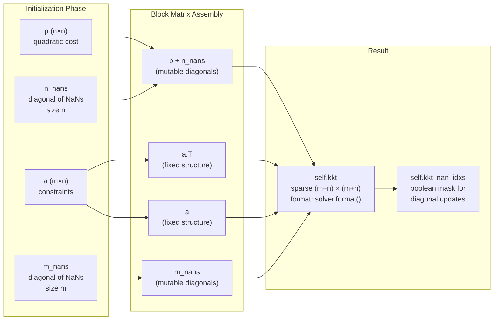
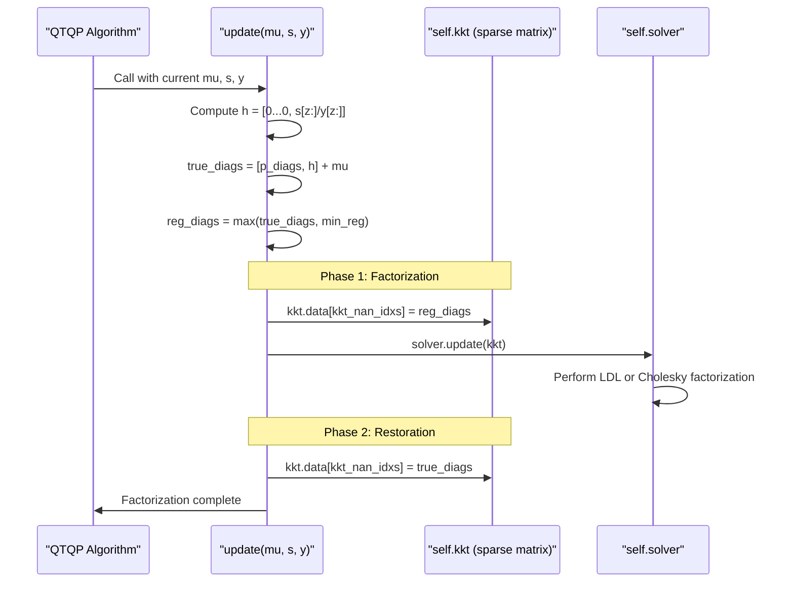
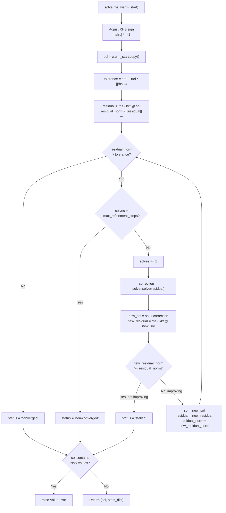
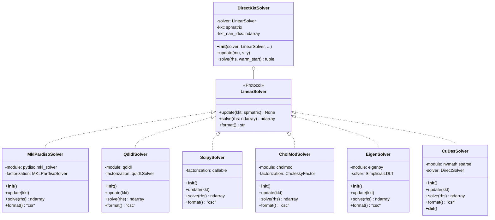
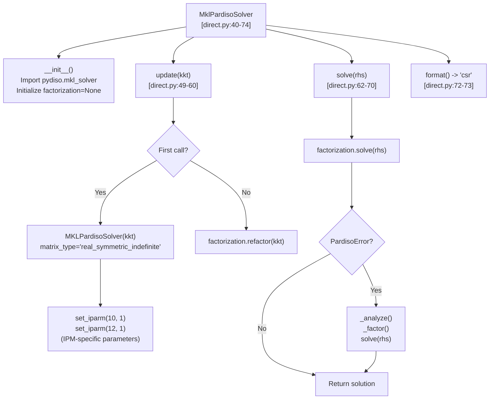
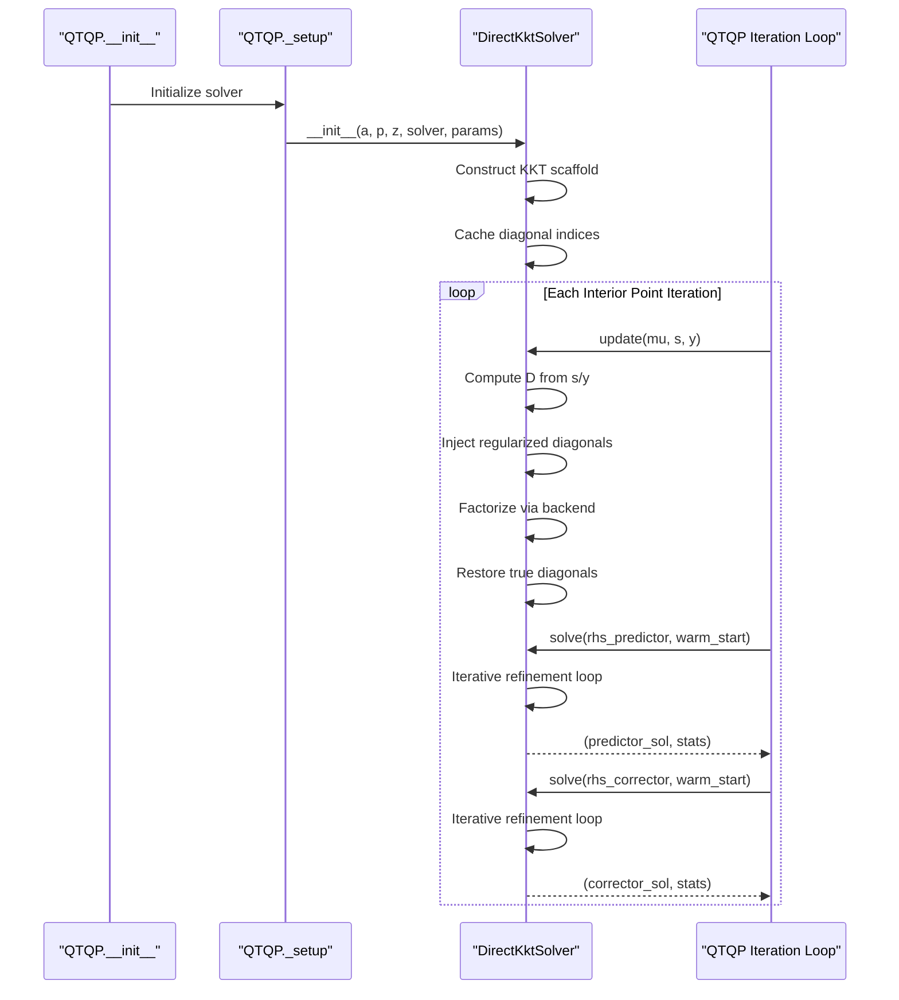

<!-- source: DeepWiki mcp.deepwiki.com · repo google-deepmind/qtqp · page 3.2 DirectKktSolver: KKT System Management · fetched 2026-10-26 -->

# DirectKktSolver: KKT System Management

<details>
<summary>Relevant source files</summary>

The following files were used as context for generating this wiki page:

- [src/qtqp/direct.py](src/qtqp/direct.py)

</details>


## Purpose and Scope

The `DirectKktSolver` class [src/qtqp/direct.py:204-383]() manages the construction, factorization, and solution of Karush-Kuhn-Tucker (KKT) linear systems that arise at each iteration of the QTQP primal-dual interior point algorithm. This document explains how `DirectKktSolver` constructs sparse KKT matrices, updates diagonal entries efficiently, delegates factorization to pluggable linear solver backends, and performs iterative refinement to achieve high-accuracy solutions.

For information about the overall optimization algorithm that uses this system, see [QTQP Solver: Primal-Dual Interior Point Method](#3.1). For details on the individual linear solver backend implementations, see [Linear Solver Backends](#3.3). For advanced discussion of the iterative refinement technique, see [Iterative Refinement](#5.3).

## System Overview

The `DirectKktSolver` serves as an abstraction layer between the QTQP optimization algorithm and various linear algebra libraries. Its primary responsibilities include:

1. **Matrix Structure Management**: Constructing the sparse KKT system scaffold once during initialization
2. **Dynamic Updates**: Efficiently updating diagonal entries based on changing barrier parameters
3. **Regularization**: Applying static regularization for numerical stability while preserving accuracy for residual calculations
4. **Backend Delegation**: Routing matrix factorization and triangular solves to the selected linear solver
5. **Solution Refinement**: Improving solution accuracy through iterative refinement with residual monitoring

**DirectKktSolver Workflow**



Sources: [src/qtqp/direct.py:204-383]()

## KKT Matrix Structure

The `DirectKktSolver` constructs a quasi-definite KKT system that represents the linearized optimality conditions for the quadratic program. The system has the block structure:

```
[ P + μI       A^T    ] [ x ]   [ rhs_x ]
[   A      -(D + μI)  ] [ y ] = [ rhs_y ]
```

Where:
- `P`: Quadratic cost matrix from the QP (n × n)
- `A`: Constraint matrix (m × n)
- `D`: Diagonal matrix derived from slack variables and dual variables
- `μ`: Barrier parameter (scalar)
- `I`: Identity matrix

### Matrix Construction

During initialization [src/qtqp/direct.py:213-260](), the solver constructs the sparse KKT matrix scaffold once:



Sources: [src/qtqp/direct.py:239-260]()

The key optimization is using `NaN` values as placeholders in the diagonal positions. These locations are identified once and cached in `self.kkt_nan_idxs` [src/qtqp/direct.py:260](), enabling efficient in-place updates without reconstructing the entire sparse matrix structure.

| Component | Type | Size | Purpose |
|-----------|------|------|---------|
| `self.kkt` | `sp.spmatrix` | (m+n) × (m+n) | Full KKT system with mutable diagonals |
| `self.p_diags` | `np.ndarray` | n | Diagonal of P matrix (cached) |
| `self.kkt_nan_idxs` | `np.ndarray` (bool) | nnz | Boolean mask identifying diagonal entries |
| `self.solver` | `LinearSolver` | - | Backend for factorization and solve |

Sources: [src/qtqp/direct.py:240-260]()

## Matrix Update Mechanism

The `update` method [src/qtqp/direct.py:262-293]() efficiently modifies the KKT matrix diagonals based on the current barrier parameter `mu`, slack variables `s`, and dual variables `y`. This method is called at each interior point iteration as the optimization progresses.

### Diagonal Computation

The method computes two sets of diagonal values:

1. **True Diagonals**: Used for accurate residual calculation
   ```
   Upper block: p_diags + μ
   Lower block: -(D + μ) where D = diag(0, ..., 0, s[z]/y[z], ..., s[m-1]/y[m-1])
   ```

2. **Regularized Diagonals**: Used for stable factorization
   ```
   reg_diags = max(true_diags, min_static_regularization)
   ```

Sources: [src/qtqp/direct.py:274-285]()

### Two-Phase Update Strategy

The update process uses a clever optimization to avoid copying the sparse matrix:



Sources: [src/qtqp/direct.py:262-293]()

This two-phase approach ensures:
- **Stable factorization**: The solver sees regularized values that are numerically well-conditioned
- **Accurate residuals**: Subsequent residual calculations use the true mathematical values
- **Efficiency**: No sparse matrix copying required, only updating dense diagonal data

## Iterative Refinement Solver

The `solve` method [src/qtqp/direct.py:294-382]() implements iterative refinement to improve solution accuracy beyond what the direct factorization alone provides. This is critical for ill-conditioned systems that arise in interior point methods.

### Refinement Algorithm

**Iterative Refinement Process**



Sources: [src/qtqp/direct.py:294-382]()

### Convergence Criteria

The iterative refinement loop terminates when one of the following conditions is met:

| Condition | Criterion | Outcome |
|-----------|-----------|---------|
| **Converged** | `residual_norm ≤ atol + rtol * ||rhs||∞` | Solution meets accuracy requirements |
| **Stalled** | `new_residual_norm ≥ old_residual_norm` | Progress stopped, return current solution |
| **Max Iterations** | `solves > max_iterative_refinement_steps` | Iteration limit reached |
| **NaN Detection** | `np.any(np.isnan(sol))` | Raises `ValueError` |

Sources: [src/qtqp/direct.py:322-372]()

The returned statistics dictionary contains:
- `"solves"`: Number of linear solves performed (factorization not counted)
- `"final_residual_norm"`: Final infinity norm of the residual
- `"status"`: One of `"converged"`, `"non-converged"`, or `"stalled"`

Sources: [src/qtqp/direct.py:378-382]()

## LinearSolver Protocol and Backend Interface

The `DirectKktSolver` delegates all matrix factorization and triangular solves to objects implementing the `LinearSolver` protocol [src/qtqp/direct.py:24-38](). This protocol defines a minimal interface that all backends must implement:



Sources: [src/qtqp/direct.py:24-202](), [src/qtqp/direct.py:204-260]()

### Protocol Methods

**`update(kkt: sp.spmatrix) -> None`** [src/qtqp/direct.py:27-29]()
- Accepts the KKT matrix in the backend's preferred sparse format
- Performs symbolic analysis (if first call) and numeric factorization
- May refactor an existing factorization if the sparsity pattern is unchanged

**`solve(rhs: np.ndarray) -> np.ndarray`** [src/qtqp/direct.py:31-33]()
- Solves the linear system using the current factorization
- Returns the solution vector

**`format() -> str`** [src/qtqp/direct.py:35-37]()
- Returns the expected sparse matrix format: `"csc"` (compressed sparse column) or `"csr"` (compressed sparse row)
- The `DirectKktSolver` constructs its KKT matrix in this format to avoid conversion overhead

### Matrix Format Selection

Different backends prefer different sparse matrix formats due to their internal algorithms:

| Backend | Format | Reason |
|---------|--------|--------|
| `ScipySolver` | CSC | SuperLU requires column-major ordering |
| `QdldlSolver` | CSC | LDL factorization works column-wise |
| `CholModSolver` | CSC | CHOLMOD library uses CSC internally |
| `EigenSolver` | CSC | Eigen's SimplicialLDLT expects CSC |
| `MklPardisoSolver` | CSR | Pardiso uses row-major ordering |
| `CuDssSolver` | CSR | cuDSS GPU solver expects CSR |

Sources: [src/qtqp/direct.py:72-73](), [src/qtqp/direct.py:94-95](), [src/qtqp/direct.py:111-112](), [src/qtqp/direct.py:133-134](), [src/qtqp/direct.py:156-157](), [src/qtqp/direct.py:195-196]()

The `DirectKktSolver` queries the backend's format during initialization [src/qtqp/direct.py:256]() and constructs the KKT matrix directly in that format, avoiding costly format conversions.

## Backend-Specific Implementation Details

Each `LinearSolver` implementation wraps a different linear algebra library with backend-specific optimizations:

### MklPardisoSolver

**Code Entity Map: MklPardisoSolver**


Sources: [src/qtqp/direct.py:40-74]()

**Key features**:
- Uses Intel MKL Pardiso for high-performance symmetric indefinite systems
- Sets IPARM parameters 10 and 12 for interior point methods [src/qtqp/direct.py:57-58]()
- Includes error recovery that retries analysis and factorization if solve fails [src/qtqp/direct.py:63-70]()
- Requires CSR format for optimal performance

### QdldlSolver

Sources: [src/qtqp/direct.py:76-96]()

**Key features**:
- Implements quasi-definite LDL factorization specifically designed for KKT systems
- Lightweight solver suitable for small to medium problems
- Supports refactorization with `update()` method [src/qtqp/direct.py:89]()
- Uses CSC format

### ScipySolver

Sources: [src/qtqp/direct.py:98-113]()

**Key features**:
- Default fallback using SciPy's `sp.linalg.factorized` function
- Based on SuperLU for general sparse systems
- Creates a new factorization on each `update()` call [src/qtqp/direct.py:106]()
- Requires CSC format [src/qtqp/direct.py:106]()

### CholModSolver

Sources: [src/qtqp/direct.py:115-135]()

**Key features**:
- Uses CHOLMOD library (SuiteSparse) for Cholesky-like LDL^T factorization
- Configured with `mode="simplicial"` for consistent performance [src/qtqp/direct.py:126]()
- Supports efficient refactorization via `cholesky_inplace()` [src/qtqp/direct.py:128]()
- Uses CSC format

### EigenSolver

Sources: [src/qtqp/direct.py:137-158]()

**Key features**:
- Wraps Eigen's SimplicialLDLT solver via eigenpy Python bindings
- Separates symbolic analysis (`analyzePattern`) and numeric factorization (`factorize`) [src/qtqp/direct.py:149-151]()
- Performs analysis only once, refactorizes on subsequent updates
- Uses CSC format

### CuDssSolver

Sources: [src/qtqp/direct.py:160-202]()

**Key features**:
- GPU-accelerated solver using Nvidia's cuDSS library
- Requires Fortran-contiguous arrays (`order="F"`) for RHS [src/qtqp/direct.py:179](), [src/qtqp/direct.py:191]()
- Separates planning, factorization, and solving phases [src/qtqp/direct.py:183](), [src/qtqp/direct.py:187]()
- Includes destructor to free GPU resources [src/qtqp/direct.py:198-201]()
- Uses CSR format
- Disables logging by default [src/qtqp/direct.py:173-176]()

## Integration with QTQP Solver

The `DirectKktSolver` is instantiated and used by the main QTQP algorithm in a tight loop:



Sources: [src/qtqp/direct.py:204-383]()

The `DirectKktSolver` is called twice per iteration for the predictor and corrector steps of the Mehrotra predictor-corrector algorithm. The `update` method is called once per iteration before the predictor step to update the KKT matrix with the current barrier parameter and variable values.

## Performance Characteristics

The efficiency of `DirectKktSolver` stems from several design choices:

| Optimization | Implementation | Benefit |
|--------------|----------------|---------|
| **Sparse scaffold** | Construct once, update diagonals only | Avoids repeated sparse matrix construction |
| **Index caching** | `self.kkt_nan_idxs` boolean mask | O(nnz) diagonal updates without searching |
| **Format selection** | Build in backend's native format | Eliminates CSC ↔ CSR conversion overhead |
| **Two-phase update** | Inject/restore diagonal values | No sparse matrix copying required |
| **Iterative refinement** | Improves accuracy with multiple solves | Achieves high accuracy despite regularization |
| **Warm starting** | Reuse previous solution | Reduces refinement iterations |

Sources: [src/qtqp/direct.py:239-260](), [src/qtqp/direct.py:262-293](), [src/qtqp/direct.py:294-382]()

The sparse matrix structure with `NaN` placeholders is particularly efficient: the sparsity pattern and off-diagonal values never change, only the `n + m` diagonal entries are updated. This reduces the update cost from O(nnz) general sparse operations to O(n + m) dense array operations.

---

