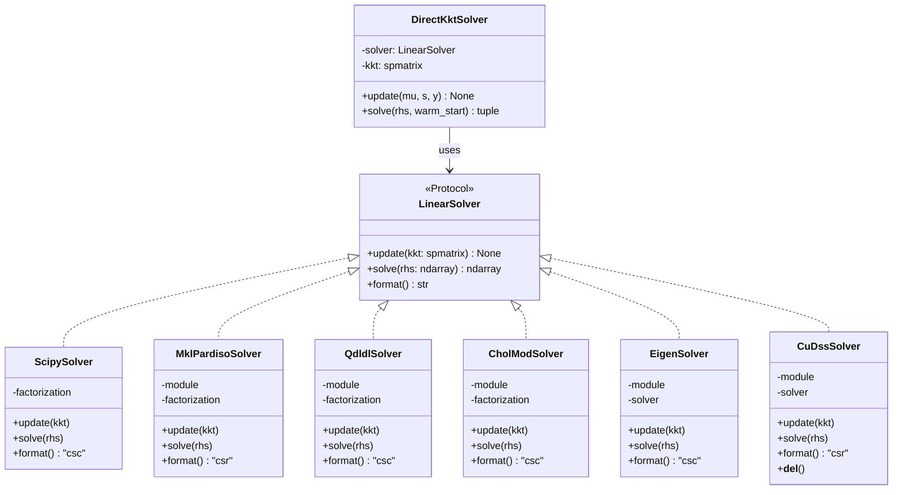
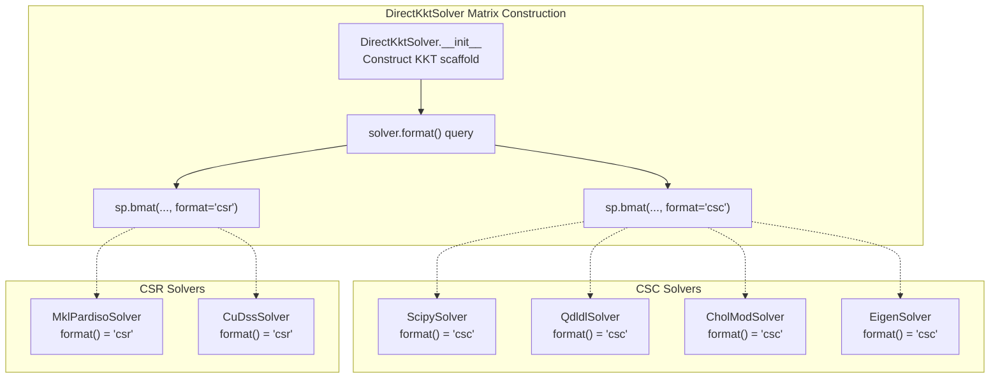
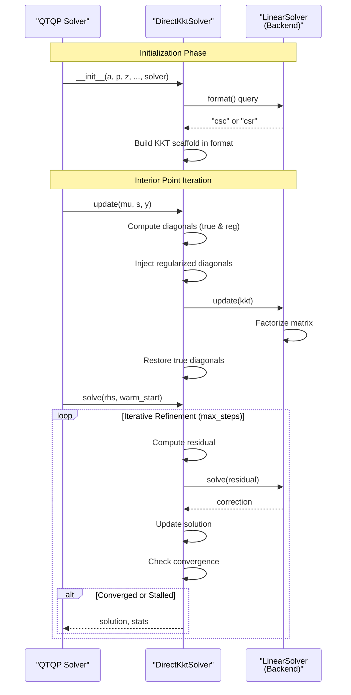
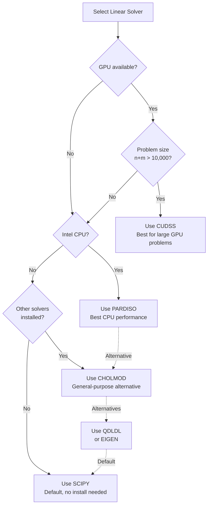

<!-- source: DeepWiki mcp.deepwiki.com · repo google-deepmind/qtqp · page 3.3 Linear Solver Backends · fetched 2026-10-26 -->

# Linear Solver Backends

<details>
<summary>Relevant source files</summary>

The following files were used as context for generating this wiki page:

- [README.md](README.md)
- [src/qtqp/direct.py](src/qtqp/direct.py)

</details>


## Purpose and Scope

This page documents the six linear solver backend implementations that QTQP uses to factorize and solve the KKT systems within the primal-dual interior point method. These backends provide the low-level numerical linear algebra operations that enable the solver to handle diverse problem types and hardware configurations.

For information about how these backends are integrated into the KKT system solving workflow, see [DirectKktSolver: KKT System Management](#3.2). For details on the overall optimization algorithm that uses these solvers, see [QTQP Solver: Primal-Dual Interior Point Method](#3.1).

Sources: [src/qtqp/direct.py:1-383](), [README.md:190-241]()

## The LinearSolver Protocol

All linear solver backends implement the `LinearSolver` protocol interface defined in [src/qtqp/direct.py:24-37](). This protocol specifies three methods that any backend must provide:

```
update(kkt: sp.spmatrix) -> None
solve(rhs: np.ndarray) -> np.ndarray
format() -> str
```

The protocol enables `DirectKktSolver` to work with any backend without coupling to specific implementation details. The three methods serve distinct purposes:

- **`update`**: Factorizes or refactorizes the KKT matrix. Called once per interior point iteration when the barrier parameter `mu` changes.
- **`solve`**: Solves the linear system `kkt @ x = rhs` using the most recent factorization. Called multiple times during iterative refinement.
- **`format`**: Returns the expected sparse matrix format (`"csc"` or `"csr"`). Used by `DirectKktSolver` to construct the KKT scaffold in the correct format.



Sources: [src/qtqp/direct.py:24-37](), [src/qtqp/direct.py:204-383]()

## Solver Implementations

QTQP provides six linear solver backends, each with distinct characteristics, dependencies, and use cases. The following subsections detail each implementation.

### SciPy Solver (Default)

**Implementation**: [src/qtqp/direct.py:98-112]()  
**Enum**: `qtqp.LinearSolver.SCIPY`  
**Matrix Format**: CSC (Compressed Sparse Column)

The `ScipySolver` wraps `scipy.sparse.linalg.factorized`, which computes an LU factorization using SuperLU. This is the default backend because SciPy is a required dependency of QTQP, requiring no additional installation.

The implementation is minimal:
- **`update`**: Calls `sp.linalg.factorized(kkt.tocsc())` to compute a new factorization
- **`solve`**: Invokes the factorization as a callable: `self.factorization(rhs)`
- **`format`**: Returns `"csc"`

**Characteristics**:
- No additional dependencies (scipy>=1.9 required by base package)
- General-purpose LU factorization
- Moderate performance for small to medium problems
- Does not exploit symmetric structure of KKT matrices

**When to Use**: Default choice when no specialized solvers are installed, or for prototyping and small-scale problems.

Sources: [src/qtqp/direct.py:98-112](), [README.md:193-194]()

### MKL Pardiso Solver

**Implementation**: [src/qtqp/direct.py:40-73]()  
**Enum**: `qtqp.LinearSolver.PARDISO`  
**Matrix Format**: CSR (Compressed Sparse Row)

The `MklPardisoSolver` wraps Intel's MKL PARDISO library via the `pydiso` package. PARDISO is a high-performance direct solver for sparse symmetric indefinite systems, making it well-suited for KKT matrices.

Key implementation details:
- **`update`**: Creates `MKLPardisoSolver` instance with `matrix_type="real_symmetric_indefinite"` on first call. Sets recommended iparms (10 and 12) for interior point methods [src/qtqp/direct.py:54-58](). Subsequent calls use `refactor()` method.
- **`solve`**: Includes error recovery logic [src/qtqp/direct.py:62-70](). If a `PardisoError` occurs, re-runs analysis and factorization steps before retrying.
- **`format`**: Returns `"csr"` (PARDISO requires CSR format)

**Installation**:
```bash
conda install pydiso --channel conda-forge
```

**Characteristics**:
- **Platform Requirement**: Intel CPUs only
- Exploits symmetric indefinite structure
- Optimized for interior point method workloads (via iparm settings)
- Generally faster than SciPy for medium to large problems
- Includes automatic error recovery

**When to Use**: Recommended default on systems with Intel CPUs. Often provides the best CPU performance for typical QP problems.

Sources: [src/qtqp/direct.py:40-73](), [README.md:200-207]()

### QDLDL Solver

**Implementation**: [src/qtqp/direct.py:76-95]()  
**Enum**: `qtqp.LinearSolver.QDLDL`  
**Matrix Format**: CSC

The `QdldlSolver` wraps the QDLDL library, which performs quasi-definite LDL factorization. QDLDL is designed specifically for quasi-definite systems (matrices with block structure `[A, B'; B, -C]` where A and C are positive definite), matching the KKT form exactly.

Implementation:
- **`update`**: Creates `qdldl.Solver` on first call [src/qtqp/direct.py:87](). Uses `update()` method for refactorization [src/qtqp/direct.py:89]()
- **`solve`**: Directly calls `self.factorization.solve(rhs)` [src/qtqp/direct.py:92]()
- **`format`**: Returns `"csc"`

**Installation**:
```bash
python -m pip install qdldl
```

**Characteristics**:
- Pure Python/NumPy implementation
- Specialized for quasi-definite systems
- Lightweight with minimal dependencies
- Predictable numerical behavior
- Moderate performance

**When to Use**: Good choice when specialized quasi-definite structure handling is desired, or when conda-based solvers cannot be installed.

Sources: [src/qtqp/direct.py:76-95](), [README.md:217-223]()

### CHOLMOD Solver

**Implementation**: [src/qtqp/direct.py:115-134]()  
**Enum**: `qtqp.LinearSolver.CHOLMOD`  
**Matrix Format**: CSC

The `CholModSolver` wraps CHOLMOD (from SuiteSparse) via the `scikit-sparse` package. CHOLMOD provides Cholesky-based LDL^T factorization with sophisticated ordering and symbolic analysis.

Implementation details:
- **`update`**: Creates `cholmod.cholesky()` factorization with `mode="simplicial"` on first call [src/qtqp/direct.py:126](). Uses in-place refactorization via `cholesky_inplace()` for subsequent updates [src/qtqp/direct.py:128]()
- **`solve`**: Invokes factorization as callable [src/qtqp/direct.py:131]()
- **`format`**: Returns `"csc"`

**Installation**:
```bash
conda install -c conda-forge scikit-sparse
```

**Characteristics**:
- Mature, heavily optimized C library (SuiteSparse)
- Simplicial factorization for stability
- In-place refactorization reduces memory allocations
- Strong numerical properties
- Good performance on a wide range of problem structures

**When to Use**: Excellent general-purpose solver. Recommended when PARDISO is not available (non-Intel CPUs) or when maximum numerical stability is required.

Sources: [src/qtqp/direct.py:115-134](), [README.md:225-231]()

### Eigen Solver

**Implementation**: [src/qtqp/direct.py:137-157]()  
**Enum**: `qtqp.LinearSolver.EIGEN`  
**Matrix Format**: CSC

The `EigenSolver` wraps Eigen's `SimplicialLDLT` solver via the `eigenpy` Python bindings. Eigen is a C++ template library widely used in robotics and scientific computing.

Implementation:
- **`update`**: Creates `eigenpy.SimplicialLDLT()` instance and calls `analyzePattern()` once on first call [src/qtqp/direct.py:148-149](). Subsequent calls use only `factorize()` [src/qtqp/direct.py:151]()
- **`solve`**: Calls `self.solver.solve(rhs)` [src/qtqp/direct.py:154]()
- **`format`**: Returns `"csc"`

**Installation**:
```bash
conda install eigenpy -c conda-forge
```

**Characteristics**:
- C++ template-based implementation via Python bindings
- Separates symbolic analysis (`analyzePattern`) from numeric factorization
- Simplicial LDL^T factorization
- Well-integrated with robotics/control ecosystems
- Moderate to good performance

**When to Use**: Natural choice in projects already using Eigen for other components, or in robotics applications where eigenpy is commonly available.

Sources: [src/qtqp/direct.py:137-157](), [README.md:209-215]()

### cuDSS GPU Solver

**Implementation**: [src/qtqp/direct.py:160-202]()  
**Enum**: `qtqp.LinearSolver.CUDSS`  
**Matrix Format**: CSR

The `CuDssSolver` wraps NVIDIA's cuDSS (CUDA Direct Sparse Solver) library, providing GPU-accelerated sparse direct solving. This is the only GPU-enabled backend in QTQP.

Implementation details:
- **`update`**: Creates `nvmath.sparse.advanced.DirectSolver` with symmetric matrix type [src/qtqp/direct.py:170-183](). Disables cuDSS logging by default [src/qtqp/direct.py:173-176](). Uses dummy RHS in Fortran order for initialization [src/qtqp/direct.py:179](). Separates `plan()` and `factorize()` steps. Subsequent calls use `reset_operands(a=kkt)` [src/qtqp/direct.py:185]()
- **`solve`**: Converts RHS to Fortran-contiguous order required by cuDSS [src/qtqp/direct.py:191](). Resets operands and calls `solve()` [src/qtqp/direct.py:192-193]()
- **`format`**: Returns `"csr"`
- **`__del__`**: Explicitly calls `solver.free()` to release GPU resources [src/qtqp/direct.py:198-201]()

**Installation**:
```bash
python -m pip install nvidia-cudss-cu12
python -m pip install nvmath-python[cu12]
```

**Characteristics**:
- **Hardware Requirement**: NVIDIA GPU with CUDA support
- GPU-accelerated factorization and triangular solves
- Asynchronous GPU operations
- Memory transfer overhead between CPU and GPU
- Requires Fortran-order arrays for RHS
- Explicit resource cleanup required

**Performance Considerations**:
- Best for large problems where factorization cost dominates
- May be slower than CPU solvers for small/medium problems due to data transfer overhead
- Benefits increase with problem size as GPU parallelism becomes effective

**When to Use**: Large-scale problems on GPU-equipped systems where factorization is the bottleneck. Not recommended for small problems or rapid solve sequences due to host-device transfer costs.

Sources: [src/qtqp/direct.py:160-202](), [README.md:233-240]()

## Solver Comparison

The following table summarizes key characteristics of all six backends:

| Solver | Matrix Format | Factorization Type | Dependencies | Hardware | Installation Complexity | Typical Use Case |
|--------|---------------|-------------------|--------------|----------|------------------------|------------------|
| **SciPy** | CSC | LU (SuperLU) | scipy (required) | CPU | None (default) | Small problems, prototyping |
| **PARDISO** | CSR | Symmetric indefinite | pydiso (conda) | Intel CPU | Low | Medium-large CPU problems |
| **QDLDL** | CSC | Quasi-definite LDL | qdldl (pip) | CPU | Low | Specialized quasi-definite needs |
| **CHOLMOD** | CSC | Simplicial LDL^T | scikit-sparse (conda) | CPU | Low | General-purpose, non-Intel CPU |
| **Eigen** | CSC | Simplicial LDL^T | eigenpy (conda) | CPU | Low | Robotics/Eigen ecosystems |
| **cuDSS** | CSR | GPU-accelerated | nvidia-cudss (pip) | NVIDIA GPU | Medium | Large-scale problems on GPU |

Sources: [src/qtqp/direct.py:24-202](), [README.md:190-241]()

## Matrix Format Requirements

Different linear solvers require different sparse matrix formats. QTQP handles this transparently through the `format()` method of the `LinearSolver` protocol.



The KKT matrix scaffold is constructed once during `DirectKktSolver` initialization in the format returned by `solver.format()` [src/qtqp/direct.py:254-258]():

```python
self.kkt = sp.bmat(
    [[p + n_nans, a.T], [a, m_nans]],
    format=self.solver.format(),  # 'csc' or 'csr'
    dtype=np.float64,
)
```

**Format Characteristics**:

- **CSC (Compressed Sparse Column)**: Column-oriented storage. Efficient for column slicing and operations involving `A.T @ x`. Used by SciPy, QDLDL, CHOLMOD, and Eigen.
- **CSR (Compressed Sparse Row)**: Row-oriented storage. Efficient for row slicing and matrix-vector products `A @ x`. Required by PARDISO and cuDSS.

The format decision occurs at solver instantiation and remains fixed throughout the solve process. Conversion between formats is avoided after initialization for performance reasons.

Sources: [src/qtqp/direct.py:35-37](), [src/qtqp/direct.py:254-258]()

## Integration with DirectKktSolver

The `DirectKktSolver` class orchestrates the use of linear solver backends within the iterative refinement workflow. The following diagram shows the complete interaction pattern:



**Key Integration Points**:

1. **Format Selection** [src/qtqp/direct.py:256](): The backend's format requirement determines KKT scaffold construction.

2. **Diagonal Injection** [src/qtqp/direct.py:262-292](): `DirectKktSolver.update()` implements a zero-copy optimization:
   - Computes regularized diagonals for stable factorization
   - Temporarily injects them into KKT matrix for `solver.update()`
   - Restores true diagonals for accurate residual computation in `solve()`

3. **Iterative Refinement** [src/qtqp/direct.py:332-369](): The `DirectKktSolver.solve()` method calls `solver.solve()` multiple times to improve accuracy:
   - Initial solve with warm-start
   - Loop: compute residual → solve correction → update solution
   - Terminates on convergence, stalling, or max iterations reached

4. **Error Handling**: Some solvers (e.g., MklPardisoSolver) include solver-specific error recovery logic [src/qtqp/direct.py:63-70]().

Sources: [src/qtqp/direct.py:204-383]()

## Solver Selection Guide

Choosing the optimal linear solver depends on problem characteristics, available hardware, and installed dependencies. The following decision tree provides guidance:



**Recommendations by Problem Size**:

- **Small (n+m < 1,000)**: SciPy is sufficient. Solver choice has minimal impact.
- **Medium (1,000 - 10,000)**: PARDISO (Intel) or CHOLMOD (other CPUs) recommended.
- **Large (> 10,000)**: cuDSS on GPU if available, otherwise PARDISO or CHOLMOD.
- **Very Large (> 100,000)**: cuDSS strongly recommended if GPU available.

**Special Considerations**:

- **Numerical Stability**: If convergence issues occur, try CHOLMOD or QDLDL which have predictable numerical behavior.
- **Robotics/Controls**: Use Eigen if already in project dependencies.
- **Minimal Dependencies**: QDLDL requires only pip installation (no conda).
- **Quick Prototyping**: SciPy requires no additional installation.

**Performance Testing**: The actual best solver may vary by problem structure. For production use with repeated solves of similar problems, benchmark all available solvers with representative test cases.

Sources: [README.md:190-241]()

## Runtime Solver Selection

Solvers are selected at solve-time via the `linear_solver` parameter to `QTQP.solve()`. The `LinearSolver` enum provides type-safe selection:

```python
import qtqp

# Create solver instance
solver = qtqp.QTQP(a=a, b=b, c=c, p=p, z=z)

# Solve with different backends
solution_scipy = solver.solve(linear_solver=qtqp.LinearSolver.SCIPY)
solution_pardiso = solver.solve(linear_solver=qtqp.LinearSolver.PARDISO)
solution_cudss = solver.solve(linear_solver=qtqp.LinearSolver.CUDSS)
```

The solver backend can be changed between calls to `solve()` on the same `QTQP` instance. Each call creates a new `DirectKktSolver` with the specified backend [src/qtqp/__init__.py]().

**Import Detection**: If a backend's dependencies are not installed, attempting to use it will raise an `ImportError` when the backend class attempts to import its underlying library (e.g., [src/qtqp/direct.py:44]() for PARDISO, [src/qtqp/direct.py:164]() for cuDSS).

**Available Enum Values**:
- `qtqp.LinearSolver.SCIPY`
- `qtqp.LinearSolver.PARDISO`
- `qtqp.LinearSolver.QDLDL`
- `qtqp.LinearSolver.CHOLMOD`
- `qtqp.LinearSolver.EIGEN`
- `qtqp.LinearSolver.CUDSS`

Sources: [README.md:154](), [README.md:192-198](), [src/qtqp/direct.py:40-202]()

---

