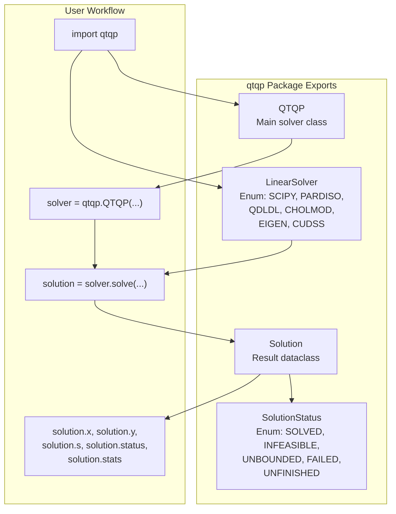
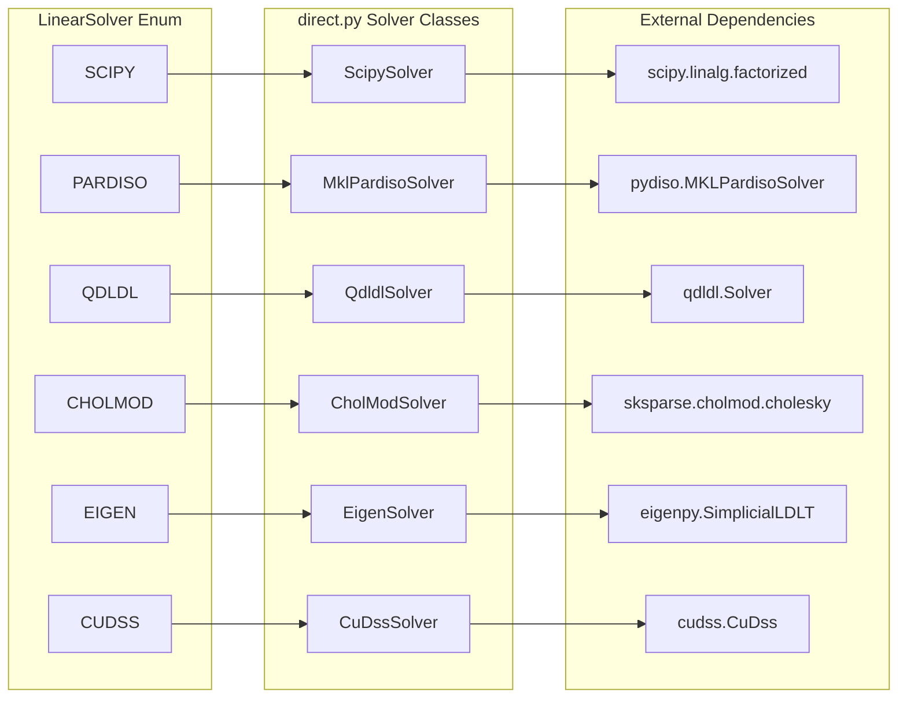

<!-- source: DeepWiki mcp.deepwiki.com · repo google-deepmind/qtqp · page 4 API Reference · fetched 2026-10-26 -->

# API Reference

<details>
<summary>Relevant source files</summary>

The following files were used as context for generating this wiki page:

- [README.md](README.md)
- [src/qtqp/__init__.py](src/qtqp/__init__.py)

</details>


This page provides comprehensive documentation of the QTQP public API, including all classes, methods, enums, and dataclasses that users interact with. This covers the programmatic interface for defining and solving quadratic programs.

For information about the internal solver architecture, see [Architecture](#3). For usage examples and problem formulation guidance, see [Getting Started](#2).

---

## Public API Overview

The `qtqp` package exports a focused public API consisting of four main components: the `QTQP` solver class, the `Solution` dataclass, and two enums for configuration and status reporting.



**Sources:** [src/qtqp/__init__.py:16-655](), [README.md:109-189]()

---

## QTQP Class

The `QTQP` class implements a primal-dual interior point method for solving quadratic programs. It is defined in [src/qtqp/__init__.py:76-654]().

### Constructor

```python
qtqp.QTQP(
    *,
    a: scipy.sparse.csc_matrix,
    b: np.ndarray,
    c: np.ndarray,
    z: int,
    p: scipy.sparse.csc_matrix | None = None,
)
```

**Constructor Parameters**

| Parameter | Type | Shape | Description |
|-----------|------|-------|-------------|
| `a` | `scipy.sparse.csc_matrix` | (m, n) | Constraint matrix in CSC format. Must be sparse CSC. |
| `b` | `np.ndarray` | (m,) | Right-hand side vector for constraints. |
| `c` | `np.ndarray` | (n,) | Linear cost coefficient vector. |
| `z` | `int` | scalar | Number of equality constraints (zero-cone size). Must satisfy 0 ≤ z < m. |
| `p` | `scipy.sparse.csc_matrix \| None` | (n, n) | Quadratic cost matrix in CSC format. If `None`, treated as zero matrix (LP problem). |

The constructor performs validation:
- Verifies `a` is in CSC format [src/qtqp/__init__.py:113-115]()
- Verifies vector shapes match matrix dimensions [src/qtqp/__init__.py:117-123]()
- Ensures `z < m` [src/qtqp/__init__.py:125-129]()
- Verifies `p` is CSC and has correct shape if provided [src/qtqp/__init__.py:134-140]()

**Sources:** [src/qtqp/__init__.py:91-141](), [README.md:117-138]()

### solve Method

```python
solver.solve(
    *,
    atol: float = 1e-7,
    rtol: float = 1e-8,
    atol_infeas: float = 1e-8,
    rtol_infeas: float = 1e-9,
    max_iter: int = 100,
    step_size_scale: float = 0.99,
    min_static_regularization: float = 1e-7,
    max_iterative_refinement_steps: int = 50,
    linear_solver_atol: float = 1e-12,
    linear_solver_rtol: float = 1e-12,
    linear_solver: LinearSolver = LinearSolver.SCIPY,
    verbose: bool = True,
    equilibrate: bool = True,
    x: np.ndarray | None = None,
    y: np.ndarray | None = None,
    s: np.ndarray | None = None,
) -> Solution
```

The `solve()` method executes the primal-dual interior point algorithm and returns a `Solution` object. All parameters are keyword-only. The method is defined in [src/qtqp/__init__.py:145-373]().

**Convergence Tolerance Parameters**

| Parameter | Type | Default | Description |
|-----------|------|---------|-------------|
| `atol` | `float` | `1e-7` | Absolute tolerance for primal/dual residuals and gap to declare optimality. |
| `rtol` | `float` | `1e-8` | Relative tolerance scaled by problem data norms for optimality. |
| `atol_infeas` | `float` | `1e-8` | Absolute tolerance for detecting primal or dual infeasibility certificates. |
| `rtol_infeas` | `float` | `1e-9` | Relative tolerance for infeasibility detection. |

**Algorithm Control Parameters**

| Parameter | Type | Default | Description |
|-----------|------|---------|-------------|
| `max_iter` | `int` | `100` | Maximum number of interior point iterations before terminating with `FAILED` status. |
| `step_size_scale` | `float` | `0.99` | Factor in (0, 1) to scale the maximum step size, ensuring iterates remain strictly interior to cones. |

**Linear Solver Configuration**

| Parameter | Type | Default | Description |
|-----------|------|---------|-------------|
| `min_static_regularization` | `float` | `1e-7` | Minimum diagonal regularization added to KKT matrix for numerical stability. |
| `max_iterative_refinement_steps` | `int` | `50` | Maximum number of iterative refinement iterations for solving KKT systems. |
| `linear_solver_atol` | `float` | `1e-12` | Absolute tolerance for iterative refinement within linear solves. |
| `linear_solver_rtol` | `float` | `1e-12` | Relative tolerance for iterative refinement within linear solves. |
| `linear_solver` | `LinearSolver` | `LinearSolver.SCIPY` | Backend linear solver enum. See [LinearSolver Enumeration](#linearsolver-enumeration) below. |

**Preprocessing and Output**

| Parameter | Type | Default | Description |
|-----------|------|---------|-------------|
| `verbose` | `bool` | `True` | If `True`, prints iteration table showing primal/dual costs, residuals, gap, mu, and timing. |
| `equilibrate` | `bool` | `True` | If `True`, applies Ruiz equilibration to improve numerical conditioning. See [Equilibration](#5.1). |

**Warm Start Parameters**

| Parameter | Type | Default | Description |
|-----------|------|---------|-------------|
| `x` | `np.ndarray \| None` | `None` | Initial primal variable (shape n). If `None`, uses zero vector. |
| `y` | `np.ndarray \| None` | `None` | Initial dual variable (shape m). If `None`, uses zero for equalities and 1.0 for inequalities. |
| `s` | `np.ndarray \| None` | `None` | Initial slack variable (shape m). If `None`, uses zero for equalities and 1.0 for inequalities. |

Warm-start vectors must satisfy conic interiority constraints:
- `y[z:]` must be strictly positive [src/qtqp/__init__.py:235-236]()
- `s[z:]` must be strictly positive [src/qtqp/__init__.py:235-236]()
- `s[:z]` must be exactly zero [src/qtqp/__init__.py:237-238]()

**Sources:** [src/qtqp/__init__.py:145-197](), [README.md:141-179]()

---

## Solution Object and Status Codes

### Solution Dataclass

The `Solution` dataclass is defined in [src/qtqp/__init__.py:57-73](). It is a frozen (immutable) dataclass containing the solver output.

```python
@dataclasses.dataclass(frozen=True)
class Solution:
    x: np.ndarray
    y: np.ndarray
    s: np.ndarray
    stats: List[Dict[str, Any]]
    status: SolutionStatus
```

**Solution Attributes**

| Attribute | Type | Shape | Description |
|-----------|------|-------|-------------|
| `x` | `np.ndarray` | (n,) | Primal solution or certificate of dual infeasibility (unboundedness). Contains `NaN` if primal infeasible. |
| `y` | `np.ndarray` | (m,) | Dual solution or certificate of primal infeasibility. Contains `NaN` if dual infeasible (primal unbounded). |
| `s` | `np.ndarray` | (m,) | Slack variable solution or certificate of dual infeasibility. Contains `NaN` if primal infeasible. |
| `stats` | `List[Dict[str, Any]]` | list | Per-iteration statistics dictionaries. See [Statistics Dictionary](#statistics-dictionary) below. |
| `status` | `SolutionStatus` | enum | Terminal status of the solve. See [SolutionStatus Enum](#solutionstatus-enum) below. |

**Interpretation by Status**

```mermaid
graph TB
    Solution["Solution Object"]
    
    subgraph "status = SOLVED"
        S_x["x: optimal primal<br/>x* = x / tau"]
        S_y["y: optimal dual<br/>y* = y / tau"]
        S_s["s: optimal slack<br/>s* = s / tau"]
    end
    
    subgraph "status = INFEASIBLE"
        I_x["x: NaN<br/>(no primal solution)"]
        I_y["y: certificate<br/>A^T y = 0, b^T y < 0"]
        I_s["s: NaN<br/>(no slack values)"]
    end
    
    subgraph "status = UNBOUNDED"
        U_x["x: certificate<br/>Ax + s = 0, c^T x < 0"]
        U_y["y: NaN<br/>(no dual solution)"]
        U_s["s: certificate<br/>complements x"]
    end
    
    subgraph "status = FAILED"
        F_x["x: best iterate / tau<br/>(not proven optimal)"]
        F_y["y: best iterate / tau<br/>(not proven optimal)"]
        F_s["s: best iterate / tau<br/>(not proven optimal)"]
    end
    
    Solution --> S_x
    Solution --> I_x
    Solution --> U_x
    Solution --> F_x
```



The solver returns scaled solutions by dividing by the homogeneous embedding variable `tau`:
- `SOLVED`: [src/qtqp/__init__.py:358]()
- `INFEASIBLE`: [src/qtqp/__init__.py:363]() - scaled by `b^T y` norm
- `UNBOUNDED`: [src/qtqp/__init__.py:368]() - scaled by `c^T x` norm
- `FAILED`: [src/qtqp/__init__.py:373]()

**Sources:** [src/qtqp/__init__.py:57-73](), [src/qtqp/__init__.py:353-373](), [README.md:180-189]()

### SolutionStatus Enum

The `SolutionStatus` enum is defined in [src/qtqp/__init__.py:47-54]().

```python
class SolutionStatus(enum.Enum):
    SOLVED = "solved"
    INFEASIBLE = "infeasible"
    UNBOUNDED = "unbounded"
    FAILED = "failed"
    UNFINISHED = "unfinished"
```

**Status Values**

| Enum Value | String Value | Meaning |
|------------|-------------|---------|
| `SolutionStatus.SOLVED` | `"solved"` | Optimal primal-dual solution found. KKT conditions satisfied within tolerances. |
| `SolutionStatus.INFEASIBLE` | `"infeasible"` | Primal problem is infeasible. Solution contains a certificate: `y` such that `A^T y = 0` and `b^T y < 0`. |
| `SolutionStatus.UNBOUNDED` | `"unbounded"` | Primal problem is unbounded (dual infeasible). Solution contains a certificate: `x, s` such that `Ax + s = 0` and `c^T x < 0`. |
| `SolutionStatus.FAILED` | `"failed"` | Solver failed to converge within `max_iter` iterations or encountered numerical issues. |
| `SolutionStatus.UNFINISHED` | `"unfinished"` | Internal status indicating iteration should continue. Not returned to users. |

The solver determines status in [src/qtqp/__init__.py:579-594]():
- `SOLVED`: When primal residual, dual residual, and gap all satisfy tolerance criteria [src/qtqp/__init__.py:579-584]()
- `UNBOUNDED`: When `c^T x < 0` and infeasibility measure is small [src/qtqp/__init__.py:585-588]()
- `INFEASIBLE`: When `b^T y < 0` and infeasibility measure is small [src/qtqp/__init__.py:589-592]()
- `UNFINISHED`: Otherwise, continue iterating [src/qtqp/__init__.py:593-594]()

**Sources:** [src/qtqp/__init__.py:47-54](), [src/qtqp/__init__.py:535-622](), [README.md:185-187]()

### Statistics Dictionary

Each element in `solution.stats` is a dictionary containing metrics from one iteration. The statistics are computed in [src/qtqp/__init__.py:596-621]().

**Statistics Fields**

| Field | Type | Description |
|-------|------|-------------|
| `iter` | `int` | Iteration number (0-indexed). |
| `pcost` | `float` | Primal objective value: `(1/2) x^T P x + c^T x`. |
| `dcost` | `float` | Dual objective value: `-(1/2) x^T P x - b^T y`. |
| `pres` | `float` | Primal residual: `∥Ax + s - b∥_∞`. |
| `dres` | `float` | Dual residual: `∥Px + A^T y + c∥_∞`. |
| `gap` | `float` | Duality gap: `\|c^T x + b^T y + x^T P x\|`. |
| `complementarity` | `float` | Complementarity measure: `\|y^T s\|`. |
| `mu` | `float` | Current barrier parameter (complementary slackness error). |
| `sigma` | `float` | Centering parameter computed by Mehrotra's heuristic. |
| `alpha` | `float` | Step size taken in this iteration. |
| `tau` | `float` | Homogeneous embedding variable value. |
| `pinfeas` | `float` | Primal infeasibility certificate measure. |
| `dinfeas` | `float` | Dual infeasibility certificate measure. |
| `norm_x` | `float` | Infinity norm of primal variable. |
| `norm_y` | `float` | Infinity norm of dual variable. |
| `norm_s` | `float` | Infinity norm of slack variable. |
| `status` | `SolutionStatus` | Status at end of this iteration. |
| `time` | `float` | Elapsed wall-clock time since solve start (seconds). |
| `q_lin_sys_stats` | `dict` | Linear solver statistics for KKT @ q solve. |
| `predictor_lin_sys_stats` | `dict` | Linear solver statistics for predictor step. |
| `corrector_lin_sys_stats` | `dict` | Linear solver statistics for corrector step. |

The linear system statistics dictionaries contain:
- `solves`: Number of iterative refinement iterations
- `status`: Either `"success"` or `"stalled"` [src/qtqp/__init__.py:635-636]()

**Sources:** [src/qtqp/__init__.py:596-621](), [README.md:187-189]()

---

## LinearSolver Enumeration

The `LinearSolver` enum selects which backend solver is used for solving KKT systems. It is defined in [src/qtqp/__init__.py:36-44]().

```python
class LinearSolver(enum.Enum):
    SCIPY = direct.ScipySolver
    PARDISO = direct.MklPardisoSolver
    QDLDL = direct.QdldlSolver
    CHOLMOD = direct.CholModSolver
    CUDSS = direct.CuDssSolver
    EIGEN = direct.EigenSolver
```

**Available Linear Solvers**

| Enum Value | Backend Class | Package Dependency | Hardware | Characteristics |
|------------|--------------|-------------------|----------|-----------------|
| `LinearSolver.SCIPY` | `ScipySolver` | scipy (required) | CPU | Default. Uses `scipy.linalg.factorized`. Good general-purpose option. |
| `LinearSolver.PARDISO` | `MklPardisoSolver` | pydiso (optional) | Intel CPU | Fast sparse direct solver from Intel MKL. Requires Intel CPU. |
| `LinearSolver.QDLDL` | `QdldlSolver` | qdldl (optional) | CPU | Free-variable LDL factorization. Lightweight and portable. |
| `LinearSolver.CHOLMOD` | `CholModSolver` | scikit-sparse (optional) | CPU | High-performance supernodal Cholesky. Good for large problems. |
| `LinearSolver.EIGEN` | `EigenSolver` | eigenpy (optional) | CPU | C++ Eigen library via Python bindings. |
| `LinearSolver.CUDSS` | `CuDssSolver` | nvidia-cudss-cu12 (optional) | GPU | NVIDIA GPU-accelerated sparse solver. Requires CUDA-capable GPU. |

**Backend Solver Mapping**



The enum values reference solver classes from [src/qtqp/direct.py](). When `solve()` is called, the enum's value is instantiated: `linear_solver.value()` [src/qtqp/__init__.py:255]().

**Installation Instructions**

Each optional backend requires separate installation. See detailed instructions in [Installation](#2.1) and [README.md:190-241]().

- **SCIPY**: Installed by default with numpy/scipy dependencies
- **PARDISO**: `conda install pydiso --channel conda-forge` (Intel CPUs only)
- **QDLDL**: `pip install qdldl`
- **CHOLMOD**: `conda install -c conda-forge scikit-sparse`
- **EIGEN**: `conda install eigenpy -c conda-forge`
- **CUDSS**: `pip install nvidia-cudss-cu12 nvmath-python[cu12]` (requires NVIDIA GPU)

**Sources:** [src/qtqp/__init__.py:36-44](), [src/qtqp/__init__.py:255](), [README.md:190-241]()

---

## Type Signatures and Parameter Flow

This diagram shows how types flow through the API from problem definition to solution retrieval.

```mermaid
graph TB
    subgraph "Problem Definition Types"
        a_type["a: scipy.sparse.csc_matrix<br/>shape (m, n)"]
        b_type["b: np.ndarray<br/>shape (m,)"]
        c_type["c: np.ndarray<br/>shape (n,)"]
        z_type["z: int<br/>scalar, 0 ≤ z < m"]
        p_type["p: scipy.sparse.csc_matrix | None<br/>shape (n, n)"]
    end
    
    subgraph "QTQP.__init__()"
        constructor["QTQP constructor<br/>validates and stores<br/>problem data"]
    end
    
    subgraph "Configuration Types"
        tol_types["atol, rtol: float<br/>atol_infeas, rtol_infeas: float"]
        solver_type["linear_solver: LinearSolver enum"]
        warm_types["x: np.ndarray | None<br/>y: np.ndarray | None<br/>s: np.ndarray | None"]
        control_types["max_iter: int<br/>step_size_scale: float<br/>verbose: bool<br/>equilibrate: bool"]
    end
    
    subgraph "QTQP.solve()"
        solve_method["solve() method<br/>executes primal-dual<br/>interior point algorithm"]
    end
    
    subgraph "Solution Return Type"
        solution_obj["Solution dataclass"]
        x_out["x: np.ndarray<br/>shape (n,)"]
        y_out["y: np.ndarray<br/>shape (m,)"]
        s_out["s: np.ndarray<br/>shape (m,)"]
        stats_out["stats: List[Dict[str, Any]]<br/>per-iteration metrics"]
        status_out["status: SolutionStatus enum<br/>SOLVED | INFEASIBLE<br/>UNBOUNDED | FAILED"]
    end
    
    a_type --> constructor
    b_type --> constructor
    c_type --> constructor
    z_type --> constructor
    p_type --> constructor
    
    constructor --> solve_method
    tol_types --> solve_method
    solver_type --> solve_method
    warm_types --> solve_method
    control_types --> solve_method
    
    solve_method --> solution_obj
    solution_obj --> x_out
    solution_obj --> y_out
    solution_obj --> s_out
    solution_obj --> stats_out
    solution_obj --> status_out
```

**Type Validation Points**

The constructor performs type and shape validation:
1. Verifies `a` is `csc_matrix` type [src/qtqp/__init__.py:113-115]()
2. Converts `b` to float64 and checks shape [src/qtqp/__init__.py:117-119]()
3. Converts `c` to float64 and checks shape [src/qtqp/__init__.py:121-123]()
4. Validates `z` range constraint [src/qtqp/__init__.py:125-129]()
5. If `p` provided, verifies type and shape [src/qtqp/__init__.py:134-140]()

The `solve()` method performs additional validation:
1. Converts warm-start arrays to float64 if provided [src/qtqp/__init__.py:211-228]()
2. Validates warm-start interiority constraints [src/qtqp/__init__.py:234-238]()

**Sources:** [src/qtqp/__init__.py:91-141](), [src/qtqp/__init__.py:145-238](), [src/qtqp/__init__.py:57-73]()

---

## Example: Complete API Usage

This example demonstrates all major API components:

```python
import qtqp
import scipy.sparse as sp
import numpy as np

# Define QP problem
p = sp.csc_matrix([[3.0, -1.0], [-1.0, 2.0]])
a = sp.csc_matrix([[-1.0, 1.0], [1.0, 0.0], [0.0, 1.0]])
b = np.array([-1.0, 0.3, -0.5])
c = np.array([-1.0, -1.0])
z = 1  # First constraint is equality

# Initialize solver
solver = qtqp.QTQP(a=a, b=b, c=c, z=z, p=p)

# Solve with custom configuration
solution = solver.solve(
    atol=1e-8,
    rtol=1e-9,
    max_iter=50,
    linear_solver=qtqp.LinearSolver.SCIPY,
    verbose=True,
    equilibrate=True
)

# Check solution status
if solution.status == qtqp.SolutionStatus.SOLVED:
    print(f"Optimal x: {solution.x}")
    print(f"Optimal y: {solution.y}")
    print(f"Optimal s: {solution.s}")
    print(f"Iterations: {len(solution.stats)}")
    
    # Access final iteration statistics
    final_stats = solution.stats[-1]
    print(f"Final primal cost: {final_stats['pcost']}")
    print(f"Final dual cost: {final_stats['dcost']}")
    print(f"Final gap: {final_stats['gap']}")
    
elif solution.status == qtqp.SolutionStatus.INFEASIBLE:
    print("Problem is primal infeasible")
    print(f"Infeasibility certificate y: {solution.y}")
    
elif solution.status == qtqp.SolutionStatus.UNBOUNDED:
    print("Problem is primal unbounded")
    print(f"Unboundedness certificate x: {solution.x}")
    
else:
    print(f"Solver failed: {solution.status}")
```

This example is adapted from [README.md:66-107]() and demonstrates:
1. Problem definition with all required matrices/vectors
2. Solver instantiation via `QTQP` constructor
3. Configuration via `solve()` parameters
4. Status checking via `SolutionStatus` enum
5. Solution extraction via `Solution` dataclass attributes
6. Statistics access via `solution.stats` list

**Sources:** [README.md:66-107](), [src/qtqp/__init__.py:76-654]()

---

