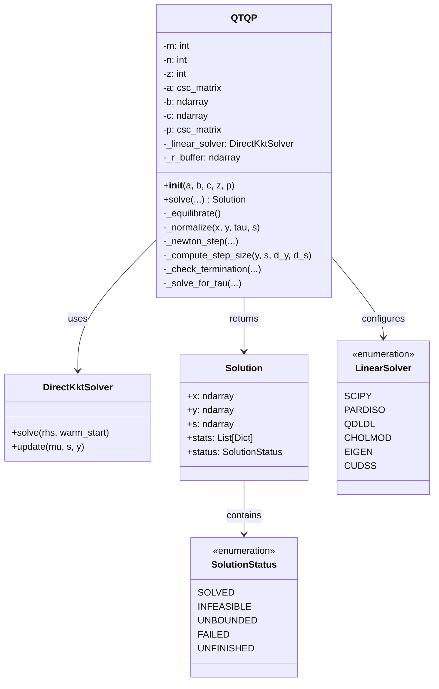
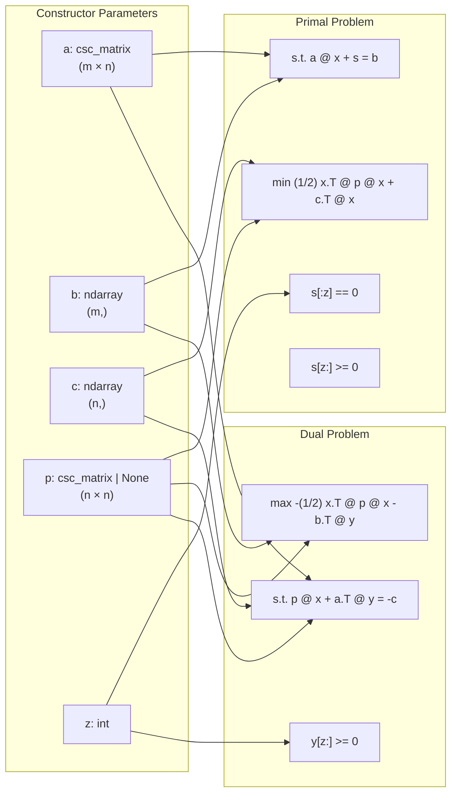
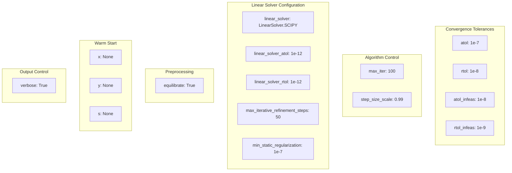
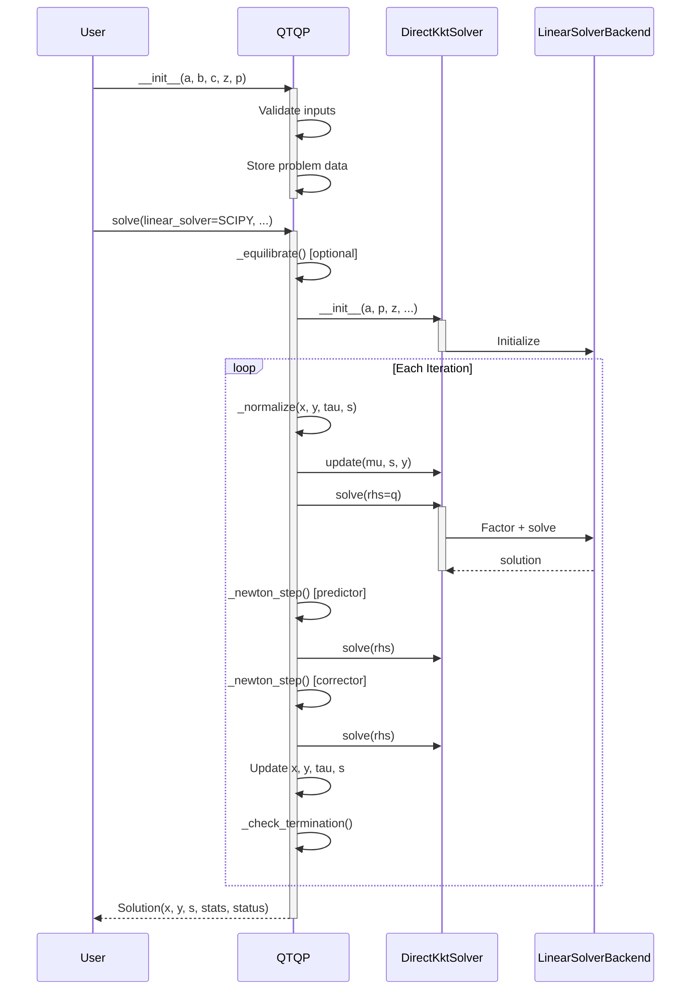

<!-- source: DeepWiki mcp.deepwiki.com · repo google-deepmind/qtqp · page 4.1 QTQP Class · fetched 2026-10-26 -->

# QTQP Class

<details>
<summary>Relevant source files</summary>

The following files were used as context for generating this wiki page:

- [README.md](README.md)
- [src/qtqp/__init__.py](src/qtqp/__init__.py)

</details>


This page documents the `QTQP` class, which is the main entry point for solving quadratic programs using the QTQP solver. It covers the constructor parameters, internal state, and the `solve` method signature. For detailed information about solution objects and status codes, see [Solution Object and Status Codes](#4.2). For linear solver backend selection, see [LinearSolver Enumeration](#4.3). For comprehensive documentation of all solve method parameters, see [Configuration Parameters](#4.4).

## Purpose and Scope

The `QTQP` class provides the public API for defining and solving convex quadratic programs. Upon instantiation, it validates and stores the problem data (constraint matrix, cost vectors, etc.). The `solve` method then executes the primal-dual interior point algorithm with configurable tolerances, linear solver backends, and optimization strategies.

## Class Definition and Location

The `QTQP` class is defined in [src/qtqp/__init__.py:76-654]() and implements a primal-dual interior point method for quadratic programming. It is the only public solver class exposed by the package.

**Class Structure**



**Sources:** [src/qtqp/__init__.py:76-654]()

## Constructor Parameters

The `QTQP` constructor is defined at [src/qtqp/__init__.py:91-140]() and takes the following parameters:

### Parameter Mapping to Mathematical Formulation



**Sources:** [src/qtqp/__init__.py:79-89](), [src/qtqp/__init__.py:91-108]()

### Parameter Details

| Parameter | Type | Shape | Description |
|-----------|------|-------|-------------|
| `a` | `scipy.sparse.csc_matrix` | (m, n) | Constraint matrix. Must be in CSC format. |
| `b` | `np.ndarray` | (m,) | Right-hand side vector for constraints. |
| `c` | `np.ndarray` | (n,) | Linear cost coefficient vector. |
| `z` | `int` | scalar | Number of equality constraints. Defines the size of the zero cone (first `z` constraints). Must satisfy `0 ≤ z < m`. |
| `p` | `scipy.sparse.csc_matrix \| None` | (n, n) | Quadratic cost matrix. If `None`, treated as zero matrix (linear program). Must be in CSC format if provided. |

**Sources:** [src/qtqp/__init__.py:103-108]()

### Input Validation

The constructor performs the following validations at [src/qtqp/__init__.py:112-140]():

1. **Matrix format validation**: `a` must be in CSC format (line 113)
2. **Shape validation**: `b` must have shape `(m,)` (lines 118-119)
3. **Shape validation**: `c` must have shape `(n,)` (lines 122-123)
4. **Constraint count**: `z` must be strictly less than `m` (lines 125-129)
5. **QP matrix format**: If `p` is provided, must be CSC format and shape `(n, n)` (lines 134-139)

**Sources:** [src/qtqp/__init__.py:112-140]()

## Instance Attributes

After construction, the `QTQP` instance stores the following attributes:

| Attribute | Type | Description |
|-----------|------|-------------|
| `self.m` | `int` | Number of constraints (rows in `a`) |
| `self.n` | `int` | Number of variables (columns in `a`) |
| `self.z` | `int` | Number of equality constraints |
| `self.a` | `csc_matrix` | Constraint matrix |
| `self.b` | `ndarray` | Right-hand side vector |
| `self.c` | `ndarray` | Cost vector |
| `self.p` | `csc_matrix` | QP matrix (zero matrix if not provided) |
| `self._r_buffer` | `ndarray` | Pre-allocated buffer for RHS computations, shape `(n+m,)` |

**Sources:** [src/qtqp/__init__.py:109-143]()

## The solve Method

The `solve` method is defined at [src/qtqp/__init__.py:145-373]() and is the primary interface for solving the quadratic program.

### Method Signature

```python
def solve(
    self,
    *,
    atol: float = 1e-7,
    rtol: float = 1e-8,
    atol_infeas: float = 1e-8,
    rtol_infeas: float = 1e-9,
    max_iter: int = 100,
    step_size_scale: float = 0.99,
    min_static_regularization: float = 1e-7,
    max_iterative_refinement_steps: int = 50,
    linear_solver_atol: float = 1e-12,
    linear_solver_rtol: float = 1e-12,
    linear_solver: LinearSolver = LinearSolver.SCIPY,
    verbose: bool = True,
    equilibrate: bool = True,
    x: np.ndarray | None = None,
    y: np.ndarray | None = None,
    s: np.ndarray | None = None,
) -> Solution
```

**Sources:** [src/qtqp/__init__.py:145-164]()

### Parameter Categories

The 16 solve parameters can be categorized into five groups:



**Sources:** [src/qtqp/__init__.py:147-163]()

For comprehensive documentation of each parameter, see [Configuration Parameters](#4.4).

### solve Method Execution Flow

```mermaid
flowchart TD
    START["solve() called"] --> INIT["Initialize from parameters<br/>[lines 198-208]"]
    INIT --> WARM{"Warm start<br/>provided?"}
    
    WARM -->|Yes| VALIDATE["Validate warm start<br/>[lines 211-238]"]
    WARM -->|No| COLD["Cold start: x=0, y[z:]=1, s[z:]=1<br/>[lines 211-228]"]
    
    VALIDATE --> EQUIL_CHECK
    COLD --> EQUIL_CHECK
    
    EQUIL_CHECK{"equilibrate<br/>== True?"}
    EQUIL_CHECK -->|Yes| EQUIL_CALL["_equilibrate()<br/>[lines 240-242]"]
    EQUIL_CHECK -->|No| NO_EQUIL["Use original a, p<br/>[lines 244-245]"]
    
    EQUIL_CALL --> SETUP_KKT
    NO_EQUIL --> SETUP_KKT
    
    SETUP_KKT["Setup DirectKktSolver<br/>[lines 247-256]"]
    SETUP_KKT --> HEADER["Log header<br/>[line 260]"]
    
    HEADER --> LOOP_START["Main iteration loop<br/>[line 263]"]
    
    LOOP_START --> EQUIL_ITER{"equilibrate?"}
    EQUIL_ITER -->|Yes| EQUIL_ITERS["_equilibrate_iterates()<br/>[line 267]"]
    EQUIL_ITER -->|No| NORM
    EQUIL_ITERS --> NORM
    
    NORM["_normalize(x, y, tau, s)<br/>[line 269]"]
    NORM --> MU["Compute mu<br/>[line 272]"]
    MU --> UPDATE["_linear_solver.update()<br/>[line 273]"]
    
    UPDATE --> SOLVE_Q["Solve KKT @ q<br/>[lines 277-279]"]
    SOLVE_Q --> PRED["Predictor step<br/>_newton_step(mu_target=0)<br/>[lines 284-294]"]
    
    PRED --> ALPHA_P["Compute alpha_p, sigma<br/>[lines 301-304]"]
    ALPHA_P --> CORR["Corrector step<br/>_newton_step(mu_target=sigma*mu)<br/>[lines 310-320]"]
    
    CORR --> STEP_UPDATE["Update iterates<br/>[lines 323-338]"]
    STEP_UPDATE --> CONE_PROJ["Project to cone interior<br/>[lines 341-344]"]
    
    CONE_PROJ --> UNEQUIL_CHECK{"equilibrate?"}
    UNEQUIL_CHECK -->|Yes| UNEQUIL["_unequilibrate_iterates()<br/>[line 347]"]
    UNEQUIL_CHECK -->|No| TERM_CHECK
    UNEQUIL --> TERM_CHECK
    
    TERM_CHECK["_check_termination()<br/>[line 350]"]
    TERM_CHECK --> LOG["_log_iteration()<br/>[line 351]"]
    LOG --> STATUS{"status?"}
    
    STATUS -->|UNFINISHED| LOOP_START
    STATUS -->|SOLVED| RETURN_SOLVED["Return Solution<br/>x/tau, y/tau, s/tau<br/>[line 358]"]
    STATUS -->|INFEASIBLE| RETURN_INFEAS["Return certificate<br/>y / abs(b@y)<br/>[line 363]"]
    STATUS -->|UNBOUNDED| RETURN_UNBOUND["Return certificate<br/>x / abs(c@x)<br/>[line 368]"]
    
    LOOP_START -->|max_iter reached| RETURN_FAILED["Return FAILED<br/>[line 373]"]
```



**Sources:** [src/qtqp/__init__.py:145-373]()

### Return Value

The `solve` method returns a `Solution` object (see [Solution Object and Status Codes](#4.2)) containing:
- Primal variables `x` or certificate of dual infeasibility
- Dual variables `y` or certificate of primal infeasibility  
- Slack variables `s` or certificate of dual infeasibility
- Iteration statistics in `stats` list
- Terminal `status` (SOLVED, INFEASIBLE, UNBOUNDED, or FAILED)

**Sources:** [src/qtqp/__init__.py:57-73](), [src/qtqp/__init__.py:195-196]()

## Internal State During solve

During execution of the `solve` method, the `QTQP` instance maintains additional state:

| Attribute | Type | Description |
|-----------|------|-------------|
| `self._linear_solver` | `DirectKktSolver` | KKT system solver instance, created at line 247 |
| `self.q` | `ndarray` | Concatenated vector `[c, b]`, used in KKT RHS (line 242 or 245) |
| `self.kkt_inv_q` | `ndarray` | Cached solution to `KKT^{-1} @ q`, reused across iterations (line 259) |
| `self.equilibrated_p` | `csc_matrix` | Equilibrated QP matrix if equilibration is enabled (line 241) |
| `self.d` | `ndarray` | Row equilibration scaling factors (line 241) |
| `self.e` | `ndarray` | Column equilibration scaling factors (line 241) |
| `self.start_time` | `float` | Solve start time for elapsed time tracking (line 198) |
| `self.it` | `int` | Current iteration number (line 263) |

**Sources:** [src/qtqp/__init__.py:198-273]()

## Code Entity Relationships

The following diagram shows how the `QTQP` class methods interact with each other and with external dependencies:

```mermaid
graph TB
    subgraph "Public API"
        INIT["__init__()"]
        SOLVE["solve()"]
    end
    
    subgraph "Equilibration [lines 375-418]"
        EQUIL["_equilibrate()"]
        EQUIL_IT["_equilibrate_iterates()"]
        UNEQUIL_IT["_unequilibrate_iterates()"]
    end
    
    subgraph "Algorithm Core [lines 449-522]"
        NEWTON["_newton_step()"]
        SOLVE_TAU["_solve_for_tau()"]
        NORMALIZE["_normalize()"]
    end
    
    subgraph "Step Size [lines 420-533]"
        MAX_STEP["_max_step_size()"]
        COMPUTE_STEP["_compute_step_size()"]
        COMPUTE_SIGMA["_compute_sigma()"]
    end
    
    subgraph "Termination [lines 535-622]"
        CHECK_TERM["_check_termination()"]
    end
    
    subgraph "Logging [lines 624-653]"
        LOG_HEADER["_log_header()"]
        LOG_ITER["_log_iteration()"]
        LOG_FOOTER["_log_footer()"]
    end
    
    subgraph "External Dependencies"
        DKKT["DirectKktSolver<br/>(from direct.py)"]
        SCIPY["scipy.sparse"]
        NUMPY["numpy"]
    end
    
    INIT --> SCIPY
    INIT --> NUMPY
    
    SOLVE --> EQUIL
    SOLVE --> EQUIL_IT
    SOLVE --> UNEQUIL_IT
    SOLVE --> DKKT
    SOLVE --> NORMALIZE
    SOLVE --> NEWTON
    SOLVE --> COMPUTE_STEP
    SOLVE --> COMPUTE_SIGMA
    SOLVE --> CHECK_TERM
    SOLVE --> LOG_HEADER
    SOLVE --> LOG_ITER
    SOLVE --> LOG_FOOTER
    
    EQUIL --> SCIPY
    NEWTON --> DKKT
    NEWTON --> SOLVE_TAU
    COMPUTE_STEP --> MAX_STEP
```



**Sources:** [src/qtqp/__init__.py:76-654]()

## Usage Pattern

The typical usage pattern for the `QTQP` class follows this sequence:



**Sources:** [src/qtqp/__init__.py:91-373](), [README.md:70-88]()

## Example Instantiation

A minimal example of creating and using a `QTQP` instance:

```python
import qtqp
import scipy.sparse
import numpy as np

# Define problem data
p = scipy.sparse.csc_matrix([[3.0, -1.0], [-1.0, 2.0]])
a = scipy.sparse.csc_matrix([[-1.0, 1.0], [1.0, 0.0], [0.0, 1.0]])
b = np.array([-1, 0.3, -0.5])
c = np.array([-1.0, -1.0])

# Instantiate solver with problem data
solver = qtqp.QTQP(a=a, b=b, c=c, p=p, z=1)

# Solve with default parameters
solution = solver.solve()
```

**Sources:** [README.md:70-88]()

## Private Method Reference

The `QTQP` class contains several private methods that implement the interior point algorithm. These are not part of the public API but are documented here for completeness:

| Method | Lines | Purpose |
|--------|-------|---------|
| `_equilibrate()` | [375-412]() | Implements Ruiz equilibration for numerical stability |
| `_equilibrate_iterates()` | [417-418]() | Scales iterates to equilibrated space |
| `_unequilibrate_iterates()` | [414-415]() | Unscales iterates back to original space |
| `_max_step_size()` | [420-429]() | Finds maximum feasible step maintaining cone constraints |
| `_compute_sigma()` | [431-447]() | Computes Mehrotra centering parameter |
| `_newton_step()` | [449-484]() | Solves augmented KKT system for search direction |
| `_solve_for_tau()` | [486-521]() | Solves 1D quadratic for homogeneous embedding variable |
| `_normalize()` | [523-527]() | Normalizes homogeneous iterates |
| `_compute_step_size()` | [529-533]() | Computes primal-dual step size |
| `_check_termination()` | [535-622]() | Evaluates convergence criteria and computes statistics |
| `_log_header()` | [624-626]() | Prints iteration table header |
| `_log_iteration()` | [628-649]() | Prints iteration statistics |
| `_log_footer()` | [651-653]() | Prints termination message |

**Sources:** [src/qtqp/__init__.py:375-653]()

---

