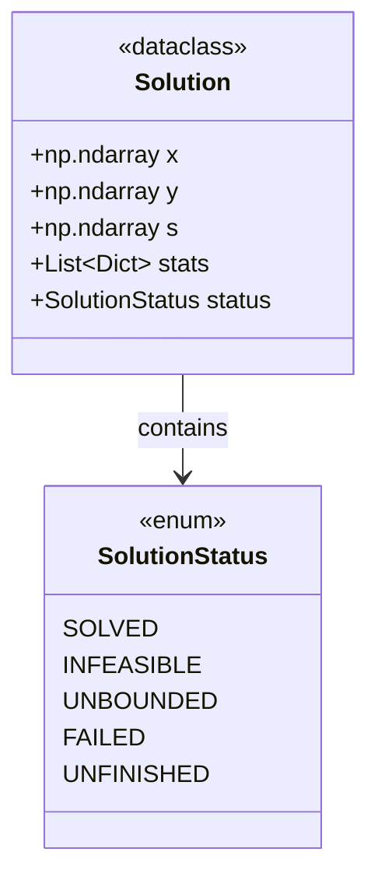
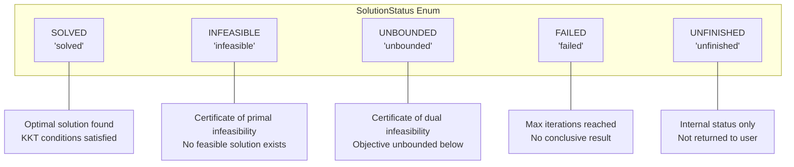
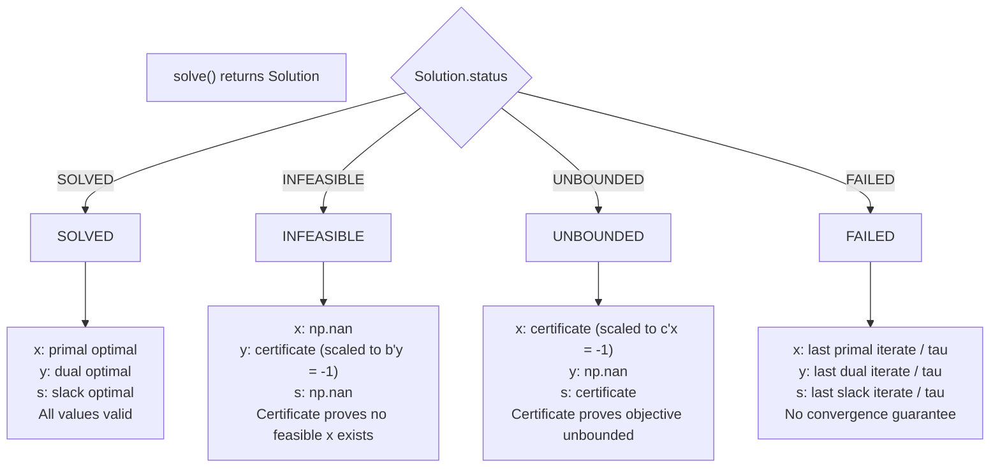
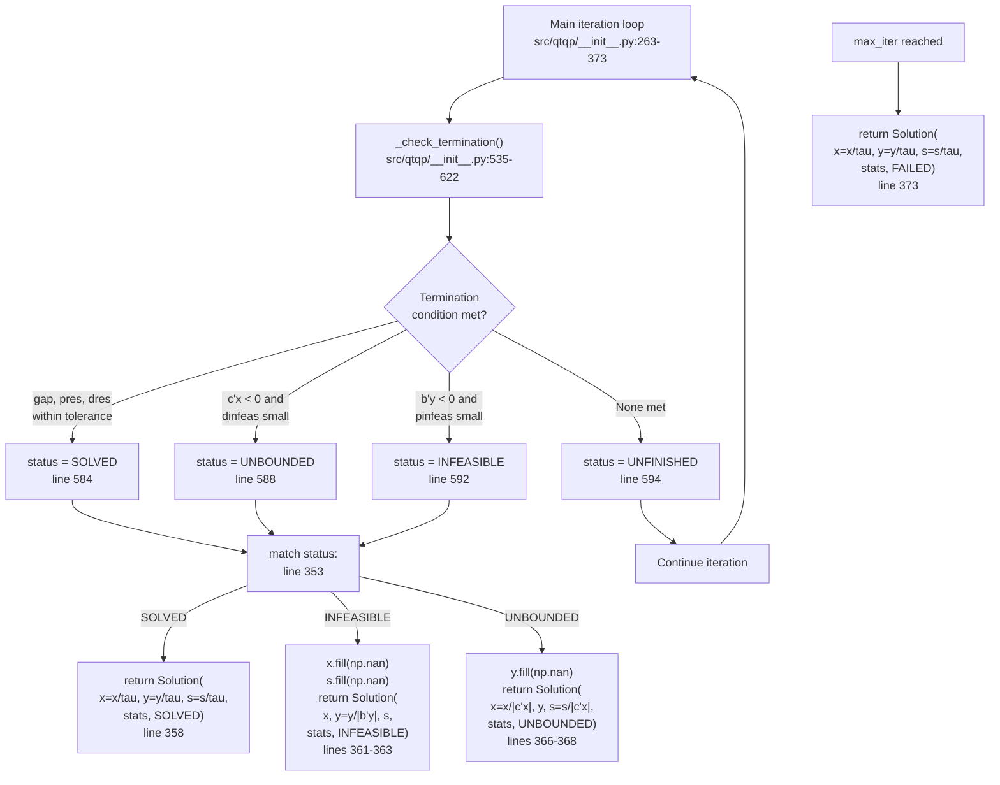

<!-- source: DeepWiki mcp.deepwiki.com · repo google-deepmind/qtqp · page 4.2 Solution Object and Status Codes · fetched 2026-10-26 -->

# Solution Object and Status Codes

<details>
<summary>Relevant source files</summary>

The following files were used as context for generating this wiki page:

- [README.md](README.md)
- [src/qtqp/__init__.py](src/qtqp/__init__.py)
- [tests/test_qtqp.py](tests/test_qtqp.py)

</details>


## Purpose and Scope

This page documents the `Solution` dataclass and `SolutionStatus` enum that represent the output of the QTQP solver. The `Solution` object contains primal-dual variables (or certificates of infeasibility/unboundedness), iteration statistics, and a status code indicating the outcome. For information about the input parameters to the solver, see [QTQP Class](#4.1). For information about interpreting infeasibility and unboundedness in detail, see [Understanding Infeasibility and Unboundedness](#5.4).

---

## Solution Dataclass Structure

The `Solution` dataclass is the return type of the `QTQP.solve()` method. It is defined as a frozen dataclass in [src/qtqp/__init__.py:57-74]().



**Sources:** [src/qtqp/__init__.py:57-74]()

### Solution Fields

| Field | Type | Description |
|-------|------|-------------|
| `x` | `np.ndarray` | Shape `(n,)`. Primal solution vector if `SOLVED`. Certificate of dual infeasibility (unboundedness direction) if `UNBOUNDED`. Filled with `np.nan` if `INFEASIBLE`. |
| `y` | `np.ndarray` | Shape `(m,)`. Dual solution vector if `SOLVED`. Certificate of primal infeasibility if `INFEASIBLE`. Filled with `np.nan` if `UNBOUNDED`. |
| `s` | `np.ndarray` | Shape `(m,)`. Slack variable vector if `SOLVED`. Certificate of dual infeasibility if `UNBOUNDED`. Filled with `np.nan` if `INFEASIBLE`. |
| `stats` | `List[Dict[str, Any]]` | List of statistics dictionaries, one per iteration. Contains residuals, costs, tolerances, and linear solver metrics. |
| `status` | `SolutionStatus` | Enum indicating the solution outcome: `SOLVED`, `INFEASIBLE`, `UNBOUNDED`, or `FAILED`. |

**Sources:** [src/qtqp/__init__.py:57-74](), [README.md:180-189]()

---

## SolutionStatus Enumeration

The `SolutionStatus` enum defines five possible outcomes from the solver, defined in [src/qtqp/__init__.py:47-55]().



**Sources:** [src/qtqp/__init__.py:47-55]()

### Status Codes

| Status | Value | Meaning | Returned to User |
|--------|-------|---------|------------------|
| `SOLVED` | `"solved"` | Optimal primal-dual solution found satisfying KKT conditions within tolerances. | Yes |
| `INFEASIBLE` | `"infeasible"` | Problem is primal infeasible (dual unbounded). Returns certificate `y` proving infeasibility. | Yes |
| `UNBOUNDED` | `"unbounded"` | Problem is dual infeasible (primal unbounded). Returns certificate `x` proving unboundedness. | Yes |
| `FAILED` | `"failed"` | Solver terminated without conclusive result after reaching `max_iter`. Returns last iterate. | Yes |
| `UNFINISHED` | `"unfinished"` | Internal status used during iteration loop. Never returned to user. | No |

**Sources:** [src/qtqp/__init__.py:47-55](), [src/qtqp/__init__.py:353-373]()

---

## Solution Interpretation by Status

The interpretation of the `x`, `y`, and `s` fields depends on the `status` field. The solver uses homogeneous self-dual embedding to detect infeasibility and unboundedness.



**Sources:** [src/qtqp/__init__.py:353-373]()

### SOLVED Status

When `status == SolutionStatus.SOLVED`, the solution satisfies the KKT optimality conditions within the specified tolerances (`atol`, `rtol`).

**Termination Criteria:** [src/qtqp/__init__.py:579-584]()
- Primal feasibility: `||Ax + s - b|| < atol + rtol * max(||Ax||, ||s||, ||b||)`
- Dual feasibility: `||Px + A'y + c|| < atol + rtol * max(||Px||, ||A'y||, ||c||)`
- Duality gap: `|c'x + b'y + x'Px| < atol + rtol * min(|pcost|, |dcost|)`

**Solution Normalization:** The solution is returned as `x/tau`, `y/tau`, `s/tau` where `tau` is the homogeneous embedding variable [src/qtqp/__init__.py:358]().

**Validation in Tests:** [tests/test_qtqp.py:90-117]()

**Sources:** [src/qtqp/__init__.py:353-358](), [src/qtqp/__init__.py:579-584](), [tests/test_qtqp.py:90-117]()

### INFEASIBLE Status

When `status == SolutionStatus.INFEASIBLE`, the primal problem has no feasible solution (equivalently, the dual is unbounded).

**Certificate Interpretation:** The `y` vector is a certificate of primal infeasibility, normalized such that `b'y = -1` [src/qtqp/__init__.py:363](). The certificate proves infeasibility by showing:
- `A'y ≈ 0` (within tolerance)
- `y[z:] >= 0` (dual feasibility)
- `b'y < 0` (contradicts primal feasibility)

**Field Values:**
- `x`: Filled with `np.nan` [src/qtqp/__init__.py:361]()
- `y`: Certificate vector, scaled to `b'y = -1` [src/qtqp/__init__.py:363]()
- `s`: Filled with `np.nan` [src/qtqp/__init__.py:362]()

**Termination Criteria:** [src/qtqp/__init__.py:589-592]()
- `b'y < 0` and `||A'y|| / |b'y| < atol_infeas + rtol_infeas * ||y|| / |b'y|`

**Validation in Tests:** [tests/test_qtqp.py:119-133]()

**Sources:** [src/qtqp/__init__.py:359-363](), [src/qtqp/__init__.py:589-592](), [tests/test_qtqp.py:119-133]()

### UNBOUNDED Status

When `status == SolutionStatus.UNBOUNDED`, the dual problem has no feasible solution (equivalently, the primal objective is unbounded below).

**Certificate Interpretation:** The `x` and `s` vectors form a certificate of dual infeasibility, normalized such that `c'x = -1` [src/qtqp/__init__.py:367-368](). The certificate proves unboundedness by showing:
- `Ax + s ≈ 0` and `Px ≈ 0` (within tolerance)
- `s[z:] >= 0` (primal feasibility)
- `c'x < 0` (objective can decrease indefinitely in direction `x`)

**Field Values:**
- `x`: Certificate vector, scaled to `c'x = -1` [src/qtqp/__init__.py:368]()
- `y`: Filled with `np.nan` [src/qtqp/__init__.py:366]()
- `s`: Certificate vector, scaled by `|c'x|` [src/qtqp/__init__.py:368]()

**Termination Criteria:** [src/qtqp/__init__.py:585-588]()
- `c'x < 0` and both `||Ax + s|| / |c'x| < tolerance` and `||Px|| / |c'x| < tolerance`

**Validation in Tests:** [tests/test_qtqp.py:135-154]()

**Sources:** [src/qtqp/__init__.py:364-368](), [src/qtqp/__init__.py:585-588](), [tests/test_qtqp.py:135-154]()

### FAILED Status

When `status == SolutionStatus.FAILED`, the solver reached `max_iter` iterations without meeting termination criteria for optimality, infeasibility, or unboundedness.

**Field Values:**
- `x`: Last primal iterate divided by `tau` [src/qtqp/__init__.py:373]()
- `y`: Last dual iterate divided by `tau` [src/qtqp/__init__.py:373]()
- `s`: Last slack iterate divided by `tau` [src/qtqp/__init__.py:373]()

**Important:** These values do not carry convergence guarantees and should be used with caution. Inspect the `stats` field to understand why convergence failed.

**Sources:** [src/qtqp/__init__.py:372-373]()

---

## Iteration Statistics Structure

The `stats` field contains a list of dictionaries, one per iteration. Each dictionary contains detailed metrics about that iteration.

### Statistics Dictionary Schema

The statistics dictionary is populated in [src/qtqp/__init__.py:596-621]() and contains the following fields:

| Key | Type | Description |
|-----|------|-------------|
| `iter` | `int` | Iteration number (0-indexed) |
| `pcost` | `float` | Primal objective value: `c'x + 0.5*x'Px` |
| `dcost` | `float` | Dual objective value: `-b'y - 0.5*x'Px` |
| `pres` | `float` | Primal residual: `||Ax + s - b||_∞` |
| `dres` | `float` | Dual residual: `||Px + A'y + c||_∞` |
| `gap` | `float` | Duality gap: `\|c'x + b'y + x'Px\|` |
| `complementarity` | `float` | Complementarity measure: `\|y's\|` |
| `pinfeas` | `float` | Primal infeasibility measure: `||A'y||_∞ / \|b'y\|` |
| `dinfeas` | `float` | Dual infeasibility measure: `max(||Ax+s||_∞, ||Px||_∞) / \|c'x\|` |
| `dinfeas_a` | `float` | Dual infeasibility from A: `||Ax+s||_∞ / \|c'x\|` |
| `dinfeas_p` | `float` | Dual infeasibility from P: `||Px||_∞ / \|c'x\|` |
| `mu` | `float` | Barrier parameter: `y's / (x'x + y'y + τ²)` |
| `sigma` | `float` | Centering parameter from Mehrotra's heuristic |
| `alpha` | `float` | Step size taken in current iteration |
| `tau` | `float` | Homogeneous embedding variable |
| `norm_x` | `float` | Infinity norm of primal variable: `||x||_∞` |
| `norm_y` | `float` | Infinity norm of dual variable: `||y||_∞` |
| `norm_s` | `float` | Infinity norm of slack variable: `||s||_∞` |
| `status` | `SolutionStatus` | Termination status at this iteration |
| `time` | `float` | Elapsed time since solve start (seconds) |
| `prelrhs` | `float` | Primal residual relative scaling factor |
| `drelrhs` | `float` | Dual residual relative scaling factor |
| `ctx` | `float` | Unnormalized primal objective component: `c'x` |
| `bty` | `float` | Unnormalized dual objective component: `b'y` |
| `q_lin_sys_stats` | `Dict` | Linear solver statistics for KKT@q solve |
| `predictor_lin_sys_stats` | `Dict` | Linear solver statistics for predictor step |
| `corrector_lin_sys_stats` | `Dict` | Linear solver statistics for corrector step |

**Sources:** [src/qtqp/__init__.py:596-621]()

### Linear System Statistics

Each of the three `*_lin_sys_stats` dictionaries contains information about the linear solver performance from `DirectKktSolver`. The structure depends on the linear solver backend but typically includes:

| Key | Type | Description |
|-----|------|-------------|
| `solves` | `int` | Number of iterative refinement steps performed |
| `status` | `str` | Status of linear solve: `"solved"` or `"stalled"` |

**Stalled Linear Solves:** When a linear solve fails to converge within iterative refinement tolerances, the status is `"stalled"`. This is displayed as `*` in the verbose output [src/qtqp/__init__.py:636]().

**Sources:** [src/qtqp/__init__.py:628-649](), [src/qtqp/direct.py]()

---

## Solution Return Flow

The following diagram shows how the solver determines which status to return and how the solution is constructed:



**Sources:** [src/qtqp/__init__.py:263-373](), [src/qtqp/__init__.py:535-622]()

---

## Usage Examples

### Checking Solution Status

```python
import qtqp
import scipy.sparse as sp
import numpy as np

# ... problem setup ...
solver = qtqp.QTQP(a=a, b=b, c=c, z=z, p=p)
solution = solver.solve()

# Check status
if solution.status == qtqp.SolutionStatus.SOLVED:
    print(f"Optimal solution: x = {solution.x}")
    print(f"Optimal objective: {solution.stats[-1]['pcost']}")
elif solution.status == qtqp.SolutionStatus.INFEASIBLE:
    print("Problem is infeasible")
    print(f"Certificate y satisfies b'y = {b @ solution.y}")
elif solution.status == qtqp.SolutionStatus.UNBOUNDED:
    print("Problem is unbounded")
    print(f"Certificate x satisfies c'x = {c @ solution.x}")
else:
    print(f"Solver failed with status: {solution.status}")
```

**Sources:** [README.md:70-88](), [src/qtqp/__init__.py:47-74]()

### Accessing Iteration Statistics

```python
# Get final iteration statistics
final_stats = solution.stats[-1]
print(f"Iterations: {final_stats['iter']}")
print(f"Final gap: {final_stats['gap']}")
print(f"Solve time: {final_stats['time']}")

# Check for stalled linear solves
for iteration_stats in solution.stats:
    for key in ['q_lin_sys_stats', 'predictor_lin_sys_stats', 
                'corrector_lin_sys_stats']:
        if iteration_stats[key].get('status') == 'stalled':
            print(f"Warning: stalled linear solve at iteration {iteration_stats['iter']}")
```

**Sources:** [src/qtqp/__init__.py:596-621](), [src/qtqp/__init__.py:628-649]()

### Warm Starting from Previous Solution

When solving a sequence of related problems, warm starting can significantly reduce iterations:

```python
# First solve
solution1 = solver.solve()

# Modify problem slightly (e.g., new c vector)
solver2 = qtqp.QTQP(a=a, b=b, c=c_new, z=z, p=p)

# Warm start with previous solution
solution2 = solver2.solve(
    x=solution1.x,
    y=solution1.y, 
    s=solution1.s
)

# Should converge in fewer iterations
print(f"Iterations with warm start: {solution2.stats[-1]['iter']}")
```

**Test Example:** [tests/test_qtqp.py:201-218]()

**Sources:** [src/qtqp/__init__.py:161-163](), [tests/test_qtqp.py:201-218]()

---

