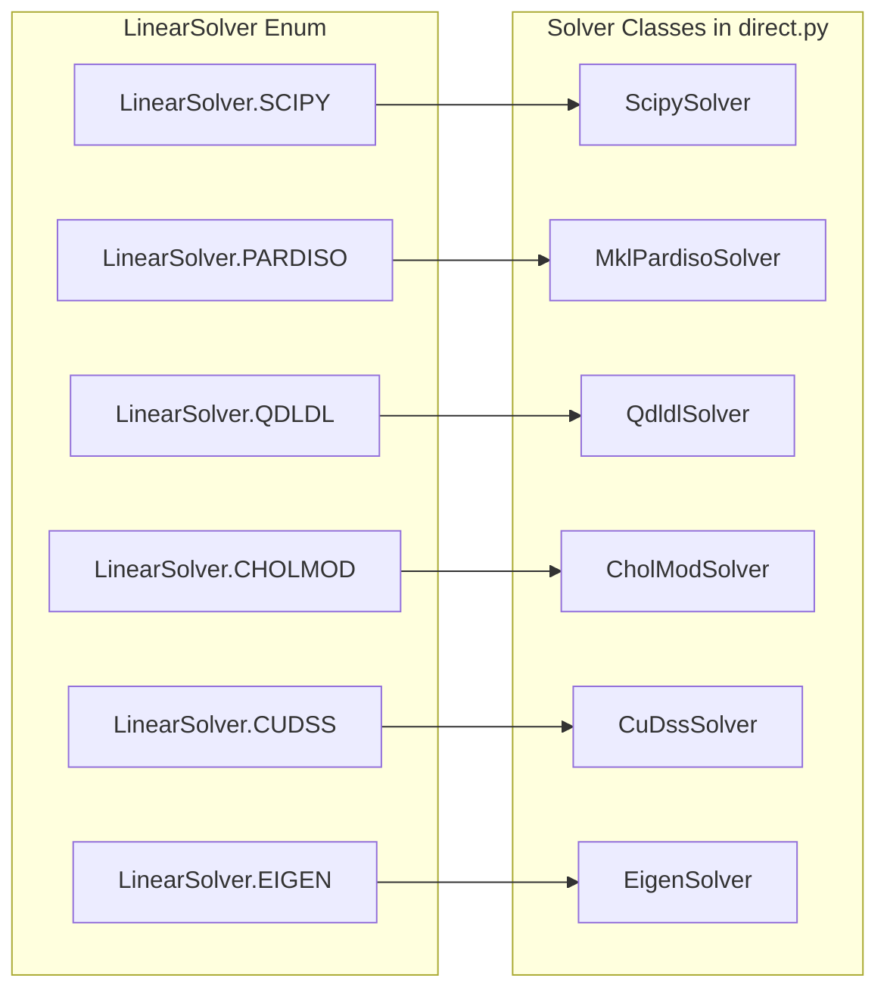
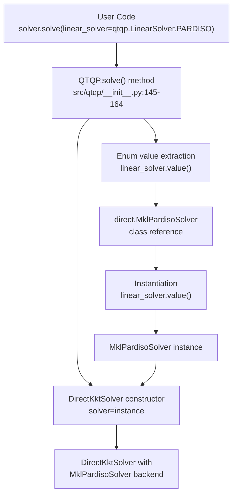
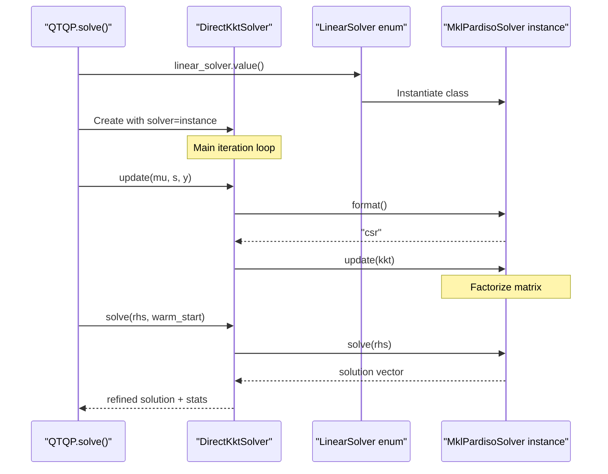

<!-- source: DeepWiki mcp.deepwiki.com · repo google-deepmind/qtqp · page 4.3 LinearSolver Enumeration · fetched 2026-10-26 -->

# LinearSolver Enumeration

<details>
<summary>Relevant source files</summary>

The following files were used as context for generating this wiki page:

- [README.md](README.md)
- [src/qtqp/__init__.py](src/qtqp/__init__.py)
- [src/qtqp/direct.py](src/qtqp/direct.py)

</details>


## Purpose and Scope

This page documents the `LinearSolver` enumeration, which provides a standardized interface for selecting different linear algebra backends when solving the KKT systems in QTQP. The enum abstracts the selection of six available direct solver implementations, allowing users to choose the most appropriate backend for their hardware and problem characteristics.

For detailed information about each solver backend's characteristics and performance, see [Linear Solver Backends](#3.3). For information on how to use this parameter in the solve method, see [QTQP Class](#4.1) and [Configuration Parameters](#4.4).

**Sources:** [src/qtqp/__init__.py:36-44]()

## Enum Definition

The `LinearSolver` enum is defined in [src/qtqp/__init__.py:36-44]() as a Python `enum.Enum` class. Each enum member maps directly to a solver implementation class from the `direct` module.

```python
class LinearSolver(enum.Enum):
  """Available linear solvers."""
  
  SCIPY = direct.ScipySolver
  PARDISO = direct.MklPardisoSolver
  QDLDL = direct.QdldlSolver
  CHOLMOD = direct.CholModSolver
  CUDSS = direct.CuDssSolver
  EIGEN = direct.EigenSolver
```

**Sources:** [src/qtqp/__init__.py:36-44]()

## Enum Members and Class Mappings

### LinearSolver Enum to Implementation Class Mapping



**Sources:** [src/qtqp/__init__.py:36-44](), [src/qtqp/direct.py:40-202]()

### Enum Member Reference Table

| Enum Member | Solver Class | Matrix Format | Implementation | Hardware |
|-------------|-------------|---------------|----------------|----------|
| `LinearSolver.SCIPY` | `ScipySolver` | CSC | `scipy.linalg.factorized` | CPU |
| `LinearSolver.PARDISO` | `MklPardisoSolver` | CSR | Intel MKL Pardiso (via `pydiso`) | CPU (Intel) |
| `LinearSolver.QDLDL` | `QdldlSolver` | CSC | QDLDL quasi-definite LDL | CPU |
| `LinearSolver.CHOLMOD` | `CholModSolver` | CSC | CHOLMOD (via `scikit-sparse`) | CPU |
| `LinearSolver.EIGEN` | `EigenSolver` | CSC | Eigen SimplicialLDLT | CPU |
| `LinearSolver.CUDSS` | `CuDssSolver` | CSR | Nvidia cuDSS | GPU |

**Sources:** [src/qtqp/direct.py:40-202](), [src/qtqp/__init__.py:36-44](), [README.md:190-240]()

## Usage in QTQP.solve()

The `LinearSolver` enum is passed as the `linear_solver` parameter to the `QTQP.solve()` method, with a default value of `LinearSolver.SCIPY`.

### Usage Example

```python
import qtqp
import scipy.sparse as sp
import numpy as np

# Define problem
solver = qtqp.QTQP(a=a, b=b, c=c, p=p, z=1)

# Default: uses SCIPY solver
solution = solver.solve()

# Explicitly specify PARDISO solver
solution = solver.solve(linear_solver=qtqp.LinearSolver.PARDISO)

# Use GPU solver
solution = solver.solve(linear_solver=qtqp.LinearSolver.CUDSS)
```

**Sources:** [src/qtqp/__init__.py:145-164](), [README.md:66-108]()

## Instantiation Flow

### From Enum Value to Solver Instance



The instantiation occurs at [src/qtqp/__init__.py:247-256](), where the enum's `.value()` method retrieves the class reference, and calling it as `linear_solver.value()` creates a new instance:

```python
self._linear_solver = direct.DirectKktSolver(
    a=a,
    p=self.equilibrated_p,
    z=self.z,
    min_static_regularization=min_static_regularization,
    max_iterative_refinement_steps=max_iterative_refinement_steps,
    atol=linear_solver_atol,
    rtol=linear_solver_rtol,
    solver=linear_solver.value(),  # Instantiates the solver class
)
```

**Sources:** [src/qtqp/__init__.py:247-256](), [src/qtqp/__init__.py:36-44]()

## Integration with DirectKktSolver

The `LinearSolver` enum serves as the abstraction layer between the high-level QTQP solver and the low-level KKT system solving. The `DirectKktSolver` class accepts any object implementing the `LinearSolver` Protocol defined in [src/qtqp/direct.py:24-37]().

### Protocol Requirements

All solver classes referenced by the enum must implement three methods:

| Method | Purpose | Return Type |
|--------|---------|-------------|
| `update(kkt: sp.spmatrix)` | Factorizes or refactorizes the KKT matrix | `None` |
| `solve(rhs: np.ndarray)` | Solves the linear system | `np.ndarray` |
| `format()` | Returns expected sparse matrix format | `str` ("csc" or "csr") |

**Sources:** [src/qtqp/direct.py:24-37]()

### DirectKktSolver Interaction Diagram



**Sources:** [src/qtqp/direct.py:204-383](), [src/qtqp/__init__.py:247-256]()

## Matrix Format Compatibility

The enum values are divided into two groups based on their preferred sparse matrix format:

### CSC Format Solvers
- `LinearSolver.SCIPY` → [src/qtqp/direct.py:98-112]()
- `LinearSolver.QDLDL` → [src/qtqp/direct.py:76-95]()
- `LinearSolver.CHOLMOD` → [src/qtqp/direct.py:115-134]()
- `LinearSolver.EIGEN` → [src/qtqp/direct.py:137-157]()

### CSR Format Solvers
- `LinearSolver.PARDISO` → [src/qtqp/direct.py:40-73]()
- `LinearSolver.CUDSS` → [src/qtqp/direct.py:160-201]()

The `DirectKktSolver` automatically constructs the KKT scaffold in the correct format by querying `solver.format()` at [src/qtqp/direct.py:256]():

```python
self.kkt = sp.bmat(
    [[p + n_nans, a.T], [a, m_nans]],
    format=self.solver.format(),  # Adapts to solver's preferred format
    dtype=np.float64,
)
```

**Sources:** [src/qtqp/direct.py:254-258](), [src/qtqp/direct.py:72-73](), [src/qtqp/direct.py:94-95](), [src/qtqp/direct.py:111-112](), [src/qtqp/direct.py:133-134](), [src/qtqp/direct.py:156-157](), [src/qtqp/direct.py:195-196]()

## Availability and Dependencies

Each enum member corresponds to a solver that may require optional dependencies. The availability check is implicit—if the required package is not installed, attempting to instantiate the solver will raise an `ImportError` at the point where the backend module is imported.

### Dependency Installation Table

| Enum Member | Package Required | Installation Command |
|-------------|-----------------|---------------------|
| `SCIPY` | `scipy` | Included by default (required dependency) |
| `PARDISO` | `pydiso` | `conda install pydiso --channel conda-forge` |
| `QDLDL` | `qdldl` | `python -m pip install qdldl` |
| `CHOLMOD` | `scikit-sparse` | `conda install -c conda-forge scikit-sparse` |
| `EIGEN` | `eigenpy` | `conda install eigenpy -c conda-forge` |
| `CUDSS` | `nvidia-cudss`, `nvmath-python` | `pip install nvidia-cudss-cu12 nvmath-python[cu12]` |

**Sources:** [README.md:200-240](), [src/qtqp/direct.py:44](), [src/qtqp/direct.py:80](), [src/qtqp/direct.py:119](), [src/qtqp/direct.py:141](), [src/qtqp/direct.py:164]()

## Default Solver Selection

The default solver is `LinearSolver.SCIPY`, which is always available since `scipy` is a required dependency of the QTQP package as specified in [pyproject.toml](). This ensures that the solver can always run without requiring users to install optional backend packages.

The default is set in the method signature at [src/qtqp/__init__.py:158]():

```python
def solve(
    *,
    # ... other parameters ...
    linear_solver: LinearSolver = LinearSolver.SCIPY,
    # ... other parameters ...
) -> Solution:
```

**Sources:** [src/qtqp/__init__.py:158](), [README.md:193-194]()

---

