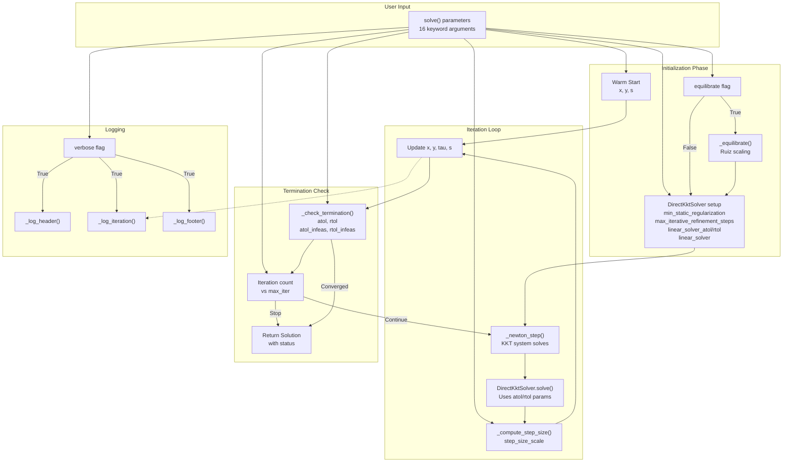

<!-- source: DeepWiki mcp.deepwiki.com · repo google-deepmind/qtqp · page 4.4 Configuration Parameters · fetched 2026-10-26 -->

# Configuration Parameters

<details>
<summary>Relevant source files</summary>

The following files were used as context for generating this wiki page:

- [README.md](README.md)
- [src/qtqp/__init__.py](src/qtqp/__init__.py)

</details>


This document provides a comprehensive reference for all configuration parameters available in the `QTQP.solve()` method. These 16 parameters control convergence criteria, numerical stability, algorithm behavior, and output verbosity.

For information about selecting linear solver backends, see [LinearSolver Enumeration](#4.3). For details on warm starting techniques, see [Warm Starting](#5.2). For equilibration behavior, see [Equilibration and Numerical Stability](#5.1).

## Overview

The `solve()` method accepts 16 keyword-only parameters organized into five functional categories:

1. **Convergence Tolerances**: Control when the solver declares a solution optimal or detects infeasibility
2. **Iteration Control**: Limit computational effort and control step sizes
3. **Numerical Stability**: Configure KKT system regularization and iterative refinement
4. **Algorithm Configuration**: Select linear solver backend and enable/disable preprocessing
5. **Warm Start Values**: Provide initial iterate values for faster convergence

All parameters have sensible defaults suitable for general-purpose solving. Most users will only need to adjust `linear_solver` and occasionally `max_iter` or the convergence tolerances.

**Sources**: [src/qtqp/__init__.py:145-164]()

## Parameter Summary Table

| Parameter | Type | Default | Category | Description |
|-----------|------|---------|----------|-------------|
| `atol` | float | `1e-7` | Convergence | Absolute tolerance for optimality |
| `rtol` | float | `1e-8` | Convergence | Relative tolerance for optimality |
| `atol_infeas` | float | `1e-8` | Convergence | Absolute tolerance for infeasibility |
| `rtol_infeas` | float | `1e-9` | Convergence | Relative tolerance for infeasibility |
| `max_iter` | int | `100` | Iteration Control | Maximum number of iterations |
| `step_size_scale` | float | `0.99` | Iteration Control | Step size safety factor in (0, 1) |
| `min_static_regularization` | float | `1e-7` | Numerical Stability | KKT diagonal regularization floor |
| `max_iterative_refinement_steps` | int | `50` | Numerical Stability | Maximum refinement iterations |
| `linear_solver_atol` | float | `1e-12` | Numerical Stability | Absolute tolerance for linear system |
| `linear_solver_rtol` | float | `1e-12` | Numerical Stability | Relative tolerance for linear system |
| `linear_solver` | LinearSolver | `SCIPY` | Algorithm Config | Backend linear solver selection |
| `verbose` | bool | `True` | Algorithm Config | Enable iteration logging |
| `equilibrate` | bool | `True` | Algorithm Config | Enable Ruiz equilibration |
| `x` | ndarray\|None | `None` | Warm Start | Initial primal solution |
| `y` | ndarray\|None | `None` | Warm Start | Initial dual solution |
| `s` | ndarray\|None | `None` | Warm Start | Initial slack variables |

**Sources**: [src/qtqp/__init__.py:145-164](), [README.md:142-179]()

## Parameter Flow Through Solver



**Diagram: Parameter Flow from User Input to Solver Components**

This diagram shows how configuration parameters are distributed to different components of the solver algorithm. Parameters flow from user input through initialization, affect the iteration loop behavior, and control termination criteria and logging.

**Sources**: [src/qtqp/__init__.py:145-373]()

## Convergence Tolerance Parameters

### atol (float, default: 1e-7)

Absolute tolerance for declaring optimal convergence. The solver checks three conditions for optimality:

1. **Primal residual**: `||Ax + s - b||∞ < atol + rtol × scale`
2. **Dual residual**: `||Px + Aᵀy + c||∞ < atol + rtol × scale`
3. **Duality gap**: `|cᵀx + bᵀy + xᵀPx| < atol + rtol × min(|pcost|, |dcost|)`

The solver returns `SolutionStatus.SOLVED` when all three conditions are satisfied.

**When to adjust**: Decrease for higher precision solutions; increase for faster termination with lower accuracy requirements.

**Sources**: [src/qtqp/__init__.py:168-170](), [src/qtqp/__init__.py:579-584]()

### rtol (float, default: 1e-8)

Relative tolerance for optimality convergence, scaled by problem-specific norms:
- Primal residual scale: `max(||Ax||∞, ||s||∞, ||b||∞) / τ`
- Dual residual scale: `max(||Px||∞, ||Aᵀy||∞, ||c||∞) / τ`
- Gap scale: `min(|pcost|, |dcost|)`

The relative term ensures tolerance adapts to problem magnitude. A problem with costs in the millions uses appropriately scaled tolerances.

**When to adjust**: Decrease for tighter relative convergence; increase when absolute tolerance dominates.

**Sources**: [src/qtqp/__init__.py:169-171](), [src/qtqp/__init__.py:564-582]()

### atol_infeas (float, default: 1e-8)

Absolute tolerance for detecting primal or dual infeasibility. The solver uses homogeneous embedding to generate infeasibility certificates:

- **Primal infeasibility**: When `bᵀy < 0` and `||Aᵀy||∞ / |bᵀy| < atol_infeas + rtol_infeas × scale`
- **Dual infeasibility**: When `cᵀx < 0` and `max(||Ax + s||∞, ||Px||∞) / |cᵀx| < atol_infeas + rtol_infeas × scale`

The returned certificate proves no feasible solution exists (primal) or objective is unbounded below (dual).

**When to adjust**: Decrease for stricter infeasibility detection; increase if solver incorrectly declares infeasibility.

**Sources**: [src/qtqp/__init__.py:171-174](), [src/qtqp/__init__.py:585-592]()

### rtol_infeas (float, default: 1e-9)

Relative tolerance for infeasibility detection, scaled by certificate norms. Works in conjunction with `atol_infeas` to provide scale-adaptive infeasibility detection.

**When to adjust**: Tighten if false infeasibility detections occur; relax for faster detection on clearly infeasible problems.

**Sources**: [src/qtqp/__init__.py:173-174](), [src/qtqp/__init__.py:586-591]()

## Iteration Control Parameters

### max_iter (int, default: 100)

Maximum number of primal-dual interior point iterations before the solver terminates with `SolutionStatus.FAILED`. Each iteration performs:
1. One `KKT @ q` solve (reused across predictor/corrector)
2. One predictor step solve (affine-scaling direction)
3. One corrector step solve (with Mehrotra correction)

Typical convergence requires 10-50 iterations for well-conditioned problems. Ill-conditioned or large-scale problems may require more.

**When to adjust**: Increase for difficult problems that converge slowly; decrease to fail-fast on problematic instances.

**Sources**: [src/qtqp/__init__.py:175](), [src/qtqp/__init__.py:263](), [src/qtqp/__init__.py:372-373]()

### step_size_scale (float, default: 0.99)

Fraction of maximum feasible step size actually taken, ensuring iterates remain strictly interior to the cone `{y[z:] > 0, s[z:] > 0, τ > 0}`. The maximum step size α is computed such that `y + α × Δy ≥ 0` and `s + α × Δs ≥ 0`, then the actual step is `step_size_scale × α`.

Valid range: `(0, 1)`. Values close to 1.0 are aggressive (faster convergence, riskier); values closer to 0.5 are conservative (slower, more stable).

**When to adjust**: Decrease if solver becomes numerically unstable (common with poorly-conditioned problems); increase slightly for well-conditioned problems.

**Sources**: [src/qtqp/__init__.py:176-178](), [src/qtqp/__init__.py:331-332](), [src/qtqp/__init__.py:420-429]()

## Numerical Stability Parameters

### min_static_regularization (float, default: 1e-7)

Minimum diagonal regularization added to the KKT matrix for numerical robustness. The KKT system has the form:

```
[P + δI    Aᵀ] [Δx]   [rhs_x]
[A      -Σ⁻¹ ] [Δy] = [rhs_y]
```

where `δ ≥ min_static_regularization` and `Σ` is a diagonal matrix from the interior point method. This regularization prevents singular or near-singular systems.

**When to adjust**: Increase if linear solves fail or produce NaN/Inf values; decrease for problems known to be well-conditioned.

**Sources**: [src/qtqp/__init__.py:178-180](), [src/qtqp/__init__.py:247-256]()

### max_iterative_refinement_steps (int, default: 50)

Maximum number of iterative refinement iterations performed by `DirectKktSolver.solve()` to achieve target accuracy. Iterative refinement compensates for limited precision in direct factorization:

```
x₀ = LDLᵀ⁻¹(b)
for i = 1 to max_steps:
    r = b - A × xᵢ₋₁
    if ||r|| < tolerance: break
    Δx = LDLᵀ⁻¹(r)
    xᵢ = xᵢ₋₁ + Δx
```

Refinement typically converges in 1-5 steps for well-conditioned systems.

**When to adjust**: Increase for very high accuracy requirements or ill-conditioned systems; decrease to fail-fast if refinement is not converging.

**Sources**: [src/qtqp/__init__.py:180-182](), [src/qtqp/__init__.py:247-256]()

### linear_solver_atol (float, default: 1e-12)

Absolute tolerance for the iterative refinement process within linear system solves. The refinement terminates when the residual `||b - Ax||∞ < linear_solver_atol + linear_solver_rtol × ||b||∞`.

**When to adjust**: Decrease for higher precision KKT solves (may improve overall convergence); increase if refinement takes too many steps.

**Sources**: [src/qtqp/__init__.py:182-184](), [src/qtqp/__init__.py:247-256]()

### linear_solver_rtol (float, default: 1e-12)

Relative tolerance for iterative refinement, scaled by the RHS norm `||b||∞`. Works with `linear_solver_atol` to provide scale-adaptive stopping criteria for linear solves.

**When to adjust**: Decrease for tighter linear system accuracy; increase for faster (less accurate) linear solves.

**Sources**: [src/qtqp/__init__.py:184-186](), [src/qtqp/__init__.py:247-256]()

## Algorithm Configuration Parameters

### linear_solver (LinearSolver, default: LinearSolver.SCIPY)

Selects the backend linear solver for factorizing and solving KKT systems. Available options:

| Enum Value | Backend | Hardware | Installation |
|------------|---------|----------|--------------|
| `LinearSolver.SCIPY` | SciPy's sparse LU | CPU | Built-in |
| `LinearSolver.PARDISO` | Intel MKL Pardiso | Intel CPU | `conda install pydiso` |
| `LinearSolver.QDLDL` | QDLDL | CPU | `pip install qdldl` |
| `LinearSolver.CHOLMOD` | CHOLMOD | CPU | `conda install scikit-sparse` |
| `LinearSolver.EIGEN` | Eigen SimplicialLDLT | CPU | `conda install eigenpy` |
| `LinearSolver.CUDSS` | NVIDIA cuDSS | NVIDIA GPU | `pip install nvidia-cudss-cu12` |

**Performance characteristics**:
- `SCIPY`: Good general-purpose solver, moderate speed
- `PARDISO`: Fastest for Intel CPUs, highly optimized
- `QDLDL`: Lightweight, pure Python-compatible, slower
- `CHOLMOD`: Fast, mature implementation
- `EIGEN`: Fast, similar performance to CHOLMOD
- `CUDSS`: GPU-accelerated, best for large problems with GPU available

**When to adjust**: Switch based on available hardware and problem size. For detailed guidance, see [Linear Solver Backends](#3.3) and [Performance Tuning](#5.5).

**Sources**: [src/qtqp/__init__.py:158](), [src/qtqp/__init__.py:186-188](), [src/qtqp/__init__.py:36-44](), [src/qtqp/__init__.py:247-256]()

### verbose (bool, default: True)

Enables iteration-by-iteration logging to stdout. When `True`, prints:
1. Problem summary header (dimensions, sparsity, solver choice)
2. Per-iteration table with metrics (costs, residuals, gap, complementarity, mu, sigma, alpha, step counts, time)
3. Termination message (solved, infeasible, unbounded, or failed)

Output format:
```
| iter |      pcost |      dcost |     pres |     dres |      gap |   infeas |       mu |    sigma |    alpha |  q, p, c |     time |
```

**When to adjust**: Set `False` for silent execution in production or when solving many problems in batch.

**Sources**: [src/qtqp/__init__.py:188-189](), [src/qtqp/__init__.py:201-208](), [src/qtqp/__init__.py:624-653]()

### equilibrate (bool, default: True)

Enables Ruiz equilibration preprocessing to improve numerical conditioning. Equilibration rescales rows/columns of `A` and `P` to have roughly unit infinity norms, which:
1. Reduces condition number of KKT matrix
2. Improves factorization accuracy
3. Balances primal and dual residuals

The scaling is performed iteratively for 10 iterations before solving begins. Solution is automatically unscaled before returning.

**Algorithm**: For each iteration, compute `d = 1/√(||A[row]||∞)` and `e = 1/√(max(||A[:,col]||∞, ||P[:,col]||∞))`, then apply:
- `A ← diag(d) × A × diag(e)`
- `P ← diag(e) × P × diag(e)`
- `b ← b × d`, `c ← c × e`

**When to adjust**: Set `False` if problem data is already well-scaled or if preprocessing time is critical. For more details, see [Equilibration and Numerical Stability](#5.1).

**Sources**: [src/qtqp/__init__.py:189-190](), [src/qtqp/__init__.py:240-246](), [src/qtqp/__init__.py:375-412]()

## Warm Start Parameters

### x (ndarray | None, default: None)

Initial primal variable vector of shape `(n,)`. If `None`, initialized to zeros. Providing a warm start close to the optimal solution can significantly reduce iteration count for sequences of related problems.

**Requirements**:
- Must have shape `(n,)`
- No feasibility constraints (can be infeasible)
- Automatically cast to `float64`

**When to use**: When solving a sequence of similar problems (e.g., in model predictive control, parametric optimization, or re-solving after small data perturbations).

**Sources**: [src/qtqp/__init__.py:191-193](), [src/qtqp/__init__.py:210-211]()

### y (ndarray | None, default: None)

Initial dual variable vector of shape `(m,)`. If `None`, initialized to `[0,...,0,1,1,...,1]` where inequality duals `y[z:]` are set to 1.0 for strict interiority.

**Requirements**:
- Must have shape `(m,)`
- Must satisfy `y[z:] ≥ 0` (inequality duals non-negative)
- Solver will raise `ValueError` if this constraint is violated

**When to use**: Provide previous solution's dual values when solving similar problems. Ensures faster convergence by starting in a good region of the dual space.

**Sources**: [src/qtqp/__init__.py:192-193](), [src/qtqp/__init__.py:212-219](), [src/qtqp/__init__.py:234-236]()

### s (ndarray | None, default: None)

Initial slack variable vector of shape `(m,)`. If `None`, initialized to `[0,...,0,1,1,...,1]` where inequality slacks `s[z:]` are set to 1.0 for strict interiority.

**Requirements**:
- Must have shape `(m,)`
- Must satisfy `s[:z] == 0` (equality slacks are zero)
- Must satisfy `s[z:] > 0` (inequality slacks strictly positive)
- Solver will raise `ValueError` if these constraints are violated

**When to use**: Complete the primal-dual warm start triple `(x, y, s)` from a previous solution.

**Sources**: [src/qtqp/__init__.py:193-194](), [src/qtqp/__init__.py:221-228](), [src/qtqp/__init__.py:237-238]()

## Parameter Usage in Code

```mermaid
flowchart TB
    subgraph "Convergence Tolerances"
        CT["atol<br/>rtol<br/>atol_infeas<br/>rtol_infeas"]
        CTFunc["_check_termination()"]
        CTLine["Lines 579-592"]
    end
    
    subgraph "Iteration Control"
        IC["max_iter<br/>step_size_scale"]
        ICLoop["Main iteration loop"]
        ICLine["Lines 263, 331-332"]
        ICFunc["_compute_step_size()<br/>_max_step_size()"]
        ICLine2["Lines 420-429, 529-533"]
    end
    
    subgraph "Numerical Stability"
        NS["min_static_regularization<br/>max_iterative_refinement_steps<br/>linear_solver_atol<br/>linear_solver_rtol"]
        NSSetup["DirectKktSolver setup"]
        NSLine["Lines 247-256"]
    end
    
    subgraph "Algorithm Config"
        AC1["linear_solver"]
        AC2["verbose"]
        AC3["equilibrate"]
        ACSetup["DirectKktSolver init<br/>with solver backend"]
        ACLine1["Lines 247-256"]
        ACLog["_log_header()<br/>_log_iteration()<br/>_log_footer()"]
        ACLine2["Lines 624-653"]
        ACEquil["_equilibrate()"]
        ACLine3["Lines 240-246, 375-412"]
    end
    
    subgraph "Warm Start"
        WS["x, y, s"]
        WSInit["Initialization"]
        WSLine["Lines 210-228"]
        WSValid["Validation checks"]
        WSLine2["Lines 234-238"]
    end
    
    CT --> CTFunc
    CTFunc --> CTLine
    
    IC --> ICLoop
    ICLoop --> ICLine
    IC --> ICFunc
    ICFunc --> ICLine2
    
    NS --> NSSetup
    NSSetup --> NSLine
    
    AC1 --> ACSetup
    ACSetup --> ACLine1
    AC2 --> ACLog
    ACLog --> ACLine2
    AC3 --> ACEquil
    ACEquil --> ACLine3
    
    WS --> WSInit
    WSInit --> WSLine
    WS --> WSValid
    WSValid --> WSLine2
```



**Diagram: Parameter Categories Mapped to Code Locations**

This diagram shows where each parameter category is used within the solver implementation. References are to line numbers in `src/qtqp/__init__.py`.

**Sources**: [src/qtqp/__init__.py:145-653]()

## Parameter Selection Guidelines

### Quick Reference by Use Case

| Use Case | Recommended Settings | Rationale |
|----------|---------------------|-----------|
| **General Purpose** | All defaults | Balanced accuracy, stability, and performance |
| **High Precision** | `atol=1e-10`, `rtol=1e-11`, `linear_solver_atol=1e-14`, `linear_solver_rtol=1e-14` | Tighter tolerances throughout |
| **Fast Approximate** | `atol=1e-5`, `rtol=1e-6`, `max_iter=50` | Faster termination with lower accuracy |
| **Large Scale** | `linear_solver=LinearSolver.PARDISO` or `CUDSS`, `equilibrate=True` | Exploit faster backends and preprocessing |
| **Sequences of Similar Problems** | Provide `x`, `y`, `s` from previous solution | Warm starting reduces iterations |
| **Ill-Conditioned** | `min_static_regularization=1e-6`, `max_iterative_refinement_steps=100`, `step_size_scale=0.95` | More regularization and refinement, smaller steps |
| **Silent Batch Processing** | `verbose=False` | Suppress output |
| **Already Well-Scaled** | `equilibrate=False` | Skip preprocessing overhead |

### Tolerance Relationships

The tolerance parameters must satisfy certain relationships for consistent behavior:

1. **Optimality tolerances**: `atol ≥ linear_solver_atol` and `rtol ≥ linear_solver_rtol`
   - Rationale: Cannot achieve tighter optimality than the accuracy of underlying linear solves
   
2. **Infeasibility tolerances**: `atol_infeas ≥ atol` and `rtol_infeas ≥ rtol`
   - Rationale: Infeasibility detection should not be more stringent than optimality

3. **Regularization vs. tolerances**: `min_static_regularization << atol`
   - Rationale: Regularization is for numerical stability, not to influence convergence criteria

Violating these guidelines may cause premature termination or infinite loops.

### Common Tuning Scenarios

**Scenario 1: Solver declares infeasible, but problem is known to be feasible**
- Increase `atol_infeas` and `rtol_infeas` by 10x
- Increase `max_iter` to allow more iterations to find feasible region
- Enable `equilibrate=True` to improve conditioning

**Scenario 2: Solver is too slow (>100 iterations)**
- Switch to faster linear solver: `linear_solver=LinearSolver.PARDISO` (Intel) or `LinearSolver.CUDSS` (GPU)
- Increase `step_size_scale` to 0.995 for more aggressive steps
- Check if problem is poorly scaled; enable `equilibrate=True`

**Scenario 3: Linear solver failures (NaN/Inf in solution)**
- Increase `min_static_regularization` to `1e-6` or `1e-5`
- Increase `max_iterative_refinement_steps` to `100`
- Decrease `step_size_scale` to `0.95` to stay further from boundary
- Try different linear solver backend (some are more numerically stable)

**Scenario 4: Solution accuracy is insufficient**
- Decrease `atol`, `rtol` by 10x
- Decrease `linear_solver_atol`, `linear_solver_rtol` by 10x
- Increase `max_iterative_refinement_steps` to ensure linear solves converge to new tolerance

**Sources**: Based on solver behavior described in [src/qtqp/__init__.py:145-653]()

## Parameter Defaults Summary

All 16 parameters have defaults designed for general-purpose solving. The defaults represent a balance between:
- **Accuracy**: Tolerances of `O(1e-7)` to `O(1e-12)` suitable for most engineering applications
- **Robustness**: Regularization and iterative refinement enabled to handle moderately ill-conditioned problems
- **Usability**: Verbose logging enabled, equilibration enabled, warm starts optional
- **Performance**: Moderate iteration limit (100), conservative step sizes (0.99), reasonable refinement limits (50)

Users solving specialized problem classes should adjust parameters based on problem characteristics (scale, conditioning, sparsity pattern) and requirements (accuracy, speed, reliability).

**Sources**: [src/qtqp/__init__.py:145-164](), [README.md:142-179]()

---

