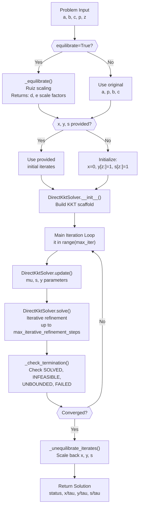
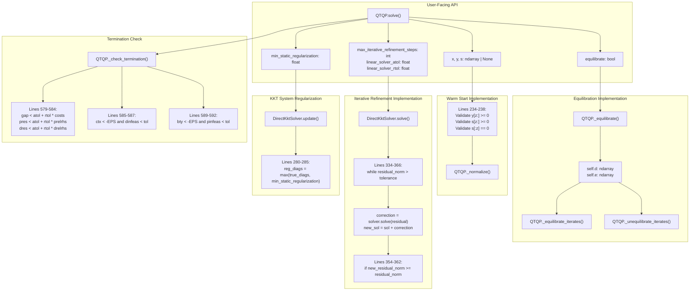
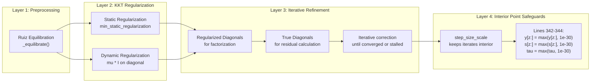
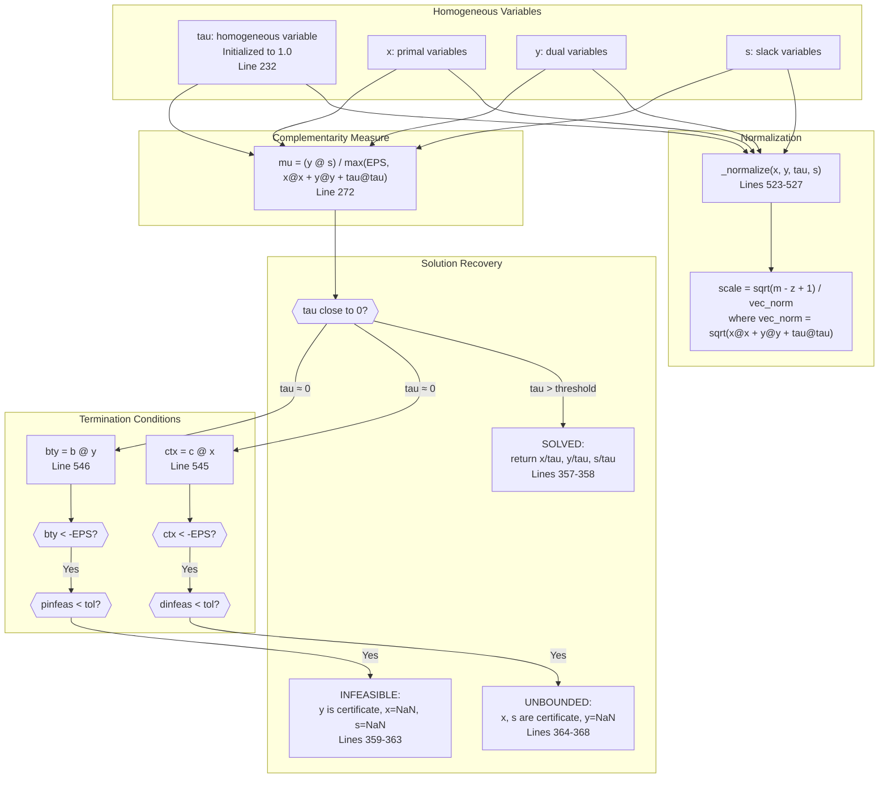
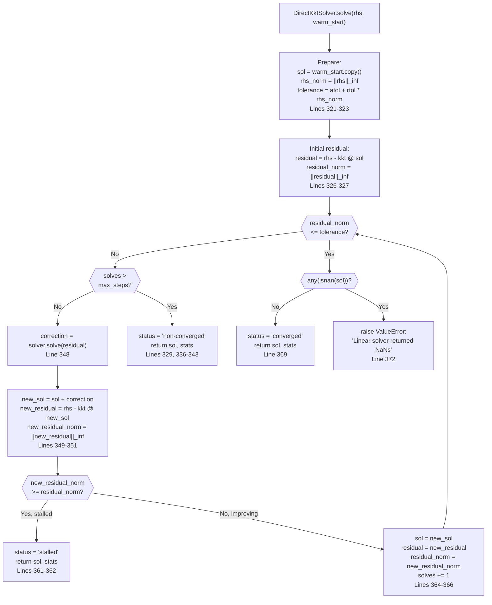
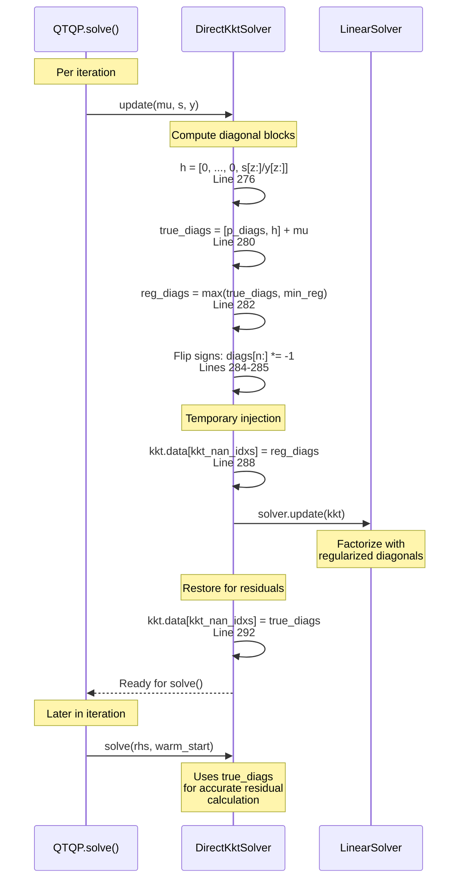
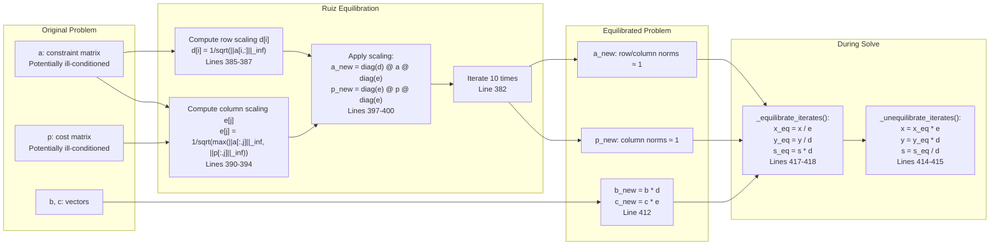

<!-- source: DeepWiki mcp.deepwiki.com · repo google-deepmind/qtqp · page 5 Advanced Topics · fetched 2026-10-26 -->

# Advanced Topics

<details>
<summary>Relevant source files</summary>

The following files were used as context for generating this wiki page:

- [src/qtqp/__init__.py](src/qtqp/__init__.py)
- [src/qtqp/direct.py](src/qtqp/direct.py)

</details>


This page covers advanced usage patterns, optimization techniques, and solver internals for the QTQP solver. Topics include numerical stability improvements, performance optimization, understanding convergence behavior, and interpreting non-standard termination states.

For basic usage and problem formulation, see [Getting Started](#2). For detailed API reference, see [API Reference](#4). For architecture and algorithm details, see [Architecture](#3).

## Scope and Organization

This page introduces five advanced topics that enable sophisticated usage of the QTQP solver:

| Topic | Purpose | Key Code Entity |
|-------|---------|-----------------|
| **Equilibration** | Improve numerical conditioning via Ruiz scaling | `QTQP._equilibrate()` |
| **Warm Starting** | Accelerate convergence for sequences of related problems | `QTQP.solve(x=..., y=..., s=...)` |
| **Iterative Refinement** | Achieve high accuracy despite ill-conditioned systems | `DirectKktSolver.solve()` |
| **Infeasibility Detection** | Understand how solver certifies infeasible/unbounded problems | `QTQP._check_termination()` |
| **Performance Tuning** | Select optimal solvers and parameters for specific problems | `LinearSolver` enum |

Each subsection (5.1-5.5) provides detailed coverage of one topic.

## Advanced Features Integration

The following diagram shows how advanced features integrate into the main solver workflow:



**Sources:** [src/qtqp/__init__.py:145-373](), [src/qtqp/__init__.py:375-412](), [src/qtqp/__init__.py:414-418](), [src/qtqp/direct.py:204-383]()

## Code Entity Mapping

The following diagram maps advanced feature names to their implementing code entities:



**Sources:** [src/qtqp/__init__.py:145-164](), [src/qtqp/__init__.py:375-418](), [src/qtqp/__init__.py:234-238](), [src/qtqp/__init__.py:523-527](), [src/qtqp/direct.py:262-292](), [src/qtqp/direct.py:294-382](), [src/qtqp/__init__.py:535-622]()

## Numerical Stability Architecture

The solver employs a multi-layered approach to numerical stability:



**Sources:** [src/qtqp/__init__.py:375-412](), [src/qtqp/direct.py:262-292](), [src/qtqp/direct.py:294-382](), [src/qtqp/__init__.py:332-344]()

## Homogeneous Self-Dual Embedding

The solver uses homogeneous self-dual embedding to detect infeasibility and unboundedness. The embedding introduces a tau variable that allows the algorithm to distinguish between optimal solutions, certificates of infeasibility, and certificates of unboundedness:



**Sources:** [src/qtqp/__init__.py:230-238](), [src/qtqp/__init__.py:269-273](), [src/qtqp/__init__.py:523-527](), [src/qtqp/__init__.py:535-622]()

## Predictor-Corrector Step Computation

The solver implements Mehrotra's predictor-corrector algorithm. Understanding this flow is essential for tuning convergence behavior:

```mermaid
flowchart TD
    subgraph "Per-Iteration Setup"
        UpdateMu["Compute mu = (y @ s) / vec_norm<br/>Line 272"]
        UpdateKKT["DirectKktSolver.update(mu, s, y)<br/>Factorize KKT matrix"]
        SolveQ["Solve KKT @ kkt_inv_q = q<br/>Reused for both steps<br/>Lines 277-279"]
    end
    
    subgraph "Predictor (Affine) Step"
        PredictorCall["_newton_step(mu_target=0.0)<br/>Lines 282-293"]
        PredictorSolve["Solve KKT system<br/>with mu_target=0"]
        ComputeAlphaP["alpha_p = _compute_step_size()<br/>Line 301"]
        ComputeSigma["sigma = _compute_sigma()<br/>Mehrotra heuristic<br/>Lines 302-304"]
    end
    
    subgraph "Corrector Step"
        ConeCor["cone_correction = -d_s_p * d_y_p / y<br/>Mehrotra nonlinearity term<br/>Line 308"]
        CorrectorCall["_newton_step(mu_target=sigma*mu)<br/>Lines 310-319"]
        CorrectorSolve["Solve KKT system<br/>with centering and correction"]
    end
    
    subgraph "Update Iterates"
        ComputeStep["d_x = x_c - x<br/>d_y = y_c - y<br/>d_tau = tau_c - tau<br/>d_s computed from y_c<br/>Lines 323-329"]
        ComputeAlpha["alpha = _compute_step_size(y, s, d_y, d_s)<br/>Line 331"]
        ApplyStep["x += step_size_scale * alpha * d_x<br/>y += step_size_scale * alpha * d_y<br/>tau += step_size_scale * alpha * d_tau<br/>s += step_size_scale * alpha * d_s<br/>Lines 332-338"]
        ClipPos["Clip y[z:], s[z:], tau to >= 1e-30<br/>Lines 342-344"]
    end
    
    UpdateMu --> UpdateKKT
    UpdateKKT --> SolveQ
    SolveQ --> PredictorCall
    PredictorCall --> PredictorSolve
    PredictorSolve --> ComputeAlphaP
    ComputeAlphaP --> ComputeSigma
    ComputeSigma --> ConeCor
    ConeCor --> CorrectorCall
    CorrectorCall --> CorrectorSolve
    CorrectorSolve --> ComputeStep
    ComputeStep --> ComputeAlpha
    ComputeAlpha --> ApplyStep
    ApplyStep --> ClipPos
```



**Sources:** [src/qtqp/__init__.py:269-344]()

## Iterative Refinement Process

The `DirectKktSolver.solve()` method implements iterative refinement to improve solution accuracy:



**Sources:** [src/qtqp/direct.py:294-382]()

## KKT Matrix Update Strategy

The `DirectKktSolver.update()` method uses an optimization to avoid copying the full KKT matrix:



This strategy enables accurate residual computation (using true diagonals) while maintaining numerical stability (factorizing with regularized diagonals).

**Sources:** [src/qtqp/direct.py:262-292]()

## Performance Characteristics by Linear Solver

Different linear solvers have different performance characteristics:

| Solver | Backend | Format | Factorization Type | Best For | Limitations |
|--------|---------|--------|-------------------|----------|-------------|
| `SCIPY` | `scipy.sparse.linalg` | CSC | LU-based | Default, portable | Slower than specialized solvers |
| `PARDISO` | Intel MKL via pydiso | CSR | LDL^T | Intel CPUs, large dense KKT | Ubuntu only, requires Intel CPU |
| `QDLDL` | qdldl library | CSC | LDL^T quasi-definite | Sparse KKT systems | May be slower than CHOLMOD |
| `CHOLMOD` | SuiteSparse via scikit-sparse | CSC | Simplicial LDL^T | Sparse KKT, good sparsity | Requires CHOLMOD installation |
| `EIGEN` | Eigen via eigenpy | CSC | Simplicial LDL^T | C++ integration, moderate size | Requires eigenpy compilation |
| `CUDSS` | NVIDIA cuDSS | CSR | GPU-accelerated | Very large problems, GPU available | Requires NVIDIA GPU, CUDA toolkit |

**Sources:** [src/qtqp/__init__.py:36-44](), [src/qtqp/direct.py:40-202]()

## Solver Selection Code Pattern

```python
# Example: Selecting different linear solvers
from qtqp import QTQP, LinearSolver

# Default (portable but slower)
solver = QTQP(a=a, b=b, c=c, z=z, p=p)
solution = solver.solve(linear_solver=LinearSolver.SCIPY)

# Intel CPU optimization
solution = solver.solve(linear_solver=LinearSolver.PARDISO)

# GPU acceleration (requires NVIDIA GPU)
solution = solver.solve(linear_solver=LinearSolver.CUDSS)

# Sparse system optimization
solution = solver.solve(linear_solver=LinearSolver.CHOLMOD)
```

**Sources:** [src/qtqp/__init__.py:36-44](), [src/qtqp/__init__.py:158-164]()

## Tuning Parameters for Convergence

Key parameters that affect convergence behavior:

| Parameter | Default | Effect | Increase When | Decrease When |
|-----------|---------|--------|---------------|---------------|
| `atol` | 1e-7 | Absolute tolerance for optimality | Want faster (looser) convergence | Need higher precision |
| `rtol` | 1e-8 | Relative tolerance for optimality | Want faster convergence | Need higher precision |
| `max_iter` | 100 | Maximum iterations | Problem doesn't converge | Want early termination |
| `step_size_scale` | 0.99 | Fraction of maximum step taken | Getting stuck at boundary | Taking too cautious steps |
| `min_static_regularization` | 1e-7 | KKT diagonal regularization | Factorization fails | Want exact KKT system |
| `max_iterative_refinement_steps` | 50 | Max refinement iterations per KKT solve | Linear solves aren't accurate | Want faster iterations |
| `linear_solver_atol` | 1e-12 | Absolute tolerance for refinement | Want faster KKT solves | Need exact KKT solves |
| `linear_solver_rtol` | 1e-12 | Relative tolerance for refinement | Want faster KKT solves | Need exact KKT solves |

**Sources:** [src/qtqp/__init__.py:145-164]()

## Equilibration Benefits

Equilibration transforms the problem to have better-conditioned matrices:



Equilibration typically reduces condition numbers by orders of magnitude, enabling more accurate solutions and faster convergence.

**Sources:** [src/qtqp/__init__.py:375-418]()

## Warm Start Usage Pattern

Warm starting provides initial values for `x`, `y`, `s` to accelerate convergence:

```python
# First solve: cold start
solver = QTQP(a=a, b=b1, c=c, z=z, p=p)
solution1 = solver.solve()

# Subsequent solve with slightly different b
# Use previous solution as warm start
solver2 = QTQP(a=a, b=b2, c=c, z=z, p=p)
solution2 = solver2.solve(
    x=solution1.x,  # Previous primal solution
    y=solution1.y,  # Previous dual solution  
    s=solution1.s   # Previous slack solution
)
```

Requirements for warm start values:
- `y[z:] >= 0` (dual variables for inequality constraints are non-negative)
- `s[z:] >= 0` (slack variables for inequality constraints are non-negative)  
- `s[:z] == 0` (slack variables for equality constraints are zero)

**Sources:** [src/qtqp/__init__.py:161-163](), [src/qtqp/__init__.py:210-238]()

## Infeasibility Certificate Structure

When the solver detects infeasibility or unboundedness, it returns certificates:

```mermaid
graph TB
    subgraph "INFEASIBLE: Primal Infeasible / Dual Unbounded"
        InfeasCond["Condition: bty < -EPS<br/>pinfeas < tolerance<br/>Lines 589-592"]
        InfeasCert["Certificate: y<br/>scaled by 1/abs(b@y)<br/>Line 363"]
        InfeasProps["Properties:<br/>- A^T @ y = 0<br/>- b^T @ y < 0<br/>- y[z:] >= 0"]
        InfeasInterpret["Interpretation:<br/>Direction y proves<br/>dual is unbounded"]
        InfeasReturn["Return:<br/>x = NaN<br/>y = certificate<br/>s = NaN<br/>Lines 361-363"]
    end
    
    subgraph "UNBOUNDED: Dual Infeasible / Primal Unbounded"
        UnboundCond["Condition: ctx < -EPS<br/>dinfeas < tolerance<br/>Lines 585-587"]
        UnboundCert["Certificate: x, s<br/>scaled by 1/abs(c@x)<br/>Lines 367-368"]
        UnboundProps["Properties:<br/>- A @ x + s = 0<br/>- c^T @ x < 0<br/>- P @ x = 0<br/>- s[z:] >= 0"]
        UnboundInterpret["Interpretation:<br/>Direction x, s proves<br/>primal is unbounded"]
        UnboundReturn["Return:<br/>x = certificate<br/>y = NaN<br/>s = certificate<br/>Lines 365-368"]
    end
    
    InfeasCond --> InfeasCert
    InfeasCert --> InfeasProps
    InfeasProps --> InfeasInterpret
    InfeasInterpret --> InfeasReturn
    
    UnboundCond --> UnboundCert
    UnboundCert --> UnboundProps
    UnboundProps --> UnboundInterpret
    UnboundInterpret --> UnboundReturn
```



**Sources:** [src/qtqp/__init__.py:535-622](), [src/qtqp/__init__.py:359-368]()

## Termination Criteria Details

The `_check_termination()` method computes multiple residuals and checks conditions:

| Status | Condition | Residuals Checked |
|--------|-----------|-------------------|
| `SOLVED` | All KKT conditions satisfied within tolerance | `pres`: primal residual<br/>`dres`: dual residual<br/>`gap`: duality gap |
| `INFEASIBLE` | Certificate of primal infeasibility found | `pinfeas`: `‖A^T y‖_∞ / |b^T y|` |
| `UNBOUNDED` | Certificate of dual infeasibility found | `dinfeas_a`: `‖A x + s‖_∞ / |c^T x|`<br/>`dinfeas_p`: `‖P x‖_∞ / |c^T x|` |
| `UNFINISHED` | None of the above | Continue iterating |

Computed values (with equilibration disabled):
- `pcost = (c^T x + 0.5 x^T P x / tau) / tau` (line 549)
- `dcost = (-b^T y - 0.5 x^T P x / tau) / tau` (line 550)
- `pres = ‖(A x + s) / tau - b‖_∞` (line 553)
- `dres = ‖(P x + A^T y) / tau + c‖_∞` (line 554)
- `gap = |(c^T x + b^T y + x^T P x / tau) / tau|` (line 555)

**Sources:** [src/qtqp/__init__.py:535-622]()

## Iteration Statistics

Each iteration produces a statistics dictionary with the following keys:

| Key | Description | Usage |
|-----|-------------|-------|
| `iter` | Iteration number | Track progress |
| `pcost`, `dcost` | Primal and dual objective values | Monitor convergence |
| `pres`, `dres` | Primal and dual residuals | Check feasibility |
| `gap` | Duality gap | Check optimality |
| `complementarity` | `|(y @ s) / tau^2|` | Check complementarity |
| `pinfeas`, `dinfeas` | Infeasibility measures | Detect infeasibility/unboundedness |
| `mu` | Barrier parameter | Track centrality |
| `sigma` | Centering parameter | Monitor predictor-corrector behavior |
| `alpha` | Step size taken | Understand step behavior |
| `tau` | Homogeneous variable | Track embedding behavior |
| `q_lin_sys_stats` | Linear solve stats for q direction | Debug KKT solver |
| `predictor_lin_sys_stats` | Predictor step solve stats | Debug predictor step |
| `corrector_lin_sys_stats` | Corrector step solve stats | Debug corrector step |
| `time` | Elapsed time in seconds | Profile performance |

**Sources:** [src/qtqp/__init__.py:596-621]()

---

