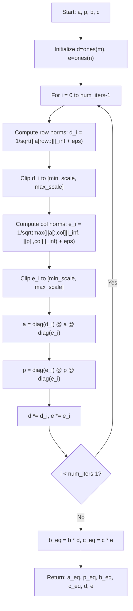
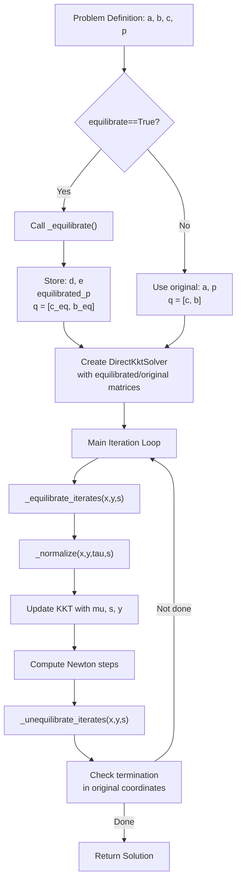
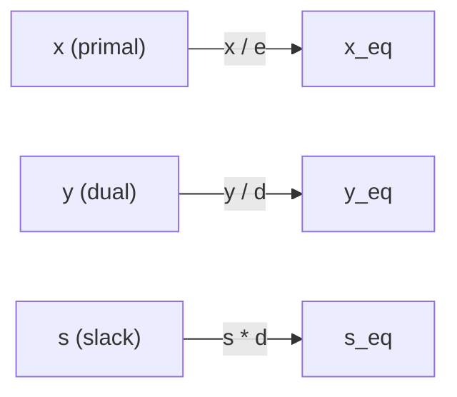
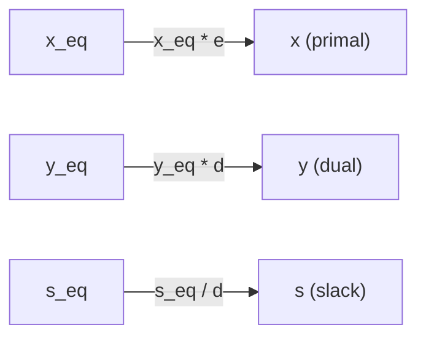
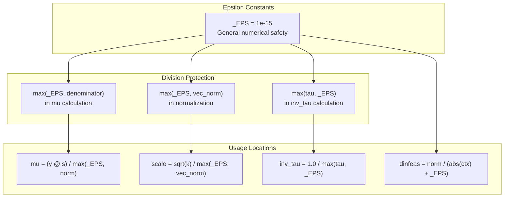
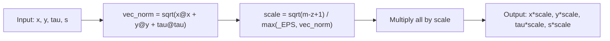
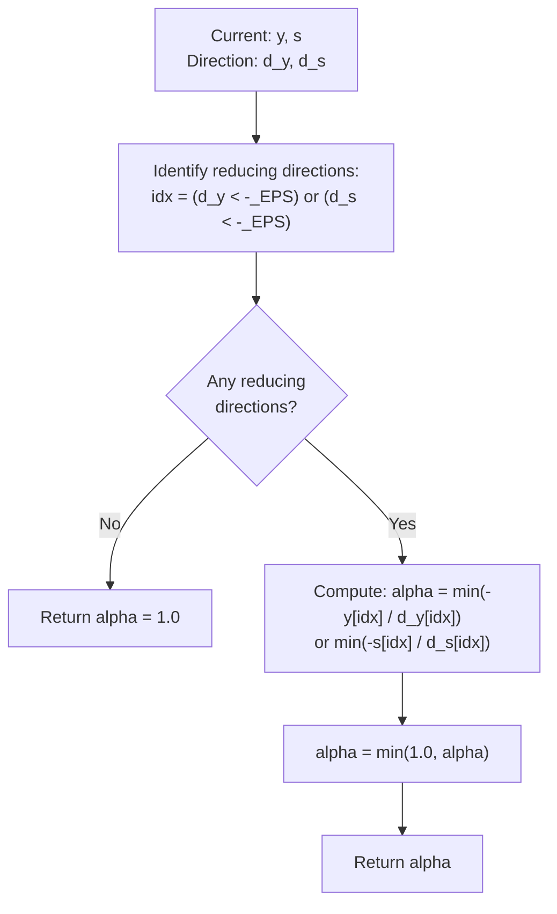
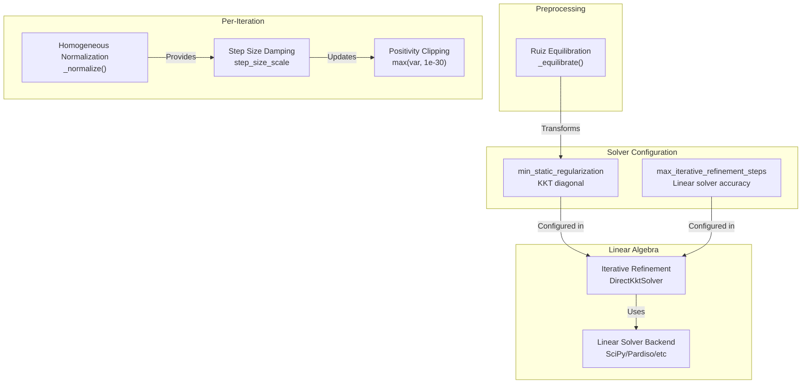

<!-- source: DeepWiki mcp.deepwiki.com · repo google-deepmind/qtqp · page 5.1 Equilibration and Numerical Stability · fetched 2026-10-26 -->

# Equilibration and Numerical Stability

<details>
<summary>Relevant source files</summary>

The following files were used as context for generating this wiki page:

- [src/qtqp/__init__.py](src/qtqp/__init__.py)

</details>


## Purpose and Scope

This page explains the equilibration process used by the QTQP solver to improve numerical conditioning and stability. Equilibration transforms the problem data (matrices and vectors) to have more balanced magnitudes, which helps the linear algebra backends solve KKT systems more accurately. This document covers the Ruiz equilibration algorithm, when it is applied, and other numerical stability techniques used throughout the solver.

For information about how the equilibrated KKT systems are solved, see [DirectKktSolver: KKT System Management](#3.2). For general performance considerations, see [Performance Tuning](#5.5). For details on iterative refinement within the linear solver, see [Iterative Refinement](#5.3).

---

## Overview of Equilibration in QTQP

Equilibration is a preprocessing technique that rescales the rows and columns of constraint matrix `a` and quadratic matrix `p` to improve numerical conditioning. The QTQP solver applies Ruiz equilibration by default, which iteratively balances the infinity norms of matrix rows and columns.

### Key Characteristics

| Property | Value |
|----------|-------|
| Algorithm | Ruiz equilibration |
| Default iterations | 10 |
| Scale bounds | [1e-3, 1e3] |
| Enabled by default | Yes (`equilibrate=True`) |
| Affects | Matrices `a`, `p` and vectors `b`, `c` |
| Storage | Scaling factors `d` (rows), `e` (columns) |

**Sources:** [src/qtqp/__init__.py:160](), [src/qtqp/__init__.py:375-412]()

---

## Ruiz Equilibration Algorithm

The `_equilibrate` method implements Ruiz equilibration, which alternately scales rows and columns to balance matrix norms.

### Algorithm Flow



**Sources:** [src/qtqp/__init__.py:375-412]()

### Implementation Details

The equilibration process operates as follows:

1. **Row Scaling (d_i):** For each iteration, compute the infinity norm of each row of `a` and scale by the inverse square root [src/qtqp/__init__.py:385-387]()

2. **Column Scaling (e_i):** Compute the maximum of `a` column norms and `p` column norms, then scale by the inverse square root [src/qtqp/__init__.py:390-394]()

3. **Clipping:** Both row and column scales are clipped to `[min_scale, max_scale]` to prevent extreme scaling factors [src/qtqp/__init__.py:387](), [src/qtqp/__init__.py:394]()

4. **Matrix Updates:** Apply scaling matrices as `diag(d_i) @ a @ diag(e_i)` and `diag(e_i) @ p @ diag(e_i)` [src/qtqp/__init__.py:397-400]()

5. **Accumulation:** Multiply cumulative scaling factors: `d *= d_i` and `e *= e_i` [src/qtqp/__init__.py:403-404]()

6. **Vector Scaling:** After all iterations, scale vectors as `b * d` and `c * e` [src/qtqp/__init__.py:412]()

### Numerical Safety

The algorithm includes several numerical safety mechanisms:

- **Epsilon addition:** `_EPS = 1e-15` is added to norms to avoid division by zero for empty rows/columns [src/qtqp/__init__.py:33](), [src/qtqp/__init__.py:385](), [src/qtqp/__init__.py:392]()
- **Scale clipping:** Default bounds `[1e-3, 1e3]` prevent extreme rescaling [src/qtqp/__init__.py:375]()
- **Square root scaling:** Using `1/sqrt(norm)` instead of `1/norm` provides more gradual scaling

**Sources:** [src/qtqp/__init__.py:375-412](), [src/qtqp/__init__.py:33]()

---

## Application During Solver Execution

Equilibration is applied at specific points during the solve process, with careful management of transformed and original coordinates.

### Equilibration Workflow



**Sources:** [src/qtqp/__init__.py:240-257](), [src/qtqp/__init__.py:266-268](), [src/qtqp/__init__.py:346-350]()

### Coordinate Transformations

The solver maintains iterates in two coordinate systems:

#### Equilibrated Coordinates (Internal)

Used during Newton step computation to work with well-conditioned matrices:



Transformation: `_equilibrate_iterates(x, y, s)` returns `(x/e, y/d, s*d)` [src/qtqp/__init__.py:417-418]()

#### Original Coordinates (External)

Used for termination checking and final solution:



Transformation: `_unequilibrate_iterates(x, y, s)` returns `(e*x, d*y, s/d)` [src/qtqp/__init__.py:414-415]()

**Sources:** [src/qtqp/__init__.py:414-418]()

### Per-Iteration Flow

Within each iteration of the main solve loop:

1. **Transform to equilibrated:** If `equilibrate==True`, convert `(x, y, s)` to equilibrated coordinates [src/qtqp/__init__.py:266-267]()

2. **Normalize:** Apply homogeneous normalization in equilibrated space [src/qtqp/__init__.py:269]()

3. **Compute steps:** All KKT solves use equilibrated matrices [src/qtqp/__init__.py:273-339]()

4. **Transform back:** Convert updated iterates to original coordinates [src/qtqp/__init__.py:346-347]()

5. **Check termination:** Evaluate convergence in original coordinates [src/qtqp/__init__.py:350]()

This approach ensures that:
- Linear algebra operations benefit from good conditioning
- Convergence checks use the original problem scale
- The final solution is in user-provided coordinates

**Sources:** [src/qtqp/__init__.py:266-350]()

---

## Additional Numerical Stability Techniques

Beyond equilibration, the QTQP solver employs several techniques to maintain numerical stability.

### Static Regularization

The DirectKktSolver adds regularization to the KKT matrix diagonal to prevent singularity:

| Parameter | Default Value | Purpose |
|-----------|--------------|---------|
| `min_static_regularization` | 1e-7 | Minimum diagonal regularization for KKT matrix |

This parameter is passed to `DirectKktSolver` during initialization [src/qtqp/__init__.py:247-256]().

**Sources:** [src/qtqp/__init__.py:154](), [src/qtqp/__init__.py:251]()

### Epsilon Guards

Multiple epsilon values prevent division by zero and underflow:



Key uses of `_EPS`:
- **Complementarity:** `mu = (y @ s) / max(_EPS, x @ x + y @ y + tau @ tau)` [src/qtqp/__init__.py:272]()
- **Normalization:** `scale = sqrt(k) / max(_EPS, vec_norm)` [src/qtqp/__init__.py:526]()
- **Inverse tau:** `inv_tau = 1.0 / max(tau, _EPS)` [src/qtqp/__init__.py:538]()
- **Infeasibility:** Division with `abs(ctx) + _EPS` to avoid zero denominator [src/qtqp/__init__.py:559](), [src/qtqp/__init__.py:562]()

**Sources:** [src/qtqp/__init__.py:33](), [src/qtqp/__init__.py:272](), [src/qtqp/__init__.py:526](), [src/qtqp/__init__.py:538](), [src/qtqp/__init__.py:559-562]()

### Strict Interior Point Maintenance

After each iteration, the solver enforces strict positivity for cone variables to prevent boundary numerical issues:

```python
# From iteration update
y[self.z :] = np.maximum(y[self.z :], 1e-30)
s[self.z :] = np.maximum(s[self.z :], 1e-30)
tau = np.maximum(tau, 1e-30)
```

The value `1e-30` is chosen to be:
- Much greater than zero (avoiding boundary)
- Much smaller than typical tolerance values (not affecting convergence)

**Sources:** [src/qtqp/__init__.py:342-344]()

### Homogeneous Normalization

The `_normalize` method rescales iterates to maintain numerical stability:



This ensures that `||[x, y, tau]||_2 ≈ sqrt(m - z + 1)` throughout the solve, preventing iterates from becoming too large or too small [src/qtqp/__init__.py:523-527]().

**Sources:** [src/qtqp/__init__.py:523-527](), [src/qtqp/__init__.py:269](), [src/qtqp/__init__.py:333-338]()

---

## Step Size Computation and Clipping

The solver computes maximum step sizes to ensure iterates remain in the positive cone:

### Step Size Calculation



The `_max_step_size` method computes the largest `alpha ∈ [0, 1]` such that `y + alpha * d_y >= 0` [src/qtqp/__init__.py:420-429]().

The `_compute_step_size` method finds the minimum of primal and dual step sizes:

```python
alpha_s = self._max_step_size(s[self.z :], d_s[self.z :])
alpha_y = self._max_step_size(y[self.z :], d_y[self.z :])
return min(alpha_s, alpha_y)
```

Finally, the step is scaled by `step_size_scale` (default 0.99) to maintain strict interiority [src/qtqp/__init__.py:332]().

**Sources:** [src/qtqp/__init__.py:420-429](), [src/qtqp/__init__.py:529-533](), [src/qtqp/__init__.py:176-177](), [src/qtqp/__init__.py:332]()

---

## Configuration Parameters

Several solve parameters control equilibration and numerical stability:

### Equilibration Parameters

| Parameter | Type | Default | Description |
|-----------|------|---------|-------------|
| `equilibrate` | `bool` | `True` | Enable/disable Ruiz equilibration |

The equilibration algorithm has hardcoded parameters in `_equilibrate`:
- `num_iters`: 10 iterations
- `min_scale`: 1e-3 minimum scaling factor
- `max_scale`: 1e3 maximum scaling factor

**Sources:** [src/qtqp/__init__.py:160](), [src/qtqp/__init__.py:375]()

### Stability Parameters

| Parameter | Type | Default | Description |
|-----------|------|---------|-------------|
| `min_static_regularization` | `float` | 1e-7 | KKT matrix diagonal regularization |
| `step_size_scale` | `float` | 0.99 | Step size damping factor |
| `linear_solver_atol` | `float` | 1e-12 | Iterative refinement absolute tolerance |
| `linear_solver_rtol` | `float` | 1e-12 | Iterative refinement relative tolerance |
| `max_iterative_refinement_steps` | `int` | 50 | Maximum iterative refinement iterations |

**Sources:** [src/qtqp/__init__.py:154-157](), [src/qtqp/__init__.py:176]()

---

## When to Disable Equilibration

While equilibration is beneficial for most problems, there are scenarios where disabling it may be appropriate:

### Disable Equilibration When:

1. **Pre-scaled problems:** If the problem data is already well-conditioned (e.g., all matrix entries and vector elements are similar magnitude)

2. **Warm-starting:** When using warm starts from a previous solve of a similar problem, the initial point may be better suited to the original scaling

3. **Timing sensitivity:** For very small problems where equilibration overhead (10 iterations × matrix operations) is significant relative to solve time

4. **Debugging:** To isolate numerical issues and understand which coordinate system is causing problems

### Keep Equilibration Enabled When:

1. **Ill-conditioned problems:** Problems with large variation in matrix entry magnitudes (e.g., mixing physical units)

2. **Production use:** The default `equilibrate=True` is recommended for general use as it improves robustness

3. **Convergence issues:** If the solver fails to converge or produces inaccurate results with equilibration disabled

**Sources:** [src/qtqp/__init__.py:189-190](), [src/qtqp/__init__.py:240-245]()

---

## Relationship to Other Stability Features

Equilibration works in conjunction with other stability mechanisms:



- **Equilibration** improves condition number before solving begins
- **Static regularization** ensures KKT matrix is positive definite
- **Iterative refinement** corrects linear solve errors (see [Iterative Refinement](#5.3))
- **Normalization** maintains consistent iterate magnitudes
- **Step size damping** and **positivity clipping** prevent boundary violations

**Sources:** [src/qtqp/__init__.py:375-412](), [src/qtqp/__init__.py:247-256](), [src/qtqp/__init__.py:523-527](), [src/qtqp/__init__.py:332-344]()

---

## Summary

Equilibration is a critical preprocessing step that:

1. **Balances matrix norms** through iterative row and column scaling
2. **Transforms coordinates** during iteration while maintaining original problem semantics
3. **Works with other stability techniques** including regularization, normalization, and iterative refinement
4. **Is enabled by default** and recommended for most use cases

The implementation is robust with multiple safeguards including epsilon guards, scale clipping, and strict interior point maintenance. For problems where equilibration is disabled, the solver still applies other numerical stability techniques to maintain accuracy.

**Sources:** [src/qtqp/__init__.py:375-412](), [src/qtqp/__init__.py:414-418](), [src/qtqp/__init__.py:240-268](), [src/qtqp/__init__.py:342-350]()

---

