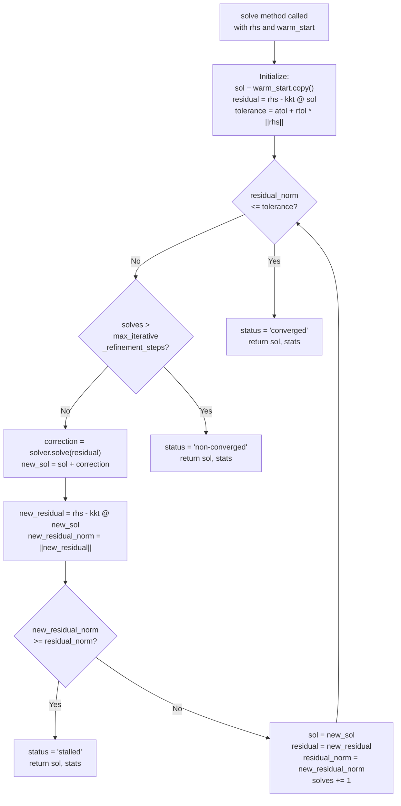
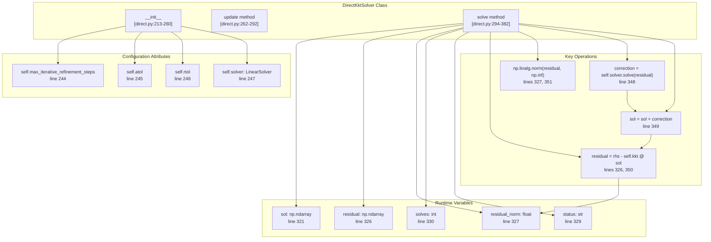
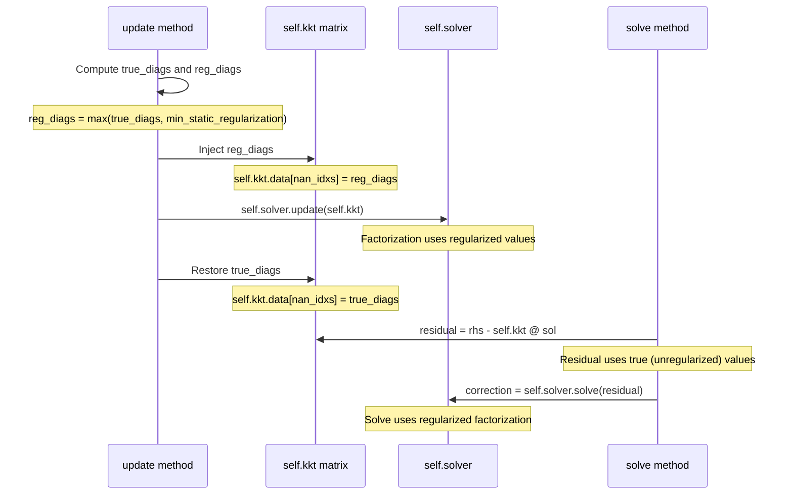

<!-- source: DeepWiki mcp.deepwiki.com · repo google-deepmind/qtqp · page 5.3 Iterative Refinement · fetched 2026-10-26 -->

# Iterative Refinement

<details>
<summary>Relevant source files</summary>

The following files were used as context for generating this wiki page:

- [src/qtqp/direct.py](src/qtqp/direct.py)

</details>


## Purpose and Scope

This document explains how the `DirectKktSolver` class uses iterative refinement to achieve high accuracy in solving KKT linear systems, even when those systems are ill-conditioned. Iterative refinement is a numerical technique that improves solution accuracy by repeatedly correcting errors in the computed solution.

For information about the broader KKT system construction and management, see [DirectKktSolver: KKT System Management](#3.2). For details on numerical stability techniques applied before solving, see [Equilibration and Numerical Stability](#5.1).

## Overview

Iterative refinement addresses the fundamental problem that direct linear solvers (factorization-based methods) accumulate numerical errors, especially when solving systems with poor conditioning. Rather than accepting the first solution from the factorization, iterative refinement:

1. Computes the residual using higher precision arithmetic
2. Solves for the correction to the solution
3. Updates the solution and repeats until convergence or stalling

The `DirectKktSolver` implements this technique to ensure that KKT systems, which can become ill-conditioned during interior point iterations, are solved to the required accuracy.

**Sources:** [src/qtqp/direct.py:294-382]()

## Algorithm Structure

### Iterative Refinement Loop

The refinement process follows this pattern:



**Diagram: Iterative Refinement Loop in DirectKktSolver.solve**

**Sources:** [src/qtqp/direct.py:316-382]()

### Code Entity Mapping

The following diagram maps the iterative refinement components to their code entities in `DirectKktSolver`:



**Diagram: DirectKktSolver Iterative Refinement Code Entities**

**Sources:** [src/qtqp/direct.py:204-382]()

## Configuration Parameters

The iterative refinement behavior is controlled by three parameters passed to the `DirectKktSolver` constructor:

| Parameter | Type | Purpose | Default (typical) |
|-----------|------|---------|-------------------|
| `max_iterative_refinement_steps` | `int` | Maximum number of correction steps allowed | Varies by solver configuration |
| `atol` | `float` | Absolute tolerance for residual convergence | Solver-specific |
| `rtol` | `float` | Relative tolerance (multiplied by RHS norm) | Solver-specific |

The convergence criterion combines absolute and relative tolerances:

```
tolerance = atol + rtol * ||rhs||_∞
```

The iterative refinement loop continues while:
```
||residual||_∞ > tolerance AND solves <= max_iterative_refinement_steps
```

**Sources:** [src/qtqp/direct.py:220-237](), [src/qtqp/direct.py:322-334]()

## Warm Start Support

The `solve` method accepts a `warm_start` parameter that provides an initial guess for the solution. This is particularly important for interior point methods where:

1. The solution from a previous iteration can be used as a warm start for the next iteration
2. A good warm start may already satisfy the tolerance, requiring zero solver calls

The warm start handling follows this logic:

```python
sol = warm_start.copy()
residual = rhs - self.kkt @ sol
residual_norm = np.linalg.norm(residual, np.inf)

# Loop only executes if residual_norm > tolerance
while residual_norm > tolerance:
    # Refinement steps...
```

If the warm start already satisfies the tolerance, the method returns immediately with `solves = 0` and `status = "converged"`.

**Sources:** [src/qtqp/direct.py:321-334]()

## Status Codes and Diagnostics

The `solve` method returns a tuple `(sol, stats)` where `stats` is a dictionary containing diagnostic information:

| Field | Type | Description |
|-------|------|-------------|
| `"solves"` | `int` | Number of correction steps performed (can be 0) |
| `"final_residual_norm"` | `float` | Infinity norm of final residual |
| `"status"` | `str` | One of: `"converged"`, `"non-converged"`, `"stalled"` |

### Status Values

**`"converged"`**: The residual norm fell below the tolerance threshold. This is the expected outcome for well-conditioned systems.

```python
# Condition: Loop exits normally
status = "converged"
```

**`"non-converged"`**: Maximum refinement steps exceeded without convergence. Indicates the system may be too ill-conditioned or the tolerance too strict.

```python
if solves > self.max_iterative_refinement_steps:
    logging.debug(
        "Iterative refinement did not converge after %d solves."
        " Final residual: %e > tolerance: %e",
        solves, residual_norm, tolerance,
    )
    break
```

**`"stalled"`**: The residual stopped improving (or worsened) between iterations. This typically indicates numerical issues in the factorization or near-singularity.

```python
if new_residual_norm >= residual_norm:
    logging.debug(
        "Iterative refinement stalled at step %d. Old res: %e, New res: %e",
        solves, residual_norm, new_residual_norm,
    )
    status = "stalled"
    break
```

**Sources:** [src/qtqp/direct.py:329](), [src/qtqp/direct.py:335-342](), [src/qtqp/direct.py:354-362](), [src/qtqp/direct.py:367-369]()

## Relationship to Regularization

The `DirectKktSolver.update` method distinguishes between two sets of diagonal values:

1. **Regularized diagonals**: Used for numerical stability during factorization
2. **True diagonals**: Used for accurate residual computation

This separation is critical for iterative refinement:



**Diagram: Regularized vs True Diagonals in Iterative Refinement**

The factorization step [src/qtqp/direct.py:288-289]() uses regularized values for numerical stability, but the residual computation [src/qtqp/direct.py:326](), [src/qtqp/direct.py:350]() uses true (unregularized) values. This ensures:

- The factorization remains numerically stable
- The residual accurately reflects the error in solving the original (unregularized) system
- Iterative refinement corrects for any discrepancy between the regularized and true systems

**Sources:** [src/qtqp/direct.py:262-292](), [src/qtqp/direct.py:326](), [src/qtqp/direct.py:350]()

## Implementation Details

### Residual Computation

Residuals are computed using the infinity norm (maximum absolute value):

```python
residual_norm = np.linalg.norm(residual, np.inf)
```

This choice is appropriate for KKT systems where different components (primal and dual variables) may have different scales. The infinity norm provides a conservative measure that ensures all components meet the tolerance.

**Sources:** [src/qtqp/direct.py:327](), [src/qtqp/direct.py:351]()

### KKT Form Adjustment

The `solve` method adjusts the RHS vector to match the quasidefinite KKT form:

```python
rhs = rhs.copy()
rhs[self.n :] *= -1.0
```

This negation corresponds to the negative block in the KKT system structure `[P + mu*I, A.T; A, -(D + mu*I)]`, ensuring residuals are computed correctly.

**Sources:** [src/qtqp/direct.py:318-319]()

### NaN Detection

After refinement, the solution is checked for NaN values:

```python
if np.any(np.isnan(sol)):
    raise ValueError("Linear solver returned NaNs.")
```

This guards against catastrophic failures in the underlying linear solver (e.g., singular matrix detection failures).

**Sources:** [src/qtqp/direct.py:371-372]()

## Performance Considerations

The number of iterative refinement steps directly impacts solve time:

- **Zero steps**: If the warm start is already accurate (common in later IPM iterations)
- **Few steps (1-3)**: Typical for well-conditioned systems
- **Many steps**: May indicate ill-conditioning; consider tightening `min_static_regularization` or using equilibration

The `max_iterative_refinement_steps` parameter provides a safety bound, but reaching it usually indicates a problem that should be addressed at the problem formulation or solver configuration level rather than simply increasing the limit.

Logging at the DEBUG level [src/qtqp/direct.py:374-376]() provides detailed diagnostics for each KKT solve, useful for diagnosing convergence issues.

**Sources:** [src/qtqp/direct.py:332-376]()

---

