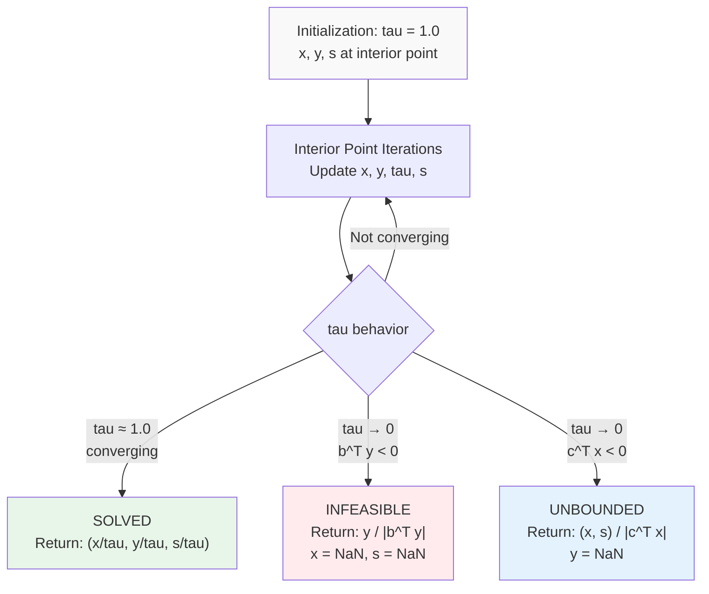
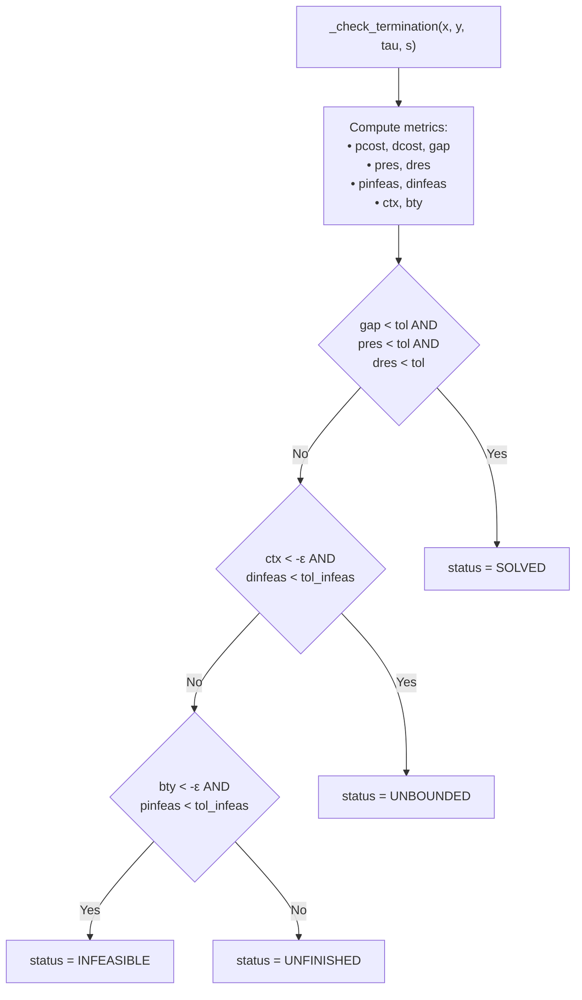
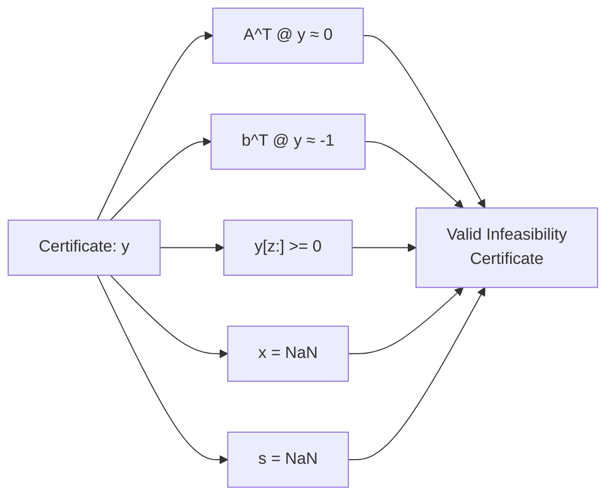
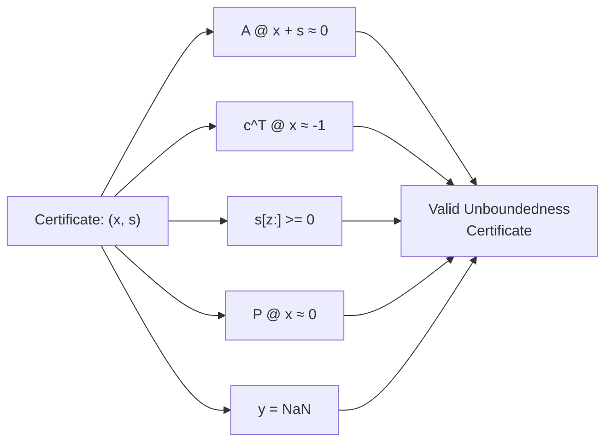
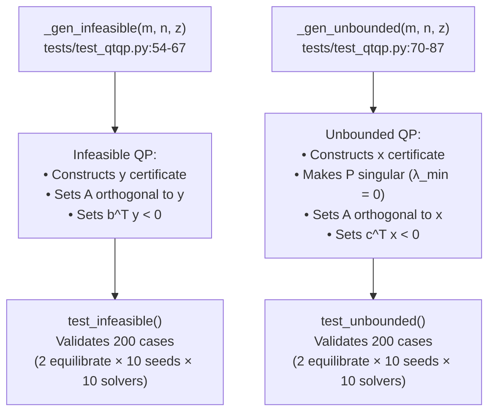
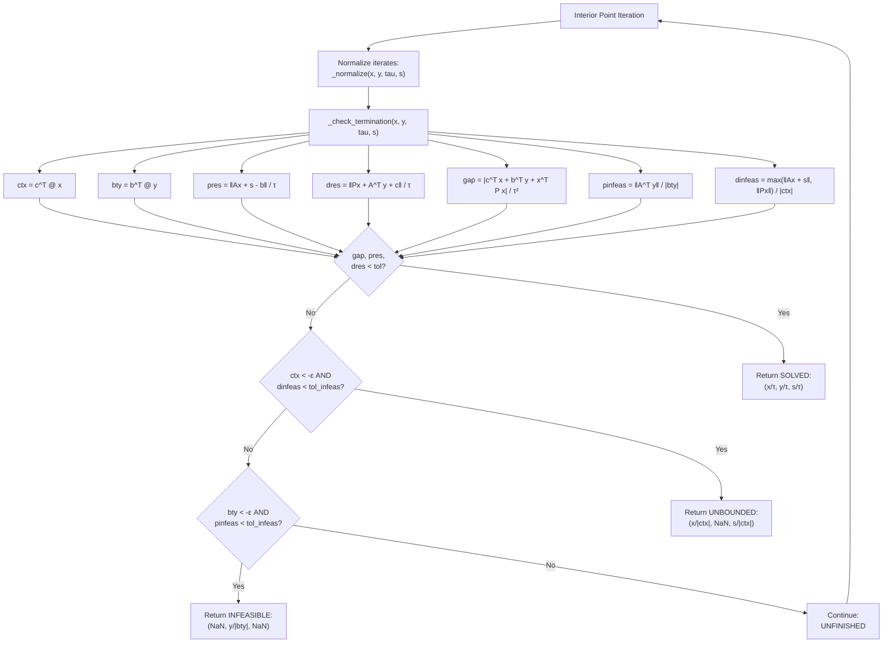

<!-- source: DeepWiki mcp.deepwiki.com · repo google-deepmind/qtqp · page 5.4 Understanding Infeasibility and Unboundedness · fetched 2026-10-26 -->

# Understanding Infeasibility and Unboundedness

<details>
<summary>Relevant source files</summary>

The following files were used as context for generating this wiki page:

- [src/qtqp/__init__.py](src/qtqp/__init__.py)
- [tests/test_qtqp.py](tests/test_qtqp.py)

</details>


## Purpose and Scope

This page explains how the QTQP solver detects and certifies infeasible and unbounded quadratic programs using the homogeneous self-dual embedding technique. It covers the mathematical theory behind infeasibility and unboundedness certificates, the algorithmic implementation in the solver, and how to interpret the results.

For information on convergence criteria for feasible problems, see [Configuration Parameters](#4.4). For numerical stability considerations, see [Equilibration and Numerical Stability](#5.1).

---

## Infeasibility and Unboundedness in Quadratic Programming

The QTQP solver can encounter three types of problem outcomes beyond finding an optimal solution:

| Outcome | Primal Status | Dual Status | Certificate Provided |
|---------|---------------|-------------|---------------------|
| `SOLVED` | Feasible and optimal | Feasible and optimal | Optimal (x, y, s) |
| `INFEASIBLE` | Primal infeasible | Dual unbounded | Dual ray y |
| `UNBOUNDED` | Primal unbounded | Dual infeasible | Primal ray (x, s) |
| `FAILED` | Unknown | Unknown | None |

### Primal Infeasibility Certificate

A certificate of primal infeasibility is a dual ray `y` satisfying:
- `A^T @ y = 0` (orthogonal to constraint matrix)
- `y[z:] >= 0` (dual feasibility for inequality constraints)
- `b^T @ y < 0` (proves no primal solution exists)

This certificate demonstrates that the dual problem is unbounded, which by strong duality implies the primal is infeasible.

### Primal Unboundedness Certificate

A certificate of primal unboundedness is a primal ray `(x, s)` satisfying:
- `A @ x + s = 0` (feasible direction)
- `s[z:] >= 0` (slack feasibility)
- `c^T @ x < 0` (objective decreases)
- `P @ x = 0` (quadratic term remains bounded)

This certificate demonstrates that the primal objective can be made arbitrarily negative, proving unboundedness.

**Sources:** [src/qtqp/__init__.py:79-88](), [tests/test_qtqp.py:119-153]()

---

## Homogeneous Self-Dual Embedding

The QTQP solver uses a homogeneous self-dual embedding to detect infeasibility and unboundedness simultaneously with solving. This technique introduces an auxiliary variable `tau` that scales the original problem.

### The Tau Variable

The `tau` variable is initialized to 1.0 and maintained as a 1-element array throughout the iterations:

```python
tau = np.array([1.0])
```

During the algorithm:
- **Feasible case**: `tau` remains close to 1.0, and `(x/tau, y/tau, s/tau)` converges to the optimal solution
- **Infeasible case**: `tau` approaches 0, and `y` converges to an infeasibility certificate
- **Unbounded case**: `tau` approaches 0, and `(x, s)` converges to an unboundedness certificate



The normalization step ensures all variables remain on a consistent scale:

```python
def _normalize(self, x, y, tau, s):
    vec_norm = np.sqrt(x @ x + y @ y + tau @ tau)
    scale = np.sqrt(self.m - self.z + 1) / max(_EPS, vec_norm)
    return x * scale, y * scale, tau * scale, s * scale
```

**Sources:** [src/qtqp/__init__.py:230-232](), [src/qtqp/__init__.py:523-527](), [src/qtqp/__init__.py:269]()

---

## Detection Logic

The solver checks for infeasibility and unboundedness in the `_check_termination` method at the end of each iteration. The detection logic uses specific metrics computed from the current iterates.

### Termination Criteria



### Key Detection Metrics

The following metrics are computed to detect each condition:

| Metric | Formula | Purpose |
|--------|---------|---------|
| `ctx` | `c^T @ x` | Objective direction (unboundedness) |
| `bty` | `b^T @ y` | Dual objective direction (infeasibility) |
| `pinfeas` | `‖A^T @ y‖ / |b^T @ y|` | Primal infeasibility measure |
| `dinfeas_a` | `‖A @ x + s‖ / |c^T @ x|` | Dual infeasibility (constraint part) |
| `dinfeas_p` | `‖P @ x‖ / |c^T @ x|` | Dual infeasibility (quadratic part) |
| `dinfeas` | `max(dinfeas_a, dinfeas_p)` | Combined dual infeasibility |

**Sources:** [src/qtqp/__init__.py:535-622](), [src/qtqp/__init__.py:559-562]()

---

## Implementation Details

### Unboundedness Detection

The solver declares a problem `UNBOUNDED` when:

1. The scaled objective `ctx = c^T @ x` is negative (below `-_EPS`)
2. The dual infeasibility measure is small:
   ```
   dinfeas < atol_infeas + rtol_infeas * norm_x / abs(ctx)
   ```

Code implementation:

```python
# From _check_termination
ctx = self.c @ x
dinfeas_a = _norm((ax + s), np.inf) / (abs(ctx) + _EPS)
dinfeas_p = _norm(px, np.inf) / (abs(ctx) + _EPS)
dinfeas = max(dinfeas_a, dinfeas_p)

if ctx < -_EPS and (
    dinfeas < self.atol_infeas + self.rtol_infeas * norm_x / abs(ctx)
):
    status = SolutionStatus.UNBOUNDED
```

The returned certificate is normalized:
```python
abs_ctx = abs(self.c @ x)
return Solution(x / abs_ctx, y, s / abs_ctx, stats, status)
```

Note that `y` is filled with `np.nan` to indicate it is not meaningful for an unbounded problem.

**Sources:** [src/qtqp/__init__.py:585-588](), [src/qtqp/__init__.py:364-368]()

### Infeasibility Detection

The solver declares a problem `INFEASIBLE` when:

1. The dual direction `bty = b^T @ y` is negative (below `-_EPS`)
2. The primal infeasibility measure is small:
   ```
   pinfeas < atol_infeas + rtol_infeas * norm_y / abs(bty)
   ```

Code implementation:

```python
# From _check_termination
bty = self.b @ y
pinfeas = _norm(aty, np.inf) / (abs(bty) + _EPS)

if bty < -_EPS and (
    pinfeas < self.atol_infeas + self.rtol_infeas * norm_y / abs(bty)
):
    status = SolutionStatus.INFEASIBLE
```

The returned certificate is normalized:
```python
x.fill(np.nan)
s.fill(np.nan)
return Solution(x, y / abs(self.b @ y), s, stats, status)
```

Here, `x` and `s` are filled with `np.nan` since they are not meaningful for an infeasible problem.

**Sources:** [src/qtqp/__init__.py:589-592](), [src/qtqp/__init__.py:359-363]()

---

## Certificate Validation

The test suite validates that returned certificates satisfy the mathematical requirements for infeasibility and unboundedness.

### Testing Infeasibility Certificates

The `_assert_infeasible` function validates:



Implementation:

```python
def _assert_infeasible(solution, a, b, z, atol=1e-8, rtol=1e-9):
    y = solution.y
    pinfeas = np.linalg.norm(a.T @ y, np.inf)
    
    assert solution.status == qtqp.SolutionStatus.INFEASIBLE
    np.testing.assert_array_equal(np.isnan(solution.x), True)
    np.testing.assert_array_equal(np.isnan(solution.s), True)
    np.testing.assert_allclose(b @ y, -1.0, atol=atol, rtol=rtol)
    np.testing.assert_array_less(-1e-9, np.min(y[z:], initial=0.0))
    np.testing.assert_array_less(pinfeas, atol + rtol * np.linalg.norm(y, np.inf))
```

**Sources:** [tests/test_qtqp.py:119-132]()

### Testing Unboundedness Certificates

The `_assert_unbounded` function validates:



Implementation:

```python
def _assert_unbounded(solution, a, c, p, z, atol=1e-8, rtol=1e-9):
    x = solution.x
    s = solution.s
    dinfeas_a = np.linalg.norm(a @ x + s, np.inf)
    dinfeas_p = np.linalg.norm(p @ x, np.inf)
    
    assert solution.status == qtqp.SolutionStatus.UNBOUNDED
    np.testing.assert_array_equal(np.isnan(solution.y), True)
    np.testing.assert_allclose(c @ x, -1.0, atol=atol, rtol=rtol)
    np.testing.assert_array_less(-1e-9, np.min(s[z:], initial=0.0))
    np.testing.assert_array_less(dinfeas_a, atol + rtol * np.linalg.norm(x, np.inf))
    np.testing.assert_array_less(dinfeas_p, atol + rtol * np.linalg.norm(x, np.inf))
```

**Sources:** [tests/test_qtqp.py:135-153]()

### Test Problem Generators

The test suite includes generators for constructing infeasible and unbounded problems:



Key construction details:

**Infeasible Problem**:
```python
# Construct dual ray y with y[z:] >= 0
y = w.copy()
y[z:] = 0.5 * (w[z:] + np.abs(w[z:]))

# Make A orthogonal to y: A = A - outer(y, A^T y) / ||y||^2
a = a - np.outer(y, np.transpose(a).dot(y)) / np.linalg.norm(y) ** 2

# Make b^T y < 0
b = -b / np.dot(b, y)
```

**Unbounded Problem**:
```python
# Make P singular with zero eigenvalue
e, v = np.linalg.eig(p)
e[-1] = 0
x = v[:, -1]  # Eigenvector for λ = 0
p = v @ np.diag(e) @ v.T

# Make A orthogonal to x: A = A - outer(s + Ax, x) / ||x||^2
a = a - np.outer(s + a.dot(x), x) / np.linalg.norm(x) ** 2

# Make c^T x < 0
c = -c / np.dot(c, x)
```

**Sources:** [tests/test_qtqp.py:54-87](), [tests/test_qtqp.py:173-195]()

---

## Tolerances and Configuration

The detection of infeasibility and unboundedness is controlled by separate tolerances from the optimality tolerances:

| Parameter | Default | Purpose |
|-----------|---------|---------|
| `atol_infeas` | `1e-8` | Absolute tolerance for certificate validation |
| `rtol_infeas` | `1e-9` | Relative tolerance for certificate validation |

These tolerances are typically stricter than the optimality tolerances (`atol=1e-7`, `rtol=1e-8`) because certificate validation requires higher precision.

Configure these parameters in the solve call:

```python
solution = solver.solve(
    atol_infeas=1e-8,
    rtol_infeas=1e-9,
    ...
)
```

The relative tolerance is scaled by the certificate norm to ensure scale-invariance:
- For unboundedness: `rtol_infeas * norm_x / abs(ctx)`
- For infeasibility: `rtol_infeas * norm_y / abs(bty)`

**Sources:** [src/qtqp/__init__.py:150-151](), [src/qtqp/__init__.py:586-591]()

---

## Practical Considerations

### When to Expect Infeasibility

A problem is infeasible when the constraints are contradictory. Common causes:
- Mutually exclusive equality constraints
- Inequality constraints that cannot be simultaneously satisfied
- Bounds that create an empty feasible region

The solver returns a dual ray `y` that proves no primal solution exists. The certificate satisfies `A^T @ y = 0`, `y[z:] >= 0`, and `b^T @ y < 0`.

### When to Expect Unboundedness

A problem is unbounded when the objective can decrease without bound. This requires:
- The quadratic matrix `P` is not positive definite (has zero or negative eigenvalues)
- There exists a feasible direction that decreases the objective

The solver returns a primal ray `(x, s)` proving unboundedness. The certificate satisfies `A @ x + s = 0`, `s[z:] >= 0`, `c^T @ x < 0`, and `P @ x = 0`.

### Interpreting NaN Values

The solution object uses `np.nan` to indicate which variables are meaningful:

| Status | x | y | s | Interpretation |
|--------|---|---|---|----------------|
| `SOLVED` | Solution | Solution | Solution | All variables optimal |
| `INFEASIBLE` | `NaN` | Certificate | `NaN` | y proves infeasibility |
| `UNBOUNDED` | Certificate | `NaN` | Certificate | (x, s) proves unboundedness |

Check the status before using solution values:

```python
if solution.status == qtqp.SolutionStatus.INFEASIBLE:
    # Use y as infeasibility certificate
    print(f"Infeasible: b^T y = {b @ solution.y}")
elif solution.status == qtqp.SolutionStatus.UNBOUNDED:
    # Use (x, s) as unboundedness certificate
    print(f"Unbounded: c^T x = {c @ solution.x}")
```

**Sources:** [src/qtqp/__init__.py:57-73](), [src/qtqp/__init__.py:359-368]()

---

## Summary: Status Detection Flow



**Sources:** [src/qtqp/__init__.py:269](), [src/qtqp/__init__.py:535-622](), [src/qtqp/__init__.py:350-373]()

---

