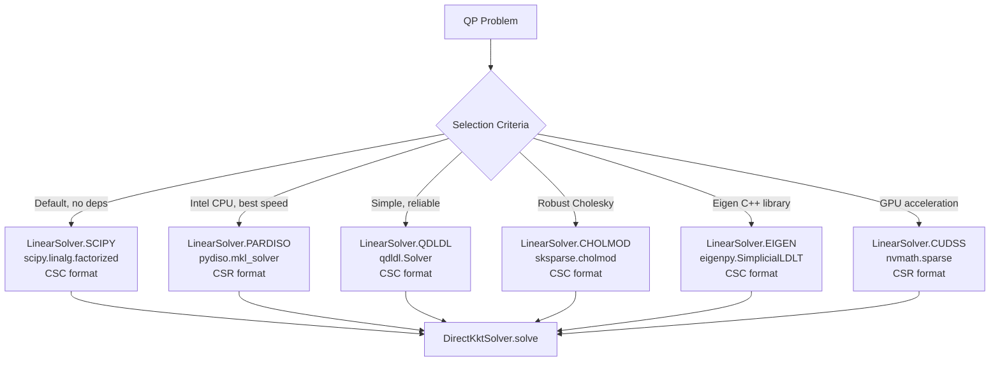
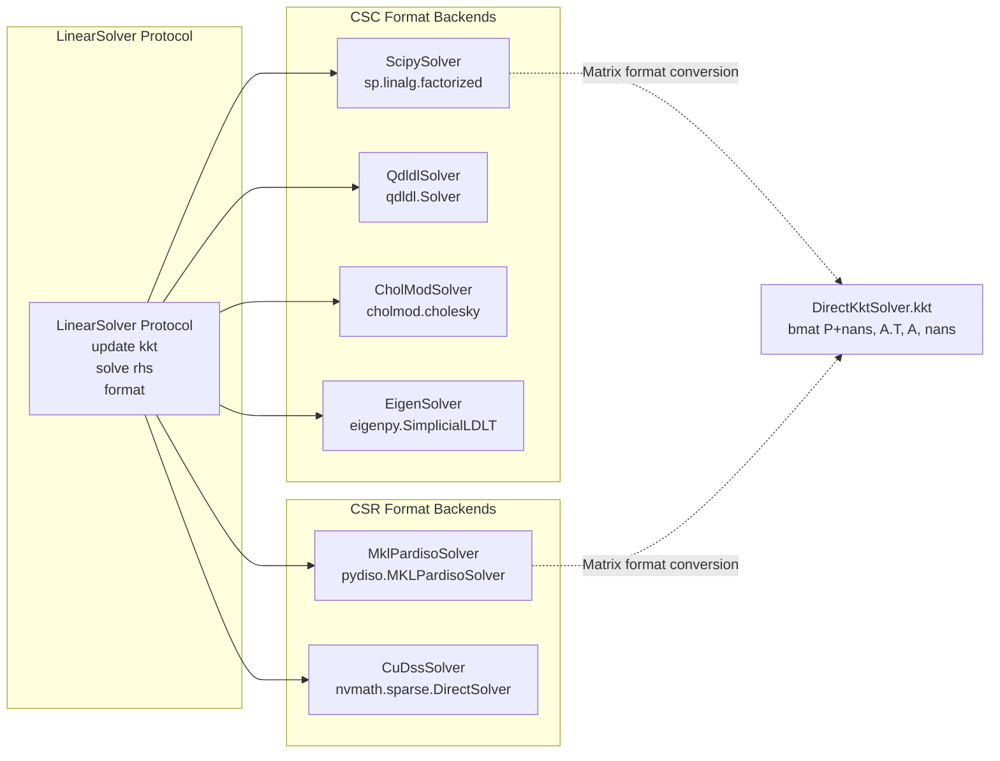
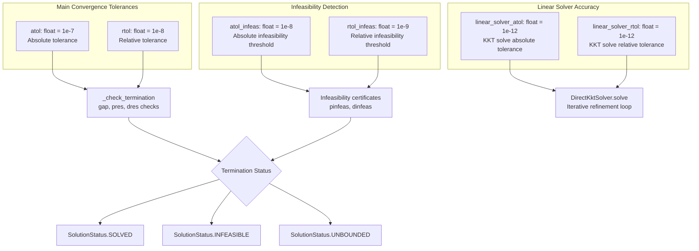
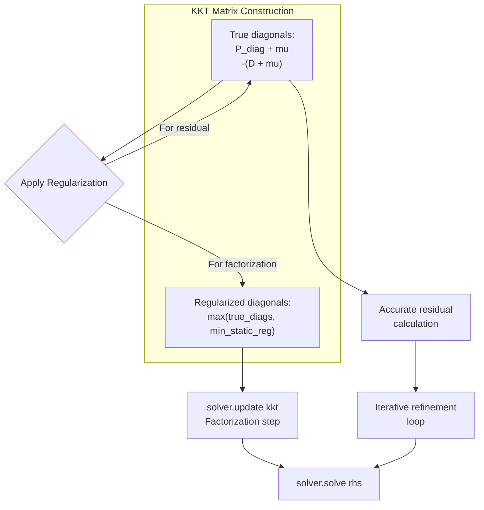
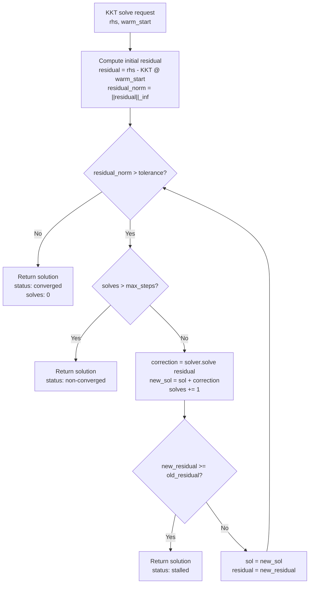
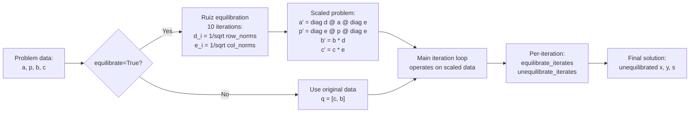
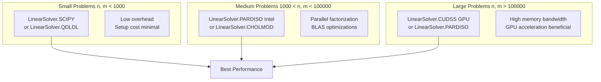

<!-- source: DeepWiki mcp.deepwiki.com · repo google-deepmind/qtqp · page 5.5 Performance Tuning · fetched 2026-10-26 -->

# Performance Tuning

<details>
<summary>Relevant source files</summary>

The following files were used as context for generating this wiki page:

- [README.md](README.md)
- [src/qtqp/__init__.py](src/qtqp/__init__.py)
- [src/qtqp/direct.py](src/qtqp/direct.py)

</details>


This page provides guidance on optimizing QTQP solver performance by selecting appropriate linear solver backends, adjusting tolerance parameters, and configuring solver settings for specific problem characteristics and hardware environments. For understanding the underlying numerical algorithms, see [Iterative Refinement](#5.3). For problem conditioning techniques, see [Equilibration and Numerical Stability](#5.1).

---

## Choosing Linear Solver Backends

The linear solver backend is the most critical performance factor, as it handles the KKT system factorization and solve operations that dominate computational cost. QTQP supports six backends through the `LinearSolver` enum.

### Backend Comparison



**Sources:** [src/qtqp/__init__.py:36-44](), [src/qtqp/direct.py:40-202]()

| Backend | Format | Installation | Speed | Reliability | Hardware Requirements |
|---------|--------|--------------|-------|-------------|----------------------|
| **SCIPY** | CSC | Built-in with scipy | Moderate | High | Any CPU |
| **PARDISO** | CSR | `conda install pydiso` | Very Fast | High | Intel CPU only |
| **QDLDL** | CSC | `pip install qdldl` | Fast | Very High | Any CPU |
| **CHOLMOD** | CSC | `conda install scikit-sparse` | Fast | Very High | Any CPU |
| **EIGEN** | CSC | `conda install eigenpy` | Fast | High | Any CPU |
| **CUDSS** | CSR | `pip install nvidia-cudss-cu12` | Very Fast | Moderate | NVIDIA GPU required |

**Sources:** [src/qtqp/direct.py:24-202](), [README.md:190-240]()

### Backend-Specific Implementation Details

Each backend implements the `LinearSolver` protocol with three methods: `update()`, `solve()`, and `format()`.



**Sources:** [src/qtqp/direct.py:24-202]()

### Solver Selection Guidelines

**For most problems:** Start with `LinearSolver.SCIPY` as it requires no additional dependencies and provides reliable performance.

**For Intel CPUs:** Use `LinearSolver.PARDISO` for best performance. The implementation at [src/qtqp/direct.py:40-73]() configures PARDISO with recommended IPM parameters (`iparm[10]=1`, `iparm[12]=1`) and includes error recovery logic for refactorization.

**For GPU acceleration:** Use `LinearSolver.CUDSS` if an NVIDIA GPU is available. Note the special handling of Fortran-contiguous arrays required by cuDSS at [src/qtqp/direct.py:189-193]().

**For maximum reliability:** Consider `LinearSolver.QDLDL` or `LinearSolver.CHOLMOD`, which are specifically designed for quasi-definite systems and rarely encounter numerical issues.

**Sources:** [src/qtqp/direct.py:40-202](), [README.md:190-240]()

---

## Tolerance Configuration

The solver uses multiple tolerance parameters that control different aspects of convergence detection and numerical accuracy.



**Sources:** [src/qtqp/__init__.py:145-164](), [src/qtqp/__init__.py:535-622]()

### Main Convergence Tolerances

The convergence check at [src/qtqp/__init__.py:579-583]() requires three conditions to be satisfied:

```
gap < atol + rtol * min(|pcost|, |dcost|)
pres < atol + rtol * max(||A@x||, ||s||, ||b||)
dres < atol + rtol * max(||P@x||, ||A.T@y||, ||c||)
```

**Tightening tolerances (smaller values):**
- Increases accuracy of solutions
- Requires more iterations
- May cause convergence failure on ill-conditioned problems
- Recommended when solution accuracy is critical

**Relaxing tolerances (larger values):**
- Reduces iteration count
- May sacrifice solution accuracy
- Useful for preliminary solutions or well-conditioned problems
- Example: `atol=1e-5, rtol=1e-6` for faster but less precise solutions

**Sources:** [src/qtqp/__init__.py:579-583]()

### Infeasibility Detection Tolerances

The infeasibility checks at [src/qtqp/__init__.py:585-592]() use separate tolerances to detect certificates of infeasibility or unboundedness:

```
dinfeas < atol_infeas + rtol_infeas * norm_x / |c.T @ x|  (unbounded)
pinfeas < atol_infeas + rtol_infeas * norm_y / |b.T @ y|  (infeasible)
```

These should typically be slightly tighter than main convergence tolerances to avoid premature infeasibility detection.

**Sources:** [src/qtqp/__init__.py:585-592]()

### Linear Solver Tolerances

The iterative refinement process at [src/qtqp/direct.py:294-382]() uses `linear_solver_atol` and `linear_solver_rtol` to control KKT solve accuracy:

```
tolerance = linear_solver_atol + linear_solver_rtol * ||rhs||
residual_norm = ||rhs - KKT @ solution||
```

**Default values (`1e-12` for both):** Provide high accuracy but may require many refinement iterations.

**Relaxing (`1e-10` or higher):** Reduces refinement iterations, useful when:
- Problem is well-conditioned
- Main convergence tolerances are relaxed
- Speed is more critical than precision

**Tightening (`1e-14` or lower):** Increases accuracy, useful when:
- Problem is ill-conditioned
- Main convergence tolerances are very tight
- Solution quality is critical

**Sources:** [src/qtqp/direct.py:294-382]()

---

## Regularization and Stability

The `min_static_regularization` parameter adds diagonal regularization to the KKT matrix for numerical stability.



**Sources:** [src/qtqp/direct.py:262-293]()

### Regularization Mechanics

The implementation at [src/qtqp/direct.py:273-292]() uses a clever optimization:

1. Calculates true diagonals: `true_diags = concatenate([p_diags, h]) + mu`
2. Applies regularization: `reg_diags = maximum(true_diags, min_static_regularization)`
3. Temporarily injects `reg_diags` for factorization
4. Immediately restores `true_diags` for accurate residual computation

This ensures stability without sacrificing accuracy in residual checks.

**Sources:** [src/qtqp/direct.py:273-292]()

### Tuning Guidelines

| Value | Use Case | Trade-off |
|-------|----------|-----------|
| **1e-7** (default) | General-purpose, balanced stability | Good starting point |
| **1e-9 to 1e-8** | Well-conditioned problems | Minimal regularization, higher accuracy |
| **1e-6 to 1e-5** | Ill-conditioned problems, near-singular KKT | More stability, slight accuracy loss |
| **1e-4 or higher** | Severely ill-conditioned problems | Strong stability, noticeable accuracy impact |

**Indicators to increase regularization:**
- Linear solver returns NaN errors
- Iterative refinement frequently stalls
- Factorization errors or instability warnings

**Indicators to decrease regularization:**
- Convergence is slow with small residuals
- Solution accuracy is insufficient
- Problem is known to be well-conditioned

**Sources:** [src/qtqp/direct.py:213-232](), [src/qtqp/direct.py:262-293]()

---

## Iterative Refinement Control

The `max_iterative_refinement_steps` parameter controls the accuracy-performance trade-off in KKT system solutions.



**Sources:** [src/qtqp/direct.py:294-382]()

### Refinement Statistics

The solve returns a dictionary with refinement statistics:

```python
{
    "solves": int,                    # Number of correction steps taken
    "final_residual_norm": float,     # Final ||rhs - KKT @ sol||_inf
    "status": str                      # "converged", "non-converged", or "stalled"
}
```

These appear in iteration statistics at [src/qtqp/__init__.py:628-650]() in the `q, p, c` column (number of solves for q-system, predictor, corrector).

**Sources:** [src/qtqp/direct.py:378-382](), [src/qtqp/__init__.py:628-650]()

### Performance Guidelines

| Value | Accuracy | Speed | Best For |
|-------|----------|-------|----------|
| **0-10** | Low | Fast | Preliminary solutions, well-conditioned problems |
| **20-50** (default: 50) | High | Moderate | General-purpose, balanced accuracy/speed |
| **100+** | Very High | Slow | Ill-conditioned problems, critical accuracy |

**Typical refinement counts:** Well-conditioned problems converge in 1-3 iterations. Ill-conditioned problems may use 10-20 iterations per solve.

**Warning signs:**
- Consistent stalling (status="stalled"): Indicates numerical issues, increase `min_static_regularization`
- High solve counts (>20): Consider if the accuracy is truly needed or if problem is poorly scaled
- Non-convergence: Tighten `linear_solver_atol/rtol` or increase `max_iterative_refinement_steps`

**Sources:** [src/qtqp/direct.py:294-382]()

---

## Equilibration Strategies

Equilibration uses Ruiz scaling to improve numerical conditioning by balancing row and column norms of the constraint matrix.



**Sources:** [src/qtqp/__init__.py:240-246](), [src/qtqp/__init__.py:375-418]()

### Implementation Details

The equilibration process at [src/qtqp/__init__.py:375-412]():

1. Computes row norms: `d_i = 1 / sqrt(||A[i,:]||_inf + eps)`
2. Computes column norms: `e_i = 1 / sqrt(max(||A[:,j]||_inf, ||P[:,j]||_inf) + eps)`
3. Clips scaling factors to `[1e-3, 1e3]` to prevent extreme scaling
4. Accumulates scaling over 10 iterations
5. Applies scaling: `D @ A @ E` and `E @ P @ E`

Per-iteration transformations at [src/qtqp/__init__.py:414-418]():
- `equilibrate_iterates(x, y, s)`: Convert to scaled space (x/e, y/d, s*d)
- `unequilibrate_iterates(x, y, s)`: Convert back (e*x, d*y, s/d)

**Sources:** [src/qtqp/__init__.py:375-418]()

### When to Use Equilibration

| Problem Type | Recommendation | Reason |
|--------------|----------------|--------|
| **Widely varying magnitudes** | Enable (default) | Balances scales, improves conditioning |
| **Mixed units** | Enable | Normalizes different measurement units |
| **Ill-conditioned matrices** | Enable | Can significantly improve convergence |
| **Well-scaled problems** | Optional | Minimal benefit, small overhead (~10 iterations) |
| **Pre-scaled problems** | Disable | Avoid double-scaling |
| **Warm-start sequences** | Consider disabling | Scaling changes between problems |

**Cost:** Equilibration adds ~10 matrix scaling operations during initialization, typically <1% of total solve time.

**Benefit:** Can reduce iteration count by 2-10× for poorly scaled problems, providing substantial net speedup.

**Sources:** [src/qtqp/__init__.py:240-246](), [src/qtqp/__init__.py:375-418]()

---

## Problem-Specific Optimizations

Different problem characteristics require different optimization strategies.

### Problem Size Scaling



**Sources:** [src/qtqp/direct.py:40-202]()

### Sparsity Patterns

The KKT matrix structure at [src/qtqp/direct.py:254-258]():

```
KKT = [[P + mu*I,    A.T   ]
       [   A,    -(D + mu*I)]]
```

**For very sparse problems (nnz < 0.01 * n * m):**
- All solvers perform well
- QDLDL and CHOLMOD have low overhead for sparse factorization
- GPU solvers may have transfer overhead that outweighs speedup

**For moderately dense problems:**
- PARDISO and CHOLMOD excel with optimized sparse routines
- Consider problem structure when choosing backend

**Sources:** [src/qtqp/direct.py:204-258]()

### LP vs QP Problems

**Linear Programs (P is zero):**
- Matrix `P` is empty: [src/qtqp/__init__.py:131-132]()
- KKT system is simpler: only diagonal regularization `mu*I` in top-left block
- Faster factorization, typically fewer iterations
- All backends perform similarly well

**Quadratic Programs (P is nonzero):**
- Matrix `P` contributes to KKT top-left block
- Factorization cost depends on `P` sparsity pattern
- More iterations typically required
- Backend choice matters more for performance

**Sources:** [src/qtqp/__init__.py:131-140](), [src/qtqp/direct.py:242-258]()

### Conditioning Strategies

For ill-conditioned problems, use this hierarchy:

1. **Enable equilibration:** [src/qtqp/__init__.py:240-246]()
2. **Increase regularization:** `min_static_regularization=1e-6` or higher
3. **Increase refinement steps:** `max_iterative_refinement_steps=100`
4. **Tighten linear solver tolerances:** `linear_solver_atol=1e-14`
5. **Try more robust backends:** CHOLMOD or QDLDL

For well-conditioned problems, optimize for speed:

1. **Consider disabling equilibration:** `equilibrate=False`
2. **Relax tolerances:** `atol=1e-5, rtol=1e-6`
3. **Reduce refinement:** `max_iterative_refinement_steps=10`
4. **Use fastest backend:** PARDISO on Intel CPUs or CUDSS on GPU

**Sources:** [src/qtqp/__init__.py:145-164]()

---

## Monitoring Performance

Understanding the solver output helps identify performance bottlenecks.

### Iteration Output Format

The verbose output at [src/qtqp/__init__.py:624-650]() displays:

```
| iter |      pcost |      dcost |     pres |     dres |      gap |   infeas |       mu |    sigma |    alpha |  q, p, c |     time |
```

**Key metrics for performance analysis:**

| Column | Meaning | Performance Indicator |
|--------|---------|----------------------|
| `q, p, c` | Refinement solves for q-system, predictor, corrector | High values (>10) suggest ill-conditioning |
| `alpha` | Step size taken | Consistently low (<0.5) indicates constraint activity |
| `sigma` | Centering parameter | Very low (<0.01) is aggressive, high (>0.8) is conservative |
| `mu` | Complementarity measure | Slow reduction indicates convergence issues |
| `time` | Cumulative time | Identify if iterations are getting slower |

**Sources:** [src/qtqp/__init__.py:624-650]()

### Refinement Status Indicators

The solver marks stalled refinement with `*` in the `q, p, c` column at [src/qtqp/__init__.py:635-636]():

```
 *,  1,  1   # Q-system solve stalled
 1,  *,  1   # Predictor solve stalled
 1,  1,  *   # Corrector solve stalled
```

**Stalling indicates:**
- KKT matrix is poorly conditioned
- Regularization is insufficient
- Linear solver tolerances are too tight for problem conditioning

**Solutions:**
- Increase `min_static_regularization` (e.g., 1e-6 → 1e-5)
- Enable or strengthen equilibration
- Try a more robust linear solver backend

**Sources:** [src/qtqp/__init__.py:628-650](), [src/qtqp/direct.py:354-362]()

### Detailed Statistics

The returned `Solution.stats` list contains dictionaries with detailed metrics for each iteration:

```python
stats_i = {
    # Optimization metrics
    "pcost": float,          # Primal objective
    "dcost": float,          # Dual objective
    "gap": float,            # Duality gap
    "mu": float,             # Barrier parameter
    "sigma": float,          # Centering parameter
    "alpha": float,          # Step size
    
    # Residuals
    "pres": float,           # Primal feasibility residual
    "dres": float,           # Dual feasibility residual
    "complementarity": float, # Complementarity condition
    
    # Infeasibility measures
    "pinfeas": float,        # Primal infeasibility certificate quality
    "dinfeas": float,        # Dual infeasibility certificate quality
    
    # Linear solver performance
    "q_lin_sys_stats": {
        "solves": int,
        "final_residual_norm": float,
        "status": str
    },
    "predictor_lin_sys_stats": {...},
    "corrector_lin_sys_stats": {...},
    
    # Timing
    "time": float            # Cumulative time
}
```

**Use these for:**
- Post-solve analysis and profiling
- Identifying convergence patterns
- Debugging numerical issues
- Comparing different solver configurations

**Sources:** [src/qtqp/__init__.py:596-621]()

---

## Performance Benchmarking Example

To systematically compare configurations:

```python
import qtqp
import scipy.sparse as sp
import numpy as np
import time

# Define problem
a = sp.csc_matrix(...)
b = np.array(...)
c = np.array(...)
p = sp.csc_matrix(...)

solver = qtqp.QTQP(a=a, b=b, c=c, p=p, z=10)

# Test configurations
configs = [
    {"name": "Default", "params": {}},
    {"name": "Fast", "params": {
        "atol": 1e-5, "rtol": 1e-6,
        "max_iterative_refinement_steps": 10,
        "equilibrate": False
    }},
    {"name": "Accurate", "params": {
        "atol": 1e-9, "rtol": 1e-10,
        "linear_solver_atol": 1e-14,
        "max_iterative_refinement_steps": 100
    }},
]

# Benchmark
for config in configs:
    start = time.time()
    sol = solver.solve(**config["params"], verbose=False)
    elapsed = time.time() - start
    
    print(f"{config['name']:10s}: {len(sol.stats)} iters, "
          f"{elapsed:.3f}s, status={sol.status.value}")
```

**Key metrics to track:**
- Total iterations
- Wall-clock time
- Final residuals (`sol.stats[-1]`)
- Refinement solve counts
- Solution status

**Sources:** [src/qtqp/__init__.py:145-197]()

---

