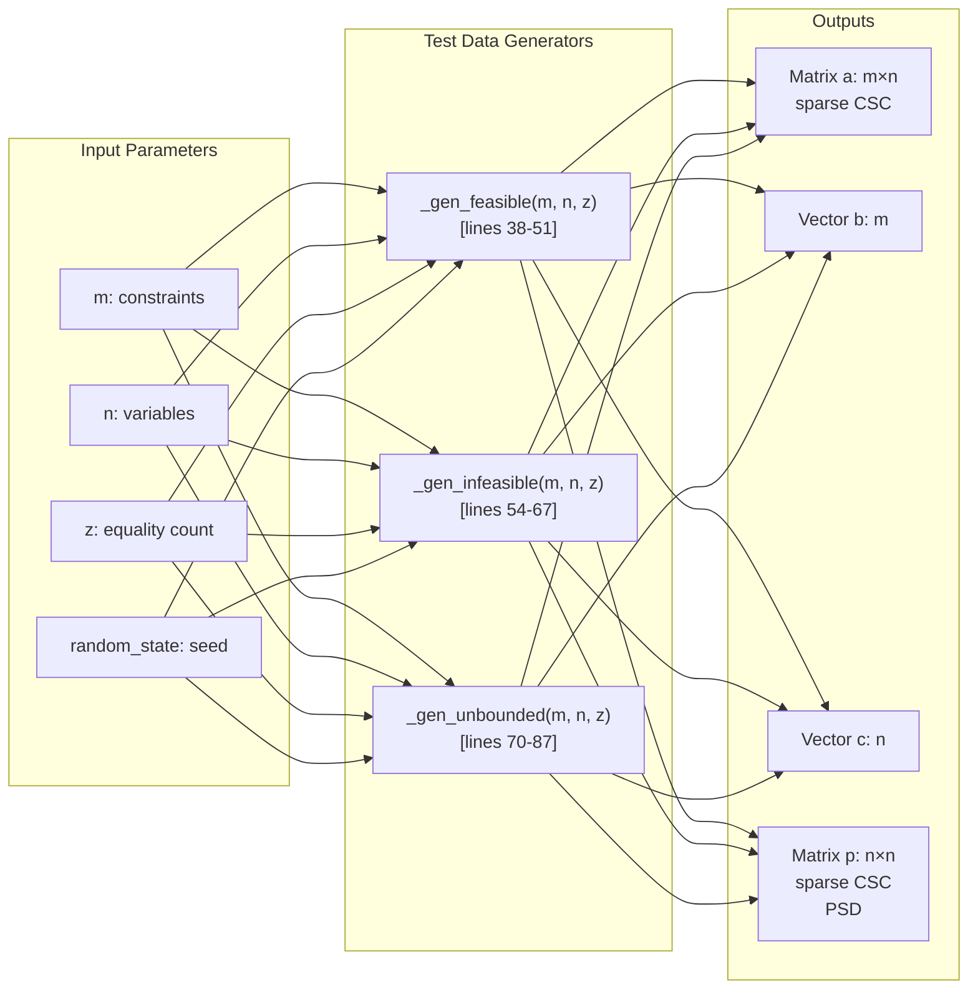
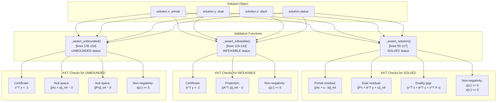
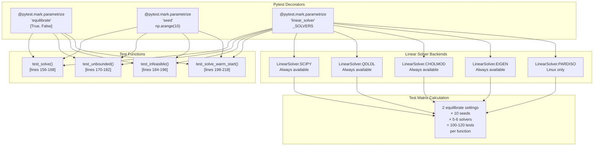
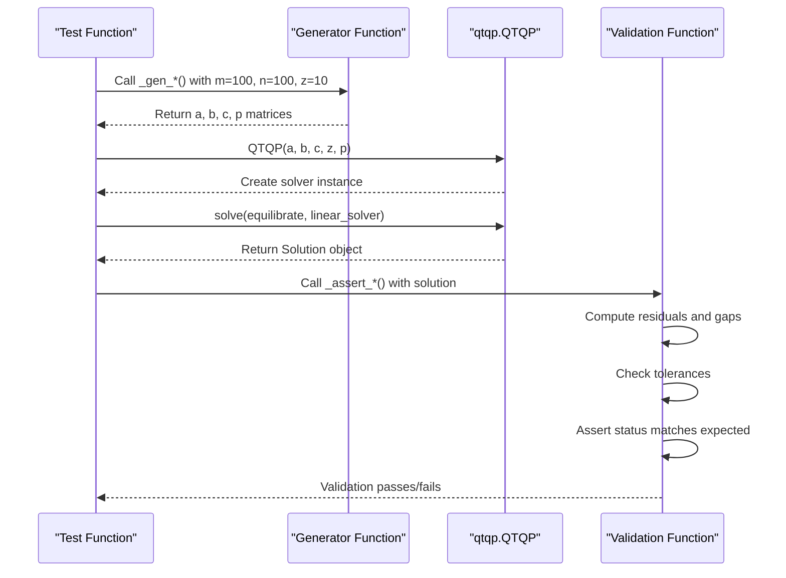
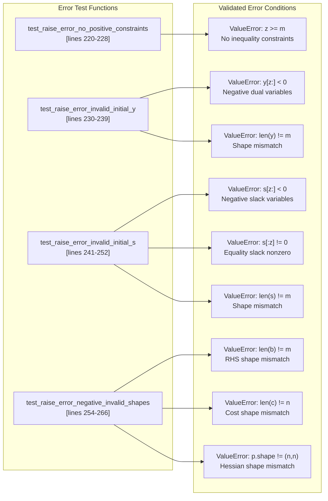
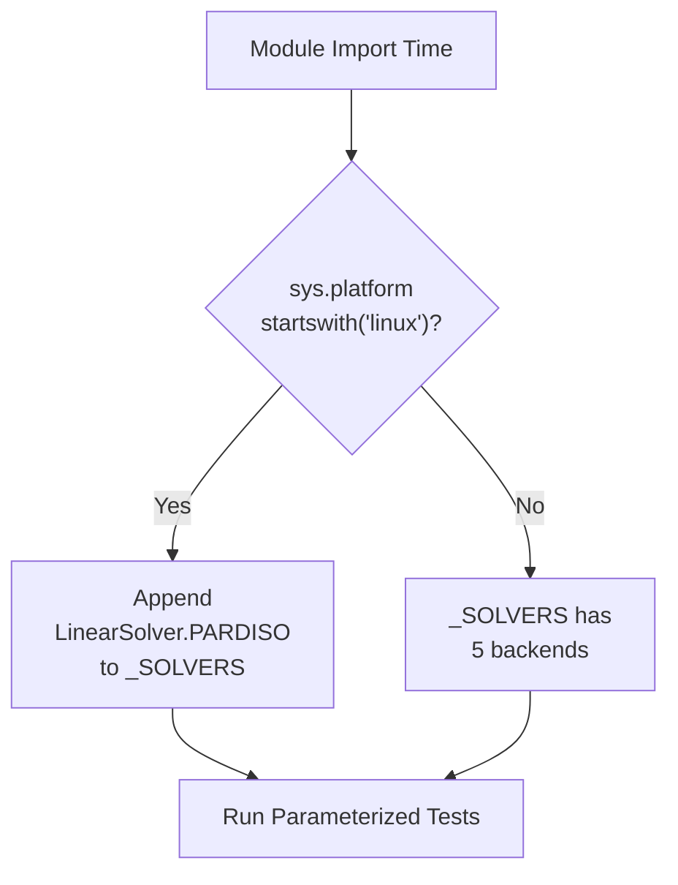

<!-- source: DeepWiki mcp.deepwiki.com · repo google-deepmind/qtqp · page 6 Testing · fetched 2026-10-26 -->

# Testing

<details>
<summary>Relevant source files</summary>

The following files were used as context for generating this wiki page:

- [tests/test_qtqp.py](tests/test_qtqp.py)

</details>


This document describes the test suite for the QTQP solver, explaining how tests validate correctness, the parameterization strategy, and KKT condition checking. The test suite ensures that the solver correctly handles feasible, infeasible, and unbounded quadratic programs across all linear solver backends.

For information about running tests locally and interpreting test output, see [Running Tests](#6.2). For details about the CI/CD testing pipeline, see [CI/CD Pipeline](#7.2).

## Test Suite Overview

The QTQP test suite is located in [tests/test_qtqp.py]() and consists of 266 lines of comprehensive validation code. The tests verify solver correctness by generating synthetic quadratic programs with known properties (feasible, infeasible, unbounded) and validating that solutions satisfy the Karush-Kuhn-Tucker (KKT) optimality conditions.

**Sources:** [tests/test_qtqp.py:1-266]()

## Test Data Generation

The test suite uses three generator functions to create synthetic quadratic programs with specific mathematical properties. Each generator constructs matrices and vectors that guarantee a particular outcome when solved.

### Generator Functions



### Generator Implementations

| Generator | Purpose | Key Construction Steps | Output Guarantee |
|-----------|---------|------------------------|------------------|
| `_gen_feasible` | Create solvable QP | Generate random x, y, s; construct P as PSD; compute c = -A^T y; compute b = Ax + s | Solution exists with optimal x, y, s |
| `_gen_infeasible` | Create infeasible QP | Generate y; project A to satisfy A^T y = 0; set b = -b / (b^T y) | No feasible solution; certificate y with b^T y = -1 |
| `_gen_unbounded` | Create unbounded QP | Set smallest eigenvalue of P to 0; align A and c with null space | Objective unbounded below; certificate x with c^T x = -1 |

**Sources:** [tests/test_qtqp.py:38-87]()

## KKT Condition Validation

The test suite validates solver correctness by checking that solutions satisfy the Karush-Kuhn-Tucker optimality conditions. Three validation functions correspond to the three problem types.

### KKT Validation Functions



### Validation Tolerances

Each validation function uses tolerance parameters to account for numerical precision:

| Parameter | Default Value | Purpose |
|-----------|---------------|---------|
| `atol` | 1e-7 (solved), 1e-8 (infeasible/unbounded) | Absolute tolerance for residuals |
| `rtol` | 1e-8 (solved), 1e-9 (infeasible/unbounded) | Relative tolerance scaled by problem norm |

The validation functions compute relative tolerance thresholds based on problem data norms to ensure scale-independent validation:

- **Primal relative RHS:** `max(||Ax||_inf, ||s||_inf, ||b||_inf)`
- **Dual relative RHS:** `max(||Px||_inf, ||A^T y||_inf, ||c||_inf)`

**Sources:** [tests/test_qtqp.py:90-154]()

## Parameterized Testing Strategy

The test suite uses pytest parameterization to create a comprehensive test matrix across multiple dimensions: equilibration settings, random seeds, and linear solver backends.

### Test Parameterization Matrix



### Solver Backend Selection

The `_SOLVERS` list is constructed at module import time with platform-specific logic:

```python
_SOLVERS = [
    qtqp.LinearSolver.SCIPY,
    qtqp.LinearSolver.QDLDL,
    qtqp.LinearSolver.CHOLMOD,
    qtqp.LinearSolver.EIGEN,
]

# Only run PARDISO on linux
if sys.platform.startswith("linux"):
    _SOLVERS.append(qtqp.LinearSolver.PARDISO)
```

The PARDISO backend is only included on Linux platforms because it requires Intel MKL, which has platform-specific requirements. The CUDSS GPU backend is excluded from the standard test suite (commented out) as it requires NVIDIA GPU hardware.

**Sources:** [tests/test_qtqp.py:24-36](), [tests/test_qtqp.py:156-218]()

## Core Test Functions

The test suite contains four primary test functions that validate different aspects of solver behavior.

### Test Function Overview

| Test Function | Lines | Purpose | Validations |
|---------------|-------|---------|-------------|
| `test_solve` | 159-168 | Verify correct solution of feasible QPs | Status SOLVED, KKT conditions satisfied |
| `test_unbounded` | 173-182 | Verify detection of unbounded QPs | Status UNBOUNDED, certificate valid, NaN dual |
| `test_infeasible` | 187-196 | Verify detection of infeasible QPs | Status INFEASIBLE, certificate valid, NaN primal/slack |
| `test_solve_warm_start` | 201-218 | Verify warm starting functionality | Solution converges in 0 iterations when warm started with optimal point |

### Test Execution Flow



### Warm Start Validation

The `test_solve_warm_start` function has special logic to verify that providing optimal initial values allows the solver to converge immediately:

1. Solve a feasible QP to obtain optimal solution (x*, y*, s*)
2. Create a new QTQP instance with same problem data
3. Solve again with `x=x*`, `y=y*`, `s=s*` as initial values
4. Verify `solution.stats[-1]['iter'] == 0` (zero iterations required)

This validates that the solver correctly recognizes when it starts at an optimal point and terminates immediately.

**Sources:** [tests/test_qtqp.py:159-218]()

## Error Handling Tests

The test suite includes validation tests for error conditions to ensure the solver fails gracefully with appropriate error messages.

### Error Test Cases



### Error Validation Pattern

All error tests follow the same pattern using pytest's `pytest.raises` context manager:

```python
with pytest.raises(ValueError):
    _ = qtqp.QTQP(a=a, b=b, c=c, z=z, p=p).solve(invalid_parameter)
```

This ensures that:
1. The correct exception type (`ValueError`) is raised
2. The solver does not silently accept invalid inputs
3. Error messages are appropriate for the specific validation failure

**Sources:** [tests/test_qtqp.py:220-266]()

## Test Coverage Summary

The complete test suite provides comprehensive coverage across multiple dimensions:

### Coverage Dimensions

| Dimension | Coverage |
|-----------|----------|
| **Problem Types** | Feasible, infeasible, unbounded |
| **Equilibration** | With and without Ruiz scaling |
| **Random Seeds** | 10 different random problems per test |
| **Linear Solvers** | 5 backends (6 on Linux with PARDISO) |
| **Warm Starting** | Cold start and warm start scenarios |
| **Error Handling** | 9 distinct error conditions |

### Total Test Count

The parameterized tests generate the following test matrix:

- **`test_solve`**: 2 × 10 × 5 = 100 tests (120 on Linux)
- **`test_unbounded`**: 2 × 10 × 5 = 100 tests (120 on Linux)
- **`test_infeasible`**: 2 × 10 × 5 = 100 tests (120 on Linux)
- **`test_solve_warm_start`**: 2 × 10 × 5 = 100 tests (120 on Linux)
- **Error tests**: 4 non-parameterized tests with multiple assertions each

**Total:** ~400 tests on non-Linux platforms, ~480 tests on Linux platforms

### Problem Size Configuration

All parameterized tests use consistent problem dimensions:
- `m = 100` constraints
- `n = 100` variables
- `z = 10` equality constraints (90 inequality constraints)

This size is large enough to expose numerical issues while remaining fast enough for frequent CI execution.

**Sources:** [tests/test_qtqp.py:1-266]()

## Platform-Specific Testing

The test suite adapts to platform capabilities at runtime to ensure consistent behavior across operating systems.

### Platform Detection Logic



### Backend Availability by Platform

| Linear Solver | Linux | macOS | Windows |
|--------------|-------|-------|---------|
| SCIPY | ✓ | ✓ | ✓ |
| QDLDL | ✓ | ✓ | ✓ |
| CHOLMOD | ✓ | ✓ | ✓ |
| EIGEN | ✓ | ✓ | ✓ |
| PARDISO | ✓ | ✗ | ✗ |
| CUDSS | Manual only (requires GPU) | Manual only | Manual only |

The platform-specific logic ensures:
- Tests always pass on all platforms
- Each platform tests all available backends
- PARDISO tests run only where the backend is supported
- No false negatives due to unavailable backends

**Sources:** [tests/test_qtqp.py:33-36]()

---

