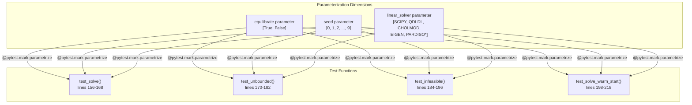
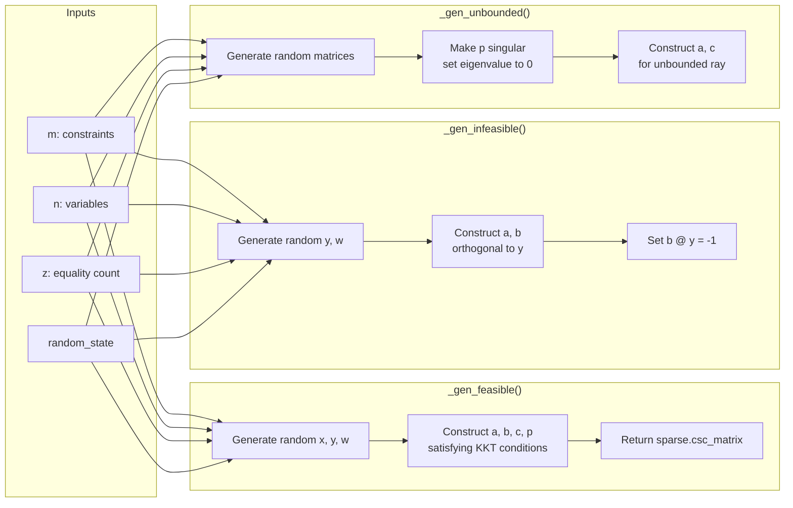
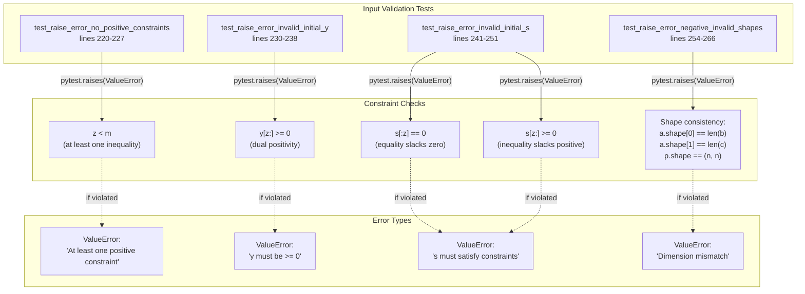

<!-- source: DeepWiki mcp.deepwiki.com · repo google-deepmind/qtqp · page 6.1 Test Suite Structure · fetched 2026-10-26 -->

# Test Suite Structure

<details>
<summary>Relevant source files</summary>

The following files were used as context for generating this wiki page:

- [tests/test_qtqp.py](tests/test_qtqp.py)

</details>


## Purpose and Scope

This document describes the organization and structure of the QTQP test suite located in [tests/test_qtqp.py](). The test suite validates solver correctness across multiple dimensions: problem types (feasible, infeasible, unbounded), linear solver backends, equilibration settings, and warm-starting. For information about running the tests and interpreting test output, see [Running Tests](#6.2). For details on the CI/CD testing matrix, see [CI/CD Pipeline](#7.2).

**Sources:** [tests/test_qtqp.py:1-266]()

---

## Test File Organization

The test suite is contained in a single file with five distinct sections:

| Section | Line Range | Purpose |
|---------|-----------|---------|
| **Solver Configuration** | 24-36 | Defines `_SOLVERS` list of linear solver backends to test |
| **Test Data Generators** | 38-88 | Functions that construct QP problems with specific properties |
| **KKT Validation Functions** | 90-154 | Assertion helpers that verify solutions satisfy optimality conditions |
| **Parameterized Test Functions** | 156-218 | Core test cases using `pytest.mark.parametrize` for matrix testing |
| **Error Validation Tests** | 220-266 | Tests that verify proper error handling for invalid inputs |

The modular organization separates test data generation, validation logic, and test execution, making the suite maintainable and extensible.

**Sources:** [tests/test_qtqp.py:1-266]()

---

## Linear Solver Backend Selection

The `_SOLVERS` list defines which linear solver backends are tested:

```python
_SOLVERS = [
    qtqp.LinearSolver.SCIPY,
    qtqp.LinearSolver.QDLDL,
    qtqp.LinearSolver.CHOLMOD,
    qtqp.LinearSolver.EIGEN,
]

# Platform-specific addition
if sys.platform.startswith("linux"):
    _SOLVERS.append(qtqp.LinearSolver.PARDISO)
```

The `PARDISO` backend is conditionally added only on Linux because it requires Intel CPU-specific instructions. The `CUDSS` GPU backend is commented out in the default configuration but can be manually enabled for GPU testing. This list is used as a parameter in all parameterized tests, ensuring every solver backend is validated.

**Sources:** [tests/test_qtqp.py:24-36]()

---

## Test Parameterization Strategy

The test suite uses `pytest.mark.parametrize` to achieve comprehensive matrix testing. Each core test function tests across three dimensions:

```
test_solve() = 2 (equilibrate) × 10 (seed) × 5-6 (linear_solver) = 100-120 test cases
test_unbounded() = 2 × 10 × 5-6 = 100-120 test cases
test_infeasible() = 2 × 10 × 5-6 = 100-120 test cases
test_solve_warm_start() = 2 × 10 × 5-6 = 100-120 test cases
```

**Total parameterized test cases:** 400-480 depending on platform

### Parameterization Diagram



This parameterization ensures that:
- Both equilibrated and non-equilibrated problem forms are tested
- Each configuration is tested on 10 different random problem instances (via seed)
- All available linear solver backends are validated

**Sources:** [tests/test_qtqp.py:156-218]()

---

## Test Data Generation Functions

The test suite includes three generator functions that construct QP problems with specific mathematical properties:

| Function | Lines | Returns | Property |
|----------|-------|---------|----------|
| `_gen_feasible()` | 38-51 | `(a, b, c, p)` | Generates a feasible QP with known solution |
| `_gen_infeasible()` | 54-67 | `(a, b, c, p)` | Generates a provably infeasible QP |
| `_gen_unbounded()` | 70-87 | `(a, b, c, p)` | Generates an unbounded QP (objective can decrease indefinitely) |

### Test Data Generation Pipeline



Each generator uses a deterministic random number generator (seeded via `random_state`) to ensure reproducible test cases. The problem dimensions used in tests are `m=100`, `n=100`, `z=10`.

### Feasible Problem Construction

The `_gen_feasible()` function constructs a QP by first generating primal-dual variables `(x, y, s)` that satisfy positivity constraints, then working backward to construct problem data `(a, b, c, p)` that makes these variables optimal:

1. Generate random vectors `x`, `y`, `w`
2. Enforce `y[z:] >= 0` by taking positive part of `w[z:]`
3. Compute `s = y - w` (slack variables)
4. Generate positive semidefinite `p = P^T P * 0.01`
5. Compute `c = -a^T y` (dual feasibility)
6. Compute `b = ax + s` (primal feasibility)

**Sources:** [tests/test_qtqp.py:38-51]()

### Infeasible Problem Construction

The `_gen_infeasible()` function creates a certificate of primal infeasibility by constructing `y` such that `a^T y = 0` and `b^T y < 0`:

1. Generate random `y`, `w`
2. Project `a` to be orthogonal to `y`: `a = a - (y * y^T a) / ||y||^2`
3. Set `b = -b / (b^T y)` to ensure `b^T y = -1`

This construction guarantees the QP is infeasible since `a^T y = 0` and `b^T y = -1` cannot be satisfied simultaneously by any feasible point.

**Sources:** [tests/test_qtqp.py:54-67]()

### Unbounded Problem Construction

The `_gen_unbounded()` function creates a certificate of unboundedness by constructing a ray `x` along which the objective decreases indefinitely:

1. Generate random `p` and make it singular by setting one eigenvalue to zero
2. Extract the null space direction `x` from the zero eigenvalue
3. Project `a` orthogonal to `x`: `a = a - ((s + ax) * x^T) / ||x||^2`
4. Set `c = -c / (c^T x)` to ensure `c^T x = -1`

This ensures `p @ x = 0` and `c^T x < 0`, creating an unbounded ray.

**Sources:** [tests/test_qtqp.py:70-87]()

---

## KKT Condition Validation Functions

The test suite includes three validation functions that verify solutions satisfy the appropriate optimality conditions:

| Function | Lines | Validates | Status |
|----------|-------|-----------|--------|
| `_assert_solution()` | 90-117 | Primal-dual optimality | `SOLVED` |
| `_assert_infeasible()` | 119-133 | Infeasibility certificate | `INFEASIBLE` |
| `_assert_unbounded()` | 135-154 | Unboundedness certificate | `UNBOUNDED` |

### KKT Validation Logic Mapping

```mermaid
graph TB
    subgraph "Solution Object"
        SolX["solution.x<br/>(primal variables)"]
        SolY["solution.y<br/>(dual variables)"]
        SolS["solution.s<br/>(slack variables)"]
        SolStatus["solution.status<br/>(enum value)"]
    end
    
    subgraph "_assert_solution() [lines 90-117]"
        CheckSolved["Assert status == SOLVED"]
        CheckPres["Primal residual:<br/>||Ax + s - b||∞"]
        CheckDres["Dual residual:<br/>||Px + A^T y + c||∞"]
        CheckGap["Duality gap:<br/>|c^T x + b^T y + x^T P x|"]
        CheckPos["Positivity:<br/>y[z:] >= 0, s[z:] >= 0"]
    end
    
    subgraph "_assert_infeasible() [lines 119-133]"
        CheckInfeas["Assert status == INFEASIBLE"]
        CheckNaN["Assert x, s are NaN"]
        CheckPinf["Certificate:<br/>||A^T y||∞ small"]
        CheckBdot["Certificate:<br/>b^T y = -1"]
        CheckYpos["Positivity:<br/>y[z:] >= 0"]
    end
    
    subgraph "_assert_unbounded() [lines 135-154]"
        CheckUnbound["Assert status == UNBOUNDED"]
        CheckYNaN["Assert y is NaN"]
        CheckDinf["Certificate:<br/>||Ax + s||∞ small<br/>||Px||∞ small"]
        CheckCdot["Certificate:<br/>c^T x = -1"]
        CheckSpos["Positivity:<br/>s[z:] >= 0"]
    end
    
    SolStatus --> CheckSolved
    SolX --> CheckPres
    SolY --> CheckPres
    SolS --> CheckPres
    SolX --> CheckDres
    SolY --> CheckDres
    SolY --> CheckPos
    SolS --> CheckPos
    SolX --> CheckGap
    SolY --> CheckGap
    
    SolStatus --> CheckInfeas
    SolX --> CheckNaN
    SolS --> CheckNaN
    SolY --> CheckPinf
    SolY --> CheckBdot
    SolY --> CheckYpos
    
    SolStatus --> CheckUnbound
    SolY --> CheckYNaN
    SolX --> CheckDinf
    SolS --> CheckDinf
    SolX --> CheckCdot
    SolS --> CheckSpos
```



**Sources:** [tests/test_qtqp.py:90-154]()

### Primal-Dual Optimality Validation

The `_assert_solution()` function validates five KKT conditions:

| Condition | Formula | Tolerance |
|-----------|---------|-----------|
| **Primal Residual** | `‖Ax + s - b‖∞ ≤ atol + rtol * max(‖Ax‖∞, ‖s‖∞, ‖b‖∞)` | `atol=1e-7, rtol=1e-8` |
| **Dual Residual** | `‖Px + A^T y + c‖∞ ≤ atol + rtol * max(‖Px‖∞, ‖A^T y‖∞, ‖c‖∞)` | `atol=1e-7, rtol=1e-8` |
| **Duality Gap** | `\|c^T x + b^T y + x^T P x\| ≤ atol + rtol * min(\|pcost\|, \|dcost\|)` | `atol=1e-7, rtol=1e-8` |
| **Primal Positivity** | `s[z:] ≥ -1e-9` (inequality slacks) | Absolute |
| **Dual Positivity** | `y[z:] ≥ -1e-9` (inequality duals) | Absolute |

The function also computes primal and dual objective values for comparison:
- `pcost = c^T x + 0.5 x^T P x`
- `dcost = -b^T y - 0.5 x^T P x`

**Sources:** [tests/test_qtqp.py:90-117]()

### Infeasibility Certificate Validation

The `_assert_infeasible()` function verifies that `y` is a certificate of primal infeasibility:

1. **Status Check:** `solution.status == qtqp.SolutionStatus.INFEASIBLE`
2. **NaN Values:** `x` and `s` must be NaN (no primal solution exists)
3. **Certificate Conditions:**
   - `‖A^T y‖∞ ≤ atol + rtol * ‖y‖∞` (approximately in null space of `A^T`)
   - `b^T y = -1` (normalization)
4. **Positivity:** `y[z:] ≥ -1e-9`

These conditions prove that no `x` exists satisfying `Ax + s = b` with `s[z:] ≥ 0`.

**Sources:** [tests/test_qtqp.py:119-133]()

### Unboundedness Certificate Validation

The `_assert_unbounded()` function verifies that `(x, s)` is a certificate of unboundedness:

1. **Status Check:** `solution.status == qtqp.SolutionStatus.UNBOUNDED`
2. **NaN Values:** `y` must be NaN (no dual solution exists)
3. **Certificate Conditions:**
   - `‖Ax + s‖∞ ≤ atol + rtol * ‖x‖∞` (feasible direction)
   - `‖Px‖∞ ≤ atol + rtol * ‖x‖∞` (in null space of `P`)
   - `c^T x = -1` (objective decreases)
4. **Positivity:** `s[z:] ≥ -1e-9`

These conditions prove that the objective can decrease indefinitely along the ray `x`.

**Sources:** [tests/test_qtqp.py:135-154]()

---

## Parameterized Test Functions

The test suite includes four parameterized test functions covering the main solver functionality:

### Test Execution Flow


**Sources:** [tests/test_qtqp.py:156-218]()

### Warm Start Test Validation

The `test_solve_warm_start()` function validates that warm-starting with an optimal solution requires zero additional iterations:

```python
solution = qtqp.QTQP(a=a, b=b, c=c, z=z, p=p).solve(
    equilibrate=equilibrate, linear_solver=linear_solver
)
solution = qtqp.QTQP(a=a, b=b, c=c, z=z, p=p).solve(
    x=solution.x,
    y=solution.y,
    s=solution.s,
    equilibrate=equilibrate,
    linear_solver=linear_solver,
)
assert solution.stats[-1]['iter'] == 0
```

This verifies that when warm-started with an already optimal solution, the solver immediately recognizes optimality.

**Sources:** [tests/test_qtqp.py:198-218]()

---

## Error Validation Tests

The test suite includes four non-parameterized tests that verify proper error handling:

| Test Function | Lines | Validates |
|--------------|-------|-----------|
| `test_raise_error_no_positive_constraints()` | 220-227 | Raises `ValueError` when `z >= m` (no inequality constraints) |
| `test_raise_error_invalid_initial_y()` | 230-238 | Raises `ValueError` for invalid warm-start `y` (negative values or wrong shape) |
| `test_raise_error_invalid_initial_s()` | 241-251 | Raises `ValueError` for invalid warm-start `s` (negative values, non-zero equalities, or wrong shape) |
| `test_raise_error_negative_invalid_shapes()` | 254-266 | Raises `ValueError` for dimension mismatches in problem data |

### Error Validation Structure



**Sources:** [tests/test_qtqp.py:220-266]()

### Invalid Warm Start Detection

The tests for invalid warm-start values verify multiple constraint violations:

**Invalid `y` Tests:**
- Negative values in inequality portion: `y=np.array([1.0, -1.0, 1.0])` with `z=1` (violates `y[z:] >= 0`)
- Wrong shape: `y=np.array([1.0])` when `m=3`

**Invalid `s` Tests:**
- Negative values in inequality portion: `s=np.array([0.0, -1.0, 1.0])` with `z=1` (violates `s[z:] >= 0`)
- Non-zero equality slacks: `s=np.array([1.0, 0.0, 0.0])` with `z=1` (violates `s[:z] == 0`)
- Wrong shape: `s=np.array([0.0])` when `m=3`

These tests ensure that the solver fails fast with clear error messages rather than producing incorrect results.

**Sources:** [tests/test_qtqp.py:230-251]()

---

## Test Coverage Summary

The test suite provides comprehensive coverage across multiple dimensions:

| Coverage Dimension | Details |
|-------------------|---------|
| **Problem Types** | Feasible, infeasible, unbounded (3 types) |
| **Solver Backends** | SCIPY, QDLDL, CHOLMOD, EIGEN, PARDISO (5-6 backends) |
| **Equilibration** | True, False (2 settings) |
| **Random Seeds** | 0-9 (10 instances per configuration) |
| **Warm Starting** | Cold start and warm start (2 modes) |
| **Error Handling** | Invalid constraints, warm-start values, dimensions (4 error types) |
| **Total Test Cases** | ~400-480 parameterized + 4 error validation |

The parameterized test structure ensures that any regression in solver behavior across different configurations will be immediately detected.

**Sources:** [tests/test_qtqp.py:1-266]()

---

