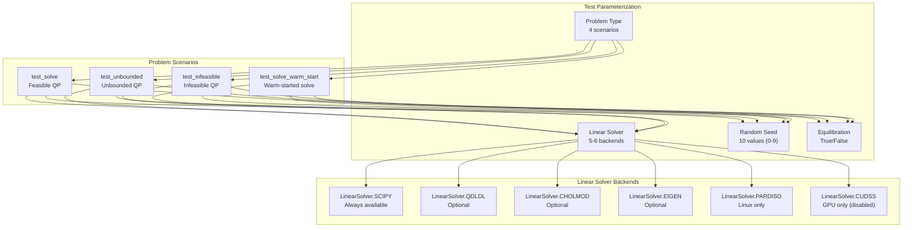
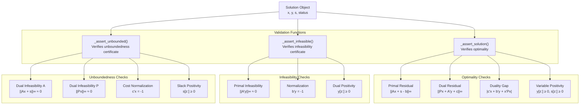
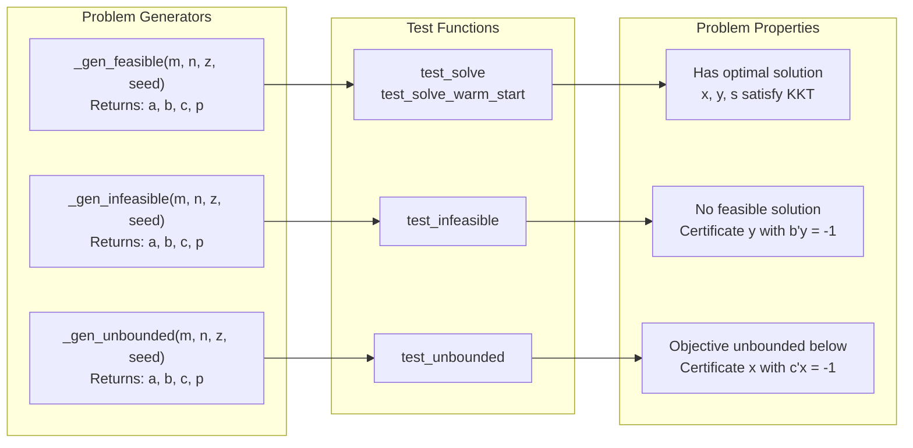
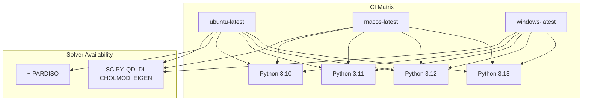

<!-- source: DeepWiki mcp.deepwiki.com · repo google-deepmind/qtqp · page 6.2 Running Tests · fetched 2026-10-26 -->

# Running Tests

<details>
<summary>Relevant source files</summary>

The following files were used as context for generating this wiki page:

- [.github/workflows/ci.yml](.github/workflows/ci.yml)
- [tests/test_qtqp.py](tests/test_qtqp.py)

</details>


This page provides instructions for running the QTQP test suite locally and understanding test output. It covers prerequisites, basic test execution, test parameterization strategies, and interpreting results. For information about the test suite structure and validation functions, see [Test Suite Structure](#6.1). For CI/CD pipeline details, see [CI/CD Pipeline](#7.2).

## Prerequisites

Before running tests, you need to install the core package and test dependencies. The QTQP test suite requires `pytest` and benefits from having optional linear solver backends available for comprehensive testing.

### Minimal Installation

To run tests with only the default SciPy solver:

```bash
pip install pytest
pip install -e .
```

### Full Installation for Comprehensive Testing

To test all available linear solver backends, install optional dependencies using conda:

```bash
# Create and activate a test environment
conda create -n qtqp-test python=3.11
conda activate qtqp-test

# Install optional solvers via conda
conda install -c conda-forge scikit-sparse eigenpy pydiso

# Install remaining dependencies via pip
pip install pytest qdldl
pip install -e .
```

Note that `pydiso` (MKL Pardiso backend) is only available on Ubuntu/Linux systems [.github/workflows/ci.yml:37-41]().

**Sources:** [.github/workflows/ci.yml:43-50](), [tests/test_qtqp.py:24-35]()

## Running Tests Locally

The test suite uses `pytest` as the test runner. All tests are located in [tests/test_qtqp.py]().

### Basic Test Execution

Run all tests in quiet mode:

```bash
pytest -q
```

This executes the entire test suite and displays a concise summary. The `-q` flag suppresses detailed output for passing tests.

### Verbose Test Execution

Run a specific test with full output including solver logging:

```bash
pytest -s tests/test_qtqp.py::test_solve[LinearSolver.SCIPY-seed0-True]
```

The `-s` flag disables output capture, allowing you to see print statements and logging from the solver [.github/workflows/ci.yml:52-57]().

### Running All Tests with Standard Output

For more detailed output without selecting a specific test:

```bash
pytest -v
```

The `-v` flag increases verbosity, showing each test case as it runs.

**Sources:** [.github/workflows/ci.yml:52-57](), [tests/test_qtqp.py:1-16]()

## Test Parameterization and Matrix Testing

The test suite uses `pytest.mark.parametrize` to automatically generate test cases across multiple dimensions, creating a comprehensive test matrix.

### Test Dimensions



**Test Matrix Dimensions:**

| Dimension | Values | Description |
|-----------|--------|-------------|
| `linear_solver` | 5-6 backends | SCIPY, QDLDL, CHOLMOD, EIGEN, PARDISO (Linux), CUDSS (commented out) |
| `seed` | 0-9 (10 values) | Random seeds for problem generation |
| `equilibrate` | True, False | Whether to apply Ruiz equilibration |
| Problem type | 4 functions | Feasible, infeasible, unbounded, warm-start |

This creates approximately **400 test cases** per platform (5 backends × 10 seeds × 2 equilibration settings × 4 problem types), or up to **600 test cases** on Linux where PARDISO is available.

**Sources:** [tests/test_qtqp.py:24-36](), [tests/test_qtqp.py:156-217]()

### Platform-Specific Test Selection

The available linear solvers vary by platform:

```python
# tests/test_qtqp.py defines available solvers
_SOLVERS = [
    qtqp.LinearSolver.SCIPY,
    qtqp.LinearSolver.QDLDL,
    qtqp.LinearSolver.CHOLMOD,
    qtqp.LinearSolver.EIGEN,
]

# PARDISO only added on Linux
if sys.platform.startswith("linux"):
    _SOLVERS.append(qtqp.LinearSolver.PARDISO)
```

Tests automatically skip unavailable backends [tests/test_qtqp.py:24-35]().

**Sources:** [tests/test_qtqp.py:24-35](), [.github/workflows/ci.yml:37-41]()

## Running Specific Tests

### By Test Function

Run all variants of a specific test function:

```bash
pytest tests/test_qtqp.py::test_solve
pytest tests/test_qtqp.py::test_infeasible
pytest tests/test_qtqp.py::test_unbounded
pytest tests/test_qtqp.py::test_solve_warm_start
```

### By Specific Parameterization

Run a single test case with specific parameters:

```bash
# Test with SCIPY solver, seed 0, equilibration enabled
pytest tests/test_qtqp.py::test_solve[LinearSolver.SCIPY-seed0-True]

# Test unbounded problem with QDLDL solver, seed 5, no equilibration
pytest tests/test_qtqp.py::test_unbounded[LinearSolver.QDLDL-seed5-False]

# Test warm start with CHOLMOD solver, seed 3, equilibration enabled
pytest tests/test_qtqp.py::test_solve_warm_start[LinearSolver.CHOLMOD-seed3-True]
```

### By Linear Solver Backend

Run all tests for a specific linear solver using pytest's `-k` flag:

```bash
# Test only SCIPY backend
pytest -k "LinearSolver.SCIPY"

# Test only PARDISO backend (Linux only)
pytest -k "LinearSolver.PARDISO"

# Test only EIGEN backend
pytest -k "LinearSolver.EIGEN"
```

### Error Handling Tests

Run tests that verify error conditions:

```bash
pytest tests/test_qtqp.py::test_raise_error_no_positive_constraints
pytest tests/test_qtqp.py::test_raise_error_invalid_initial_y
pytest tests/test_qtqp.py::test_raise_error_invalid_initial_s
pytest tests/test_qtqp.py::test_raise_error_negative_invalid_shapes
```

These tests verify that the solver correctly raises `ValueError` for invalid inputs [tests/test_qtqp.py:220-266]().

**Sources:** [tests/test_qtqp.py:159-266](), [.github/workflows/ci.yml:56-57]()

## Understanding Test Output

### Successful Test Run

When all tests pass, `pytest -q` produces output like:

```
...................................................  [100%]
450 passed in 12.34s
```

Each dot represents a passing test. With verbose mode (`pytest -v`), you see each test case:

```
tests/test_qtqp.py::test_solve[LinearSolver.SCIPY-seed0-True] PASSED
tests/test_qtqp.py::test_solve[LinearSolver.SCIPY-seed0-False] PASSED
tests/test_qtqp.py::test_solve[LinearSolver.SCIPY-seed1-True] PASSED
...
```

### Test Failure Output

When a test fails, pytest displays detailed information:

```
FAILED tests/test_qtqp.py::test_solve[LinearSolver.SCIPY-seed0-True]
AssertionError: Arrays are not less
```

The failure shows:
- Which test case failed (including parameter values)
- The assertion that failed
- Expected vs. actual values

### Verbose Solver Output

Running with `-s` flag shows internal solver logging:

```bash
pytest -s tests/test_qtqp.py::test_solve[LinearSolver.SCIPY-seed0-True]
```

This displays iteration-by-iteration solver progress, including residuals, gap, and complementarity [.github/workflows/ci.yml:56-57]().

**Sources:** [.github/workflows/ci.yml:52-57]()

## Test Validation Functions

The test suite includes specialized validation functions that verify KKT conditions for different solution types.

### KKT Condition Validation



### Validation Function Summary

| Function | Purpose | Key Checks | File Location |
|----------|---------|------------|---------------|
| `_assert_solution()` | Verifies optimal solution | Primal/dual residuals, duality gap, variable positivity | [tests/test_qtqp.py:90-117]() |
| `_assert_infeasible()` | Verifies infeasibility certificate | `A'y ≈ 0`, `b'y = -1`, `y[z:] ≥ 0` | [tests/test_qtqp.py:119-133]() |
| `_assert_unbounded()` | Verifies unboundedness certificate | `Ax + s ≈ 0`, `Px ≈ 0`, `c'x = -1`, `s[z:] ≥ 0` | [tests/test_qtqp.py:135-154]() |

These functions use configurable absolute (`atol`) and relative (`rtol`) tolerances to verify that solutions satisfy the appropriate KKT conditions to numerical precision.

**Sources:** [tests/test_qtqp.py:90-154]()

## Problem Generators

The test suite uses three problem generators that create QP instances with known properties.

### Generator Functions



| Generator | Problem Type | Construction Method | File Location |
|-----------|--------------|---------------------|---------------|
| `_gen_feasible()` | Feasible QP | Constructs `x`, `y`, `s` satisfying KKT, derives `a`, `b`, `c`, `p` | [tests/test_qtqp.py:38-51]() |
| `_gen_infeasible()` | Infeasible QP | Constructs dual certificate `y` proving infeasibility | [tests/test_qtqp.py:54-67]() |
| `_gen_unbounded()` | Unbounded QP | Constructs direction `x` of unbounded decrease | [tests/test_qtqp.py:70-87]() |

All generators use `numpy.random.default_rng()` with configurable seeds for reproducibility. The standard test size is `m=100`, `n=100`, `z=10` (100 constraints, 100 variables, 10 equality constraints) [tests/test_qtqp.py:162]().

**Sources:** [tests/test_qtqp.py:38-87](), [tests/test_qtqp.py:159-217]()

## CI Test Matrix

The GitHub Actions CI runs tests across a comprehensive matrix of platforms and Python versions.

### CI Test Configuration



**CI Matrix Summary:**

| Platform | Python Versions | Linear Solvers | Test Cases |
|----------|----------------|----------------|------------|
| Ubuntu | 3.10, 3.11, 3.12, 3.13 | SCIPY, QDLDL, CHOLMOD, EIGEN, PARDISO | ~600 |
| macOS | 3.10, 3.11, 3.12, 3.13 | SCIPY, QDLDL, CHOLMOD, EIGEN | ~400 |
| Windows | 3.10, 3.11, 3.12, 3.13 | SCIPY, QDLDL, CHOLMOD, EIGEN | ~400 |

This creates **12 platform-Python combinations** (3 platforms × 4 Python versions), each running the full test suite. The total CI matrix executes approximately **5,200 test cases** per commit [.github/workflows/ci.yml:14-18]().

**Sources:** [.github/workflows/ci.yml:11-57]()

## Common Issues and Troubleshooting

### Missing Optional Dependencies

If a test fails with `ModuleNotFoundError`, install the missing optional dependency:

```bash
# For QDLDL
pip install qdldl

# For CHOLMOD
conda install -c conda-forge scikit-sparse

# For Eigen
conda install -c conda-forge eigenpy

# For PARDISO (Linux only)
conda install -c conda-forge pydiso
```

Tests automatically skip backends that are not installed.

### Platform-Specific Failures

**PARDISO on non-Linux systems:** PARDISO tests are skipped on macOS and Windows. If you see PARDISO-related errors on these platforms, ensure the platform check at [tests/test_qtqp.py:34-35]() is working correctly.

**GPU solver (cuDSS):** The cuDSS backend is commented out in the test suite [tests/test_qtqp.py:29-30]() and requires NVIDIA GPU hardware. It is not tested in standard CI runs.

### Test Timeout

Large test matrices may take 10-30 minutes to complete. To run a faster subset:

```bash
# Test only one seed
pytest -k "seed0"

# Test only feasible problems
pytest -k "test_solve"

# Test only one backend
pytest -k "LinearSolver.SCIPY"
```

**Sources:** [tests/test_qtqp.py:24-35](), [.github/workflows/ci.yml:37-41]()

---

