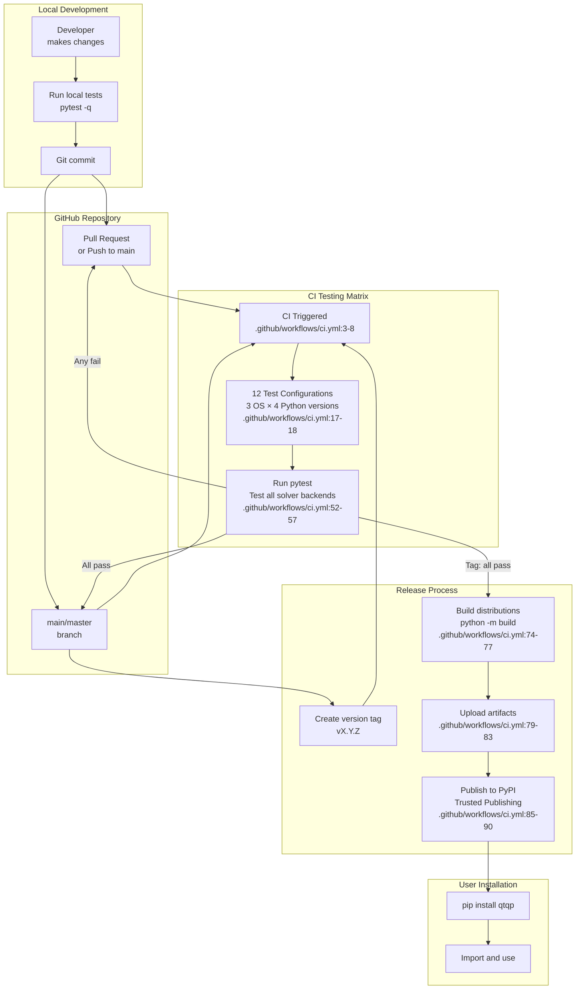

<!-- source: DeepWiki mcp.deepwiki.com · repo google-deepmind/qtqp · page 7 Development Guide · fetched 2026-10-26 -->

# Development Guide

<details>
<summary>Relevant source files</summary>

The following files were used as context for generating this wiki page:

- [.github/workflows/ci.yml](.github/workflows/ci.yml)
- [pyproject.toml](pyproject.toml)

</details>


This document provides an overview of the development infrastructure, workflows, and processes for contributors and maintainers of the QTQP repository. It covers the project structure, CI/CD pipeline, contribution guidelines, release process, and dependency management.

For information about running tests, see [Testing](#6). For API documentation, see [API Reference](#4). For architectural details, see [Architecture](#3).

## Overview

The QTQP repository uses modern Python packaging standards and automated CI/CD workflows to maintain code quality and streamline releases. The development infrastructure is built around:

- **Standard Python tooling**: Uses `setuptools>=68` with src-layout, `pytest` for testing
- **GitHub Actions CI/CD**: Automated testing across 12 configurations (3 OS × 4 Python versions)
- **Trusted Publishing**: Secure PyPI deployment without API tokens
- **Conda integration**: For managing optional linear solver dependencies
- **Automated releases**: Version tags trigger build and publish workflows

## Repository Structure

The repository follows the src-layout pattern recommended for modern Python packages. This structure separates source code from tests and configuration, preventing accidental imports of the development version.

### Key Development Files

| File Path | Purpose | Section Reference |
|-----------|---------|-------------------|
| `pyproject.toml` | Package metadata, dependencies, build configuration | [7.5](#7.5) |
| `.github/workflows/ci.yml` | CI/CD pipeline for testing and publishing | [7.2](#7.2) |
| `src/qtqp/__init__.py` | Main package entry point with public API | [3.1](#3.1) |
| `src/qtqp/direct.py` | KKT solver and linear algebra backends | [3.2](#3.2), [3.3](#3.3) |
| `tests/test_qtqp.py` | Test suite with 400+ parameterized tests | [6](#6) |
| `README.md` | User-facing documentation | [2](#2) |
| `LICENSE` | Apache License 2.0 | [8.1](#8.1) |

**Sources:** [pyproject.toml:1-33](), [.github/workflows/ci.yml:1-92]()

### Directory Layout

```
qtqp/
├── .github/
│   └── workflows/
│       └── ci.yml                 # CI/CD automation
├── src/
│   └── qtqp/
│       ├── __init__.py           # Public API exports
│       └── direct.py             # Internal implementations
├── tests/
│   └── test_qtqp.py              # Test suite
├── pyproject.toml                # Package configuration
├── README.md                     # User documentation
└── LICENSE                       # Apache License 2.0
```

The `src/` layout prevents direct imports of the development version and ensures that tests run against the installed package.

**Sources:** [pyproject.toml:27-32]()

## Development Workflow

The following diagram illustrates the complete development lifecycle from code changes to production release:

**Diagram: Development Lifecycle - Code to Production**



**Sources:** [.github/workflows/ci.yml:1-92]()

## Build System Configuration

The package uses `setuptools` with `pyproject.toml` for configuration. This follows PEP 517/518 standards for modern Python packaging.

### Package Metadata

The `[project]` section defines core package information:

- **Name**: `qtqp` [pyproject.toml:6]()
- **Version**: `0.0.2` [pyproject.toml:7]()
- **Python requirement**: `>=3.9` [pyproject.toml:12]()
- **Runtime dependencies**: `numpy>=1.23`, `scipy>=1.9` [pyproject.toml:15-18]()
- **Optional dependencies**: `pytest` for testing [pyproject.toml:20-23]()

### Build Backend

The build system uses `setuptools>=68` with the `setuptools.build_meta` backend [pyproject.toml:1-3](). The src-layout is configured in `[tool.setuptools]` [pyproject.toml:25-32]().

**Sources:** [pyproject.toml:1-33]()

## CI/CD Pipeline Architecture

The GitHub Actions workflow automates testing, building, and publishing. The pipeline has two main jobs: `test` and `build-and-publish`.

**Diagram: CI/CD Job Dependencies and Triggers**

```mermaid
flowchart LR
    subgraph "Trigger Events"
        PUSH_MAIN["push: main/master<br/>.github/workflows/ci.yml:4-5"]
        PUSH_TAG["push: tags v*<br/>.github/workflows/ci.yml:6"]
        PR_EVENT["pull_request<br/>.github/workflows/ci.yml:7"]
        MANUAL["workflow_dispatch<br/>.github/workflows/ci.yml:8"]
    end
    
    subgraph "Test Job"
        TEST_JOB["test job<br/>.github/workflows/ci.yml:11"]
        CHECKOUT["actions/checkout@v5<br/>.github/workflows/ci.yml:21"]
        SETUP_PY["actions/setup-python@v6<br/>.github/workflows/ci.yml:23-26"]
        SETUP_CONDA["setup-miniconda@v3<br/>.github/workflows/ci.yml:28-35"]
        INSTALL_PARDISO["conda install pydiso<br/>Ubuntu only<br/>.github/workflows/ci.yml:38-41"]
        INSTALL_DEPS["Install dependencies<br/>.github/workflows/ci.yml:43-50"]
        RUN_TESTS["pytest -q<br/>.github/workflows/ci.yml:52-57"]
    end
    
    subgraph "Build and Publish Job"
        BUILD_JOB["build-and-publish job<br/>needs: test<br/>.github/workflows/ci.yml:59-61"]
        BUILD_WHEEL["python -m build<br/>.github/workflows/ci.yml:74-77"]
        UPLOAD_ARTIFACT["upload-artifact@v5<br/>.github/workflows/ci.yml:79-83"]
        PUBLISH_PYPI["gh-action-pypi-publish<br/>Trusted Publishing<br/>.github/workflows/ci.yml:85-90"]
    end
    
    PUSH_MAIN --> TEST_JOB
    PR_EVENT --> TEST_JOB
    MANUAL --> TEST_JOB
    PUSH_TAG --> TEST_JOB
    
    TEST_JOB --> CHECKOUT
    CHECKOUT --> SETUP_PY
    SETUP_PY --> SETUP_CONDA
    SETUP_CONDA --> INSTALL_PARDISO
    INSTALL_PARDISO --> INSTALL_DEPS
    INSTALL_DEPS --> RUN_TESTS
    
    PUSH_TAG --> BUILD_JOB
    RUN_TESTS -->|"All tests pass"| BUILD_JOB
    BUILD_JOB --> BUILD_WHEEL
    BUILD_WHEEL --> UPLOAD_ARTIFACT
    UPLOAD_ARTIFACT --> PUBLISH_PYPI
```



**Sources:** [.github/workflows/ci.yml:1-92]()

### Test Matrix Configuration

The test job runs in a matrix to ensure cross-platform compatibility:

| Matrix Dimension | Values | Configuration |
|------------------|--------|---------------|
| Operating System | `ubuntu-latest`, `macos-latest`, `windows-latest` | [.github/workflows/ci.yml:17]() |
| Python Version | `3.10`, `3.11`, `3.12`, `3.13` | [.github/workflows/ci.yml:18]() |
| **Total Configurations** | **12** | 3 OS × 4 Python |

The matrix uses `fail-fast: false` [.github/workflows/ci.yml:15]() to run all configurations even if one fails, providing complete test coverage information.

**Sources:** [.github/workflows/ci.yml:14-18]()

### Dependency Installation Strategy

The CI pipeline uses both `pip` and `conda` to install dependencies:

1. **Core dependencies** (`numpy`, `scipy`): Installed via pip [.github/workflows/ci.yml:50]()
2. **Optional linear solver backends**: Installed via conda for better binary compatibility
   - `scikit-sparse` (CHOLMOD): All platforms [.github/workflows/ci.yml:46]()
   - `eigenpy`: All platforms [.github/workflows/ci.yml:47]()
   - `pydiso` (MKL Pardiso): Ubuntu only [.github/workflows/ci.yml:38-41]()
   - `qdldl`: Installed via pip [.github/workflows/ci.yml:49]()

MKL Pardiso is limited to Ubuntu because it requires Intel CPUs and has compatibility issues on macOS and Windows [.github/workflows/ci.yml:37]().

**Sources:** [.github/workflows/ci.yml:28-50]()

## Release Automation

Releases are fully automated through the `build-and-publish` job, which only runs when a version tag is pushed [.github/workflows/ci.yml:60]().

### Release Workflow

1. **Trigger**: Push a tag matching `v*` pattern (e.g., `v0.0.2`) [.github/workflows/ci.yml:6]()
2. **Wait for tests**: The build job depends on all test configurations passing [.github/workflows/ci.yml:61]()
3. **Build distributions**: Creates both wheel and source distributions [.github/workflows/ci.yml:74-77]()
4. **Upload artifacts**: Stores distributions as GitHub artifacts [.github/workflows/ci.yml:79-83]()
5. **Publish to PyPI**: Uses Trusted Publishing for secure deployment [.github/workflows/ci.yml:85-90]()

### Trusted Publishing Configuration

The pipeline uses OpenID Connect (OIDC) Trusted Publishing, eliminating the need for PyPI API tokens. This requires:

- **Permissions**: `id-token: write` for OIDC authentication [.github/workflows/ci.yml:65]()
- **Action**: `pypa/gh-action-pypi-publish@release/v1` [.github/workflows/ci.yml:86]()

The action is configured with `print-hash: true` for verification [.github/workflows/ci.yml:88](). Commented lines show options for test PyPI deployment [.github/workflows/ci.yml:89-90]().

**Sources:** [.github/workflows/ci.yml:59-91]()

## Package Distribution

The build process creates two distribution formats:

| Format | File Pattern | Purpose |
|--------|--------------|---------|
| Wheel | `qtqp-0.0.2-py3-none-any.whl` | Binary distribution, faster installation |
| Source | `qtqp-0.0.2.tar.gz` | Source distribution, maximum compatibility |

Both are built using `python -m build` [.github/workflows/ci.yml:77](), which uses the configuration in `pyproject.toml` [pyproject.toml:1-3]().

**Sources:** [.github/workflows/ci.yml:74-83](), [pyproject.toml:1-7]()

## Subsections

This Development Guide is organized into the following subsections:

- **[7.1 Project Structure](#7.1)**: Detailed repository layout, module organization, and src-layout pattern
- **[7.2 CI/CD Pipeline](#7.2)**: In-depth explanation of GitHub Actions workflows, test matrix, and automation
- **[7.3 Contributing](#7.3)**: Guidelines for contributing code, CLA requirements, and code review process
- **[7.4 Release Process](#7.4)**: Step-by-step release procedures, version tagging, and changelog management
- **[7.5 Dependency Management](#7.5)**: Required and optional dependencies, version constraints, and Dependabot configuration

## Quick Reference Commands

For developers working with the repository:

```bash
# Install development environment
pip install -e .
pip install pytest

# Install optional solver backends (via conda)
conda install -c conda-forge scikit-sparse eigenpy
pip install qdldl

# Run tests locally
pytest -q                          # Quiet mode, all tests
pytest -s tests/test_qtqp.py       # Verbose mode, specific file

# Build distributions
pip install build
python -m build

# Create a release (maintainers only)
git tag v0.0.3
git push origin v0.0.3             # Triggers CI/CD pipeline
```

**Sources:** [.github/workflows/ci.yml:44-57](), [.github/workflows/ci.yml:75-77]()

---

