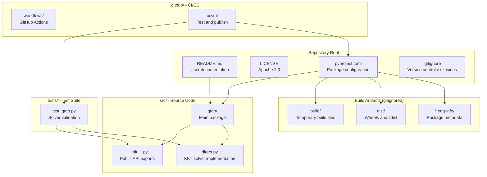
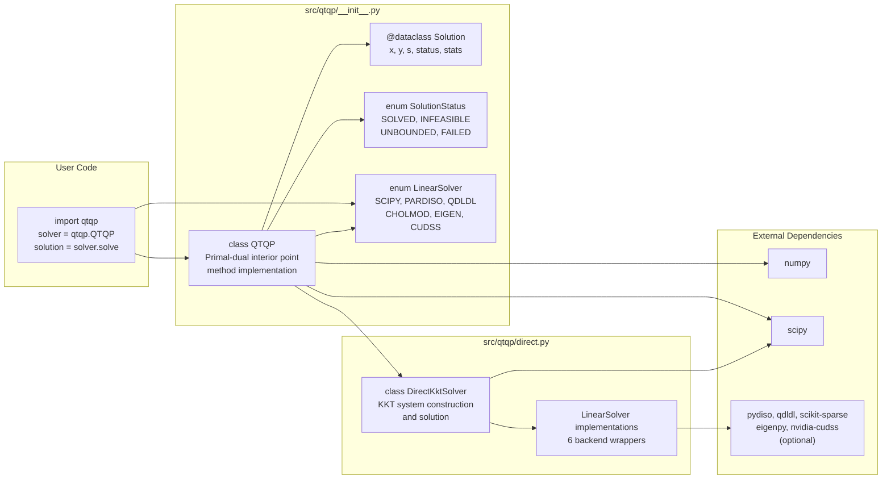
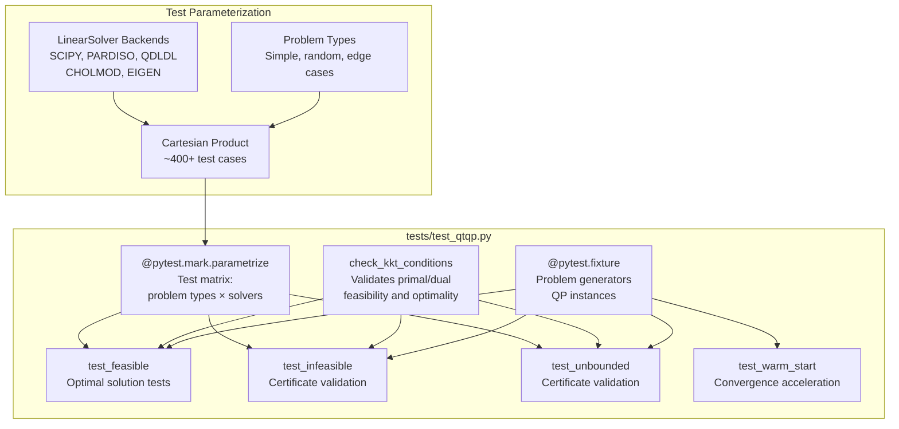
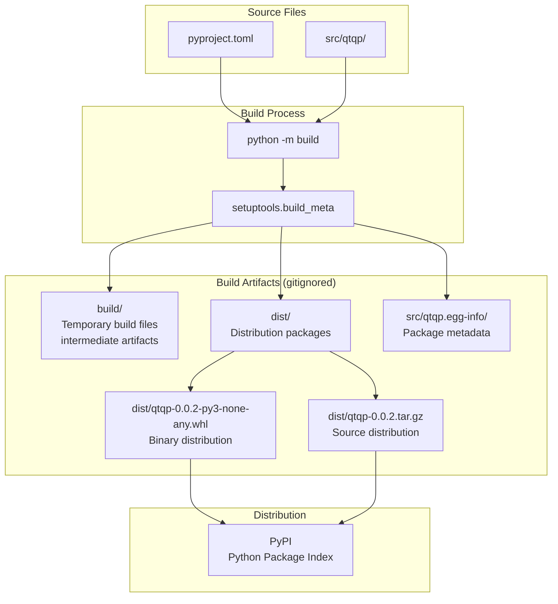
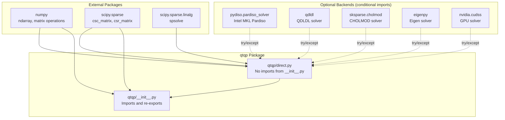

<!-- source: DeepWiki mcp.deepwiki.com · repo google-deepmind/qtqp · page 7.1 Project Structure · fetched 2026-10-26 -->

# Project Structure

<details>
<summary>Relevant source files</summary>

The following files were used as context for generating this wiki page:

- [.gitignore](.gitignore)
- [pyproject.toml](pyproject.toml)

</details>


This page documents the QTQP repository's file organization, explaining the src-layout pattern, module hierarchy, and the purpose of each directory and configuration file. This information is intended for developers who need to understand how the codebase is organized, where to find specific functionality, or how to contribute new code.

For information about the CI/CD automation that builds and tests this structure, see [CI/CD Pipeline](#7.2). For details on dependency management, see [Dependency Management](#7.5).

## Repository Layout

The QTQP repository follows modern Python packaging best practices with a src-layout structure. The top-level directory contains configuration files and directories organized by function.

**Directory Structure Overview**



**Sources:** [pyproject.toml:1-33](), [.gitignore:1-25](), Diagram 5 from high-level architecture

The repository organizes files into four primary categories:

| Directory | Purpose | Key Files |
|-----------|---------|-----------|
| `src/qtqp/` | Core package source code | `__init__.py`, `direct.py` |
| `tests/` | Test suite with pytest tests | `test_qtqp.py` |
| `.github/workflows/` | CI/CD automation | `ci.yml` |
| Root directory | Documentation and configuration | `README.md`, `pyproject.toml`, `LICENSE` |

## The src-layout Pattern

The QTQP project uses the **src-layout** pattern, where the package code resides in a `src/` directory rather than directly in the repository root. This pattern is configured in [pyproject.toml:27-32]():

```toml
[tool.setuptools]
package-dir = {"" = "src"}

[tool.setuptools.packages.find]
where = ["src"]
namespaces = false
```

**Advantages of src-layout:**

1. **Import correctness during development:** When the package is in `src/`, developers cannot accidentally import the local development copy instead of the installed package. Tests must install the package to run, ensuring they test the actual distribution.

2. **Cleaner repository structure:** Separates source code from tests, configuration, and documentation. The root directory remains uncluttered.

3. **Build isolation:** Build artifacts (`.egg-info`, `build/`, `dist/`) stay separate from source code, reducing confusion about what is tracked in version control.

4. **Standard practice:** The src-layout is recommended by the Python Packaging Authority and widely adopted in modern Python projects.

**Sources:** [pyproject.toml:25-32]()

## Package Module Organization

The `qtqp` package consists of two Python modules that implement a layered architecture separating the optimization algorithm from the linear algebra backends.

**Module Hierarchy**



**Sources:** Diagram 5 from high-level architecture, [pyproject.toml:14-18]()

### src/qtqp/__init__.py - Public API

This module serves as the package entry point and defines the public API. It exports:

- **`QTQP` class:** The main solver class implementing the primal-dual interior point method with predictor-corrector steps
- **`Solution` dataclass:** Container for solver results including primal variables (`x`), dual variables (`y`), slack variables (`s`), solution status, and iteration statistics
- **`SolutionStatus` enum:** Status codes indicating solution outcome (`SOLVED`, `INFEASIBLE`, `UNBOUNDED`, `FAILED`)
- **`LinearSolver` enum:** Identifiers for available linear algebra backends (`SCIPY`, `PARDISO`, `QDLDL`, `CHOLMOD`, `EIGEN`, `CUDSS`)

The `QTQP` class contains the optimization algorithm logic, including problem initialization, equilibration, iteration loop, and termination checking. It delegates all KKT system construction and solution to `DirectKktSolver`.

**Sources:** Diagram 1 and Diagram 5 from high-level architecture

### src/qtqp/direct.py - KKT System Implementation

This module contains the internal implementation of KKT system management and linear solver backends:

- **`DirectKktSolver` class:** Manages KKT matrix construction, updates, and solution with iterative refinement. Provides a unified interface regardless of which linear algebra backend is selected.
- **Linear solver backend implementations:** Six wrapper classes implementing the same interface for different numerical libraries (SciPy sparse, Intel MKL Pardiso, QDLDL, CHOLMOD, Eigen, NVIDIA cuDSS).

The `DirectKktSolver` constructs a sparse KKT matrix scaffold once during initialization, then updates diagonal entries at each iteration as barrier parameters change. It performs iterative refinement to maintain solution accuracy despite potentially ill-conditioned systems.

**Sources:** Diagram 1 and Diagram 2 from high-level architecture

## Test Organization

The test suite is located in the `tests/` directory and validates solver correctness across all supported configurations.

**Test Module Structure**



**Sources:** Diagram 4 from high-level architecture, [pyproject.toml:20-23]()

The test suite uses pytest with extensive parameterization to achieve broad coverage:

- **Problem fixtures:** Generate various QP problem instances (feasible, infeasible, unbounded)
- **KKT condition checking:** Validates solutions satisfy Karush-Kuhn-Tucker optimality conditions
- **Solver matrix testing:** Each test runs with all available linear solver backends (backend availability depends on platform and installed optional dependencies)
- **Warm-start tests:** Verify that providing initial solutions accelerates convergence

Tests require the `pytest` package, specified in [pyproject.toml:20-23]() as an optional test dependency.

## Configuration Files

The repository uses several configuration files to manage the build system, dependencies, and development tools.

### pyproject.toml - Package Configuration

The [pyproject.toml:1-33]() file is the central configuration file for the Python package, following PEP 518 and PEP 621 standards.

**Configuration Sections**

| Section | Purpose | Key Settings |
|---------|---------|--------------|
| `[build-system]` | Build tool requirements | setuptools>=68, wheel |
| `[project]` | Package metadata | name="qtqp", version="0.0.2", requires-python=">=3.9" |
| `[project.dependencies]` | Required runtime dependencies | numpy>=1.23, scipy>=1.9 |
| `[project.optional-dependencies]` | Optional dependency groups | test: pytest |
| `[tool.setuptools]` | Setuptools-specific configuration | src-layout: package-dir = {"": "src"} |
| `[tool.setuptools.packages.find]` | Package discovery | where=["src"], namespaces=false |

**Build System Configuration**

The build system section [pyproject.toml:1-3]() specifies that the package uses setuptools as the build backend:

```toml
[build-system]
requires = ["setuptools>=68", "wheel"]
build-backend = "setuptools.build_meta"
```

This configuration enables `pip` and `build` to construct wheel and source distributions without requiring a legacy `setup.py` file.

**Dependency Specification**

Runtime dependencies [pyproject.toml:14-18]() are minimal, including only numpy and scipy:

```toml
dependencies = [
  "numpy>=1.23",
  "scipy>=1.9"
]
```

Optional linear solver backends (pydiso, qdldl, scikit-sparse, eigenpy, nvidia-cudss) are not listed as dependencies because they must be installed separately by users who want those backends. The package gracefully handles their absence by limiting available `LinearSolver` enum values.

**Sources:** [pyproject.toml:1-33]()

### .gitignore - Version Control Exclusions

The [.gitignore:1-25]() file specifies which files and directories should not be tracked in version control. Key exclusions include:

- **Python bytecode:** `__pycache__/`, `*.pyc`, `*.pyo` files generated during execution
- **Build artifacts:** `build/`, `dist/`, `*.egg-info/` directories created during packaging
- **Distribution files:** `.eggs/`, `wheels/` containing built packages

These exclusions prevent committing temporary or generated files that should be recreated during development and build processes.

**Sources:** [.gitignore:1-25]()

## Build Artifacts and Distribution

When the package is built (either locally or in CI), several artifact directories are created. These are excluded from version control via `.gitignore`.

**Build Output Structure**



**Sources:** [pyproject.toml:1-33](), [.gitignore:8-24](), Diagram 5 from high-level architecture

**Artifact Descriptions:**

- **`build/`**: Temporary directory containing intermediate build files. Created and used by setuptools during the build process, then discarded.

- **`dist/`**: Contains the final distribution packages ready for upload to PyPI:
  - **Wheel (`.whl`)**: Binary distribution format, platform-independent for pure Python packages. Filename: `qtqp-0.0.2-py3-none-any.whl` indicates Python 3, no ABI requirements, any platform.
  - **Source distribution (`.tar.gz`)**: Complete source code package for installation from source. Filename: `qtqp-0.0.2.tar.gz`.

- **`*.egg-info/`**: Package metadata directory created during build, containing dependency information, entry points, and package manifest.

These artifacts are automatically generated during the CI/CD pipeline when a version tag is pushed, then uploaded to PyPI. For details on this automated process, see [Release Process](#7.4).

## Module Import Hierarchy

Understanding how modules import each other helps developers locate functionality and avoid circular dependencies.

**Import Dependency Graph**



**Sources:** Diagram 5 from high-level architecture, [pyproject.toml:14-18]()

**Key Import Patterns:**

1. **`qtqp/direct.py` has no internal dependencies:** This module imports only from external packages (numpy, scipy) and optional backends. It does not import from `__init__.py`, preventing circular dependencies.

2. **`qtqp/__init__.py` imports from `direct.py`:** The public API module imports `DirectKktSolver` and related classes from `direct.py`, then re-exports selected items along with the `QTQP` class.

3. **Optional imports use try/except:** Linear solver backend imports are wrapped in exception handlers. If a backend package is not installed, that solver option is silently unavailable rather than causing import errors.

4. **External dependencies are minimal:** Core functionality requires only numpy and scipy, ensuring broad compatibility and easy installation.

This import structure ensures that users can `import qtqp` successfully regardless of which optional linear solver backends are installed, with the package automatically adapting to available dependencies.

---

