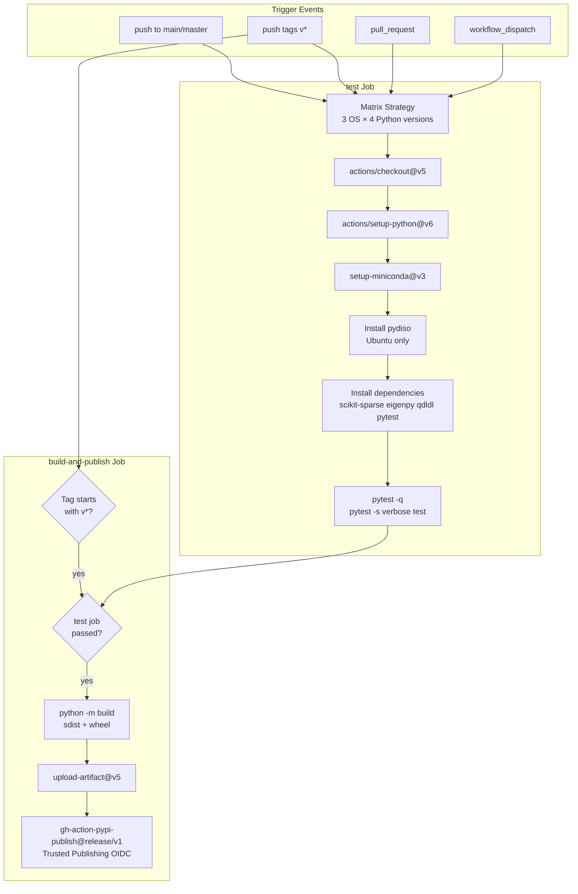
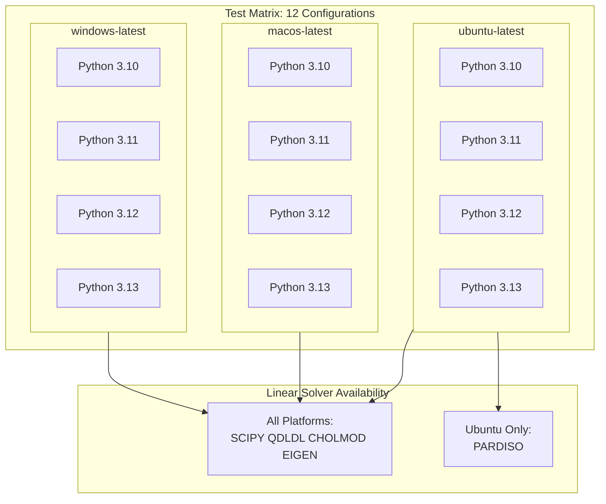
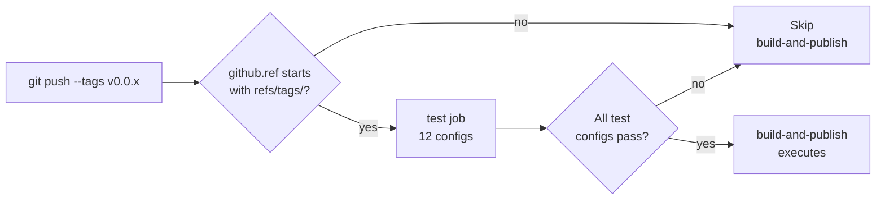
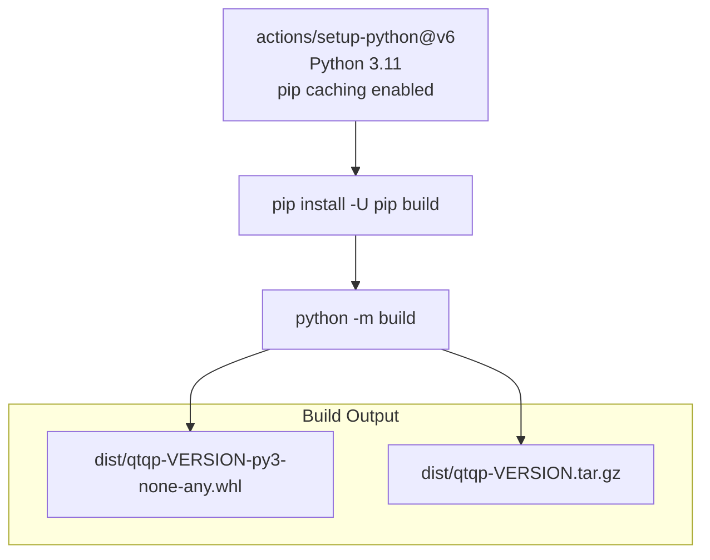
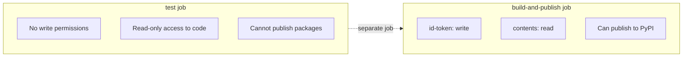
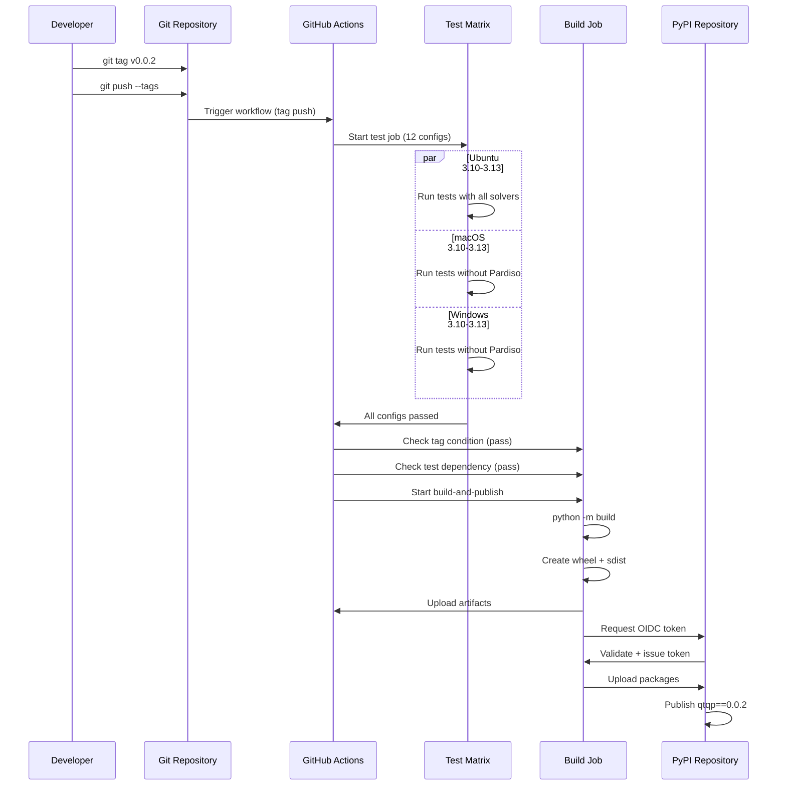

<!-- source: DeepWiki mcp.deepwiki.com · repo google-deepmind/qtqp · page 7.2 CI/CD Pipeline · fetched 2026-10-26 -->

# CI/CD Pipeline

<details>
<summary>Relevant source files</summary>

The following files were used as context for generating this wiki page:

- [.github/workflows/ci.yml](.github/workflows/ci.yml)

</details>


## Purpose and Scope

This page documents the GitHub Actions CI/CD pipeline that automates testing, building, and publishing of the QTQP package. The pipeline ensures code quality through comprehensive cross-platform testing and enables automated releases to PyPI.

For information about the test suite structure and test cases, see [Test Suite Structure](#6.1). For release process and version tagging conventions, see [Release Process](#7.4).

## Overview

The CI/CD pipeline is defined in a single GitHub Actions workflow file that orchestrates two primary jobs: `test` and `build-and-publish`. The workflow runs automatically on code changes and publishes new versions to PyPI when version tags are pushed.

### Workflow Architecture



**Sources:** [.github/workflows/ci.yml:1-91]()

## Trigger Conditions

The workflow defines four trigger conditions that activate different pipeline behaviors:

| Trigger | Condition | Jobs Executed | Purpose |
|---------|-----------|---------------|---------|
| `push` to `main` or `master` | Every commit to main branches | `test` | Validate main branch stability |
| `push` with tag `v*` | Version tags like `v0.0.2` | `test` + `build-and-publish` | Release new version to PyPI |
| `pull_request` | Any PR to any branch | `test` | Validate proposed changes |
| `workflow_dispatch` | Manual trigger from GitHub UI | `test` | Debug or ad-hoc testing |

The conditional logic for the `build-and-publish` job uses `if: startsWith(github.ref, 'refs/tags/')` at [.github/workflows/ci.yml:60](), ensuring publication only occurs for tagged releases.

**Sources:** [.github/workflows/ci.yml:3-8](), [.github/workflows/ci.yml:60]()

## Test Job

The `test` job validates the QTQP package across multiple platforms and Python versions to ensure broad compatibility.

### Test Matrix Configuration



The matrix is defined at [.github/workflows/ci.yml:14-18]() with `fail-fast: false`, allowing all configurations to complete even if some fail. This provides comprehensive failure visibility across platforms.

**Sources:** [.github/workflows/ci.yml:11-18]()

### Environment Setup Steps

The test job executes the following setup sequence:

1. **Checkout Repository** ([.github/workflows/ci.yml:21]())
   - Uses `actions/checkout@v5` to clone the repository

2. **Setup Python** ([.github/workflows/ci.yml:23-26]())
   - Uses `actions/setup-python@v6` with pip caching enabled
   - Installs the Python version from the matrix

3. **Setup Conda** ([.github/workflows/ci.yml:28-35]())
   - Uses `conda-incubator/setup-miniconda@v3`
   - Creates environment named `test-env`
   - Configures `conda-forge` channel with strict priority
   - Required because some linear solver backends (scikit-sparse, eigenpy) are only available via conda

4. **Install MKL Pardiso** ([.github/workflows/ci.yml:37-41]())
   - Conditional: `if: matrix.os == 'ubuntu-latest'`
   - Installs `pydiso` package providing Intel MKL Pardiso backend
   - Platform restriction documented in comment: "MKL Pardiso not available on MacOS and failing on Windows"

5. **Install Dependencies** ([.github/workflows/ci.yml:43-50]())
   - Installs `scikit-sparse` (CHOLMOD backend) via conda
   - Installs `eigenpy` (Eigen backend) via conda
   - Installs `qdldl` and `pytest` via pip
   - Installs QTQP package in editable mode with test extras if available

**Sources:** [.github/workflows/ci.yml:20-50]()

### Dependency Installation Pattern

The dependency installation uses a specific shell configuration to ensure conda environment activation:

```yaml
shell: bash -l {0}
```

This ensures the conda environment is properly activated for each step. The installation command at [.github/workflows/ci.yml:50]() uses a fallback pattern:

```bash
python -m pip install -e .[test] || python -m pip install -e .
```

This attempts to install with test extras first, falling back to basic installation if the `test` extra is not defined in `pyproject.toml`.

**Sources:** [.github/workflows/ci.yml:44-50]()

### Test Execution

The test execution step runs two pytest commands:

```yaml
pytest -q
pytest -s tests/test_qtqp.py::test_solve[LinearSolver.SCIPY-seed0-True]
```

1. **Quiet Test Run** ([.github/workflows/ci.yml:55]())
   - `pytest -q` runs all tests with minimal output
   - Validates all solver backends available on the platform
   - Tests multiple problem types (feasible, infeasible, unbounded)

2. **Verbose Sample Test** ([.github/workflows/ci.yml:57]())
   - Runs a single test with `-s` flag to show stdout/stderr
   - Uses `LinearSolver.SCIPY` backend (always available)
   - Purpose documented in comment: "Run one test verbose to see logging"
   - Provides diagnostic output for debugging CI issues

The test naming convention `test_solve[LinearSolver.SCIPY-seed0-True]` shows pytest's parameterization, where the test is parameterized by solver backend, random seed, and equilibration flag.

**Sources:** [.github/workflows/ci.yml:52-57]()

## Build and Publish Job

The `build-and-publish` job creates distribution packages and publishes them to PyPI. This job only executes when specific conditions are met.

### Job Execution Conditions



The job definition includes:
- `if: startsWith(github.ref, 'refs/tags/')` at [.github/workflows/ci.yml:60]()
- `needs: [test]` at [.github/workflows/ci.yml:61]()

This ensures the job only runs for version tags and only after all test matrix configurations pass.

**Sources:** [.github/workflows/ci.yml:60-61]()

### Build Process

The build process uses Python 3.11 on Ubuntu and follows the modern Python packaging workflow:



The build step at [.github/workflows/ci.yml:74-77]() uses the `build` package, which:
1. Reads configuration from `pyproject.toml`
2. Creates a source distribution (sdist) containing all source files
3. Creates a wheel (binary distribution) as a pure Python package (`py3-none-any`)

**Sources:** [.github/workflows/ci.yml:68-77]()

### Artifact Upload

Build artifacts are uploaded to GitHub Actions for inspection and debugging:

```yaml
- name: Upload build artifacts
  uses: actions/upload-artifact@v5
  with:
    name: dist
    path: dist/*
```

This creates an artifact named `dist` containing both the wheel and sdist. Artifacts are available in the GitHub Actions UI for 90 days (default retention period) and can be downloaded by maintainers for verification before PyPI publication.

**Sources:** [.github/workflows/ci.yml:79-83]()

### PyPI Publishing with Trusted Publishing

The final step publishes packages to PyPI using OIDC-based Trusted Publishing:

```yaml
- name: Publish to PyPI (Trusted Publishing)
  uses: pypa/gh-action-pypi-publish@release/v1
  with:
    print-hash: true
```

**Trusted Publishing** eliminates the need for long-lived API tokens by using OpenID Connect (OIDC) to establish trust between GitHub Actions and PyPI. The workflow at [.github/workflows/ci.yml:64-66]() requests the required permissions:

```yaml
permissions:
  id-token: write  # Required for OIDC token generation
  contents: read   # Required for repository access
```

The `print-hash: true` option outputs SHA256 checksums of uploaded files for verification.

**Commented Configuration**: The workflow includes commented lines at [.github/workflows/ci.yml:89-90]() for testing with TestPyPI:

```yaml
# repository-url: https://test.pypi.org/legacy/
# skip-existing: true
```

These can be uncommented to test the publishing process without affecting the production PyPI repository.

**Sources:** [.github/workflows/ci.yml:85-90](), [.github/workflows/ci.yml:64-66]()

## Security and Permissions

The CI/CD pipeline implements security best practices:

### Job Isolation



**Test Job**: Runs with default minimal permissions, cannot modify repository or publish packages.

**Build-and-Publish Job**: 
- Explicitly declares required permissions at [.github/workflows/ci.yml:64-66]()
- `id-token: write`: Enables OIDC token generation for PyPI Trusted Publishing
- `contents: read`: Allows repository checkout
- Does not have `contents: write`, preventing accidental repository modifications

### Trusted Publishing Security Model

Traditional PyPI publishing requires storing API tokens as GitHub secrets, creating security risks:
- Long-lived credentials that can be leaked
- Manual token rotation required
- Difficult to audit usage

Trusted Publishing using OIDC:
- No stored credentials in GitHub
- Short-lived tokens generated per-workflow
- PyPI validates the token's claims (repository, workflow, environment)
- Automatic credential rotation
- Detailed audit logs on PyPI

The trust relationship must be configured once on PyPI by project maintainers, specifying:
- Repository owner: `google-deepmind`
- Repository name: `qtqp`
- Workflow filename: `ci.yml`
- Environment name (optional): not used in this workflow

**Sources:** [.github/workflows/ci.yml:64-66](), [.github/workflows/ci.yml:85-86]()

## Matrix Strategy Details

The test matrix configuration demonstrates advanced GitHub Actions features:

### Platform-Specific Behavior

| Platform | Runner Image | Solver Backends Available | Special Considerations |
|----------|--------------|---------------------------|------------------------|
| Ubuntu | `ubuntu-latest` | SCIPY, PARDISO, QDLDL, CHOLMOD, EIGEN | Full solver support, Intel CPU required for Pardiso |
| macOS | `macos-latest` | SCIPY, QDLDL, CHOLMOD, EIGEN | No Pardiso (Intel CPU only) |
| Windows | `windows-latest` | SCIPY, QDLDL, CHOLMOD, EIGEN | No Pardiso (installation fails) |

The conditional Pardiso installation at [.github/workflows/ci.yml:38-41]() uses:

```yaml
if: matrix.os == 'ubuntu-latest'
```

This prevents installation attempts on unsupported platforms.

### Fail-Fast Disabled

The matrix configuration at [.github/workflows/ci.yml:15]() sets:

```yaml
fail-fast: false
```

This means:
- All 12 matrix configurations run independently
- Failure in one configuration does not cancel others
- Provides complete visibility into which platforms/versions have issues
- Critical for detecting platform-specific bugs

**Sources:** [.github/workflows/ci.yml:14-18](), [.github/workflows/ci.yml:37-41]()

## Workflow Execution Flow

The complete execution sequence for a tagged release:



**Sources:** [.github/workflows/ci.yml:1-91]()

## Troubleshooting Common Issues

### Test Failures

**Conda Environment Not Activated**
- Symptom: Command not found errors for conda-installed packages
- Solution: Ensure `shell: bash -l {0}` is used for all conda-dependent steps
- Location: [.github/workflows/ci.yml:44]()

**Pardiso Installation Fails**
- Symptom: `conda install pydiso` fails on macOS/Windows
- Expected: Pardiso only supported on Ubuntu with Intel CPU
- The workflow correctly handles this with conditional installation at [.github/workflows/ci.yml:38-41]()

**Test Parameterization Errors**
- Symptom: Tests skip certain solver backends
- Cause: Solver backend not installed in environment
- Check: `pytest -v` output shows which solvers are being tested
- The verbose test at [.github/workflows/ci.yml:57]() helps diagnose this

### Build and Publish Failures

**Job Doesn't Run**
- Check: Tag must start with `v` (e.g., `v0.0.2`, not `0.0.2`)
- Check: All test matrix configurations must pass
- Location: [.github/workflows/ci.yml:60-61]()

**Trusted Publishing Fails**
- Symptom: "Authentication failed" or "Insufficient permissions"
- Cause: Trust relationship not configured on PyPI
- Solution: Project maintainers must configure Trusted Publishing on PyPI settings
- Verify: Workflow has `id-token: write` permission at [.github/workflows/ci.yml:65]()

**Version Already Exists**
- Symptom: PyPI rejects upload with "File already exists"
- Cause: Version number in `pyproject.toml` not incremented
- Solution: Update version before tagging
- Note: The commented `skip-existing: true` at [.github/workflows/ci.yml:90]() would skip this error but is not enabled

**Sources:** [.github/workflows/ci.yml:38-41](), [.github/workflows/ci.yml:57](), [.github/workflows/ci.yml:60-61](), [.github/workflows/ci.yml:65](), [.github/workflows/ci.yml:90]()

## Related Configuration

The CI/CD pipeline interacts with several other configuration files:

- **pyproject.toml**: Defines package metadata, dependencies, and build system ([Project Structure](#7.1))
- **tests/test_qtqp.py**: Contains test cases executed by the pipeline ([Running Tests](#6.2))
- **.gitignore**: Prevents committing build artifacts and cache files
- **Dependabot**: Keeps GitHub Actions versions updated ([Dependency Management](#7.5))

**Sources:** [.github/workflows/ci.yml:1-91]()

---

