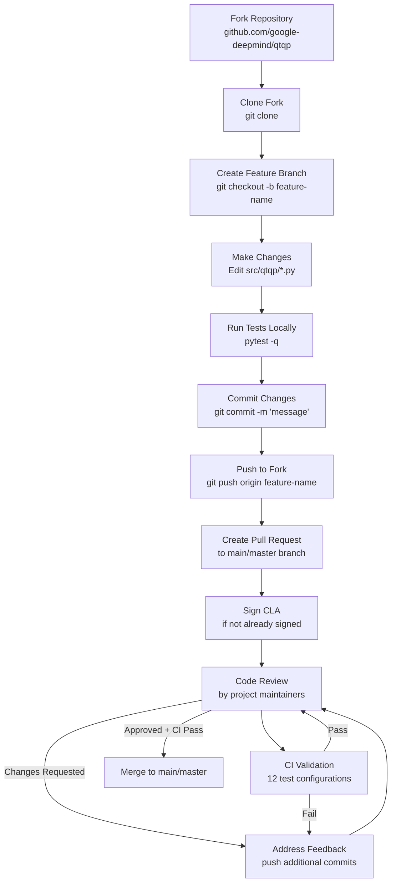
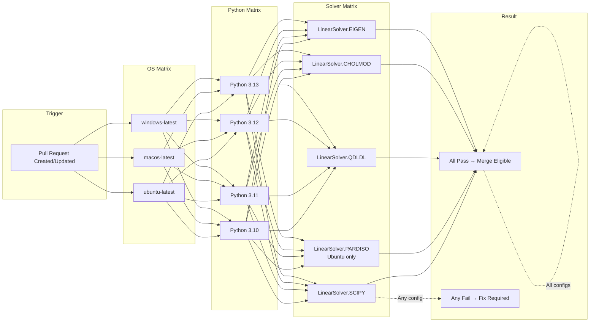
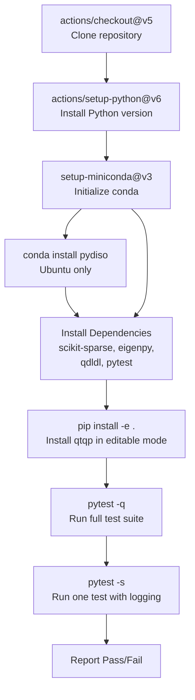
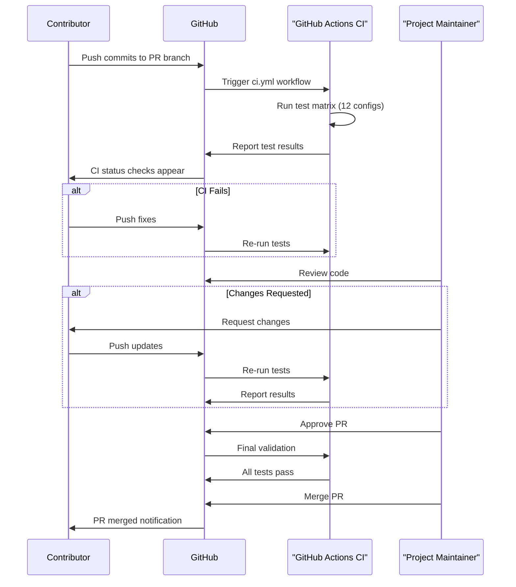

<!-- source: DeepWiki mcp.deepwiki.com · repo google-deepmind/qtqp · page 7.3 Contributing · fetched 2026-10-26 -->

# Contributing

<details>
<summary>Relevant source files</summary>

The following files were used as context for generating this wiki page:

- [.github/workflows/ci.yml](.github/workflows/ci.yml)
- [CONTRIBUTING.md](CONTRIBUTING.md)

</details>


This document provides guidelines for contributing code to the QTQP repository. It covers the Contributor License Agreement (CLA) requirements, code review process, development workflow, testing expectations, and community standards. For information about the project structure and repository layout, see [Project Structure](#7.1). For details on the CI/CD automation that validates contributions, see [CI/CD Pipeline](#7.2).

## Contributor License Agreement

All contributions to this project must be accompanied by a signed Contributor License Agreement (CLA). The CLA process is managed through Google's CLA system.

**Key Points:**
- You or your employer retain copyright to your contribution
- The CLA grants permission to use and redistribute your code as part of the project
- Visit https://cla.developers.google.com/ to view existing agreements or sign a new one
- CLA submission is typically required only once across all Google open source projects

If you have previously signed a CLA for another Google project, you likely do not need to sign again.

**Sources:** [CONTRIBUTING.md:1-13]()

## Code Review Process

All code submissions require review before merging, including contributions from project members. The review process uses GitHub's pull request mechanism.

### Pull Request Requirements

| Requirement | Description |
|------------|-------------|
| **CLA Status** | Must have signed CLA before merge |
| **Review Approval** | At least one project member must approve |
| **CI Passing** | All tests must pass in CI matrix |
| **Code Standards** | Must follow project conventions |
| **Documentation** | Update relevant wiki pages if needed |

### Review Focus Areas

Reviewers evaluate contributions based on:
- **Correctness**: Does the code solve the stated problem?
- **Testing**: Are there adequate tests covering new functionality?
- **Performance**: Does it maintain or improve solver performance?
- **Compatibility**: Does it work across all supported platforms (Ubuntu, macOS, Windows) and Python versions (3.10-3.13)?
- **Code Quality**: Is the code readable, maintainable, and well-documented?

**Sources:** [CONTRIBUTING.md:15-20](), [.github/workflows/ci.yml:1-92]()

## Development Workflow

### Contribution Process



**Sources:** [CONTRIBUTING.md:15-20](), [.github/workflows/ci.yml:3-8]()

### Local Development Setup

Before submitting a pull request, set up a local development environment to test changes:

```bash
# Clone your fork
git clone https://github.com/<your-username>/qtqp.git
cd qtqp

# Create a conda environment
conda create -n qtqp-dev python=3.11
conda activate qtqp-dev

# Install dependencies
conda install -c conda-forge scikit-sparse eigenpy
pip install qdldl pytest
pip install -e .

# Run tests
pytest -q
```

**Platform-Specific Considerations:**

| Platform | Additional Setup |
|----------|------------------|
| **Ubuntu** | `conda install -c conda-forge pydiso` for Pardiso solver |
| **macOS** | Pardiso not available; other solvers work |
| **Windows** | Pardiso not available; other solvers work |

**Sources:** [.github/workflows/ci.yml:28-50]()

### Branch Strategy

- **Fork the repository** rather than creating branches directly
- **Create feature branches** from `main` or `master`
- **Use descriptive branch names**: `fix-kkt-solver`, `add-warmstart-tests`, `improve-equilibration`
- **Keep PRs focused**: Address one issue or feature per pull request
- **Rebase on main** before submitting to avoid merge conflicts

**Sources:** [.github/workflows/ci.yml:4-6]()

## Testing Requirements

All contributions must include appropriate tests and pass the existing test suite.

### Running Tests Locally

```bash
# Run all tests
pytest -q

# Run tests for a specific solver
pytest -k "LinearSolver.SCIPY"

# Run with verbose output
pytest -s tests/test_qtqp.py::test_solve[LinearSolver.SCIPY-seed0-True]

# Run specific test file
pytest tests/test_qtqp.py
```

### Test Coverage Expectations

| Change Type | Test Requirements |
|-------------|-------------------|
| **Bug Fix** | Add test reproducing the bug |
| **New Feature** | Tests covering normal and edge cases |
| **Performance** | Benchmarks demonstrating improvement |
| **API Change** | Update tests for modified interfaces |
| **Backend Addition** | Tests for new `LinearSolver` enum value |

### CI Test Matrix

When you submit a pull request, GitHub Actions automatically runs the test suite across multiple configurations:



This results in **12 configurations** (3 OS × 4 Python versions), with Ubuntu testing 5 solvers and macOS/Windows testing 4 solvers each.

**Sources:** [.github/workflows/ci.yml:11-58]()

### Test Validation Details

The CI workflow performs the following validation steps on each configuration:



**Sources:** [.github/workflows/ci.yml:20-57]()

## Submitting Pull Requests

### Pull Request Creation

When creating a pull request:

1. **Title**: Use a clear, descriptive title summarizing the change
2. **Description**: Include:
   - What problem does this solve?
   - What approach did you take?
   - Are there any breaking changes?
   - Have you added tests?
   - Related issues (use `Fixes #123` syntax)

3. **Draft PRs**: Use draft status for work-in-progress submissions

### Pull Request Checklist

Before requesting review, ensure:

- [ ] All tests pass locally (`pytest -q`)
- [ ] New functionality includes tests
- [ ] Code follows existing style conventions
- [ ] Documentation updated (if API changed)
- [ ] CLA signed
- [ ] Commits have descriptive messages
- [ ] No merge conflicts with `main`/`master`

### What Happens After Submission



**Sources:** [CONTRIBUTING.md:15-20](), [.github/workflows/ci.yml:1-92]()

## Community Standards

This project follows Google's Open Source Community Guidelines, which establish expectations for respectful, constructive collaboration.

### Core Principles

- **Respectful**: Treat all contributors with respect regardless of experience level
- **Constructive**: Provide actionable feedback in code reviews
- **Collaborative**: Work together to improve the project
- **Inclusive**: Welcome contributions from diverse backgrounds

### Resources

- Full guidelines: https://opensource.google/conduct/
- GitHub Help for Pull Requests: https://help.github.com/articles/about-pull-requests/

### Reporting Issues

If you encounter violations of the community guidelines or have concerns about interactions within the project, follow the reporting procedures outlined in Google's Open Source Community Guidelines.

**Sources:** [CONTRIBUTING.md:22-25]()

## Quick Reference

### Essential Commands

| Task | Command |
|------|---------|
| **Run all tests** | `pytest -q` |
| **Run specific test** | `pytest -k "test_name"` |
| **Run with output** | `pytest -s tests/test_qtqp.py::test_name` |
| **Install editable** | `pip install -e .` |
| **Install with test deps** | `pip install -e .[test]` |

### Important Files

| File | Purpose |
|------|---------|
| `CONTRIBUTING.md` | CLA and review process |
| `.github/workflows/ci.yml` | CI/CD configuration |
| `tests/test_qtqp.py` | Main test suite |
| `pyproject.toml` | Package configuration |
| `src/qtqp/__init__.py` | Public API |
| `src/qtqp/direct.py` | KKT solver implementation |

**Sources:** [.github/workflows/ci.yml:52-57](), [CONTRIBUTING.md:1-26]()

---

