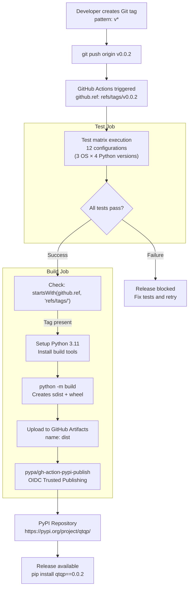
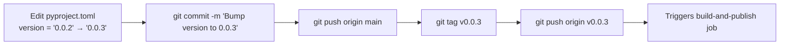
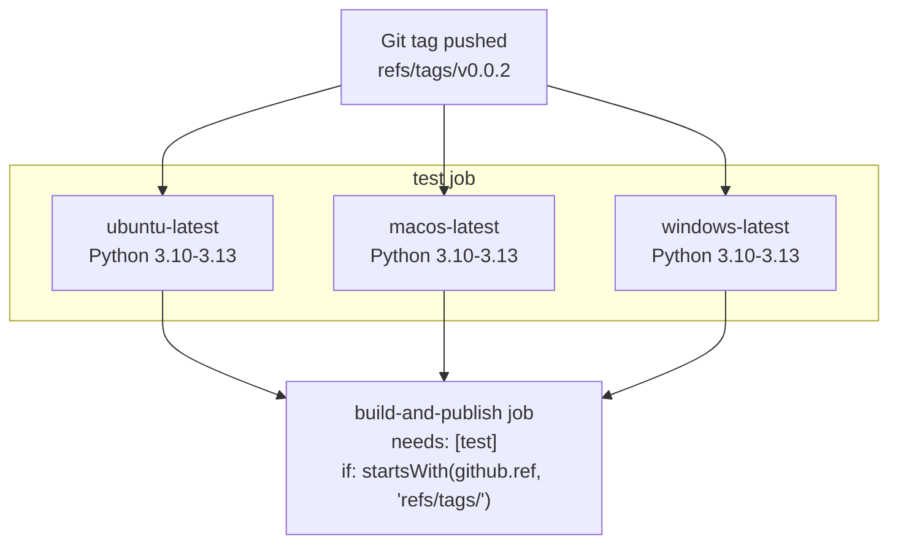
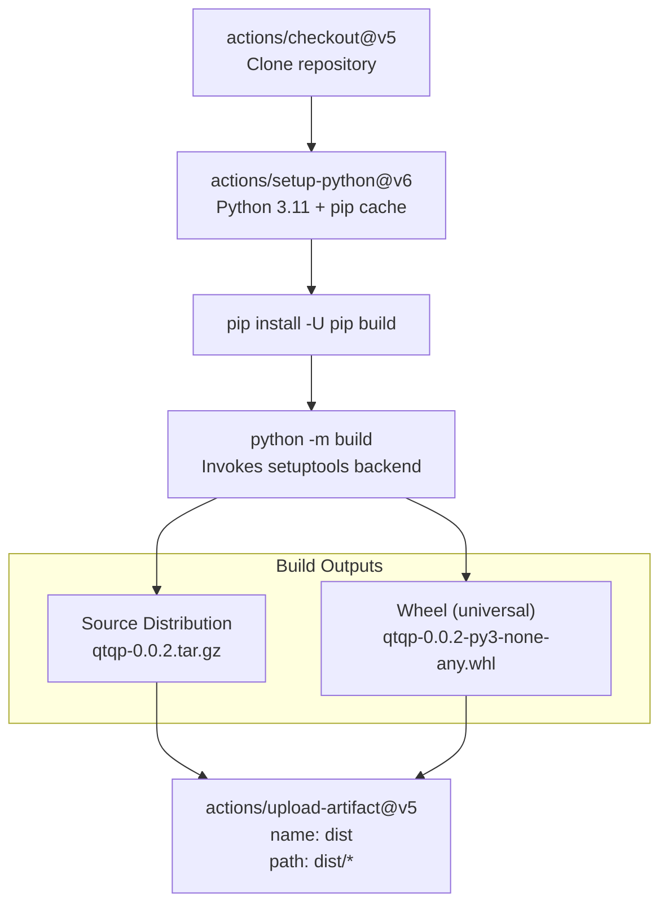
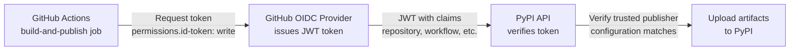
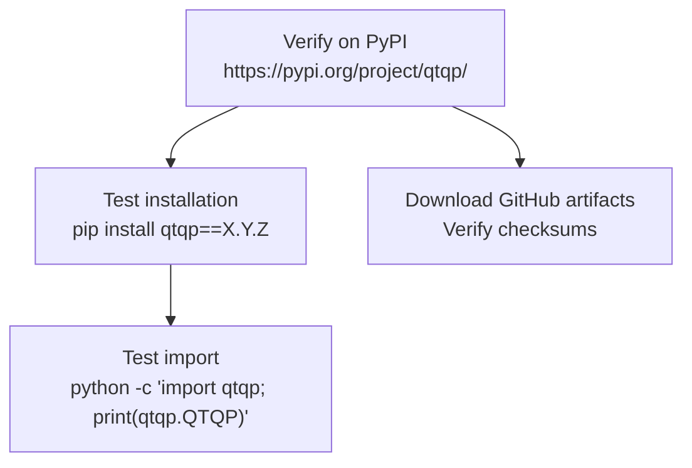
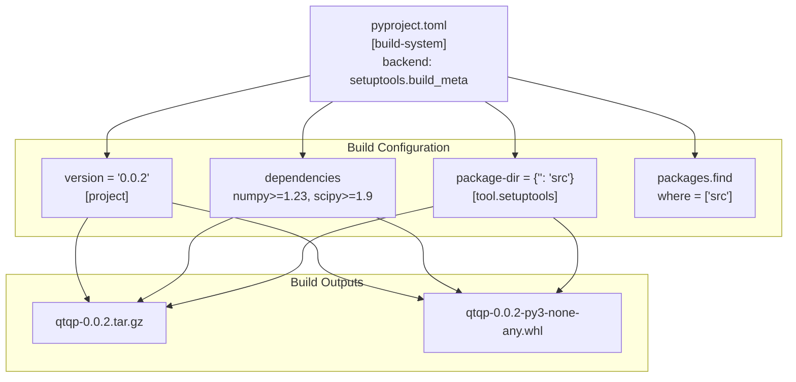

<!-- source: DeepWiki mcp.deepwiki.com · repo google-deepmind/qtqp · page 7.4 Release Process · fetched 2026-10-26 -->

# Release Process

<details>
<summary>Relevant source files</summary>

The following files were used as context for generating this wiki page:

- [.github/workflows/ci.yml](.github/workflows/ci.yml)
- [pyproject.toml](pyproject.toml)

</details>


## Purpose and Scope

This document describes the automated release process for the QTQP package, covering version tagging, automated building of distribution artifacts, and publication to the Python Package Index (PyPI). The process leverages GitHub Actions with OIDC-based Trusted Publishing to eliminate the need for manually managed API tokens.

For information about the broader CI/CD pipeline including testing workflows, see [CI/CD Pipeline](#7.2). For details on managing runtime and build dependencies, see [Dependency Management](#7.5).

---

## Release Workflow Overview

The QTQP release process is fully automated and triggered by creating a Git tag with the `v*` pattern (e.g., `v0.0.2`). The workflow enforces that all tests pass across all supported platforms and Python versions before building and publishing distribution artifacts.

### Release Trigger and Build Flow



**Sources:** [.github/workflows/ci.yml:1-91]()

---

## Version Management

### Version Definition

The package version is defined in `pyproject.toml` using the `version` field. This is a static version string that must be manually updated before creating a release tag.

| Field | Value | Purpose |
|-------|-------|---------|
| `version` | `"0.0.2"` | Package version string |
| `name` | `"qtqp"` | Package name on PyPI |
| `requires-python` | `">=3.9"` | Minimum Python version |

**Sources:** [pyproject.toml:6-12]()

### Version Update Process



The version in `pyproject.toml` and the Git tag should match (excluding the `v` prefix). For example:
- `pyproject.toml`: `version = "0.0.3"`
- Git tag: `v0.0.3`

**Sources:** [pyproject.toml:7]()

---

## CI Workflow Configuration

### Trigger Conditions

The CI workflow is configured with multiple triggers that determine when jobs execute:

```yaml
on:
  push:
    branches: [ main, master ]
    tags: [ 'v*' ]
  pull_request:
  workflow_dispatch:
```

| Trigger | Activates Test Job | Activates Build Job |
|---------|-------------------|---------------------|
| Push to main/master | Yes | No |
| Pull request | Yes | No |
| Tag with `v*` pattern | Yes | Yes |
| Manual dispatch | Yes | No |

The `build-and-publish` job includes a conditional check that ensures it only runs for tags:

```yaml
if: startsWith(github.ref, 'refs/tags/')
```

**Sources:** [.github/workflows/ci.yml:3-8](), [.github/workflows/ci.yml:60]()

### Job Dependencies



The `build-and-publish` job declares a dependency on the `test` job using the `needs` field, ensuring all 12 test configurations must pass before proceeding with the build.

**Sources:** [.github/workflows/ci.yml:59-62]()

---

## Build Artifact Generation

### Build Environment

The build process uses a standardized environment to ensure reproducible builds:

| Component | Value | Purpose |
|-----------|-------|---------|
| Operating System | `ubuntu-latest` | Linux environment for building |
| Python Version | `3.11` | Version used for build tooling |
| Build Backend | `setuptools.build_meta` | Build system defined in `pyproject.toml` |
| Build Frontend | `build` package | PEP 517 compliant builder |

**Sources:** [.github/workflows/ci.yml:63-72](), [pyproject.toml:2-3]()

### Build Steps



**Sources:** [.github/workflows/ci.yml:68-83]()

### Artifact Details

The `python -m build` command generates two types of distribution artifacts in the `dist/` directory:

**Source Distribution (`sdist`):**
- Filename: `qtqp-{version}.tar.gz`
- Contents: Source code, `pyproject.toml`, `LICENSE`, `README.md`
- Purpose: Users can install from source, useful for custom builds

**Wheel Distribution:**
- Filename: `qtqp-{version}-py3-none-any.whl`
- Type: Universal wheel (pure Python, no compiled extensions)
- Platform: `any` (works on all platforms)
- Python: `py3` (compatible with Python 3.x)

The wheel is a pure Python package because QTQP has no compiled extensions—it delegates to external libraries for linear algebra operations.

**Sources:** [.github/workflows/ci.yml:74-77](), [pyproject.toml:1-3]()

---

## PyPI Publication with Trusted Publishing

### Trusted Publishing Configuration

QTQP uses OpenID Connect (OIDC) based Trusted Publishing, which eliminates the need to store PyPI API tokens as GitHub secrets. Instead, GitHub Actions authenticates directly with PyPI using short-lived tokens.



**Required GitHub Actions Permissions:**

```yaml
permissions:
  id-token: write    # Required for OIDC token
  contents: read     # Required to checkout code
```

**Sources:** [.github/workflows/ci.yml:64-66]()

### Publication Action

The workflow uses the official PyPA publish action:

```yaml
- name: Publish to PyPI (Trusted Publishing)
  uses: pypa/gh-action-pypi-publish@release/v1
  with:
    print-hash: true
```

| Parameter | Value | Purpose |
|-----------|-------|---------|
| `print-hash` | `true` | Prints SHA256 hash of uploaded files for verification |
| `repository-url` | (default) | Uses production PyPI; can uncomment for TestPyPI |
| `skip-existing` | (default: false) | Fails if version already exists (prevents accidental overwrites) |

The commented lines in the workflow show how to publish to TestPyPI for testing:

```yaml
# repository-url: https://test.pypi.org/legacy/
# skip-existing: true
```

**Sources:** [.github/workflows/ci.yml:85-90]()

### PyPI Configuration Requirements

For Trusted Publishing to work, the following must be configured on PyPI:

1. **Navigate to Project Settings:** https://pypi.org/manage/project/qtqp/settings/publishing/
2. **Add Trusted Publisher:** Configure GitHub as publisher
3. **Specify Repository:** `google-deepmind/qtqp`
4. **Specify Workflow:** `.github/workflows/ci.yml`
5. **Specify Environment:** (leave empty for no environment restrictions)

This one-time configuration establishes the trust relationship between GitHub Actions and PyPI.

**Sources:** [.github/workflows/ci.yml:85-86]()

---

## Release Checklist

### Pre-Release Steps

1. **Ensure all tests pass** on main branch
2. **Update version** in `pyproject.toml`
3. **Update README** if needed with new version examples
4. **Commit changes:** `git commit -m "Bump version to X.Y.Z"`
5. **Push to main:** `git push origin main`

**Sources:** [pyproject.toml:7]()

### Release Execution

1. **Create tag:** `git tag vX.Y.Z`
2. **Push tag:** `git push origin vX.Y.Z`
3. **Monitor workflow:** Check GitHub Actions for test results
4. **Verify build:** Check that artifacts are uploaded
5. **Verify publication:** Check PyPI for new version

**Sources:** [.github/workflows/ci.yml:6]()

### Post-Release Verification



**Verification Commands:**

```bash
# Install specific version
pip install qtqp==0.0.2

# Verify package metadata
pip show qtqp

# Test basic functionality
python -c "import qtqp; print(qtqp.__version__)"
```

**Sources:** [.github/workflows/ci.yml:79-90]()

---

## Rollback and Recovery

### Failed Publication

If the `build-and-publish` job fails after tests pass, check:

1. **PyPI Trusted Publisher configuration** matches repository and workflow file
2. **GitHub Actions permissions** include `id-token: write`
3. **Version conflicts** - PyPI rejects versions that already exist
4. **Network issues** - retry the workflow

The workflow can be manually re-triggered using the `workflow_dispatch` event after fixing issues.

**Sources:** [.github/workflows/ci.yml:8](), [.github/workflows/ci.yml:64-66]()

### Version Conflicts

If a version is accidentally published with bugs:

1. **Cannot delete versions** from PyPI (per PEP 592)
2. **Must release patch version** (e.g., `0.0.2` → `0.0.3`)
3. **Can yank versions** to prevent installation (shows warning)

**Yanking a Release:**
- Navigate to PyPI project page
- Select the release version
- Click "Yank" button
- Users must explicitly specify version to install yanked releases

**Sources:** [.github/workflows/ci.yml:85-90]()

---

## Build System Details

### setuptools Configuration



The `setuptools.build_meta` backend uses the src-layout pattern, meaning packages are located in `src/qtqp/` rather than the repository root. This prevents accidental imports from the repository during development and testing.

**Sources:** [pyproject.toml:1-32]()

### Runtime Dependencies in Distributions

Both the wheel and sdist include metadata specifying runtime dependencies:

```python
dependencies = [
  "numpy>=1.23",
  "scipy>=1.9"
]
```

When users install QTQP via `pip install qtqp`, pip automatically installs these dependencies if they are not already present. Optional solver backends (pydiso, qdldl, scikit-sparse, eigenpy, nvidia-cudss) are not included and must be installed separately.

**Sources:** [pyproject.toml:14-18]()

---

## Common Release Scenarios

### Regular Release

**Scenario:** New feature or bug fix ready for release

**Steps:**
1. Update `version` in `pyproject.toml`: `0.0.2` → `0.0.3`
2. Commit: `git commit -m "Release 0.0.3"`
3. Push: `git push origin main`
4. Tag: `git tag v0.0.3`
5. Push tag: `git push origin v0.0.3`
6. Wait for CI to complete

**Expected outcome:** New version available on PyPI within ~5 minutes

**Sources:** [.github/workflows/ci.yml:1-91](), [pyproject.toml:7]()

### Hotfix Release

**Scenario:** Critical bug in production version

**Steps:**
1. Create hotfix branch from tag: `git checkout -b hotfix/0.0.3 v0.0.2`
2. Fix bug and commit
3. Update version: `0.0.2` → `0.0.3`
4. Merge to main: `git checkout main && git merge hotfix/0.0.3`
5. Tag and push: `git tag v0.0.3 && git push origin v0.0.3`

**Expected outcome:** Hotfix version published without waiting for next regular release

**Sources:** [pyproject.toml:7]()

### Pre-release Testing

**Scenario:** Test release process without publishing to production PyPI

**Steps:**
1. Uncomment TestPyPI configuration in workflow:
   ```yaml
   repository-url: https://test.pypi.org/legacy/
   ```
2. Push changes and create tag
3. Verify upload to TestPyPI
4. Test installation: `pip install -i https://test.pypi.org/simple/ qtqp`
5. Revert changes and publish to production

**Sources:** [.github/workflows/ci.yml:89-90]()

---

