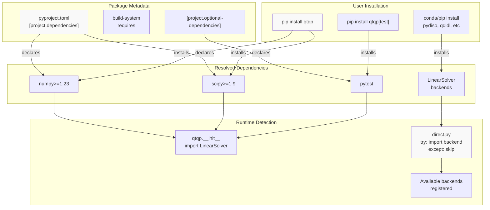
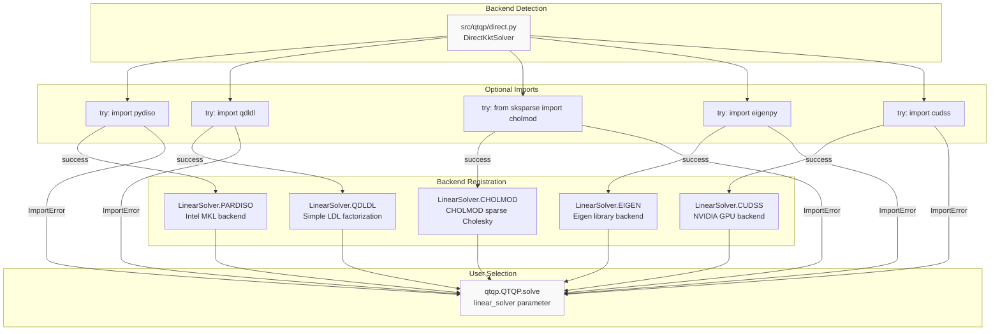

<!-- source: DeepWiki mcp.deepwiki.com · repo google-deepmind/qtqp · page 7.5 Dependency Management · fetched 2026-10-26 -->

# Dependency Management

<details>
<summary>Relevant source files</summary>

The following files were used as context for generating this wiki page:

- [.github/dependabot.yml](.github/dependabot.yml)
- [pyproject.toml](pyproject.toml)

</details>


## Purpose and Scope

This document explains how dependencies are managed in the QTQP repository, including required and optional runtime dependencies, build system dependencies, version constraints, and automated dependency update mechanisms. This covers the dependency declarations in [pyproject.toml:1-33]() and the Dependabot configuration for keeping dependencies current.

For information about installing these dependencies as an end user, see [Installation](#2.1). For information about the build and release process, see [Release Process](#7.4).

---

## Dependency Categories

The QTQP project organizes dependencies into three distinct categories based on their role in the system:

| Category | Purpose | Installation Timing | Specified In |
|----------|---------|---------------------|--------------|
| **Required Runtime** | Core functionality for all users | `pip install qtqp` | [pyproject.toml:15-18]() |
| **Optional Runtime** | Alternative linear solver backends | Manual installation | Detected dynamically via imports |
| **Build System** | Package building and distribution | Build time only | [pyproject.toml:2]() |
| **Test Dependencies** | Running test suite | Development only | [pyproject.toml:21-23]() |

**Sources:** [pyproject.toml:1-33]()

---

## Dependency Resolution Flow



**Sources:** [pyproject.toml:5-23]()

---

## Required Runtime Dependencies

The QTQP solver requires two core dependencies for all functionality:

### numpy (>=1.23)

**Specification:** [pyproject.toml:16]()

**Purpose:** Provides fundamental array data structures and numerical operations. Used throughout the solver for:
- Vector operations in the primal-dual interior point algorithm
- Array slicing and indexing
- Mathematical functions (log, sqrt, norm calculations)
- Interface for problem definition matrices and vectors

**Version Constraint Rationale:** Version 1.23 (released June 2022) introduced improved type hints and stability improvements. This minimum version ensures compatibility with modern Python 3.9+ while avoiding legacy numpy versions.

### scipy (>=1.9)

**Specification:** [pyproject.toml:17]()

**Purpose:** Provides sparse matrix data structures and the default linear solver backend:
- `scipy.sparse` matrices (CSC, CSR formats) for constraint matrix `a` and quadratic matrix `p`
- Default `LinearSolver.SCIPY` backend using `scipy.sparse.linalg.spsolve`
- Sparse matrix operations for KKT system construction

**Version Constraint Rationale:** Version 1.9 (released July 2022) provides stable sparse matrix APIs and improved sparse linear algebra performance. This is the minimum version that ensures reliable sparse solver behavior.

**Sources:** [pyproject.toml:15-18]()

---

## Optional Runtime Dependencies

Optional dependencies provide alternative linear solver backends with different performance characteristics. These are **not** declared in `pyproject.toml` because they are platform-specific and users should choose based on their hardware and performance requirements.

### Linear Solver Backend Dependencies



The following table summarizes the optional backend dependencies:

| Backend | Package Name | Installation Method | Platform Support |
|---------|-------------|---------------------|------------------|
| PARDISO | `pydiso` | `conda install -c conda-forge pydiso` | Linux (Intel CPUs), macOS, Windows |
| QDLDL | `qdldl` | `pip install qdldl` | All platforms |
| CHOLMOD | `scikit-sparse` | `conda install -c conda-forge scikit-sparse` | Linux, macOS |
| EIGEN | `eigenpy` | `conda install -c conda-forge eigenpy` | Linux, macOS, Windows |
| cuDSS | `nvidia-cudss-cu12` | `pip install nvidia-cudss-cu12` | Linux (NVIDIA GPUs) |

**Detection Mechanism:** The `DirectKktSolver` class in [src/qtqp/direct.py]() attempts to import each backend package at initialization. If import succeeds, that backend is available for use. If import fails, the backend is silently unavailable without causing errors. Users can query available backends by attempting to instantiate a solver with a specific `linear_solver` parameter.

**Sources:** Based on Diagram 5 from high-level architecture overview, implementation details in [src/qtqp/direct.py]()

---

## Build System Dependencies

Build-time dependencies are required only when building the package from source, not for end users installing from PyPI.

### setuptools (>=68)

**Specification:** [pyproject.toml:2]()

**Purpose:** Provides the build backend for creating wheel and source distributions. The minimum version 68 (released July 2023) ensures:
- Support for PEP 621 declarative metadata in `pyproject.toml`
- Proper handling of `src/` layout packages via `package-dir` configuration
- Reliable `pyproject.toml`-only builds without `setup.py`

**Configuration:** The build backend is specified as `setuptools.build_meta` in [pyproject.toml:3]().

### wheel

**Specification:** [pyproject.toml:2]()

**Purpose:** Required by setuptools to build binary wheel distributions (`.whl` files). The wheel format enables faster installation for end users compared to source distributions.

**Sources:** [pyproject.toml:1-3]()

---

## Python Version Constraint

**Specification:** [pyproject.toml:12]()

```toml
requires-python = ">=3.9"
```

The package requires Python 3.9 or newer. This constraint ensures:
- Modern type hints are available (`list[T]`, `dict[K,V]` without `from __future__ import annotations`)
- Compatibility with numpy>=1.23 and scipy>=1.9
- Support for dataclasses and structural pattern matching (if used)

**CI/CD Testing:** The GitHub Actions workflow tests Python versions 3.10, 3.11, 3.12, and 3.13 across three operating systems (Ubuntu, macOS, Windows), providing a 12-configuration test matrix. Python 3.9 is the minimum supported version but not explicitly tested in CI.

**Sources:** [pyproject.toml:12](), CI/CD workflow from high-level architecture diagrams

---

## Test Dependencies

Development and testing dependencies are declared in the optional dependency group `[test]`:

```toml
[project.optional-dependencies]
test = [
    "pytest",
]
```

**Installation:** Developers install test dependencies with:
```bash
pip install qtqp[test]
```

**Purpose:** The `pytest` framework enables:
- Parameterized testing across multiple linear solver backends
- Test discovery in `tests/test_qtqp.py`
- Detailed assertion introspection
- Integration with CI/CD pipeline

**Note:** The test suite also requires optional linear solver backend packages to be installed for comprehensive testing. The CI workflow installs these separately based on platform capabilities (e.g., PARDISO only on Ubuntu).

**Sources:** [pyproject.toml:20-23]()

---

## Automated Dependency Updates with Dependabot

The repository uses GitHub Dependabot to automatically monitor and update dependencies.

### Dependabot Configuration

**File:** [.github/dependabot.yml:1-11]()

```yaml
version: 2
updates:
  - package-ecosystem: "github-actions"
    directory: "/"
    schedule:
      interval: "weekly"
```

**Configuration Details:**

| Parameter | Value | Purpose |
|-----------|-------|---------|
| `package-ecosystem` | `"github-actions"` | Monitors GitHub Actions workflow dependencies |
| `directory` | `"/"` | Root directory containing `.github/workflows/` |
| `schedule.interval` | `"weekly"` | Checks for updates every week |

**What Dependabot Updates:**
- **GitHub Actions versions** in [.github/workflows/ci.yml](): Dependabot monitors action references like `actions/checkout@v4`, `actions/setup-python@v5`, and `pypa/gh-action-pypi-publish@release/v1` for new versions
- **Does NOT monitor Python package dependencies**: The configuration only targets GitHub Actions, not the Python dependencies in `pyproject.toml`

**Update Process:**
1. Dependabot detects new action versions weekly
2. Creates pull request with version bump
3. PR description includes changelog and commit links
4. CI runs automatically on the PR
5. Maintainers review and merge if tests pass

**Rationale:** GitHub Actions evolve frequently with security patches and new features. Weekly automated updates ensure the CI/CD pipeline stays current without manual monitoring. Python package dependencies (numpy, scipy) are stable and updated manually when needed.

**Sources:** [.github/dependabot.yml:1-11]()

---

## Dependency Installation Patterns

### End User Installation

Standard installation with required dependencies only:
```bash
pip install qtqp
```

This installs `numpy>=1.23`, `scipy>=1.9`, and the QTQP package, enabling use with the default `LinearSolver.SCIPY` backend.

### Adding Optional Backends

Users install optional backends separately based on hardware and requirements:

**For Intel CPUs (high performance):**
```bash
conda install -c conda-forge pydiso
```

**For portable, lightweight solver:**
```bash
pip install qdldl
```

**For NVIDIA GPU acceleration:**
```bash
pip install nvidia-cudss-cu12
```

Multiple backends can be installed simultaneously. The solver selects the backend via the `linear_solver` parameter in the `solve()` method.

### Developer Installation

Complete development environment with testing capabilities:
```bash
# Clone repository
git clone https://github.com/google-deepmind/qtqp
cd qtqp

# Install package in editable mode with test dependencies
pip install -e ".[test]"

# Install optional backends for comprehensive testing
conda install -c conda-forge pydiso scikit-sparse eigenpy
pip install qdldl
```

The `-e` flag installs in editable mode, allowing code changes without reinstallation.

**Sources:** Installation patterns derived from [pyproject.toml:1-33]() and testing requirements from high-level architecture diagrams

---

## Version Constraint Philosophy

The QTQP project uses **minimum version constraints** for dependencies rather than pinning exact versions:

**Required Dependencies:**
- `numpy>=1.23` (not `numpy==1.23`)
- `scipy>=1.9` (not `scipy==1.9`)

**Advantages of Minimum Constraints:**
1. **Flexibility:** Users can install newer versions with bug fixes and performance improvements
2. **Compatibility:** Works in environments with existing newer versions of dependencies
3. **Security:** Users automatically benefit from security patches in newer dependency versions
4. **Reduced Conflicts:** Looser constraints reduce dependency resolution conflicts with other packages

**Disadvantages Mitigated by Testing:**
- Risk of breakage from dependency updates is mitigated by comprehensive CI testing
- Test matrix validates functionality with recent dependency versions on each commit
- Any breaking changes in numpy/scipy are caught before release

**No Upper Bounds:** The project intentionally avoids upper version bounds (e.g., `numpy<2.0`) to prevent artificial compatibility limits. If future dependency versions break compatibility, testing will catch it, and a new QTQP release will add appropriate constraints.

**Sources:** [pyproject.toml:15-18](), dependency management best practices

---

## Summary Table: All Dependencies

| Dependency | Category | Version Constraint | Installation Method | Required For |
|------------|----------|-------------------|---------------------|--------------|
| `numpy` | Required Runtime | `>=1.23` | PyPI (automatic) | All functionality |
| `scipy` | Required Runtime | `>=1.9` | PyPI (automatic) | All functionality + default solver |
| `setuptools` | Build System | `>=68` | Build time only | Package building |
| `wheel` | Build System | (latest) | Build time only | Package building |
| `pytest` | Test | (latest) | `pip install qtqp[test]` | Running tests |
| `pydiso` | Optional Runtime | (latest) | conda-forge | `LinearSolver.PARDISO` |
| `qdldl` | Optional Runtime | (latest) | PyPI | `LinearSolver.QDLDL` |
| `scikit-sparse` | Optional Runtime | (latest) | conda-forge | `LinearSolver.CHOLMOD` |
| `eigenpy` | Optional Runtime | (latest) | conda-forge | `LinearSolver.EIGEN` |
| `nvidia-cudss-cu12` | Optional Runtime | (latest) | PyPI | `LinearSolver.CUDSS` |

**Sources:** [pyproject.toml:1-33](), backend specifications from architecture documentation

---

