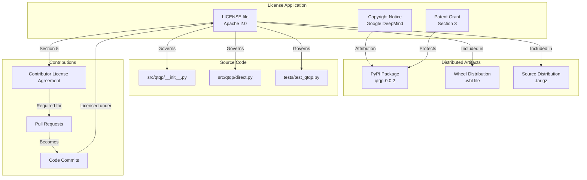
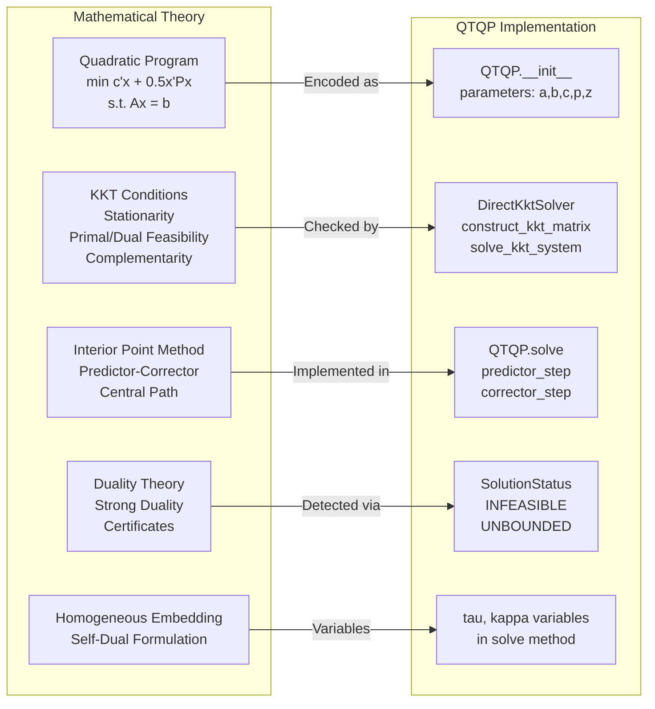
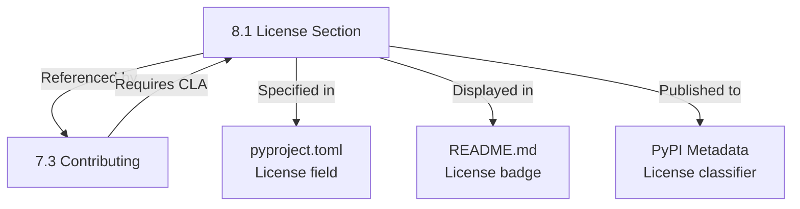
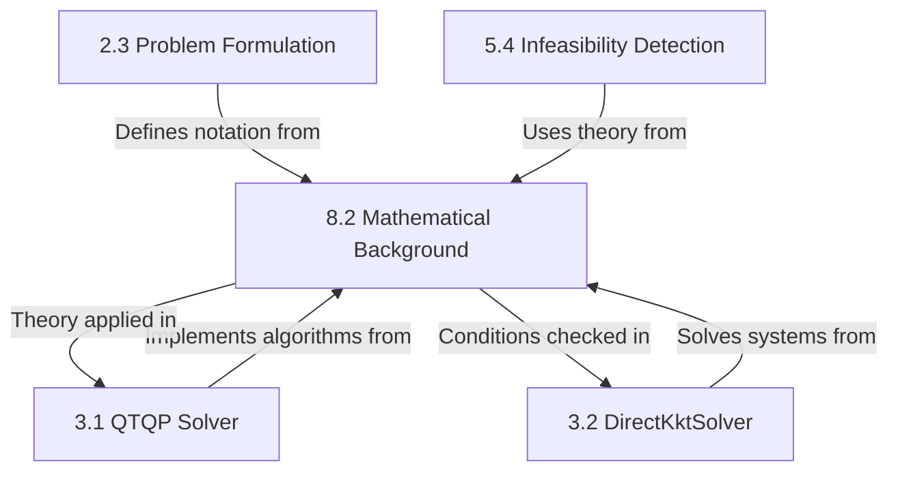

<!-- source: DeepWiki mcp.deepwiki.com · repo google-deepmind/qtqp · page 8 Reference · fetched 2026-10-26 -->

# Reference

Relevant source files

The following files were used as context for generating this wiki page:

- [LICENSE](LICENSE)

**Purpose and Scope**: This section provides supplementary reference material for the QTQP solver project, including licensing information and mathematical foundations. It serves as a reference for legal terms governing the software and the theoretical background underlying the implementation. For installation and usage instructions, see [Getting Started](#2). For implementation details, see [Architecture](#3).

This reference section is divided into two subsections:
- **[License](#8.1)**: Documents the Apache License 2.0 terms, copyright attribution, and patent grant
- **[Mathematical Background](#8.2)**: Explains the mathematical theory of quadratic programming, KKT conditions, interior point methods, and duality

## Overview of Reference Materials

The QTQP repository provides both legal and mathematical reference documentation to support users and contributors. The legal documentation ensures proper attribution and usage rights, while the mathematical background helps users understand the theoretical foundations of the solver algorithms.

### Legal Framework

**License Application Diagram**: Shows how the Apache License 2.0 from [LICENSE:1-203]() governs all source code, distributed packages, and contributions. The patent grant protects users, while the CLA ensures all contributions follow consistent licensing terms.

Sources: [LICENSE:1-203]()

### Mathematical Concepts to Code Mapping

**Mathematical to Code Mapping**: Illustrates how fundamental mathematical concepts in optimization theory map to specific code entities in the QTQP solver. The `QTQP` class in [src/qtqp/__init__.py]() implements the primal-dual interior point method, while `DirectKktSolver` in [src/qtqp/direct.py]() handles the KKT system construction and solution.

Sources: [src/qtqp/__init__.py](), [src/qtqp/direct.py]()

## Reference Material Structure

The following table summarizes the content covered in each reference subsection:

| Subsection | Content | Primary Source |
|------------|---------|----------------|
| [License](#8.1) | Apache License 2.0 full text, copyright notices, patent grant, redistribution terms, warranty disclaimers | [LICENSE:1-203]() |
| [Mathematical Background](#8.2) | Quadratic programming formulation, KKT optimality conditions, primal-dual interior point methods, homogeneous self-dual embedding, duality theory, infeasibility detection | Theory literature and implementation in [src/qtqp/__init__.py]() |

## Relationship to Other Documentation

This reference section complements other parts of the QTQP documentation:

- **[Overview](#1)**: Provides high-level introduction to what QTQP does
- **[Getting Started](#2)**: Shows how to install and use the solver
- **[Architecture](#3)**: Explains implementation details and design decisions
- **[API Reference](#4)**: Documents public interfaces and parameters
- **[Advanced Topics](#5)**: Covers optimization techniques and solver behavior
- **[Testing](#6)**: Describes test coverage and validation approach
- **[Development Guide](#7)**: Explains project structure and contribution workflow

The reference material in this section provides the foundational knowledge needed to understand the legal rights and mathematical theory underlying the implementation described in those other sections.

### License Information Cross-References

**License Cross-References**: The license information in section 8.1 is referenced throughout the project. Contributors must acknowledge it (see [Contributing](#7.3)), the package metadata declares it in [pyproject.toml](), and PyPI displays it to users.

Sources: [LICENSE:1-203](), [pyproject.toml](), [.github/workflows/ci.yml]()

### Mathematical Background Cross-References

**Mathematical Cross-References**: The mathematical background in section 8.2 provides theoretical foundations referenced throughout the documentation. Problem formulation (see [Problem Formulation](#2.3)) uses the notation, the architecture sections (see [QTQP Solver](#3.1) and [DirectKktSolver](#3.2)) implement the algorithms, and advanced topics (see [Understanding Infeasibility and Unboundedness](#5.4)) apply the theory.

Sources: [src/qtqp/__init__.py](), [src/qtqp/direct.py]()

## Using Reference Material

### For Users

Users should consult this reference section when:
- Understanding the legal terms for using or redistributing QTQP
- Learning the mathematical theory behind the solver algorithms
- Verifying the correctness of solver behavior using KKT conditions
- Understanding why the solver reports specific solution statuses

### For Contributors

Contributors should review this reference material to:
- Understand licensing requirements before submitting code
- Learn the mathematical foundations to improve or extend algorithms
- Verify that implementations correctly follow theoretical principles
- Document changes using consistent mathematical notation

### For Researchers

Researchers can use this reference to:
- Compare QTQP's implementation with theoretical algorithms
- Understand the homogeneous self-dual embedding approach
- Study how infeasibility and unboundedness are detected
- Validate solver results against KKT optimality conditions

## Summary

The Reference section provides essential legal and mathematical documentation for the QTQP solver. Section [8.1 License](#8.1) contains the complete Apache License 2.0 text from [LICENSE:1-203](), while section [8.2 Mathematical Background](#8.2) explains the optimization theory implemented in the solver. Together, these subsections ensure users understand both their legal rights and the mathematical principles underlying the solver's operation.

Sources: [LICENSE:1-203](), [src/qtqp/__init__.py](), [src/qtqp/direct.py]()

---

