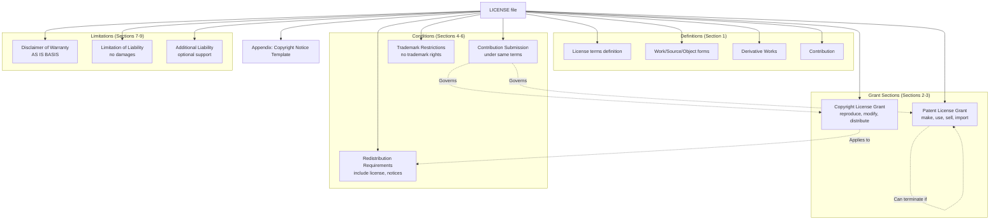
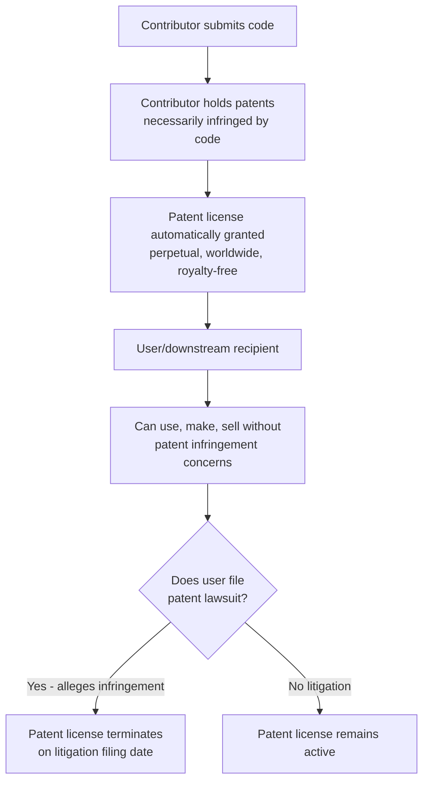
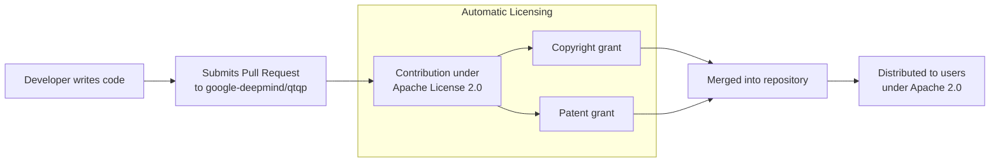
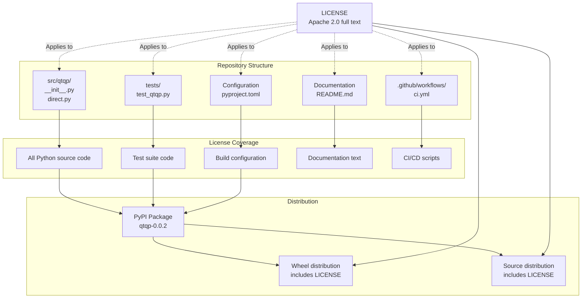
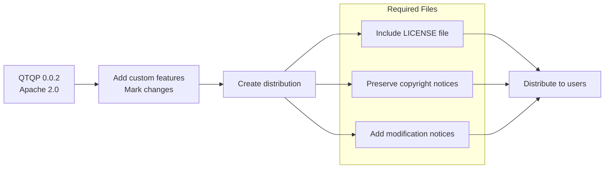

<!-- source: DeepWiki mcp.deepwiki.com · repo google-deepmind/qtqp · page 8.1 License · fetched 2026-10-26 -->

# License

<details>
<summary>Relevant source files</summary>

The following files were used as context for generating this wiki page:

- [LICENSE](LICENSE)

</details>


## Purpose and Scope

This page documents the licensing terms for the QTQP repository. The QTQP solver is distributed under the Apache License 2.0, which governs how the software may be used, modified, and distributed. This page explains the key terms, copyright attribution requirements, patent grant provisions, and practical implications for users and contributors.

For information about contributing code, see [Contributing](#7.3). For details on the release and distribution process, see [Release Process](#7.4).

---

## License Type

The QTQP repository is licensed under the **Apache License, Version 2.0** (January 2004). This is a permissive open-source license approved by the Open Source Initiative (OSI) that allows broad freedom to use, modify, and distribute the software while providing explicit patent protections.

The full license text is located at [LICENSE:1-203]().

**Key characteristics of Apache 2.0:**

| Feature | Description |
|---------|-------------|
| **Type** | Permissive open-source license |
| **Commercial Use** | Allowed without restrictions |
| **Modification** | Allowed - you may create derivative works |
| **Distribution** | Allowed in source or binary form |
| **Patent Grant** | Explicit patent license from contributors |
| **Sublicensing** | Allowed |
| **Trademark Use** | Not granted - limited to attribution |
| **Warranty** | None - provided "AS IS" |
| **Liability** | Limited - contributors not liable for damages |

Sources: [LICENSE:2-4]()

---

## License Structure

The Apache License 2.0 is organized into nine main sections, plus appendix guidance for applying the license:



Sources: [LICENSE:1-203]()

---

## Copyright License Grant (Section 2)

Section 2 grants comprehensive copyright permissions to all users:

**Granted Rights:**
- **Reproduce** - Make copies of the software
- **Prepare Derivative Works** - Modify and create derived versions
- **Publicly Display** - Show the software publicly
- **Publicly Perform** - Execute the software publicly
- **Sublicense** - Grant the same rights to others
- **Distribute** - Share in source or compiled form

**License Properties:**
- **Perpetual** - No expiration date
- **Worldwide** - Valid in all jurisdictions
- **Non-exclusive** - Others may also license the work
- **No-charge** - Free of licensing fees
- **Royalty-free** - No ongoing payments required
- **Irrevocable** - Cannot be taken back (except for patent termination conditions)

Sources: [LICENSE:67-72]()

---

## Patent License Grant (Section 3)

Section 3 provides explicit patent protection, which distinguishes Apache 2.0 from simpler permissive licenses like MIT:

**Patent License Scope:**
- Covers patent claims necessarily infringed by a Contributor's code
- Applies to patents owned or controlled by the Contributor
- Grants rights to make, use, sell, offer to sell, import, and transfer
- Only covers patents infringed by the specific Contribution

**Patent Termination Clause:**
If you initiate patent litigation alleging that the Work or any Contribution constitutes patent infringement, your patent licenses under this License terminate as of the filing date. This defensive termination clause protects the project from patent trolling.



Sources: [LICENSE:74-88]()

---

## Redistribution Requirements (Section 4)

When redistributing QTQP or derivative works, you must meet these conditions:

### Required Actions

| Requirement | Description | Location |
|-------------|-------------|----------|
| **Include License** | Provide copy of Apache License 2.0 | [LICENSE:95-96]() |
| **Mark Modifications** | Add notices to changed files | [LICENSE:98-99]() |
| **Preserve Notices** | Keep copyright, patent, trademark notices | [LICENSE:101-105]() |
| **Include NOTICE** | If present, reproduce attribution notices | [LICENSE:107-122]() |

### Modification Notices Example

When modifying QTQP source files, add prominent notices:

```python
# Modified by [Your Name/Organization] on [Date]
# Changes: [Brief description of modifications]
#
# Original work:
# Copyright [original copyright holder]
# Licensed under the Apache License, Version 2.0
```

### Optional Rights

You may:
- Add your own copyright statement to modifications
- Provide different license terms for your modifications (but not for the original Work)
- Add your own attribution notices alongside the original NOTICE content

All redistribution must comply with the License conditions even when adding your own terms.

Sources: [LICENSE:90-129]()

---

## Contribution Terms (Section 5)

All contributions submitted to the QTQP project are governed by the same Apache License 2.0 terms:

**Default Contribution License:**
Unless explicitly stated otherwise, any Contribution intentionally submitted for inclusion is automatically under Apache 2.0 terms without additional conditions.

**Key Points:**
- No separate Contributor License Agreement (CLA) required beyond the Apache 2.0 terms
- Contributions include the original work plus any modifications or additions
- "Submitted" includes electronic, verbal, or written communication to project maintainers
- Excludes communications marked "Not a Contribution"

This ensures that all code in the repository has consistent licensing terms.



Sources: [LICENSE:131-137]()

---

## Trademark Restrictions (Section 6)

The Apache License 2.0 **does not grant trademark rights**:

**Not Permitted:**
- Using "QTQP" as a trademark for your derivative work
- Using Google DeepMind trademarks or service marks
- Implying endorsement by the Licensor

**Permitted:**
- Reasonable and customary use describing the origin (e.g., "Based on QTQP")
- Reproducing the license notice content
- Attribution as required by Section 4

Sources: [LICENSE:139-142]()

---

## Warranty Disclaimer (Section 7)

The software is provided **"AS IS"** without warranties:

**No Warranties Provided:**
- No warranty of MERCHANTABILITY
- No warranty of FITNESS FOR A PARTICULAR PURPOSE
- No warranty of TITLE
- No warranty of NON-INFRINGEMENT
- No express or implied warranties of any kind

**User Responsibility:**
You are solely responsible for:
- Determining appropriateness of use
- Testing and validation for your use case
- Assuming all risks associated with use
- Compliance with applicable laws and regulations

This is standard for open-source software and protects contributors from liability for issues in the code.

Sources: [LICENSE:144-152]()

---

## Limitation of Liability (Section 8)

Contributors are not liable for damages arising from use of the software:

**No Liability For:**
- Direct, indirect, special, incidental, or consequential damages
- Loss of goodwill
- Work stoppage
- Computer failure or malfunction
- Commercial damages or losses

**Applies Under Any Legal Theory:**
- Tort (including negligence)
- Contract
- Other legal theories

**Exception:** Deliberate and grossly negligent acts or written agreement to accept liability.

This limitation applies even if contributors were advised of the possibility of damages.

Sources: [LICENSE:154-164]()

---

## License Application in QTQP Repository

The Apache License 2.0 applies to all source code and documentation in the QTQP repository:



Sources: [LICENSE:1-203]()

---

## Practical Implications

### For Users

**You can:**
- Install and use QTQP for any purpose (commercial or non-commercial)
- Integrate QTQP into proprietary software
- Redistribute QTQP as-is or modified
- Use QTQP in closed-source products

**You must:**
- Include the Apache License 2.0 text with any distribution
- Preserve copyright notices
- Not use QTQP trademarks without permission

**You do not need to:**
- Share your modifications (though contributions are welcome)
- Pay licensing fees or royalties
- Open-source your application that uses QTQP

### For Contributors

**When you contribute:**
- Your contribution is automatically licensed under Apache 2.0
- You grant a perpetual copyright license for your code
- You grant a patent license for patents covering your contribution
- You retain copyright ownership of your contribution

**You should:**
- Ensure you have rights to contribute the code
- Mark any third-party code clearly
- Follow the project's contribution guidelines (see [Contributing](#7.3))

### For Redistributors

**If distributing modified QTQP:**
- Include the Apache License 2.0 file
- Mark your changes prominently
- Preserve all copyright and attribution notices
- You may add your own copyright for your modifications
- You may offer different terms for your modifications only

**Example redistribution scenario:**



Sources: [LICENSE:90-129]()

---

## Dependency Licenses

QTQP depends on several external libraries, each with their own licenses:

| Dependency | License | Requirement Level |
|------------|---------|-------------------|
| `numpy` | BSD-3-Clause | Required |
| `scipy` | BSD-3-Clause | Required |
| `pydiso` | BSD-3-Clause | Optional |
| `qdldl` | Apache-2.0 | Optional |
| `scikit-sparse` | GPL-2.0/LGPL-2.1 | Optional |
| `eigenpy` | BSD-2-Clause | Optional |
| `nvidia-cudss` | Proprietary | Optional |

**Important Notes:**
- The required dependencies (numpy, scipy) use BSD licenses compatible with Apache 2.0
- CHOLMOD (via scikit-sparse) uses GPL-2.0, which is a copyleft license
- If you use CHOLMOD backend, GPL-2.0 terms may apply to your distribution
- GPU solver (nvidia-cudss) has proprietary NVIDIA license terms
- Check individual dependency licenses before redistribution

Sources: [LICENSE:1-203]()

---

## Comparison with Other Open Source Licenses

Understanding how Apache 2.0 compares to other licenses:

| Feature | Apache 2.0 | MIT | GPL-3.0 | BSD-3-Clause |
|---------|-----------|-----|---------|--------------|
| **Permissive** | Yes | Yes | No (copyleft) | Yes |
| **Commercial Use** | Yes | Yes | Yes | Yes |
| **Modification** | Yes | Yes | Yes | Yes |
| **Distribution** | Yes | Yes | Yes | Yes |
| **Sublicensing** | Yes | Yes | No | Yes |
| **Patent Grant** | Explicit | No | Explicit | No |
| **Trademark Grant** | No | No | No | No |
| **Source Disclosure** | Not required | Not required | Required | Not required |
| **Derivative License** | Can differ | Can differ | Must be GPL | Can differ |
| **Change Notice** | Required | Not required | Required | Not required |

**Why Apache 2.0 for QTQP:**
- Provides explicit patent protection
- Requires attribution and change notices
- Allows use in proprietary software
- Compatible with most open-source licenses
- Industry-standard for permissive open-source

Sources: [LICENSE:1-203]()

---

## Summary

The QTQP solver is licensed under Apache License 2.0, providing:

**Key Permissions:**
- Commercial and non-commercial use
- Modification and derivative works
- Distribution in any form
- Integration into proprietary software

**Key Requirements:**
- Include license text with distributions
- Preserve copyright notices
- Mark modifications clearly

**Key Protections:**
- Explicit patent license grant
- Patent termination for litigators
- No warranties provided
- Limited liability for contributors

**For Most Users:** You can use QTQP freely in your projects without worrying about licensing restrictions, as long as you include the license file when redistributing.

Sources: [LICENSE:1-203]()

---

