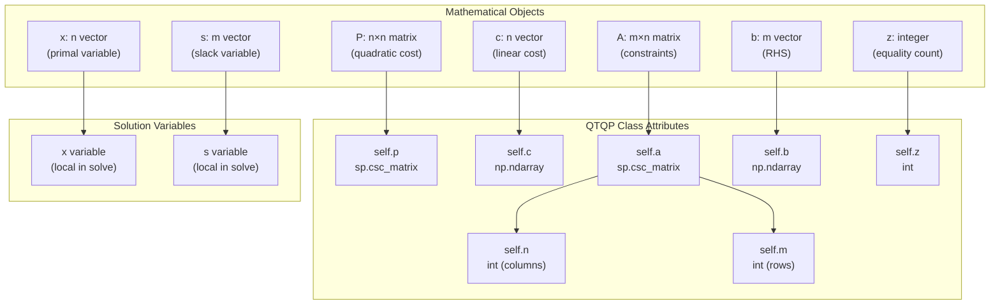
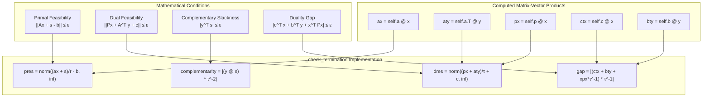
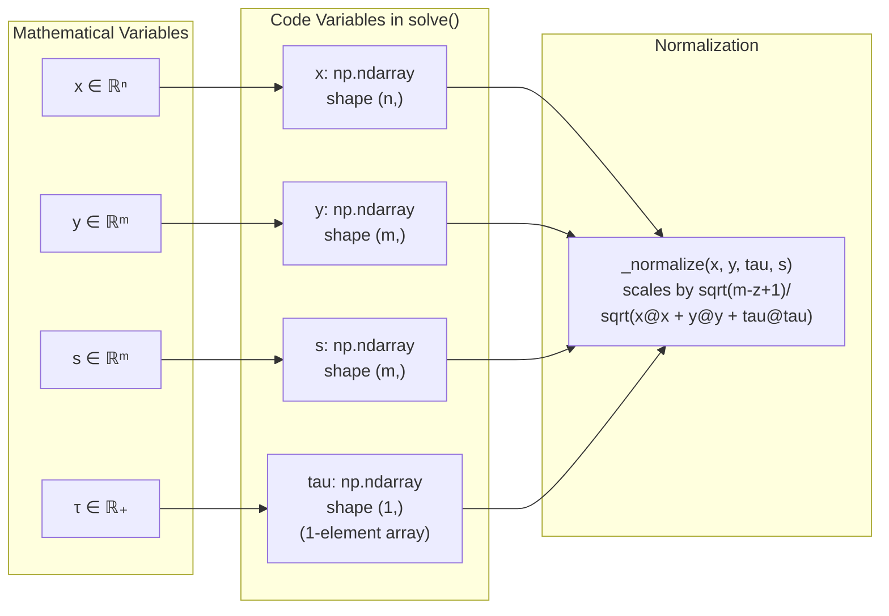
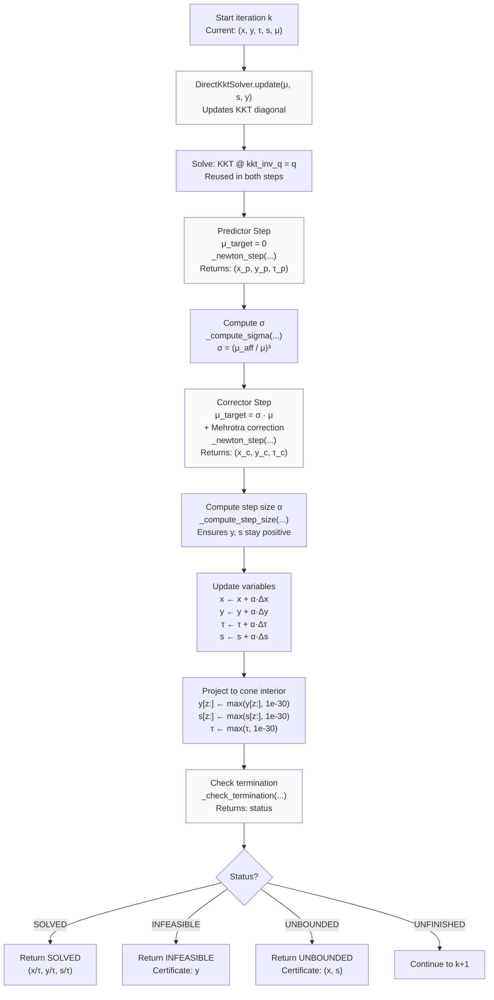
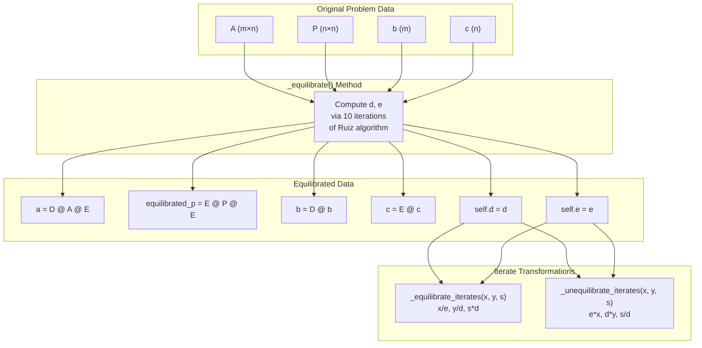

<!-- source: DeepWiki mcp.deepwiki.com · repo google-deepmind/qtqp · page 8.2 Mathematical Background · fetched 2026-10-26 -->

# Mathematical Background

<details>
<summary>Relevant source files</summary>

The following files were used as context for generating this wiki page:

- [README.md](README.md)
- [src/qtqp/__init__.py](src/qtqp/__init__.py)

</details>


## Purpose and Scope

This page provides the mathematical foundations underlying the QTQP solver implementation. It covers quadratic programming theory, duality, Karush-Kuhn-Tucker (KKT) optimality conditions, interior point methods, and the homogeneous self-dual embedding technique. This material helps readers understand the algorithmic choices made in [src/qtqp/__init__.py]() and the theoretical guarantees of the solver.

For practical usage of the solver, see [Quick Start Guide](#2.2). For implementation details of the algorithm, see [QTQP Solver: Primal-Dual Interior Point Method](#3.1). For understanding solution outcomes, see [Understanding Infeasibility and Unboundedness](#5.4).

## Quadratic Programming Formulation

The QTQP solver addresses convex quadratic programs in the following standard form:

**Primal Problem:**
```
minimize    (1/2) x^T P x + c^T x
subject to  A x + s = b
            s[:z] = 0      (equality constraints)
            s[z:] ≥ 0      (inequality constraints)
```

**Variables:**
- `x ∈ ℝⁿ`: decision variable
- `s ∈ ℝᵐ`: slack variable

**Data:**
- `P ∈ ℝⁿˣⁿ`: positive semidefinite matrix (quadratic cost)
- `c ∈ ℝⁿ`: linear cost vector
- `A ∈ ℝᵐˣⁿ`: constraint matrix
- `b ∈ ℝᵐ`: right-hand side vector
- `z ∈ {0, ..., m-1}`: number of equality constraints

The slack vector `s` is partitioned into two cones: the zero cone `s[:z]` must be exactly zero (equality constraints), and the positive orthant `s[z:]` must be non-negative (inequality constraints).

**Sources:** [src/qtqp/__init__.py:79-89](), [README.md:8-13]()

### Problem Representation in Code



**Diagram: Mapping Mathematical Problem to QTQP Class**

The constructor `QTQP.__init__` validates that matrices are in CSC sparse format and dimensions are consistent. The method extracts `self.m` and `self.n` from the shape of `self.a`.

**Sources:** [src/qtqp/__init__.py:91-140]()

## Duality Theory

The dual problem provides lower bounds on the primal objective and enables detection of infeasibility:

**Dual Problem:**
```
maximize    -(1/2) x^T P x - b^T y
subject to  P x + A^T y = -c
            y[z:] ≥ 0      (inequality duals must be non-negative)
```

**Variables:**
- `y ∈ ℝᵐ`: dual variable (Lagrange multiplier for constraints)

The dual variable `y` has free components `y[:z]` (duals for equalities) and non-negative components `y[z:]` (duals for inequalities).

**Weak Duality:** For any primal feasible `(x, s)` and dual feasible `y`:
```
primal_cost(x) ≥ dual_cost(x, y)
```

**Strong Duality:** Under the Slater condition (strict feasibility exists), if the primal has an optimal solution, then:
```
primal_cost(x*) = dual_cost(x*, y*)
```
and the duality gap is zero.

**Sources:** [README.md:15-21](), [src/qtqp/__init__.py:86-88]()

### Infeasibility and Unboundedness Certificates

The homogeneous embedding formulation allows the solver to certify three outcomes:

1. **Optimal Solution:** Both primal and dual are feasible, and optimality conditions hold
2. **Primal Infeasible / Dual Unbounded:** A certificate `y` exists where:
   - `A^T y = 0`
   - `b^T y < 0`
   - `y[z:] ≥ 0`
3. **Dual Infeasible / Primal Unbounded:** A certificate `(x, s)` exists where:
   - `A x + s = 0`
   - `P x = 0`
   - `c^T x < 0`
   - `s[z:] ≥ 0`

**Sources:** [src/qtqp/__init__.py:359-368](), [src/qtqp/__init__.py:559-562](), [src/qtqp/__init__.py:585-591]()

## KKT Optimality Conditions

The Karush-Kuhn-Tucker (KKT) conditions are necessary and sufficient for optimality in convex QPs. A point `(x*, y*, s*)` is optimal if and only if:

**1. Primal Feasibility:**
```
A x + s = b
s[:z] = 0
s[z:] ≥ 0
```

**2. Dual Feasibility:**
```
P x + A^T y = -c
y[z:] ≥ 0
```

**3. Complementary Slackness:**
```
y[i] · s[i] = 0  for all i ∈ {z, ..., m-1}
```

**4. Stationarity:**
The gradient of the Lagrangian equals zero (captured by dual feasibility).

### KKT System in Code

The KKT conditions are checked in the termination function:



**Diagram: KKT Conditions to Code Mapping**

The method `_check_termination` computes residuals and checks them against tolerances. The iterates are in homogeneous coordinates with `τ` (tau), so scaling by `1/τ` recovers the actual primal-dual values.

**Sources:** [src/qtqp/__init__.py:535-622](), specifically [src/qtqp/__init__.py:540-556]()

### Termination Criteria

The solver declares `SOLVED` when:
```python
gap < atol + rtol * min(|pcost|, |dcost|)
pres < atol + rtol * prelrhs
dres < atol + rtol * drelrhs
```

where `prelrhs` and `drelrhs` are relative scaling factors based on problem data norms.

**Sources:** [src/qtqp/__init__.py:579-584](), [src/qtqp/__init__.py:564-574]()

## Interior Point Methods

Interior point methods (IPMs) solve optimization problems by following a central path through the interior of the feasible region. The key idea is to replace the hard complementarity constraint `y[i] · s[i] = 0` with a parameterized relaxation `y[i] · s[i] = μ` for `μ > 0`.

### Logarithmic Barrier Function

The inequality constraints `s[z:] ≥ 0` are enforced via a barrier:
```
minimize  (1/2) x^T P x + c^T x - μ Σᵢ₌ₖ₊₁ᵐ log(s[i])
```

As `μ → 0`, the barrier forces `s → 0` boundary, recovering the original problem.

### Central Path

The central path is the set of solutions parametrized by `μ > 0` that satisfy:
```
A x + s = b
P x + A^T y = -c
y[i] · s[i] = μ  for i ∈ {z, ..., m-1}
s[:z] = 0
y[z:] > 0, s[z:] > 0
```

Interior point methods follow this path, decreasing `μ` at each iteration until optimality is reached.

**Sources:** [src/qtqp/__init__.py:272]() (mu calculation), [src/qtqp/__init__.py:273]() (KKT update with mu)

### Newton Step for Perturbed KKT System

At each iteration, the solver computes a Newton direction for the perturbed KKT system:

```
┌                    ┐ ┌   ┐   ┌      ┐
│  P      A^T     0  │ │ Δx│   │  -rₚ │
│  A       0     -I  │ │ Δy│ = │  -rₐ │
│  0    S[z:]  Y[z:] │ │Δs │   │  -rμ │
└                    ┘ └   ┘   └      ┘
```

where:
- `S[z:]` is diagonal matrix with `s[z:]` on diagonal
- `Y[z:]` is diagonal matrix with `y[z:]` on diagonal
- `rₚ = P x + A^T y + c` (dual residual)
- `rₐ = A x + s - b` (primal residual)
- `rμ = Y[z:] @ s[z:] - μ e` (complementarity residual)

**Sources:** [src/qtqp/__init__.py:449-484]() (_newton_step method)

## Homogeneous Self-Dual Embedding

The solver uses a homogeneous self-dual embedding to handle infeasible and unbounded problems robustly. This technique embeds the primal-dual problem in a larger system with an additional variable `τ ≥ 0`.

### Embedded System

The homogeneous formulation solves:
```
Find (x, y, s, τ) such that:
    A x + s τ = b τ
    P x + A^T y τ = -c τ
    y[i] · s[i] = 0  for i ∈ {z, ..., m-1}
    τ ≥ 0, y[z:] ≥ 0, s[z:] ≥ 0
```

**Key property:** This system always has a solution (it is self-dual). The value of `τ` determines the outcome:

1. **τ > 0:** Dividing by τ gives a primal-dual optimal solution `(x/τ, y/τ, s/τ)`
2. **τ = 0, c^T x < 0:** Certificate of primal unboundedness
3. **τ = 0, b^T y < 0:** Certificate of dual unboundedness (primal infeasibility)

**Sources:** [src/qtqp/__init__.py:232]() (tau initialization), [src/qtqp/__init__.py:358]() (solved case), [src/qtqp/__init__.py:363](), [src/qtqp/__init__.py:368]() (infeasible/unbounded cases)

### Homogeneous Variables in Code



**Diagram: Homogeneous Variables in Implementation**

The variable `tau` is kept as a 1-element array for consistent vector operations (e.g., `@` operator). The `_normalize` method scales all variables to maintain numerical stability.

**Sources:** [src/qtqp/__init__.py:230-232]() (tau initialization), [src/qtqp/__init__.py:523-527]() (_normalize method)

### Solving for τ Component

The Newton step for the homogeneous embedding requires solving a quadratic equation for `τ`. The method `_solve_for_tau` handles this:

**Quadratic Equation:**
```
t_a · τ² + t_b · τ + t_c = 0
```

where the coefficients are derived from the KKT system structure:
- `t_a = μ + k_inv_q^T q - k_inv_q[:n]^T P k_inv_q[:n]`
- `t_b = -r_tau - m_r^T q + m_r[:n]^T P k_inv_q[:n] + k_inv_q[:n]^T P m_r[:n]`
- `t_c = -m_r[:n]^T P m_r[:n] - μ_target`

Theoretical properties guarantee `t_a > 0` and `t_c ≤ 0`, ensuring a non-negative solution exists.

**Sources:** [src/qtqp/__init__.py:486-521]() (_solve_for_tau method)

## Predictor-Corrector Algorithm

The solver implements Mehrotra's predictor-corrector algorithm, which combines two Newton steps per iteration:

1. **Predictor (Affine) Step:** Solve with `μ_target = 0` to find the pure Newton direction toward optimality
2. **Corrector Step:** Adjust the direction to stay well-centered on the central path

### Algorithm Flow



**Diagram: Predictor-Corrector Main Loop**

**Sources:** [src/qtqp/__init__.py:262-373]() (main iteration loop)

### Predictor Step

The predictor step computes an affine-scaling direction by setting `μ_target = 0`:

```python
x_p, y_p, tau_p, predictor_lin_sys_stats = self._newton_step(
    mu=mu,
    mu_target=0.0,
    rhs_anchor=np.concatenate([x, y]),
    tau_anchor=tau,
    y=y,
    s=s,
    tau=tau,
    cone_correction=None,
)
```

This direction aims purely at satisfying the KKT conditions without centering considerations.

**Sources:** [src/qtqp/__init__.py:282-294]()

### Centering Parameter (σ)

The centering parameter σ determines how much to reduce `μ` in the corrector step. Mehrotra's heuristic computes:

```python
σ = (μ_aff / μ)³
```

where `μ_aff` is the complementarity measure after taking a full predictor step. Small `σ` (aggressive) means the predictor worked well; large `σ` (conservative) means more centering is needed.

**Sources:** [src/qtqp/__init__.py:301-304](), [src/qtqp/__init__.py:431-447]() (_compute_sigma method)

### Corrector Step with Mehrotra Correction

The corrector step targets `μ_target = σ · μ` and adds a nonlinear correction term:

```python
cone_correction = -d_s_p[self.z :] * d_y_p[self.z :] / y[self.z :]

x_c, y_c, tau_c, corrector_lin_sys_stats = self._newton_step(
    mu=mu,
    mu_target=sigma * mu,
    rhs_anchor=np.concatenate([x_p, y_p]),
    tau_anchor=tau_p,
    y=y,
    s=s,
    tau=tau,
    cone_correction=cone_correction,
)
```

The `cone_correction` term accounts for the nonlinearity in the complementarity condition `y[i] · s[i] = μ`, improving convergence.

**Sources:** [src/qtqp/__init__.py:307-320]()

### Step Size Selection

The step size `α` is chosen to maintain strict positivity of variables:

```python
alpha = self._compute_step_size(y, s, d_y, d_s)
step_size = step_size_scale * alpha
```

The method `_max_step_size` computes the largest `α ∈ [0,1]` such that `y + α·Δy ≥ 0` and `s + α·Δs ≥ 0`. The `step_size_scale` parameter (default 0.99) provides a safety margin.

**Sources:** [src/qtqp/__init__.py:331-332](), [src/qtqp/__init__.py:420-429]() (_max_step_size method)

## Equilibration and Numerical Conditioning

Poor scaling of problem data can cause numerical issues in the linear solver. The solver implements Ruiz equilibration to improve conditioning.

### Ruiz Equilibration Algorithm

Ruiz equilibration iteratively rescales rows and columns to balance matrix norms:

**For iterations i = 1, ..., num_iters:**
1. Compute row scaling: `d_i = 1 / sqrt(||A_row||_∞ + ε)`
2. Compute column scaling: `e_i = 1 / sqrt(max(||A_col||_∞, ||P_col||_∞) + ε)`
3. Apply: `A ← diag(d_i) @ A @ diag(e_i)`, `P ← diag(e_i) @ P @ diag(e_i)`
4. Accumulate: `d ← d · d_i`, `e ← e · e_i`

The final equilibrated problem has:
- `A_eq = diag(d) @ A @ diag(e)`
- `P_eq = diag(e) @ P @ diag(e)`
- `b_eq = diag(d) @ b`
- `c_eq = diag(e) @ c`

**Sources:** [src/qtqp/__init__.py:375-412]() (_equilibrate method)

### Equilibration Transformations



**Diagram: Equilibration Data Flow**

When equilibration is enabled, the solver:
1. Equilibrates problem data before the main loop
2. Transforms iterates before normalization: `_equilibrate_iterates`
3. Transforms iterates back after updates: `_unequilibrate_iterates`
4. Checks termination on unequilibrated values

This ensures KKT conditions are checked on the original problem, not the equilibrated version.

**Sources:** [src/qtqp/__init__.py:240-246]() (equilibration setup), [src/qtqp/__init__.py:266-268]() (equilibrate iterates), [src/qtqp/__init__.py:346-348]() (unequilibrate iterates), [src/qtqp/__init__.py:414-418]() (transformation methods)

### Numerical Stability Parameters

Several parameters control numerical robustness:

| Parameter | Default | Purpose | Code Reference |
|-----------|---------|---------|----------------|
| `min_static_regularization` | 1e-7 | Minimum diagonal regularization in KKT matrix | [src/qtqp/__init__.py:154]() |
| `max_iterative_refinement_steps` | 50 | Maximum refinement iterations for linear solve | [src/qtqp/__init__.py:155]() |
| `linear_solver_atol` | 1e-12 | Absolute tolerance for refined linear solve | [src/qtqp/__init__.py:156]() |
| `linear_solver_rtol` | 1e-12 | Relative tolerance for refined linear solve | [src/qtqp/__init__.py:157]() |
| `step_size_scale` | 0.99 | Safety factor for step size (maintains interiority) | [src/qtqp/__init__.py:153]() |

The `min_static_regularization` parameter adds a small diagonal term to the KKT matrix to prevent singular systems. Iterative refinement improves the accuracy of the linear solve despite ill-conditioning.

**Sources:** [src/qtqp/__init__.py:145-157]() (solve method parameters), [src/qtqp/__init__.py:247-256]() (DirectKktSolver initialization)

## Summary

The QTQP solver combines several advanced techniques to robustly solve convex quadratic programs:

1. **Homogeneous self-dual embedding** enables unified handling of feasible, infeasible, and unbounded cases
2. **Predictor-corrector interior point method** provides fast convergence with Mehrotra's adaptive centering
3. **KKT optimality conditions** guide the Newton steps and termination criteria
4. **Ruiz equilibration** improves numerical conditioning for poorly-scaled problems
5. **Iterative refinement** achieves high accuracy despite ill-conditioned linear systems

These mathematical foundations translate directly into the implementation in [src/qtqp/__init__.py](), with the core algorithm in the `solve` method [src/qtqp/__init__.py:145-373]() and the KKT system management delegated to `DirectKktSolver` in [src/qtqp/direct.py]().

**Sources:** [src/qtqp/__init__.py:76-654](), [README.md:1-280]()