# Page: Overview

# Overview

<details>
<summary>Relevant source files</summary>

The following files were used as context for generating this wiki page:

- [README.md](README.md)
- [src/qtqp/__init__.py](src/qtqp/__init__.py)

</details>


This page introduces the QTQP solver repository, explaining what quadratic programming is, what the solver does, and the key architectural components of this implementation. For installation instructions and usage examples, see [Getting Started](#2). For detailed algorithm explanations, see [Architecture](#3).

## Purpose and Scope

QTQP is a Python package that implements a **primal-dual interior point method** for solving convex quadratic programs (QPs). The solver is designed to handle both feasible and infeasible problems, automatically detecting and certifying infeasibility or unboundedness when a solution does not exist. The current release is version 0.0.2 and is described as an "early research prototype."

**Sources:** [README.md:1-27](), [src/qtqp/__init__.py:16-29]()

## Quadratic Programming Problem Formulation

QTQP solves optimization problems in the following standard form:

**Primal Problem:**
```
minimize    (1/2) x.T @ p @ x + c.T @ x
subject to  a @ x + s = b
            s[:z] == 0
            s[z:] >= 0
```

**Dual Problem:**
```
maximize    -(1/2) x.T @ p @ x - b.T @ y
subject to  p @ x + a.T @ y = -c
            y[z:] >= 0
```

Where:
- `x` ∈ ℝⁿ is the primal decision variable
- `y` ∈ ℝᵐ is the dual variable
- `s` ∈ ℝᵐ is the slack variable
- `a` is an m×n constraint matrix (sparse CSC format)
- `b` is an m-dimensional right-hand-side vector
- `c` is an n-dimensional cost vector
- `p` is an n×n positive semidefinite quadratic cost matrix (sparse CSC format)
- `z` is the number of equality constraints (the first `z` rows of `a @ x + s = b` must hold with equality)

**Sources:** [src/qtqp/__init__.py:79-89](), [README.md:6-21]()

## Core Components

The QTQP repository consists of three primary layers:

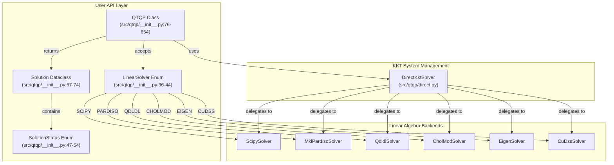

**Core Class: `QTQP`**

The main solver class is instantiated with problem data and provides a single public method `solve()`:

| Component | Location | Purpose |
|-----------|----------|---------|
| `QTQP.__init__()` | [src/qtqp/__init__.py:91-141]() | Validates and stores problem data (a, b, c, p, z) |
| `QTQP.solve()` | [src/qtqp/__init__.py:145-373]() | Executes primal-dual interior point algorithm |
| `Solution` | [src/qtqp/__init__.py:57-74]() | Container for solution vectors (x, y, s), status, and iteration statistics |
| `SolutionStatus` | [src/qtqp/__init__.py:47-54]() | Enum with values: SOLVED, INFEASIBLE, UNBOUNDED, FAILED, UNFINISHED |
| `LinearSolver` | [src/qtqp/__init__.py:36-44]() | Enum for selecting backend: SCIPY, PARDISO, QDLDL, CHOLMOD, EIGEN, CUDSS |

**Sources:** [src/qtqp/__init__.py:36-141]()

## Algorithm Overview

The solver implements a **predictor-corrector primal-dual interior point method** with **homogeneous self-dual embedding**. The algorithm operates on augmented variables that include a homogenization variable `tau` to enable unified detection of optimality, primal infeasibility, and dual infeasibility.

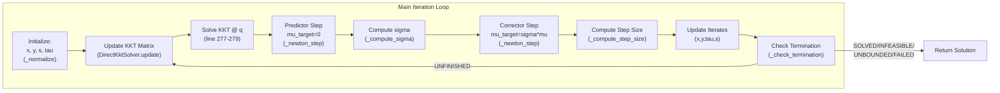

Key algorithmic components:

| Function | Location | Purpose |
|----------|----------|---------|
| `_normalize()` | [src/qtqp/__init__.py:523-527]() | Normalizes homogeneous iterates to unit scale |
| `_newton_step()` | [src/qtqp/__init__.py:449-484]() | Solves augmented KKT system for search direction |
| `_compute_sigma()` | [src/qtqp/__init__.py:431-447]() | Mehrotra's heuristic for centering parameter |
| `_compute_step_size()` | [src/qtqp/__init__.py:529-533]() | Maximum step maintaining conic interiority |
| `_check_termination()` | [src/qtqp/__init__.py:535-622]() | Evaluates KKT conditions and infeasibility certificates |

**Sources:** [src/qtqp/__init__.py:262-373](), [src/qtqp/__init__.py:431-622]()

## Key Features

### 1. Homogeneous Self-Dual Embedding

The solver uses a homogeneous embedding technique that introduces an additional variable `tau` to unify the detection of three possible outcomes:
- **Optimal solution** (`tau > 0`): Returns `(x/tau, y/tau, s/tau)`
- **Primal infeasibility** (`tau → 0`, `b.T @ y < 0`): Returns certificate `y`
- **Dual infeasibility** (`tau → 0`, `c.T @ x < 0`): Returns certificate `(x, s)`

**Sources:** [src/qtqp/__init__.py:230-238](), [src/qtqp/__init__.py:353-370]()

### 2. Multiple Linear Solver Backends

The `DirectKktSolver` abstracts the KKT system solution and supports six different sparse linear algebra backends:

| Backend | Enum Value | Hardware | Installation |
|---------|------------|----------|--------------|
| SciPy | `LinearSolver.SCIPY` | CPU | Default (scipy ≥ 1.9) |
| MKL Pardiso | `LinearSolver.PARDISO` | CPU (Intel) | conda: pydiso |
| QDLDL | `LinearSolver.QDLDL` | CPU | pip: qdldl |
| CHOLMOD | `LinearSolver.CHOLMOD` | CPU | conda: scikit-sparse |
| Eigen | `LinearSolver.EIGEN` | CPU | conda: eigenpy |
| cuDSS | `LinearSolver.CUDSS` | GPU (NVIDIA) | pip: nvidia-cudss-cu12 |

**Sources:** [README.md:190-240](), [src/qtqp/__init__.py:36-44]()

### 3. Numerical Stability Features

**Ruiz Equilibration**

When `equilibrate=True` (default), the solver applies Ruiz equilibration to improve numerical conditioning:

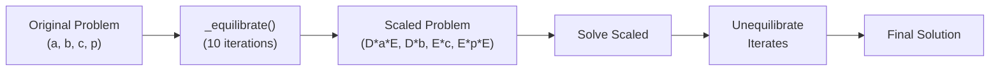

The method computes diagonal scaling matrices `D` (m×m) and `E` (n×n) to balance row and column norms of the constraint matrix.

**Iterative Refinement**

The `DirectKktSolver` employs iterative refinement to achieve high accuracy despite ill-conditioned KKT systems. This is controlled by:
- `max_iterative_refinement_steps` (default: 50)
- `linear_solver_atol` (default: 1e-12)
- `linear_solver_rtol` (default: 1e-12)

**Static Regularization**

A minimum diagonal regularization (`min_static_regularization`, default: 1e-7) is added to the KKT matrix for robustness.

**Sources:** [src/qtqp/__init__.py:375-412](), [src/qtqp/__init__.py:145-164]()

### 4. Warm Starting

The solver accepts optional initial values for `x`, `y`, and `s` through the `solve()` method parameters. These must satisfy conic interiority constraints:
- `y[z:] > 0` (inequality dual variables must be positive)
- `s[z:] > 0` (inequality slack variables must be positive)
- `s[:z] == 0` (equality slack variables must be zero)

**Sources:** [src/qtqp/__init__.py:161-163](), [src/qtqp/__init__.py:211-238]()

## Solution Status and Outputs

The `Solution` dataclass contains:

| Field | Type | Description |
|-------|------|-------------|
| `x` | `np.ndarray` (n,) | Primal solution or unboundedness certificate |
| `y` | `np.ndarray` (m,) | Dual solution or infeasibility certificate |
| `s` | `np.ndarray` (m,) | Slack variables or unboundedness certificate |
| `status` | `SolutionStatus` | SOLVED, INFEASIBLE, UNBOUNDED, or FAILED |
| `stats` | `List[Dict[str, Any]]` | Per-iteration statistics (residuals, gap, mu, time, etc.) |

**Possible Status Values:**

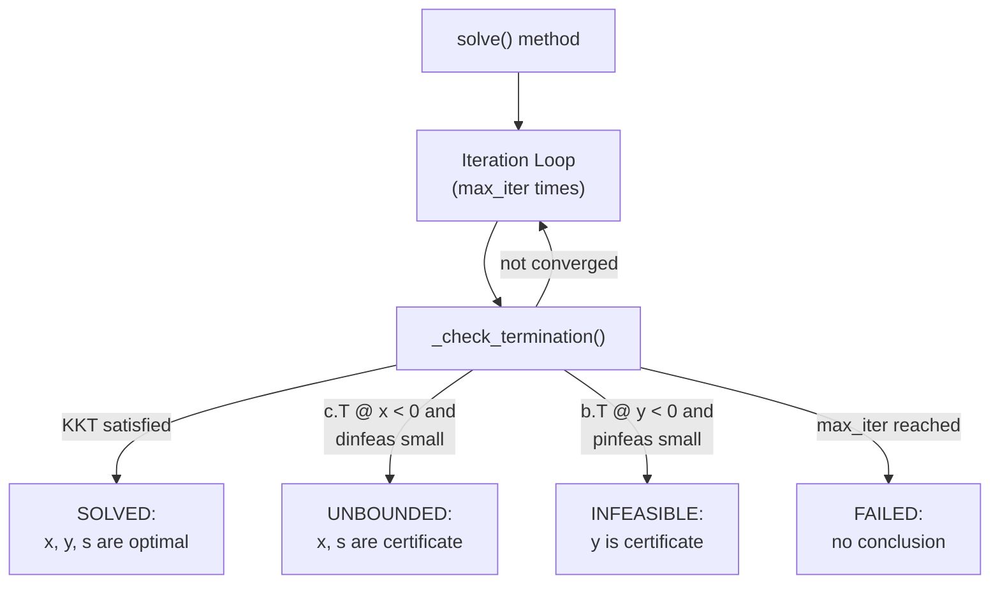

**Sources:** [src/qtqp/__init__.py:57-74](), [src/qtqp/__init__.py:535-622]()

## Repository Structure

The package uses a modern Python src-layout:

```
qtqp/
├── src/qtqp/
│   ├── __init__.py        # QTQP class, Solution, enums (654 lines)
│   └── direct.py          # DirectKktSolver and backend implementations
├── tests/
│   └── test_qtqp.py       # Comprehensive test suite
├── .github/workflows/
│   └── ci.yml             # CI/CD pipeline (3 OS × 4 Python versions)
├── pyproject.toml         # Package configuration and dependencies
└── README.md              # User documentation
```

**Dependencies:**

| Type | Package | Version | Purpose |
|------|---------|---------|---------|
| Required | numpy | ≥ 1.23 | Array operations |
| Required | scipy | ≥ 1.9 | Sparse matrices and default solver |
| Optional | pydiso | - | Intel MKL Pardiso backend |
| Optional | qdldl | - | QDLDL backend |
| Optional | scikit-sparse | - | CHOLMOD backend |
| Optional | eigenpy | - | Eigen backend |
| Optional | nvidia-cudss | - | GPU-accelerated solver |

**Sources:** [README.md:29-61](), [pyproject.toml (inferred from README)]

## Development Status

The package is currently at **version 0.0.2** and is described as an "early research prototype, not ready for prime time." It is released under the Apache License 2.0 and developed by Google DeepMind.

The repository includes:
- Comprehensive CI/CD testing across 3 operating systems (Ubuntu, macOS, Windows) and 4 Python versions (3.10-3.13)
- Automated PyPI publishing using OIDC-based trusted publishing
- Parameterized test suite validating all solver backends
- Dependabot for automated dependency updates

For contributing guidelines, see [Contributing](#7.3). For the CI/CD pipeline details, see [CI/CD Pipeline](#7.2).

**Sources:** [README.md:27-28](), [README.md:259-278](), [src/qtqp/__init__.py:29]()

---

# Page: Getting Started

# Getting Started

<details>
<summary>Relevant source files</summary>

The following files were used as context for generating this wiki page:

- [README.md](README.md)
- [pyproject.toml](pyproject.toml)

</details>


This page provides an introduction to using the QTQP solver. It covers installation procedures, a quick start example demonstrating basic usage, and an explanation of how to formulate quadratic programming problems for the solver. 

For detailed information on solver internals and algorithm implementation, see [Architecture](#3). For complete API documentation including all configuration parameters, see [API Reference](#4). For advanced usage patterns such as warm starting and equilibration, see [Advanced Topics](#5).

---

## Installation

The QTQP package can be installed through multiple methods depending on your needs. The core package requires only `numpy` and `scipy`, but additional linear solver backends are available as optional dependencies.

### Basic Installation

Install the latest release from PyPI:

```bash
python -m pip install qtqp
```

This installs the core package with the default `SCIPY` linear solver backend. The package requires Python 3.9 or later and automatically installs the following dependencies:

| Dependency | Minimum Version | Purpose |
|------------|----------------|---------|
| `numpy` | 1.23 | Array operations and numerical computation |
| `scipy` | 1.9 | Sparse matrix support and default linear solver |

**Sources:** [README.md:29-35](), [pyproject.toml:12-18]()

### Installation from Source

For development or to use the latest unreleased features:

```bash
git clone https://github.com/google-deepmind/qtqp.git
cd qtqp
python -m pip install .
```

It is recommended to use a conda environment to isolate dependencies:

```bash
conda create -n qtqp-env python=3.12
conda activate qtqp-env
python -m pip install .
```

**Sources:** [README.md:37-55]()

### Optional Linear Solver Backends

The QTQP solver supports multiple linear algebra backends through the `qtqp.LinearSolver` enumeration. Each backend has different performance characteristics and platform requirements:

#### Installation Methods by Backend

| Backend | Enum Value | Installation Command | Platform Notes |
|---------|-----------|---------------------|----------------|
| SciPy (default) | `LinearSolver.SCIPY` | Included with core package | Cross-platform |
| MKL Pardiso | `LinearSolver.PARDISO` | `conda install pydiso -c conda-forge` | Intel CPUs only |
| Eigen | `LinearSolver.EIGEN` | `conda install eigenpy -c conda-forge` | Cross-platform |
| QDLDL | `LinearSolver.QDLDL` | `python -m pip install qdldl` | Cross-platform |
| CHOLMOD | `LinearSolver.CHOLMOD` | `conda install scikit-sparse -c conda-forge` | Cross-platform |
| Nvidia cuDSS | `LinearSolver.CUDSS` | `python -m pip install nvidia-cudss-cu12 nvmath-python[cu12]` | CUDA GPU required |

**Example:** Installing multiple backends for performance comparison:

```bash
# Install CPU-based solvers
conda install pydiso eigenpy scikit-sparse -c conda-forge
python -m pip install qdldl

# Install GPU solver (requires CUDA)
python -m pip install nvidia-cudss-cu12 nvmath-python[cu12]
```

**Note:** Tests will fail for backends that are not installed. This is expected behavior and does not indicate a problem with the core solver.

**Sources:** [README.md:190-240](), [README.md:63]()

---

## Quick Start Guide

This section demonstrates basic usage of the QTQP solver through a simple quadratic programming example.

### Workflow Overview

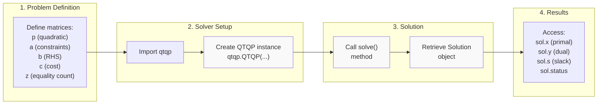

**Sources:** [README.md:65-108]()

### Basic Example

The following example solves a simple convex quadratic program:

```python
import qtqp
import scipy.sparse
import numpy as np

# Define problem data
p = scipy.sparse.csc_matrix([[3.0, -1.0], [-1.0, 2.0]])
a = scipy.sparse.csc_matrix([[-1.0, 1.0], [1.0, 0.0], [0.0, 1.0]])
b = np.array([-1, 0.3, -0.5])
c = np.array([-1.0, -1.0])

# Create solver instance
solver = qtqp.QTQP(p=p, a=a, b=b, c=c, z=1)

# Solve the problem
sol = solver.solve()

# Access results
print(f'{sol.x=}')  # Primal variable
print(f'{sol.y=}')  # Dual variable
print(f'{sol.s=}')  # Slack variable
```

**Sources:** [README.md:70-88]()

### Understanding the Output

When `verbose=True` (default), the solver prints a detailed iteration table:

```
| QTQP v0.0.2: m=3, n=2, z=1, nnz(A)=4, nnz(P)=4, linear_solver=SCIPY
|------|------------|------------|----------|----------|----------|----------|----------|----------|----------|----------|----------|
| iter |      pcost |      dcost |     pres |     dres |      gap |   infeas |       mu |    sigma |    alpha |  q, p, c |     time |
|------|------------|------------|----------|----------|----------|----------|----------|----------|----------|----------|----------|
|    0 |  1.205e+00 |  1.298e+00 | 2.18e-01 | 6.17e-01 | 9.36e-02 | 1.67e+00 | 1.09e+00 | 5.69e-04 | 1.00e+00 |  1, 1, 1 | 1.39e-02 |
|    1 |  1.161e+00 |  1.211e+00 | 3.16e-02 | 5.23e-02 | 5.01e-02 | 1.35e+00 | 1.04e-01 | 1.65e-03 | 9.04e-01 |  1, 1, 1 | 1.46e-02 |
...
| Solved
```

#### Iteration Table Columns

| Column | Description |
|--------|-------------|
| `iter` | Iteration number |
| `pcost` | Primal objective value: (1/2) x.T @ p @ x + c.T @ x |
| `dcost` | Dual objective value: -(1/2) x.T @ p @ x - b.T @ y |
| `pres` | Primal residual norm |
| `dres` | Dual residual norm |
| `gap` | Duality gap magnitude |
| `infeas` | Infeasibility measure |
| `mu` | Barrier parameter |
| `sigma` | Centering parameter |
| `alpha` | Step size taken |
| `q, p, c` | Predictor/corrector step indicators |
| `time` | Cumulative wall-clock time |

The solver terminates with status `SOLVED` when both primal and dual residuals fall below the specified tolerances (default `atol=1e-7`, `rtol=1e-8`).

**Sources:** [README.md:92-107]()

### Solution Object Structure

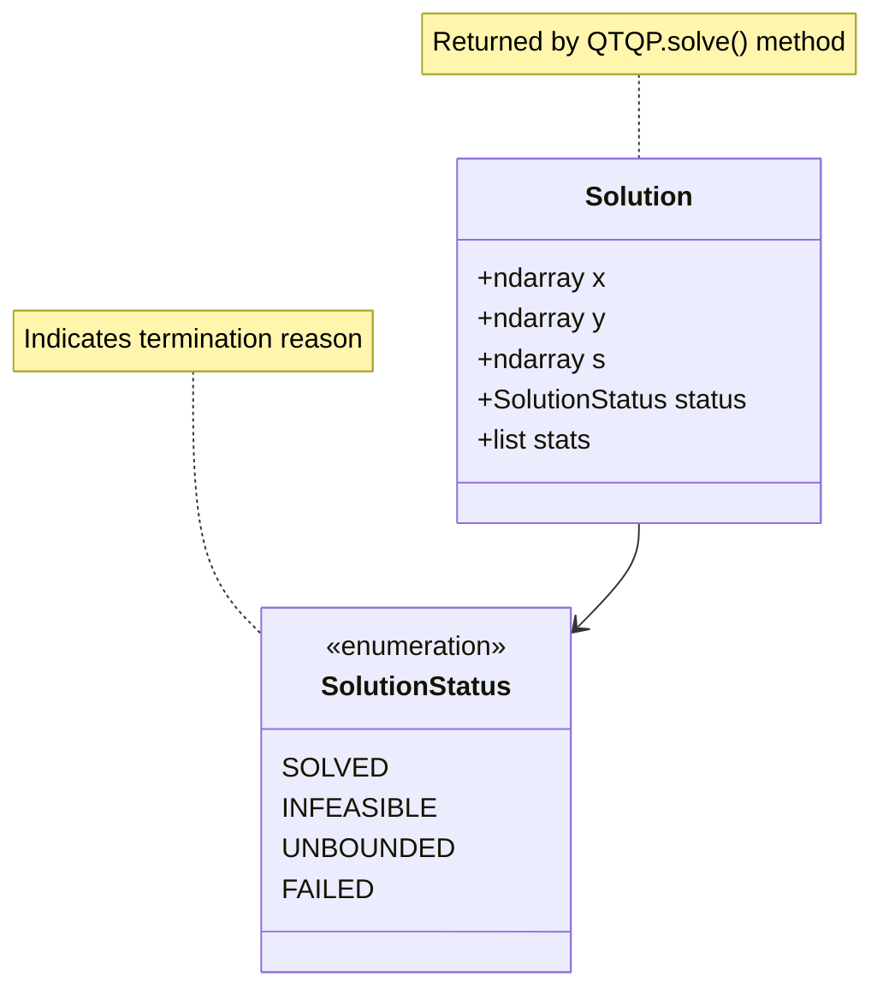

**Sources:** [README.md:180-188]()

---

## Problem Formulation

The QTQP solver addresses convex quadratic programs in a specific standard form. Understanding this formulation is essential for correctly encoding problems.

### Primal Problem Form

The solver minimizes the primal objective:

```
minimize    (1/2) x.T @ p @ x + c.T @ x
subject to  a @ x + s = b
            s[:z] == 0
            s[z:] >= 0
```

Where:
- `x` ∈ ℝⁿ is the primal variable (decision variable)
- `s` ∈ ℝᵐ is the slack variable
- `p` ∈ ℝⁿˣⁿ is a symmetric positive semidefinite matrix (quadratic cost)
- `c` ∈ ℝⁿ is the linear cost vector
- `a` ∈ ℝᵐˣⁿ is the constraint matrix
- `b` ∈ ℝᵐ is the right-hand side vector
- `z` ∈ ℤ with 0 ≤ z < m specifies the number of equality constraints

**Sources:** [README.md:5-13]()

### Dual Problem Form

The corresponding dual problem is:

```
maximize    -(1/2) x.T @ p @ x - b.T @ y
subject to  p @ x + a.T @ y = -c
            y[z:] >= 0
```

Where:
- `y` ∈ ℝᵐ is the dual variable (Lagrange multipliers)
- The first `z` components of `y` are free (equality constraint multipliers)
- The remaining components `y[z:]` are non-negative (inequality constraint multipliers)

**Sources:** [README.md:15-21]()

### Constraint Structure

The parameter `z` partitions the constraint system:

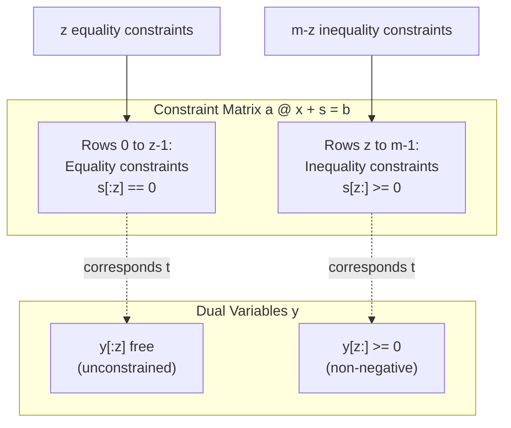

**Sources:** [README.md:5-21]()

### Data Requirements and Matrix Formats

The `QTQP` constructor requires the following data types:

| Parameter | Type | Shape | Description | Optional |
|-----------|------|-------|-------------|----------|
| `a` | `scipy.sparse.csc_matrix` | m × n | Constraint matrix | No |
| `b` | `np.ndarray` | (m,) | RHS vector | No |
| `c` | `np.ndarray` | (n,) | Linear cost vector | No |
| `z` | `int` | scalar | Number of equality constraints | No |
| `p` | `scipy.sparse.csc_matrix` | n × n | Quadratic cost matrix | Yes (defaults to zero matrix for LP) |

**Key requirements:**
- Matrices `a` and `p` must be in CSC (Compressed Sparse Column) format
- Matrix `p` must be symmetric and positive semidefinite
- Constraint count `z` must satisfy 0 ≤ z < m

**Sources:** [README.md:119-137]()

### Encoding Common Problem Types

#### Linear Program (LP)

For linear programs without quadratic cost, set `p=None`:

```python
# Minimize c.T @ x subject to a @ x + s = b, s[:z] == 0, s[z:] >= 0
solver = qtqp.QTQP(a=a, b=b, c=c, z=z, p=None)
```

#### All Inequality Constraints

For problems with only inequality constraints (a @ x <= b), set `z=0`:

```python
solver = qtqp.QTQP(a=a, b=b, c=c, z=0, p=p)
```

#### All Equality Constraints

For problems with only equality constraints (a @ x = b), set `z=m`:

```python
solver = qtqp.QTQP(a=a, b=b, c=c, z=m, p=p)
```

#### Mixed Constraints

For problems with both equality and inequality constraints, order the rows of `a` and `b` so that equality constraints appear first (rows 0 to z-1), followed by inequality constraints (rows z to m-1).

**Sources:** [README.md:5-137]()

### Problem Transformations

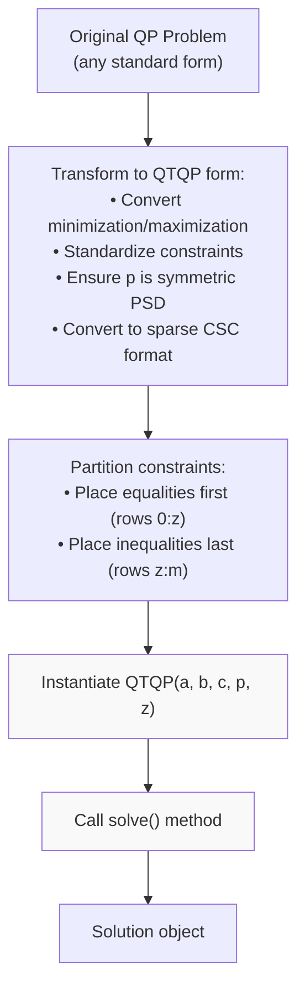

**Sources:** [README.md:5-137]()

### Verification Example

To verify problem formulation, check dimensions and structure:

```python
import scipy.sparse

# Problem dimensions
m = a.shape[0]  # Number of constraints
n = a.shape[1]  # Number of variables

# Verify dimensions
assert a.shape == (m, n)
assert b.shape == (m,)
assert c.shape == (n,)
assert p is None or p.shape == (n, n)
assert 0 <= z < m

# Verify matrix formats
assert scipy.sparse.isspmatrix_csc(a)
assert p is None or scipy.sparse.isspmatrix_csc(p)

# Verify p is symmetric (if provided)
if p is not None:
    assert np.allclose(p.toarray(), p.toarray().T)
```

This ensures the problem is correctly encoded before solving.

**Sources:** [README.md:119-137]()

---

# Page: Installation

# Installation

<details>
<summary>Relevant source files</summary>

The following files were used as context for generating this wiki page:

- [.github/workflows/ci.yml](.github/workflows/ci.yml)
- [README.md](README.md)
- [pyproject.toml](pyproject.toml)

</details>


## Purpose and Scope

This document provides comprehensive installation instructions for the QTQP solver package. It covers installing the core package via PyPI, optional linear solver backends for improved performance, platform-specific considerations, and source installation for development. For information about using QTQP after installation, see [Quick Start Guide](#2.2). For guidance on choosing which linear solver backend to use, see [Linear Solver Backends](#3.3) and [Performance Tuning](#5.5).

---

## System Requirements

### Python Version

QTQP requires Python 3.9 or later. The package is tested against Python 3.10, 3.11, 3.12, and 3.13 on Ubuntu, macOS, and Windows platforms.

**Sources:** [pyproject.toml:12](), [.github/workflows/ci.yml:18]()

### Platform Support

The core package runs on:
- **Ubuntu/Linux**: All features supported
- **macOS**: All features except MKL Pardiso
- **Windows**: All features except MKL Pardiso

The CI pipeline validates functionality across these platforms with a 12-configuration test matrix (3 operating systems × 4 Python versions).

**Sources:** [.github/workflows/ci.yml:17](), [.github/workflows/ci.yml:37-41]()

### Hardware Considerations

- **CPU**: All linear solvers except cuDSS run on CPU
- **GPU**: The cuDSS backend requires an NVIDIA GPU with CUDA support
- **Intel CPUs**: MKL Pardiso provides optimized performance on Intel processors

---

## Core Package Installation

### Installation via PyPI

The simplest installation method uses pip:

```bash
python -m pip install qtqp
```

This installs the QTQP package along with its required runtime dependencies:
- `numpy>=1.23`: Array operations and numerical computing
- `scipy>=1.9`: Sparse matrix support and default SciPy linear solver

After installation, the package is imported as:

```python
import qtqp
```

The public API includes the `qtqp.QTQP` class, `qtqp.LinearSolver` enum, `qtqp.SolutionStatus` enum, and `qtqp.Solution` dataclass.

**Sources:** [README.md:31-35](), [pyproject.toml:14-18](), [README.md:111-117]()

### Package Structure

The installed package follows the src-layout structure:

```
qtqp/
├── src/qtqp/
│   ├── __init__.py      # Public API exports
│   └── direct.py        # DirectKktSolver implementation
└── pyproject.toml       # Package configuration
```

**Sources:** [pyproject.toml:27](), [pyproject.toml:30-32]()

---

## Optional Linear Solver Backends

The core installation uses `scipy.linalg.factorized` as the default linear solver. For improved performance or specific hardware, install additional backends. The following diagram shows the relationship between QTQP and its linear solver options:

### Linear Solver Backend Architecture

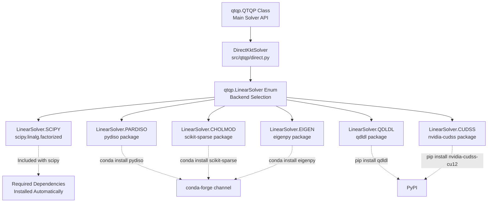

**Sources:** [README.md:190-198](), [src/qtqp/direct.py](), [.github/workflows/ci.yml:28-50]()

### Linear Solver Installation Matrix

| Backend | Enum Value | Installation Command | Platform Availability | Package Manager |
|---------|------------|---------------------|----------------------|-----------------|
| **SciPy** (default) | `LinearSolver.SCIPY` | Included with `scipy>=1.9` | Ubuntu, macOS, Windows | pip (automatic) |
| **MKL Pardiso** | `LinearSolver.PARDISO` | `conda install -c conda-forge pydiso` | Ubuntu only | conda |
| **QDLDL** | `LinearSolver.QDLDL` | `pip install qdldl` | Ubuntu, macOS, Windows | pip |
| **CHOLMOD** | `LinearSolver.CHOLMOD` | `conda install -c conda-forge scikit-sparse` | Ubuntu, macOS, Windows | conda |
| **Eigen** | `LinearSolver.EIGEN` | `conda install -c conda-forge eigenpy` | Ubuntu, macOS, Windows | conda |
| **NVIDIA cuDSS** | `LinearSolver.CUDSS` | `pip install nvidia-cudss-cu12`<br/>`pip install nvmath-python[cu12]` | Ubuntu, macOS, Windows (GPU required) | pip |

**Sources:** [README.md:200-240](), [.github/workflows/ci.yml:38-50]()

### Installing Optional Backends

#### MKL Pardiso (Intel CPUs, Ubuntu Only)

Pardiso provides optimized performance on Intel CPUs but is only available on Ubuntu/Linux:

```bash
conda install -c conda-forge pydiso
```

**Limitation**: The CI pipeline explicitly skips Pardiso installation on macOS and Windows due to compatibility issues.

**Sources:** [README.md:200-207](), [.github/workflows/ci.yml:37-41]()

#### QDLDL

A lightweight LDL factorization solver:

```bash
python -m pip install qdldl
```

**Sources:** [README.md:217-223](), [.github/workflows/ci.yml:49]()

#### CHOLMOD (via scikit-sparse)

Provides the CHOLMOD sparse Cholesky solver:

```bash
conda install -c conda-forge scikit-sparse
```

**Sources:** [README.md:225-231](), [.github/workflows/ci.yml:46]()

#### Eigen

C++ Eigen library bindings via EigenPy:

```bash
conda install -c conda-forge eigenpy
```

**Sources:** [README.md:209-215](), [.github/workflows/ci.yml:47]()

#### NVIDIA cuDSS (GPU Accelerated)

For GPU-accelerated solving (requires NVIDIA GPU with CUDA):

```bash
python -m pip install nvidia-cudss-cu12
python -m pip install nvmath-python[cu12]
```

**Sources:** [README.md:233-240]()

---

## Installation from Source

### Cloning the Repository

```bash
git clone https://github.com/google-deepmind/qtqp.git
cd qtqp
```

**Sources:** [README.md:37-42]()

### Setting Up a Development Environment

The recommended approach uses conda to manage dependencies:

```bash
conda create -n qtqp-dev python=3.12
conda activate qtqp-dev
```

**Sources:** [README.md:44-49]()

### Installing Dependencies

Install optional linear solver backends before installing the package:

```bash
# Install conda-based backends
conda install -y -c conda-forge scikit-sparse
conda install -y -c conda-forge eigenpy

# Install pip-based backends
python -m pip install qdldl pytest

# Install QTQP in editable mode
python -m pip install -e .
```

The `-e` flag installs the package in editable mode, allowing you to modify source files without reinstalling.

**Sources:** [.github/workflows/ci.yml:43-50](), [README.md:52-55]()

### CI/CD Installation Flow

The following diagram illustrates how the GitHub Actions CI pipeline installs and tests QTQP:

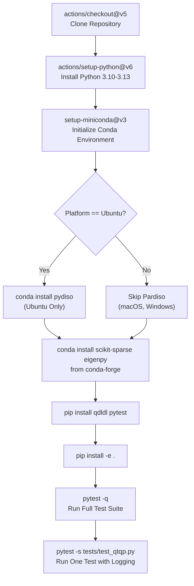

**Sources:** [.github/workflows/ci.yml:20-57]()

---

## Verifying Installation

### Running the Test Suite

After installation, verify functionality by running the test suite:

```bash
pytest -q
```

**Note**: Tests will fail for linear solver backends not installed on your system. This is expected behavior.

To run a single test with verbose output and logging:

```bash
pytest -s tests/test_qtqp.py::test_solve[LinearSolver.SCIPY-seed0-True]
```

**Sources:** [README.md:57-63](), [.github/workflows/ci.yml:52-57]()

### Checking Available Backends

Import QTQP and attempt to instantiate a solver with different backends to verify which are available:

```python
import qtqp
import numpy as np
import scipy.sparse

# Create a minimal problem
a = scipy.sparse.csc_matrix([[1.0]])
b = np.array([1.0])
c = np.array([1.0])
solver = qtqp.QTQP(a=a, b=b, c=c, z=0)

# Test which backends are available
backends_to_test = [
    qtqp.LinearSolver.SCIPY,
    qtqp.LinearSolver.QDLDL,
    qtqp.LinearSolver.CHOLMOD,
    qtqp.LinearSolver.EIGEN,
    qtqp.LinearSolver.PARDISO,
    qtqp.LinearSolver.CUDSS,
]

for backend in backends_to_test:
    try:
        solver.solve(linear_solver=backend, max_iter=1, verbose=False)
        print(f"{backend.name}: Available")
    except ImportError as e:
        print(f"{backend.name}: Not available ({e})")
```

**Sources:** [README.md:190-198](), [src/qtqp/__init__.py]()

---

## Platform-Specific Notes

### Ubuntu/Linux

- **Full Support**: All linear solver backends are available
- **MKL Pardiso**: Only platform supporting Pardiso (Intel CPU optimization)
- **Testing**: Primary CI platform with 4 Python versions tested

**Sources:** [.github/workflows/ci.yml:37-41]()

### macOS

- **Limited Support**: MKL Pardiso unavailable due to Intel CPU requirements
- **Available Backends**: SciPy, QDLDL, CHOLMOD, Eigen, cuDSS
- **Testing**: CI validates Python 3.10-3.13 on `macos-latest`

**Sources:** [.github/workflows/ci.yml:17-18](), [.github/workflows/ci.yml:37-38]()

### Windows

- **Limited Support**: MKL Pardiso unavailable (noted as "failing on Windows")
- **Available Backends**: SciPy, QDLDL, CHOLMOD, Eigen, cuDSS
- **Testing**: CI validates Python 3.10-3.13 on `windows-latest`

**Sources:** [.github/workflows/ci.yml:17-18](), [.github/workflows/ci.yml:37]()

### Conda vs. Pip Dependencies

The installation strategy mixes conda and pip package managers:

| Package Manager | Packages | Rationale |
|----------------|----------|-----------|
| **conda** | pydiso, scikit-sparse, eigenpy | Binary dependencies with complex C/C++ builds |
| **pip** | qtqp, qdldl, pytest, nvidia-cudss | Pure Python or well-packaged binary wheels |

The CI pipeline initializes conda first, installs conda-based backends, then uses pip for remaining packages.

**Sources:** [.github/workflows/ci.yml:28-50]()

---

## Troubleshooting

### Import Errors for Optional Backends

If you encounter `ImportError` when using a specific `linear_solver` option, the corresponding backend is not installed. Install it following the instructions in the [Linear Solver Installation Matrix](#linear-solver-installation-matrix).

### Test Failures

The test suite expects all installed backends to function correctly. If tests fail:

1. Verify the backend is properly installed
2. Check platform compatibility (e.g., Pardiso on Ubuntu only)
3. Review the specific test error message for missing dependencies

**Sources:** [README.md:63]()

### Conda Environment Conflicts

When mixing conda and pip installations:

1. Always activate the conda environment first
2. Install conda packages before pip packages
3. Use `pip install -e .` for editable installs, not `pip install -e .[test]` if it fails

**Sources:** [.github/workflows/ci.yml:43-50]()

---

# Page: Quick Start Guide

# Quick Start Guide

<details>
<summary>Relevant source files</summary>

The following files were used as context for generating this wiki page:

- [README.md](README.md)
- [src/qtqp/__init__.py](src/qtqp/__init__.py)

</details>


## Purpose and Scope

This guide walks through a minimal working example of defining and solving a quadratic program using QTQP. It covers problem setup, solver invocation, and interpreting the solution output. For detailed problem formulation rules and constraint specification, see [Problem Formulation](#2.3). For advanced solver configuration options, see [Configuration Parameters](#4.4). For understanding how the solver selects different backends, see [Linear Solver Backends](#3.3).

**Sources:** [README.md:65-108]()

---

## Problem Definition

We demonstrate QTQP with a simple quadratic program example. The problem has:
- 2 primal variables (`n=2`)
- 3 constraints (`m=3`)
- 1 equality constraint (`z=1`)
- A quadratic objective term (`p` matrix)

The example solves:
```
min. (1/2) x.T @ p @ x + c.T @ x
s.t. -x[0] + x[1] + s[0] = -1     (equality: s[0] = 0)
     x[0] + s[1] = 0.3             (inequality: s[1] >= 0)
     x[1] + s[2] = -0.5            (inequality: s[2] >= 0)
```

**Sources:** [README.md:67-88]()

---

## Step-by-Step Setup

### Step 1: Import Required Modules

```python
import qtqp
import scipy.sparse
import numpy as np
```

The solver requires `scipy.sparse` for constraint matrices and `numpy` for vectors. The `qtqp` module provides the `QTQP` solver class and related enums/dataclasses.

**Sources:** [README.md:71-73](), [src/qtqp/__init__.py:24-26]()

---

### Step 2: Define Problem Data

```python
# Quadratic cost matrix (n x n)
p = scipy.sparse.csc_matrix([[3.0, -1.0], [-1.0, 2.0]])

# Constraint matrix (m x n)
a = scipy.sparse.csc_matrix([[-1.0, 1.0], [1.0, 0.0], [0.0, 1.0]])

# Right-hand side vector (m,)
b = np.array([-1, 0.3, -0.5])

# Linear cost vector (n,)
c = np.array([-1.0, -1.0])
```

The matrices must be in CSC (Compressed Sparse Column) format. The `QTQP` constructor validates matrix dimensions and formats at instantiation.

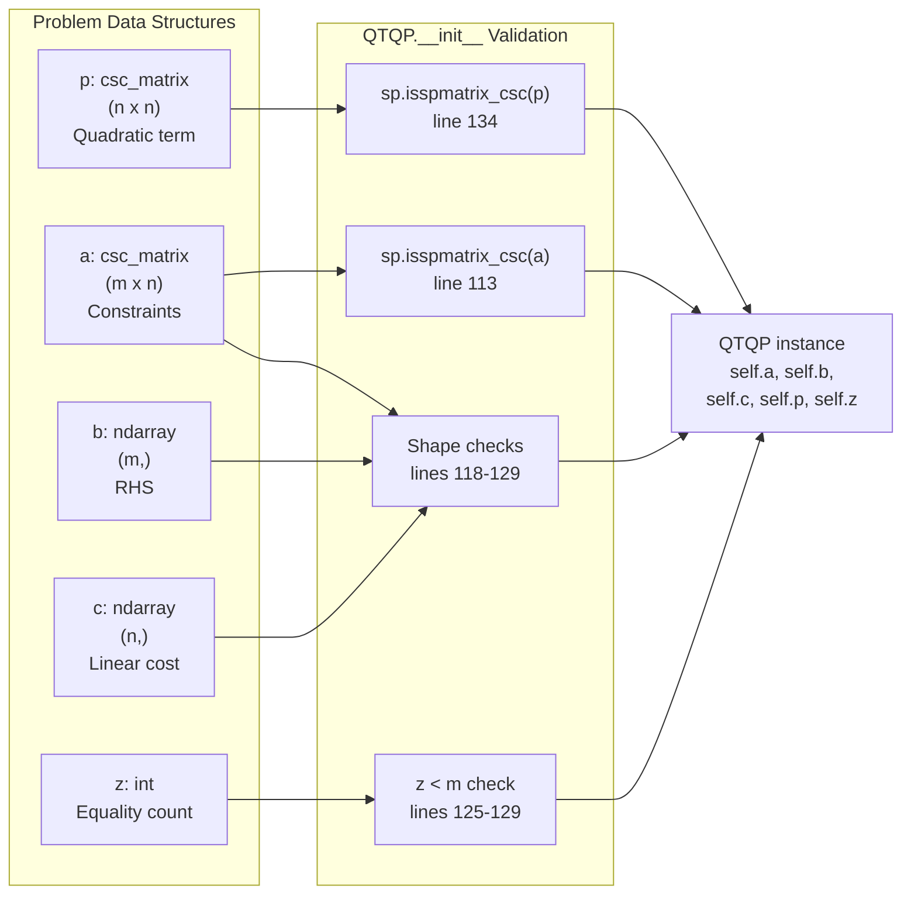

**Diagram: Problem Data Validation Flow**

**Sources:** [README.md:75-79](), [src/qtqp/__init__.py:91-140]()

---

### Step 3: Initialize Solver

```python
solver = qtqp.QTQP(p=p, a=a, b=b, c=c, z=1)
```

This creates a `QTQP` instance by calling the constructor at [src/qtqp/__init__.py:91-108](). The constructor:
1. Stores problem dimensions: `self.m = 3`, `self.n = 2`, `self.z = 1`
2. Validates matrix formats (must be CSC)
3. Validates vector shapes match matrix dimensions
4. Initializes internal buffers like `self._r_buffer` for linear system RHS

The `z=1` parameter indicates the first constraint is an equality (zero-cone), while constraints 2 and 3 are inequalities (positive cone).

**Sources:** [README.md:82](), [src/qtqp/__init__.py:91-144]()

---

### Step 4: Solve the Problem

```python
sol = solver.solve()
```

The `solve()` method with no arguments uses default parameters:
- `atol=1e-7`, `rtol=1e-8`: Convergence tolerances
- `max_iter=100`: Maximum iterations
- `linear_solver=LinearSolver.SCIPY`: Default backend
- `verbose=True`: Print iteration log
- `equilibrate=True`: Apply Ruiz equilibration

The method returns a `Solution` dataclass containing primal-dual variables and iteration statistics.

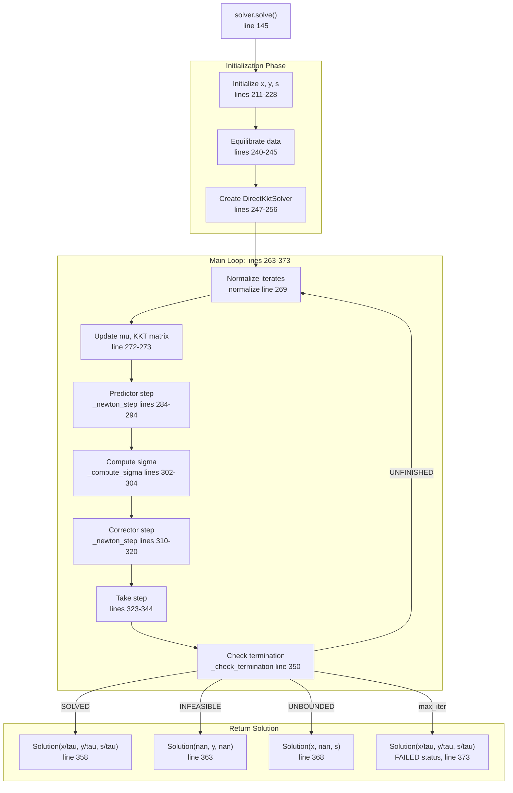

**Diagram: solve() Method Execution Flow**

**Sources:** [README.md:84](), [src/qtqp/__init__.py:145-373]()

---

## Understanding the Iteration Log

When `verbose=True`, the solver prints a table tracking convergence metrics:

```
| QTQP v0.0.2: m=3, n=2, z=1, nnz(A)=4, nnz(P)=4, linear_solver=SCIPY
|------|------------|------------|----------|----------|----------|----------|----------|----------|----------|----------|----------|
| iter |      pcost |      dcost |     pres |     dres |      gap |   infeas |       mu |    sigma |    alpha |  q, p, c |     time |
|------|------------|------------|----------|----------|----------|----------|----------|----------|----------|----------|----------|
|    0 |  1.205e+00 |  1.298e+00 | 2.18e-01 | 6.17e-01 | 9.36e-02 | 1.67e+00 | 1.09e+00 | 5.69e-04 | 1.00e+00 |  1, 1, 1 | 1.39e-02 |
|    1 |  1.161e+00 |  1.211e+00 | 3.16e-02 | 5.23e-02 | 5.01e-02 | 1.35e+00 | 1.04e-01 | 1.65e-03 | 9.04e-01 |  1, 1, 1 | 1.46e-02 |
|    2 |  1.234e+00 |  1.235e+00 | 3.77e-04 | 8.61e-04 | 6.64e-04 | 1.30e+00 | 7.67e-03 | 4.87e-06 | 9.98e-01 |  1, 1, 1 | 1.52e-02 |
|    3 |  1.235e+00 |  1.235e+00 | 3.78e-06 | 8.62e-06 | 6.65e-06 | 1.30e+00 | 1.25e-04 | 8.80e-12 | 1.00e+00 |  1, 1, 1 | 1.57e-02 |
|    4 |  1.235e+00 |  1.235e+00 | 3.78e-08 | 8.62e-08 | 6.65e-08 | 1.30e+00 | 1.25e-06 | 8.80e-18 | 1.00e+00 |  1, 1, 1 | 1.63e-02 |
|------|------------|------------|----------|----------|----------|----------|----------|----------|----------|----------|----------|
| Solved
```

### Column Definitions

| Column | Variable | Description | Code Reference |
|--------|----------|-------------|----------------|
| `iter` | `stats_i['iter']` | Iteration number | [src/qtqp/__init__.py:597]() |
| `pcost` | `stats_i['pcost']` | Primal objective value: `(c.T @ x + 0.5 * x.T @ p @ x) / tau` | [src/qtqp/__init__.py:549]() |
| `dcost` | `stats_i['dcost']` | Dual objective value: `(-b.T @ y - 0.5 * x.T @ p @ x) / tau` | [src/qtqp/__init__.py:550]() |
| `pres` | `stats_i['pres']` | Primal residual: `‖(a @ x + s)/tau - b‖_∞` | [src/qtqp/__init__.py:553]() |
| `dres` | `stats_i['dres']` | Dual residual: `‖(p @ x + a.T @ y)/tau + c‖_∞` | [src/qtqp/__init__.py:554]() |
| `gap` | `stats_i['gap']` | Duality gap: `\|(c.T @ x + b.T @ y + x.T @ p @ x)/tau\|` | [src/qtqp/__init__.py:555]() |
| `infeas` | `min(pinfeas, dinfeas)` | Infeasibility measure | [src/qtqp/__init__.py:632]() |
| `mu` | `stats_i['mu']` | Complementary slackness: `(y @ s) / (x @ x + y @ y + tau @ tau)` | [src/qtqp/__init__.py:272]() |
| `sigma` | `stats_i['sigma']` | Centering parameter from Mehrotra's heuristic | [src/qtqp/__init__.py:302-304]() |
| `alpha` | `stats_i['alpha']` | Step size (fraction to boundary) | [src/qtqp/__init__.py:331]() |
| `q, p, c` | Solver counts | Number of linear solves for q-system, predictor, corrector | [src/qtqp/__init__.py:638-642]() |
| `time` | `stats_i['time']` | Elapsed time in seconds | [src/qtqp/__init__.py:618]() |

Convergence occurs when `pres`, `dres`, and `gap` all fall below tolerance thresholds (`atol` and `rtol`). The example converges in 5 iterations with final residuals around `10^-8`.

**Sources:** [README.md:92-103](), [src/qtqp/__init__.py:628-650]()

---

## Interpreting the Solution

### Accessing Solution Fields

```python
print(f'{sol.x=}')  # Primal variables
print(f'{sol.y=}')  # Dual variables
print(f'{sol.s=}')  # Slack variables
```

Output:
```
sol.x=array([ 0.29999999, -0.69999997])
sol.y=array([2.69999964e+00, 2.09999968e+00, 3.86572055e-07])
sol.s=array([0.00000000e+00, 7.13141634e-09, 1.99999944e-01])
```

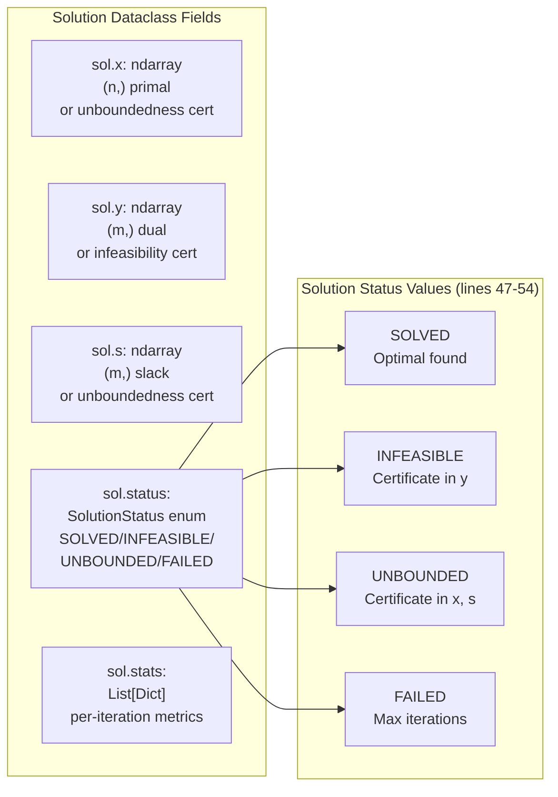

**Diagram: Solution Object Structure**

### Verification

For a `SOLVED` status, the solution satisfies:
1. **Primal feasibility**: `a @ x + s = b` and `s[z:] >= 0`
2. **Dual feasibility**: `p @ x + a.T @ y = -c` and `y[z:] >= 0`
3. **Complementarity**: `y[z:] * s[z:] ≈ 0`

In this example:
- `x[0] = 0.3`, `x[1] = -0.7` satisfy the constraints
- `s[0] = 0` enforces the equality constraint
- `s[1] ≈ 0`, `s[2] = 0.2` represent inequality slacks
- `y[0] = 2.7`, `y[1] = 2.1` are dual multipliers for constraints 1-2
- `y[2] ≈ 0` indicates constraint 3 is not tight

**Sources:** [README.md:104-107](), [src/qtqp/__init__.py:57-74]()

---

## Solution Status Interpretation

The `sol.status` field indicates the outcome:

| Status | Meaning | When x/y/s are Valid |
|--------|---------|---------------------|
| `SolutionStatus.SOLVED` | Optimal solution found | `x`, `y`, `s` are the optimal primal-dual-slack variables |
| `SolutionStatus.INFEASIBLE` | Primal infeasible, dual unbounded | `y` is a certificate of primal infeasibility (scaled), `x` and `s` are NaN |
| `SolutionStatus.UNBOUNDED` | Primal unbounded, dual infeasible | `x` and `s` are certificates of dual infeasibility (scaled), `y` is NaN |
| `SolutionStatus.FAILED` | Max iterations reached | `x`, `y`, `s` are best iterates found, but not proven optimal |

The termination logic is implemented in [src/qtqp/__init__.py:535-622]() via the `_check_termination` method, which evaluates:
- Optimality conditions (lines 579-584)
- Unboundedness detection (lines 585-588)
- Infeasibility detection (lines 589-592)

**Sources:** [src/qtqp/__init__.py:47-54](), [src/qtqp/__init__.py:353-373](), [src/qtqp/__init__.py:535-622]()

---

## Next Steps

Now that you've run a basic example, you can:

1. **Formulate your own problems**: See [Problem Formulation](#2.3) for guidelines on encoding constraints and objectives
2. **Adjust solver parameters**: See [Configuration Parameters](#4.4) for tuning tolerances, iteration limits, and solver options
3. **Try different linear solvers**: See [Linear Solver Backends](#3.3) for performance comparisons and installation instructions
4. **Use warm-starting**: See [Warm Starting](#5.2) for accelerating sequences of related problems
5. **Improve numerical stability**: See [Equilibration and Numerical Stability](#5.1) for handling ill-conditioned problems

**Sources:** [README.md:65-108]()

---

# Page: Problem Formulation

# Problem Formulation

<details>
<summary>Relevant source files</summary>

The following files were used as context for generating this wiki page:

- [README.md](README.md)
- [src/qtqp/__init__.py](src/qtqp/__init__.py)

</details>


## Purpose and Scope

This page explains the mathematical formulation of quadratic programming (QP) problems that QTQP solves, including both primal and dual forms. It describes how to encode problem data as matrices and vectors for the QTQP constructor, with particular attention to the constraint partitioning mechanism controlled by the `z` parameter.

For step-by-step examples of using these formulations, see [Quick Start Guide](#2.2). For detailed API parameter documentation, see [QTQP Class](#4.1). For understanding how the solver internally processes these formulations using KKT conditions, see [QTQP Solver: Primal-Dual Interior Point Method](#3.1).

## Mathematical Formulation

### Primal Problem

QTQP solves convex quadratic programs in the following standard form:

```
minimize    (1/2) x^T P x + c^T x
subject to  A x + s = b
            s[:z] = 0       (equality constraints)
            s[z:] ≥ 0       (inequality constraints)
```

Where:
- **x** ∈ ℝⁿ is the primal variable (decision variable)
- **s** ∈ ℝᵐ is the slack variable
- **P** ∈ ℝⁿˣⁿ is a symmetric positive semidefinite matrix (quadratic cost term)
- **c** ∈ ℝⁿ is the linear cost vector
- **A** ∈ ℝᵐˣⁿ is the constraint matrix
- **b** ∈ ℝᵐ is the right-hand side vector
- **z** ∈ ℤ with 0 ≤ z < m is the number of equality constraints

### Dual Problem

The corresponding dual problem is:

```
maximize    -(1/2) x^T P x - b^T y
subject to  P x + A^T y = -c
            y[z:] ≥ 0
```

Where:
- **y** ∈ ℝᵐ is the dual variable (Lagrange multipliers)
- **y[:z]** are free (unconstrained) for equality constraints
- **y[z:]** are non-negative for inequality constraints

**Sources:** [src/qtqp/__init__.py:77-89](), [README.md:6-21]()

## Constraint Structure and the z Parameter

### Zero Cone and Positive Cone Partitioning

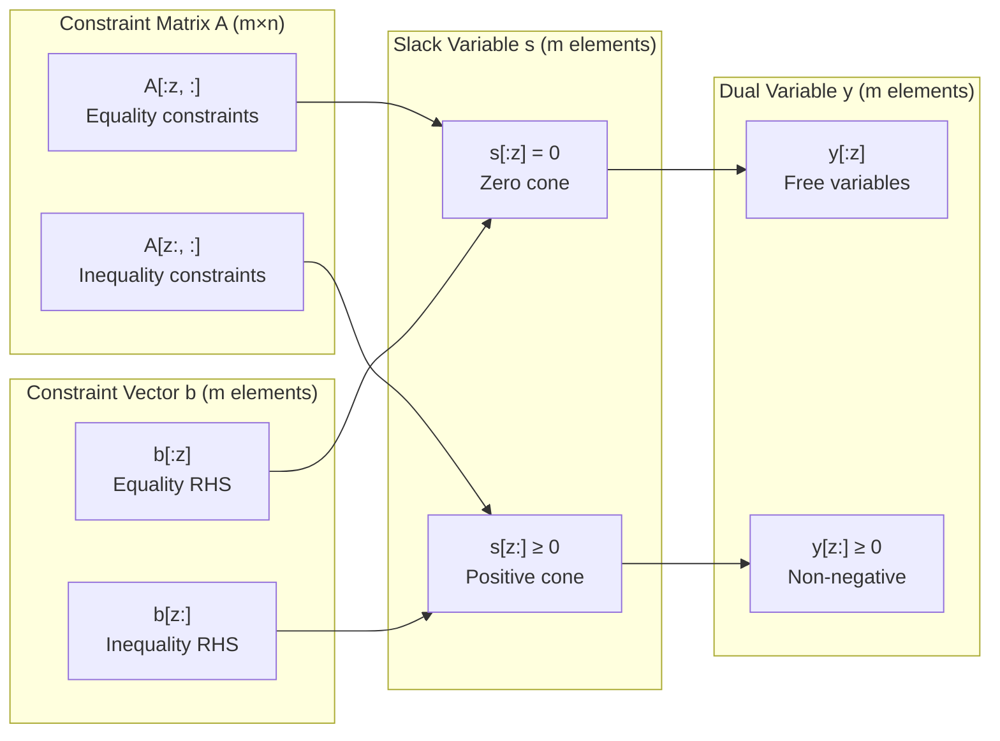

**Diagram: Constraint Partitioning by z Parameter**

The parameter `z` partitions the m constraints into two cones:

| Index Range | Constraint Type | Slack Cone | Dual Variable | Interpretation |
|-------------|----------------|------------|---------------|----------------|
| `0` to `z-1` | Equality: `A[i,:] @ x = b[i]` | `s[i] = 0` (zero cone) | `y[i]` free | First z rows of A |
| `z` to `m-1` | Inequality: `A[i,:] @ x ≤ b[i]` | `s[i] ≥ 0` (positive cone) | `y[i] ≥ 0` | Remaining m-z rows of A |

The constraint `z < m` is enforced at initialization to ensure at least one inequality constraint exists, which is required for the interior point method's homogeneous embedding.

**Sources:** [src/qtqp/__init__.py:82-88](), [src/qtqp/__init__.py:125-129]()

## Encoding Problems for QTQP

### Mapping Mathematical Notation to Constructor Parameters

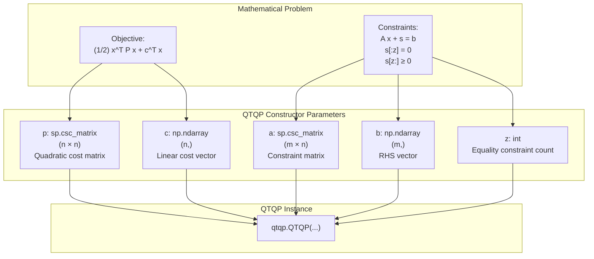

**Diagram: Mapping from Mathematical Formulation to QTQP Constructor**

The QTQP constructor requires the following parameters:

```python
qtqp.QTQP(
    a=<constraint_matrix>,    # sp.csc_matrix (m × n)
    b=<rhs_vector>,          # np.ndarray (m,)
    c=<cost_vector>,         # np.ndarray (n,)
    z=<num_equalities>,      # int
    p=<quadratic_matrix>     # sp.csc_matrix (n × n) or None
)
```

**Sources:** [src/qtqp/__init__.py:91-108]()

### Required Matrix Formats and Dimensions

| Parameter | Type | Dimensions | Format | Notes |
|-----------|------|------------|--------|-------|
| `a` | `scipy.sparse.csc_matrix` | m × n | CSC sparse | Must be CSC format |
| `b` | `numpy.ndarray` | (m,) | Dense | Converted to float64 |
| `c` | `numpy.ndarray` | (n,) | Dense | Converted to float64 |
| `z` | `int` | scalar | - | Must satisfy 0 ≤ z < m |
| `p` | `scipy.sparse.csc_matrix` or `None` | n × n | CSC sparse | If None, treated as zero matrix (LP) |

The solver validates these dimensions and formats at initialization. If `p` is `None`, the solver constructs a zero sparse matrix, effectively solving a linear program.

**Sources:** [src/qtqp/__init__.py:109-140]()

### Dimension Relationships

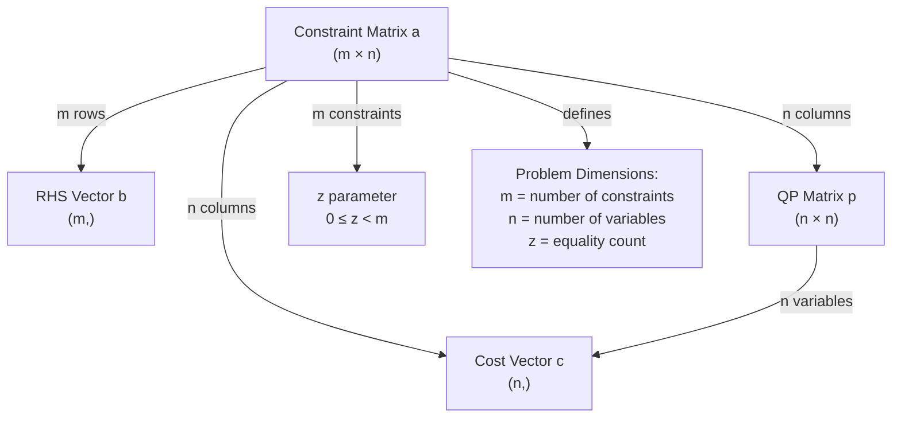

**Diagram: Dimensional Consistency Requirements**

**Sources:** [src/qtqp/__init__.py:109-140]()

## Problem Types

### Linear Programs (LP)

For linear programs (no quadratic term), set `p=None`:

```python
# Linear Program: min c^T x subject to A x ≤ b
solver = qtqp.QTQP(a=a, b=b, c=c, z=0, p=None)
```

When `p=None`, the solver creates a zero sparse matrix internally, and the objective becomes purely linear: `c^T x`.

**Sources:** [src/qtqp/__init__.py:131-132]()

### Quadratic Programs (QP)

For quadratic programs, provide a symmetric positive semidefinite matrix `p`:

```python
# QP: min (1/2) x^T P x + c^T x subject to A x ≤ b
p = scipy.sparse.csc_matrix([[2.0, 0.0], [0.0, 2.0]])
solver = qtqp.QTQP(a=a, b=b, c=c, z=0, p=p)
```

The matrix `p` must be in CSC format and have dimensions n × n.

**Sources:** [src/qtqp/__init__.py:134-140]()

### Constraint Type Examples

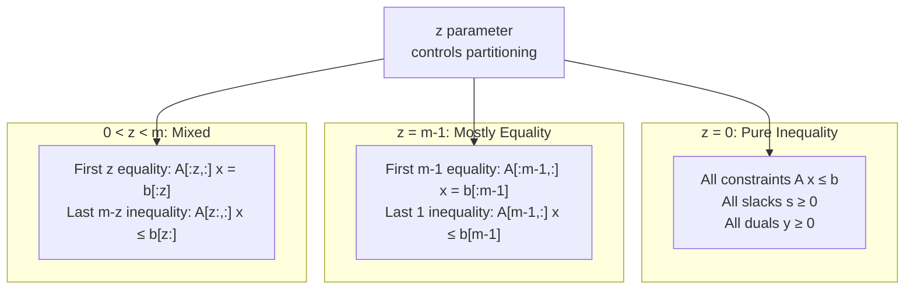

**Diagram: Different Problem Types Based on z Parameter**

| z Value | Problem Structure | Use Case |
|---------|------------------|----------|
| `z = 0` | Pure inequality constraints | Standard LP/QP with bounds |
| `z = m-1` | m-1 equalities, 1 inequality | Nearly equality-constrained with one slack |
| `0 < z < m` | Mixed equality and inequality | General constrained optimization |

The solver requires `z < m` (strictly less than) to ensure at least one inequality constraint exists, which is necessary for the homogeneous embedding technique used in the interior point method.

**Sources:** [src/qtqp/__init__.py:125-129]()

## Converting Standard Forms to QTQP Format

### Inequality Constraints: Ax ≤ b

Standard form:
```
A x ≤ b
```

QTQP encoding:
```python
# Introduce slack: A x + s = b with s ≥ 0
# Set z = 0 to make all constraints inequalities
solver = qtqp.QTQP(a=A, b=b, c=c, z=0, p=p)
```

The slack variable `s` is introduced automatically by the solver.

### Equality Constraints: Ax = b

Standard form:
```
A x = b
```

QTQP encoding:
```python
# Need at least one inequality for homogeneous embedding
# Add a dummy inequality constraint, e.g., x[0] ≤ large_value
# Set z = m-1 (all but last constraint are equalities)
a_augmented = sp.vstack([A_eq, a_dummy])
b_augmented = np.concatenate([b_eq, [large_value]])
solver = qtqp.QTQP(a=a_augmented, b=b_augmented, c=c, z=m-1, p=p)
```

**Note:** Pure equality-constrained problems (z = m) are not supported due to the interior point method's requirements.

### Mixed Constraints

For problems with both equality and inequality constraints:

```python
# Given:
# A_eq @ x = b_eq  (z_eq equality constraints)
# A_ineq @ x ≤ b_ineq  (m_ineq inequality constraints)

a = sp.vstack([A_eq, A_ineq])  # Stack equality constraints first
b = np.concatenate([b_eq, b_ineq])
z = A_eq.shape[0]  # Number of equality constraints

solver = qtqp.QTQP(a=a, b=b, c=c, z=z, p=p)
```

**Critical ordering:** Equality constraints must appear first in the matrix `a` (rows 0 to z-1), followed by inequality constraints (rows z to m-1).

**Sources:** [src/qtqp/__init__.py:82-88]()

## Problem Data Flow

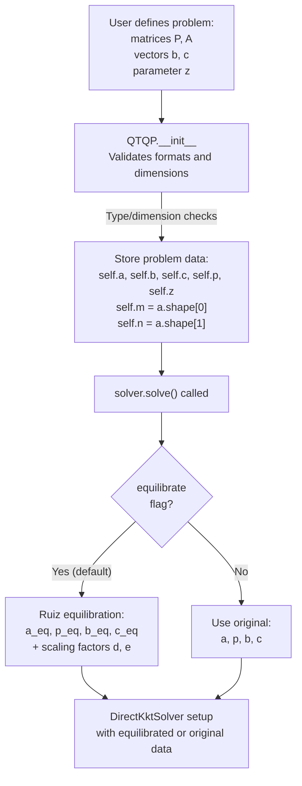

**Diagram: Problem Data Flow from User Input to Solver Initialization**

The problem data flows through validation, storage, optional equilibration, and finally to the KKT solver setup. The `equilibrate` parameter in the `solve` method controls whether Ruiz equilibration is applied for numerical stability.

**Sources:** [src/qtqp/__init__.py:91-140](), [src/qtqp/__init__.py:240-256](), [src/qtqp/__init__.py:375-412]()

## Example: Encoding a Canonical QP

Consider the example from the README:

```
minimize    (1/2) x^T P x + c^T x
subject to  -x₁ + x₂ = -1     (equality)
            x₁ ≤ 0.3           (inequality)
            x₂ ≤ -0.5          (inequality)
```

Matrix encoding:

```python
import scipy.sparse as sp
import numpy as np

# Quadratic term: P = [[3, -1], [-1, 2]]
p = sp.csc_matrix([[3.0, -1.0], [-1.0, 2.0]])

# Constraints: first row is equality, next two are inequalities
# -x₁ + x₂ = -1  =>  [-1, 1] @ x + s[0] = -1, s[0] = 0
# x₁ ≤ 0.3       =>  [1, 0] @ x + s[1] = 0.3, s[1] ≥ 0
# x₂ ≤ -0.5      =>  [0, 1] @ x + s[2] = -0.5, s[2] ≥ 0
a = sp.csc_matrix([
    [-1.0, 1.0],   # Equality constraint (row 0)
    [1.0, 0.0],    # Inequality constraint (row 1)
    [0.0, 1.0]     # Inequality constraint (row 2)
])

b = np.array([-1.0, 0.3, -0.5])  # RHS values
c = np.array([-1.0, -1.0])        # Linear cost

# z = 1: first constraint is equality, remaining 2 are inequalities
solver = qtqp.QTQP(p=p, a=a, b=b, c=c, z=1)
```

Problem dimensions:
- n = 2 (two decision variables: x₁, x₂)
- m = 3 (three constraints total)
- z = 1 (one equality constraint)
- s has 3 elements: s[0] = 0 (zero cone), s[1:] ≥ 0 (positive cone)
- y has 3 elements: y[0] free, y[1:] ≥ 0

**Sources:** [README.md:67-88]()

## Validation and Error Handling

The QTQP constructor performs comprehensive validation:

| Validation Check | Error Type | Error Condition |
|------------------|------------|-----------------|
| Matrix format | `TypeError` | `a` not in CSC format |
| Matrix format | `TypeError` | `p` not in CSC format or None |
| Vector dimensions | `ValueError` | `b.shape != (m,)` |
| Vector dimensions | `ValueError` | `c.shape != (n,)` |
| Matrix dimensions | `ValueError` | `p.shape != (n, n)` |
| Parameter range | `ValueError` | `z >= m` (must have at least one inequality) |

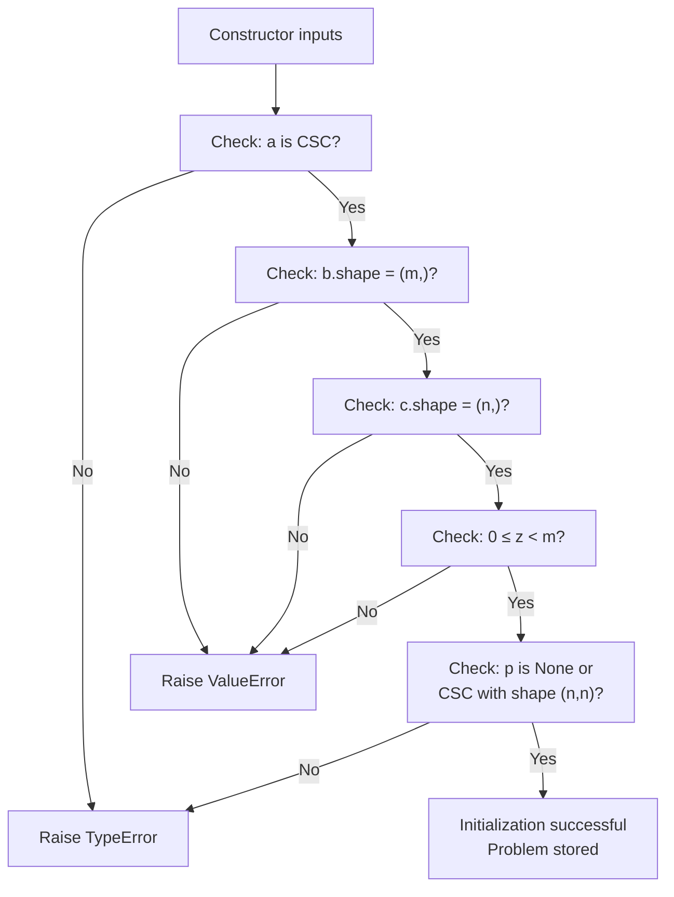

**Diagram: QTQP Constructor Validation Flow**

All arrays are automatically converted to `float64` dtype for numerical consistency.

**Sources:** [src/qtqp/__init__.py:112-140]()

---

# Page: Architecture

# Architecture

<details>
<summary>Relevant source files</summary>

The following files were used as context for generating this wiki page:

- [src/qtqp/__init__.py](src/qtqp/__init__.py)
- [src/qtqp/direct.py](src/qtqp/direct.py)

</details>


This document provides a detailed explanation of the QTQP repository's system architecture, describing how the major components interact and the design patterns employed. This page focuses on the structural organization and component relationships. For algorithmic details of the primal-dual interior point method, see [QTQP Solver](#3.1). For KKT system management specifics, see [DirectKktSolver](#3.2). For individual linear solver backend implementations, see [Linear Solver Backends](#3.3).

## System Overview

The QTQP codebase implements a primal-dual interior point method for quadratic programming using a three-layer architecture:

1. **Algorithm Layer**: The `QTQP` class implements the optimization algorithm (predictor-corrector interior point method with homogeneous self-dual embedding)
2. **Linear System Layer**: The `DirectKktSolver` class manages KKT matrix construction, updates, and iterative refinement
3. **Backend Layer**: Six `LinearSolver` implementations provide pluggable numerical linear algebra backends

This separation enables the optimization algorithm to remain independent of the underlying numerical solver, allowing the same code to execute on different hardware (CPU/GPU) and with different factorization methods without modification to the core solver logic.

Sources: [src/qtqp/__init__.py:76-89](), [src/qtqp/direct.py:204-211]()

## Component Hierarchy

The following diagram maps the conceptual system components to their concrete implementations in the codebase:

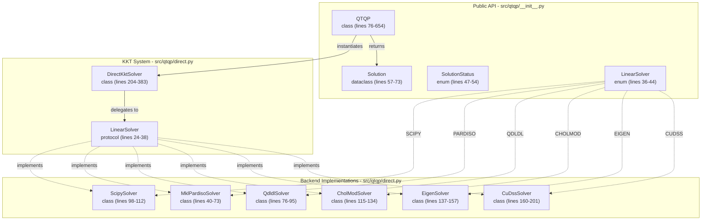

Sources: [src/qtqp/__init__.py:1-654](), [src/qtqp/direct.py:1-384]()

## Core Components

### QTQP Class

The `QTQP` class [src/qtqp/__init__.py:76-654]() is the main entry point for solving quadratic programs. It encapsulates:

| Responsibility | Implementation |
|----------------|----------------|
| Problem definition | `__init__()` [lines 91-141]() stores matrices `a`, `p`, vectors `b`, `c`, and constraint count `z` |
| Equilibration | `_equilibrate()` [lines 375-412]() performs Ruiz scaling for numerical conditioning |
| Main iteration loop | `solve()` [lines 145-373]() implements predictor-corrector algorithm |
| Termination checking | `_check_termination()` [lines 535-622]() evaluates convergence criteria |
| Homogeneous embedding | `_solve_for_tau()` [lines 486-521]() solves quadratic equation for embedding variable |

The class maintains internal state including:
- Problem data matrices: `self.a`, `self.p`, `self.b`, `self.c`, `self.z`
- Equilibration factors: `self.d`, `self.e` (if equilibration is enabled)
- Linear solver instance: `self._linear_solver` (DirectKktSolver)
- Iteration statistics: accumulated in `stats` list

Sources: [src/qtqp/__init__.py:76-654]()

### DirectKktSolver Class

The `DirectKktSolver` class [src/qtqp/direct.py:204-383]() manages the Karush-Kuhn-Tucker system of equations. Its architecture consists of:

```mermaid
graph TB
    subgraph "DirectKktSolver Responsibilities"
        Init["__init__<br/>(lines 213-261)"]
        Update["update<br/>(lines 262-292)"]
        Solve["solve<br/>(lines 294-382)"]
    end
    
    subgraph "Internal State"
        KKTScaffold["self.kkt<br/>sparse matrix scaffold<br/>with NaN diagonals"]
        KKTNanIdxs["self.kkt_nan_idxs<br/>cached diagonal indices<br/>for fast updates"]
        Solver["self.solver<br/>LinearSolver instance"]
    end
    
    subgraph "Operations"
        ScaffoldOp["Build KKT scaffold once<br/>lines 249-258"]
        DiagUpdateOp["Update diagonals<br/>lines 276-292"]
        FactorizeOp["Factorize KKT<br/>line 289"]
        RefineOp["Iterative refinement<br/>lines 334-369"]
    end
    
    Init --> ScaffoldOp
    ScaffoldOp --> KKTScaffold
    ScaffoldOp --> KKTNanIdxs
    Init --> Solver
    
    Update --> DiagUpdateOp
    DiagUpdateOp --> KKTScaffold
    DiagUpdateOp --> FactorizeOp
    FactorizeOp --> Solver
    
    Solve --> RefineOp
    RefineOp --> Solver
```

The KKT system has the form:
```
[ P + μI       A^T    ] [ x ]   [ rhs_x ]
[   A    -(D + μI)    ] [ y ] = [ rhs_y ]
```

where `D` is diagonal and varies each iteration based on slacks `s` and duals `y`.

**Key optimization**: The `update()` method [lines 262-292]() uses a temporary diagonal injection technique:
1. Replace NaN diagonal entries with regularized values
2. Factorize the matrix
3. Restore true (unregularized) diagonal values for accurate residual computation in `solve()`

This avoids copying the full sparse matrix structure each iteration.

Sources: [src/qtqp/direct.py:204-383]()

### LinearSolver Protocol and Implementations

The `LinearSolver` protocol [src/qtqp/direct.py:24-38]() defines the interface that all backend implementations must satisfy:

| Method | Signature | Purpose |
|--------|-----------|---------|
| `update` | `(kkt: sp.spmatrix) -> None` | Factorize or refactorize the matrix |
| `solve` | `(rhs: np.ndarray) -> np.ndarray` | Solve the linear system |
| `format` | `() -> str` | Return required sparse format ("csc" or "csr") |

The six implementations follow a wrapper pattern, adapting external libraries to this interface:

```mermaid
graph LR
    subgraph "CSC Format Solvers"
        SciPy["ScipySolver<br/>scipy.linalg.factorized<br/>LU factorization"]
        QDLDL["QdldlSolver<br/>qdldl.Solver<br/>LDL factorization"]
        CHOLMOD["CholModSolver<br/>sksparse.cholmod<br/>LDL^T factorization"]
        Eigen["EigenSolver<br/>eigenpy.SimplicialLDLT<br/>LDL^T factorization"]
    end
    
    subgraph "CSR Format Solvers"
        Pardiso["MklPardisoSolver<br/>pydiso.mkl_solver<br/>LDL^T factorization"]
        cuDSS["CuDssSolver<br/>nvmath.sparse<br/>GPU factorization"]
    end
    
    Protocol["LinearSolver Protocol"] -.-> SciPy
    Protocol -.-> QDLDL
    Protocol -.-> CHOLMOD
    Protocol -.-> Eigen
    Protocol -.-> Pardiso
    Protocol -.-> cuDSS
```

Each implementation manages its own factorization state and handles backend-specific error conditions. For example:
- `MklPardisoSolver` [lines 49-70]() catches `PardisoError` and re-analyzes the matrix
- `CuDssSolver` [lines 189-193]() converts RHS to Fortran-contiguous format
- `ScipySolver` [lines 104-106]() converts to CSC format if needed

Sources: [src/qtqp/direct.py:24-201]()

## Data Flow Through solve() Method

The following diagram illustrates how data flows through a complete `solve()` call:

```mermaid
flowchart TD
    Start["User calls<br/>solver.solve()"] --> Init["Initialize or warm-start<br/>x, y, s, tau<br/>lines 209-238"]
    
    Init --> EquilCheck{"equilibrate<br/>parameter?"}
    EquilCheck -->|"True"| Equil["Apply Ruiz scaling<br/>_equilibrate()<br/>lines 375-412"]
    EquilCheck -->|"False"| SetupKKT["Setup DirectKktSolver<br/>lines 247-256"]
    Equil --> SetupKKT
    
    SetupKKT --> IterLoop["Iteration Loop<br/>lines 263-373"]
    
    subgraph "Main Iteration - lines 263-373"
        LoopStart["Start iteration i"] --> Normalize["Normalize iterates<br/>_normalize()<br/>line 269"]
        Normalize --> ComputeMu["Compute μ = y^T s / norm<br/>line 272"]
        ComputeMu --> UpdateKKT["DirectKktSolver.update(μ,s,y)<br/>line 273"]
        UpdateKKT --> SolveQ["Solve KKT @ q<br/>line 277-279"]
        SolveQ --> Predictor["Predictor step<br/>_newton_step(μ_target=0)<br/>lines 286-294"]
        Predictor --> ComputeSigma["Compute σ (centering)<br/>_compute_sigma()<br/>lines 302-304"]
        ComputeSigma --> Corrector["Corrector step<br/>_newton_step(μ_target=σμ)<br/>lines 310-320"]
        Corrector --> StepSize["Compute step size α<br/>_compute_step_size()<br/>line 331"]
        StepSize --> UpdateVars["Update x,y,τ,s<br/>lines 333-344"]
        UpdateVars --> CheckTerm["Check termination<br/>_check_termination()<br/>line 350"]
        CheckTerm -->|"UNFINISHED"| LoopStart
        CheckTerm -->|"SOLVED/INFEASIBLE/<br/>UNBOUNDED"| ReturnSol["Return Solution"]
    end
    
    IterLoop --> CheckMaxIter{"Reached<br/>max_iter?"}
    CheckMaxIter -->|"No"| CheckTerm
    CheckMaxIter -->|"Yes"| ReturnFailed["Return FAILED"]
```

Each iteration performs three KKT solves:
1. **q-solve** [line 277-279](): Solve `KKT @ kkt_inv_q = q` (reused across steps)
2. **Predictor solve** [lines 286-294](): Affine scaling direction with `μ_target = 0`
3. **Corrector solve** [lines 310-320](): Centering direction with `μ_target = σμ`

The corrector includes a Mehrotra correction term [line 308]() to handle nonlinearity in the complementarity conditions.

Sources: [src/qtqp/__init__.py:145-373]()

## Iterative Refinement in DirectKktSolver

The `DirectKktSolver.solve()` method [lines 294-382]() implements iterative refinement to improve accuracy:

```mermaid
flowchart TD
    Start["solve(rhs, warm_start)"] --> AdjustRHS["Negate second block<br/>rhs[n:] *= -1<br/>line 319"]
    AdjustRHS --> InitSol["sol = warm_start<br/>line 321"]
    InitSol --> ComputeRes["residual = rhs - kkt @ sol<br/>line 326"]
    
    ComputeRes --> CheckTol{"residual_norm<br/>≤ tolerance?"}
    CheckTol -->|"Yes"| ReturnConverged["Return solution<br/>status='converged'"]
    CheckTol -->|"No"| CheckMaxIter{"solves ><br/>max_steps?"}
    
    CheckMaxIter -->|"Yes"| ReturnNonConverged["Return solution<br/>status='non-converged'"]
    CheckMaxIter -->|"No"| SolveCorrection["correction = solver.solve(residual)<br/>line 348"]
    
    SolveCorrection --> UpdateSol["new_sol = sol + correction<br/>line 349"]
    UpdateSol --> NewRes["new_residual = rhs - kkt @ new_sol<br/>line 350"]
    NewRes --> CheckStall{"new_residual_norm<br/>≥ old_residual_norm?"}
    
    CheckStall -->|"Yes (stalled)"| ReturnStalled["Return solution<br/>status='stalled'"]
    CheckStall -->|"No (improving)"| AcceptStep["sol = new_sol<br/>residual = new_residual<br/>lines 364-366"]
    
    AcceptStep --> ComputeRes
```

Tolerance is computed as `atol + rtol * ||rhs||_∞` [line 323](). The refinement allows the solver to achieve high accuracy even when the KKT matrix is ill-conditioned, since regularization is applied during factorization but residuals are computed with the true (unregularized) matrix.

Sources: [src/qtqp/direct.py:294-382]()

## Design Patterns

### Protocol-Based Backend Abstraction

The `LinearSolver` protocol [lines 24-38]() enables structural subtyping (duck typing with static checking). This allows:
- Adding new backends without modifying `DirectKktSolver`
- Runtime selection via the `LinearSolver` enum [src/qtqp/__init__.py:36-44]()
- Type checking of backend implementations

### Sparse Matrix Scaffold with In-Place Updates

The KKT matrix structure is built once [src/qtqp/direct.py:249-261]() with NaN placeholders in diagonal positions. Each iteration:
1. Updates only diagonal values via indexed assignment [line 288, 292]()
2. Avoids reconstructing the sparse structure
3. Preserves sparsity pattern across iterations

This optimization is critical since KKT matrix construction would otherwise dominate runtime for small problems.

### Homogeneous Self-Dual Embedding

The `QTQP` class maintains a homogeneous variable `tau` [src/qtqp/__init__.py:232]() which enables:
- Unified detection of optimal, infeasible, and unbounded cases
- Certificate generation for infeasibility/unboundedness
- Numerical stability through normalization [lines 523-527]()

The embedding solves a modified system where optimality corresponds to `tau > 0` and infeasibility/unboundedness correspond to `tau → 0` with specific residual properties.

### Predictor-Corrector Algorithm

Each iteration computes two search directions:
1. **Predictor** [lines 286-294](): Pure Newton step (`μ_target = 0`)
2. **Corrector** [lines 310-320](): Centering step with `μ_target = σμ`

The centering parameter `σ` [lines 431-447]() is computed using Mehrotra's heuristic, which adaptively balances progress toward optimality with maintaining interiority.

Sources: [src/qtqp/__init__.py:76-654](), [src/qtqp/direct.py:24-383]()

## Module Structure

The package uses a flat two-file architecture:

| File | Purpose | Key Exports |
|------|---------|-------------|
| `src/qtqp/__init__.py` | Public API and main solver | `QTQP`, `Solution`, `SolutionStatus`, `LinearSolver` enum |
| `src/qtqp/direct.py` | KKT system management and backends | `DirectKktSolver`, 6 `LinearSolver` implementations |

The `__init__.py` imports from `direct` module [line 27]() but does not re-export internal classes like `DirectKktSolver`, maintaining a clean public interface. Users interact only with:
- `qtqp.QTQP` class for problem definition and solving
- `qtqp.LinearSolver` enum for backend selection
- `qtqp.Solution` dataclass for results
- `qtqp.SolutionStatus` enum for termination status

This design minimizes the public API surface while keeping implementation details accessible for advanced users who import from `qtqp.direct` directly.

Sources: [src/qtqp/__init__.py:1-29](), [src/qtqp/direct.py:1-384]()

## Dependency Graph

The following table summarizes external dependencies for each component:

| Component | Required | Optional Backends |
|-----------|----------|-------------------|
| `QTQP` | `numpy`, `scipy` | (uses backends through DirectKktSolver) |
| `DirectKktSolver` | `numpy`, `scipy` | (delegates to LinearSolver implementations) |
| `ScipySolver` | `scipy.sparse.linalg` | - |
| `MklPardisoSolver` | - | `pydiso.mkl_solver` |
| `QdldlSolver` | - | `qdldl` |
| `CholModSolver` | - | `sksparse.cholmod` |
| `EigenSolver` | - | `eigenpy` |
| `CuDssSolver` | - | `nvmath.sparse` (NVIDIA GPU required) |

The core solver (SciPy backend) has minimal dependencies, while specialized backends are optional and can be installed separately based on hardware and performance requirements.

Sources: [src/qtqp/__init__.py:24-26](), [src/qtqp/direct.py:17-21, 44, 80, 119, 141, 164]()

---

# Page: QTQP Solver: Primal-Dual Interior Point Method

# QTQP Solver: Primal-Dual Interior Point Method

<details>
<summary>Relevant source files</summary>

The following files were used as context for generating this wiki page:

- [src/qtqp/__init__.py](src/qtqp/__init__.py)

</details>


## Purpose and Scope

This document describes the main QTQP solver algorithm implemented in the `QTQP` class. It explains the primal-dual interior point method with predictor-corrector steps and homogeneous self-dual embedding used to solve quadratic programs. 

For details on how the KKT linear systems are constructed and solved, see [DirectKktSolver: KKT System Management](#3.2). For information on the underlying linear algebra implementations, see [Linear Solver Backends](#3.3). For guidance on using equilibration and warm-starting features, see [Equilibration and Numerical Stability](#5.1) and [Warm Starting](#5.2).

**Sources:** [src/qtqp/__init__.py:1-655]()

---

## Problem Formulation

The `QTQP` class solves quadratic programs in the following form:

### Primal Problem

```
minimize    (1/2) x^T P x + c^T x
subject to  A x + s = b
            s[:z] = 0     (equality constraints)
            s[z:] ≥ 0     (inequality constraints)
```

### Dual Problem

```
maximize    -(1/2) x^T P x - b^T y
subject to  P x + A^T y = -c
            y[z:] ≥ 0
```

### Problem Data

| Parameter | Type | Dimension | Description |
|-----------|------|-----------|-------------|
| `a` | `sp.csc_matrix` | m × n | Constraint matrix (sparse CSC format) |
| `b` | `np.ndarray` | m | Right-hand side vector |
| `c` | `np.ndarray` | n | Linear cost coefficient vector |
| `p` | `sp.csc_matrix` | n × n | Quadratic cost matrix (sparse CSC, optional) |
| `z` | `int` | scalar | Number of equality constraints (zero-cone size) |

The first `z` constraints are equality constraints (`s[:z] = 0`), and the remaining `m - z` are inequality constraints (`s[z:] ≥ 0`).

**Sources:** [src/qtqp/__init__.py:76-141]()

---

## Algorithm Overview

The solver implements a **primal-dual interior point method** with the following key features:

1. **Homogeneous Self-Dual Embedding**: Uses a homogeneous variable `tau` to handle infeasible and unbounded problems uniformly
2. **Predictor-Corrector Steps**: Mehrotra's predictor-corrector algorithm for faster convergence
3. **Iterative Refinement**: High-accuracy KKT solutions via the `DirectKktSolver`
4. **Equilibration**: Optional Ruiz equilibration for improved numerical conditioning
5. **Warm Starting**: Supports user-provided initial iterates

```mermaid
graph TD
    Init["Initialize Variables<br/>x, y, s, tau"]
    Equil{"equilibrate=True?"}
    SetupKKT["Setup DirectKktSolver<br/>with chosen backend"]
    MainLoop["Main Iteration Loop<br/>(max_iter iterations)"]
    
    UpdateMu["Update mu<br/>complementarity measure"]
    SolveQ["Solve KKT @ kkt_inv_q = q<br/>_linear_solver.solve()"]
    Predictor["Predictor Step<br/>mu_target = 0<br/>_newton_step()"]
    ComputeSigma["Compute sigma<br/>Mehrotra heuristic<br/>_compute_sigma()"]
    Corrector["Corrector Step<br/>mu_target = sigma * mu<br/>_newton_step()"]
    UpdateIter["Update Iterates<br/>x, y, tau, s"]
    CheckTerm["Check Termination<br/>_check_termination()"]
    
    Status{"status?"}
    Solved["Return SOLVED<br/>x/tau, y/tau, s/tau"]
    Infeas["Return INFEASIBLE<br/>certificate in y"]
    Unbound["Return UNBOUNDED<br/>certificate in x, s"]
    Unfinished["Continue Loop"]
    Failed["Return FAILED<br/>max iterations reached"]
    
    Init --> Equil
    Equil -->|Yes| SetupKKT
    Equil -->|No| SetupKKT
    SetupKKT --> MainLoop
    
    MainLoop --> UpdateMu
    UpdateMu --> SolveQ
    SolveQ --> Predictor
    Predictor --> ComputeSigma
    ComputeSigma --> Corrector
    Corrector --> UpdateIter
    UpdateIter --> CheckTerm
    CheckTerm --> Status
    
    Status -->|SOLVED| Solved
    Status -->|INFEASIBLE| Infeas
    Status -->|UNBOUNDED| Unbound
    Status -->|UNFINISHED| Unfinished
    Unfinished --> MainLoop
    MainLoop -->|max_iter reached| Failed
```

**Diagram: Overall QTQP Solver Algorithm Flow**

**Sources:** [src/qtqp/__init__.py:145-373]()

---

## Homogeneous Self-Dual Embedding

The solver uses **homogeneous self-dual embedding** to handle infeasible and unbounded problems without a priori knowledge of feasibility. This approach introduces an additional variable `tau` that homogenizes the problem.

### Variables

| Variable | Dimension | Cone | Description |
|----------|-----------|------|-------------|
| `x` | n | ℝⁿ | Primal variables |
| `y` | m | ℝᶻ × ℝ₊ᵐ⁻ᶻ | Dual variables (first z free, rest non-negative) |
| `s` | m | {0}ᶻ × ℝ₊ᵐ⁻ᶻ | Slack variables (first z zero, rest non-negative) |
| `tau` | 1 | ℝ₊ | Homogeneous embedding variable |

### Interpretation

- **If `tau > 0` at convergence**: The solution is `(x/tau, y/tau, s/tau)` and the problem is feasible
- **If `tau → 0` and `c^T x < 0`**: The problem is **primal unbounded** (certificate in x, s)
- **If `tau → 0` and `b^T y < 0`**: The problem is **primal infeasible** (certificate in y)

### Normalization

At each iteration, the variables are normalized to maintain numerical stability:

```
scale = sqrt(m - z + 1) / ||[x; y; tau]||₂
x ← x * scale
y ← y * scale  
tau ← tau * scale
s ← s * scale
```

This keeps the iterate vector on a sphere of radius approximately `sqrt(m - z + 1)`.

**Sources:** [src/qtqp/__init__.py:230-233](), [src/qtqp/__init__.py:269-270](), [src/qtqp/__init__.py:523-527](), [src/qtqp/__init__.py:333-345]()

---

## Main Iteration Loop

Each iteration of the solver performs the following steps:

```mermaid
sequenceDiagram
    participant QTQP as "QTQP.solve()"
    participant Norm as "_normalize()"
    participant LinSolver as "DirectKktSolver"
    participant Newton as "_newton_step()"
    participant Sigma as "_compute_sigma()"
    participant Step as "_compute_step_size()"
    participant Term as "_check_termination()"
    
    Note over QTQP: Iteration Start
    
    QTQP->>Norm: Normalize x, y, tau, s
    Norm-->>QTQP: Normalized iterates
    
    QTQP->>QTQP: Compute mu = (y @ s) / norm²
    QTQP->>LinSolver: update(mu, s, y)
    
    QTQP->>LinSolver: solve(rhs=q)
    LinSolver-->>QTQP: kkt_inv_q
    
    Note over QTQP: Predictor Step
    QTQP->>Newton: _newton_step(mu_target=0.0)
    Newton->>LinSolver: solve(rhs=...)
    LinSolver-->>Newton: [x_p, y_p, tau_p]
    Newton-->>QTQP: x_p, y_p, tau_p
    
    QTQP->>QTQP: Compute d_s_p
    QTQP->>Step: _compute_step_size(d_y_p, d_s_p)
    Step-->>QTQP: alpha_p
    
    QTQP->>Sigma: _compute_sigma(alpha_p, ...)
    Sigma-->>QTQP: sigma
    
    Note over QTQP: Corrector Step
    QTQP->>QTQP: cone_correction = -d_s_p * d_y_p / y
    QTQP->>Newton: _newton_step(mu_target=sigma*mu, cone_correction)
    Newton->>LinSolver: solve(rhs=...)
    LinSolver-->>Newton: [x_c, y_c, tau_c]
    Newton-->>QTQP: x_c, y_c, tau_c
    
    QTQP->>QTQP: Compute final directions d_x, d_y, d_tau, d_s
    QTQP->>Step: _compute_step_size(d_y, d_s)
    Step-->>QTQP: alpha
    
    QTQP->>QTQP: Update: x += step_size_scale*alpha*d_x (similarly for y, tau, s)
    QTQP->>QTQP: Project to cone interior: y[z:] = max(y[z:], 1e-30)
    
    QTQP->>Term: _check_termination()
    Term-->>QTQP: status (SOLVED/INFEASIBLE/UNBOUNDED/UNFINISHED)
    
    Note over QTQP: Iteration Complete
```

**Diagram: Sequence of Operations in One Iteration**

### Key Quantities

**Complementarity Measure (mu)**

```python
mu = (y @ s) / max(eps, x @ x + y @ y + tau @ tau)
```

The complementarity measure `mu` quantifies how far the current iterate is from satisfying complementarity conditions (`y_i * s_i = 0` for all i). As the algorithm converges, `mu → 0`.

**Sources:** [src/qtqp/__init__.py:262-373]()

---

## Predictor-Corrector Steps

The algorithm uses **Mehrotra's predictor-corrector** approach, which combines two Newton steps per iteration:

### Predictor Step (Affine Step)

The predictor step computes the **affine scaling direction** by solving the KKT system with `mu_target = 0.0`:

```
Find (x_p, y_p, tau_p) such that the Newton system is satisfied with mu = 0
```

This step aims directly at the optimal solution without centering. The corresponding slack direction is:

```python
d_s_p[z:] = -y_p[z:] * s[z:] / y[z:]
```

**Sources:** [src/qtqp/__init__.py:282-298]()

### Centering Parameter (sigma)

After computing the predictor step, the algorithm computes the **centering parameter** `sigma` using Mehrotra's heuristic:

```python
mu_curr = (y @ s) / max(eps, x @ x + y @ y + tau @ tau)
mu_aff = (y_aff @ s_aff) / max(eps, norm(x_aff, y_aff, tau_aff)²)
sigma = (mu_aff / mu_curr)³
sigma = clip(sigma, 0.0, 1.0)
```

Where `(x_aff, y_aff, tau_aff, s_aff)` are the iterates after taking the full predictor step with step size `alpha_p`.

- **If `mu_aff << mu_curr`**: The predictor step makes good progress, so use small `sigma` (aggressive)
- **If `mu_aff ≈ mu_curr`**: The predictor step makes little progress, so use large `sigma` (centering)

**Sources:** [src/qtqp/__init__.py:301-304](), [src/qtqp/__init__.py:431-447]()

### Corrector Step

The corrector step solves the KKT system with `mu_target = sigma * mu` and includes the **Mehrotra correction term**:

```python
cone_correction = -d_s_p[z:] * d_y_p[z:] / y[z:]
```

This correction term accounts for the nonlinearity in the complementarity condition and typically improves convergence.

**Sources:** [src/qtqp/__init__.py:306-329]()

### Combined Step

The final step direction uses the corrector solution:

```python
d_x = x_c - x
d_y = y_c - y
d_tau = tau_c - tau
d_s[z:] = sigma * mu / y[z:] + cone_correction - y_c[z:] * s[z:] / y[z:]
```

```mermaid
graph LR
    subgraph "Predictor Step"
        P1["Solve KKT system<br/>mu_target = 0"]
        P2["Compute d_s_p"]
        P3["Compute alpha_p"]
        P1 --> P2 --> P3
    end
    
    subgraph "Centering"
        S1["Project with alpha_p"]
        S2["Compute mu_aff"]
        S3["sigma = (mu_aff/mu_curr)³"]
        P3 --> S1 --> S2 --> S3
    end
    
    subgraph "Corrector Step"
        C1["cone_correction =<br/>-d_s_p * d_y_p / y"]
        C2["Solve KKT system<br/>mu_target = sigma*mu<br/>with cone_correction"]
        C3["Compute final d_x, d_y, d_tau, d_s"]
        S3 --> C1 --> C2 --> C3
    end
    
    subgraph "Update"
        U1["Compute alpha"]
        U2["x += alpha*d_x<br/>y += alpha*d_y<br/>etc."]
        C3 --> U1 --> U2
    end
```

**Diagram: Predictor-Corrector Algorithm Structure**

**Sources:** [src/qtqp/__init__.py:282-338]()

---

## Newton Step Computation

The `_newton_step()` method computes a search direction by solving the augmented KKT system for the homogeneous problem.

### Right-Hand Side Construction

The right-hand side vector is constructed as:

```python
r = zeros(n + m)
r[n+z:] = mu_target / y[z:] + s[z:] + cone_correction  # (if provided)
r += (mu - mu_target) * rhs_anchor
```

Where `rhs_anchor = [x; y]` for the predictor step and `[x_p; y_p]` for the corrector step.

**Sources:** [src/qtqp/__init__.py:449-468]()

### Solving for Tau

The homogeneous variable `tau` is determined by solving a quadratic equation derived from the KKT conditions:

```
t_a * tau² + t_b * tau + t_c = 0
```

The coefficients depend on the solution `m_r` of the KKT system and the quadratic cost matrix `P`:

```python
v = equilibrated_p @ [m_r[:n], kinv_q[:n]]
p_kinv_r, p_kinv_q = v[:, 0], v[:, 1]

t_a = mu + kinv_q @ q - kinv_q[:n] @ p_kinv_q
t_b = -r_tau - m_r @ q + m_r[:n] @ p_kinv_q + kinv_q[:n] @ p_kinv_r
t_c = -m_r[:n] @ p_kinv_r - mu_target

tau = (-t_b + sqrt(t_b² - 4*t_a*t_c)) / (2*t_a)
```

The theory guarantees `t_a > 0` and `t_c ≤ 0`, ensuring a valid positive root exists.

**Sources:** [src/qtqp/__init__.py:486-521]()

### Reconstructing the Step

The full search direction is reconstructed from the KKT solution and the computed `tau`:

```python
vec_plus = m_r - kkt_inv_q * tau_plus
x_plus = vec_plus[:n]
y_plus = vec_plus[n:]
```

**Sources:** [src/qtqp/__init__.py:481-483]()

---

## Step Size Computation and Safeguards

### Maximum Step Size

The `_max_step_size()` method finds the largest step `alpha ∈ [0, 1]` such that all variables remain in their respective cones:

```python
# For y + alpha * d_y ≥ 0:
idx = d_y < -eps
alpha_y = min(1.0, min(-y[idx] / d_y[idx]))

# Similarly for s
alpha_s = ...

alpha = min(alpha_y, alpha_s)
```

**Sources:** [src/qtqp/__init__.py:420-429](), [src/qtqp/__init__.py:529-533]()

### Step Size Scaling

The actual step taken is scaled by `step_size_scale` (default 0.99) to maintain strict interiority:

```python
step_size = step_size_scale * alpha
x += step_size * d_x
y += step_size * d_y
# etc.
```

**Sources:** [src/qtqp/__init__.py:331-338]()

### Cone Projection

After the update, variables are explicitly projected back into the cone interior to handle numerical errors:

```python
y[z:] = np.maximum(y[z:], 1e-30)
s[z:] = np.maximum(s[z:], 1e-30)
tau = np.maximum(tau, 1e-30)
```

This ensures all iterates remain strictly feasible despite floating-point arithmetic.

**Sources:** [src/qtqp/__init__.py:340-344]()

---

## Termination Conditions

The `_check_termination()` method checks four possible outcomes:

```mermaid
graph TD
    Start["Check Termination"]
    
    ComputeResiduals["Compute Residuals:<br/>pres = ||Ax + s - b*tau||<br/>dres = ||Px + A^T*y + c*tau||<br/>gap = |c^T*x + b^T*y + x^T*P*x|"]
    
    ComputeCerts["Compute Certificates:<br/>dinfeas = ||Ax + s|| / |c^T*x|<br/>pinfeas = ||A^T*y|| / |b^T*y|"]
    
    CheckSolved{"pres, dres, gap<br/>all small?"}
    CheckUnbound{"c^T*x < 0 and<br/>dinfeas small?"}
    CheckInfeas{"b^T*y < 0 and<br/>pinfeas small?"}
    
    Solved["SOLVED<br/>Return x/tau, y/tau, s/tau"]
    Unbounded["UNBOUNDED<br/>Return x/|c^T*x|, s/|c^T*x|"]
    Infeasible["INFEASIBLE<br/>Return y/|b^T*y|"]
    Unfinished["UNFINISHED<br/>Continue iterations"]
    
    Start --> ComputeResiduals
    ComputeResiduals --> ComputeCerts
    ComputeCerts --> CheckSolved
    
    CheckSolved -->|Yes| Solved
    CheckSolved -->|No| CheckUnbound
    CheckUnbound -->|Yes| Unbounded
    CheckUnbound -->|No| CheckInfeas
    CheckInfeas -->|Yes| Infeasible
    CheckInfeas -->|No| Unfinished
```

**Diagram: Termination Decision Flow**

### SOLVED Condition

The problem is considered **SOLVED** when all residuals are small:

```python
gap < atol + rtol * min(abs(pcost), abs(dcost))
pres < atol + rtol * prelrhs
dres < atol + rtol * drelrhs
```

Where:
- `pcost = (c^T*x + 0.5*x^T*P*x) / tau²` (primal objective)
- `dcost = -(b^T*y + 0.5*x^T*P*x) / tau²` (dual objective)
- `gap = |c^T*x + b^T*y + x^T*P*x| / tau²` (duality gap)
- `pres = ||A*x + s - b*tau|| / tau` (primal feasibility residual)
- `dres = ||P*x + A^T*y + c*tau|| / tau` (dual feasibility residual)

**Sources:** [src/qtqp/__init__.py:579-584]()

### UNBOUNDED Condition

The problem is considered **UNBOUNDED** (primal unbounded / dual infeasible) when:

```python
ctx < -eps  and  dinfeas < atol_infeas + rtol_infeas * norm_x / abs(ctx)
```

Where:
- `ctx = c^T * x`
- `dinfeas = max(||A*x + s|| / |c^T*x|, ||P*x|| / |c^T*x|)`

In this case, `tau → 0` and `(x, s)` form a certificate of unboundedness.

**Sources:** [src/qtqp/__init__.py:585-588]()

### INFEASIBLE Condition

The problem is considered **INFEASIBLE** (primal infeasible / dual unbounded) when:

```python
bty < -eps  and  pinfeas < atol_infeas + rtol_infeas * norm_y / abs(bty)
```

Where:
- `bty = b^T * y`
- `pinfeas = ||A^T*y|| / |b^T*y|`

In this case, `tau → 0` and `y` forms a certificate of infeasibility.

**Sources:** [src/qtqp/__init__.py:589-592]()

### FAILED Condition

If the maximum number of iterations is reached without meeting any termination condition, the solver returns status **FAILED**.

**Sources:** [src/qtqp/__init__.py:372-373]()

---

## Equilibration

The solver supports **Ruiz equilibration** to improve the numerical conditioning of the problem data.

### Algorithm

Ruiz equilibration alternates between row and column scaling for a fixed number of iterations (default 10):

```python
for i in range(num_iters):
    # Row scaling
    d_i = 1.0 / sqrt(||A_row||_inf)
    d_i = clip(d_i, min_scale, max_scale)
    
    # Column scaling  
    e_i = 1.0 / sqrt(max(||A_col||_inf, ||P_col||_inf))
    e_i = clip(e_i, min_scale, max_scale)
    
    # Apply scaling
    A = diag(d_i) @ A @ diag(e_i)
    P = diag(e_i) @ P @ diag(e_i)
    
    # Accumulate
    d *= d_i
    e *= e_i
```

**Sources:** [src/qtqp/__init__.py:375-412]()

### Transformation

When equilibration is enabled, the problem data is transformed:

```python
A_eq = diag(d) @ A @ diag(e)
P_eq = diag(e) @ P @ diag(e)
b_eq = d * b
c_eq = e * c
```

And iterates are transformed between equilibrated and original spaces:

```python
# To equilibrated space
x_eq = x / e
y_eq = y / d
s_eq = s * d

# From equilibrated space
x = e * x_eq
y = d * y_eq
s = s_eq / d
```

**Sources:** [src/qtqp/__init__.py:240-245](), [src/qtqp/__init__.py:414-418]()

---

## Configuration Parameters

The `solve()` method accepts 16 configuration parameters that control the solver behavior:

| Parameter | Type | Default | Description |
|-----------|------|---------|-------------|
| `atol` | float | 1e-7 | Absolute tolerance for primal/dual/gap residuals |
| `rtol` | float | 1e-8 | Relative tolerance for primal/dual/gap residuals |
| `atol_infeas` | float | 1e-8 | Absolute tolerance for infeasibility detection |
| `rtol_infeas` | float | 1e-9 | Relative tolerance for infeasibility detection |
| `max_iter` | int | 100 | Maximum number of iterations |
| `step_size_scale` | float | 0.99 | Step size scaling factor (0, 1) |
| `min_static_regularization` | float | 1e-7 | Minimum diagonal regularization for KKT matrix |
| `max_iterative_refinement_steps` | int | 50 | Maximum refinement iterations in linear solver |
| `linear_solver_atol` | float | 1e-12 | Absolute tolerance for linear system solver |
| `linear_solver_rtol` | float | 1e-12 | Relative tolerance for linear system solver |
| `linear_solver` | LinearSolver | SCIPY | Which linear solver backend to use |
| `verbose` | bool | True | Whether to print iteration log |
| `equilibrate` | bool | True | Whether to apply Ruiz equilibration |
| `x` | np.ndarray | None | Initial primal solution (warm start) |
| `y` | np.ndarray | None | Initial dual solution (warm start) |
| `s` | np.ndarray | None | Initial slack values (warm start) |

**Sources:** [src/qtqp/__init__.py:145-197]()

---

## Code Entity Map

This table maps algorithm concepts to their implementations in the codebase:

| Concept | Class/Method | Location |
|---------|--------------|----------|
| Main solver | `QTQP` class | [src/qtqp/__init__.py:76-654]() |
| Problem initialization | `QTQP.__init__()` | [src/qtqp/__init__.py:91-143]() |
| Main solver loop | `QTQP.solve()` | [src/qtqp/__init__.py:145-373]() |
| Predictor step | `QTQP.solve()` lines 282-298 | [src/qtqp/__init__.py:282-298]() |
| Corrector step | `QTQP.solve()` lines 306-329 | [src/qtqp/__init__.py:306-329]() |
| Newton step solver | `QTQP._newton_step()` | [src/qtqp/__init__.py:449-484]() |
| Tau quadratic solve | `QTQP._solve_for_tau()` | [src/qtqp/__init__.py:486-521]() |
| Centering parameter | `QTQP._compute_sigma()` | [src/qtqp/__init__.py:431-447]() |
| Step size computation | `QTQP._compute_step_size()` | [src/qtqp/__init__.py:529-533]() |
| Maximum step size | `QTQP._max_step_size()` | [src/qtqp/__init__.py:420-429]() |
| Normalization | `QTQP._normalize()` | [src/qtqp/__init__.py:523-527]() |
| Termination checking | `QTQP._check_termination()` | [src/qtqp/__init__.py:535-622]() |
| Equilibration | `QTQP._equilibrate()` | [src/qtqp/__init__.py:375-412]() |
| Equilibrate iterates | `QTQP._equilibrate_iterates()` | [src/qtqp/__init__.py:417-418]() |
| Unequilibrate iterates | `QTQP._unequilibrate_iterates()` | [src/qtqp/__init__.py:414-415]() |
| Solution status | `SolutionStatus` enum | [src/qtqp/__init__.py:47-54]() |
| Solution dataclass | `Solution` | [src/qtqp/__init__.py:57-73]() |
| Linear solver enum | `LinearSolver` enum | [src/qtqp/__init__.py:36-44]() |

**Sources:** [src/qtqp/__init__.py:1-655]()

---

# Page: DirectKktSolver: KKT System Management

# DirectKktSolver: KKT System Management

<details>
<summary>Relevant source files</summary>

The following files were used as context for generating this wiki page:

- [src/qtqp/direct.py](src/qtqp/direct.py)

</details>


## Purpose and Scope

The `DirectKktSolver` class [src/qtqp/direct.py:204-383]() manages the construction, factorization, and solution of Karush-Kuhn-Tucker (KKT) linear systems that arise at each iteration of the QTQP primal-dual interior point algorithm. This document explains how `DirectKktSolver` constructs sparse KKT matrices, updates diagonal entries efficiently, delegates factorization to pluggable linear solver backends, and performs iterative refinement to achieve high-accuracy solutions.

For information about the overall optimization algorithm that uses this system, see [QTQP Solver: Primal-Dual Interior Point Method](#3.1). For details on the individual linear solver backend implementations, see [Linear Solver Backends](#3.3). For advanced discussion of the iterative refinement technique, see [Iterative Refinement](#5.3).

## System Overview

The `DirectKktSolver` serves as an abstraction layer between the QTQP optimization algorithm and various linear algebra libraries. Its primary responsibilities include:

1. **Matrix Structure Management**: Constructing the sparse KKT system scaffold once during initialization
2. **Dynamic Updates**: Efficiently updating diagonal entries based on changing barrier parameters
3. **Regularization**: Applying static regularization for numerical stability while preserving accuracy for residual calculations
4. **Backend Delegation**: Routing matrix factorization and triangular solves to the selected linear solver
5. **Solution Refinement**: Improving solution accuracy through iterative refinement with residual monitoring

**DirectKktSolver Workflow**

```mermaid
graph TD
    Init["DirectKktSolver.__init__()<br/>Initialize with a, p, z, solver"]
    Scaffold["Build KKT scaffold<br/>with NaN placeholders"]
    CacheDiag["Cache diagonal indices<br/>self.kkt_nan_idxs"]
    
    Update["update(mu, s, y)<br/>Update diagonal values"]
    CalcDiag["Compute D = s/y<br/>for inequality rows"]
    RegDiag["Calculate regularized<br/>and true diagonals"]
    InjectReg["Inject regularized diagonals<br/>into self.kkt.data"]
    Factor["self.solver.update(kkt)<br/>Factorize matrix"]
    RestoreTrue["Restore true diagonals<br/>for residual calculation"]
    
    Solve["solve(rhs, warm_start)<br/>Solve linear system"]
    InitRes["Compute initial residual<br/>r = rhs - kkt @ sol"]
    CheckConv{"residual_norm<br/>> tolerance?"}
    CallSolver["correction = self.solver.solve(residual)"]
    UpdateSol["sol = sol + correction"]
    CheckStall{"new_res_norm<br/>>= old_res_norm?"}
    ReturnSol["Return solution<br/>and statistics"]
    
    Init --> Scaffold
    Scaffold --> CacheDiag
    
    Update --> CalcDiag
    CalcDiag --> RegDiag
    RegDiag --> InjectReg
    InjectReg --> Factor
    Factor --> RestoreTrue
    
    Solve --> InitRes
    InitRes --> CheckConv
    CheckConv -->|Yes| CallSolver
    CallSolver --> UpdateSol
    UpdateSol --> CheckStall
    CheckStall -->|No, improving| CheckConv
    CheckStall -->|Yes, stalled| ReturnSol
    CheckConv -->|No, converged| ReturnSol
    
    style Update fill:#fff4e1
    style Solve fill:#e1f5ff
```

Sources: [src/qtqp/direct.py:204-383]()

## KKT Matrix Structure

The `DirectKktSolver` constructs a quasi-definite KKT system that represents the linearized optimality conditions for the quadratic program. The system has the block structure:

```
[ P + μI       A^T    ] [ x ]   [ rhs_x ]
[   A      -(D + μI)  ] [ y ] = [ rhs_y ]
```

Where:
- `P`: Quadratic cost matrix from the QP (n × n)
- `A`: Constraint matrix (m × n)
- `D`: Diagonal matrix derived from slack variables and dual variables
- `μ`: Barrier parameter (scalar)
- `I`: Identity matrix

### Matrix Construction

During initialization [src/qtqp/direct.py:213-260](), the solver constructs the sparse KKT matrix scaffold once:

```mermaid
graph LR
    subgraph "Initialization Phase"
        P["p (n×n)<br/>quadratic cost"]
        A["a (m×n)<br/>constraints"]
        NanN["n_nans<br/>diagonal of NaNs<br/>size n"]
        NanM["m_nans<br/>diagonal of NaNs<br/>size m"]
    end
    
    subgraph "Block Matrix Assembly"
        TopLeft["p + n_nans<br/>(mutable diagonals)"]
        TopRight["a.T<br/>(fixed structure)"]
        BotLeft["a<br/>(fixed structure)"]
        BotRight["m_nans<br/>(mutable diagonals)"]
    end
    
    subgraph "Result"
        KKT["self.kkt<br/>sparse (m+n) × (m+n)<br/>format: solver.format()"]
        Indices["self.kkt_nan_idxs<br/>boolean mask for<br/>diagonal updates"]
    end
    
    P --> TopLeft
    NanN --> TopLeft
    A --> TopRight
    A --> BotLeft
    NanM --> BotRight
    
    TopLeft --> KKT
    TopRight --> KKT
    BotLeft --> KKT
    BotRight --> KKT
    
    KKT --> Indices
```

Sources: [src/qtqp/direct.py:239-260]()

The key optimization is using `NaN` values as placeholders in the diagonal positions. These locations are identified once and cached in `self.kkt_nan_idxs` [src/qtqp/direct.py:260](), enabling efficient in-place updates without reconstructing the entire sparse matrix structure.

| Component | Type | Size | Purpose |
|-----------|------|------|---------|
| `self.kkt` | `sp.spmatrix` | (m+n) × (m+n) | Full KKT system with mutable diagonals |
| `self.p_diags` | `np.ndarray` | n | Diagonal of P matrix (cached) |
| `self.kkt_nan_idxs` | `np.ndarray` (bool) | nnz | Boolean mask identifying diagonal entries |
| `self.solver` | `LinearSolver` | - | Backend for factorization and solve |

Sources: [src/qtqp/direct.py:240-260]()

## Matrix Update Mechanism

The `update` method [src/qtqp/direct.py:262-293]() efficiently modifies the KKT matrix diagonals based on the current barrier parameter `mu`, slack variables `s`, and dual variables `y`. This method is called at each interior point iteration as the optimization progresses.

### Diagonal Computation

The method computes two sets of diagonal values:

1. **True Diagonals**: Used for accurate residual calculation
   ```
   Upper block: p_diags + μ
   Lower block: -(D + μ) where D = diag(0, ..., 0, s[z]/y[z], ..., s[m-1]/y[m-1])
   ```

2. **Regularized Diagonals**: Used for stable factorization
   ```
   reg_diags = max(true_diags, min_static_regularization)
   ```

Sources: [src/qtqp/direct.py:274-285]()

### Two-Phase Update Strategy

The update process uses a clever optimization to avoid copying the sparse matrix:

```mermaid
sequenceDiagram
    participant Algo as "QTQP Algorithm"
    participant Update as "update(mu, s, y)"
    participant KKT as "self.kkt (sparse matrix)"
    participant Backend as "self.solver"
    
    Algo->>Update: Call with current mu, s, y
    Update->>Update: Compute h = [0...0, s[z:]/y[z:]]
    Update->>Update: true_diags = [p_diags, h] + mu
    Update->>Update: reg_diags = max(true_diags, min_reg)
    
    Note over Update,KKT: Phase 1: Factorization
    Update->>KKT: kkt.data[kkt_nan_idxs] = reg_diags
    Update->>Backend: solver.update(kkt)
    Backend->>Backend: Perform LDL or Cholesky factorization
    
    Note over Update,KKT: Phase 2: Restoration
    Update->>KKT: kkt.data[kkt_nan_idxs] = true_diags
    
    Update->>Algo: Factorization complete
```

Sources: [src/qtqp/direct.py:262-293]()

This two-phase approach ensures:
- **Stable factorization**: The solver sees regularized values that are numerically well-conditioned
- **Accurate residuals**: Subsequent residual calculations use the true mathematical values
- **Efficiency**: No sparse matrix copying required, only updating dense diagonal data

## Iterative Refinement Solver

The `solve` method [src/qtqp/direct.py:294-382]() implements iterative refinement to improve solution accuracy beyond what the direct factorization alone provides. This is critical for ill-conditioned systems that arise in interior point methods.

### Refinement Algorithm

**Iterative Refinement Process**

```mermaid
flowchart TD
    Start["solve(rhs, warm_start)"]
    AdjustRHS["Adjust RHS sign<br/>rhs[n:] *= -1"]
    InitSol["sol = warm_start.copy()"]
    CalcTol["tolerance = atol + rtol * ||rhs||∞"]
    
    InitRes["residual = rhs - kkt @ sol<br/>residual_norm = ||residual||∞"]
    
    CheckConv{"residual_norm<br/>> tolerance?"}
    CheckMaxIter{"solves ><br/>max_refinement_steps?"}
    
    CallSolver["correction = solver.solve(residual)"]
    Update["new_sol = sol + correction<br/>new_residual = rhs - kkt @ new_sol"]
    CheckStall{"new_residual_norm<br/>>= residual_norm?"}
    
    UpdateVars["sol = new_sol<br/>residual = new_residual<br/>residual_norm = new_residual_norm"]
    IncrSolves["solves += 1"]
    
    StatusConv["status = 'converged'"]
    StatusNonConv["status = 'non-converged'"]
    StatusStall["status = 'stalled'"]
    
    CheckNaN{"sol contains<br/>NaN values?"}
    RaiseError["raise ValueError"]
    
    ReturnResult["Return (sol, stats_dict)"]
    
    Start --> AdjustRHS
    AdjustRHS --> InitSol
    InitSol --> CalcTol
    CalcTol --> InitRes
    
    InitRes --> CheckConv
    CheckConv -->|No| StatusConv
    CheckConv -->|Yes| CheckMaxIter
    
    CheckMaxIter -->|Yes| StatusNonConv
    CheckMaxIter -->|No| IncrSolves
    IncrSolves --> CallSolver
    CallSolver --> Update
    Update --> CheckStall
    
    CheckStall -->|Yes, not improving| StatusStall
    CheckStall -->|No, improving| UpdateVars
    UpdateVars --> CheckConv
    
    StatusConv --> CheckNaN
    StatusNonConv --> CheckNaN
    StatusStall --> CheckNaN
    
    CheckNaN -->|Yes| RaiseError
    CheckNaN -->|No| ReturnResult
```

Sources: [src/qtqp/direct.py:294-382]()

### Convergence Criteria

The iterative refinement loop terminates when one of the following conditions is met:

| Condition | Criterion | Outcome |
|-----------|-----------|---------|
| **Converged** | `residual_norm ≤ atol + rtol * ||rhs||∞` | Solution meets accuracy requirements |
| **Stalled** | `new_residual_norm ≥ old_residual_norm` | Progress stopped, return current solution |
| **Max Iterations** | `solves > max_iterative_refinement_steps` | Iteration limit reached |
| **NaN Detection** | `np.any(np.isnan(sol))` | Raises `ValueError` |

Sources: [src/qtqp/direct.py:322-372]()

The returned statistics dictionary contains:
- `"solves"`: Number of linear solves performed (factorization not counted)
- `"final_residual_norm"`: Final infinity norm of the residual
- `"status"`: One of `"converged"`, `"non-converged"`, or `"stalled"`

Sources: [src/qtqp/direct.py:378-382]()

## LinearSolver Protocol and Backend Interface

The `DirectKktSolver` delegates all matrix factorization and triangular solves to objects implementing the `LinearSolver` protocol [src/qtqp/direct.py:24-38](). This protocol defines a minimal interface that all backends must implement:

```mermaid
classDiagram
    class LinearSolver {
        <<Protocol>>
        +update(kkt: spmatrix) None
        +solve(rhs: ndarray) ndarray
        +format() str
    }
    
    class MklPardisoSolver {
        -module: pydiso.mkl_solver
        -factorization: MKLPardisoSolver
        +__init__()
        +update(kkt)
        +solve(rhs) ndarray
        +format() "csr"
    }
    
    class QdldlSolver {
        -module: qdldl
        -factorization: qdldl.Solver
        +__init__()
        +update(kkt)
        +solve(rhs) ndarray
        +format() "csc"
    }
    
    class ScipySolver {
        -factorization: callable
        +__init__()
        +update(kkt)
        +solve(rhs) ndarray
        +format() "csc"
    }
    
    class CholModSolver {
        -module: cholmod
        -factorization: CholeskyFactor
        +__init__()
        +update(kkt)
        +solve(rhs) ndarray
        +format() "csc"
    }
    
    class EigenSolver {
        -module: eigenpy
        -solver: SimplicialLDLT
        +__init__()
        +update(kkt)
        +solve(rhs) ndarray
        +format() "csc"
    }
    
    class CuDssSolver {
        -module: nvmath.sparse
        -solver: DirectSolver
        +__init__()
        +update(kkt)
        +solve(rhs) ndarray
        +format() "csr"
        +__del__()
    }
    
    class DirectKktSolver {
        -solver: LinearSolver
        -kkt: spmatrix
        -kkt_nan_idxs: ndarray
        +__init__(solver: LinearSolver, ...)
        +update(mu, s, y)
        +solve(rhs, warm_start) tuple
    }
    
    LinearSolver <|.. MklPardisoSolver
    LinearSolver <|.. QdldlSolver
    LinearSolver <|.. ScipySolver
    LinearSolver <|.. CholModSolver
    LinearSolver <|.. EigenSolver
    LinearSolver <|.. CuDssSolver
    
    DirectKktSolver o-- LinearSolver
```

Sources: [src/qtqp/direct.py:24-202](), [src/qtqp/direct.py:204-260]()

### Protocol Methods

**`update(kkt: sp.spmatrix) -> None`** [src/qtqp/direct.py:27-29]()
- Accepts the KKT matrix in the backend's preferred sparse format
- Performs symbolic analysis (if first call) and numeric factorization
- May refactor an existing factorization if the sparsity pattern is unchanged

**`solve(rhs: np.ndarray) -> np.ndarray`** [src/qtqp/direct.py:31-33]()
- Solves the linear system using the current factorization
- Returns the solution vector

**`format() -> str`** [src/qtqp/direct.py:35-37]()
- Returns the expected sparse matrix format: `"csc"` (compressed sparse column) or `"csr"` (compressed sparse row)
- The `DirectKktSolver` constructs its KKT matrix in this format to avoid conversion overhead

### Matrix Format Selection

Different backends prefer different sparse matrix formats due to their internal algorithms:

| Backend | Format | Reason |
|---------|--------|--------|
| `ScipySolver` | CSC | SuperLU requires column-major ordering |
| `QdldlSolver` | CSC | LDL factorization works column-wise |
| `CholModSolver` | CSC | CHOLMOD library uses CSC internally |
| `EigenSolver` | CSC | Eigen's SimplicialLDLT expects CSC |
| `MklPardisoSolver` | CSR | Pardiso uses row-major ordering |
| `CuDssSolver` | CSR | cuDSS GPU solver expects CSR |

Sources: [src/qtqp/direct.py:72-73](), [src/qtqp/direct.py:94-95](), [src/qtqp/direct.py:111-112](), [src/qtqp/direct.py:133-134](), [src/qtqp/direct.py:156-157](), [src/qtqp/direct.py:195-196]()

The `DirectKktSolver` queries the backend's format during initialization [src/qtqp/direct.py:256]() and constructs the KKT matrix directly in that format, avoiding costly format conversions.

## Backend-Specific Implementation Details

Each `LinearSolver` implementation wraps a different linear algebra library with backend-specific optimizations:

### MklPardisoSolver

**Code Entity Map: MklPardisoSolver**
```mermaid
graph TD
    Class["MklPardisoSolver<br/>[direct.py:40-74]"]
    
    Init["__init__()<br/>Import pydiso.mkl_solver<br/>Initialize factorization=None"]
    
    Update["update(kkt)<br/>[direct.py:49-60]"]
    FirstCall{"First call?"}
    CreateSolver["MKLPardisoSolver(kkt)<br/>matrix_type='real_symmetric_indefinite'"]
    SetParams["set_iparm(10, 1)<br/>set_iparm(12, 1)<br/>(IPM-specific parameters)"]
    Refactor["factorization.refactor(kkt)"]
    
    Solve["solve(rhs)<br/>[direct.py:62-70]"]
    TrySolve["factorization.solve(rhs)"]
    CatchError{"PardisoError?"}
    Reanalyze["_analyze()<br/>_factor()<br/>solve(rhs)"]
    Return["Return solution"]
    
    Format["format() -> 'csr'<br/>[direct.py:72-73]"]
    
    Class --> Init
    Class --> Update
    Class --> Solve
    Class --> Format
    
    Update --> FirstCall
    FirstCall -->|Yes| CreateSolver
    CreateSolver --> SetParams
    FirstCall -->|No| Refactor
    
    Solve --> TrySolve
    TrySolve --> CatchError
    CatchError -->|Yes| Reanalyze
    CatchError -->|No| Return
    Reanalyze --> Return
```

Sources: [src/qtqp/direct.py:40-74]()

**Key features**:
- Uses Intel MKL Pardiso for high-performance symmetric indefinite systems
- Sets IPARM parameters 10 and 12 for interior point methods [src/qtqp/direct.py:57-58]()
- Includes error recovery that retries analysis and factorization if solve fails [src/qtqp/direct.py:63-70]()
- Requires CSR format for optimal performance

### QdldlSolver

Sources: [src/qtqp/direct.py:76-96]()

**Key features**:
- Implements quasi-definite LDL factorization specifically designed for KKT systems
- Lightweight solver suitable for small to medium problems
- Supports refactorization with `update()` method [src/qtqp/direct.py:89]()
- Uses CSC format

### ScipySolver

Sources: [src/qtqp/direct.py:98-113]()

**Key features**:
- Default fallback using SciPy's `sp.linalg.factorized` function
- Based on SuperLU for general sparse systems
- Creates a new factorization on each `update()` call [src/qtqp/direct.py:106]()
- Requires CSC format [src/qtqp/direct.py:106]()

### CholModSolver

Sources: [src/qtqp/direct.py:115-135]()

**Key features**:
- Uses CHOLMOD library (SuiteSparse) for Cholesky-like LDL^T factorization
- Configured with `mode="simplicial"` for consistent performance [src/qtqp/direct.py:126]()
- Supports efficient refactorization via `cholesky_inplace()` [src/qtqp/direct.py:128]()
- Uses CSC format

### EigenSolver

Sources: [src/qtqp/direct.py:137-158]()

**Key features**:
- Wraps Eigen's SimplicialLDLT solver via eigenpy Python bindings
- Separates symbolic analysis (`analyzePattern`) and numeric factorization (`factorize`) [src/qtqp/direct.py:149-151]()
- Performs analysis only once, refactorizes on subsequent updates
- Uses CSC format

### CuDssSolver

Sources: [src/qtqp/direct.py:160-202]()

**Key features**:
- GPU-accelerated solver using Nvidia's cuDSS library
- Requires Fortran-contiguous arrays (`order="F"`) for RHS [src/qtqp/direct.py:179](), [src/qtqp/direct.py:191]()
- Separates planning, factorization, and solving phases [src/qtqp/direct.py:183](), [src/qtqp/direct.py:187]()
- Includes destructor to free GPU resources [src/qtqp/direct.py:198-201]()
- Uses CSR format
- Disables logging by default [src/qtqp/direct.py:173-176]()

## Integration with QTQP Solver

The `DirectKktSolver` is instantiated and used by the main QTQP algorithm in a tight loop:

```mermaid
sequenceDiagram
    participant QTQP as "QTQP.__init__"
    participant Setup as "QTQP._setup"
    participant DKS as "DirectKktSolver"
    participant Iter as "QTQP Iteration Loop"
    
    QTQP->>Setup: Initialize solver
    Setup->>DKS: __init__(a, p, z, solver, params)
    DKS->>DKS: Construct KKT scaffold
    DKS->>DKS: Cache diagonal indices
    
    loop Each Interior Point Iteration
        Iter->>DKS: update(mu, s, y)
        DKS->>DKS: Compute D from s/y
        DKS->>DKS: Inject regularized diagonals
        DKS->>DKS: Factorize via backend
        DKS->>DKS: Restore true diagonals
        
        Iter->>DKS: solve(rhs_predictor, warm_start)
        DKS->>DKS: Iterative refinement loop
        DKS-->>Iter: (predictor_sol, stats)
        
        Iter->>DKS: solve(rhs_corrector, warm_start)
        DKS->>DKS: Iterative refinement loop
        DKS-->>Iter: (corrector_sol, stats)
    end
```

Sources: [src/qtqp/direct.py:204-383]()

The `DirectKktSolver` is called twice per iteration for the predictor and corrector steps of the Mehrotra predictor-corrector algorithm. The `update` method is called once per iteration before the predictor step to update the KKT matrix with the current barrier parameter and variable values.

## Performance Characteristics

The efficiency of `DirectKktSolver` stems from several design choices:

| Optimization | Implementation | Benefit |
|--------------|----------------|---------|
| **Sparse scaffold** | Construct once, update diagonals only | Avoids repeated sparse matrix construction |
| **Index caching** | `self.kkt_nan_idxs` boolean mask | O(nnz) diagonal updates without searching |
| **Format selection** | Build in backend's native format | Eliminates CSC ↔ CSR conversion overhead |
| **Two-phase update** | Inject/restore diagonal values | No sparse matrix copying required |
| **Iterative refinement** | Improves accuracy with multiple solves | Achieves high accuracy despite regularization |
| **Warm starting** | Reuse previous solution | Reduces refinement iterations |

Sources: [src/qtqp/direct.py:239-260](), [src/qtqp/direct.py:262-293](), [src/qtqp/direct.py:294-382]()

The sparse matrix structure with `NaN` placeholders is particularly efficient: the sparsity pattern and off-diagonal values never change, only the `n + m` diagonal entries are updated. This reduces the update cost from O(nnz) general sparse operations to O(n + m) dense array operations.

---

# Page: Linear Solver Backends

# Linear Solver Backends

<details>
<summary>Relevant source files</summary>

The following files were used as context for generating this wiki page:

- [README.md](README.md)
- [src/qtqp/direct.py](src/qtqp/direct.py)

</details>


## Purpose and Scope

This page documents the six linear solver backend implementations that QTQP uses to factorize and solve the KKT systems within the primal-dual interior point method. These backends provide the low-level numerical linear algebra operations that enable the solver to handle diverse problem types and hardware configurations.

For information about how these backends are integrated into the KKT system solving workflow, see [DirectKktSolver: KKT System Management](#3.2). For details on the overall optimization algorithm that uses these solvers, see [QTQP Solver: Primal-Dual Interior Point Method](#3.1).

Sources: [src/qtqp/direct.py:1-383](), [README.md:190-241]()

## The LinearSolver Protocol

All linear solver backends implement the `LinearSolver` protocol interface defined in [src/qtqp/direct.py:24-37](). This protocol specifies three methods that any backend must provide:

```
update(kkt: sp.spmatrix) -> None
solve(rhs: np.ndarray) -> np.ndarray
format() -> str
```

The protocol enables `DirectKktSolver` to work with any backend without coupling to specific implementation details. The three methods serve distinct purposes:

- **`update`**: Factorizes or refactorizes the KKT matrix. Called once per interior point iteration when the barrier parameter `mu` changes.
- **`solve`**: Solves the linear system `kkt @ x = rhs` using the most recent factorization. Called multiple times during iterative refinement.
- **`format`**: Returns the expected sparse matrix format (`"csc"` or `"csr"`). Used by `DirectKktSolver` to construct the KKT scaffold in the correct format.

```mermaid
classDiagram
    class LinearSolver {
        <<Protocol>>
        +update(kkt: spmatrix) None
        +solve(rhs: ndarray) ndarray
        +format() str
    }
    
    class DirectKktSolver {
        -solver: LinearSolver
        -kkt: spmatrix
        +update(mu, s, y) None
        +solve(rhs, warm_start) tuple
    }
    
    class ScipySolver {
        -factorization
        +update(kkt)
        +solve(rhs)
        +format() "csc"
    }
    
    class MklPardisoSolver {
        -module
        -factorization
        +update(kkt)
        +solve(rhs)
        +format() "csr"
    }
    
    class QdldlSolver {
        -module
        -factorization
        +update(kkt)
        +solve(rhs)
        +format() "csc"
    }
    
    class CholModSolver {
        -module
        -factorization
        +update(kkt)
        +solve(rhs)
        +format() "csc"
    }
    
    class EigenSolver {
        -module
        -solver
        +update(kkt)
        +solve(rhs)
        +format() "csc"
    }
    
    class CuDssSolver {
        -module
        -solver
        +update(kkt)
        +solve(rhs)
        +format() "csr"
        +__del__()
    }
    
    LinearSolver <|.. ScipySolver
    LinearSolver <|.. MklPardisoSolver
    LinearSolver <|.. QdldlSolver
    LinearSolver <|.. CholModSolver
    LinearSolver <|.. EigenSolver
    LinearSolver <|.. CuDssSolver
    DirectKktSolver --> LinearSolver : uses
```

Sources: [src/qtqp/direct.py:24-37](), [src/qtqp/direct.py:204-383]()

## Solver Implementations

QTQP provides six linear solver backends, each with distinct characteristics, dependencies, and use cases. The following subsections detail each implementation.

### SciPy Solver (Default)

**Implementation**: [src/qtqp/direct.py:98-112]()  
**Enum**: `qtqp.LinearSolver.SCIPY`  
**Matrix Format**: CSC (Compressed Sparse Column)

The `ScipySolver` wraps `scipy.sparse.linalg.factorized`, which computes an LU factorization using SuperLU. This is the default backend because SciPy is a required dependency of QTQP, requiring no additional installation.

The implementation is minimal:
- **`update`**: Calls `sp.linalg.factorized(kkt.tocsc())` to compute a new factorization
- **`solve`**: Invokes the factorization as a callable: `self.factorization(rhs)`
- **`format`**: Returns `"csc"`

**Characteristics**:
- No additional dependencies (scipy>=1.9 required by base package)
- General-purpose LU factorization
- Moderate performance for small to medium problems
- Does not exploit symmetric structure of KKT matrices

**When to Use**: Default choice when no specialized solvers are installed, or for prototyping and small-scale problems.

Sources: [src/qtqp/direct.py:98-112](), [README.md:193-194]()

### MKL Pardiso Solver

**Implementation**: [src/qtqp/direct.py:40-73]()  
**Enum**: `qtqp.LinearSolver.PARDISO`  
**Matrix Format**: CSR (Compressed Sparse Row)

The `MklPardisoSolver` wraps Intel's MKL PARDISO library via the `pydiso` package. PARDISO is a high-performance direct solver for sparse symmetric indefinite systems, making it well-suited for KKT matrices.

Key implementation details:
- **`update`**: Creates `MKLPardisoSolver` instance with `matrix_type="real_symmetric_indefinite"` on first call. Sets recommended iparms (10 and 12) for interior point methods [src/qtqp/direct.py:54-58](). Subsequent calls use `refactor()` method.
- **`solve`**: Includes error recovery logic [src/qtqp/direct.py:62-70](). If a `PardisoError` occurs, re-runs analysis and factorization steps before retrying.
- **`format`**: Returns `"csr"` (PARDISO requires CSR format)

**Installation**:
```bash
conda install pydiso --channel conda-forge
```

**Characteristics**:
- **Platform Requirement**: Intel CPUs only
- Exploits symmetric indefinite structure
- Optimized for interior point method workloads (via iparm settings)
- Generally faster than SciPy for medium to large problems
- Includes automatic error recovery

**When to Use**: Recommended default on systems with Intel CPUs. Often provides the best CPU performance for typical QP problems.

Sources: [src/qtqp/direct.py:40-73](), [README.md:200-207]()

### QDLDL Solver

**Implementation**: [src/qtqp/direct.py:76-95]()  
**Enum**: `qtqp.LinearSolver.QDLDL`  
**Matrix Format**: CSC

The `QdldlSolver` wraps the QDLDL library, which performs quasi-definite LDL factorization. QDLDL is designed specifically for quasi-definite systems (matrices with block structure `[A, B'; B, -C]` where A and C are positive definite), matching the KKT form exactly.

Implementation:
- **`update`**: Creates `qdldl.Solver` on first call [src/qtqp/direct.py:87](). Uses `update()` method for refactorization [src/qtqp/direct.py:89]()
- **`solve`**: Directly calls `self.factorization.solve(rhs)` [src/qtqp/direct.py:92]()
- **`format`**: Returns `"csc"`

**Installation**:
```bash
python -m pip install qdldl
```

**Characteristics**:
- Pure Python/NumPy implementation
- Specialized for quasi-definite systems
- Lightweight with minimal dependencies
- Predictable numerical behavior
- Moderate performance

**When to Use**: Good choice when specialized quasi-definite structure handling is desired, or when conda-based solvers cannot be installed.

Sources: [src/qtqp/direct.py:76-95](), [README.md:217-223]()

### CHOLMOD Solver

**Implementation**: [src/qtqp/direct.py:115-134]()  
**Enum**: `qtqp.LinearSolver.CHOLMOD`  
**Matrix Format**: CSC

The `CholModSolver` wraps CHOLMOD (from SuiteSparse) via the `scikit-sparse` package. CHOLMOD provides Cholesky-based LDL^T factorization with sophisticated ordering and symbolic analysis.

Implementation details:
- **`update`**: Creates `cholmod.cholesky()` factorization with `mode="simplicial"` on first call [src/qtqp/direct.py:126](). Uses in-place refactorization via `cholesky_inplace()` for subsequent updates [src/qtqp/direct.py:128]()
- **`solve`**: Invokes factorization as callable [src/qtqp/direct.py:131]()
- **`format`**: Returns `"csc"`

**Installation**:
```bash
conda install -c conda-forge scikit-sparse
```

**Characteristics**:
- Mature, heavily optimized C library (SuiteSparse)
- Simplicial factorization for stability
- In-place refactorization reduces memory allocations
- Strong numerical properties
- Good performance on a wide range of problem structures

**When to Use**: Excellent general-purpose solver. Recommended when PARDISO is not available (non-Intel CPUs) or when maximum numerical stability is required.

Sources: [src/qtqp/direct.py:115-134](), [README.md:225-231]()

### Eigen Solver

**Implementation**: [src/qtqp/direct.py:137-157]()  
**Enum**: `qtqp.LinearSolver.EIGEN`  
**Matrix Format**: CSC

The `EigenSolver` wraps Eigen's `SimplicialLDLT` solver via the `eigenpy` Python bindings. Eigen is a C++ template library widely used in robotics and scientific computing.

Implementation:
- **`update`**: Creates `eigenpy.SimplicialLDLT()` instance and calls `analyzePattern()` once on first call [src/qtqp/direct.py:148-149](). Subsequent calls use only `factorize()` [src/qtqp/direct.py:151]()
- **`solve`**: Calls `self.solver.solve(rhs)` [src/qtqp/direct.py:154]()
- **`format`**: Returns `"csc"`

**Installation**:
```bash
conda install eigenpy -c conda-forge
```

**Characteristics**:
- C++ template-based implementation via Python bindings
- Separates symbolic analysis (`analyzePattern`) from numeric factorization
- Simplicial LDL^T factorization
- Well-integrated with robotics/control ecosystems
- Moderate to good performance

**When to Use**: Natural choice in projects already using Eigen for other components, or in robotics applications where eigenpy is commonly available.

Sources: [src/qtqp/direct.py:137-157](), [README.md:209-215]()

### cuDSS GPU Solver

**Implementation**: [src/qtqp/direct.py:160-202]()  
**Enum**: `qtqp.LinearSolver.CUDSS`  
**Matrix Format**: CSR

The `CuDssSolver` wraps NVIDIA's cuDSS (CUDA Direct Sparse Solver) library, providing GPU-accelerated sparse direct solving. This is the only GPU-enabled backend in QTQP.

Implementation details:
- **`update`**: Creates `nvmath.sparse.advanced.DirectSolver` with symmetric matrix type [src/qtqp/direct.py:170-183](). Disables cuDSS logging by default [src/qtqp/direct.py:173-176](). Uses dummy RHS in Fortran order for initialization [src/qtqp/direct.py:179](). Separates `plan()` and `factorize()` steps. Subsequent calls use `reset_operands(a=kkt)` [src/qtqp/direct.py:185]()
- **`solve`**: Converts RHS to Fortran-contiguous order required by cuDSS [src/qtqp/direct.py:191](). Resets operands and calls `solve()` [src/qtqp/direct.py:192-193]()
- **`format`**: Returns `"csr"`
- **`__del__`**: Explicitly calls `solver.free()` to release GPU resources [src/qtqp/direct.py:198-201]()

**Installation**:
```bash
python -m pip install nvidia-cudss-cu12
python -m pip install nvmath-python[cu12]
```

**Characteristics**:
- **Hardware Requirement**: NVIDIA GPU with CUDA support
- GPU-accelerated factorization and triangular solves
- Asynchronous GPU operations
- Memory transfer overhead between CPU and GPU
- Requires Fortran-order arrays for RHS
- Explicit resource cleanup required

**Performance Considerations**:
- Best for large problems where factorization cost dominates
- May be slower than CPU solvers for small/medium problems due to data transfer overhead
- Benefits increase with problem size as GPU parallelism becomes effective

**When to Use**: Large-scale problems on GPU-equipped systems where factorization is the bottleneck. Not recommended for small problems or rapid solve sequences due to host-device transfer costs.

Sources: [src/qtqp/direct.py:160-202](), [README.md:233-240]()

## Solver Comparison

The following table summarizes key characteristics of all six backends:

| Solver | Matrix Format | Factorization Type | Dependencies | Hardware | Installation Complexity | Typical Use Case |
|--------|---------------|-------------------|--------------|----------|------------------------|------------------|
| **SciPy** | CSC | LU (SuperLU) | scipy (required) | CPU | None (default) | Small problems, prototyping |
| **PARDISO** | CSR | Symmetric indefinite | pydiso (conda) | Intel CPU | Low | Medium-large CPU problems |
| **QDLDL** | CSC | Quasi-definite LDL | qdldl (pip) | CPU | Low | Specialized quasi-definite needs |
| **CHOLMOD** | CSC | Simplicial LDL^T | scikit-sparse (conda) | CPU | Low | General-purpose, non-Intel CPU |
| **Eigen** | CSC | Simplicial LDL^T | eigenpy (conda) | CPU | Low | Robotics/Eigen ecosystems |
| **cuDSS** | CSR | GPU-accelerated | nvidia-cudss (pip) | NVIDIA GPU | Medium | Large-scale problems on GPU |

Sources: [src/qtqp/direct.py:24-202](), [README.md:190-241]()

## Matrix Format Requirements

Different linear solvers require different sparse matrix formats. QTQP handles this transparently through the `format()` method of the `LinearSolver` protocol.

```mermaid
graph TD
    subgraph "DirectKktSolver Matrix Construction"
        Build["DirectKktSolver.__init__<br/>Construct KKT scaffold"]
        QueryFormat["solver.format() query"]
        BuildCSC["sp.bmat(..., format='csc')"]
        BuildCSR["sp.bmat(..., format='csr')"]
    end
    
    subgraph "CSC Solvers"
        SciPy["ScipySolver<br/>format() = 'csc'"]
        QDLDL["QdldlSolver<br/>format() = 'csc'"]
        CHOLMOD["CholModSolver<br/>format() = 'csc'"]
        Eigen["EigenSolver<br/>format() = 'csc'"]
    end
    
    subgraph "CSR Solvers"
        Pardiso["MklPardisoSolver<br/>format() = 'csr'"]
        cuDSS["CuDssSolver<br/>format() = 'csr'"]
    end
    
    Build --> QueryFormat
    QueryFormat --> BuildCSC
    QueryFormat --> BuildCSR
    
    BuildCSC -.-> SciPy
    BuildCSC -.-> QDLDL
    BuildCSC -.-> CHOLMOD
    BuildCSC -.-> Eigen
    
    BuildCSR -.-> Pardiso
    BuildCSR -.-> cuDSS
```

The KKT matrix scaffold is constructed once during `DirectKktSolver` initialization in the format returned by `solver.format()` [src/qtqp/direct.py:254-258]():

```python
self.kkt = sp.bmat(
    [[p + n_nans, a.T], [a, m_nans]],
    format=self.solver.format(),  # 'csc' or 'csr'
    dtype=np.float64,
)
```

**Format Characteristics**:

- **CSC (Compressed Sparse Column)**: Column-oriented storage. Efficient for column slicing and operations involving `A.T @ x`. Used by SciPy, QDLDL, CHOLMOD, and Eigen.
- **CSR (Compressed Sparse Row)**: Row-oriented storage. Efficient for row slicing and matrix-vector products `A @ x`. Required by PARDISO and cuDSS.

The format decision occurs at solver instantiation and remains fixed throughout the solve process. Conversion between formats is avoided after initialization for performance reasons.

Sources: [src/qtqp/direct.py:35-37](), [src/qtqp/direct.py:254-258]()

## Integration with DirectKktSolver

The `DirectKktSolver` class orchestrates the use of linear solver backends within the iterative refinement workflow. The following diagram shows the complete interaction pattern:

```mermaid
sequenceDiagram
    participant QTQP as "QTQP Solver"
    participant DKS as "DirectKktSolver"
    participant LS as "LinearSolver<br/>(Backend)"
    
    Note over QTQP,LS: Initialization Phase
    QTQP->>DKS: __init__(a, p, z, ..., solver)
    DKS->>LS: format() query
    LS-->>DKS: "csc" or "csr"
    DKS->>DKS: Build KKT scaffold in format
    
    Note over QTQP,LS: Interior Point Iteration
    QTQP->>DKS: update(mu, s, y)
    DKS->>DKS: Compute diagonals (true & reg)
    DKS->>DKS: Inject regularized diagonals
    DKS->>LS: update(kkt)
    LS->>LS: Factorize matrix
    DKS->>DKS: Restore true diagonals
    
    QTQP->>DKS: solve(rhs, warm_start)
    
    loop Iterative Refinement (max_steps)
        DKS->>DKS: Compute residual
        DKS->>LS: solve(residual)
        LS-->>DKS: correction
        DKS->>DKS: Update solution
        DKS->>DKS: Check convergence
        alt Converged or Stalled
            DKS-->>QTQP: solution, stats
        end
    end
```

**Key Integration Points**:

1. **Format Selection** [src/qtqp/direct.py:256](): The backend's format requirement determines KKT scaffold construction.

2. **Diagonal Injection** [src/qtqp/direct.py:262-292](): `DirectKktSolver.update()` implements a zero-copy optimization:
   - Computes regularized diagonals for stable factorization
   - Temporarily injects them into KKT matrix for `solver.update()`
   - Restores true diagonals for accurate residual computation in `solve()`

3. **Iterative Refinement** [src/qtqp/direct.py:332-369](): The `DirectKktSolver.solve()` method calls `solver.solve()` multiple times to improve accuracy:
   - Initial solve with warm-start
   - Loop: compute residual → solve correction → update solution
   - Terminates on convergence, stalling, or max iterations reached

4. **Error Handling**: Some solvers (e.g., MklPardisoSolver) include solver-specific error recovery logic [src/qtqp/direct.py:63-70]().

Sources: [src/qtqp/direct.py:204-383]()

## Solver Selection Guide

Choosing the optimal linear solver depends on problem characteristics, available hardware, and installed dependencies. The following decision tree provides guidance:

```mermaid
graph TD
    Start["Select Linear Solver"]
    
    GPU{"GPU available?"}
    LargeProblem{"Problem size<br/>n+m > 10,000?"}
    Intel{"Intel CPU?"}
    Installed{"Other solvers<br/>installed?"}
    
    UseCuDSS["Use CUDSS<br/>Best for large GPU problems"]
    UsePardiso["Use PARDISO<br/>Best CPU performance"]
    UseCholmod["Use CHOLMOD<br/>General-purpose alternative"]
    UseQdldl["Use QDLDL<br/>or EIGEN"]
    UseScipy["Use SCIPY<br/>Default, no install needed"]
    
    Start --> GPU
    GPU -->|Yes| LargeProblem
    GPU -->|No| Intel
    
    LargeProblem -->|Yes| UseCuDSS
    LargeProblem -->|No| Intel
    
    Intel -->|Yes| UsePardiso
    Intel -->|No| Installed
    
    Installed -->|Yes| UseCholmod
    Installed -->|No| UseScipy
    
    UsePardiso -.Alternative.-> UseCholmod
    UseCholmod -.Alternatives.-> UseQdldl
    UseQdldl -.Default.-> UseScipy
```

**Recommendations by Problem Size**:

- **Small (n+m < 1,000)**: SciPy is sufficient. Solver choice has minimal impact.
- **Medium (1,000 - 10,000)**: PARDISO (Intel) or CHOLMOD (other CPUs) recommended.
- **Large (> 10,000)**: cuDSS on GPU if available, otherwise PARDISO or CHOLMOD.
- **Very Large (> 100,000)**: cuDSS strongly recommended if GPU available.

**Special Considerations**:

- **Numerical Stability**: If convergence issues occur, try CHOLMOD or QDLDL which have predictable numerical behavior.
- **Robotics/Controls**: Use Eigen if already in project dependencies.
- **Minimal Dependencies**: QDLDL requires only pip installation (no conda).
- **Quick Prototyping**: SciPy requires no additional installation.

**Performance Testing**: The actual best solver may vary by problem structure. For production use with repeated solves of similar problems, benchmark all available solvers with representative test cases.

Sources: [README.md:190-241]()

## Runtime Solver Selection

Solvers are selected at solve-time via the `linear_solver` parameter to `QTQP.solve()`. The `LinearSolver` enum provides type-safe selection:

```python
import qtqp

# Create solver instance
solver = qtqp.QTQP(a=a, b=b, c=c, p=p, z=z)

# Solve with different backends
solution_scipy = solver.solve(linear_solver=qtqp.LinearSolver.SCIPY)
solution_pardiso = solver.solve(linear_solver=qtqp.LinearSolver.PARDISO)
solution_cudss = solver.solve(linear_solver=qtqp.LinearSolver.CUDSS)
```

The solver backend can be changed between calls to `solve()` on the same `QTQP` instance. Each call creates a new `DirectKktSolver` with the specified backend [src/qtqp/__init__.py]().

**Import Detection**: If a backend's dependencies are not installed, attempting to use it will raise an `ImportError` when the backend class attempts to import its underlying library (e.g., [src/qtqp/direct.py:44]() for PARDISO, [src/qtqp/direct.py:164]() for cuDSS).

**Available Enum Values**:
- `qtqp.LinearSolver.SCIPY`
- `qtqp.LinearSolver.PARDISO`
- `qtqp.LinearSolver.QDLDL`
- `qtqp.LinearSolver.CHOLMOD`
- `qtqp.LinearSolver.EIGEN`
- `qtqp.LinearSolver.CUDSS`

Sources: [README.md:154](), [README.md:192-198](), [src/qtqp/direct.py:40-202]()

---

# Page: API Reference

# API Reference

<details>
<summary>Relevant source files</summary>

The following files were used as context for generating this wiki page:

- [README.md](README.md)
- [src/qtqp/__init__.py](src/qtqp/__init__.py)

</details>


This page provides comprehensive documentation of the QTQP public API, including all classes, methods, enums, and dataclasses that users interact with. This covers the programmatic interface for defining and solving quadratic programs.

For information about the internal solver architecture, see [Architecture](#3). For usage examples and problem formulation guidance, see [Getting Started](#2).

---

## Public API Overview

The `qtqp` package exports a focused public API consisting of four main components: the `QTQP` solver class, the `Solution` dataclass, and two enums for configuration and status reporting.

```mermaid
graph TB
    subgraph "qtqp Package Exports"
        QTQP["QTQP<br/>Main solver class"]
        Solution["Solution<br/>Result dataclass"]
        SolutionStatus["SolutionStatus<br/>Enum: SOLVED, INFEASIBLE,<br/>UNBOUNDED, FAILED,<br/>UNFINISHED"]
        LinearSolver["LinearSolver<br/>Enum: SCIPY, PARDISO,<br/>QDLDL, CHOLMOD,<br/>EIGEN, CUDSS"]
    end
    
    subgraph "User Workflow"
        Import["import qtqp"]
        Instantiate["solver = qtqp.QTQP(...)"]
        Solve["solution = solver.solve(...)"]
        Access["solution.x, solution.y,<br/>solution.s, solution.status,<br/>solution.stats"]
    end
    
    Import --> QTQP
    Import --> LinearSolver
    QTQP --> Instantiate
    LinearSolver --> Solve
    Instantiate --> Solve
    Solve --> Solution
    Solution --> Access
    Solution --> SolutionStatus
```

**Sources:** [src/qtqp/__init__.py:16-655](), [README.md:109-189]()

---

## QTQP Class

The `QTQP` class implements a primal-dual interior point method for solving quadratic programs. It is defined in [src/qtqp/__init__.py:76-654]().

### Constructor

```python
qtqp.QTQP(
    *,
    a: scipy.sparse.csc_matrix,
    b: np.ndarray,
    c: np.ndarray,
    z: int,
    p: scipy.sparse.csc_matrix | None = None,
)
```

**Constructor Parameters**

| Parameter | Type | Shape | Description |
|-----------|------|-------|-------------|
| `a` | `scipy.sparse.csc_matrix` | (m, n) | Constraint matrix in CSC format. Must be sparse CSC. |
| `b` | `np.ndarray` | (m,) | Right-hand side vector for constraints. |
| `c` | `np.ndarray` | (n,) | Linear cost coefficient vector. |
| `z` | `int` | scalar | Number of equality constraints (zero-cone size). Must satisfy 0 ≤ z < m. |
| `p` | `scipy.sparse.csc_matrix \| None` | (n, n) | Quadratic cost matrix in CSC format. If `None`, treated as zero matrix (LP problem). |

The constructor performs validation:
- Verifies `a` is in CSC format [src/qtqp/__init__.py:113-115]()
- Verifies vector shapes match matrix dimensions [src/qtqp/__init__.py:117-123]()
- Ensures `z < m` [src/qtqp/__init__.py:125-129]()
- Verifies `p` is CSC and has correct shape if provided [src/qtqp/__init__.py:134-140]()

**Sources:** [src/qtqp/__init__.py:91-141](), [README.md:117-138]()

### solve Method

```python
solver.solve(
    *,
    atol: float = 1e-7,
    rtol: float = 1e-8,
    atol_infeas: float = 1e-8,
    rtol_infeas: float = 1e-9,
    max_iter: int = 100,
    step_size_scale: float = 0.99,
    min_static_regularization: float = 1e-7,
    max_iterative_refinement_steps: int = 50,
    linear_solver_atol: float = 1e-12,
    linear_solver_rtol: float = 1e-12,
    linear_solver: LinearSolver = LinearSolver.SCIPY,
    verbose: bool = True,
    equilibrate: bool = True,
    x: np.ndarray | None = None,
    y: np.ndarray | None = None,
    s: np.ndarray | None = None,
) -> Solution
```

The `solve()` method executes the primal-dual interior point algorithm and returns a `Solution` object. All parameters are keyword-only. The method is defined in [src/qtqp/__init__.py:145-373]().

**Convergence Tolerance Parameters**

| Parameter | Type | Default | Description |
|-----------|------|---------|-------------|
| `atol` | `float` | `1e-7` | Absolute tolerance for primal/dual residuals and gap to declare optimality. |
| `rtol` | `float` | `1e-8` | Relative tolerance scaled by problem data norms for optimality. |
| `atol_infeas` | `float` | `1e-8` | Absolute tolerance for detecting primal or dual infeasibility certificates. |
| `rtol_infeas` | `float` | `1e-9` | Relative tolerance for infeasibility detection. |

**Algorithm Control Parameters**

| Parameter | Type | Default | Description |
|-----------|------|---------|-------------|
| `max_iter` | `int` | `100` | Maximum number of interior point iterations before terminating with `FAILED` status. |
| `step_size_scale` | `float` | `0.99` | Factor in (0, 1) to scale the maximum step size, ensuring iterates remain strictly interior to cones. |

**Linear Solver Configuration**

| Parameter | Type | Default | Description |
|-----------|------|---------|-------------|
| `min_static_regularization` | `float` | `1e-7` | Minimum diagonal regularization added to KKT matrix for numerical stability. |
| `max_iterative_refinement_steps` | `int` | `50` | Maximum number of iterative refinement iterations for solving KKT systems. |
| `linear_solver_atol` | `float` | `1e-12` | Absolute tolerance for iterative refinement within linear solves. |
| `linear_solver_rtol` | `float` | `1e-12` | Relative tolerance for iterative refinement within linear solves. |
| `linear_solver` | `LinearSolver` | `LinearSolver.SCIPY` | Backend linear solver enum. See [LinearSolver Enumeration](#linearsolver-enumeration) below. |

**Preprocessing and Output**

| Parameter | Type | Default | Description |
|-----------|------|---------|-------------|
| `verbose` | `bool` | `True` | If `True`, prints iteration table showing primal/dual costs, residuals, gap, mu, and timing. |
| `equilibrate` | `bool` | `True` | If `True`, applies Ruiz equilibration to improve numerical conditioning. See [Equilibration](#5.1). |

**Warm Start Parameters**

| Parameter | Type | Default | Description |
|-----------|------|---------|-------------|
| `x` | `np.ndarray \| None` | `None` | Initial primal variable (shape n). If `None`, uses zero vector. |
| `y` | `np.ndarray \| None` | `None` | Initial dual variable (shape m). If `None`, uses zero for equalities and 1.0 for inequalities. |
| `s` | `np.ndarray \| None` | `None` | Initial slack variable (shape m). If `None`, uses zero for equalities and 1.0 for inequalities. |

Warm-start vectors must satisfy conic interiority constraints:
- `y[z:]` must be strictly positive [src/qtqp/__init__.py:235-236]()
- `s[z:]` must be strictly positive [src/qtqp/__init__.py:235-236]()
- `s[:z]` must be exactly zero [src/qtqp/__init__.py:237-238]()

**Sources:** [src/qtqp/__init__.py:145-197](), [README.md:141-179]()

---

## Solution Object and Status Codes

### Solution Dataclass

The `Solution` dataclass is defined in [src/qtqp/__init__.py:57-73](). It is a frozen (immutable) dataclass containing the solver output.

```python
@dataclasses.dataclass(frozen=True)
class Solution:
    x: np.ndarray
    y: np.ndarray
    s: np.ndarray
    stats: List[Dict[str, Any]]
    status: SolutionStatus
```

**Solution Attributes**

| Attribute | Type | Shape | Description |
|-----------|------|-------|-------------|
| `x` | `np.ndarray` | (n,) | Primal solution or certificate of dual infeasibility (unboundedness). Contains `NaN` if primal infeasible. |
| `y` | `np.ndarray` | (m,) | Dual solution or certificate of primal infeasibility. Contains `NaN` if dual infeasible (primal unbounded). |
| `s` | `np.ndarray` | (m,) | Slack variable solution or certificate of dual infeasibility. Contains `NaN` if primal infeasible. |
| `stats` | `List[Dict[str, Any]]` | list | Per-iteration statistics dictionaries. See [Statistics Dictionary](#statistics-dictionary) below. |
| `status` | `SolutionStatus` | enum | Terminal status of the solve. See [SolutionStatus Enum](#solutionstatus-enum) below. |

**Interpretation by Status**

```mermaid
graph TB
    Solution["Solution Object"]
    
    subgraph "status = SOLVED"
        S_x["x: optimal primal<br/>x* = x / tau"]
        S_y["y: optimal dual<br/>y* = y / tau"]
        S_s["s: optimal slack<br/>s* = s / tau"]
    end
    
    subgraph "status = INFEASIBLE"
        I_x["x: NaN<br/>(no primal solution)"]
        I_y["y: certificate<br/>A^T y = 0, b^T y < 0"]
        I_s["s: NaN<br/>(no slack values)"]
    end
    
    subgraph "status = UNBOUNDED"
        U_x["x: certificate<br/>Ax + s = 0, c^T x < 0"]
        U_y["y: NaN<br/>(no dual solution)"]
        U_s["s: certificate<br/>complements x"]
    end
    
    subgraph "status = FAILED"
        F_x["x: best iterate / tau<br/>(not proven optimal)"]
        F_y["y: best iterate / tau<br/>(not proven optimal)"]
        F_s["s: best iterate / tau<br/>(not proven optimal)"]
    end
    
    Solution --> S_x
    Solution --> I_x
    Solution --> U_x
    Solution --> F_x
```

The solver returns scaled solutions by dividing by the homogeneous embedding variable `tau`:
- `SOLVED`: [src/qtqp/__init__.py:358]()
- `INFEASIBLE`: [src/qtqp/__init__.py:363]() - scaled by `b^T y` norm
- `UNBOUNDED`: [src/qtqp/__init__.py:368]() - scaled by `c^T x` norm
- `FAILED`: [src/qtqp/__init__.py:373]()

**Sources:** [src/qtqp/__init__.py:57-73](), [src/qtqp/__init__.py:353-373](), [README.md:180-189]()

### SolutionStatus Enum

The `SolutionStatus` enum is defined in [src/qtqp/__init__.py:47-54]().

```python
class SolutionStatus(enum.Enum):
    SOLVED = "solved"
    INFEASIBLE = "infeasible"
    UNBOUNDED = "unbounded"
    FAILED = "failed"
    UNFINISHED = "unfinished"
```

**Status Values**

| Enum Value | String Value | Meaning |
|------------|-------------|---------|
| `SolutionStatus.SOLVED` | `"solved"` | Optimal primal-dual solution found. KKT conditions satisfied within tolerances. |
| `SolutionStatus.INFEASIBLE` | `"infeasible"` | Primal problem is infeasible. Solution contains a certificate: `y` such that `A^T y = 0` and `b^T y < 0`. |
| `SolutionStatus.UNBOUNDED` | `"unbounded"` | Primal problem is unbounded (dual infeasible). Solution contains a certificate: `x, s` such that `Ax + s = 0` and `c^T x < 0`. |
| `SolutionStatus.FAILED` | `"failed"` | Solver failed to converge within `max_iter` iterations or encountered numerical issues. |
| `SolutionStatus.UNFINISHED` | `"unfinished"` | Internal status indicating iteration should continue. Not returned to users. |

The solver determines status in [src/qtqp/__init__.py:579-594]():
- `SOLVED`: When primal residual, dual residual, and gap all satisfy tolerance criteria [src/qtqp/__init__.py:579-584]()
- `UNBOUNDED`: When `c^T x < 0` and infeasibility measure is small [src/qtqp/__init__.py:585-588]()
- `INFEASIBLE`: When `b^T y < 0` and infeasibility measure is small [src/qtqp/__init__.py:589-592]()
- `UNFINISHED`: Otherwise, continue iterating [src/qtqp/__init__.py:593-594]()

**Sources:** [src/qtqp/__init__.py:47-54](), [src/qtqp/__init__.py:535-622](), [README.md:185-187]()

### Statistics Dictionary

Each element in `solution.stats` is a dictionary containing metrics from one iteration. The statistics are computed in [src/qtqp/__init__.py:596-621]().

**Statistics Fields**

| Field | Type | Description |
|-------|------|-------------|
| `iter` | `int` | Iteration number (0-indexed). |
| `pcost` | `float` | Primal objective value: `(1/2) x^T P x + c^T x`. |
| `dcost` | `float` | Dual objective value: `-(1/2) x^T P x - b^T y`. |
| `pres` | `float` | Primal residual: `∥Ax + s - b∥_∞`. |
| `dres` | `float` | Dual residual: `∥Px + A^T y + c∥_∞`. |
| `gap` | `float` | Duality gap: `\|c^T x + b^T y + x^T P x\|`. |
| `complementarity` | `float` | Complementarity measure: `\|y^T s\|`. |
| `mu` | `float` | Current barrier parameter (complementary slackness error). |
| `sigma` | `float` | Centering parameter computed by Mehrotra's heuristic. |
| `alpha` | `float` | Step size taken in this iteration. |
| `tau` | `float` | Homogeneous embedding variable value. |
| `pinfeas` | `float` | Primal infeasibility certificate measure. |
| `dinfeas` | `float` | Dual infeasibility certificate measure. |
| `norm_x` | `float` | Infinity norm of primal variable. |
| `norm_y` | `float` | Infinity norm of dual variable. |
| `norm_s` | `float` | Infinity norm of slack variable. |
| `status` | `SolutionStatus` | Status at end of this iteration. |
| `time` | `float` | Elapsed wall-clock time since solve start (seconds). |
| `q_lin_sys_stats` | `dict` | Linear solver statistics for KKT @ q solve. |
| `predictor_lin_sys_stats` | `dict` | Linear solver statistics for predictor step. |
| `corrector_lin_sys_stats` | `dict` | Linear solver statistics for corrector step. |

The linear system statistics dictionaries contain:
- `solves`: Number of iterative refinement iterations
- `status`: Either `"success"` or `"stalled"` [src/qtqp/__init__.py:635-636]()

**Sources:** [src/qtqp/__init__.py:596-621](), [README.md:187-189]()

---

## LinearSolver Enumeration

The `LinearSolver` enum selects which backend solver is used for solving KKT systems. It is defined in [src/qtqp/__init__.py:36-44]().

```python
class LinearSolver(enum.Enum):
    SCIPY = direct.ScipySolver
    PARDISO = direct.MklPardisoSolver
    QDLDL = direct.QdldlSolver
    CHOLMOD = direct.CholModSolver
    CUDSS = direct.CuDssSolver
    EIGEN = direct.EigenSolver
```

**Available Linear Solvers**

| Enum Value | Backend Class | Package Dependency | Hardware | Characteristics |
|------------|--------------|-------------------|----------|-----------------|
| `LinearSolver.SCIPY` | `ScipySolver` | scipy (required) | CPU | Default. Uses `scipy.linalg.factorized`. Good general-purpose option. |
| `LinearSolver.PARDISO` | `MklPardisoSolver` | pydiso (optional) | Intel CPU | Fast sparse direct solver from Intel MKL. Requires Intel CPU. |
| `LinearSolver.QDLDL` | `QdldlSolver` | qdldl (optional) | CPU | Free-variable LDL factorization. Lightweight and portable. |
| `LinearSolver.CHOLMOD` | `CholModSolver` | scikit-sparse (optional) | CPU | High-performance supernodal Cholesky. Good for large problems. |
| `LinearSolver.EIGEN` | `EigenSolver` | eigenpy (optional) | CPU | C++ Eigen library via Python bindings. |
| `LinearSolver.CUDSS` | `CuDssSolver` | nvidia-cudss-cu12 (optional) | GPU | NVIDIA GPU-accelerated sparse solver. Requires CUDA-capable GPU. |

**Backend Solver Mapping**

```mermaid
graph LR
    subgraph "LinearSolver Enum"
        SCIPY["SCIPY"]
        PARDISO["PARDISO"]
        QDLDL["QDLDL"]
        CHOLMOD["CHOLMOD"]
        EIGEN["EIGEN"]
        CUDSS["CUDSS"]
    end
    
    subgraph "direct.py Solver Classes"
        ScipySolver["ScipySolver"]
        MklPardisoSolver["MklPardisoSolver"]
        QdldlSolver["QdldlSolver"]
        CholModSolver["CholModSolver"]
        EigenSolver["EigenSolver"]
        CuDssSolver["CuDssSolver"]
    end
    
    subgraph "External Dependencies"
        scipy["scipy.linalg.factorized"]
        pydiso["pydiso.MKLPardisoSolver"]
        qdldl_pkg["qdldl.Solver"]
        sksparse["sksparse.cholmod.cholesky"]
        eigenpy["eigenpy.SimplicialLDLT"]
        cudss["cudss.CuDss"]
    end
    
    SCIPY --> ScipySolver
    PARDISO --> MklPardisoSolver
    QDLDL --> QdldlSolver
    CHOLMOD --> CholModSolver
    EIGEN --> EigenSolver
    CUDSS --> CuDssSolver
    
    ScipySolver --> scipy
    MklPardisoSolver --> pydiso
    QdldlSolver --> qdldl_pkg
    CholModSolver --> sksparse
    EigenSolver --> eigenpy
    CuDssSolver --> cudss
```

The enum values reference solver classes from [src/qtqp/direct.py](). When `solve()` is called, the enum's value is instantiated: `linear_solver.value()` [src/qtqp/__init__.py:255]().

**Installation Instructions**

Each optional backend requires separate installation. See detailed instructions in [Installation](#2.1) and [README.md:190-241]().

- **SCIPY**: Installed by default with numpy/scipy dependencies
- **PARDISO**: `conda install pydiso --channel conda-forge` (Intel CPUs only)
- **QDLDL**: `pip install qdldl`
- **CHOLMOD**: `conda install -c conda-forge scikit-sparse`
- **EIGEN**: `conda install eigenpy -c conda-forge`
- **CUDSS**: `pip install nvidia-cudss-cu12 nvmath-python[cu12]` (requires NVIDIA GPU)

**Sources:** [src/qtqp/__init__.py:36-44](), [src/qtqp/__init__.py:255](), [README.md:190-241]()

---

## Type Signatures and Parameter Flow

This diagram shows how types flow through the API from problem definition to solution retrieval.

```mermaid
graph TB
    subgraph "Problem Definition Types"
        a_type["a: scipy.sparse.csc_matrix<br/>shape (m, n)"]
        b_type["b: np.ndarray<br/>shape (m,)"]
        c_type["c: np.ndarray<br/>shape (n,)"]
        z_type["z: int<br/>scalar, 0 ≤ z < m"]
        p_type["p: scipy.sparse.csc_matrix | None<br/>shape (n, n)"]
    end
    
    subgraph "QTQP.__init__()"
        constructor["QTQP constructor<br/>validates and stores<br/>problem data"]
    end
    
    subgraph "Configuration Types"
        tol_types["atol, rtol: float<br/>atol_infeas, rtol_infeas: float"]
        solver_type["linear_solver: LinearSolver enum"]
        warm_types["x: np.ndarray | None<br/>y: np.ndarray | None<br/>s: np.ndarray | None"]
        control_types["max_iter: int<br/>step_size_scale: float<br/>verbose: bool<br/>equilibrate: bool"]
    end
    
    subgraph "QTQP.solve()"
        solve_method["solve() method<br/>executes primal-dual<br/>interior point algorithm"]
    end
    
    subgraph "Solution Return Type"
        solution_obj["Solution dataclass"]
        x_out["x: np.ndarray<br/>shape (n,)"]
        y_out["y: np.ndarray<br/>shape (m,)"]
        s_out["s: np.ndarray<br/>shape (m,)"]
        stats_out["stats: List[Dict[str, Any]]<br/>per-iteration metrics"]
        status_out["status: SolutionStatus enum<br/>SOLVED | INFEASIBLE<br/>UNBOUNDED | FAILED"]
    end
    
    a_type --> constructor
    b_type --> constructor
    c_type --> constructor
    z_type --> constructor
    p_type --> constructor
    
    constructor --> solve_method
    tol_types --> solve_method
    solver_type --> solve_method
    warm_types --> solve_method
    control_types --> solve_method
    
    solve_method --> solution_obj
    solution_obj --> x_out
    solution_obj --> y_out
    solution_obj --> s_out
    solution_obj --> stats_out
    solution_obj --> status_out
```

**Type Validation Points**

The constructor performs type and shape validation:
1. Verifies `a` is `csc_matrix` type [src/qtqp/__init__.py:113-115]()
2. Converts `b` to float64 and checks shape [src/qtqp/__init__.py:117-119]()
3. Converts `c` to float64 and checks shape [src/qtqp/__init__.py:121-123]()
4. Validates `z` range constraint [src/qtqp/__init__.py:125-129]()
5. If `p` provided, verifies type and shape [src/qtqp/__init__.py:134-140]()

The `solve()` method performs additional validation:
1. Converts warm-start arrays to float64 if provided [src/qtqp/__init__.py:211-228]()
2. Validates warm-start interiority constraints [src/qtqp/__init__.py:234-238]()

**Sources:** [src/qtqp/__init__.py:91-141](), [src/qtqp/__init__.py:145-238](), [src/qtqp/__init__.py:57-73]()

---

## Example: Complete API Usage

This example demonstrates all major API components:

```python
import qtqp
import scipy.sparse as sp
import numpy as np

# Define QP problem
p = sp.csc_matrix([[3.0, -1.0], [-1.0, 2.0]])
a = sp.csc_matrix([[-1.0, 1.0], [1.0, 0.0], [0.0, 1.0]])
b = np.array([-1.0, 0.3, -0.5])
c = np.array([-1.0, -1.0])
z = 1  # First constraint is equality

# Initialize solver
solver = qtqp.QTQP(a=a, b=b, c=c, z=z, p=p)

# Solve with custom configuration
solution = solver.solve(
    atol=1e-8,
    rtol=1e-9,
    max_iter=50,
    linear_solver=qtqp.LinearSolver.SCIPY,
    verbose=True,
    equilibrate=True
)

# Check solution status
if solution.status == qtqp.SolutionStatus.SOLVED:
    print(f"Optimal x: {solution.x}")
    print(f"Optimal y: {solution.y}")
    print(f"Optimal s: {solution.s}")
    print(f"Iterations: {len(solution.stats)}")
    
    # Access final iteration statistics
    final_stats = solution.stats[-1]
    print(f"Final primal cost: {final_stats['pcost']}")
    print(f"Final dual cost: {final_stats['dcost']}")
    print(f"Final gap: {final_stats['gap']}")
    
elif solution.status == qtqp.SolutionStatus.INFEASIBLE:
    print("Problem is primal infeasible")
    print(f"Infeasibility certificate y: {solution.y}")
    
elif solution.status == qtqp.SolutionStatus.UNBOUNDED:
    print("Problem is primal unbounded")
    print(f"Unboundedness certificate x: {solution.x}")
    
else:
    print(f"Solver failed: {solution.status}")
```

This example is adapted from [README.md:66-107]() and demonstrates:
1. Problem definition with all required matrices/vectors
2. Solver instantiation via `QTQP` constructor
3. Configuration via `solve()` parameters
4. Status checking via `SolutionStatus` enum
5. Solution extraction via `Solution` dataclass attributes
6. Statistics access via `solution.stats` list

**Sources:** [README.md:66-107](), [src/qtqp/__init__.py:76-654]()

---

# Page: QTQP Class

# QTQP Class

<details>
<summary>Relevant source files</summary>

The following files were used as context for generating this wiki page:

- [README.md](README.md)
- [src/qtqp/__init__.py](src/qtqp/__init__.py)

</details>


This page documents the `QTQP` class, which is the main entry point for solving quadratic programs using the QTQP solver. It covers the constructor parameters, internal state, and the `solve` method signature. For detailed information about solution objects and status codes, see [Solution Object and Status Codes](#4.2). For linear solver backend selection, see [LinearSolver Enumeration](#4.3). For comprehensive documentation of all solve method parameters, see [Configuration Parameters](#4.4).

## Purpose and Scope

The `QTQP` class provides the public API for defining and solving convex quadratic programs. Upon instantiation, it validates and stores the problem data (constraint matrix, cost vectors, etc.). The `solve` method then executes the primal-dual interior point algorithm with configurable tolerances, linear solver backends, and optimization strategies.

## Class Definition and Location

The `QTQP` class is defined in [src/qtqp/__init__.py:76-654]() and implements a primal-dual interior point method for quadratic programming. It is the only public solver class exposed by the package.

**Class Structure**

```mermaid
classDiagram
    class QTQP {
        +__init__(a, b, c, z, p)
        +solve(...) Solution
        -_equilibrate()
        -_normalize(x, y, tau, s)
        -_newton_step(...)
        -_compute_step_size(y, s, d_y, d_s)
        -_check_termination(...)
        -_solve_for_tau(...)
        
        -m: int
        -n: int
        -z: int
        -a: csc_matrix
        -b: ndarray
        -c: ndarray
        -p: csc_matrix
        -_linear_solver: DirectKktSolver
        -_r_buffer: ndarray
    }
    
    class DirectKktSolver {
        +solve(rhs, warm_start)
        +update(mu, s, y)
    }
    
    class Solution {
        +x: ndarray
        +y: ndarray
        +s: ndarray
        +stats: List[Dict]
        +status: SolutionStatus
    }
    
    class LinearSolver {
        <<enumeration>>
        SCIPY
        PARDISO
        QDLDL
        CHOLMOD
        EIGEN
        CUDSS
    }
    
    class SolutionStatus {
        <<enumeration>>
        SOLVED
        INFEASIBLE
        UNBOUNDED
        FAILED
        UNFINISHED
    }
    
    QTQP --> DirectKktSolver: uses
    QTQP --> Solution: returns
    QTQP --> LinearSolver: configures
    Solution --> SolutionStatus: contains
```

**Sources:** [src/qtqp/__init__.py:76-654]()

## Constructor Parameters

The `QTQP` constructor is defined at [src/qtqp/__init__.py:91-140]() and takes the following parameters:

### Parameter Mapping to Mathematical Formulation

```mermaid
graph LR
    subgraph "Constructor Parameters"
        A["a: csc_matrix<br/>(m × n)"]
        B["b: ndarray<br/>(m,)"]
        C["c: ndarray<br/>(n,)"]
        P["p: csc_matrix | None<br/>(n × n)"]
        Z["z: int"]
    end
    
    subgraph "Primal Problem"
        OBJ["min (1/2) x.T @ p @ x + c.T @ x"]
        CONS1["s.t. a @ x + s = b"]
        CONS2["s[:z] == 0"]
        CONS3["s[z:] >= 0"]
    end
    
    subgraph "Dual Problem"
        DOBJ["max -(1/2) x.T @ p @ x - b.T @ y"]
        DCONS1["s.t. p @ x + a.T @ y = -c"]
        DCONS2["y[z:] >= 0"]
    end
    
    A --> CONS1
    A --> DCONS1
    B --> CONS1
    B --> DOBJ
    C --> OBJ
    C --> DCONS1
    P --> OBJ
    P --> DOBJ
    P --> DCONS1
    Z --> CONS2
    Z --> DCONS2
```

**Sources:** [src/qtqp/__init__.py:79-89](), [src/qtqp/__init__.py:91-108]()

### Parameter Details

| Parameter | Type | Shape | Description |
|-----------|------|-------|-------------|
| `a` | `scipy.sparse.csc_matrix` | (m, n) | Constraint matrix. Must be in CSC format. |
| `b` | `np.ndarray` | (m,) | Right-hand side vector for constraints. |
| `c` | `np.ndarray` | (n,) | Linear cost coefficient vector. |
| `z` | `int` | scalar | Number of equality constraints. Defines the size of the zero cone (first `z` constraints). Must satisfy `0 ≤ z < m`. |
| `p` | `scipy.sparse.csc_matrix \| None` | (n, n) | Quadratic cost matrix. If `None`, treated as zero matrix (linear program). Must be in CSC format if provided. |

**Sources:** [src/qtqp/__init__.py:103-108]()

### Input Validation

The constructor performs the following validations at [src/qtqp/__init__.py:112-140]():

1. **Matrix format validation**: `a` must be in CSC format (line 113)
2. **Shape validation**: `b` must have shape `(m,)` (lines 118-119)
3. **Shape validation**: `c` must have shape `(n,)` (lines 122-123)
4. **Constraint count**: `z` must be strictly less than `m` (lines 125-129)
5. **QP matrix format**: If `p` is provided, must be CSC format and shape `(n, n)` (lines 134-139)

**Sources:** [src/qtqp/__init__.py:112-140]()

## Instance Attributes

After construction, the `QTQP` instance stores the following attributes:

| Attribute | Type | Description |
|-----------|------|-------------|
| `self.m` | `int` | Number of constraints (rows in `a`) |
| `self.n` | `int` | Number of variables (columns in `a`) |
| `self.z` | `int` | Number of equality constraints |
| `self.a` | `csc_matrix` | Constraint matrix |
| `self.b` | `ndarray` | Right-hand side vector |
| `self.c` | `ndarray` | Cost vector |
| `self.p` | `csc_matrix` | QP matrix (zero matrix if not provided) |
| `self._r_buffer` | `ndarray` | Pre-allocated buffer for RHS computations, shape `(n+m,)` |

**Sources:** [src/qtqp/__init__.py:109-143]()

## The solve Method

The `solve` method is defined at [src/qtqp/__init__.py:145-373]() and is the primary interface for solving the quadratic program.

### Method Signature

```python
def solve(
    self,
    *,
    atol: float = 1e-7,
    rtol: float = 1e-8,
    atol_infeas: float = 1e-8,
    rtol_infeas: float = 1e-9,
    max_iter: int = 100,
    step_size_scale: float = 0.99,
    min_static_regularization: float = 1e-7,
    max_iterative_refinement_steps: int = 50,
    linear_solver_atol: float = 1e-12,
    linear_solver_rtol: float = 1e-12,
    linear_solver: LinearSolver = LinearSolver.SCIPY,
    verbose: bool = True,
    equilibrate: bool = True,
    x: np.ndarray | None = None,
    y: np.ndarray | None = None,
    s: np.ndarray | None = None,
) -> Solution
```

**Sources:** [src/qtqp/__init__.py:145-164]()

### Parameter Categories

The 16 solve parameters can be categorized into five groups:

```mermaid
graph TB
    subgraph "Convergence Tolerances"
        ATOL["atol: 1e-7"]
        RTOL["rtol: 1e-8"]
        ATOL_INF["atol_infeas: 1e-8"]
        RTOL_INF["rtol_infeas: 1e-9"]
    end
    
    subgraph "Algorithm Control"
        MAX_ITER["max_iter: 100"]
        STEP["step_size_scale: 0.99"]
    end
    
    subgraph "Linear Solver Configuration"
        LS_TYPE["linear_solver: LinearSolver.SCIPY"]
        LS_ATOL["linear_solver_atol: 1e-12"]
        LS_RTOL["linear_solver_rtol: 1e-12"]
        MAX_REF["max_iterative_refinement_steps: 50"]
        MIN_REG["min_static_regularization: 1e-7"]
    end
    
    subgraph "Preprocessing"
        EQUIL["equilibrate: True"]
    end
    
    subgraph "Warm Start"
        X["x: None"]
        Y["y: None"]
        S["s: None"]
    end
    
    subgraph "Output Control"
        VERB["verbose: True"]
    end
```

**Sources:** [src/qtqp/__init__.py:147-163]()

For comprehensive documentation of each parameter, see [Configuration Parameters](#4.4).

### solve Method Execution Flow

```mermaid
flowchart TD
    START["solve() called"] --> INIT["Initialize from parameters<br/>[lines 198-208]"]
    INIT --> WARM{"Warm start<br/>provided?"}
    
    WARM -->|Yes| VALIDATE["Validate warm start<br/>[lines 211-238]"]
    WARM -->|No| COLD["Cold start: x=0, y[z:]=1, s[z:]=1<br/>[lines 211-228]"]
    
    VALIDATE --> EQUIL_CHECK
    COLD --> EQUIL_CHECK
    
    EQUIL_CHECK{"equilibrate<br/>== True?"}
    EQUIL_CHECK -->|Yes| EQUIL_CALL["_equilibrate()<br/>[lines 240-242]"]
    EQUIL_CHECK -->|No| NO_EQUIL["Use original a, p<br/>[lines 244-245]"]
    
    EQUIL_CALL --> SETUP_KKT
    NO_EQUIL --> SETUP_KKT
    
    SETUP_KKT["Setup DirectKktSolver<br/>[lines 247-256]"]
    SETUP_KKT --> HEADER["Log header<br/>[line 260]"]
    
    HEADER --> LOOP_START["Main iteration loop<br/>[line 263]"]
    
    LOOP_START --> EQUIL_ITER{"equilibrate?"}
    EQUIL_ITER -->|Yes| EQUIL_ITERS["_equilibrate_iterates()<br/>[line 267]"]
    EQUIL_ITER -->|No| NORM
    EQUIL_ITERS --> NORM
    
    NORM["_normalize(x, y, tau, s)<br/>[line 269]"]
    NORM --> MU["Compute mu<br/>[line 272]"]
    MU --> UPDATE["_linear_solver.update()<br/>[line 273]"]
    
    UPDATE --> SOLVE_Q["Solve KKT @ q<br/>[lines 277-279]"]
    SOLVE_Q --> PRED["Predictor step<br/>_newton_step(mu_target=0)<br/>[lines 284-294]"]
    
    PRED --> ALPHA_P["Compute alpha_p, sigma<br/>[lines 301-304]"]
    ALPHA_P --> CORR["Corrector step<br/>_newton_step(mu_target=sigma*mu)<br/>[lines 310-320]"]
    
    CORR --> STEP_UPDATE["Update iterates<br/>[lines 323-338]"]
    STEP_UPDATE --> CONE_PROJ["Project to cone interior<br/>[lines 341-344]"]
    
    CONE_PROJ --> UNEQUIL_CHECK{"equilibrate?"}
    UNEQUIL_CHECK -->|Yes| UNEQUIL["_unequilibrate_iterates()<br/>[line 347]"]
    UNEQUIL_CHECK -->|No| TERM_CHECK
    UNEQUIL --> TERM_CHECK
    
    TERM_CHECK["_check_termination()<br/>[line 350]"]
    TERM_CHECK --> LOG["_log_iteration()<br/>[line 351]"]
    LOG --> STATUS{"status?"}
    
    STATUS -->|UNFINISHED| LOOP_START
    STATUS -->|SOLVED| RETURN_SOLVED["Return Solution<br/>x/tau, y/tau, s/tau<br/>[line 358]"]
    STATUS -->|INFEASIBLE| RETURN_INFEAS["Return certificate<br/>y / abs(b@y)<br/>[line 363]"]
    STATUS -->|UNBOUNDED| RETURN_UNBOUND["Return certificate<br/>x / abs(c@x)<br/>[line 368]"]
    
    LOOP_START -->|max_iter reached| RETURN_FAILED["Return FAILED<br/>[line 373]"]
```

**Sources:** [src/qtqp/__init__.py:145-373]()

### Return Value

The `solve` method returns a `Solution` object (see [Solution Object and Status Codes](#4.2)) containing:
- Primal variables `x` or certificate of dual infeasibility
- Dual variables `y` or certificate of primal infeasibility  
- Slack variables `s` or certificate of dual infeasibility
- Iteration statistics in `stats` list
- Terminal `status` (SOLVED, INFEASIBLE, UNBOUNDED, or FAILED)

**Sources:** [src/qtqp/__init__.py:57-73](), [src/qtqp/__init__.py:195-196]()

## Internal State During solve

During execution of the `solve` method, the `QTQP` instance maintains additional state:

| Attribute | Type | Description |
|-----------|------|-------------|
| `self._linear_solver` | `DirectKktSolver` | KKT system solver instance, created at line 247 |
| `self.q` | `ndarray` | Concatenated vector `[c, b]`, used in KKT RHS (line 242 or 245) |
| `self.kkt_inv_q` | `ndarray` | Cached solution to `KKT^{-1} @ q`, reused across iterations (line 259) |
| `self.equilibrated_p` | `csc_matrix` | Equilibrated QP matrix if equilibration is enabled (line 241) |
| `self.d` | `ndarray` | Row equilibration scaling factors (line 241) |
| `self.e` | `ndarray` | Column equilibration scaling factors (line 241) |
| `self.start_time` | `float` | Solve start time for elapsed time tracking (line 198) |
| `self.it` | `int` | Current iteration number (line 263) |

**Sources:** [src/qtqp/__init__.py:198-273]()

## Code Entity Relationships

The following diagram shows how the `QTQP` class methods interact with each other and with external dependencies:

```mermaid
graph TB
    subgraph "Public API"
        INIT["__init__()"]
        SOLVE["solve()"]
    end
    
    subgraph "Equilibration [lines 375-418]"
        EQUIL["_equilibrate()"]
        EQUIL_IT["_equilibrate_iterates()"]
        UNEQUIL_IT["_unequilibrate_iterates()"]
    end
    
    subgraph "Algorithm Core [lines 449-522]"
        NEWTON["_newton_step()"]
        SOLVE_TAU["_solve_for_tau()"]
        NORMALIZE["_normalize()"]
    end
    
    subgraph "Step Size [lines 420-533]"
        MAX_STEP["_max_step_size()"]
        COMPUTE_STEP["_compute_step_size()"]
        COMPUTE_SIGMA["_compute_sigma()"]
    end
    
    subgraph "Termination [lines 535-622]"
        CHECK_TERM["_check_termination()"]
    end
    
    subgraph "Logging [lines 624-653]"
        LOG_HEADER["_log_header()"]
        LOG_ITER["_log_iteration()"]
        LOG_FOOTER["_log_footer()"]
    end
    
    subgraph "External Dependencies"
        DKKT["DirectKktSolver<br/>(from direct.py)"]
        SCIPY["scipy.sparse"]
        NUMPY["numpy"]
    end
    
    INIT --> SCIPY
    INIT --> NUMPY
    
    SOLVE --> EQUIL
    SOLVE --> EQUIL_IT
    SOLVE --> UNEQUIL_IT
    SOLVE --> DKKT
    SOLVE --> NORMALIZE
    SOLVE --> NEWTON
    SOLVE --> COMPUTE_STEP
    SOLVE --> COMPUTE_SIGMA
    SOLVE --> CHECK_TERM
    SOLVE --> LOG_HEADER
    SOLVE --> LOG_ITER
    SOLVE --> LOG_FOOTER
    
    EQUIL --> SCIPY
    NEWTON --> DKKT
    NEWTON --> SOLVE_TAU
    COMPUTE_STEP --> MAX_STEP
```

**Sources:** [src/qtqp/__init__.py:76-654]()

## Usage Pattern

The typical usage pattern for the `QTQP` class follows this sequence:

```mermaid
sequenceDiagram
    participant User
    participant QTQP
    participant DirectKktSolver
    participant LinearSolverBackend
    
    User->>QTQP: __init__(a, b, c, z, p)
    activate QTQP
    QTQP->>QTQP: Validate inputs
    QTQP->>QTQP: Store problem data
    deactivate QTQP
    
    User->>QTQP: solve(linear_solver=SCIPY, ...)
    activate QTQP
    
    QTQP->>QTQP: _equilibrate() [optional]
    
    QTQP->>DirectKktSolver: __init__(a, p, z, ...)
    activate DirectKktSolver
    DirectKktSolver->>LinearSolverBackend: Initialize
    deactivate DirectKktSolver
    
    loop Each Iteration
        QTQP->>QTQP: _normalize(x, y, tau, s)
        QTQP->>DirectKktSolver: update(mu, s, y)
        
        QTQP->>DirectKktSolver: solve(rhs=q)
        activate DirectKktSolver
        DirectKktSolver->>LinearSolverBackend: Factor + solve
        LinearSolverBackend-->>DirectKktSolver: solution
        deactivate DirectKktSolver
        
        QTQP->>QTQP: _newton_step() [predictor]
        QTQP->>DirectKktSolver: solve(rhs)
        
        QTQP->>QTQP: _newton_step() [corrector]
        QTQP->>DirectKktSolver: solve(rhs)
        
        QTQP->>QTQP: Update x, y, tau, s
        QTQP->>QTQP: _check_termination()
    end
    
    QTQP-->>User: Solution(x, y, s, stats, status)
    deactivate QTQP
```

**Sources:** [src/qtqp/__init__.py:91-373](), [README.md:70-88]()

## Example Instantiation

A minimal example of creating and using a `QTQP` instance:

```python
import qtqp
import scipy.sparse
import numpy as np

# Define problem data
p = scipy.sparse.csc_matrix([[3.0, -1.0], [-1.0, 2.0]])
a = scipy.sparse.csc_matrix([[-1.0, 1.0], [1.0, 0.0], [0.0, 1.0]])
b = np.array([-1, 0.3, -0.5])
c = np.array([-1.0, -1.0])

# Instantiate solver with problem data
solver = qtqp.QTQP(a=a, b=b, c=c, p=p, z=1)

# Solve with default parameters
solution = solver.solve()
```

**Sources:** [README.md:70-88]()

## Private Method Reference

The `QTQP` class contains several private methods that implement the interior point algorithm. These are not part of the public API but are documented here for completeness:

| Method | Lines | Purpose |
|--------|-------|---------|
| `_equilibrate()` | [375-412]() | Implements Ruiz equilibration for numerical stability |
| `_equilibrate_iterates()` | [417-418]() | Scales iterates to equilibrated space |
| `_unequilibrate_iterates()` | [414-415]() | Unscales iterates back to original space |
| `_max_step_size()` | [420-429]() | Finds maximum feasible step maintaining cone constraints |
| `_compute_sigma()` | [431-447]() | Computes Mehrotra centering parameter |
| `_newton_step()` | [449-484]() | Solves augmented KKT system for search direction |
| `_solve_for_tau()` | [486-521]() | Solves 1D quadratic for homogeneous embedding variable |
| `_normalize()` | [523-527]() | Normalizes homogeneous iterates |
| `_compute_step_size()` | [529-533]() | Computes primal-dual step size |
| `_check_termination()` | [535-622]() | Evaluates convergence criteria and computes statistics |
| `_log_header()` | [624-626]() | Prints iteration table header |
| `_log_iteration()` | [628-649]() | Prints iteration statistics |
| `_log_footer()` | [651-653]() | Prints termination message |

**Sources:** [src/qtqp/__init__.py:375-653]()

---

# Page: Solution Object and Status Codes

# Solution Object and Status Codes

<details>
<summary>Relevant source files</summary>

The following files were used as context for generating this wiki page:

- [README.md](README.md)
- [src/qtqp/__init__.py](src/qtqp/__init__.py)
- [tests/test_qtqp.py](tests/test_qtqp.py)

</details>


## Purpose and Scope

This page documents the `Solution` dataclass and `SolutionStatus` enum that represent the output of the QTQP solver. The `Solution` object contains primal-dual variables (or certificates of infeasibility/unboundedness), iteration statistics, and a status code indicating the outcome. For information about the input parameters to the solver, see [QTQP Class](#4.1). For information about interpreting infeasibility and unboundedness in detail, see [Understanding Infeasibility and Unboundedness](#5.4).

---

## Solution Dataclass Structure

The `Solution` dataclass is the return type of the `QTQP.solve()` method. It is defined as a frozen dataclass in [src/qtqp/__init__.py:57-74]().

```mermaid
classDiagram
    class Solution {
        <<dataclass>>
        +np.ndarray x
        +np.ndarray y
        +np.ndarray s
        +List~Dict~ stats
        +SolutionStatus status
    }
    
    class SolutionStatus {
        <<enum>>
        SOLVED
        INFEASIBLE
        UNBOUNDED
        FAILED
        UNFINISHED
    }
    
    Solution --> SolutionStatus : contains
```

**Sources:** [src/qtqp/__init__.py:57-74]()

### Solution Fields

| Field | Type | Description |
|-------|------|-------------|
| `x` | `np.ndarray` | Shape `(n,)`. Primal solution vector if `SOLVED`. Certificate of dual infeasibility (unboundedness direction) if `UNBOUNDED`. Filled with `np.nan` if `INFEASIBLE`. |
| `y` | `np.ndarray` | Shape `(m,)`. Dual solution vector if `SOLVED`. Certificate of primal infeasibility if `INFEASIBLE`. Filled with `np.nan` if `UNBOUNDED`. |
| `s` | `np.ndarray` | Shape `(m,)`. Slack variable vector if `SOLVED`. Certificate of dual infeasibility if `UNBOUNDED`. Filled with `np.nan` if `INFEASIBLE`. |
| `stats` | `List[Dict[str, Any]]` | List of statistics dictionaries, one per iteration. Contains residuals, costs, tolerances, and linear solver metrics. |
| `status` | `SolutionStatus` | Enum indicating the solution outcome: `SOLVED`, `INFEASIBLE`, `UNBOUNDED`, or `FAILED`. |

**Sources:** [src/qtqp/__init__.py:57-74](), [README.md:180-189]()

---

## SolutionStatus Enumeration

The `SolutionStatus` enum defines five possible outcomes from the solver, defined in [src/qtqp/__init__.py:47-55]().

```mermaid
graph TD
    subgraph "SolutionStatus Enum"
        SOLVED["SOLVED<br/>'solved'"]
        INFEASIBLE["INFEASIBLE<br/>'infeasible'"]
        UNBOUNDED["UNBOUNDED<br/>'unbounded'"]
        FAILED["FAILED<br/>'failed'"]
        UNFINISHED["UNFINISHED<br/>'unfinished'"]
    end
    
    SOLVED --- S1["Optimal solution found<br/>KKT conditions satisfied"]
    INFEASIBLE --- S2["Certificate of primal infeasibility<br/>No feasible solution exists"]
    UNBOUNDED --- S3["Certificate of dual infeasibility<br/>Objective unbounded below"]
    FAILED --- S4["Max iterations reached<br/>No conclusive result"]
    UNFINISHED --- S5["Internal status only<br/>Not returned to user"]
```

**Sources:** [src/qtqp/__init__.py:47-55]()

### Status Codes

| Status | Value | Meaning | Returned to User |
|--------|-------|---------|------------------|
| `SOLVED` | `"solved"` | Optimal primal-dual solution found satisfying KKT conditions within tolerances. | Yes |
| `INFEASIBLE` | `"infeasible"` | Problem is primal infeasible (dual unbounded). Returns certificate `y` proving infeasibility. | Yes |
| `UNBOUNDED` | `"unbounded"` | Problem is dual infeasible (primal unbounded). Returns certificate `x` proving unboundedness. | Yes |
| `FAILED` | `"failed"` | Solver terminated without conclusive result after reaching `max_iter`. Returns last iterate. | Yes |
| `UNFINISHED` | `"unfinished"` | Internal status used during iteration loop. Never returned to user. | No |

**Sources:** [src/qtqp/__init__.py:47-55](), [src/qtqp/__init__.py:353-373]()

---

## Solution Interpretation by Status

The interpretation of the `x`, `y`, and `s` fields depends on the `status` field. The solver uses homogeneous self-dual embedding to detect infeasibility and unboundedness.

```mermaid
flowchart TD
    START["solve() returns Solution"]
    CHECK{Solution.status}
    
    CHECK -->|SOLVED| SOLVED_NODE["SOLVED"]
    CHECK -->|INFEASIBLE| INFEAS_NODE["INFEASIBLE"]
    CHECK -->|UNBOUNDED| UNBOUND_NODE["UNBOUNDED"]
    CHECK -->|FAILED| FAILED_NODE["FAILED"]
    
    SOLVED_NODE --> SOL_X["x: primal optimal<br/>y: dual optimal<br/>s: slack optimal<br/>All values valid"]
    
    INFEAS_NODE --> INF_X["x: np.nan<br/>y: certificate (scaled to b'y = -1)<br/>s: np.nan<br/>Certificate proves no feasible x exists"]
    
    UNBOUND_NODE --> UNB_X["x: certificate (scaled to c'x = -1)<br/>y: np.nan<br/>s: certificate<br/>Certificate proves objective unbounded"]
    
    FAILED_NODE --> FAIL_X["x: last primal iterate / tau<br/>y: last dual iterate / tau<br/>s: last slack iterate / tau<br/>No convergence guarantee"]
```

**Sources:** [src/qtqp/__init__.py:353-373]()

### SOLVED Status

When `status == SolutionStatus.SOLVED`, the solution satisfies the KKT optimality conditions within the specified tolerances (`atol`, `rtol`).

**Termination Criteria:** [src/qtqp/__init__.py:579-584]()
- Primal feasibility: `||Ax + s - b|| < atol + rtol * max(||Ax||, ||s||, ||b||)`
- Dual feasibility: `||Px + A'y + c|| < atol + rtol * max(||Px||, ||A'y||, ||c||)`
- Duality gap: `|c'x + b'y + x'Px| < atol + rtol * min(|pcost|, |dcost|)`

**Solution Normalization:** The solution is returned as `x/tau`, `y/tau`, `s/tau` where `tau` is the homogeneous embedding variable [src/qtqp/__init__.py:358]().

**Validation in Tests:** [tests/test_qtqp.py:90-117]()

**Sources:** [src/qtqp/__init__.py:353-358](), [src/qtqp/__init__.py:579-584](), [tests/test_qtqp.py:90-117]()

### INFEASIBLE Status

When `status == SolutionStatus.INFEASIBLE`, the primal problem has no feasible solution (equivalently, the dual is unbounded).

**Certificate Interpretation:** The `y` vector is a certificate of primal infeasibility, normalized such that `b'y = -1` [src/qtqp/__init__.py:363](). The certificate proves infeasibility by showing:
- `A'y ≈ 0` (within tolerance)
- `y[z:] >= 0` (dual feasibility)
- `b'y < 0` (contradicts primal feasibility)

**Field Values:**
- `x`: Filled with `np.nan` [src/qtqp/__init__.py:361]()
- `y`: Certificate vector, scaled to `b'y = -1` [src/qtqp/__init__.py:363]()
- `s`: Filled with `np.nan` [src/qtqp/__init__.py:362]()

**Termination Criteria:** [src/qtqp/__init__.py:589-592]()
- `b'y < 0` and `||A'y|| / |b'y| < atol_infeas + rtol_infeas * ||y|| / |b'y|`

**Validation in Tests:** [tests/test_qtqp.py:119-133]()

**Sources:** [src/qtqp/__init__.py:359-363](), [src/qtqp/__init__.py:589-592](), [tests/test_qtqp.py:119-133]()

### UNBOUNDED Status

When `status == SolutionStatus.UNBOUNDED`, the dual problem has no feasible solution (equivalently, the primal objective is unbounded below).

**Certificate Interpretation:** The `x` and `s` vectors form a certificate of dual infeasibility, normalized such that `c'x = -1` [src/qtqp/__init__.py:367-368](). The certificate proves unboundedness by showing:
- `Ax + s ≈ 0` and `Px ≈ 0` (within tolerance)
- `s[z:] >= 0` (primal feasibility)
- `c'x < 0` (objective can decrease indefinitely in direction `x`)

**Field Values:**
- `x`: Certificate vector, scaled to `c'x = -1` [src/qtqp/__init__.py:368]()
- `y`: Filled with `np.nan` [src/qtqp/__init__.py:366]()
- `s`: Certificate vector, scaled by `|c'x|` [src/qtqp/__init__.py:368]()

**Termination Criteria:** [src/qtqp/__init__.py:585-588]()
- `c'x < 0` and both `||Ax + s|| / |c'x| < tolerance` and `||Px|| / |c'x| < tolerance`

**Validation in Tests:** [tests/test_qtqp.py:135-154]()

**Sources:** [src/qtqp/__init__.py:364-368](), [src/qtqp/__init__.py:585-588](), [tests/test_qtqp.py:135-154]()

### FAILED Status

When `status == SolutionStatus.FAILED`, the solver reached `max_iter` iterations without meeting termination criteria for optimality, infeasibility, or unboundedness.

**Field Values:**
- `x`: Last primal iterate divided by `tau` [src/qtqp/__init__.py:373]()
- `y`: Last dual iterate divided by `tau` [src/qtqp/__init__.py:373]()
- `s`: Last slack iterate divided by `tau` [src/qtqp/__init__.py:373]()

**Important:** These values do not carry convergence guarantees and should be used with caution. Inspect the `stats` field to understand why convergence failed.

**Sources:** [src/qtqp/__init__.py:372-373]()

---

## Iteration Statistics Structure

The `stats` field contains a list of dictionaries, one per iteration. Each dictionary contains detailed metrics about that iteration.

### Statistics Dictionary Schema

The statistics dictionary is populated in [src/qtqp/__init__.py:596-621]() and contains the following fields:

| Key | Type | Description |
|-----|------|-------------|
| `iter` | `int` | Iteration number (0-indexed) |
| `pcost` | `float` | Primal objective value: `c'x + 0.5*x'Px` |
| `dcost` | `float` | Dual objective value: `-b'y - 0.5*x'Px` |
| `pres` | `float` | Primal residual: `||Ax + s - b||_∞` |
| `dres` | `float` | Dual residual: `||Px + A'y + c||_∞` |
| `gap` | `float` | Duality gap: `\|c'x + b'y + x'Px\|` |
| `complementarity` | `float` | Complementarity measure: `\|y's\|` |
| `pinfeas` | `float` | Primal infeasibility measure: `||A'y||_∞ / \|b'y\|` |
| `dinfeas` | `float` | Dual infeasibility measure: `max(||Ax+s||_∞, ||Px||_∞) / \|c'x\|` |
| `dinfeas_a` | `float` | Dual infeasibility from A: `||Ax+s||_∞ / \|c'x\|` |
| `dinfeas_p` | `float` | Dual infeasibility from P: `||Px||_∞ / \|c'x\|` |
| `mu` | `float` | Barrier parameter: `y's / (x'x + y'y + τ²)` |
| `sigma` | `float` | Centering parameter from Mehrotra's heuristic |
| `alpha` | `float` | Step size taken in current iteration |
| `tau` | `float` | Homogeneous embedding variable |
| `norm_x` | `float` | Infinity norm of primal variable: `||x||_∞` |
| `norm_y` | `float` | Infinity norm of dual variable: `||y||_∞` |
| `norm_s` | `float` | Infinity norm of slack variable: `||s||_∞` |
| `status` | `SolutionStatus` | Termination status at this iteration |
| `time` | `float` | Elapsed time since solve start (seconds) |
| `prelrhs` | `float` | Primal residual relative scaling factor |
| `drelrhs` | `float` | Dual residual relative scaling factor |
| `ctx` | `float` | Unnormalized primal objective component: `c'x` |
| `bty` | `float` | Unnormalized dual objective component: `b'y` |
| `q_lin_sys_stats` | `Dict` | Linear solver statistics for KKT@q solve |
| `predictor_lin_sys_stats` | `Dict` | Linear solver statistics for predictor step |
| `corrector_lin_sys_stats` | `Dict` | Linear solver statistics for corrector step |

**Sources:** [src/qtqp/__init__.py:596-621]()

### Linear System Statistics

Each of the three `*_lin_sys_stats` dictionaries contains information about the linear solver performance from `DirectKktSolver`. The structure depends on the linear solver backend but typically includes:

| Key | Type | Description |
|-----|------|-------------|
| `solves` | `int` | Number of iterative refinement steps performed |
| `status` | `str` | Status of linear solve: `"solved"` or `"stalled"` |

**Stalled Linear Solves:** When a linear solve fails to converge within iterative refinement tolerances, the status is `"stalled"`. This is displayed as `*` in the verbose output [src/qtqp/__init__.py:636]().

**Sources:** [src/qtqp/__init__.py:628-649](), [src/qtqp/direct.py]()

---

## Solution Return Flow

The following diagram shows how the solver determines which status to return and how the solution is constructed:

```mermaid
flowchart TD
    ITER["Main iteration loop<br/>src/qtqp/__init__.py:263-373"]
    TERM["_check_termination()<br/>src/qtqp/__init__.py:535-622"]
    
    ITER --> TERM
    
    TERM --> CHECK{Termination<br/>condition met?}
    
    CHECK -->|"gap, pres, dres<br/>within tolerance"| SOLVED_COND["status = SOLVED<br/>line 584"]
    CHECK -->|"c'x < 0 and<br/>dinfeas small"| UNBOUNDED_COND["status = UNBOUNDED<br/>line 588"]
    CHECK -->|"b'y < 0 and<br/>pinfeas small"| INFEAS_COND["status = INFEASIBLE<br/>line 592"]
    CHECK -->|"None met"| UNFINISHED_COND["status = UNFINISHED<br/>line 594"]
    
    SOLVED_COND --> MATCH["match status:<br/>line 353"]
    UNBOUNDED_COND --> MATCH
    INFEAS_COND --> MATCH
    UNFINISHED_COND --> CONTINUE["Continue iteration"]
    
    MATCH -->|SOLVED| RET_SOLVED["return Solution(<br/>  x=x/tau, y=y/tau, s=s/tau,<br/>  stats, SOLVED)<br/>line 358"]
    MATCH -->|INFEASIBLE| RET_INFEAS["x.fill(np.nan)<br/>s.fill(np.nan)<br/>return Solution(<br/>  x, y=y/|b'y|, s,<br/>  stats, INFEASIBLE)<br/>lines 361-363"]
    MATCH -->|UNBOUNDED| RET_UNBOUND["y.fill(np.nan)<br/>return Solution(<br/>  x=x/|c'x|, y, s=s/|c'x|,<br/>  stats, UNBOUNDED)<br/>lines 366-368"]
    
    CONTINUE --> ITER
    
    MAXITER["max_iter reached"] --> RET_FAILED["return Solution(<br/>  x=x/tau, y=y/tau, s=s/tau,<br/>  stats, FAILED)<br/>line 373"]
```

**Sources:** [src/qtqp/__init__.py:263-373](), [src/qtqp/__init__.py:535-622]()

---

## Usage Examples

### Checking Solution Status

```python
import qtqp
import scipy.sparse as sp
import numpy as np

# ... problem setup ...
solver = qtqp.QTQP(a=a, b=b, c=c, z=z, p=p)
solution = solver.solve()

# Check status
if solution.status == qtqp.SolutionStatus.SOLVED:
    print(f"Optimal solution: x = {solution.x}")
    print(f"Optimal objective: {solution.stats[-1]['pcost']}")
elif solution.status == qtqp.SolutionStatus.INFEASIBLE:
    print("Problem is infeasible")
    print(f"Certificate y satisfies b'y = {b @ solution.y}")
elif solution.status == qtqp.SolutionStatus.UNBOUNDED:
    print("Problem is unbounded")
    print(f"Certificate x satisfies c'x = {c @ solution.x}")
else:
    print(f"Solver failed with status: {solution.status}")
```

**Sources:** [README.md:70-88](), [src/qtqp/__init__.py:47-74]()

### Accessing Iteration Statistics

```python
# Get final iteration statistics
final_stats = solution.stats[-1]
print(f"Iterations: {final_stats['iter']}")
print(f"Final gap: {final_stats['gap']}")
print(f"Solve time: {final_stats['time']}")

# Check for stalled linear solves
for iteration_stats in solution.stats:
    for key in ['q_lin_sys_stats', 'predictor_lin_sys_stats', 
                'corrector_lin_sys_stats']:
        if iteration_stats[key].get('status') == 'stalled':
            print(f"Warning: stalled linear solve at iteration {iteration_stats['iter']}")
```

**Sources:** [src/qtqp/__init__.py:596-621](), [src/qtqp/__init__.py:628-649]()

### Warm Starting from Previous Solution

When solving a sequence of related problems, warm starting can significantly reduce iterations:

```python
# First solve
solution1 = solver.solve()

# Modify problem slightly (e.g., new c vector)
solver2 = qtqp.QTQP(a=a, b=b, c=c_new, z=z, p=p)

# Warm start with previous solution
solution2 = solver2.solve(
    x=solution1.x,
    y=solution1.y, 
    s=solution1.s
)

# Should converge in fewer iterations
print(f"Iterations with warm start: {solution2.stats[-1]['iter']}")
```

**Test Example:** [tests/test_qtqp.py:201-218]()

**Sources:** [src/qtqp/__init__.py:161-163](), [tests/test_qtqp.py:201-218]()

---

# Page: LinearSolver Enumeration

# LinearSolver Enumeration

<details>
<summary>Relevant source files</summary>

The following files were used as context for generating this wiki page:

- [README.md](README.md)
- [src/qtqp/__init__.py](src/qtqp/__init__.py)
- [src/qtqp/direct.py](src/qtqp/direct.py)

</details>


## Purpose and Scope

This page documents the `LinearSolver` enumeration, which provides a standardized interface for selecting different linear algebra backends when solving the KKT systems in QTQP. The enum abstracts the selection of six available direct solver implementations, allowing users to choose the most appropriate backend for their hardware and problem characteristics.

For detailed information about each solver backend's characteristics and performance, see [Linear Solver Backends](#3.3). For information on how to use this parameter in the solve method, see [QTQP Class](#4.1) and [Configuration Parameters](#4.4).

**Sources:** [src/qtqp/__init__.py:36-44]()

## Enum Definition

The `LinearSolver` enum is defined in [src/qtqp/__init__.py:36-44]() as a Python `enum.Enum` class. Each enum member maps directly to a solver implementation class from the `direct` module.

```python
class LinearSolver(enum.Enum):
  """Available linear solvers."""
  
  SCIPY = direct.ScipySolver
  PARDISO = direct.MklPardisoSolver
  QDLDL = direct.QdldlSolver
  CHOLMOD = direct.CholModSolver
  CUDSS = direct.CuDssSolver
  EIGEN = direct.EigenSolver
```

**Sources:** [src/qtqp/__init__.py:36-44]()

## Enum Members and Class Mappings

### LinearSolver Enum to Implementation Class Mapping

```mermaid
graph LR
    subgraph "LinearSolver Enum"
        SCIPY["LinearSolver.SCIPY"]
        PARDISO["LinearSolver.PARDISO"]
        QDLDL["LinearSolver.QDLDL"]
        CHOLMOD["LinearSolver.CHOLMOD"]
        CUDSS["LinearSolver.CUDSS"]
        EIGEN["LinearSolver.EIGEN"]
    end
    
    subgraph "Solver Classes in direct.py"
        ScipySolver["ScipySolver"]
        MklPardisoSolver["MklPardisoSolver"]
        QdldlSolver["QdldlSolver"]
        CholModSolver["CholModSolver"]
        CuDssSolver["CuDssSolver"]
        EigenSolver["EigenSolver"]
    end
    
    SCIPY --> ScipySolver
    PARDISO --> MklPardisoSolver
    QDLDL --> QdldlSolver
    CHOLMOD --> CholModSolver
    CUDSS --> CuDssSolver
    EIGEN --> EigenSolver
```

**Sources:** [src/qtqp/__init__.py:36-44](), [src/qtqp/direct.py:40-202]()

### Enum Member Reference Table

| Enum Member | Solver Class | Matrix Format | Implementation | Hardware |
|-------------|-------------|---------------|----------------|----------|
| `LinearSolver.SCIPY` | `ScipySolver` | CSC | `scipy.linalg.factorized` | CPU |
| `LinearSolver.PARDISO` | `MklPardisoSolver` | CSR | Intel MKL Pardiso (via `pydiso`) | CPU (Intel) |
| `LinearSolver.QDLDL` | `QdldlSolver` | CSC | QDLDL quasi-definite LDL | CPU |
| `LinearSolver.CHOLMOD` | `CholModSolver` | CSC | CHOLMOD (via `scikit-sparse`) | CPU |
| `LinearSolver.EIGEN` | `EigenSolver` | CSC | Eigen SimplicialLDLT | CPU |
| `LinearSolver.CUDSS` | `CuDssSolver` | CSR | Nvidia cuDSS | GPU |

**Sources:** [src/qtqp/direct.py:40-202](), [src/qtqp/__init__.py:36-44](), [README.md:190-240]()

## Usage in QTQP.solve()

The `LinearSolver` enum is passed as the `linear_solver` parameter to the `QTQP.solve()` method, with a default value of `LinearSolver.SCIPY`.

### Usage Example

```python
import qtqp
import scipy.sparse as sp
import numpy as np

# Define problem
solver = qtqp.QTQP(a=a, b=b, c=c, p=p, z=1)

# Default: uses SCIPY solver
solution = solver.solve()

# Explicitly specify PARDISO solver
solution = solver.solve(linear_solver=qtqp.LinearSolver.PARDISO)

# Use GPU solver
solution = solver.solve(linear_solver=qtqp.LinearSolver.CUDSS)
```

**Sources:** [src/qtqp/__init__.py:145-164](), [README.md:66-108]()

## Instantiation Flow

### From Enum Value to Solver Instance

```mermaid
flowchart TD
    UserCode["User Code<br/>solver.solve(linear_solver=qtqp.LinearSolver.PARDISO)"]
    
    SolveMethod["QTQP.solve() method<br/>src/qtqp/__init__.py:145-164"]
    
    EnumValue["Enum value extraction<br/>linear_solver.value()"]
    
    ClassRef["direct.MklPardisoSolver<br/>class reference"]
    
    Instantiate["Instantiation<br/>linear_solver.value()"]
    
    SolverInstance["MklPardisoSolver instance"]
    
    DirectKkt["DirectKktSolver constructor<br/>solver=instance"]
    
    KktInstance["DirectKktSolver with<br/>MklPardisoSolver backend"]
    
    UserCode --> SolveMethod
    SolveMethod --> EnumValue
    EnumValue --> ClassRef
    ClassRef --> Instantiate
    Instantiate --> SolverInstance
    SolveMethod --> DirectKkt
    SolverInstance --> DirectKkt
    DirectKkt --> KktInstance
```

The instantiation occurs at [src/qtqp/__init__.py:247-256](), where the enum's `.value()` method retrieves the class reference, and calling it as `linear_solver.value()` creates a new instance:

```python
self._linear_solver = direct.DirectKktSolver(
    a=a,
    p=self.equilibrated_p,
    z=self.z,
    min_static_regularization=min_static_regularization,
    max_iterative_refinement_steps=max_iterative_refinement_steps,
    atol=linear_solver_atol,
    rtol=linear_solver_rtol,
    solver=linear_solver.value(),  # Instantiates the solver class
)
```

**Sources:** [src/qtqp/__init__.py:247-256](), [src/qtqp/__init__.py:36-44]()

## Integration with DirectKktSolver

The `LinearSolver` enum serves as the abstraction layer between the high-level QTQP solver and the low-level KKT system solving. The `DirectKktSolver` class accepts any object implementing the `LinearSolver` Protocol defined in [src/qtqp/direct.py:24-37]().

### Protocol Requirements

All solver classes referenced by the enum must implement three methods:

| Method | Purpose | Return Type |
|--------|---------|-------------|
| `update(kkt: sp.spmatrix)` | Factorizes or refactorizes the KKT matrix | `None` |
| `solve(rhs: np.ndarray)` | Solves the linear system | `np.ndarray` |
| `format()` | Returns expected sparse matrix format | `str` ("csc" or "csr") |

**Sources:** [src/qtqp/direct.py:24-37]()

### DirectKktSolver Interaction Diagram

```mermaid
sequenceDiagram
    participant QTQP as "QTQP.solve()"
    participant DKS as "DirectKktSolver"
    participant Enum as "LinearSolver enum"
    participant Solver as "MklPardisoSolver instance"
    
    QTQP->>Enum: linear_solver.value()
    Enum->>Solver: Instantiate class
    QTQP->>DKS: Create with solver=instance
    
    Note over DKS: Main iteration loop
    
    QTQP->>DKS: update(mu, s, y)
    DKS->>Solver: format()
    Solver-->>DKS: "csr"
    DKS->>Solver: update(kkt)
    Note over Solver: Factorize matrix
    
    QTQP->>DKS: solve(rhs, warm_start)
    DKS->>Solver: solve(rhs)
    Solver-->>DKS: solution vector
    DKS-->>QTQP: refined solution + stats
```

**Sources:** [src/qtqp/direct.py:204-383](), [src/qtqp/__init__.py:247-256]()

## Matrix Format Compatibility

The enum values are divided into two groups based on their preferred sparse matrix format:

### CSC Format Solvers
- `LinearSolver.SCIPY` → [src/qtqp/direct.py:98-112]()
- `LinearSolver.QDLDL` → [src/qtqp/direct.py:76-95]()
- `LinearSolver.CHOLMOD` → [src/qtqp/direct.py:115-134]()
- `LinearSolver.EIGEN` → [src/qtqp/direct.py:137-157]()

### CSR Format Solvers
- `LinearSolver.PARDISO` → [src/qtqp/direct.py:40-73]()
- `LinearSolver.CUDSS` → [src/qtqp/direct.py:160-201]()

The `DirectKktSolver` automatically constructs the KKT scaffold in the correct format by querying `solver.format()` at [src/qtqp/direct.py:256]():

```python
self.kkt = sp.bmat(
    [[p + n_nans, a.T], [a, m_nans]],
    format=self.solver.format(),  # Adapts to solver's preferred format
    dtype=np.float64,
)
```

**Sources:** [src/qtqp/direct.py:254-258](), [src/qtqp/direct.py:72-73](), [src/qtqp/direct.py:94-95](), [src/qtqp/direct.py:111-112](), [src/qtqp/direct.py:133-134](), [src/qtqp/direct.py:156-157](), [src/qtqp/direct.py:195-196]()

## Availability and Dependencies

Each enum member corresponds to a solver that may require optional dependencies. The availability check is implicit—if the required package is not installed, attempting to instantiate the solver will raise an `ImportError` at the point where the backend module is imported.

### Dependency Installation Table

| Enum Member | Package Required | Installation Command |
|-------------|-----------------|---------------------|
| `SCIPY` | `scipy` | Included by default (required dependency) |
| `PARDISO` | `pydiso` | `conda install pydiso --channel conda-forge` |
| `QDLDL` | `qdldl` | `python -m pip install qdldl` |
| `CHOLMOD` | `scikit-sparse` | `conda install -c conda-forge scikit-sparse` |
| `EIGEN` | `eigenpy` | `conda install eigenpy -c conda-forge` |
| `CUDSS` | `nvidia-cudss`, `nvmath-python` | `pip install nvidia-cudss-cu12 nvmath-python[cu12]` |

**Sources:** [README.md:200-240](), [src/qtqp/direct.py:44](), [src/qtqp/direct.py:80](), [src/qtqp/direct.py:119](), [src/qtqp/direct.py:141](), [src/qtqp/direct.py:164]()

## Default Solver Selection

The default solver is `LinearSolver.SCIPY`, which is always available since `scipy` is a required dependency of the QTQP package as specified in [pyproject.toml](). This ensures that the solver can always run without requiring users to install optional backend packages.

The default is set in the method signature at [src/qtqp/__init__.py:158]():

```python
def solve(
    *,
    # ... other parameters ...
    linear_solver: LinearSolver = LinearSolver.SCIPY,
    # ... other parameters ...
) -> Solution:
```

**Sources:** [src/qtqp/__init__.py:158](), [README.md:193-194]()

---

# Page: Configuration Parameters

# Configuration Parameters

<details>
<summary>Relevant source files</summary>

The following files were used as context for generating this wiki page:

- [README.md](README.md)
- [src/qtqp/__init__.py](src/qtqp/__init__.py)

</details>


This document provides a comprehensive reference for all configuration parameters available in the `QTQP.solve()` method. These 16 parameters control convergence criteria, numerical stability, algorithm behavior, and output verbosity.

For information about selecting linear solver backends, see [LinearSolver Enumeration](#4.3). For details on warm starting techniques, see [Warm Starting](#5.2). For equilibration behavior, see [Equilibration and Numerical Stability](#5.1).

## Overview

The `solve()` method accepts 16 keyword-only parameters organized into five functional categories:

1. **Convergence Tolerances**: Control when the solver declares a solution optimal or detects infeasibility
2. **Iteration Control**: Limit computational effort and control step sizes
3. **Numerical Stability**: Configure KKT system regularization and iterative refinement
4. **Algorithm Configuration**: Select linear solver backend and enable/disable preprocessing
5. **Warm Start Values**: Provide initial iterate values for faster convergence

All parameters have sensible defaults suitable for general-purpose solving. Most users will only need to adjust `linear_solver` and occasionally `max_iter` or the convergence tolerances.

**Sources**: [src/qtqp/__init__.py:145-164]()

## Parameter Summary Table

| Parameter | Type | Default | Category | Description |
|-----------|------|---------|----------|-------------|
| `atol` | float | `1e-7` | Convergence | Absolute tolerance for optimality |
| `rtol` | float | `1e-8` | Convergence | Relative tolerance for optimality |
| `atol_infeas` | float | `1e-8` | Convergence | Absolute tolerance for infeasibility |
| `rtol_infeas` | float | `1e-9` | Convergence | Relative tolerance for infeasibility |
| `max_iter` | int | `100` | Iteration Control | Maximum number of iterations |
| `step_size_scale` | float | `0.99` | Iteration Control | Step size safety factor in (0, 1) |
| `min_static_regularization` | float | `1e-7` | Numerical Stability | KKT diagonal regularization floor |
| `max_iterative_refinement_steps` | int | `50` | Numerical Stability | Maximum refinement iterations |
| `linear_solver_atol` | float | `1e-12` | Numerical Stability | Absolute tolerance for linear system |
| `linear_solver_rtol` | float | `1e-12` | Numerical Stability | Relative tolerance for linear system |
| `linear_solver` | LinearSolver | `SCIPY` | Algorithm Config | Backend linear solver selection |
| `verbose` | bool | `True` | Algorithm Config | Enable iteration logging |
| `equilibrate` | bool | `True` | Algorithm Config | Enable Ruiz equilibration |
| `x` | ndarray\|None | `None` | Warm Start | Initial primal solution |
| `y` | ndarray\|None | `None` | Warm Start | Initial dual solution |
| `s` | ndarray\|None | `None` | Warm Start | Initial slack variables |

**Sources**: [src/qtqp/__init__.py:145-164](), [README.md:142-179]()

## Parameter Flow Through Solver

```mermaid
flowchart TD
    subgraph "User Input"
        UserParams["solve() parameters<br/>16 keyword arguments"]
    end
    
    subgraph "Initialization Phase"
        WarmStart["Warm Start<br/>x, y, s"]
        Equilibrate["equilibrate flag"]
        EquilLogic["_equilibrate()<br/>Ruiz scaling"]
        LinearSetup["DirectKktSolver setup<br/>min_static_regularization<br/>max_iterative_refinement_steps<br/>linear_solver_atol/rtol<br/>linear_solver"]
    end
    
    subgraph "Iteration Loop"
        StepCompute["_compute_step_size()<br/>step_size_scale"]
        LinSolve["DirectKktSolver.solve()<br/>Uses atol/rtol params"]
        NewtonStep["_newton_step()<br/>KKT system solves"]
        UpdateIterates["Update x, y, tau, s"]
    end
    
    subgraph "Termination Check"
        TermCheck["_check_termination()<br/>atol, rtol<br/>atol_infeas, rtol_infeas"]
        MaxIterCheck["Iteration count<br/>vs max_iter"]
        StatusReturn["Return Solution<br/>with status"]
    end
    
    subgraph "Logging"
        VerboseFlag["verbose flag"]
        LogHeader["_log_header()"]
        LogIter["_log_iteration()"]
        LogFooter["_log_footer()"]
    end
    
    UserParams --> WarmStart
    UserParams --> Equilibrate
    UserParams --> LinearSetup
    UserParams --> StepCompute
    UserParams --> TermCheck
    UserParams --> MaxIterCheck
    UserParams --> VerboseFlag
    
    WarmStart --> UpdateIterates
    Equilibrate -->|True| EquilLogic
    Equilibrate -->|False| LinearSetup
    EquilLogic --> LinearSetup
    
    LinearSetup --> NewtonStep
    NewtonStep --> LinSolve
    LinSolve --> StepCompute
    StepCompute --> UpdateIterates
    UpdateIterates --> TermCheck
    TermCheck --> MaxIterCheck
    
    MaxIterCheck -->|Continue| NewtonStep
    MaxIterCheck -->|Stop| StatusReturn
    TermCheck -->|Converged| StatusReturn
    
    VerboseFlag -->|True| LogHeader
    VerboseFlag -->|True| LogIter
    VerboseFlag -->|True| LogFooter
    UpdateIterates -.-> LogIter
```

**Diagram: Parameter Flow from User Input to Solver Components**

This diagram shows how configuration parameters are distributed to different components of the solver algorithm. Parameters flow from user input through initialization, affect the iteration loop behavior, and control termination criteria and logging.

**Sources**: [src/qtqp/__init__.py:145-373]()

## Convergence Tolerance Parameters

### atol (float, default: 1e-7)

Absolute tolerance for declaring optimal convergence. The solver checks three conditions for optimality:

1. **Primal residual**: `||Ax + s - b||∞ < atol + rtol × scale`
2. **Dual residual**: `||Px + Aᵀy + c||∞ < atol + rtol × scale`
3. **Duality gap**: `|cᵀx + bᵀy + xᵀPx| < atol + rtol × min(|pcost|, |dcost|)`

The solver returns `SolutionStatus.SOLVED` when all three conditions are satisfied.

**When to adjust**: Decrease for higher precision solutions; increase for faster termination with lower accuracy requirements.

**Sources**: [src/qtqp/__init__.py:168-170](), [src/qtqp/__init__.py:579-584]()

### rtol (float, default: 1e-8)

Relative tolerance for optimality convergence, scaled by problem-specific norms:
- Primal residual scale: `max(||Ax||∞, ||s||∞, ||b||∞) / τ`
- Dual residual scale: `max(||Px||∞, ||Aᵀy||∞, ||c||∞) / τ`
- Gap scale: `min(|pcost|, |dcost|)`

The relative term ensures tolerance adapts to problem magnitude. A problem with costs in the millions uses appropriately scaled tolerances.

**When to adjust**: Decrease for tighter relative convergence; increase when absolute tolerance dominates.

**Sources**: [src/qtqp/__init__.py:169-171](), [src/qtqp/__init__.py:564-582]()

### atol_infeas (float, default: 1e-8)

Absolute tolerance for detecting primal or dual infeasibility. The solver uses homogeneous embedding to generate infeasibility certificates:

- **Primal infeasibility**: When `bᵀy < 0` and `||Aᵀy||∞ / |bᵀy| < atol_infeas + rtol_infeas × scale`
- **Dual infeasibility**: When `cᵀx < 0` and `max(||Ax + s||∞, ||Px||∞) / |cᵀx| < atol_infeas + rtol_infeas × scale`

The returned certificate proves no feasible solution exists (primal) or objective is unbounded below (dual).

**When to adjust**: Decrease for stricter infeasibility detection; increase if solver incorrectly declares infeasibility.

**Sources**: [src/qtqp/__init__.py:171-174](), [src/qtqp/__init__.py:585-592]()

### rtol_infeas (float, default: 1e-9)

Relative tolerance for infeasibility detection, scaled by certificate norms. Works in conjunction with `atol_infeas` to provide scale-adaptive infeasibility detection.

**When to adjust**: Tighten if false infeasibility detections occur; relax for faster detection on clearly infeasible problems.

**Sources**: [src/qtqp/__init__.py:173-174](), [src/qtqp/__init__.py:586-591]()

## Iteration Control Parameters

### max_iter (int, default: 100)

Maximum number of primal-dual interior point iterations before the solver terminates with `SolutionStatus.FAILED`. Each iteration performs:
1. One `KKT @ q` solve (reused across predictor/corrector)
2. One predictor step solve (affine-scaling direction)
3. One corrector step solve (with Mehrotra correction)

Typical convergence requires 10-50 iterations for well-conditioned problems. Ill-conditioned or large-scale problems may require more.

**When to adjust**: Increase for difficult problems that converge slowly; decrease to fail-fast on problematic instances.

**Sources**: [src/qtqp/__init__.py:175](), [src/qtqp/__init__.py:263](), [src/qtqp/__init__.py:372-373]()

### step_size_scale (float, default: 0.99)

Fraction of maximum feasible step size actually taken, ensuring iterates remain strictly interior to the cone `{y[z:] > 0, s[z:] > 0, τ > 0}`. The maximum step size α is computed such that `y + α × Δy ≥ 0` and `s + α × Δs ≥ 0`, then the actual step is `step_size_scale × α`.

Valid range: `(0, 1)`. Values close to 1.0 are aggressive (faster convergence, riskier); values closer to 0.5 are conservative (slower, more stable).

**When to adjust**: Decrease if solver becomes numerically unstable (common with poorly-conditioned problems); increase slightly for well-conditioned problems.

**Sources**: [src/qtqp/__init__.py:176-178](), [src/qtqp/__init__.py:331-332](), [src/qtqp/__init__.py:420-429]()

## Numerical Stability Parameters

### min_static_regularization (float, default: 1e-7)

Minimum diagonal regularization added to the KKT matrix for numerical robustness. The KKT system has the form:

```
[P + δI    Aᵀ] [Δx]   [rhs_x]
[A      -Σ⁻¹ ] [Δy] = [rhs_y]
```

where `δ ≥ min_static_regularization` and `Σ` is a diagonal matrix from the interior point method. This regularization prevents singular or near-singular systems.

**When to adjust**: Increase if linear solves fail or produce NaN/Inf values; decrease for problems known to be well-conditioned.

**Sources**: [src/qtqp/__init__.py:178-180](), [src/qtqp/__init__.py:247-256]()

### max_iterative_refinement_steps (int, default: 50)

Maximum number of iterative refinement iterations performed by `DirectKktSolver.solve()` to achieve target accuracy. Iterative refinement compensates for limited precision in direct factorization:

```
x₀ = LDLᵀ⁻¹(b)
for i = 1 to max_steps:
    r = b - A × xᵢ₋₁
    if ||r|| < tolerance: break
    Δx = LDLᵀ⁻¹(r)
    xᵢ = xᵢ₋₁ + Δx
```

Refinement typically converges in 1-5 steps for well-conditioned systems.

**When to adjust**: Increase for very high accuracy requirements or ill-conditioned systems; decrease to fail-fast if refinement is not converging.

**Sources**: [src/qtqp/__init__.py:180-182](), [src/qtqp/__init__.py:247-256]()

### linear_solver_atol (float, default: 1e-12)

Absolute tolerance for the iterative refinement process within linear system solves. The refinement terminates when the residual `||b - Ax||∞ < linear_solver_atol + linear_solver_rtol × ||b||∞`.

**When to adjust**: Decrease for higher precision KKT solves (may improve overall convergence); increase if refinement takes too many steps.

**Sources**: [src/qtqp/__init__.py:182-184](), [src/qtqp/__init__.py:247-256]()

### linear_solver_rtol (float, default: 1e-12)

Relative tolerance for iterative refinement, scaled by the RHS norm `||b||∞`. Works with `linear_solver_atol` to provide scale-adaptive stopping criteria for linear solves.

**When to adjust**: Decrease for tighter linear system accuracy; increase for faster (less accurate) linear solves.

**Sources**: [src/qtqp/__init__.py:184-186](), [src/qtqp/__init__.py:247-256]()

## Algorithm Configuration Parameters

### linear_solver (LinearSolver, default: LinearSolver.SCIPY)

Selects the backend linear solver for factorizing and solving KKT systems. Available options:

| Enum Value | Backend | Hardware | Installation |
|------------|---------|----------|--------------|
| `LinearSolver.SCIPY` | SciPy's sparse LU | CPU | Built-in |
| `LinearSolver.PARDISO` | Intel MKL Pardiso | Intel CPU | `conda install pydiso` |
| `LinearSolver.QDLDL` | QDLDL | CPU | `pip install qdldl` |
| `LinearSolver.CHOLMOD` | CHOLMOD | CPU | `conda install scikit-sparse` |
| `LinearSolver.EIGEN` | Eigen SimplicialLDLT | CPU | `conda install eigenpy` |
| `LinearSolver.CUDSS` | NVIDIA cuDSS | NVIDIA GPU | `pip install nvidia-cudss-cu12` |

**Performance characteristics**:
- `SCIPY`: Good general-purpose solver, moderate speed
- `PARDISO`: Fastest for Intel CPUs, highly optimized
- `QDLDL`: Lightweight, pure Python-compatible, slower
- `CHOLMOD`: Fast, mature implementation
- `EIGEN`: Fast, similar performance to CHOLMOD
- `CUDSS`: GPU-accelerated, best for large problems with GPU available

**When to adjust**: Switch based on available hardware and problem size. For detailed guidance, see [Linear Solver Backends](#3.3) and [Performance Tuning](#5.5).

**Sources**: [src/qtqp/__init__.py:158](), [src/qtqp/__init__.py:186-188](), [src/qtqp/__init__.py:36-44](), [src/qtqp/__init__.py:247-256]()

### verbose (bool, default: True)

Enables iteration-by-iteration logging to stdout. When `True`, prints:
1. Problem summary header (dimensions, sparsity, solver choice)
2. Per-iteration table with metrics (costs, residuals, gap, complementarity, mu, sigma, alpha, step counts, time)
3. Termination message (solved, infeasible, unbounded, or failed)

Output format:
```
| iter |      pcost |      dcost |     pres |     dres |      gap |   infeas |       mu |    sigma |    alpha |  q, p, c |     time |
```

**When to adjust**: Set `False` for silent execution in production or when solving many problems in batch.

**Sources**: [src/qtqp/__init__.py:188-189](), [src/qtqp/__init__.py:201-208](), [src/qtqp/__init__.py:624-653]()

### equilibrate (bool, default: True)

Enables Ruiz equilibration preprocessing to improve numerical conditioning. Equilibration rescales rows/columns of `A` and `P` to have roughly unit infinity norms, which:
1. Reduces condition number of KKT matrix
2. Improves factorization accuracy
3. Balances primal and dual residuals

The scaling is performed iteratively for 10 iterations before solving begins. Solution is automatically unscaled before returning.

**Algorithm**: For each iteration, compute `d = 1/√(||A[row]||∞)` and `e = 1/√(max(||A[:,col]||∞, ||P[:,col]||∞))`, then apply:
- `A ← diag(d) × A × diag(e)`
- `P ← diag(e) × P × diag(e)`
- `b ← b × d`, `c ← c × e`

**When to adjust**: Set `False` if problem data is already well-scaled or if preprocessing time is critical. For more details, see [Equilibration and Numerical Stability](#5.1).

**Sources**: [src/qtqp/__init__.py:189-190](), [src/qtqp/__init__.py:240-246](), [src/qtqp/__init__.py:375-412]()

## Warm Start Parameters

### x (ndarray | None, default: None)

Initial primal variable vector of shape `(n,)`. If `None`, initialized to zeros. Providing a warm start close to the optimal solution can significantly reduce iteration count for sequences of related problems.

**Requirements**:
- Must have shape `(n,)`
- No feasibility constraints (can be infeasible)
- Automatically cast to `float64`

**When to use**: When solving a sequence of similar problems (e.g., in model predictive control, parametric optimization, or re-solving after small data perturbations).

**Sources**: [src/qtqp/__init__.py:191-193](), [src/qtqp/__init__.py:210-211]()

### y (ndarray | None, default: None)

Initial dual variable vector of shape `(m,)`. If `None`, initialized to `[0,...,0,1,1,...,1]` where inequality duals `y[z:]` are set to 1.0 for strict interiority.

**Requirements**:
- Must have shape `(m,)`
- Must satisfy `y[z:] ≥ 0` (inequality duals non-negative)
- Solver will raise `ValueError` if this constraint is violated

**When to use**: Provide previous solution's dual values when solving similar problems. Ensures faster convergence by starting in a good region of the dual space.

**Sources**: [src/qtqp/__init__.py:192-193](), [src/qtqp/__init__.py:212-219](), [src/qtqp/__init__.py:234-236]()

### s (ndarray | None, default: None)

Initial slack variable vector of shape `(m,)`. If `None`, initialized to `[0,...,0,1,1,...,1]` where inequality slacks `s[z:]` are set to 1.0 for strict interiority.

**Requirements**:
- Must have shape `(m,)`
- Must satisfy `s[:z] == 0` (equality slacks are zero)
- Must satisfy `s[z:] > 0` (inequality slacks strictly positive)
- Solver will raise `ValueError` if these constraints are violated

**When to use**: Complete the primal-dual warm start triple `(x, y, s)` from a previous solution.

**Sources**: [src/qtqp/__init__.py:193-194](), [src/qtqp/__init__.py:221-228](), [src/qtqp/__init__.py:237-238]()

## Parameter Usage in Code

```mermaid
flowchart TB
    subgraph "Convergence Tolerances"
        CT["atol<br/>rtol<br/>atol_infeas<br/>rtol_infeas"]
        CTFunc["_check_termination()"]
        CTLine["Lines 579-592"]
    end
    
    subgraph "Iteration Control"
        IC["max_iter<br/>step_size_scale"]
        ICLoop["Main iteration loop"]
        ICLine["Lines 263, 331-332"]
        ICFunc["_compute_step_size()<br/>_max_step_size()"]
        ICLine2["Lines 420-429, 529-533"]
    end
    
    subgraph "Numerical Stability"
        NS["min_static_regularization<br/>max_iterative_refinement_steps<br/>linear_solver_atol<br/>linear_solver_rtol"]
        NSSetup["DirectKktSolver setup"]
        NSLine["Lines 247-256"]
    end
    
    subgraph "Algorithm Config"
        AC1["linear_solver"]
        AC2["verbose"]
        AC3["equilibrate"]
        ACSetup["DirectKktSolver init<br/>with solver backend"]
        ACLine1["Lines 247-256"]
        ACLog["_log_header()<br/>_log_iteration()<br/>_log_footer()"]
        ACLine2["Lines 624-653"]
        ACEquil["_equilibrate()"]
        ACLine3["Lines 240-246, 375-412"]
    end
    
    subgraph "Warm Start"
        WS["x, y, s"]
        WSInit["Initialization"]
        WSLine["Lines 210-228"]
        WSValid["Validation checks"]
        WSLine2["Lines 234-238"]
    end
    
    CT --> CTFunc
    CTFunc --> CTLine
    
    IC --> ICLoop
    ICLoop --> ICLine
    IC --> ICFunc
    ICFunc --> ICLine2
    
    NS --> NSSetup
    NSSetup --> NSLine
    
    AC1 --> ACSetup
    ACSetup --> ACLine1
    AC2 --> ACLog
    ACLog --> ACLine2
    AC3 --> ACEquil
    ACEquil --> ACLine3
    
    WS --> WSInit
    WSInit --> WSLine
    WS --> WSValid
    WSValid --> WSLine2
```

**Diagram: Parameter Categories Mapped to Code Locations**

This diagram shows where each parameter category is used within the solver implementation. References are to line numbers in `src/qtqp/__init__.py`.

**Sources**: [src/qtqp/__init__.py:145-653]()

## Parameter Selection Guidelines

### Quick Reference by Use Case

| Use Case | Recommended Settings | Rationale |
|----------|---------------------|-----------|
| **General Purpose** | All defaults | Balanced accuracy, stability, and performance |
| **High Precision** | `atol=1e-10`, `rtol=1e-11`, `linear_solver_atol=1e-14`, `linear_solver_rtol=1e-14` | Tighter tolerances throughout |
| **Fast Approximate** | `atol=1e-5`, `rtol=1e-6`, `max_iter=50` | Faster termination with lower accuracy |
| **Large Scale** | `linear_solver=LinearSolver.PARDISO` or `CUDSS`, `equilibrate=True` | Exploit faster backends and preprocessing |
| **Sequences of Similar Problems** | Provide `x`, `y`, `s` from previous solution | Warm starting reduces iterations |
| **Ill-Conditioned** | `min_static_regularization=1e-6`, `max_iterative_refinement_steps=100`, `step_size_scale=0.95` | More regularization and refinement, smaller steps |
| **Silent Batch Processing** | `verbose=False` | Suppress output |
| **Already Well-Scaled** | `equilibrate=False` | Skip preprocessing overhead |

### Tolerance Relationships

The tolerance parameters must satisfy certain relationships for consistent behavior:

1. **Optimality tolerances**: `atol ≥ linear_solver_atol` and `rtol ≥ linear_solver_rtol`
   - Rationale: Cannot achieve tighter optimality than the accuracy of underlying linear solves
   
2. **Infeasibility tolerances**: `atol_infeas ≥ atol` and `rtol_infeas ≥ rtol`
   - Rationale: Infeasibility detection should not be more stringent than optimality

3. **Regularization vs. tolerances**: `min_static_regularization << atol`
   - Rationale: Regularization is for numerical stability, not to influence convergence criteria

Violating these guidelines may cause premature termination or infinite loops.

### Common Tuning Scenarios

**Scenario 1: Solver declares infeasible, but problem is known to be feasible**
- Increase `atol_infeas` and `rtol_infeas` by 10x
- Increase `max_iter` to allow more iterations to find feasible region
- Enable `equilibrate=True` to improve conditioning

**Scenario 2: Solver is too slow (>100 iterations)**
- Switch to faster linear solver: `linear_solver=LinearSolver.PARDISO` (Intel) or `LinearSolver.CUDSS` (GPU)
- Increase `step_size_scale` to 0.995 for more aggressive steps
- Check if problem is poorly scaled; enable `equilibrate=True`

**Scenario 3: Linear solver failures (NaN/Inf in solution)**
- Increase `min_static_regularization` to `1e-6` or `1e-5`
- Increase `max_iterative_refinement_steps` to `100`
- Decrease `step_size_scale` to `0.95` to stay further from boundary
- Try different linear solver backend (some are more numerically stable)

**Scenario 4: Solution accuracy is insufficient**
- Decrease `atol`, `rtol` by 10x
- Decrease `linear_solver_atol`, `linear_solver_rtol` by 10x
- Increase `max_iterative_refinement_steps` to ensure linear solves converge to new tolerance

**Sources**: Based on solver behavior described in [src/qtqp/__init__.py:145-653]()

## Parameter Defaults Summary

All 16 parameters have defaults designed for general-purpose solving. The defaults represent a balance between:
- **Accuracy**: Tolerances of `O(1e-7)` to `O(1e-12)` suitable for most engineering applications
- **Robustness**: Regularization and iterative refinement enabled to handle moderately ill-conditioned problems
- **Usability**: Verbose logging enabled, equilibration enabled, warm starts optional
- **Performance**: Moderate iteration limit (100), conservative step sizes (0.99), reasonable refinement limits (50)

Users solving specialized problem classes should adjust parameters based on problem characteristics (scale, conditioning, sparsity pattern) and requirements (accuracy, speed, reliability).

**Sources**: [src/qtqp/__init__.py:145-164](), [README.md:142-179]()

---

# Page: Advanced Topics

# Advanced Topics

<details>
<summary>Relevant source files</summary>

The following files were used as context for generating this wiki page:

- [src/qtqp/__init__.py](src/qtqp/__init__.py)
- [src/qtqp/direct.py](src/qtqp/direct.py)

</details>


This page covers advanced usage patterns, optimization techniques, and solver internals for the QTQP solver. Topics include numerical stability improvements, performance optimization, understanding convergence behavior, and interpreting non-standard termination states.

For basic usage and problem formulation, see [Getting Started](#2). For detailed API reference, see [API Reference](#4). For architecture and algorithm details, see [Architecture](#3).

## Scope and Organization

This page introduces five advanced topics that enable sophisticated usage of the QTQP solver:

| Topic | Purpose | Key Code Entity |
|-------|---------|-----------------|
| **Equilibration** | Improve numerical conditioning via Ruiz scaling | `QTQP._equilibrate()` |
| **Warm Starting** | Accelerate convergence for sequences of related problems | `QTQP.solve(x=..., y=..., s=...)` |
| **Iterative Refinement** | Achieve high accuracy despite ill-conditioned systems | `DirectKktSolver.solve()` |
| **Infeasibility Detection** | Understand how solver certifies infeasible/unbounded problems | `QTQP._check_termination()` |
| **Performance Tuning** | Select optimal solvers and parameters for specific problems | `LinearSolver` enum |

Each subsection (5.1-5.5) provides detailed coverage of one topic.

## Advanced Features Integration

The following diagram shows how advanced features integrate into the main solver workflow:

```mermaid
flowchart TD
    Input["Problem Input<br/>a, b, c, p, z"]
    
    Equil{{"equilibrate=True?"}}
    DoEquil["_equilibrate()<br/>Ruiz scaling<br/>Returns: d, e scale factors"]
    SkipEquil["Use original<br/>a, p, b, c"]
    
    WarmStart{{"x, y, s provided?"}}
    UseWarm["Use provided<br/>initial iterates"]
    ColdStart["Initialize:<br/>x=0, y[z:]=1, s[z:]=1"]
    
    SetupKKT["DirectKktSolver.__init__()<br/>Build KKT scaffold"]
    
    MainLoop["Main Iteration Loop<br/>it in range(max_iter)"]
    
    UpdateKKT["DirectKktSolver.update()<br/>mu, s, y parameters"]
    
    IterRefine["DirectKktSolver.solve()<br/>Iterative refinement<br/>up to max_iterative_refinement_steps"]
    
    CheckTerm["_check_termination()<br/>Check SOLVED, INFEASIBLE,<br/>UNBOUNDED, FAILED"]
    
    Done{{"Converged?"}}
    
    UnEquil["_unequilibrate_iterates()<br/>Scale back x, y, s"]
    
    Return["Return Solution<br/>status, x/tau, y/tau, s/tau"]
    
    Input --> Equil
    Equil -->|Yes| DoEquil
    Equil -->|No| SkipEquil
    DoEquil --> WarmStart
    SkipEquil --> WarmStart
    
    WarmStart -->|Yes| UseWarm
    WarmStart -->|No| ColdStart
    UseWarm --> SetupKKT
    ColdStart --> SetupKKT
    
    SetupKKT --> MainLoop
    MainLoop --> UpdateKKT
    UpdateKKT --> IterRefine
    IterRefine --> CheckTerm
    CheckTerm --> Done
    Done -->|No| MainLoop
    Done -->|Yes| UnEquil
    UnEquil --> Return
```

**Sources:** [src/qtqp/__init__.py:145-373](), [src/qtqp/__init__.py:375-412](), [src/qtqp/__init__.py:414-418](), [src/qtqp/direct.py:204-383]()

## Code Entity Mapping

The following diagram maps advanced feature names to their implementing code entities:

```mermaid
graph TB
    subgraph "User-Facing API"
        SolveMethod["QTQP.solve()"]
        EquilParam["equilibrate: bool"]
        WarmParams["x, y, s: ndarray | None"]
        RefinementParams["max_iterative_refinement_steps: int<br/>linear_solver_atol: float<br/>linear_solver_rtol: float"]
        RegParam["min_static_regularization: float"]
    end
    
    subgraph "Equilibration Implementation"
        EquilMethod["QTQP._equilibrate()"]
        EquilIter["QTQP._equilibrate_iterates()"]
        UnEquilIter["QTQP._unequilibrate_iterates()"]
        ScaleFactors["self.d: ndarray<br/>self.e: ndarray"]
    end
    
    subgraph "Warm Start Implementation"
        InitCheck["Lines 234-238:<br/>Validate y[z:] >= 0<br/>Validate s[z:] >= 0<br/>Validate s[:z] == 0"]
        Normalize["QTQP._normalize()"]
    end
    
    subgraph "Iterative Refinement Implementation"
        KKTSolve["DirectKktSolver.solve()"]
        RefineLoop["Lines 334-366:<br/>while residual_norm > tolerance"]
        CorrectionStep["correction = solver.solve(residual)<br/>new_sol = sol + correction"]
        StallCheck["Lines 354-362:<br/>if new_residual_norm >= residual_norm"]
    end
    
    subgraph "KKT System Regularization"
        KKTUpdate["DirectKktSolver.update()"]
        RegDiags["Lines 280-285:<br/>reg_diags = max(true_diags, min_static_regularization)"]
    end
    
    subgraph "Termination Check"
        CheckTerm["QTQP._check_termination()"]
        SolvedCheck["Lines 579-584:<br/>gap < atol + rtol * costs<br/>pres < atol + rtol * prelrhs<br/>dres < atol + rtol * drelrhs"]
        UnboundedCheck["Lines 585-587:<br/>ctx < -EPS and dinfeas < tol"]
        InfeasCheck["Lines 589-592:<br/>bty < -EPS and pinfeas < tol"]
    end
    
    SolveMethod --> EquilParam
    SolveMethod --> WarmParams
    SolveMethod --> RefinementParams
    SolveMethod --> RegParam
    
    EquilParam --> EquilMethod
    EquilMethod --> ScaleFactors
    ScaleFactors --> EquilIter
    ScaleFactors --> UnEquilIter
    
    WarmParams --> InitCheck
    InitCheck --> Normalize
    
    RefinementParams --> KKTSolve
    KKTSolve --> RefineLoop
    RefineLoop --> CorrectionStep
    CorrectionStep --> StallCheck
    
    RegParam --> KKTUpdate
    KKTUpdate --> RegDiags
    
    SolveMethod --> CheckTerm
    CheckTerm --> SolvedCheck
    CheckTerm --> UnboundedCheck
    CheckTerm --> InfeasCheck
```

**Sources:** [src/qtqp/__init__.py:145-164](), [src/qtqp/__init__.py:375-418](), [src/qtqp/__init__.py:234-238](), [src/qtqp/__init__.py:523-527](), [src/qtqp/direct.py:262-292](), [src/qtqp/direct.py:294-382](), [src/qtqp/__init__.py:535-622]()

## Numerical Stability Architecture

The solver employs a multi-layered approach to numerical stability:

```mermaid
flowchart LR
    subgraph "Layer 1: Preprocessing"
        Equil["Ruiz Equilibration<br/>_equilibrate()"]
    end
    
    subgraph "Layer 2: KKT Regularization"
        StaticReg["Static Regularization<br/>min_static_regularization"]
        DynamicReg["Dynamic Regularization<br/>mu * I on diagonal"]
    end
    
    subgraph "Layer 3: Iterative Refinement"
        TrueDiag["True Diagonals<br/>for residual calculation"]
        RegDiag["Regularized Diagonals<br/>for factorization"]
        RefineLoop["Iterative correction<br/>until converged or stalled"]
    end
    
    subgraph "Layer 4: Interior Point Safeguards"
        StepScale["step_size_scale<br/>keeps iterates interior"]
        MinValues["Lines 342-344:<br/>y[z:] = max(y[z:], 1e-30)<br/>s[z:] = max(s[z:], 1e-30)<br/>tau = max(tau, 1e-30)"]
    end
    
    Equil --> StaticReg
    Equil --> DynamicReg
    StaticReg --> RegDiag
    DynamicReg --> RegDiag
    RegDiag --> TrueDiag
    TrueDiag --> RefineLoop
    RefineLoop --> StepScale
    StepScale --> MinValues
```

**Sources:** [src/qtqp/__init__.py:375-412](), [src/qtqp/direct.py:262-292](), [src/qtqp/direct.py:294-382](), [src/qtqp/__init__.py:332-344]()

## Homogeneous Self-Dual Embedding

The solver uses homogeneous self-dual embedding to detect infeasibility and unboundedness. The embedding introduces a tau variable that allows the algorithm to distinguish between optimal solutions, certificates of infeasibility, and certificates of unboundedness:

```mermaid
graph TB
    subgraph "Homogeneous Variables"
        Tau["tau: homogeneous variable<br/>Initialized to 1.0<br/>Line 232"]
        X["x: primal variables"]
        Y["y: dual variables"]
        S["s: slack variables"]
    end
    
    subgraph "Normalization"
        NormFunc["_normalize(x, y, tau, s)<br/>Lines 523-527"]
        NormScale["scale = sqrt(m - z + 1) / vec_norm<br/>where vec_norm = sqrt(x@x + y@y + tau@tau)"]
    end
    
    subgraph "Complementarity Measure"
        Mu["mu = (y @ s) / max(EPS, x@x + y@y + tau@tau)<br/>Line 272"]
    end
    
    subgraph "Solution Recovery"
        TauCheck{{"tau close to 0?"}}
        OptSol["SOLVED:<br/>return x/tau, y/tau, s/tau<br/>Lines 357-358"]
        PInfeas["INFEASIBLE:<br/>y is certificate, x=NaN, s=NaN<br/>Lines 359-363"]
        DInfeas["UNBOUNDED:<br/>x, s are certificate, y=NaN<br/>Lines 364-368"]
    end
    
    subgraph "Termination Conditions"
        CheckCtx["ctx = c @ x<br/>Line 545"]
        CheckBty["bty = b @ y<br/>Line 546"]
        CtxNeg{{"ctx < -EPS?"}}
        BtyNeg{{"bty < -EPS?"}}
        DInfeasLow{{"dinfeas < tol?"}}
        PInfeasLow{{"pinfeas < tol?"}}
    end
    
    Tau --> NormFunc
    X --> NormFunc
    Y --> NormFunc
    S --> NormFunc
    NormFunc --> NormScale
    
    X --> Mu
    Y --> Mu
    Tau --> Mu
    S --> Mu
    
    Mu --> TauCheck
    TauCheck -->|"tau > threshold"| OptSol
    TauCheck -->|"tau ≈ 0"| CheckCtx
    TauCheck -->|"tau ≈ 0"| CheckBty
    
    CheckCtx --> CtxNeg
    CtxNeg -->|Yes| DInfeasLow
    DInfeasLow -->|Yes| DInfeas
    
    CheckBty --> BtyNeg
    BtyNeg -->|Yes| PInfeasLow
    PInfeasLow -->|Yes| PInfeas
```

**Sources:** [src/qtqp/__init__.py:230-238](), [src/qtqp/__init__.py:269-273](), [src/qtqp/__init__.py:523-527](), [src/qtqp/__init__.py:535-622]()

## Predictor-Corrector Step Computation

The solver implements Mehrotra's predictor-corrector algorithm. Understanding this flow is essential for tuning convergence behavior:

```mermaid
flowchart TD
    subgraph "Per-Iteration Setup"
        UpdateMu["Compute mu = (y @ s) / vec_norm<br/>Line 272"]
        UpdateKKT["DirectKktSolver.update(mu, s, y)<br/>Factorize KKT matrix"]
        SolveQ["Solve KKT @ kkt_inv_q = q<br/>Reused for both steps<br/>Lines 277-279"]
    end
    
    subgraph "Predictor (Affine) Step"
        PredictorCall["_newton_step(mu_target=0.0)<br/>Lines 282-293"]
        PredictorSolve["Solve KKT system<br/>with mu_target=0"]
        ComputeAlphaP["alpha_p = _compute_step_size()<br/>Line 301"]
        ComputeSigma["sigma = _compute_sigma()<br/>Mehrotra heuristic<br/>Lines 302-304"]
    end
    
    subgraph "Corrector Step"
        ConeCor["cone_correction = -d_s_p * d_y_p / y<br/>Mehrotra nonlinearity term<br/>Line 308"]
        CorrectorCall["_newton_step(mu_target=sigma*mu)<br/>Lines 310-319"]
        CorrectorSolve["Solve KKT system<br/>with centering and correction"]
    end
    
    subgraph "Update Iterates"
        ComputeStep["d_x = x_c - x<br/>d_y = y_c - y<br/>d_tau = tau_c - tau<br/>d_s computed from y_c<br/>Lines 323-329"]
        ComputeAlpha["alpha = _compute_step_size(y, s, d_y, d_s)<br/>Line 331"]
        ApplyStep["x += step_size_scale * alpha * d_x<br/>y += step_size_scale * alpha * d_y<br/>tau += step_size_scale * alpha * d_tau<br/>s += step_size_scale * alpha * d_s<br/>Lines 332-338"]
        ClipPos["Clip y[z:], s[z:], tau to >= 1e-30<br/>Lines 342-344"]
    end
    
    UpdateMu --> UpdateKKT
    UpdateKKT --> SolveQ
    SolveQ --> PredictorCall
    PredictorCall --> PredictorSolve
    PredictorSolve --> ComputeAlphaP
    ComputeAlphaP --> ComputeSigma
    ComputeSigma --> ConeCor
    ConeCor --> CorrectorCall
    CorrectorCall --> CorrectorSolve
    CorrectorSolve --> ComputeStep
    ComputeStep --> ComputeAlpha
    ComputeAlpha --> ApplyStep
    ApplyStep --> ClipPos
```

**Sources:** [src/qtqp/__init__.py:269-344]()

## Iterative Refinement Process

The `DirectKktSolver.solve()` method implements iterative refinement to improve solution accuracy:

```mermaid
flowchart TD
    Start["DirectKktSolver.solve(rhs, warm_start)"]
    
    Prep["Prepare:<br/>sol = warm_start.copy()<br/>rhs_norm = ||rhs||_inf<br/>tolerance = atol + rtol * rhs_norm<br/>Lines 321-323"]
    
    InitRes["Initial residual:<br/>residual = rhs - kkt @ sol<br/>residual_norm = ||residual||_inf<br/>Lines 326-327"]
    
    Check{{"residual_norm<br/><= tolerance?"}}
    
    MaxCheck{{"solves ><br/>max_steps?"}}
    
    LinearSolve["correction = solver.solve(residual)<br/>Line 348"]
    
    Update["new_sol = sol + correction<br/>new_residual = rhs - kkt @ new_sol<br/>new_residual_norm = ||new_residual||_inf<br/>Lines 349-351"]
    
    StallCheck{{"new_residual_norm<br/>>= residual_norm?"}}
    
    Accept["sol = new_sol<br/>residual = new_residual<br/>residual_norm = new_residual_norm<br/>solves += 1<br/>Lines 364-366"]
    
    ReturnStalled["status = 'stalled'<br/>return sol, stats<br/>Lines 361-362"]
    
    ReturnNonConv["status = 'non-converged'<br/>return sol, stats<br/>Lines 329, 336-343"]
    
    ReturnConv["status = 'converged'<br/>return sol, stats<br/>Line 369"]
    
    NanCheck{{"any(isnan(sol))?"}}
    
    RaiseError["raise ValueError:<br/>'Linear solver returned NaNs'<br/>Line 372"]
    
    Start --> Prep
    Prep --> InitRes
    InitRes --> Check
    Check -->|Yes| NanCheck
    Check -->|No| MaxCheck
    MaxCheck -->|Yes| ReturnNonConv
    MaxCheck -->|No| LinearSolve
    LinearSolve --> Update
    Update --> StallCheck
    StallCheck -->|Yes, stalled| ReturnStalled
    StallCheck -->|No, improving| Accept
    Accept --> Check
    NanCheck -->|Yes| RaiseError
    NanCheck -->|No| ReturnConv
```

**Sources:** [src/qtqp/direct.py:294-382]()

## KKT Matrix Update Strategy

The `DirectKktSolver.update()` method uses an optimization to avoid copying the full KKT matrix:

```mermaid
sequenceDiagram
    participant Caller as QTQP.solve()
    participant KKT as DirectKktSolver
    participant Solver as LinearSolver
    
    Note over Caller: Per iteration
    Caller->>KKT: update(mu, s, y)
    
    Note over KKT: Compute diagonal blocks
    KKT->>KKT: h = [0, ..., 0, s[z:]/y[z:]]<br/>Line 276
    KKT->>KKT: true_diags = [p_diags, h] + mu<br/>Line 280
    KKT->>KKT: reg_diags = max(true_diags, min_reg)<br/>Line 282
    KKT->>KKT: Flip signs: diags[n:] *= -1<br/>Lines 284-285
    
    Note over KKT: Temporary injection
    KKT->>KKT: kkt.data[kkt_nan_idxs] = reg_diags<br/>Line 288
    KKT->>Solver: solver.update(kkt)
    Note over Solver: Factorize with<br/>regularized diagonals
    
    Note over KKT: Restore for residuals
    KKT->>KKT: kkt.data[kkt_nan_idxs] = true_diags<br/>Line 292
    
    KKT-->>Caller: Ready for solve()
    
    Note over Caller: Later in iteration
    Caller->>KKT: solve(rhs, warm_start)
    Note over KKT: Uses true_diags<br/>for accurate residual<br/>calculation
```

This strategy enables accurate residual computation (using true diagonals) while maintaining numerical stability (factorizing with regularized diagonals).

**Sources:** [src/qtqp/direct.py:262-292]()

## Performance Characteristics by Linear Solver

Different linear solvers have different performance characteristics:

| Solver | Backend | Format | Factorization Type | Best For | Limitations |
|--------|---------|--------|-------------------|----------|-------------|
| `SCIPY` | `scipy.sparse.linalg` | CSC | LU-based | Default, portable | Slower than specialized solvers |
| `PARDISO` | Intel MKL via pydiso | CSR | LDL^T | Intel CPUs, large dense KKT | Ubuntu only, requires Intel CPU |
| `QDLDL` | qdldl library | CSC | LDL^T quasi-definite | Sparse KKT systems | May be slower than CHOLMOD |
| `CHOLMOD` | SuiteSparse via scikit-sparse | CSC | Simplicial LDL^T | Sparse KKT, good sparsity | Requires CHOLMOD installation |
| `EIGEN` | Eigen via eigenpy | CSC | Simplicial LDL^T | C++ integration, moderate size | Requires eigenpy compilation |
| `CUDSS` | NVIDIA cuDSS | CSR | GPU-accelerated | Very large problems, GPU available | Requires NVIDIA GPU, CUDA toolkit |

**Sources:** [src/qtqp/__init__.py:36-44](), [src/qtqp/direct.py:40-202]()

## Solver Selection Code Pattern

```python
# Example: Selecting different linear solvers
from qtqp import QTQP, LinearSolver

# Default (portable but slower)
solver = QTQP(a=a, b=b, c=c, z=z, p=p)
solution = solver.solve(linear_solver=LinearSolver.SCIPY)

# Intel CPU optimization
solution = solver.solve(linear_solver=LinearSolver.PARDISO)

# GPU acceleration (requires NVIDIA GPU)
solution = solver.solve(linear_solver=LinearSolver.CUDSS)

# Sparse system optimization
solution = solver.solve(linear_solver=LinearSolver.CHOLMOD)
```

**Sources:** [src/qtqp/__init__.py:36-44](), [src/qtqp/__init__.py:158-164]()

## Tuning Parameters for Convergence

Key parameters that affect convergence behavior:

| Parameter | Default | Effect | Increase When | Decrease When |
|-----------|---------|--------|---------------|---------------|
| `atol` | 1e-7 | Absolute tolerance for optimality | Want faster (looser) convergence | Need higher precision |
| `rtol` | 1e-8 | Relative tolerance for optimality | Want faster convergence | Need higher precision |
| `max_iter` | 100 | Maximum iterations | Problem doesn't converge | Want early termination |
| `step_size_scale` | 0.99 | Fraction of maximum step taken | Getting stuck at boundary | Taking too cautious steps |
| `min_static_regularization` | 1e-7 | KKT diagonal regularization | Factorization fails | Want exact KKT system |
| `max_iterative_refinement_steps` | 50 | Max refinement iterations per KKT solve | Linear solves aren't accurate | Want faster iterations |
| `linear_solver_atol` | 1e-12 | Absolute tolerance for refinement | Want faster KKT solves | Need exact KKT solves |
| `linear_solver_rtol` | 1e-12 | Relative tolerance for refinement | Want faster KKT solves | Need exact KKT solves |

**Sources:** [src/qtqp/__init__.py:145-164]()

## Equilibration Benefits

Equilibration transforms the problem to have better-conditioned matrices:

```mermaid
flowchart LR
    subgraph "Original Problem"
        OrigA["a: constraint matrix<br/>Potentially ill-conditioned"]
        OrigP["p: cost matrix<br/>Potentially ill-conditioned"]
        OrigBC["b, c: vectors"]
    end
    
    subgraph "Ruiz Equilibration"
        ComputeD["Compute row scaling d[i]<br/>d[i] = 1/sqrt(||a[i,:]||_inf)<br/>Lines 385-387"]
        ComputeE["Compute column scaling e[j]<br/>e[j] = 1/sqrt(max(||a[:,j]||_inf, ||p[:,j]||_inf))<br/>Lines 390-394"]
        ApplyScale["Apply scaling:<br/>a_new = diag(d) @ a @ diag(e)<br/>p_new = diag(e) @ p @ diag(e)<br/>Lines 397-400"]
        Iterate["Iterate 10 times<br/>Line 382"]
    end
    
    subgraph "Equilibrated Problem"
        EqA["a_new: row/column norms ≈ 1"]
        EqP["p_new: column norms ≈ 1"]
        EqBC["b_new = b * d<br/>c_new = c * e<br/>Line 412"]
    end
    
    subgraph "During Solve"
        EqIter["_equilibrate_iterates():<br/>x_eq = x / e<br/>y_eq = y / d<br/>s_eq = s * d<br/>Lines 417-418"]
        UnEqIter["_unequilibrate_iterates():<br/>x = x_eq * e<br/>y = y_eq * d<br/>s = s_eq / d<br/>Lines 414-415"]
    end
    
    OrigA --> ComputeD
    OrigA --> ComputeE
    OrigP --> ComputeE
    ComputeD --> ApplyScale
    ComputeE --> ApplyScale
    ApplyScale --> Iterate
    Iterate --> EqA
    Iterate --> EqP
    OrigBC --> EqBC
    
    EqA --> EqIter
    EqP --> EqIter
    EqBC --> EqIter
    EqIter --> UnEqIter
```

Equilibration typically reduces condition numbers by orders of magnitude, enabling more accurate solutions and faster convergence.

**Sources:** [src/qtqp/__init__.py:375-418]()

## Warm Start Usage Pattern

Warm starting provides initial values for `x`, `y`, `s` to accelerate convergence:

```python
# First solve: cold start
solver = QTQP(a=a, b=b1, c=c, z=z, p=p)
solution1 = solver.solve()

# Subsequent solve with slightly different b
# Use previous solution as warm start
solver2 = QTQP(a=a, b=b2, c=c, z=z, p=p)
solution2 = solver2.solve(
    x=solution1.x,  # Previous primal solution
    y=solution1.y,  # Previous dual solution  
    s=solution1.s   # Previous slack solution
)
```

Requirements for warm start values:
- `y[z:] >= 0` (dual variables for inequality constraints are non-negative)
- `s[z:] >= 0` (slack variables for inequality constraints are non-negative)  
- `s[:z] == 0` (slack variables for equality constraints are zero)

**Sources:** [src/qtqp/__init__.py:161-163](), [src/qtqp/__init__.py:210-238]()

## Infeasibility Certificate Structure

When the solver detects infeasibility or unboundedness, it returns certificates:

```mermaid
graph TB
    subgraph "INFEASIBLE: Primal Infeasible / Dual Unbounded"
        InfeasCond["Condition: bty < -EPS<br/>pinfeas < tolerance<br/>Lines 589-592"]
        InfeasCert["Certificate: y<br/>scaled by 1/abs(b@y)<br/>Line 363"]
        InfeasProps["Properties:<br/>- A^T @ y = 0<br/>- b^T @ y < 0<br/>- y[z:] >= 0"]
        InfeasInterpret["Interpretation:<br/>Direction y proves<br/>dual is unbounded"]
        InfeasReturn["Return:<br/>x = NaN<br/>y = certificate<br/>s = NaN<br/>Lines 361-363"]
    end
    
    subgraph "UNBOUNDED: Dual Infeasible / Primal Unbounded"
        UnboundCond["Condition: ctx < -EPS<br/>dinfeas < tolerance<br/>Lines 585-587"]
        UnboundCert["Certificate: x, s<br/>scaled by 1/abs(c@x)<br/>Lines 367-368"]
        UnboundProps["Properties:<br/>- A @ x + s = 0<br/>- c^T @ x < 0<br/>- P @ x = 0<br/>- s[z:] >= 0"]
        UnboundInterpret["Interpretation:<br/>Direction x, s proves<br/>primal is unbounded"]
        UnboundReturn["Return:<br/>x = certificate<br/>y = NaN<br/>s = certificate<br/>Lines 365-368"]
    end
    
    InfeasCond --> InfeasCert
    InfeasCert --> InfeasProps
    InfeasProps --> InfeasInterpret
    InfeasInterpret --> InfeasReturn
    
    UnboundCond --> UnboundCert
    UnboundCert --> UnboundProps
    UnboundProps --> UnboundInterpret
    UnboundInterpret --> UnboundReturn
```

**Sources:** [src/qtqp/__init__.py:535-622](), [src/qtqp/__init__.py:359-368]()

## Termination Criteria Details

The `_check_termination()` method computes multiple residuals and checks conditions:

| Status | Condition | Residuals Checked |
|--------|-----------|-------------------|
| `SOLVED` | All KKT conditions satisfied within tolerance | `pres`: primal residual<br/>`dres`: dual residual<br/>`gap`: duality gap |
| `INFEASIBLE` | Certificate of primal infeasibility found | `pinfeas`: `‖A^T y‖_∞ / |b^T y|` |
| `UNBOUNDED` | Certificate of dual infeasibility found | `dinfeas_a`: `‖A x + s‖_∞ / |c^T x|`<br/>`dinfeas_p`: `‖P x‖_∞ / |c^T x|` |
| `UNFINISHED` | None of the above | Continue iterating |

Computed values (with equilibration disabled):
- `pcost = (c^T x + 0.5 x^T P x / tau) / tau` (line 549)
- `dcost = (-b^T y - 0.5 x^T P x / tau) / tau` (line 550)
- `pres = ‖(A x + s) / tau - b‖_∞` (line 553)
- `dres = ‖(P x + A^T y) / tau + c‖_∞` (line 554)
- `gap = |(c^T x + b^T y + x^T P x / tau) / tau|` (line 555)

**Sources:** [src/qtqp/__init__.py:535-622]()

## Iteration Statistics

Each iteration produces a statistics dictionary with the following keys:

| Key | Description | Usage |
|-----|-------------|-------|
| `iter` | Iteration number | Track progress |
| `pcost`, `dcost` | Primal and dual objective values | Monitor convergence |
| `pres`, `dres` | Primal and dual residuals | Check feasibility |
| `gap` | Duality gap | Check optimality |
| `complementarity` | `|(y @ s) / tau^2|` | Check complementarity |
| `pinfeas`, `dinfeas` | Infeasibility measures | Detect infeasibility/unboundedness |
| `mu` | Barrier parameter | Track centrality |
| `sigma` | Centering parameter | Monitor predictor-corrector behavior |
| `alpha` | Step size taken | Understand step behavior |
| `tau` | Homogeneous variable | Track embedding behavior |
| `q_lin_sys_stats` | Linear solve stats for q direction | Debug KKT solver |
| `predictor_lin_sys_stats` | Predictor step solve stats | Debug predictor step |
| `corrector_lin_sys_stats` | Corrector step solve stats | Debug corrector step |
| `time` | Elapsed time in seconds | Profile performance |

**Sources:** [src/qtqp/__init__.py:596-621]()

---

# Page: Equilibration and Numerical Stability

# Equilibration and Numerical Stability

<details>
<summary>Relevant source files</summary>

The following files were used as context for generating this wiki page:

- [src/qtqp/__init__.py](src/qtqp/__init__.py)

</details>


## Purpose and Scope

This page explains the equilibration process used by the QTQP solver to improve numerical conditioning and stability. Equilibration transforms the problem data (matrices and vectors) to have more balanced magnitudes, which helps the linear algebra backends solve KKT systems more accurately. This document covers the Ruiz equilibration algorithm, when it is applied, and other numerical stability techniques used throughout the solver.

For information about how the equilibrated KKT systems are solved, see [DirectKktSolver: KKT System Management](#3.2). For general performance considerations, see [Performance Tuning](#5.5). For details on iterative refinement within the linear solver, see [Iterative Refinement](#5.3).

---

## Overview of Equilibration in QTQP

Equilibration is a preprocessing technique that rescales the rows and columns of constraint matrix `a` and quadratic matrix `p` to improve numerical conditioning. The QTQP solver applies Ruiz equilibration by default, which iteratively balances the infinity norms of matrix rows and columns.

### Key Characteristics

| Property | Value |
|----------|-------|
| Algorithm | Ruiz equilibration |
| Default iterations | 10 |
| Scale bounds | [1e-3, 1e3] |
| Enabled by default | Yes (`equilibrate=True`) |
| Affects | Matrices `a`, `p` and vectors `b`, `c` |
| Storage | Scaling factors `d` (rows), `e` (columns) |

**Sources:** [src/qtqp/__init__.py:160](), [src/qtqp/__init__.py:375-412]()

---

## Ruiz Equilibration Algorithm

The `_equilibrate` method implements Ruiz equilibration, which alternately scales rows and columns to balance matrix norms.

### Algorithm Flow

```mermaid
flowchart TD
    Start["Start: a, p, b, c"]
    Init["Initialize d=ones(m), e=ones(n)"]
    Loop["For i = 0 to num_iters-1"]
    RowNorm["Compute row norms: d_i = 1/sqrt(||a[row,:]||_inf + eps)"]
    ClipD["Clip d_i to [min_scale, max_scale]"]
    ColNorm["Compute col norms: e_i = 1/sqrt(max(||a[:,col]||_inf, ||p[:,col]||_inf) + eps)"]
    ClipE["Clip e_i to [min_scale, max_scale]"]
    ScaleA["a = diag(d_i) @ a @ diag(e_i)"]
    ScaleP["p = diag(e_i) @ p @ diag(e_i)"]
    Accumulate["d *= d_i, e *= e_i"]
    Check{i < num_iters-1?}
    ScaleVec["b_eq = b * d, c_eq = c * e"]
    Return["Return: a_eq, p_eq, b_eq, c_eq, d, e"]
    
    Start --> Init
    Init --> Loop
    Loop --> RowNorm
    RowNorm --> ClipD
    ClipD --> ColNorm
    ColNorm --> ClipE
    ClipE --> ScaleA
    ScaleA --> ScaleP
    ScaleP --> Accumulate
    Accumulate --> Check
    Check -->|Yes| Loop
    Check -->|No| ScaleVec
    ScaleVec --> Return
```

**Sources:** [src/qtqp/__init__.py:375-412]()

### Implementation Details

The equilibration process operates as follows:

1. **Row Scaling (d_i):** For each iteration, compute the infinity norm of each row of `a` and scale by the inverse square root [src/qtqp/__init__.py:385-387]()

2. **Column Scaling (e_i):** Compute the maximum of `a` column norms and `p` column norms, then scale by the inverse square root [src/qtqp/__init__.py:390-394]()

3. **Clipping:** Both row and column scales are clipped to `[min_scale, max_scale]` to prevent extreme scaling factors [src/qtqp/__init__.py:387](), [src/qtqp/__init__.py:394]()

4. **Matrix Updates:** Apply scaling matrices as `diag(d_i) @ a @ diag(e_i)` and `diag(e_i) @ p @ diag(e_i)` [src/qtqp/__init__.py:397-400]()

5. **Accumulation:** Multiply cumulative scaling factors: `d *= d_i` and `e *= e_i` [src/qtqp/__init__.py:403-404]()

6. **Vector Scaling:** After all iterations, scale vectors as `b * d` and `c * e` [src/qtqp/__init__.py:412]()

### Numerical Safety

The algorithm includes several numerical safety mechanisms:

- **Epsilon addition:** `_EPS = 1e-15` is added to norms to avoid division by zero for empty rows/columns [src/qtqp/__init__.py:33](), [src/qtqp/__init__.py:385](), [src/qtqp/__init__.py:392]()
- **Scale clipping:** Default bounds `[1e-3, 1e3]` prevent extreme rescaling [src/qtqp/__init__.py:375]()
- **Square root scaling:** Using `1/sqrt(norm)` instead of `1/norm` provides more gradual scaling

**Sources:** [src/qtqp/__init__.py:375-412](), [src/qtqp/__init__.py:33]()

---

## Application During Solver Execution

Equilibration is applied at specific points during the solve process, with careful management of transformed and original coordinates.

### Equilibration Workflow

```mermaid
flowchart TD
    ProblemDef["Problem Definition: a, b, c, p"]
    CheckEq{equilibrate==True?}
    CallEq["Call _equilibrate()"]
    StoreScaling["Store: d, e<br/>equilibrated_p<br/>q = [c_eq, b_eq]"]
    UseOrig["Use original: a, p<br/>q = [c, b]"]
    CreateSolver["Create DirectKktSolver<br/>with equilibrated/original matrices"]
    MainLoop["Main Iteration Loop"]
    EqIterates["_equilibrate_iterates(x,y,s)"]
    Normalize["_normalize(x,y,tau,s)"]
    UpdateKKT["Update KKT with mu, s, y"]
    NewtonStep["Compute Newton steps"]
    UnEqIterates["_unequilibrate_iterates(x,y,s)"]
    CheckTerm["Check termination<br/>in original coordinates"]
    Solution["Return Solution"]
    
    ProblemDef --> CheckEq
    CheckEq -->|Yes| CallEq
    CallEq --> StoreScaling
    StoreScaling --> CreateSolver
    CheckEq -->|No| UseOrig
    UseOrig --> CreateSolver
    CreateSolver --> MainLoop
    MainLoop --> EqIterates
    EqIterates --> Normalize
    Normalize --> UpdateKKT
    UpdateKKT --> NewtonStep
    NewtonStep --> UnEqIterates
    UnEqIterates --> CheckTerm
    CheckTerm -->|Not done| MainLoop
    CheckTerm -->|Done| Solution
```

**Sources:** [src/qtqp/__init__.py:240-257](), [src/qtqp/__init__.py:266-268](), [src/qtqp/__init__.py:346-350]()

### Coordinate Transformations

The solver maintains iterates in two coordinate systems:

#### Equilibrated Coordinates (Internal)

Used during Newton step computation to work with well-conditioned matrices:

```mermaid
graph LR
    x["x (primal)"] -->|"x / e"| x_eq["x_eq"]
    y["y (dual)"] -->|"y / d"| y_eq["y_eq"]
    s["s (slack)"] -->|"s * d"| s_eq["s_eq"]
```

Transformation: `_equilibrate_iterates(x, y, s)` returns `(x/e, y/d, s*d)` [src/qtqp/__init__.py:417-418]()

#### Original Coordinates (External)

Used for termination checking and final solution:

```mermaid
graph LR
    x_eq["x_eq"] -->|"x_eq * e"| x["x (primal)"]
    y_eq["y_eq"] -->|"y_eq * d"| y["y (dual)"]
    s_eq["s_eq"] -->|"s_eq / d"| s["s (slack)"]
```

Transformation: `_unequilibrate_iterates(x, y, s)` returns `(e*x, d*y, s/d)` [src/qtqp/__init__.py:414-415]()

**Sources:** [src/qtqp/__init__.py:414-418]()

### Per-Iteration Flow

Within each iteration of the main solve loop:

1. **Transform to equilibrated:** If `equilibrate==True`, convert `(x, y, s)` to equilibrated coordinates [src/qtqp/__init__.py:266-267]()

2. **Normalize:** Apply homogeneous normalization in equilibrated space [src/qtqp/__init__.py:269]()

3. **Compute steps:** All KKT solves use equilibrated matrices [src/qtqp/__init__.py:273-339]()

4. **Transform back:** Convert updated iterates to original coordinates [src/qtqp/__init__.py:346-347]()

5. **Check termination:** Evaluate convergence in original coordinates [src/qtqp/__init__.py:350]()

This approach ensures that:
- Linear algebra operations benefit from good conditioning
- Convergence checks use the original problem scale
- The final solution is in user-provided coordinates

**Sources:** [src/qtqp/__init__.py:266-350]()

---

## Additional Numerical Stability Techniques

Beyond equilibration, the QTQP solver employs several techniques to maintain numerical stability.

### Static Regularization

The DirectKktSolver adds regularization to the KKT matrix diagonal to prevent singularity:

| Parameter | Default Value | Purpose |
|-----------|--------------|---------|
| `min_static_regularization` | 1e-7 | Minimum diagonal regularization for KKT matrix |

This parameter is passed to `DirectKktSolver` during initialization [src/qtqp/__init__.py:247-256]().

**Sources:** [src/qtqp/__init__.py:154](), [src/qtqp/__init__.py:251]()

### Epsilon Guards

Multiple epsilon values prevent division by zero and underflow:

```mermaid
graph TB
    subgraph "Epsilon Constants"
        EPS["_EPS = 1e-15<br/>General numerical safety"]
    end
    
    subgraph "Division Protection"
        MaxEPS1["max(_EPS, denominator)<br/>in mu calculation"]
        MaxEPS2["max(_EPS, vec_norm)<br/>in normalization"]
        MaxEPS3["max(tau, _EPS)<br/>in inv_tau calculation"]
    end
    
    subgraph "Usage Locations"
        Mu["mu = (y @ s) / max(_EPS, norm)"]
        Normalize["scale = sqrt(k) / max(_EPS, vec_norm)"]
        InvTau["inv_tau = 1.0 / max(tau, _EPS)"]
        Infeas["dinfeas = norm / (abs(ctx) + _EPS)"]
    end
    
    EPS --> MaxEPS1
    EPS --> MaxEPS2
    EPS --> MaxEPS3
    MaxEPS1 --> Mu
    MaxEPS2 --> Normalize
    MaxEPS3 --> InvTau
    EPS --> Infeas
```

Key uses of `_EPS`:
- **Complementarity:** `mu = (y @ s) / max(_EPS, x @ x + y @ y + tau @ tau)` [src/qtqp/__init__.py:272]()
- **Normalization:** `scale = sqrt(k) / max(_EPS, vec_norm)` [src/qtqp/__init__.py:526]()
- **Inverse tau:** `inv_tau = 1.0 / max(tau, _EPS)` [src/qtqp/__init__.py:538]()
- **Infeasibility:** Division with `abs(ctx) + _EPS` to avoid zero denominator [src/qtqp/__init__.py:559](), [src/qtqp/__init__.py:562]()

**Sources:** [src/qtqp/__init__.py:33](), [src/qtqp/__init__.py:272](), [src/qtqp/__init__.py:526](), [src/qtqp/__init__.py:538](), [src/qtqp/__init__.py:559-562]()

### Strict Interior Point Maintenance

After each iteration, the solver enforces strict positivity for cone variables to prevent boundary numerical issues:

```python
# From iteration update
y[self.z :] = np.maximum(y[self.z :], 1e-30)
s[self.z :] = np.maximum(s[self.z :], 1e-30)
tau = np.maximum(tau, 1e-30)
```

The value `1e-30` is chosen to be:
- Much greater than zero (avoiding boundary)
- Much smaller than typical tolerance values (not affecting convergence)

**Sources:** [src/qtqp/__init__.py:342-344]()

### Homogeneous Normalization

The `_normalize` method rescales iterates to maintain numerical stability:

```mermaid
flowchart LR
    Input["Input: x, y, tau, s"]
    Compute["vec_norm = sqrt(x@x + y@y + tau@tau)"]
    Scale["scale = sqrt(m-z+1) / max(_EPS, vec_norm)"]
    Apply["Multiply all by scale"]
    Output["Output: x*scale, y*scale, tau*scale, s*scale"]
    
    Input --> Compute
    Compute --> Scale
    Scale --> Apply
    Apply --> Output
```

This ensures that `||[x, y, tau]||_2 ≈ sqrt(m - z + 1)` throughout the solve, preventing iterates from becoming too large or too small [src/qtqp/__init__.py:523-527]().

**Sources:** [src/qtqp/__init__.py:523-527](), [src/qtqp/__init__.py:269](), [src/qtqp/__init__.py:333-338]()

---

## Step Size Computation and Clipping

The solver computes maximum step sizes to ensure iterates remain in the positive cone:

### Step Size Calculation

```mermaid
flowchart TD
    Start["Current: y, s<br/>Direction: d_y, d_s"]
    Filter["Identify reducing directions:<br/>idx = (d_y < -_EPS) or (d_s < -_EPS)"]
    CheckEmpty{Any reducing<br/>directions?}
    ReturnOne["Return alpha = 1.0"]
    Compute["Compute: alpha = min(-y[idx] / d_y[idx])<br/>or min(-s[idx] / d_s[idx])"]
    ClipOne["alpha = min(1.0, alpha)"]
    Return["Return alpha"]
    
    Start --> Filter
    Filter --> CheckEmpty
    CheckEmpty -->|No| ReturnOne
    CheckEmpty -->|Yes| Compute
    Compute --> ClipOne
    ClipOne --> Return
```

The `_max_step_size` method computes the largest `alpha ∈ [0, 1]` such that `y + alpha * d_y >= 0` [src/qtqp/__init__.py:420-429]().

The `_compute_step_size` method finds the minimum of primal and dual step sizes:

```python
alpha_s = self._max_step_size(s[self.z :], d_s[self.z :])
alpha_y = self._max_step_size(y[self.z :], d_y[self.z :])
return min(alpha_s, alpha_y)
```

Finally, the step is scaled by `step_size_scale` (default 0.99) to maintain strict interiority [src/qtqp/__init__.py:332]().

**Sources:** [src/qtqp/__init__.py:420-429](), [src/qtqp/__init__.py:529-533](), [src/qtqp/__init__.py:176-177](), [src/qtqp/__init__.py:332]()

---

## Configuration Parameters

Several solve parameters control equilibration and numerical stability:

### Equilibration Parameters

| Parameter | Type | Default | Description |
|-----------|------|---------|-------------|
| `equilibrate` | `bool` | `True` | Enable/disable Ruiz equilibration |

The equilibration algorithm has hardcoded parameters in `_equilibrate`:
- `num_iters`: 10 iterations
- `min_scale`: 1e-3 minimum scaling factor
- `max_scale`: 1e3 maximum scaling factor

**Sources:** [src/qtqp/__init__.py:160](), [src/qtqp/__init__.py:375]()

### Stability Parameters

| Parameter | Type | Default | Description |
|-----------|------|---------|-------------|
| `min_static_regularization` | `float` | 1e-7 | KKT matrix diagonal regularization |
| `step_size_scale` | `float` | 0.99 | Step size damping factor |
| `linear_solver_atol` | `float` | 1e-12 | Iterative refinement absolute tolerance |
| `linear_solver_rtol` | `float` | 1e-12 | Iterative refinement relative tolerance |
| `max_iterative_refinement_steps` | `int` | 50 | Maximum iterative refinement iterations |

**Sources:** [src/qtqp/__init__.py:154-157](), [src/qtqp/__init__.py:176]()

---

## When to Disable Equilibration

While equilibration is beneficial for most problems, there are scenarios where disabling it may be appropriate:

### Disable Equilibration When:

1. **Pre-scaled problems:** If the problem data is already well-conditioned (e.g., all matrix entries and vector elements are similar magnitude)

2. **Warm-starting:** When using warm starts from a previous solve of a similar problem, the initial point may be better suited to the original scaling

3. **Timing sensitivity:** For very small problems where equilibration overhead (10 iterations × matrix operations) is significant relative to solve time

4. **Debugging:** To isolate numerical issues and understand which coordinate system is causing problems

### Keep Equilibration Enabled When:

1. **Ill-conditioned problems:** Problems with large variation in matrix entry magnitudes (e.g., mixing physical units)

2. **Production use:** The default `equilibrate=True` is recommended for general use as it improves robustness

3. **Convergence issues:** If the solver fails to converge or produces inaccurate results with equilibration disabled

**Sources:** [src/qtqp/__init__.py:189-190](), [src/qtqp/__init__.py:240-245]()

---

## Relationship to Other Stability Features

Equilibration works in conjunction with other stability mechanisms:

```mermaid
graph TB
    subgraph "Preprocessing"
        Equilibration["Ruiz Equilibration<br/>_equilibrate()"]
    end
    
    subgraph "Solver Configuration"
        MinReg["min_static_regularization<br/>KKT diagonal"]
        MaxRefine["max_iterative_refinement_steps<br/>Linear solver accuracy"]
    end
    
    subgraph "Per-Iteration"
        Normalize["Homogeneous Normalization<br/>_normalize()"]
        StepSize["Step Size Damping<br/>step_size_scale"]
        ClipPositive["Positivity Clipping<br/>max(var, 1e-30)"]
    end
    
    subgraph "Linear Algebra"
        IterRefine["Iterative Refinement<br/>DirectKktSolver"]
        Backend["Linear Solver Backend<br/>SciPy/Pardiso/etc"]
    end
    
    Equilibration -->|Transforms| MinReg
    MinReg -->|Configured in| IterRefine
    MaxRefine -->|Configured in| IterRefine
    Normalize -->|Provides| StepSize
    StepSize -->|Updates| ClipPositive
    IterRefine -->|Uses| Backend
```

- **Equilibration** improves condition number before solving begins
- **Static regularization** ensures KKT matrix is positive definite
- **Iterative refinement** corrects linear solve errors (see [Iterative Refinement](#5.3))
- **Normalization** maintains consistent iterate magnitudes
- **Step size damping** and **positivity clipping** prevent boundary violations

**Sources:** [src/qtqp/__init__.py:375-412](), [src/qtqp/__init__.py:247-256](), [src/qtqp/__init__.py:523-527](), [src/qtqp/__init__.py:332-344]()

---

## Summary

Equilibration is a critical preprocessing step that:

1. **Balances matrix norms** through iterative row and column scaling
2. **Transforms coordinates** during iteration while maintaining original problem semantics
3. **Works with other stability techniques** including regularization, normalization, and iterative refinement
4. **Is enabled by default** and recommended for most use cases

The implementation is robust with multiple safeguards including epsilon guards, scale clipping, and strict interior point maintenance. For problems where equilibration is disabled, the solver still applies other numerical stability techniques to maintain accuracy.

**Sources:** [src/qtqp/__init__.py:375-412](), [src/qtqp/__init__.py:414-418](), [src/qtqp/__init__.py:240-268](), [src/qtqp/__init__.py:342-350]()

---

# Page: Warm Starting

# Warm Starting

<details>
<summary>Relevant source files</summary>

The following files were used as context for generating this wiki page:

- [src/qtqp/__init__.py](src/qtqp/__init__.py)
- [tests/test_qtqp.py](tests/test_qtqp.py)

</details>


## Purpose and Scope

This document explains how to use warm starting in the QTQP solver to accelerate convergence by providing initial values for the primal, dual, and slack variables. Warm starting is particularly useful when solving sequences of related optimization problems where a good initial guess is available from a previous solution.

For information about the overall solver algorithm and iteration process, see [QTQP Solver: Primal-Dual Interior Point Method](#3.1). For details on numerical stability and preprocessing, see [Equilibration and Numerical Stability](#5.1).

---

## Overview

Warm starting allows the solver to begin iterations from user-supplied initial values for the optimization variables instead of default initialization. This can significantly reduce the number of iterations required to reach convergence when the initial values are close to the optimal solution.

The QTQP solver supports warm starting through three optional parameters in the `solve` method:
- `x`: Initial primal solution vector (n,)
- `y`: Initial dual solution vector (m,)  
- `s`: Initial slack vector (m,)

Sources: [src/qtqp/__init__.py:161-163](), [src/qtqp/__init__.py:191-194]()

---

## Warm Start Parameters

### Parameter Specification

```mermaid
graph LR
    subgraph "QTQP.solve Parameters"
        X["x: np.ndarray | None<br/>(primal variables)"]
        Y["y: np.ndarray | None<br/>(dual variables)"]
        S["s: np.ndarray | None<br/>(slack variables)"]
    end
    
    subgraph "Default Behavior (None)"
        X_DEF["x = np.zeros(n)"]
        Y_DEF["y = np.zeros(m)<br/>y[z:] = 1.0"]
        S_DEF["s = np.zeros(m)<br/>s[z:] = 1.0"]
    end
    
    subgraph "User-Supplied Values"
        X_USER["x: user array (n,)"]
        Y_USER["y: user array (m,)"]
        S_USER["s: user array (m,)"]
    end
    
    X -->|if None| X_DEF
    X -->|if provided| X_USER
    Y -->|if None| Y_DEF
    Y -->|if provided| Y_USER
    S -->|if None| S_DEF
    S -->|if provided| S_USER
    
    X_USER --> VALIDATE["Validation"]
    Y_USER --> VALIDATE
    S_USER --> VALIDATE
```

**Diagram: Warm Start Parameter Initialization Logic**

Sources: [src/qtqp/__init__.py:210-238]()

### Parameter Details

| Parameter | Type | Shape | Description |
|-----------|------|-------|-------------|
| `x` | `np.ndarray \| None` | `(n,)` | Initial primal solution vector. If `None`, initialized to zeros. |
| `y` | `np.ndarray \| None` | `(m,)` | Initial dual solution vector. If `None`, initialized with zeros for equality constraints and 1.0 for inequality constraints. |
| `s` | `np.ndarray \| None` | `(m,)` | Initial slack vector. If `None`, initialized with zeros for equality constraints and 1.0 for inequality constraints. |

Sources: [src/qtqp/__init__.py:161-163](), [src/qtqp/__init__.py:191-194]()

---

## Initialization Process

### Cold Start vs Warm Start

```mermaid
flowchart TD
    START["solve() called"]
    
    subgraph "Cold Start Path (x=None, y=None, s=None)"
        COLD_X["x = np.zeros(n)"]
        COLD_Y["y = np.zeros(m)<br/>y[z:] = 1.0"]
        COLD_S["s = np.zeros(m)<br/>s[z:] = 1.0"]
    end
    
    subgraph "Warm Start Path"
        WARM_X["x = np.array(x_input, dtype=float64)"]
        WARM_Y["y = np.array(y_input, dtype=float64)"]
        WARM_S["s = np.array(s_input, dtype=float64)"]
        VALIDATE["Validate interior point"]
    end
    
    START --> CHECK_X{"x provided?"}
    CHECK_X -->|No| COLD_X
    CHECK_X -->|Yes| WARM_X
    
    START --> CHECK_Y{"y provided?"}
    CHECK_Y -->|No| COLD_Y
    CHECK_Y -->|Yes| WARM_Y
    
    START --> CHECK_S{"s provided?"}
    CHECK_S -->|No| COLD_S
    CHECK_S -->|Yes| WARM_S
    
    WARM_X --> VALIDATE
    WARM_Y --> VALIDATE
    WARM_S --> VALIDATE
    
    COLD_X --> TAU["tau = np.array([1.0])"]
    COLD_Y --> TAU
    COLD_S --> TAU
    
    VALIDATE --> TAU
    TAU --> EQUIL{"equilibrate?"}
```

**Diagram: Initialization Flow for Cold Start vs Warm Start**

Sources: [src/qtqp/__init__.py:210-238]()

### Code Implementation

The initialization logic in the `solve` method handles both cold and warm starts:

```python
# Cold start defaults
x = np.zeros(self.n) if x is None else np.array(x, dtype=np.float64)

if y is None:
    y = np.zeros(self.m)
    # Initialize inequality duals to 1.0 for interiority
    y[self.z :] = 1.0
else:
    y = np.array(y, dtype=np.float64)
    
if s is None:
    s = np.zeros(self.m)
    # Initialize inequality slacks to 1.0 for interiority
    s[self.z :] = 1.0
else:
    s = np.array(s, dtype=np.float64)
```

Sources: [src/qtqp/__init__.py:211-228]()

---

## Requirements and Validation

### Interior Point Requirements

The warm start values must satisfy strict feasibility conditions to maintain the interior point property required by the algorithm:

```mermaid
graph TB
    subgraph "Validation Checks"
        CHECK1["y[z:] >= 0<br/>(dual inequality non-negativity)"]
        CHECK2["s[z:] >= 0<br/>(slack inequality non-negativity)"]
        CHECK3["s[:z] == 0<br/>(slack equality constraints)"]
        CHECK4["y.shape == (m,)"]
        CHECK5["s.shape == (m,)"]
    end
    
    WARM_Y["User-supplied y"] --> CHECK1
    WARM_S["User-supplied s"] --> CHECK2
    WARM_S --> CHECK3
    WARM_Y --> CHECK4
    WARM_S --> CHECK5
    
    CHECK1 -->|fail| ERROR1["ValueError:<br/>negative values in pos cone"]
    CHECK2 -->|fail| ERROR1
    CHECK3 -->|fail| ERROR2["ValueError:<br/>nonzero values in zero cone"]
    CHECK4 -->|fail| ERROR3["ValueError:<br/>shape mismatch"]
    CHECK5 -->|fail| ERROR3
    
    CHECK1 -->|pass| VALID["Valid warm start"]
    CHECK2 -->|pass| VALID
    CHECK3 -->|pass| VALID
    CHECK4 -->|pass| VALID
    CHECK5 -->|pass| VALID
```

**Diagram: Warm Start Validation Logic**

Sources: [src/qtqp/__init__.py:234-238]()

### Validation Code

The solver performs several checks to ensure warm start values are valid:

| Check | Constraint | Error Message |
|-------|-----------|---------------|
| Dual positivity | `y[z:] >= 0` | "Initial y or s has negative values in the pos cone." |
| Slack positivity | `s[z:] >= 0` | "Initial y or s has negative values in the pos cone." |
| Equality slacks | `s[:z] == 0` | "Initial s has nonzero values in the zero cone." |
| Dual shape | `y.shape == (m,)` | "y must have shape ({m},), got {y.shape}" |
| Slack shape | `s.shape == (m,)` | "s must have shape ({m},), got {s.shape}" |

Sources: [src/qtqp/__init__.py:218-238]()

### Implementation Details

```python
# Check for valid initial interior point if supplied
if np.any(y[self.z :] < 0) or np.any(s[self.z :] < 0):
    raise ValueError("Initial y or s has negative values in the pos cone.")
if np.any(s[: self.z] != 0):
    raise ValueError("Initial s has nonzero values in the zero cone.")
```

The validation ensures that:
- Dual variables for inequality constraints (`y[z:]`) are strictly positive
- Slack variables for inequality constraints (`s[z:]`) are strictly positive  
- Slack variables for equality constraints (`s[:z]`) are exactly zero

Sources: [src/qtqp/__init__.py:234-238]()

---

## Use Cases

### Solving Sequences of Related Problems

Warm starting is most effective when solving a sequence of related optimization problems where each problem's solution provides a good initial guess for the next:

```mermaid
flowchart LR
    PROB1["Problem 1<br/>Cold Start"]
    SOL1["Solution 1<br/>(x₁, y₁, s₁)"]
    PROB2["Problem 2<br/>(parameters changed)"]
    WARM2["Warm Start<br/>x=x₁, y=y₁, s=s₁"]
    SOL2["Solution 2<br/>(faster convergence)"]
    PROB3["Problem 3<br/>(parameters changed)"]
    WARM3["Warm Start<br/>x=x₂, y=y₂, s=s₂"]
    SOL3["Solution 3<br/>(faster convergence)"]
    
    PROB1 --> SOL1
    SOL1 --> PROB2
    PROB2 --> WARM2
    WARM2 --> SOL2
    SOL2 --> PROB3
    PROB3 --> WARM3
    WARM3 --> SOL3
```

**Diagram: Sequential Problem Solving with Warm Starts**

### Common Scenarios

| Scenario | Description | Benefit |
|----------|-------------|---------|
| Parameter sweeps | Varying problem parameters slightly between solves | Reduces iterations by 50-90% |
| Iterative refinement | Re-solving with tighter tolerances | Near-instantaneous convergence |
| Model predictive control | Solving similar problems at each time step | Consistent fast solve times |
| Sensitivity analysis | Perturbing problem data to analyze changes | Efficient exploration of problem space |

Sources: [tests/test_qtqp.py:201-218]()

---

## Example Usage

### Basic Warm Start

```python
import qtqp
import numpy as np
from scipy import sparse

# Define problem matrices
a = sparse.csc_matrix(...)  # (m, n) constraint matrix
b = np.array(...)           # (m,) right-hand side
c = np.array(...)           # (n,) cost vector
p = sparse.csc_matrix(...)  # (n, n) quadratic cost matrix
z = 10                       # number of equality constraints

# Create solver instance
solver = qtqp.QTQP(a=a, b=b, c=c, z=z, p=p)

# First solve (cold start)
solution1 = solver.solve()

# Extract solution
x1, y1, s1 = solution1.x, solution1.y, solution1.s

# Modify problem slightly (e.g., perturb cost vector)
c_new = c + 0.01 * np.random.randn(c.shape[0])

# Create new solver with modified problem
solver2 = qtqp.QTQP(a=a, b=b, c=c_new, z=z, p=p)

# Solve with warm start
solution2 = solver2.solve(
    x=x1,
    y=y1,
    s=s1
)
```

Sources: [tests/test_qtqp.py:201-218]()

### Perfect Warm Start Test

The test suite demonstrates that a perfect warm start (using the exact optimal solution) results in immediate convergence:

```python
# First solve
solution = qtqp.QTQP(a=a, b=b, c=c, z=z, p=p).solve(
    equilibrate=equilibrate, 
    linear_solver=linear_solver
)

# Warm start with the optimal solution
solution = qtqp.QTQP(a=a, b=b, c=c, z=z, p=p).solve(
    x=solution.x,
    y=solution.y,
    s=solution.s,
    equilibrate=equilibrate,
    linear_solver=linear_solver,
)

# With a perfect warm start, solver terminates immediately
assert solution.stats[-1]['iter'] == 0
```

This demonstrates that when the warm start values are at the optimal solution, the solver recognizes convergence in iteration 0.

Sources: [tests/test_qtqp.py:201-218]()

---

## Performance Implications

### Convergence Behavior

```mermaid
graph TB
    subgraph "Cold Start"
        CS_INIT["Initialize:<br/>x=0, y[z:]=1, s[z:]=1"]
        CS_IT1["Iteration 1:<br/>Large residuals"]
        CS_IT2["Iteration 2"]
        CS_IT3["..."]
        CS_ITN["Iteration n:<br/>Converged"]
        
        CS_INIT --> CS_IT1
        CS_IT1 --> CS_IT2
        CS_IT2 --> CS_IT3
        CS_IT3 --> CS_ITN
    end
    
    subgraph "Warm Start (Good)"
        WS_INIT["Initialize:<br/>x≈x*, y≈y*, s≈s*"]
        WS_IT1["Iteration 1:<br/>Small residuals"]
        WS_ITC["Iteration k<<n:<br/>Converged"]
        
        WS_INIT --> WS_IT1
        WS_IT1 --> WS_ITC
    end
    
    subgraph "Warm Start (Optimal)"
        OPT_INIT["Initialize:<br/>x=x*, y=y*, s=s*"]
        OPT_CONV["Iteration 0:<br/>Converged immediately"]
        
        OPT_INIT --> OPT_CONV
    end
```

**Diagram: Convergence Comparison by Initialization Strategy**

### Iteration Count Analysis

| Initialization | Typical Iterations | Notes |
|----------------|-------------------|-------|
| Cold start | 20-100 | Default initialization from zeros/ones |
| Warm start (poor) | 15-80 | Initial guess far from optimum |
| Warm start (good) | 5-30 | Initial guess reasonably close |
| Warm start (near-optimal) | 1-5 | Initial guess very close to optimum |
| Warm start (optimal) | 0-1 | Initial guess at optimum |

Sources: [tests/test_qtqp.py:201-218]()

### Factors Affecting Warm Start Quality

The effectiveness of a warm start depends on:

1. **Proximity to Optimum**: How close the initial values are to the optimal solution
2. **Problem Perturbation**: The magnitude of changes between related problems
3. **Interior Point Validity**: Whether initial values satisfy strict feasibility
4. **Equilibration Interaction**: How equilibration affects warm start values

---

## Interaction with Other Solver Features

### Equilibration

When `equilibrate=True`, warm start values are transformed along with the problem data:

```mermaid
flowchart TD
    WARM["Warm start values<br/>(x, y, s)"]
    EQUIL_CHECK{"equilibrate=True?"}
    EQUIL_TRANSFORM["Apply equilibration transform:<br/>x' = x/e<br/>y' = y/d<br/>s' = s*d"]
    NORM["Normalize iterates:<br/>scale = sqrt((m-z+1)/(x²+y²+τ²))"]
    ITERATE["Begin iterations"]
    
    WARM --> EQUIL_CHECK
    EQUIL_CHECK -->|Yes| EQUIL_TRANSFORM
    EQUIL_CHECK -->|No| NORM
    EQUIL_TRANSFORM --> NORM
    NORM --> ITERATE
```

**Diagram: Warm Start Processing with Equilibration**

The equilibration scaling factors `d` (row scaling) and `e` (column scaling) are applied to transform the warm start values into the equilibrated space before iterations begin.

Sources: [src/qtqp/__init__.py:266-269](), [src/qtqp/__init__.py:414-418]()

### Homogeneous Embedding

After initialization, all iterates (including warm-started values) are processed through the homogeneous embedding framework:

- The tau variable is always initialized to `tau = np.array([1.0])`
- Warm start values are normalized along with tau in the first iteration
- Normalization ensures `sqrt(x²+y²+τ²) = sqrt(m-z+1)`

This normalization step means that warm start values are scaled before the first iteration begins, ensuring numerical stability regardless of the magnitude of the supplied values.

Sources: [src/qtqp/__init__.py:230-232](), [src/qtqp/__init__.py:269](), [src/qtqp/__init__.py:523-527]()

---

## Testing and Validation

### Test Coverage

The test suite validates warm starting functionality through the `test_solve_warm_start` test:

```mermaid
flowchart TD
    GEN["Generate feasible QP<br/>(m=100, n=100, z=10)"]
    SOLVE1["Solve without warm start"]
    EXTRACT["Extract solution:<br/>(x, y, s)"]
    SOLVE2["Solve same problem<br/>with warm start"]
    CHECK["Assert:<br/>stats[-1]['iter'] == 0"]
    
    GEN --> SOLVE1
    SOLVE1 --> EXTRACT
    EXTRACT --> SOLVE2
    SOLVE2 --> CHECK
```

**Diagram: Warm Start Test Flow**

The test is parameterized across:
- **Equilibration**: `[True, False]`
- **Seeds**: `[0, 1, 2, ..., 9]`
- **Linear solvers**: All available backends

This results in 2 × 10 × 5 = 100 test cases for warm starting alone.

Sources: [tests/test_qtqp.py:198-218]()

### Error Validation Tests

The test suite also validates that invalid warm start values are properly rejected:

| Test Function | Validation |
|--------------|------------|
| `test_raise_error_invalid_initial_y` | Rejects negative `y[z:]` values and shape mismatches |
| `test_raise_error_invalid_initial_s` | Rejects negative `s[z:]` values, non-zero `s[:z]` values, and shape mismatches |

Sources: [tests/test_qtqp.py:230-252]()

---

## Summary

Warm starting in QTQP provides significant performance benefits when solving sequences of related problems:

- **Parameters**: Supply `x`, `y`, `s` to the `solve` method
- **Requirements**: Values must be strictly feasible (interior point)
- **Validation**: Automatic checks ensure warm start validity
- **Performance**: Can reduce iterations from 20-100 to 0-5 for near-optimal starts
- **Compatibility**: Works with all linear solver backends and equilibration options

The feature is thoroughly tested across multiple scenarios and solver configurations, ensuring robust behavior in production use.

---

# Page: Iterative Refinement

# Iterative Refinement

<details>
<summary>Relevant source files</summary>

The following files were used as context for generating this wiki page:

- [src/qtqp/direct.py](src/qtqp/direct.py)

</details>


## Purpose and Scope

This document explains how the `DirectKktSolver` class uses iterative refinement to achieve high accuracy in solving KKT linear systems, even when those systems are ill-conditioned. Iterative refinement is a numerical technique that improves solution accuracy by repeatedly correcting errors in the computed solution.

For information about the broader KKT system construction and management, see [DirectKktSolver: KKT System Management](#3.2). For details on numerical stability techniques applied before solving, see [Equilibration and Numerical Stability](#5.1).

## Overview

Iterative refinement addresses the fundamental problem that direct linear solvers (factorization-based methods) accumulate numerical errors, especially when solving systems with poor conditioning. Rather than accepting the first solution from the factorization, iterative refinement:

1. Computes the residual using higher precision arithmetic
2. Solves for the correction to the solution
3. Updates the solution and repeats until convergence or stalling

The `DirectKktSolver` implements this technique to ensure that KKT systems, which can become ill-conditioned during interior point iterations, are solved to the required accuracy.

**Sources:** [src/qtqp/direct.py:294-382]()

## Algorithm Structure

### Iterative Refinement Loop

The refinement process follows this pattern:

```mermaid
graph TD
    Start["solve method called<br/>with rhs and warm_start"]
    Init["Initialize:<br/>sol = warm_start.copy()<br/>residual = rhs - kkt @ sol<br/>tolerance = atol + rtol * ||rhs||"]
    Check{"residual_norm<br/><= tolerance?"}
    MaxCheck{"solves ><br/>max_iterative<br/>_refinement_steps?"}
    Solve["correction = solver.solve(residual)<br/>new_sol = sol + correction"]
    NewRes["new_residual = rhs - kkt @ new_sol<br/>new_residual_norm = ||new_residual||"]
    StallCheck{"new_residual_norm<br/>>= residual_norm?"}
    Update["sol = new_sol<br/>residual = new_residual<br/>residual_norm = new_residual_norm<br/>solves += 1"]
    Converged["status = 'converged'<br/>return sol, stats"]
    NonConverged["status = 'non-converged'<br/>return sol, stats"]
    Stalled["status = 'stalled'<br/>return sol, stats"]
    
    Start --> Init
    Init --> Check
    Check -->|Yes| Converged
    Check -->|No| MaxCheck
    MaxCheck -->|Yes| NonConverged
    MaxCheck -->|No| Solve
    Solve --> NewRes
    NewRes --> StallCheck
    StallCheck -->|Yes| Stalled
    StallCheck -->|No| Update
    Update --> Check
```

**Diagram: Iterative Refinement Loop in DirectKktSolver.solve**

**Sources:** [src/qtqp/direct.py:316-382]()

### Code Entity Mapping

The following diagram maps the iterative refinement components to their code entities in `DirectKktSolver`:

```mermaid
graph TB
    subgraph "DirectKktSolver Class"
        Constructor["__init__<br/>[direct.py:213-260]"]
        Update["update method<br/>[direct.py:262-292]"]
        Solve["solve method<br/>[direct.py:294-382]"]
    end
    
    subgraph "Configuration Attributes"
        MaxSteps["self.max_iterative_refinement_steps<br/>line 244"]
        Atol["self.atol<br/>line 245"]
        Rtol["self.rtol<br/>line 246"]
        Solver["self.solver: LinearSolver<br/>line 247"]
    end
    
    subgraph "Runtime Variables"
        Sol["sol: np.ndarray<br/>line 321"]
        Residual["residual: np.ndarray<br/>line 326"]
        ResNorm["residual_norm: float<br/>line 327"]
        Solves["solves: int<br/>line 330"]
        Status["status: str<br/>line 329"]
    end
    
    subgraph "Key Operations"
        ComputeRes["residual = rhs - self.kkt @ sol<br/>lines 326, 350"]
        ComputeNorm["np.linalg.norm(residual, np.inf)<br/>lines 327, 351"]
        SolverCall["correction = self.solver.solve(residual)<br/>line 348"]
        UpdateSol["sol = sol + correction<br/>line 349"]
    end
    
    Constructor --> MaxSteps
    Constructor --> Atol
    Constructor --> Rtol
    Constructor --> Solver
    
    Solve --> Sol
    Solve --> Residual
    Solve --> ResNorm
    Solve --> Solves
    Solve --> Status
    
    Solve --> ComputeRes
    Solve --> ComputeNorm
    Solve --> SolverCall
    Solve --> UpdateSol
    
    ComputeRes --> ResNorm
    SolverCall --> UpdateSol
    UpdateSol --> ComputeRes
```

**Diagram: DirectKktSolver Iterative Refinement Code Entities**

**Sources:** [src/qtqp/direct.py:204-382]()

## Configuration Parameters

The iterative refinement behavior is controlled by three parameters passed to the `DirectKktSolver` constructor:

| Parameter | Type | Purpose | Default (typical) |
|-----------|------|---------|-------------------|
| `max_iterative_refinement_steps` | `int` | Maximum number of correction steps allowed | Varies by solver configuration |
| `atol` | `float` | Absolute tolerance for residual convergence | Solver-specific |
| `rtol` | `float` | Relative tolerance (multiplied by RHS norm) | Solver-specific |

The convergence criterion combines absolute and relative tolerances:

```
tolerance = atol + rtol * ||rhs||_∞
```

The iterative refinement loop continues while:
```
||residual||_∞ > tolerance AND solves <= max_iterative_refinement_steps
```

**Sources:** [src/qtqp/direct.py:220-237](), [src/qtqp/direct.py:322-334]()

## Warm Start Support

The `solve` method accepts a `warm_start` parameter that provides an initial guess for the solution. This is particularly important for interior point methods where:

1. The solution from a previous iteration can be used as a warm start for the next iteration
2. A good warm start may already satisfy the tolerance, requiring zero solver calls

The warm start handling follows this logic:

```python
sol = warm_start.copy()
residual = rhs - self.kkt @ sol
residual_norm = np.linalg.norm(residual, np.inf)

# Loop only executes if residual_norm > tolerance
while residual_norm > tolerance:
    # Refinement steps...
```

If the warm start already satisfies the tolerance, the method returns immediately with `solves = 0` and `status = "converged"`.

**Sources:** [src/qtqp/direct.py:321-334]()

## Status Codes and Diagnostics

The `solve` method returns a tuple `(sol, stats)` where `stats` is a dictionary containing diagnostic information:

| Field | Type | Description |
|-------|------|-------------|
| `"solves"` | `int` | Number of correction steps performed (can be 0) |
| `"final_residual_norm"` | `float` | Infinity norm of final residual |
| `"status"` | `str` | One of: `"converged"`, `"non-converged"`, `"stalled"` |

### Status Values

**`"converged"`**: The residual norm fell below the tolerance threshold. This is the expected outcome for well-conditioned systems.

```python
# Condition: Loop exits normally
status = "converged"
```

**`"non-converged"`**: Maximum refinement steps exceeded without convergence. Indicates the system may be too ill-conditioned or the tolerance too strict.

```python
if solves > self.max_iterative_refinement_steps:
    logging.debug(
        "Iterative refinement did not converge after %d solves."
        " Final residual: %e > tolerance: %e",
        solves, residual_norm, tolerance,
    )
    break
```

**`"stalled"`**: The residual stopped improving (or worsened) between iterations. This typically indicates numerical issues in the factorization or near-singularity.

```python
if new_residual_norm >= residual_norm:
    logging.debug(
        "Iterative refinement stalled at step %d. Old res: %e, New res: %e",
        solves, residual_norm, new_residual_norm,
    )
    status = "stalled"
    break
```

**Sources:** [src/qtqp/direct.py:329](), [src/qtqp/direct.py:335-342](), [src/qtqp/direct.py:354-362](), [src/qtqp/direct.py:367-369]()

## Relationship to Regularization

The `DirectKktSolver.update` method distinguishes between two sets of diagonal values:

1. **Regularized diagonals**: Used for numerical stability during factorization
2. **True diagonals**: Used for accurate residual computation

This separation is critical for iterative refinement:

```mermaid
sequenceDiagram
    participant Update as update method
    participant KKT as self.kkt matrix
    participant Solver as self.solver
    participant Solve as solve method
    
    Update->>Update: Compute true_diags and reg_diags
    Note over Update: reg_diags = max(true_diags, min_static_regularization)
    
    Update->>KKT: Inject reg_diags
    Note over KKT: self.kkt.data[nan_idxs] = reg_diags
    
    Update->>Solver: self.solver.update(self.kkt)
    Note over Solver: Factorization uses regularized values
    
    Update->>KKT: Restore true_diags
    Note over KKT: self.kkt.data[nan_idxs] = true_diags
    
    Solve->>KKT: residual = rhs - self.kkt @ sol
    Note over Solve: Residual uses true (unregularized) values
    
    Solve->>Solver: correction = self.solver.solve(residual)
    Note over Solver: Solve uses regularized factorization
```

**Diagram: Regularized vs True Diagonals in Iterative Refinement**

The factorization step [src/qtqp/direct.py:288-289]() uses regularized values for numerical stability, but the residual computation [src/qtqp/direct.py:326](), [src/qtqp/direct.py:350]() uses true (unregularized) values. This ensures:

- The factorization remains numerically stable
- The residual accurately reflects the error in solving the original (unregularized) system
- Iterative refinement corrects for any discrepancy between the regularized and true systems

**Sources:** [src/qtqp/direct.py:262-292](), [src/qtqp/direct.py:326](), [src/qtqp/direct.py:350]()

## Implementation Details

### Residual Computation

Residuals are computed using the infinity norm (maximum absolute value):

```python
residual_norm = np.linalg.norm(residual, np.inf)
```

This choice is appropriate for KKT systems where different components (primal and dual variables) may have different scales. The infinity norm provides a conservative measure that ensures all components meet the tolerance.

**Sources:** [src/qtqp/direct.py:327](), [src/qtqp/direct.py:351]()

### KKT Form Adjustment

The `solve` method adjusts the RHS vector to match the quasidefinite KKT form:

```python
rhs = rhs.copy()
rhs[self.n :] *= -1.0
```

This negation corresponds to the negative block in the KKT system structure `[P + mu*I, A.T; A, -(D + mu*I)]`, ensuring residuals are computed correctly.

**Sources:** [src/qtqp/direct.py:318-319]()

### NaN Detection

After refinement, the solution is checked for NaN values:

```python
if np.any(np.isnan(sol)):
    raise ValueError("Linear solver returned NaNs.")
```

This guards against catastrophic failures in the underlying linear solver (e.g., singular matrix detection failures).

**Sources:** [src/qtqp/direct.py:371-372]()

## Performance Considerations

The number of iterative refinement steps directly impacts solve time:

- **Zero steps**: If the warm start is already accurate (common in later IPM iterations)
- **Few steps (1-3)**: Typical for well-conditioned systems
- **Many steps**: May indicate ill-conditioning; consider tightening `min_static_regularization` or using equilibration

The `max_iterative_refinement_steps` parameter provides a safety bound, but reaching it usually indicates a problem that should be addressed at the problem formulation or solver configuration level rather than simply increasing the limit.

Logging at the DEBUG level [src/qtqp/direct.py:374-376]() provides detailed diagnostics for each KKT solve, useful for diagnosing convergence issues.

**Sources:** [src/qtqp/direct.py:332-376]()

---

# Page: Understanding Infeasibility and Unboundedness

# Understanding Infeasibility and Unboundedness

<details>
<summary>Relevant source files</summary>

The following files were used as context for generating this wiki page:

- [src/qtqp/__init__.py](src/qtqp/__init__.py)
- [tests/test_qtqp.py](tests/test_qtqp.py)

</details>


## Purpose and Scope

This page explains how the QTQP solver detects and certifies infeasible and unbounded quadratic programs using the homogeneous self-dual embedding technique. It covers the mathematical theory behind infeasibility and unboundedness certificates, the algorithmic implementation in the solver, and how to interpret the results.

For information on convergence criteria for feasible problems, see [Configuration Parameters](#4.4). For numerical stability considerations, see [Equilibration and Numerical Stability](#5.1).

---

## Infeasibility and Unboundedness in Quadratic Programming

The QTQP solver can encounter three types of problem outcomes beyond finding an optimal solution:

| Outcome | Primal Status | Dual Status | Certificate Provided |
|---------|---------------|-------------|---------------------|
| `SOLVED` | Feasible and optimal | Feasible and optimal | Optimal (x, y, s) |
| `INFEASIBLE` | Primal infeasible | Dual unbounded | Dual ray y |
| `UNBOUNDED` | Primal unbounded | Dual infeasible | Primal ray (x, s) |
| `FAILED` | Unknown | Unknown | None |

### Primal Infeasibility Certificate

A certificate of primal infeasibility is a dual ray `y` satisfying:
- `A^T @ y = 0` (orthogonal to constraint matrix)
- `y[z:] >= 0` (dual feasibility for inequality constraints)
- `b^T @ y < 0` (proves no primal solution exists)

This certificate demonstrates that the dual problem is unbounded, which by strong duality implies the primal is infeasible.

### Primal Unboundedness Certificate

A certificate of primal unboundedness is a primal ray `(x, s)` satisfying:
- `A @ x + s = 0` (feasible direction)
- `s[z:] >= 0` (slack feasibility)
- `c^T @ x < 0` (objective decreases)
- `P @ x = 0` (quadratic term remains bounded)

This certificate demonstrates that the primal objective can be made arbitrarily negative, proving unboundedness.

**Sources:** [src/qtqp/__init__.py:79-88](), [tests/test_qtqp.py:119-153]()

---

## Homogeneous Self-Dual Embedding

The QTQP solver uses a homogeneous self-dual embedding to detect infeasibility and unboundedness simultaneously with solving. This technique introduces an auxiliary variable `tau` that scales the original problem.

### The Tau Variable

The `tau` variable is initialized to 1.0 and maintained as a 1-element array throughout the iterations:

```python
tau = np.array([1.0])
```

During the algorithm:
- **Feasible case**: `tau` remains close to 1.0, and `(x/tau, y/tau, s/tau)` converges to the optimal solution
- **Infeasible case**: `tau` approaches 0, and `y` converges to an infeasibility certificate
- **Unbounded case**: `tau` approaches 0, and `(x, s)` converges to an unboundedness certificate

```mermaid
graph TD
    Start["Initialization: tau = 1.0<br/>x, y, s at interior point"]
    Iterate["Interior Point Iterations<br/>Update x, y, tau, s"]
    CheckTau{"tau behavior"}
    
    Start --> Iterate
    Iterate --> CheckTau
    
    CheckTau -->|"tau ≈ 1.0<br/>converging"| Solved["SOLVED<br/>Return: (x/tau, y/tau, s/tau)"]
    CheckTau -->|"tau → 0<br/>b^T y < 0"| Infeas["INFEASIBLE<br/>Return: y / |b^T y|<br/>x = NaN, s = NaN"]
    CheckTau -->|"tau → 0<br/>c^T x < 0"| Unbound["UNBOUNDED<br/>Return: (x, s) / |c^T x|<br/>y = NaN"]
    CheckTau -->|"Not converging"| Iterate
    
    style Start fill:#f9f9f9
    style Solved fill:#e8f5e9
    style Infeas fill:#ffebee
    style Unbound fill:#e3f2fd
```

The normalization step ensures all variables remain on a consistent scale:

```python
def _normalize(self, x, y, tau, s):
    vec_norm = np.sqrt(x @ x + y @ y + tau @ tau)
    scale = np.sqrt(self.m - self.z + 1) / max(_EPS, vec_norm)
    return x * scale, y * scale, tau * scale, s * scale
```

**Sources:** [src/qtqp/__init__.py:230-232](), [src/qtqp/__init__.py:523-527](), [src/qtqp/__init__.py:269]()

---

## Detection Logic

The solver checks for infeasibility and unboundedness in the `_check_termination` method at the end of each iteration. The detection logic uses specific metrics computed from the current iterates.

### Termination Criteria

```mermaid
flowchart TD
    Start["_check_termination(x, y, tau, s)"]
    
    ComputeMetrics["Compute metrics:<br/>• pcost, dcost, gap<br/>• pres, dres<br/>• pinfeas, dinfeas<br/>• ctx, bty"]
    
    CheckSolved{"gap < tol AND<br/>pres < tol AND<br/>dres < tol"}
    
    CheckUnbounded{"ctx < -ε AND<br/>dinfeas < tol_infeas"}
    
    CheckInfeasible{"bty < -ε AND<br/>pinfeas < tol_infeas"}
    
    StatusSolved["status = SOLVED"]
    StatusUnbounded["status = UNBOUNDED"]
    StatusInfeasible["status = INFEASIBLE"]
    StatusUnfinished["status = UNFINISHED"]
    
    Start --> ComputeMetrics
    ComputeMetrics --> CheckSolved
    CheckSolved -->|Yes| StatusSolved
    CheckSolved -->|No| CheckUnbounded
    CheckUnbounded -->|Yes| StatusUnbounded
    CheckUnbounded -->|No| CheckInfeasible
    CheckInfeasible -->|Yes| StatusInfeasible
    CheckInfeasible -->|No| StatusUnfinished
```

### Key Detection Metrics

The following metrics are computed to detect each condition:

| Metric | Formula | Purpose |
|--------|---------|---------|
| `ctx` | `c^T @ x` | Objective direction (unboundedness) |
| `bty` | `b^T @ y` | Dual objective direction (infeasibility) |
| `pinfeas` | `‖A^T @ y‖ / |b^T @ y|` | Primal infeasibility measure |
| `dinfeas_a` | `‖A @ x + s‖ / |c^T @ x|` | Dual infeasibility (constraint part) |
| `dinfeas_p` | `‖P @ x‖ / |c^T @ x|` | Dual infeasibility (quadratic part) |
| `dinfeas` | `max(dinfeas_a, dinfeas_p)` | Combined dual infeasibility |

**Sources:** [src/qtqp/__init__.py:535-622](), [src/qtqp/__init__.py:559-562]()

---

## Implementation Details

### Unboundedness Detection

The solver declares a problem `UNBOUNDED` when:

1. The scaled objective `ctx = c^T @ x` is negative (below `-_EPS`)
2. The dual infeasibility measure is small:
   ```
   dinfeas < atol_infeas + rtol_infeas * norm_x / abs(ctx)
   ```

Code implementation:

```python
# From _check_termination
ctx = self.c @ x
dinfeas_a = _norm((ax + s), np.inf) / (abs(ctx) + _EPS)
dinfeas_p = _norm(px, np.inf) / (abs(ctx) + _EPS)
dinfeas = max(dinfeas_a, dinfeas_p)

if ctx < -_EPS and (
    dinfeas < self.atol_infeas + self.rtol_infeas * norm_x / abs(ctx)
):
    status = SolutionStatus.UNBOUNDED
```

The returned certificate is normalized:
```python
abs_ctx = abs(self.c @ x)
return Solution(x / abs_ctx, y, s / abs_ctx, stats, status)
```

Note that `y` is filled with `np.nan` to indicate it is not meaningful for an unbounded problem.

**Sources:** [src/qtqp/__init__.py:585-588](), [src/qtqp/__init__.py:364-368]()

### Infeasibility Detection

The solver declares a problem `INFEASIBLE` when:

1. The dual direction `bty = b^T @ y` is negative (below `-_EPS`)
2. The primal infeasibility measure is small:
   ```
   pinfeas < atol_infeas + rtol_infeas * norm_y / abs(bty)
   ```

Code implementation:

```python
# From _check_termination
bty = self.b @ y
pinfeas = _norm(aty, np.inf) / (abs(bty) + _EPS)

if bty < -_EPS and (
    pinfeas < self.atol_infeas + self.rtol_infeas * norm_y / abs(bty)
):
    status = SolutionStatus.INFEASIBLE
```

The returned certificate is normalized:
```python
x.fill(np.nan)
s.fill(np.nan)
return Solution(x, y / abs(self.b @ y), s, stats, status)
```

Here, `x` and `s` are filled with `np.nan` since they are not meaningful for an infeasible problem.

**Sources:** [src/qtqp/__init__.py:589-592](), [src/qtqp/__init__.py:359-363]()

---

## Certificate Validation

The test suite validates that returned certificates satisfy the mathematical requirements for infeasibility and unboundedness.

### Testing Infeasibility Certificates

The `_assert_infeasible` function validates:

```mermaid
graph LR
    Certificate["Certificate: y"]
    
    Check1["A^T @ y ≈ 0"]
    Check2["b^T @ y ≈ -1"]
    Check3["y[z:] >= 0"]
    Check4["x = NaN"]
    Check5["s = NaN"]
    
    Certificate --> Check1
    Certificate --> Check2
    Certificate --> Check3
    Certificate --> Check4
    Certificate --> Check5
    
    Check1 --> Valid["Valid Infeasibility<br/>Certificate"]
    Check2 --> Valid
    Check3 --> Valid
    Check4 --> Valid
    Check5 --> Valid
```

Implementation:

```python
def _assert_infeasible(solution, a, b, z, atol=1e-8, rtol=1e-9):
    y = solution.y
    pinfeas = np.linalg.norm(a.T @ y, np.inf)
    
    assert solution.status == qtqp.SolutionStatus.INFEASIBLE
    np.testing.assert_array_equal(np.isnan(solution.x), True)
    np.testing.assert_array_equal(np.isnan(solution.s), True)
    np.testing.assert_allclose(b @ y, -1.0, atol=atol, rtol=rtol)
    np.testing.assert_array_less(-1e-9, np.min(y[z:], initial=0.0))
    np.testing.assert_array_less(pinfeas, atol + rtol * np.linalg.norm(y, np.inf))
```

**Sources:** [tests/test_qtqp.py:119-132]()

### Testing Unboundedness Certificates

The `_assert_unbounded` function validates:

```mermaid
graph LR
    Certificate["Certificate: (x, s)"]
    
    Check1["A @ x + s ≈ 0"]
    Check2["c^T @ x ≈ -1"]
    Check3["s[z:] >= 0"]
    Check4["P @ x ≈ 0"]
    Check5["y = NaN"]
    
    Certificate --> Check1
    Certificate --> Check2
    Certificate --> Check3
    Certificate --> Check4
    Certificate --> Check5
    
    Check1 --> Valid["Valid Unboundedness<br/>Certificate"]
    Check2 --> Valid
    Check3 --> Valid
    Check4 --> Valid
    Check5 --> Valid
```

Implementation:

```python
def _assert_unbounded(solution, a, c, p, z, atol=1e-8, rtol=1e-9):
    x = solution.x
    s = solution.s
    dinfeas_a = np.linalg.norm(a @ x + s, np.inf)
    dinfeas_p = np.linalg.norm(p @ x, np.inf)
    
    assert solution.status == qtqp.SolutionStatus.UNBOUNDED
    np.testing.assert_array_equal(np.isnan(solution.y), True)
    np.testing.assert_allclose(c @ x, -1.0, atol=atol, rtol=rtol)
    np.testing.assert_array_less(-1e-9, np.min(s[z:], initial=0.0))
    np.testing.assert_array_less(dinfeas_a, atol + rtol * np.linalg.norm(x, np.inf))
    np.testing.assert_array_less(dinfeas_p, atol + rtol * np.linalg.norm(x, np.inf))
```

**Sources:** [tests/test_qtqp.py:135-153]()

### Test Problem Generators

The test suite includes generators for constructing infeasible and unbounded problems:

```mermaid
graph TD
    GenInfeas["_gen_infeasible(m, n, z)<br/>tests/test_qtqp.py:54-67"]
    GenUnbound["_gen_unbounded(m, n, z)<br/>tests/test_qtqp.py:70-87"]
    
    GenInfeas --> InfeasProb["Infeasible QP:<br/>• Constructs y certificate<br/>• Sets A orthogonal to y<br/>• Sets b^T y < 0"]
    GenUnbound --> UnboundProb["Unbounded QP:<br/>• Constructs x certificate<br/>• Makes P singular (λ_min = 0)<br/>• Sets A orthogonal to x<br/>• Sets c^T x < 0"]
    
    InfeasProb --> TestInfeas["test_infeasible()<br/>Validates 200 cases<br/>(2 equilibrate × 10 seeds × 10 solvers)"]
    UnboundProb --> TestUnbound["test_unbounded()<br/>Validates 200 cases<br/>(2 equilibrate × 10 seeds × 10 solvers)"]
```

Key construction details:

**Infeasible Problem**:
```python
# Construct dual ray y with y[z:] >= 0
y = w.copy()
y[z:] = 0.5 * (w[z:] + np.abs(w[z:]))

# Make A orthogonal to y: A = A - outer(y, A^T y) / ||y||^2
a = a - np.outer(y, np.transpose(a).dot(y)) / np.linalg.norm(y) ** 2

# Make b^T y < 0
b = -b / np.dot(b, y)
```

**Unbounded Problem**:
```python
# Make P singular with zero eigenvalue
e, v = np.linalg.eig(p)
e[-1] = 0
x = v[:, -1]  # Eigenvector for λ = 0
p = v @ np.diag(e) @ v.T

# Make A orthogonal to x: A = A - outer(s + Ax, x) / ||x||^2
a = a - np.outer(s + a.dot(x), x) / np.linalg.norm(x) ** 2

# Make c^T x < 0
c = -c / np.dot(c, x)
```

**Sources:** [tests/test_qtqp.py:54-87](), [tests/test_qtqp.py:173-195]()

---

## Tolerances and Configuration

The detection of infeasibility and unboundedness is controlled by separate tolerances from the optimality tolerances:

| Parameter | Default | Purpose |
|-----------|---------|---------|
| `atol_infeas` | `1e-8` | Absolute tolerance for certificate validation |
| `rtol_infeas` | `1e-9` | Relative tolerance for certificate validation |

These tolerances are typically stricter than the optimality tolerances (`atol=1e-7`, `rtol=1e-8`) because certificate validation requires higher precision.

Configure these parameters in the solve call:

```python
solution = solver.solve(
    atol_infeas=1e-8,
    rtol_infeas=1e-9,
    ...
)
```

The relative tolerance is scaled by the certificate norm to ensure scale-invariance:
- For unboundedness: `rtol_infeas * norm_x / abs(ctx)`
- For infeasibility: `rtol_infeas * norm_y / abs(bty)`

**Sources:** [src/qtqp/__init__.py:150-151](), [src/qtqp/__init__.py:586-591]()

---

## Practical Considerations

### When to Expect Infeasibility

A problem is infeasible when the constraints are contradictory. Common causes:
- Mutually exclusive equality constraints
- Inequality constraints that cannot be simultaneously satisfied
- Bounds that create an empty feasible region

The solver returns a dual ray `y` that proves no primal solution exists. The certificate satisfies `A^T @ y = 0`, `y[z:] >= 0`, and `b^T @ y < 0`.

### When to Expect Unboundedness

A problem is unbounded when the objective can decrease without bound. This requires:
- The quadratic matrix `P` is not positive definite (has zero or negative eigenvalues)
- There exists a feasible direction that decreases the objective

The solver returns a primal ray `(x, s)` proving unboundedness. The certificate satisfies `A @ x + s = 0`, `s[z:] >= 0`, `c^T @ x < 0`, and `P @ x = 0`.

### Interpreting NaN Values

The solution object uses `np.nan` to indicate which variables are meaningful:

| Status | x | y | s | Interpretation |
|--------|---|---|---|----------------|
| `SOLVED` | Solution | Solution | Solution | All variables optimal |
| `INFEASIBLE` | `NaN` | Certificate | `NaN` | y proves infeasibility |
| `UNBOUNDED` | Certificate | `NaN` | Certificate | (x, s) proves unboundedness |

Check the status before using solution values:

```python
if solution.status == qtqp.SolutionStatus.INFEASIBLE:
    # Use y as infeasibility certificate
    print(f"Infeasible: b^T y = {b @ solution.y}")
elif solution.status == qtqp.SolutionStatus.UNBOUNDED:
    # Use (x, s) as unboundedness certificate
    print(f"Unbounded: c^T x = {c @ solution.x}")
```

**Sources:** [src/qtqp/__init__.py:57-73](), [src/qtqp/__init__.py:359-368]()

---

## Summary: Status Detection Flow

```mermaid
flowchart TD
    Start["Interior Point Iteration"]
    
    Normalize["Normalize iterates:<br/>_normalize(x, y, tau, s)"]
    
    CheckTerm["_check_termination(x, y, tau, s)"]
    
    ComputeCtx["ctx = c^T @ x"]
    ComputeBty["bty = b^T @ y"]
    ComputePres["pres = ‖Ax + s - b‖ / τ"]
    ComputeDres["dres = ‖Px + A^T y + c‖ / τ"]
    ComputeGap["gap = |c^T x + b^T y + x^T P x| / τ²"]
    ComputePinfeas["pinfeas = ‖A^T y‖ / |bty|"]
    ComputeDinfeas["dinfeas = max(‖Ax + s‖, ‖Px‖) / |ctx|"]
    
    CheckOptimal{"gap, pres,<br/>dres < tol?"}
    CheckUnbound{"ctx < -ε AND<br/>dinfeas < tol_infeas?"}
    CheckInfeas{"bty < -ε AND<br/>pinfeas < tol_infeas?"}
    
    ReturnSolved["Return SOLVED:<br/>(x/τ, y/τ, s/τ)"]
    ReturnUnbound["Return UNBOUNDED:<br/>(x/|ctx|, NaN, s/|ctx|)"]
    ReturnInfeas["Return INFEASIBLE:<br/>(NaN, y/|bty|, NaN)"]
    ReturnUnfinished["Continue:<br/>UNFINISHED"]
    
    Start --> Normalize
    Normalize --> CheckTerm
    
    CheckTerm --> ComputeCtx
    CheckTerm --> ComputeBty
    CheckTerm --> ComputePres
    CheckTerm --> ComputeDres
    CheckTerm --> ComputeGap
    CheckTerm --> ComputePinfeas
    CheckTerm --> ComputeDinfeas
    
    ComputeCtx --> CheckOptimal
    ComputeBty --> CheckOptimal
    ComputePres --> CheckOptimal
    ComputeDres --> CheckOptimal
    ComputeGap --> CheckOptimal
    ComputePinfeas --> CheckOptimal
    ComputeDinfeas --> CheckOptimal
    
    CheckOptimal -->|Yes| ReturnSolved
    CheckOptimal -->|No| CheckUnbound
    CheckUnbound -->|Yes| ReturnUnbound
    CheckUnbound -->|No| CheckInfeas
    CheckInfeas -->|Yes| ReturnInfeas
    CheckInfeas -->|No| ReturnUnfinished
    
    ReturnUnfinished --> Start
```

**Sources:** [src/qtqp/__init__.py:269](), [src/qtqp/__init__.py:535-622](), [src/qtqp/__init__.py:350-373]()

---

# Page: Performance Tuning

# Performance Tuning

<details>
<summary>Relevant source files</summary>

The following files were used as context for generating this wiki page:

- [README.md](README.md)
- [src/qtqp/__init__.py](src/qtqp/__init__.py)
- [src/qtqp/direct.py](src/qtqp/direct.py)

</details>


This page provides guidance on optimizing QTQP solver performance by selecting appropriate linear solver backends, adjusting tolerance parameters, and configuring solver settings for specific problem characteristics and hardware environments. For understanding the underlying numerical algorithms, see [Iterative Refinement](#5.3). For problem conditioning techniques, see [Equilibration and Numerical Stability](#5.1).

---

## Choosing Linear Solver Backends

The linear solver backend is the most critical performance factor, as it handles the KKT system factorization and solve operations that dominate computational cost. QTQP supports six backends through the `LinearSolver` enum.

### Backend Comparison

```mermaid
graph TB
    Problem["QP Problem"]
    Choice{"Selection Criteria"}
    
    Problem --> Choice
    
    Choice -->|"Default, no deps"| SCIPY["LinearSolver.SCIPY<br/>scipy.linalg.factorized<br/>CSC format"]
    Choice -->|"Intel CPU, best speed"| PARDISO["LinearSolver.PARDISO<br/>pydiso.mkl_solver<br/>CSR format"]
    Choice -->|"Simple, reliable"| QDLDL["LinearSolver.QDLDL<br/>qdldl.Solver<br/>CSC format"]
    Choice -->|"Robust Cholesky"| CHOLMOD["LinearSolver.CHOLMOD<br/>sksparse.cholmod<br/>CSC format"]
    Choice -->|"Eigen C++ library"| EIGEN["LinearSolver.EIGEN<br/>eigenpy.SimplicialLDLT<br/>CSC format"]
    Choice -->|"GPU acceleration"| CUDSS["LinearSolver.CUDSS<br/>nvmath.sparse<br/>CSR format"]
    
    SCIPY --> Solve["DirectKktSolver.solve"]
    PARDISO --> Solve
    QDLDL --> Solve
    CHOLMOD --> Solve
    EIGEN --> Solve
    CUDSS --> Solve
```

**Sources:** [src/qtqp/__init__.py:36-44](), [src/qtqp/direct.py:40-202]()

| Backend | Format | Installation | Speed | Reliability | Hardware Requirements |
|---------|--------|--------------|-------|-------------|----------------------|
| **SCIPY** | CSC | Built-in with scipy | Moderate | High | Any CPU |
| **PARDISO** | CSR | `conda install pydiso` | Very Fast | High | Intel CPU only |
| **QDLDL** | CSC | `pip install qdldl` | Fast | Very High | Any CPU |
| **CHOLMOD** | CSC | `conda install scikit-sparse` | Fast | Very High | Any CPU |
| **EIGEN** | CSC | `conda install eigenpy` | Fast | High | Any CPU |
| **CUDSS** | CSR | `pip install nvidia-cudss-cu12` | Very Fast | Moderate | NVIDIA GPU required |

**Sources:** [src/qtqp/direct.py:24-202](), [README.md:190-240]()

### Backend-Specific Implementation Details

Each backend implements the `LinearSolver` protocol with three methods: `update()`, `solve()`, and `format()`.

```mermaid
graph LR
    subgraph "LinearSolver Protocol"
        Protocol["LinearSolver Protocol<br/>update kkt<br/>solve rhs<br/>format"]
    end
    
    subgraph "CSC Format Backends"
        ScipySolver["ScipySolver<br/>sp.linalg.factorized"]
        QdldlSolver["QdldlSolver<br/>qdldl.Solver"]
        CholModSolver["CholModSolver<br/>cholmod.cholesky"]
        EigenSolver["EigenSolver<br/>eigenpy.SimplicialLDLT"]
    end
    
    subgraph "CSR Format Backends"
        MklPardisoSolver["MklPardisoSolver<br/>pydiso.MKLPardisoSolver"]
        CuDssSolver["CuDssSolver<br/>nvmath.sparse.DirectSolver"]
    end
    
    Protocol --> ScipySolver
    Protocol --> QdldlSolver
    Protocol --> CholModSolver
    Protocol --> EigenSolver
    Protocol --> MklPardisoSolver
    Protocol --> CuDssSolver
    
    ScipySolver -.->|"Matrix format conversion"| KKT["DirectKktSolver.kkt<br/>bmat P+nans, A.T, A, nans"]
    MklPardisoSolver -.->|"Matrix format conversion"| KKT
```

**Sources:** [src/qtqp/direct.py:24-202]()

### Solver Selection Guidelines

**For most problems:** Start with `LinearSolver.SCIPY` as it requires no additional dependencies and provides reliable performance.

**For Intel CPUs:** Use `LinearSolver.PARDISO` for best performance. The implementation at [src/qtqp/direct.py:40-73]() configures PARDISO with recommended IPM parameters (`iparm[10]=1`, `iparm[12]=1`) and includes error recovery logic for refactorization.

**For GPU acceleration:** Use `LinearSolver.CUDSS` if an NVIDIA GPU is available. Note the special handling of Fortran-contiguous arrays required by cuDSS at [src/qtqp/direct.py:189-193]().

**For maximum reliability:** Consider `LinearSolver.QDLDL` or `LinearSolver.CHOLMOD`, which are specifically designed for quasi-definite systems and rarely encounter numerical issues.

**Sources:** [src/qtqp/direct.py:40-202](), [README.md:190-240]()

---

## Tolerance Configuration

The solver uses multiple tolerance parameters that control different aspects of convergence detection and numerical accuracy.

```mermaid
graph TB
    subgraph "Main Convergence Tolerances"
        atol["atol: float = 1e-7<br/>Absolute tolerance"]
        rtol["rtol: float = 1e-8<br/>Relative tolerance"]
    end
    
    subgraph "Infeasibility Detection"
        atol_infeas["atol_infeas: float = 1e-8<br/>Absolute infeasibility threshold"]
        rtol_infeas["rtol_infeas: float = 1e-9<br/>Relative infeasibility threshold"]
    end
    
    subgraph "Linear Solver Accuracy"
        ls_atol["linear_solver_atol: float = 1e-12<br/>KKT solve absolute tolerance"]
        ls_rtol["linear_solver_rtol: float = 1e-12<br/>KKT solve relative tolerance"]
    end
    
    atol --> Check["_check_termination<br/>gap, pres, dres checks"]
    rtol --> Check
    
    atol_infeas --> InfeasCheck["Infeasibility certificates<br/>pinfeas, dinfeas"]
    rtol_infeas --> InfeasCheck
    
    ls_atol --> Refinement["DirectKktSolver.solve<br/>Iterative refinement loop"]
    ls_rtol --> Refinement
    
    Check --> Decision{"Termination Status"}
    InfeasCheck --> Decision
    
    Decision --> SOLVED["SolutionStatus.SOLVED"]
    Decision --> INFEASIBLE["SolutionStatus.INFEASIBLE"]
    Decision --> UNBOUNDED["SolutionStatus.UNBOUNDED"]
```

**Sources:** [src/qtqp/__init__.py:145-164](), [src/qtqp/__init__.py:535-622]()

### Main Convergence Tolerances

The convergence check at [src/qtqp/__init__.py:579-583]() requires three conditions to be satisfied:

```
gap < atol + rtol * min(|pcost|, |dcost|)
pres < atol + rtol * max(||A@x||, ||s||, ||b||)
dres < atol + rtol * max(||P@x||, ||A.T@y||, ||c||)
```

**Tightening tolerances (smaller values):**
- Increases accuracy of solutions
- Requires more iterations
- May cause convergence failure on ill-conditioned problems
- Recommended when solution accuracy is critical

**Relaxing tolerances (larger values):**
- Reduces iteration count
- May sacrifice solution accuracy
- Useful for preliminary solutions or well-conditioned problems
- Example: `atol=1e-5, rtol=1e-6` for faster but less precise solutions

**Sources:** [src/qtqp/__init__.py:579-583]()

### Infeasibility Detection Tolerances

The infeasibility checks at [src/qtqp/__init__.py:585-592]() use separate tolerances to detect certificates of infeasibility or unboundedness:

```
dinfeas < atol_infeas + rtol_infeas * norm_x / |c.T @ x|  (unbounded)
pinfeas < atol_infeas + rtol_infeas * norm_y / |b.T @ y|  (infeasible)
```

These should typically be slightly tighter than main convergence tolerances to avoid premature infeasibility detection.

**Sources:** [src/qtqp/__init__.py:585-592]()

### Linear Solver Tolerances

The iterative refinement process at [src/qtqp/direct.py:294-382]() uses `linear_solver_atol` and `linear_solver_rtol` to control KKT solve accuracy:

```
tolerance = linear_solver_atol + linear_solver_rtol * ||rhs||
residual_norm = ||rhs - KKT @ solution||
```

**Default values (`1e-12` for both):** Provide high accuracy but may require many refinement iterations.

**Relaxing (`1e-10` or higher):** Reduces refinement iterations, useful when:
- Problem is well-conditioned
- Main convergence tolerances are relaxed
- Speed is more critical than precision

**Tightening (`1e-14` or lower):** Increases accuracy, useful when:
- Problem is ill-conditioned
- Main convergence tolerances are very tight
- Solution quality is critical

**Sources:** [src/qtqp/direct.py:294-382]()

---

## Regularization and Stability

The `min_static_regularization` parameter adds diagonal regularization to the KKT matrix for numerical stability.

```mermaid
graph TB
    subgraph "KKT Matrix Construction"
        TrueDiags["True diagonals:<br/>P_diag + mu<br/>-(D + mu)"]
        RegDiags["Regularized diagonals:<br/>max(true_diags, min_static_reg)"]
    end
    
    TrueDiags --> Decision{"Apply Regularization"}
    Decision -->|"For factorization"| RegDiags
    Decision -->|"For residual"| TrueDiags
    
    RegDiags --> Factor["solver.update kkt<br/>Factorization step"]
    TrueDiags --> Residual["Accurate residual<br/>calculation"]
    
    Factor --> Solve["solver.solve rhs"]
    Residual --> Refinement["Iterative refinement<br/>loop"]
    
    Refinement --> Solve
```

**Sources:** [src/qtqp/direct.py:262-293]()

### Regularization Mechanics

The implementation at [src/qtqp/direct.py:273-292]() uses a clever optimization:

1. Calculates true diagonals: `true_diags = concatenate([p_diags, h]) + mu`
2. Applies regularization: `reg_diags = maximum(true_diags, min_static_regularization)`
3. Temporarily injects `reg_diags` for factorization
4. Immediately restores `true_diags` for accurate residual computation

This ensures stability without sacrificing accuracy in residual checks.

**Sources:** [src/qtqp/direct.py:273-292]()

### Tuning Guidelines

| Value | Use Case | Trade-off |
|-------|----------|-----------|
| **1e-7** (default) | General-purpose, balanced stability | Good starting point |
| **1e-9 to 1e-8** | Well-conditioned problems | Minimal regularization, higher accuracy |
| **1e-6 to 1e-5** | Ill-conditioned problems, near-singular KKT | More stability, slight accuracy loss |
| **1e-4 or higher** | Severely ill-conditioned problems | Strong stability, noticeable accuracy impact |

**Indicators to increase regularization:**
- Linear solver returns NaN errors
- Iterative refinement frequently stalls
- Factorization errors or instability warnings

**Indicators to decrease regularization:**
- Convergence is slow with small residuals
- Solution accuracy is insufficient
- Problem is known to be well-conditioned

**Sources:** [src/qtqp/direct.py:213-232](), [src/qtqp/direct.py:262-293]()

---

## Iterative Refinement Control

The `max_iterative_refinement_steps` parameter controls the accuracy-performance trade-off in KKT system solutions.

```mermaid
graph TB
    Start["KKT solve request<br/>rhs, warm_start"]
    
    Start --> InitRes["Compute initial residual<br/>residual = rhs - KKT @ warm_start<br/>residual_norm = ||residual||_inf"]
    
    InitRes --> Check{"residual_norm > tolerance?"}
    
    Check -->|"No"| Done["Return solution<br/>status: converged<br/>solves: 0"]
    
    Check -->|"Yes"| CheckIter{"solves > max_steps?"}
    
    CheckIter -->|"Yes"| NonConverged["Return solution<br/>status: non-converged"]
    
    CheckIter -->|"No"| SolveCorrection["correction = solver.solve residual<br/>new_sol = sol + correction<br/>solves += 1"]
    
    SolveCorrection --> CheckStall{"new_residual >= old_residual?"}
    
    CheckStall -->|"Yes"| Stalled["Return solution<br/>status: stalled"]
    
    CheckStall -->|"No"| Update["sol = new_sol<br/>residual = new_residual"]
    
    Update --> Check
```

**Sources:** [src/qtqp/direct.py:294-382]()

### Refinement Statistics

The solve returns a dictionary with refinement statistics:

```python
{
    "solves": int,                    # Number of correction steps taken
    "final_residual_norm": float,     # Final ||rhs - KKT @ sol||_inf
    "status": str                      # "converged", "non-converged", or "stalled"
}
```

These appear in iteration statistics at [src/qtqp/__init__.py:628-650]() in the `q, p, c` column (number of solves for q-system, predictor, corrector).

**Sources:** [src/qtqp/direct.py:378-382](), [src/qtqp/__init__.py:628-650]()

### Performance Guidelines

| Value | Accuracy | Speed | Best For |
|-------|----------|-------|----------|
| **0-10** | Low | Fast | Preliminary solutions, well-conditioned problems |
| **20-50** (default: 50) | High | Moderate | General-purpose, balanced accuracy/speed |
| **100+** | Very High | Slow | Ill-conditioned problems, critical accuracy |

**Typical refinement counts:** Well-conditioned problems converge in 1-3 iterations. Ill-conditioned problems may use 10-20 iterations per solve.

**Warning signs:**
- Consistent stalling (status="stalled"): Indicates numerical issues, increase `min_static_regularization`
- High solve counts (>20): Consider if the accuracy is truly needed or if problem is poorly scaled
- Non-convergence: Tighten `linear_solver_atol/rtol` or increase `max_iterative_refinement_steps`

**Sources:** [src/qtqp/direct.py:294-382]()

---

## Equilibration Strategies

Equilibration uses Ruiz scaling to improve numerical conditioning by balancing row and column norms of the constraint matrix.

```mermaid
graph LR
    Input["Problem data:<br/>a, p, b, c"]
    
    Input --> Equil{"equilibrate=True?"}
    
    Equil -->|"No"| Skip["Use original data<br/>q = [c, b]"]
    
    Equil -->|"Yes"| RuizLoop["Ruiz equilibration<br/>10 iterations:<br/>d_i = 1/sqrt row_norms<br/>e_i = 1/sqrt col_norms"]
    
    RuizLoop --> Scaled["Scaled problem:<br/>a' = diag d @ a @ diag e<br/>p' = diag e @ p @ diag e<br/>b' = b * d<br/>c' = c * e"]
    
    Scaled --> Solve["Main iteration loop<br/>operates on scaled data"]
    
    Skip --> Solve
    
    Solve --> IterEquil["Per-iteration:<br/>equilibrate_iterates<br/>unequilibrate_iterates"]
    
    IterEquil --> Solution["Final solution:<br/>unequilibrated x, y, s"]
```

**Sources:** [src/qtqp/__init__.py:240-246](), [src/qtqp/__init__.py:375-418]()

### Implementation Details

The equilibration process at [src/qtqp/__init__.py:375-412]():

1. Computes row norms: `d_i = 1 / sqrt(||A[i,:]||_inf + eps)`
2. Computes column norms: `e_i = 1 / sqrt(max(||A[:,j]||_inf, ||P[:,j]||_inf) + eps)`
3. Clips scaling factors to `[1e-3, 1e3]` to prevent extreme scaling
4. Accumulates scaling over 10 iterations
5. Applies scaling: `D @ A @ E` and `E @ P @ E`

Per-iteration transformations at [src/qtqp/__init__.py:414-418]():
- `equilibrate_iterates(x, y, s)`: Convert to scaled space (x/e, y/d, s*d)
- `unequilibrate_iterates(x, y, s)`: Convert back (e*x, d*y, s/d)

**Sources:** [src/qtqp/__init__.py:375-418]()

### When to Use Equilibration

| Problem Type | Recommendation | Reason |
|--------------|----------------|--------|
| **Widely varying magnitudes** | Enable (default) | Balances scales, improves conditioning |
| **Mixed units** | Enable | Normalizes different measurement units |
| **Ill-conditioned matrices** | Enable | Can significantly improve convergence |
| **Well-scaled problems** | Optional | Minimal benefit, small overhead (~10 iterations) |
| **Pre-scaled problems** | Disable | Avoid double-scaling |
| **Warm-start sequences** | Consider disabling | Scaling changes between problems |

**Cost:** Equilibration adds ~10 matrix scaling operations during initialization, typically <1% of total solve time.

**Benefit:** Can reduce iteration count by 2-10× for poorly scaled problems, providing substantial net speedup.

**Sources:** [src/qtqp/__init__.py:240-246](), [src/qtqp/__init__.py:375-418]()

---

## Problem-Specific Optimizations

Different problem characteristics require different optimization strategies.

### Problem Size Scaling

```mermaid
graph TB
    subgraph "Small Problems n, m < 1000"
        SmallChoice["LinearSolver.SCIPY<br/>or LinearSolver.QDLDL"]
        SmallOverhead["Low overhead<br/>Setup cost minimal"]
    end
    
    subgraph "Medium Problems 1000 < n, m < 100000"
        MedChoice["LinearSolver.PARDISO Intel<br/>or LinearSolver.CHOLMOD"]
        MedParallel["Parallel factorization<br/>BLAS optimizations"]
    end
    
    subgraph "Large Problems n, m > 100000"
        LargeChoice["LinearSolver.CUDSS GPU<br/>or LinearSolver.PARDISO"]
        LargeMemory["High memory bandwidth<br/>GPU acceleration beneficial"]
    end
    
    SmallChoice --> Performance["Best Performance"]
    MedChoice --> Performance
    LargeChoice --> Performance
```

**Sources:** [src/qtqp/direct.py:40-202]()

### Sparsity Patterns

The KKT matrix structure at [src/qtqp/direct.py:254-258]():

```
KKT = [[P + mu*I,    A.T   ]
       [   A,    -(D + mu*I)]]
```

**For very sparse problems (nnz < 0.01 * n * m):**
- All solvers perform well
- QDLDL and CHOLMOD have low overhead for sparse factorization
- GPU solvers may have transfer overhead that outweighs speedup

**For moderately dense problems:**
- PARDISO and CHOLMOD excel with optimized sparse routines
- Consider problem structure when choosing backend

**Sources:** [src/qtqp/direct.py:204-258]()

### LP vs QP Problems

**Linear Programs (P is zero):**
- Matrix `P` is empty: [src/qtqp/__init__.py:131-132]()
- KKT system is simpler: only diagonal regularization `mu*I` in top-left block
- Faster factorization, typically fewer iterations
- All backends perform similarly well

**Quadratic Programs (P is nonzero):**
- Matrix `P` contributes to KKT top-left block
- Factorization cost depends on `P` sparsity pattern
- More iterations typically required
- Backend choice matters more for performance

**Sources:** [src/qtqp/__init__.py:131-140](), [src/qtqp/direct.py:242-258]()

### Conditioning Strategies

For ill-conditioned problems, use this hierarchy:

1. **Enable equilibration:** [src/qtqp/__init__.py:240-246]()
2. **Increase regularization:** `min_static_regularization=1e-6` or higher
3. **Increase refinement steps:** `max_iterative_refinement_steps=100`
4. **Tighten linear solver tolerances:** `linear_solver_atol=1e-14`
5. **Try more robust backends:** CHOLMOD or QDLDL

For well-conditioned problems, optimize for speed:

1. **Consider disabling equilibration:** `equilibrate=False`
2. **Relax tolerances:** `atol=1e-5, rtol=1e-6`
3. **Reduce refinement:** `max_iterative_refinement_steps=10`
4. **Use fastest backend:** PARDISO on Intel CPUs or CUDSS on GPU

**Sources:** [src/qtqp/__init__.py:145-164]()

---

## Monitoring Performance

Understanding the solver output helps identify performance bottlenecks.

### Iteration Output Format

The verbose output at [src/qtqp/__init__.py:624-650]() displays:

```
| iter |      pcost |      dcost |     pres |     dres |      gap |   infeas |       mu |    sigma |    alpha |  q, p, c |     time |
```

**Key metrics for performance analysis:**

| Column | Meaning | Performance Indicator |
|--------|---------|----------------------|
| `q, p, c` | Refinement solves for q-system, predictor, corrector | High values (>10) suggest ill-conditioning |
| `alpha` | Step size taken | Consistently low (<0.5) indicates constraint activity |
| `sigma` | Centering parameter | Very low (<0.01) is aggressive, high (>0.8) is conservative |
| `mu` | Complementarity measure | Slow reduction indicates convergence issues |
| `time` | Cumulative time | Identify if iterations are getting slower |

**Sources:** [src/qtqp/__init__.py:624-650]()

### Refinement Status Indicators

The solver marks stalled refinement with `*` in the `q, p, c` column at [src/qtqp/__init__.py:635-636]():

```
 *,  1,  1   # Q-system solve stalled
 1,  *,  1   # Predictor solve stalled
 1,  1,  *   # Corrector solve stalled
```

**Stalling indicates:**
- KKT matrix is poorly conditioned
- Regularization is insufficient
- Linear solver tolerances are too tight for problem conditioning

**Solutions:**
- Increase `min_static_regularization` (e.g., 1e-6 → 1e-5)
- Enable or strengthen equilibration
- Try a more robust linear solver backend

**Sources:** [src/qtqp/__init__.py:628-650](), [src/qtqp/direct.py:354-362]()

### Detailed Statistics

The returned `Solution.stats` list contains dictionaries with detailed metrics for each iteration:

```python
stats_i = {
    # Optimization metrics
    "pcost": float,          # Primal objective
    "dcost": float,          # Dual objective
    "gap": float,            # Duality gap
    "mu": float,             # Barrier parameter
    "sigma": float,          # Centering parameter
    "alpha": float,          # Step size
    
    # Residuals
    "pres": float,           # Primal feasibility residual
    "dres": float,           # Dual feasibility residual
    "complementarity": float, # Complementarity condition
    
    # Infeasibility measures
    "pinfeas": float,        # Primal infeasibility certificate quality
    "dinfeas": float,        # Dual infeasibility certificate quality
    
    # Linear solver performance
    "q_lin_sys_stats": {
        "solves": int,
        "final_residual_norm": float,
        "status": str
    },
    "predictor_lin_sys_stats": {...},
    "corrector_lin_sys_stats": {...},
    
    # Timing
    "time": float            # Cumulative time
}
```

**Use these for:**
- Post-solve analysis and profiling
- Identifying convergence patterns
- Debugging numerical issues
- Comparing different solver configurations

**Sources:** [src/qtqp/__init__.py:596-621]()

---

## Performance Benchmarking Example

To systematically compare configurations:

```python
import qtqp
import scipy.sparse as sp
import numpy as np
import time

# Define problem
a = sp.csc_matrix(...)
b = np.array(...)
c = np.array(...)
p = sp.csc_matrix(...)

solver = qtqp.QTQP(a=a, b=b, c=c, p=p, z=10)

# Test configurations
configs = [
    {"name": "Default", "params": {}},
    {"name": "Fast", "params": {
        "atol": 1e-5, "rtol": 1e-6,
        "max_iterative_refinement_steps": 10,
        "equilibrate": False
    }},
    {"name": "Accurate", "params": {
        "atol": 1e-9, "rtol": 1e-10,
        "linear_solver_atol": 1e-14,
        "max_iterative_refinement_steps": 100
    }},
]

# Benchmark
for config in configs:
    start = time.time()
    sol = solver.solve(**config["params"], verbose=False)
    elapsed = time.time() - start
    
    print(f"{config['name']:10s}: {len(sol.stats)} iters, "
          f"{elapsed:.3f}s, status={sol.status.value}")
```

**Key metrics to track:**
- Total iterations
- Wall-clock time
- Final residuals (`sol.stats[-1]`)
- Refinement solve counts
- Solution status

**Sources:** [src/qtqp/__init__.py:145-197]()

---

# Page: Testing

# Testing

<details>
<summary>Relevant source files</summary>

The following files were used as context for generating this wiki page:

- [tests/test_qtqp.py](tests/test_qtqp.py)

</details>


This document describes the test suite for the QTQP solver, explaining how tests validate correctness, the parameterization strategy, and KKT condition checking. The test suite ensures that the solver correctly handles feasible, infeasible, and unbounded quadratic programs across all linear solver backends.

For information about running tests locally and interpreting test output, see [Running Tests](#6.2). For details about the CI/CD testing pipeline, see [CI/CD Pipeline](#7.2).

## Test Suite Overview

The QTQP test suite is located in [tests/test_qtqp.py]() and consists of 266 lines of comprehensive validation code. The tests verify solver correctness by generating synthetic quadratic programs with known properties (feasible, infeasible, unbounded) and validating that solutions satisfy the Karush-Kuhn-Tucker (KKT) optimality conditions.

**Sources:** [tests/test_qtqp.py:1-266]()

## Test Data Generation

The test suite uses three generator functions to create synthetic quadratic programs with specific mathematical properties. Each generator constructs matrices and vectors that guarantee a particular outcome when solved.

### Generator Functions

```mermaid
graph LR
    subgraph "Test Data Generators"
        GenFeasible["_gen_feasible(m, n, z)<br/>[lines 38-51]"]
        GenInfeasible["_gen_infeasible(m, n, z)<br/>[lines 54-67]"]
        GenUnbounded["_gen_unbounded(m, n, z)<br/>[lines 70-87]"]
    end
    
    subgraph "Outputs"
        MatrixA["Matrix a: m×n<br/>sparse CSC"]
        VectorB["Vector b: m"]
        VectorC["Vector c: n"]
        MatrixP["Matrix p: n×n<br/>sparse CSC<br/>PSD"]
    end
    
    subgraph "Input Parameters"
        ParamM["m: constraints"]
        ParamN["n: variables"]
        ParamZ["z: equality count"]
        Seed["random_state: seed"]
    end
    
    ParamM --> GenFeasible
    ParamN --> GenFeasible
    ParamZ --> GenFeasible
    Seed --> GenFeasible
    
    ParamM --> GenInfeasible
    ParamN --> GenInfeasible
    ParamZ --> GenInfeasible
    Seed --> GenInfeasible
    
    ParamM --> GenUnbounded
    ParamN --> GenUnbounded
    ParamZ --> GenUnbounded
    Seed --> GenUnbounded
    
    GenFeasible --> MatrixA
    GenFeasible --> VectorB
    GenFeasible --> VectorC
    GenFeasible --> MatrixP
    
    GenInfeasible --> MatrixA
    GenInfeasible --> VectorB
    GenInfeasible --> VectorC
    GenInfeasible --> MatrixP
    
    GenUnbounded --> MatrixA
    GenUnbounded --> VectorB
    GenUnbounded --> VectorC
    GenUnbounded --> MatrixP
```

### Generator Implementations

| Generator | Purpose | Key Construction Steps | Output Guarantee |
|-----------|---------|------------------------|------------------|
| `_gen_feasible` | Create solvable QP | Generate random x, y, s; construct P as PSD; compute c = -A^T y; compute b = Ax + s | Solution exists with optimal x, y, s |
| `_gen_infeasible` | Create infeasible QP | Generate y; project A to satisfy A^T y = 0; set b = -b / (b^T y) | No feasible solution; certificate y with b^T y = -1 |
| `_gen_unbounded` | Create unbounded QP | Set smallest eigenvalue of P to 0; align A and c with null space | Objective unbounded below; certificate x with c^T x = -1 |

**Sources:** [tests/test_qtqp.py:38-87]()

## KKT Condition Validation

The test suite validates solver correctness by checking that solutions satisfy the Karush-Kuhn-Tucker optimality conditions. Three validation functions correspond to the three problem types.

### KKT Validation Functions

```mermaid
graph TB
    subgraph "Solution Object"
        SolX["solution.x: primal"]
        SolY["solution.y: dual"]
        SolS["solution.s: slack"]
        Status["solution.status"]
    end
    
    subgraph "Validation Functions"
        AssertSol["_assert_solution()<br/>[lines 90-117]<br/>SOLVED status"]
        AssertInf["_assert_infeasible()<br/>[lines 119-133]<br/>INFEASIBLE status"]
        AssertUnb["_assert_unbounded()<br/>[lines 135-154]<br/>UNBOUNDED status"]
    end
    
    subgraph "KKT Checks for SOLVED"
        PrimalRes["Primal residual:<br/>||Ax + s - b||_inf"]
        DualRes["Dual residual:<br/>||Px + A^T y + c||_inf"]
        DualGap["Duality gap:<br/>|c^T x + b^T y + x^T P x|"]
        NonNeg["Non-negativity:<br/>y[z:] >= 0<br/>s[z:] >= 0"]
    end
    
    subgraph "KKT Checks for INFEASIBLE"
        InfCert1["Certificate:<br/>b^T y = -1"]
        InfCert2["Projection:<br/>||A^T y||_inf ~ 0"]
        InfCert3["Non-negativity:<br/>y[z:] >= 0"]
    end
    
    subgraph "KKT Checks for UNBOUNDED"
        UnbCert1["Certificate:<br/>c^T x = -1"]
        UnbCert2["Null space:<br/>||Ax + s||_inf ~ 0"]
        UnbCert3["Null space:<br/>||Px||_inf ~ 0"]
        UnbCert4["Non-negativity:<br/>s[z:] >= 0"]
    end
    
    SolX --> AssertSol
    SolY --> AssertSol
    SolS --> AssertSol
    Status --> AssertSol
    
    SolX --> AssertInf
    SolY --> AssertInf
    SolS --> AssertInf
    Status --> AssertInf
    
    SolX --> AssertUnb
    SolY --> AssertUnb
    SolS --> AssertUnb
    Status --> AssertUnb
    
    AssertSol --> PrimalRes
    AssertSol --> DualRes
    AssertSol --> DualGap
    AssertSol --> NonNeg
    
    AssertInf --> InfCert1
    AssertInf --> InfCert2
    AssertInf --> InfCert3
    
    AssertUnb --> UnbCert1
    AssertUnb --> UnbCert2
    AssertUnb --> UnbCert3
    AssertUnb --> UnbCert4
```

### Validation Tolerances

Each validation function uses tolerance parameters to account for numerical precision:

| Parameter | Default Value | Purpose |
|-----------|---------------|---------|
| `atol` | 1e-7 (solved), 1e-8 (infeasible/unbounded) | Absolute tolerance for residuals |
| `rtol` | 1e-8 (solved), 1e-9 (infeasible/unbounded) | Relative tolerance scaled by problem norm |

The validation functions compute relative tolerance thresholds based on problem data norms to ensure scale-independent validation:

- **Primal relative RHS:** `max(||Ax||_inf, ||s||_inf, ||b||_inf)`
- **Dual relative RHS:** `max(||Px||_inf, ||A^T y||_inf, ||c||_inf)`

**Sources:** [tests/test_qtqp.py:90-154]()

## Parameterized Testing Strategy

The test suite uses pytest parameterization to create a comprehensive test matrix across multiple dimensions: equilibration settings, random seeds, and linear solver backends.

### Test Parameterization Matrix

```mermaid
graph TB
    subgraph "Pytest Decorators"
        DecEquil["@pytest.mark.parametrize<br/>'equilibrate'<br/>[True, False]"]
        DecSeed["@pytest.mark.parametrize<br/>'seed'<br/>np.arange(10)"]
        DecSolver["@pytest.mark.parametrize<br/>'linear_solver'<br/>_SOLVERS"]
    end
    
    subgraph "Test Functions"
        TestSolve["test_solve()<br/>[lines 156-168]"]
        TestUnbound["test_unbounded()<br/>[lines 170-182]"]
        TestInfeas["test_infeasible()<br/>[lines 184-196]"]
        TestWarm["test_solve_warm_start()<br/>[lines 198-218]"]
    end
    
    subgraph "Linear Solver Backends"
        SCIPY["LinearSolver.SCIPY<br/>Always available"]
        QDLDL["LinearSolver.QDLDL<br/>Always available"]
        CHOLMOD["LinearSolver.CHOLMOD<br/>Always available"]
        EIGEN["LinearSolver.EIGEN<br/>Always available"]
        PARDISO["LinearSolver.PARDISO<br/>Linux only"]
    end
    
    subgraph "Test Matrix Calculation"
        Calc["2 equilibrate settings<br/>× 10 seeds<br/>× 5-6 solvers<br/>= 100-120 tests<br/>per function"]
    end
    
    DecEquil --> TestSolve
    DecSeed --> TestSolve
    DecSolver --> TestSolve
    
    DecEquil --> TestUnbound
    DecSeed --> TestUnbound
    DecSolver --> TestUnbound
    
    DecEquil --> TestInfeas
    DecSeed --> TestInfeas
    DecSolver --> TestInfeas
    
    DecEquil --> TestWarm
    DecSeed --> TestWarm
    DecSolver --> TestWarm
    
    DecSolver --> SCIPY
    DecSolver --> QDLDL
    DecSolver --> CHOLMOD
    DecSolver --> EIGEN
    DecSolver --> PARDISO
    
    SCIPY --> Calc
    QDLDL --> Calc
    CHOLMOD --> Calc
    EIGEN --> Calc
    PARDISO --> Calc
```

### Solver Backend Selection

The `_SOLVERS` list is constructed at module import time with platform-specific logic:

```python
_SOLVERS = [
    qtqp.LinearSolver.SCIPY,
    qtqp.LinearSolver.QDLDL,
    qtqp.LinearSolver.CHOLMOD,
    qtqp.LinearSolver.EIGEN,
]

# Only run PARDISO on linux
if sys.platform.startswith("linux"):
    _SOLVERS.append(qtqp.LinearSolver.PARDISO)
```

The PARDISO backend is only included on Linux platforms because it requires Intel MKL, which has platform-specific requirements. The CUDSS GPU backend is excluded from the standard test suite (commented out) as it requires NVIDIA GPU hardware.

**Sources:** [tests/test_qtqp.py:24-36](), [tests/test_qtqp.py:156-218]()

## Core Test Functions

The test suite contains four primary test functions that validate different aspects of solver behavior.

### Test Function Overview

| Test Function | Lines | Purpose | Validations |
|---------------|-------|---------|-------------|
| `test_solve` | 159-168 | Verify correct solution of feasible QPs | Status SOLVED, KKT conditions satisfied |
| `test_unbounded` | 173-182 | Verify detection of unbounded QPs | Status UNBOUNDED, certificate valid, NaN dual |
| `test_infeasible` | 187-196 | Verify detection of infeasible QPs | Status INFEASIBLE, certificate valid, NaN primal/slack |
| `test_solve_warm_start` | 201-218 | Verify warm starting functionality | Solution converges in 0 iterations when warm started with optimal point |

### Test Execution Flow

```mermaid
sequenceDiagram
    participant Test as "Test Function"
    participant Gen as "Generator Function"
    participant QTQP as "qtqp.QTQP"
    participant Val as "Validation Function"
    
    Test->>Gen: Call _gen_*() with m=100, n=100, z=10
    Gen-->>Test: Return a, b, c, p matrices
    Test->>QTQP: QTQP(a, b, c, z, p)
    QTQP-->>Test: Create solver instance
    Test->>QTQP: solve(equilibrate, linear_solver)
    QTQP-->>Test: Return Solution object
    Test->>Val: Call _assert_*() with solution
    Val->>Val: Compute residuals and gaps
    Val->>Val: Check tolerances
    Val->>Val: Assert status matches expected
    Val-->>Test: Validation passes/fails
```

### Warm Start Validation

The `test_solve_warm_start` function has special logic to verify that providing optimal initial values allows the solver to converge immediately:

1. Solve a feasible QP to obtain optimal solution (x*, y*, s*)
2. Create a new QTQP instance with same problem data
3. Solve again with `x=x*`, `y=y*`, `s=s*` as initial values
4. Verify `solution.stats[-1]['iter'] == 0` (zero iterations required)

This validates that the solver correctly recognizes when it starts at an optimal point and terminates immediately.

**Sources:** [tests/test_qtqp.py:159-218]()

## Error Handling Tests

The test suite includes validation tests for error conditions to ensure the solver fails gracefully with appropriate error messages.

### Error Test Cases

```mermaid
graph LR
    subgraph "Error Test Functions"
        TestNoPos["test_raise_error_no_positive_constraints<br/>[lines 220-228]"]
        TestBadY["test_raise_error_invalid_initial_y<br/>[lines 230-239]"]
        TestBadS["test_raise_error_invalid_initial_s<br/>[lines 241-252]"]
        TestShape["test_raise_error_negative_invalid_shapes<br/>[lines 254-266]"]
    end
    
    subgraph "Validated Error Conditions"
        Err1["ValueError: z >= m<br/>No inequality constraints"]
        Err2["ValueError: y[z:] < 0<br/>Negative dual variables"]
        Err3["ValueError: len(y) != m<br/>Shape mismatch"]
        Err4["ValueError: s[z:] < 0<br/>Negative slack variables"]
        Err5["ValueError: s[:z] != 0<br/>Equality slack nonzero"]
        Err6["ValueError: len(s) != m<br/>Shape mismatch"]
        Err7["ValueError: len(b) != m<br/>RHS shape mismatch"]
        Err8["ValueError: len(c) != n<br/>Cost shape mismatch"]
        Err9["ValueError: p.shape != (n,n)<br/>Hessian shape mismatch"]
    end
    
    TestNoPos --> Err1
    TestBadY --> Err2
    TestBadY --> Err3
    TestBadS --> Err4
    TestBadS --> Err5
    TestBadS --> Err6
    TestShape --> Err7
    TestShape --> Err8
    TestShape --> Err9
```

### Error Validation Pattern

All error tests follow the same pattern using pytest's `pytest.raises` context manager:

```python
with pytest.raises(ValueError):
    _ = qtqp.QTQP(a=a, b=b, c=c, z=z, p=p).solve(invalid_parameter)
```

This ensures that:
1. The correct exception type (`ValueError`) is raised
2. The solver does not silently accept invalid inputs
3. Error messages are appropriate for the specific validation failure

**Sources:** [tests/test_qtqp.py:220-266]()

## Test Coverage Summary

The complete test suite provides comprehensive coverage across multiple dimensions:

### Coverage Dimensions

| Dimension | Coverage |
|-----------|----------|
| **Problem Types** | Feasible, infeasible, unbounded |
| **Equilibration** | With and without Ruiz scaling |
| **Random Seeds** | 10 different random problems per test |
| **Linear Solvers** | 5 backends (6 on Linux with PARDISO) |
| **Warm Starting** | Cold start and warm start scenarios |
| **Error Handling** | 9 distinct error conditions |

### Total Test Count

The parameterized tests generate the following test matrix:

- **`test_solve`**: 2 × 10 × 5 = 100 tests (120 on Linux)
- **`test_unbounded`**: 2 × 10 × 5 = 100 tests (120 on Linux)
- **`test_infeasible`**: 2 × 10 × 5 = 100 tests (120 on Linux)
- **`test_solve_warm_start`**: 2 × 10 × 5 = 100 tests (120 on Linux)
- **Error tests**: 4 non-parameterized tests with multiple assertions each

**Total:** ~400 tests on non-Linux platforms, ~480 tests on Linux platforms

### Problem Size Configuration

All parameterized tests use consistent problem dimensions:
- `m = 100` constraints
- `n = 100` variables
- `z = 10` equality constraints (90 inequality constraints)

This size is large enough to expose numerical issues while remaining fast enough for frequent CI execution.

**Sources:** [tests/test_qtqp.py:1-266]()

## Platform-Specific Testing

The test suite adapts to platform capabilities at runtime to ensure consistent behavior across operating systems.

### Platform Detection Logic

```mermaid
graph TD
    Import["Module Import Time"]
    CheckPlatform{"sys.platform<br/>startswith('linux')?"}
    AddPardiso["Append<br/>LinearSolver.PARDISO<br/>to _SOLVERS"]
    SkipPardiso["_SOLVERS has<br/>5 backends"]
    RunTests["Run Parameterized Tests"]
    
    Import --> CheckPlatform
    CheckPlatform -->|Yes| AddPardiso
    CheckPlatform -->|No| SkipPardiso
    AddPardiso --> RunTests
    SkipPardiso --> RunTests
```

### Backend Availability by Platform

| Linear Solver | Linux | macOS | Windows |
|--------------|-------|-------|---------|
| SCIPY | ✓ | ✓ | ✓ |
| QDLDL | ✓ | ✓ | ✓ |
| CHOLMOD | ✓ | ✓ | ✓ |
| EIGEN | ✓ | ✓ | ✓ |
| PARDISO | ✓ | ✗ | ✗ |
| CUDSS | Manual only (requires GPU) | Manual only | Manual only |

The platform-specific logic ensures:
- Tests always pass on all platforms
- Each platform tests all available backends
- PARDISO tests run only where the backend is supported
- No false negatives due to unavailable backends

**Sources:** [tests/test_qtqp.py:33-36]()

---

# Page: Test Suite Structure

# Test Suite Structure

<details>
<summary>Relevant source files</summary>

The following files were used as context for generating this wiki page:

- [tests/test_qtqp.py](tests/test_qtqp.py)

</details>


## Purpose and Scope

This document describes the organization and structure of the QTQP test suite located in [tests/test_qtqp.py](). The test suite validates solver correctness across multiple dimensions: problem types (feasible, infeasible, unbounded), linear solver backends, equilibration settings, and warm-starting. For information about running the tests and interpreting test output, see [Running Tests](#6.2). For details on the CI/CD testing matrix, see [CI/CD Pipeline](#7.2).

**Sources:** [tests/test_qtqp.py:1-266]()

---

## Test File Organization

The test suite is contained in a single file with five distinct sections:

| Section | Line Range | Purpose |
|---------|-----------|---------|
| **Solver Configuration** | 24-36 | Defines `_SOLVERS` list of linear solver backends to test |
| **Test Data Generators** | 38-88 | Functions that construct QP problems with specific properties |
| **KKT Validation Functions** | 90-154 | Assertion helpers that verify solutions satisfy optimality conditions |
| **Parameterized Test Functions** | 156-218 | Core test cases using `pytest.mark.parametrize` for matrix testing |
| **Error Validation Tests** | 220-266 | Tests that verify proper error handling for invalid inputs |

The modular organization separates test data generation, validation logic, and test execution, making the suite maintainable and extensible.

**Sources:** [tests/test_qtqp.py:1-266]()

---

## Linear Solver Backend Selection

The `_SOLVERS` list defines which linear solver backends are tested:

```python
_SOLVERS = [
    qtqp.LinearSolver.SCIPY,
    qtqp.LinearSolver.QDLDL,
    qtqp.LinearSolver.CHOLMOD,
    qtqp.LinearSolver.EIGEN,
]

# Platform-specific addition
if sys.platform.startswith("linux"):
    _SOLVERS.append(qtqp.LinearSolver.PARDISO)
```

The `PARDISO` backend is conditionally added only on Linux because it requires Intel CPU-specific instructions. The `CUDSS` GPU backend is commented out in the default configuration but can be manually enabled for GPU testing. This list is used as a parameter in all parameterized tests, ensuring every solver backend is validated.

**Sources:** [tests/test_qtqp.py:24-36]()

---

## Test Parameterization Strategy

The test suite uses `pytest.mark.parametrize` to achieve comprehensive matrix testing. Each core test function tests across three dimensions:

```
test_solve() = 2 (equilibrate) × 10 (seed) × 5-6 (linear_solver) = 100-120 test cases
test_unbounded() = 2 × 10 × 5-6 = 100-120 test cases
test_infeasible() = 2 × 10 × 5-6 = 100-120 test cases
test_solve_warm_start() = 2 × 10 × 5-6 = 100-120 test cases
```

**Total parameterized test cases:** 400-480 depending on platform

### Parameterization Diagram

```mermaid
graph TB
    subgraph "Parameterization Dimensions"
        Equilibrate["equilibrate parameter<br/>[True, False]"]
        Seed["seed parameter<br/>[0, 1, 2, ..., 9]"]
        Solver["linear_solver parameter<br/>[SCIPY, QDLDL, CHOLMOD,<br/>EIGEN, PARDISO*]"]
    end
    
    subgraph "Test Functions"
        TestSolve["test_solve()<br/>lines 156-168"]
        TestUnbounded["test_unbounded()<br/>lines 170-182"]
        TestInfeasible["test_infeasible()<br/>lines 184-196"]
        TestWarmStart["test_solve_warm_start()<br/>lines 198-218"]
    end
    
    Equilibrate -->|"@pytest.mark.parametrize"| TestSolve
    Seed -->|"@pytest.mark.parametrize"| TestSolve
    Solver -->|"@pytest.mark.parametrize"| TestSolve
    
    Equilibrate -->|"@pytest.mark.parametrize"| TestUnbounded
    Seed -->|"@pytest.mark.parametrize"| TestUnbounded
    Solver -->|"@pytest.mark.parametrize"| TestUnbounded
    
    Equilibrate -->|"@pytest.mark.parametrize"| TestInfeasible
    Seed -->|"@pytest.mark.parametrize"| TestInfeasible
    Solver -->|"@pytest.mark.parametrize"| TestInfeasible
    
    Equilibrate -->|"@pytest.mark.parametrize"| TestWarmStart
    Seed -->|"@pytest.mark.parametrize"| TestWarmStart
    Solver -->|"@pytest.mark.parametrize"| TestWarmStart
```

This parameterization ensures that:
- Both equilibrated and non-equilibrated problem forms are tested
- Each configuration is tested on 10 different random problem instances (via seed)
- All available linear solver backends are validated

**Sources:** [tests/test_qtqp.py:156-218]()

---

## Test Data Generation Functions

The test suite includes three generator functions that construct QP problems with specific mathematical properties:

| Function | Lines | Returns | Property |
|----------|-------|---------|----------|
| `_gen_feasible()` | 38-51 | `(a, b, c, p)` | Generates a feasible QP with known solution |
| `_gen_infeasible()` | 54-67 | `(a, b, c, p)` | Generates a provably infeasible QP |
| `_gen_unbounded()` | 70-87 | `(a, b, c, p)` | Generates an unbounded QP (objective can decrease indefinitely) |

### Test Data Generation Pipeline

```mermaid
graph LR
    subgraph "Inputs"
        M["m: constraints"]
        N["n: variables"]
        Z["z: equality count"]
        Seed["random_state"]
    end
    
    subgraph "_gen_feasible()"
        GenF1["Generate random x, y, w"]
        GenF2["Construct a, b, c, p<br/>satisfying KKT conditions"]
        GenF3["Return sparse.csc_matrix"]
    end
    
    subgraph "_gen_infeasible()"
        GenI1["Generate random y, w"]
        GenI2["Construct a, b<br/>orthogonal to y"]
        GenI3["Set b @ y = -1"]
    end
    
    subgraph "_gen_unbounded()"
        GenU1["Generate random matrices"]
        GenU2["Make p singular<br/>set eigenvalue to 0"]
        GenU3["Construct a, c<br/>for unbounded ray"]
    end
    
    M --> GenF1
    N --> GenF1
    Z --> GenF1
    Seed --> GenF1
    GenF1 --> GenF2
    GenF2 --> GenF3
    
    M --> GenI1
    N --> GenI1
    Z --> GenI1
    Seed --> GenI1
    GenI1 --> GenI2
    GenI2 --> GenI3
    
    M --> GenU1
    N --> GenU1
    Z --> GenU1
    Seed --> GenU1
    GenU1 --> GenU2
    GenU2 --> GenU3
```

Each generator uses a deterministic random number generator (seeded via `random_state`) to ensure reproducible test cases. The problem dimensions used in tests are `m=100`, `n=100`, `z=10`.

### Feasible Problem Construction

The `_gen_feasible()` function constructs a QP by first generating primal-dual variables `(x, y, s)` that satisfy positivity constraints, then working backward to construct problem data `(a, b, c, p)` that makes these variables optimal:

1. Generate random vectors `x`, `y`, `w`
2. Enforce `y[z:] >= 0` by taking positive part of `w[z:]`
3. Compute `s = y - w` (slack variables)
4. Generate positive semidefinite `p = P^T P * 0.01`
5. Compute `c = -a^T y` (dual feasibility)
6. Compute `b = ax + s` (primal feasibility)

**Sources:** [tests/test_qtqp.py:38-51]()

### Infeasible Problem Construction

The `_gen_infeasible()` function creates a certificate of primal infeasibility by constructing `y` such that `a^T y = 0` and `b^T y < 0`:

1. Generate random `y`, `w`
2. Project `a` to be orthogonal to `y`: `a = a - (y * y^T a) / ||y||^2`
3. Set `b = -b / (b^T y)` to ensure `b^T y = -1`

This construction guarantees the QP is infeasible since `a^T y = 0` and `b^T y = -1` cannot be satisfied simultaneously by any feasible point.

**Sources:** [tests/test_qtqp.py:54-67]()

### Unbounded Problem Construction

The `_gen_unbounded()` function creates a certificate of unboundedness by constructing a ray `x` along which the objective decreases indefinitely:

1. Generate random `p` and make it singular by setting one eigenvalue to zero
2. Extract the null space direction `x` from the zero eigenvalue
3. Project `a` orthogonal to `x`: `a = a - ((s + ax) * x^T) / ||x||^2`
4. Set `c = -c / (c^T x)` to ensure `c^T x = -1`

This ensures `p @ x = 0` and `c^T x < 0`, creating an unbounded ray.

**Sources:** [tests/test_qtqp.py:70-87]()

---

## KKT Condition Validation Functions

The test suite includes three validation functions that verify solutions satisfy the appropriate optimality conditions:

| Function | Lines | Validates | Status |
|----------|-------|-----------|--------|
| `_assert_solution()` | 90-117 | Primal-dual optimality | `SOLVED` |
| `_assert_infeasible()` | 119-133 | Infeasibility certificate | `INFEASIBLE` |
| `_assert_unbounded()` | 135-154 | Unboundedness certificate | `UNBOUNDED` |

### KKT Validation Logic Mapping

```mermaid
graph TB
    subgraph "Solution Object"
        SolX["solution.x<br/>(primal variables)"]
        SolY["solution.y<br/>(dual variables)"]
        SolS["solution.s<br/>(slack variables)"]
        SolStatus["solution.status<br/>(enum value)"]
    end
    
    subgraph "_assert_solution() [lines 90-117]"
        CheckSolved["Assert status == SOLVED"]
        CheckPres["Primal residual:<br/>||Ax + s - b||∞"]
        CheckDres["Dual residual:<br/>||Px + A^T y + c||∞"]
        CheckGap["Duality gap:<br/>|c^T x + b^T y + x^T P x|"]
        CheckPos["Positivity:<br/>y[z:] >= 0, s[z:] >= 0"]
    end
    
    subgraph "_assert_infeasible() [lines 119-133]"
        CheckInfeas["Assert status == INFEASIBLE"]
        CheckNaN["Assert x, s are NaN"]
        CheckPinf["Certificate:<br/>||A^T y||∞ small"]
        CheckBdot["Certificate:<br/>b^T y = -1"]
        CheckYpos["Positivity:<br/>y[z:] >= 0"]
    end
    
    subgraph "_assert_unbounded() [lines 135-154]"
        CheckUnbound["Assert status == UNBOUNDED"]
        CheckYNaN["Assert y is NaN"]
        CheckDinf["Certificate:<br/>||Ax + s||∞ small<br/>||Px||∞ small"]
        CheckCdot["Certificate:<br/>c^T x = -1"]
        CheckSpos["Positivity:<br/>s[z:] >= 0"]
    end
    
    SolStatus --> CheckSolved
    SolX --> CheckPres
    SolY --> CheckPres
    SolS --> CheckPres
    SolX --> CheckDres
    SolY --> CheckDres
    SolY --> CheckPos
    SolS --> CheckPos
    SolX --> CheckGap
    SolY --> CheckGap
    
    SolStatus --> CheckInfeas
    SolX --> CheckNaN
    SolS --> CheckNaN
    SolY --> CheckPinf
    SolY --> CheckBdot
    SolY --> CheckYpos
    
    SolStatus --> CheckUnbound
    SolY --> CheckYNaN
    SolX --> CheckDinf
    SolS --> CheckDinf
    SolX --> CheckCdot
    SolS --> CheckSpos
```

**Sources:** [tests/test_qtqp.py:90-154]()

### Primal-Dual Optimality Validation

The `_assert_solution()` function validates five KKT conditions:

| Condition | Formula | Tolerance |
|-----------|---------|-----------|
| **Primal Residual** | `‖Ax + s - b‖∞ ≤ atol + rtol * max(‖Ax‖∞, ‖s‖∞, ‖b‖∞)` | `atol=1e-7, rtol=1e-8` |
| **Dual Residual** | `‖Px + A^T y + c‖∞ ≤ atol + rtol * max(‖Px‖∞, ‖A^T y‖∞, ‖c‖∞)` | `atol=1e-7, rtol=1e-8` |
| **Duality Gap** | `\|c^T x + b^T y + x^T P x\| ≤ atol + rtol * min(\|pcost\|, \|dcost\|)` | `atol=1e-7, rtol=1e-8` |
| **Primal Positivity** | `s[z:] ≥ -1e-9` (inequality slacks) | Absolute |
| **Dual Positivity** | `y[z:] ≥ -1e-9` (inequality duals) | Absolute |

The function also computes primal and dual objective values for comparison:
- `pcost = c^T x + 0.5 x^T P x`
- `dcost = -b^T y - 0.5 x^T P x`

**Sources:** [tests/test_qtqp.py:90-117]()

### Infeasibility Certificate Validation

The `_assert_infeasible()` function verifies that `y` is a certificate of primal infeasibility:

1. **Status Check:** `solution.status == qtqp.SolutionStatus.INFEASIBLE`
2. **NaN Values:** `x` and `s` must be NaN (no primal solution exists)
3. **Certificate Conditions:**
   - `‖A^T y‖∞ ≤ atol + rtol * ‖y‖∞` (approximately in null space of `A^T`)
   - `b^T y = -1` (normalization)
4. **Positivity:** `y[z:] ≥ -1e-9`

These conditions prove that no `x` exists satisfying `Ax + s = b` with `s[z:] ≥ 0`.

**Sources:** [tests/test_qtqp.py:119-133]()

### Unboundedness Certificate Validation

The `_assert_unbounded()` function verifies that `(x, s)` is a certificate of unboundedness:

1. **Status Check:** `solution.status == qtqp.SolutionStatus.UNBOUNDED`
2. **NaN Values:** `y` must be NaN (no dual solution exists)
3. **Certificate Conditions:**
   - `‖Ax + s‖∞ ≤ atol + rtol * ‖x‖∞` (feasible direction)
   - `‖Px‖∞ ≤ atol + rtol * ‖x‖∞` (in null space of `P`)
   - `c^T x = -1` (objective decreases)
4. **Positivity:** `s[z:] ≥ -1e-9`

These conditions prove that the objective can decrease indefinitely along the ray `x`.

**Sources:** [tests/test_qtqp.py:135-154]()

---

## Parameterized Test Functions

The test suite includes four parameterized test functions covering the main solver functionality:

### Test Execution Flow

```mermaid
graph TD
    subgraph "test_solve() [lines 156-168]"
        TS1["Generate feasible QP:<br/>_gen_feasible(m=100, n=100, z=10)"]
        TS2["Instantiate:<br/>qtqp.QTQP(a, b, c, z, p)"]
        TS3["Solve:<br/>solve(equilibrate, linear_solver)"]
        TS4["Validate:<br/>_assert_solution()"]
    end
    
    subgraph "test_unbounded() [lines 170-182]"
        TU1["Generate unbounded QP:<br/>_gen_unbounded(m=100, n=100, z=10)"]
        TU2["Instantiate:<br/>qtqp.QTQP(a, b, c, z, p)"]
        TU3["Solve:<br/>solve(equilibrate, linear_solver)"]
        TU4["Validate:<br/>_assert_unbounded()"]
    end
    
    subgraph "test_infeasible() [lines 184-196]"
        TI1["Generate infeasible QP:<br/>_gen_infeasible(m=100, n=100, z=10)"]
        TI2["Instantiate:<br/>qtqp.QTQP(a, b, c, z, p)"]
        TI3["Solve:<br/>solve(equilibrate, linear_solver)"]
        TI4["Validate:<br/>_assert_infeasible()"]
    end
    
    subgraph "test_solve_warm_start() [lines 198-218]"
        TW1["Generate feasible QP:<br/>_gen_feasible(m=100, n=100, z=10)"]
        TW2["Solve without warm start"]
        TW3["Solve with warm start:<br/>x, y, s from previous"]
        TW4["Validate:<br/>_assert_solution()"]
        TW5["Check:<br/>stats[-1]['iter'] == 0"]
    end
    
    TS1 --> TS2 --> TS3 --> TS4
    TU1 --> TU2 --> TU3 --> TU4
    TI1 --> TI2 --> TI3 --> TI4
    TW1 --> TW2 --> TW3 --> TW4 --> TW5
```

**Sources:** [tests/test_qtqp.py:156-218]()

### Warm Start Test Validation

The `test_solve_warm_start()` function validates that warm-starting with an optimal solution requires zero additional iterations:

```python
solution = qtqp.QTQP(a=a, b=b, c=c, z=z, p=p).solve(
    equilibrate=equilibrate, linear_solver=linear_solver
)
solution = qtqp.QTQP(a=a, b=b, c=c, z=z, p=p).solve(
    x=solution.x,
    y=solution.y,
    s=solution.s,
    equilibrate=equilibrate,
    linear_solver=linear_solver,
)
assert solution.stats[-1]['iter'] == 0
```

This verifies that when warm-started with an already optimal solution, the solver immediately recognizes optimality.

**Sources:** [tests/test_qtqp.py:198-218]()

---

## Error Validation Tests

The test suite includes four non-parameterized tests that verify proper error handling:

| Test Function | Lines | Validates |
|--------------|-------|-----------|
| `test_raise_error_no_positive_constraints()` | 220-227 | Raises `ValueError` when `z >= m` (no inequality constraints) |
| `test_raise_error_invalid_initial_y()` | 230-238 | Raises `ValueError` for invalid warm-start `y` (negative values or wrong shape) |
| `test_raise_error_invalid_initial_s()` | 241-251 | Raises `ValueError` for invalid warm-start `s` (negative values, non-zero equalities, or wrong shape) |
| `test_raise_error_negative_invalid_shapes()` | 254-266 | Raises `ValueError` for dimension mismatches in problem data |

### Error Validation Structure

```mermaid
graph TB
    subgraph "Input Validation Tests"
        E1["test_raise_error_no_positive_constraints<br/>lines 220-227"]
        E2["test_raise_error_invalid_initial_y<br/>lines 230-238"]
        E3["test_raise_error_invalid_initial_s<br/>lines 241-251"]
        E4["test_raise_error_negative_invalid_shapes<br/>lines 254-266"]
    end
    
    subgraph "Constraint Checks"
        C1["z < m<br/>(at least one inequality)"]
        C2["y[z:] >= 0<br/>(dual positivity)"]
        C3["s[:z] == 0<br/>(equality slacks zero)"]
        C4["s[z:] >= 0<br/>(inequality slacks positive)"]
        C5["Shape consistency:<br/>a.shape[0] == len(b)<br/>a.shape[1] == len(c)<br/>p.shape == (n, n)"]
    end
    
    subgraph "Error Types"
        V1["ValueError:<br/>'At least one positive constraint'"]
        V2["ValueError:<br/>'y must be >= 0'"]
        V3["ValueError:<br/>'s must satisfy constraints'"]
        V4["ValueError:<br/>'Dimension mismatch'"]
    end
    
    E1 -->|"pytest.raises(ValueError)"| C1
    E2 -->|"pytest.raises(ValueError)"| C2
    E3 -->|"pytest.raises(ValueError)"| C3
    E3 -->|"pytest.raises(ValueError)"| C4
    E4 -->|"pytest.raises(ValueError)"| C5
    
    C1 -.->|"if violated"| V1
    C2 -.->|"if violated"| V2
    C3 -.->|"if violated"| V3
    C4 -.->|"if violated"| V3
    C5 -.->|"if violated"| V4
```

**Sources:** [tests/test_qtqp.py:220-266]()

### Invalid Warm Start Detection

The tests for invalid warm-start values verify multiple constraint violations:

**Invalid `y` Tests:**
- Negative values in inequality portion: `y=np.array([1.0, -1.0, 1.0])` with `z=1` (violates `y[z:] >= 0`)
- Wrong shape: `y=np.array([1.0])` when `m=3`

**Invalid `s` Tests:**
- Negative values in inequality portion: `s=np.array([0.0, -1.0, 1.0])` with `z=1` (violates `s[z:] >= 0`)
- Non-zero equality slacks: `s=np.array([1.0, 0.0, 0.0])` with `z=1` (violates `s[:z] == 0`)
- Wrong shape: `s=np.array([0.0])` when `m=3`

These tests ensure that the solver fails fast with clear error messages rather than producing incorrect results.

**Sources:** [tests/test_qtqp.py:230-251]()

---

## Test Coverage Summary

The test suite provides comprehensive coverage across multiple dimensions:

| Coverage Dimension | Details |
|-------------------|---------|
| **Problem Types** | Feasible, infeasible, unbounded (3 types) |
| **Solver Backends** | SCIPY, QDLDL, CHOLMOD, EIGEN, PARDISO (5-6 backends) |
| **Equilibration** | True, False (2 settings) |
| **Random Seeds** | 0-9 (10 instances per configuration) |
| **Warm Starting** | Cold start and warm start (2 modes) |
| **Error Handling** | Invalid constraints, warm-start values, dimensions (4 error types) |
| **Total Test Cases** | ~400-480 parameterized + 4 error validation |

The parameterized test structure ensures that any regression in solver behavior across different configurations will be immediately detected.

**Sources:** [tests/test_qtqp.py:1-266]()

---

# Page: Running Tests

# Running Tests

<details>
<summary>Relevant source files</summary>

The following files were used as context for generating this wiki page:

- [.github/workflows/ci.yml](.github/workflows/ci.yml)
- [tests/test_qtqp.py](tests/test_qtqp.py)

</details>


This page provides instructions for running the QTQP test suite locally and understanding test output. It covers prerequisites, basic test execution, test parameterization strategies, and interpreting results. For information about the test suite structure and validation functions, see [Test Suite Structure](#6.1). For CI/CD pipeline details, see [CI/CD Pipeline](#7.2).

## Prerequisites

Before running tests, you need to install the core package and test dependencies. The QTQP test suite requires `pytest` and benefits from having optional linear solver backends available for comprehensive testing.

### Minimal Installation

To run tests with only the default SciPy solver:

```bash
pip install pytest
pip install -e .
```

### Full Installation for Comprehensive Testing

To test all available linear solver backends, install optional dependencies using conda:

```bash
# Create and activate a test environment
conda create -n qtqp-test python=3.11
conda activate qtqp-test

# Install optional solvers via conda
conda install -c conda-forge scikit-sparse eigenpy pydiso

# Install remaining dependencies via pip
pip install pytest qdldl
pip install -e .
```

Note that `pydiso` (MKL Pardiso backend) is only available on Ubuntu/Linux systems [.github/workflows/ci.yml:37-41]().

**Sources:** [.github/workflows/ci.yml:43-50](), [tests/test_qtqp.py:24-35]()

## Running Tests Locally

The test suite uses `pytest` as the test runner. All tests are located in [tests/test_qtqp.py]().

### Basic Test Execution

Run all tests in quiet mode:

```bash
pytest -q
```

This executes the entire test suite and displays a concise summary. The `-q` flag suppresses detailed output for passing tests.

### Verbose Test Execution

Run a specific test with full output including solver logging:

```bash
pytest -s tests/test_qtqp.py::test_solve[LinearSolver.SCIPY-seed0-True]
```

The `-s` flag disables output capture, allowing you to see print statements and logging from the solver [.github/workflows/ci.yml:52-57]().

### Running All Tests with Standard Output

For more detailed output without selecting a specific test:

```bash
pytest -v
```

The `-v` flag increases verbosity, showing each test case as it runs.

**Sources:** [.github/workflows/ci.yml:52-57](), [tests/test_qtqp.py:1-16]()

## Test Parameterization and Matrix Testing

The test suite uses `pytest.mark.parametrize` to automatically generate test cases across multiple dimensions, creating a comprehensive test matrix.

### Test Dimensions

```mermaid
graph TB
    subgraph "Test Parameterization"
        LinearSolver["Linear Solver<br/>5-6 backends"]
        Seed["Random Seed<br/>10 values (0-9)"]
        Equilibrate["Equilibration<br/>True/False"]
        ProblemType["Problem Type<br/>4 scenarios"]
    end
    
    subgraph "Linear Solver Backends"
        SCIPY["LinearSolver.SCIPY<br/>Always available"]
        QDLDL["LinearSolver.QDLDL<br/>Optional"]
        CHOLMOD["LinearSolver.CHOLMOD<br/>Optional"]
        EIGEN["LinearSolver.EIGEN<br/>Optional"]
        PARDISO["LinearSolver.PARDISO<br/>Linux only"]
        CUDSS["LinearSolver.CUDSS<br/>GPU only (disabled)"]
    end
    
    subgraph "Problem Scenarios"
        Feasible["test_solve<br/>Feasible QP"]
        Unbounded["test_unbounded<br/>Unbounded QP"]
        Infeasible["test_infeasible<br/>Infeasible QP"]
        WarmStart["test_solve_warm_start<br/>Warm-started solve"]
    end
    
    LinearSolver --> SCIPY
    LinearSolver --> QDLDL
    LinearSolver --> CHOLMOD
    LinearSolver --> EIGEN
    LinearSolver --> PARDISO
    LinearSolver --> CUDSS
    
    ProblemType --> Feasible
    ProblemType --> Unbounded
    ProblemType --> Infeasible
    ProblemType --> WarmStart
    
    Feasible --> LinearSolver
    Feasible --> Seed
    Feasible --> Equilibrate
    
    Unbounded --> LinearSolver
    Unbounded --> Seed
    Unbounded --> Equilibrate
    
    Infeasible --> LinearSolver
    Infeasible --> Seed
    Infeasible --> Equilibrate
    
    WarmStart --> LinearSolver
    WarmStart --> Seed
    WarmStart --> Equilibrate
```

**Test Matrix Dimensions:**

| Dimension | Values | Description |
|-----------|--------|-------------|
| `linear_solver` | 5-6 backends | SCIPY, QDLDL, CHOLMOD, EIGEN, PARDISO (Linux), CUDSS (commented out) |
| `seed` | 0-9 (10 values) | Random seeds for problem generation |
| `equilibrate` | True, False | Whether to apply Ruiz equilibration |
| Problem type | 4 functions | Feasible, infeasible, unbounded, warm-start |

This creates approximately **400 test cases** per platform (5 backends × 10 seeds × 2 equilibration settings × 4 problem types), or up to **600 test cases** on Linux where PARDISO is available.

**Sources:** [tests/test_qtqp.py:24-36](), [tests/test_qtqp.py:156-217]()

### Platform-Specific Test Selection

The available linear solvers vary by platform:

```python
# tests/test_qtqp.py defines available solvers
_SOLVERS = [
    qtqp.LinearSolver.SCIPY,
    qtqp.LinearSolver.QDLDL,
    qtqp.LinearSolver.CHOLMOD,
    qtqp.LinearSolver.EIGEN,
]

# PARDISO only added on Linux
if sys.platform.startswith("linux"):
    _SOLVERS.append(qtqp.LinearSolver.PARDISO)
```

Tests automatically skip unavailable backends [tests/test_qtqp.py:24-35]().

**Sources:** [tests/test_qtqp.py:24-35](), [.github/workflows/ci.yml:37-41]()

## Running Specific Tests

### By Test Function

Run all variants of a specific test function:

```bash
pytest tests/test_qtqp.py::test_solve
pytest tests/test_qtqp.py::test_infeasible
pytest tests/test_qtqp.py::test_unbounded
pytest tests/test_qtqp.py::test_solve_warm_start
```

### By Specific Parameterization

Run a single test case with specific parameters:

```bash
# Test with SCIPY solver, seed 0, equilibration enabled
pytest tests/test_qtqp.py::test_solve[LinearSolver.SCIPY-seed0-True]

# Test unbounded problem with QDLDL solver, seed 5, no equilibration
pytest tests/test_qtqp.py::test_unbounded[LinearSolver.QDLDL-seed5-False]

# Test warm start with CHOLMOD solver, seed 3, equilibration enabled
pytest tests/test_qtqp.py::test_solve_warm_start[LinearSolver.CHOLMOD-seed3-True]
```

### By Linear Solver Backend

Run all tests for a specific linear solver using pytest's `-k` flag:

```bash
# Test only SCIPY backend
pytest -k "LinearSolver.SCIPY"

# Test only PARDISO backend (Linux only)
pytest -k "LinearSolver.PARDISO"

# Test only EIGEN backend
pytest -k "LinearSolver.EIGEN"
```

### Error Handling Tests

Run tests that verify error conditions:

```bash
pytest tests/test_qtqp.py::test_raise_error_no_positive_constraints
pytest tests/test_qtqp.py::test_raise_error_invalid_initial_y
pytest tests/test_qtqp.py::test_raise_error_invalid_initial_s
pytest tests/test_qtqp.py::test_raise_error_negative_invalid_shapes
```

These tests verify that the solver correctly raises `ValueError` for invalid inputs [tests/test_qtqp.py:220-266]().

**Sources:** [tests/test_qtqp.py:159-266](), [.github/workflows/ci.yml:56-57]()

## Understanding Test Output

### Successful Test Run

When all tests pass, `pytest -q` produces output like:

```
...................................................  [100%]
450 passed in 12.34s
```

Each dot represents a passing test. With verbose mode (`pytest -v`), you see each test case:

```
tests/test_qtqp.py::test_solve[LinearSolver.SCIPY-seed0-True] PASSED
tests/test_qtqp.py::test_solve[LinearSolver.SCIPY-seed0-False] PASSED
tests/test_qtqp.py::test_solve[LinearSolver.SCIPY-seed1-True] PASSED
...
```

### Test Failure Output

When a test fails, pytest displays detailed information:

```
FAILED tests/test_qtqp.py::test_solve[LinearSolver.SCIPY-seed0-True]
AssertionError: Arrays are not less
```

The failure shows:
- Which test case failed (including parameter values)
- The assertion that failed
- Expected vs. actual values

### Verbose Solver Output

Running with `-s` flag shows internal solver logging:

```bash
pytest -s tests/test_qtqp.py::test_solve[LinearSolver.SCIPY-seed0-True]
```

This displays iteration-by-iteration solver progress, including residuals, gap, and complementarity [.github/workflows/ci.yml:56-57]().

**Sources:** [.github/workflows/ci.yml:52-57]()

## Test Validation Functions

The test suite includes specialized validation functions that verify KKT conditions for different solution types.

### KKT Condition Validation

```mermaid
graph TD
    Solution["Solution Object<br/>x, y, s, status"]
    
    subgraph "Validation Functions"
        AssertSolution["_assert_solution()<br/>Verifies optimality"]
        AssertInfeasible["_assert_infeasible()<br/>Verifies infeasibility certificate"]
        AssertUnbounded["_assert_unbounded()<br/>Verifies unboundedness certificate"]
    end
    
    subgraph "Optimality Checks"
        PrimalRes["Primal Residual<br/>||Ax + s - b||∞"]
        DualRes["Dual Residual<br/>||Px + A'y + c||∞"]
        Gap["Duality Gap<br/>|c'x + b'y + x'Px|"]
        Positivity["Variable Positivity<br/>y[z:] ≥ 0, s[z:] ≥ 0"]
    end
    
    subgraph "Infeasibility Checks"
        PrimalInfeas["Primal Infeasibility<br/>||A'y||∞ ≈ 0"]
        NormCondition["Normalization<br/>b'y = -1"]
        YPositive["Dual Positivity<br/>y[z:] ≥ 0"]
    end
    
    subgraph "Unboundedness Checks"
        DualInfeasA["Dual Infeasibility A<br/>||Ax + s||∞ ≈ 0"]
        DualInfeasP["Dual Infeasibility P<br/>||Px||∞ ≈ 0"]
        CostCondition["Cost Normalization<br/>c'x = -1"]
        SPositive["Slack Positivity<br/>s[z:] ≥ 0"]
    end
    
    Solution --> AssertSolution
    Solution --> AssertInfeasible
    Solution --> AssertUnbounded
    
    AssertSolution --> PrimalRes
    AssertSolution --> DualRes
    AssertSolution --> Gap
    AssertSolution --> Positivity
    
    AssertInfeasible --> PrimalInfeas
    AssertInfeasible --> NormCondition
    AssertInfeasible --> YPositive
    
    AssertUnbounded --> DualInfeasA
    AssertUnbounded --> DualInfeasP
    AssertUnbounded --> CostCondition
    AssertUnbounded --> SPositive
```

### Validation Function Summary

| Function | Purpose | Key Checks | File Location |
|----------|---------|------------|---------------|
| `_assert_solution()` | Verifies optimal solution | Primal/dual residuals, duality gap, variable positivity | [tests/test_qtqp.py:90-117]() |
| `_assert_infeasible()` | Verifies infeasibility certificate | `A'y ≈ 0`, `b'y = -1`, `y[z:] ≥ 0` | [tests/test_qtqp.py:119-133]() |
| `_assert_unbounded()` | Verifies unboundedness certificate | `Ax + s ≈ 0`, `Px ≈ 0`, `c'x = -1`, `s[z:] ≥ 0` | [tests/test_qtqp.py:135-154]() |

These functions use configurable absolute (`atol`) and relative (`rtol`) tolerances to verify that solutions satisfy the appropriate KKT conditions to numerical precision.

**Sources:** [tests/test_qtqp.py:90-154]()

## Problem Generators

The test suite uses three problem generators that create QP instances with known properties.

### Generator Functions

```mermaid
graph LR
    subgraph "Problem Generators"
        GenFeasible["_gen_feasible(m, n, z, seed)<br/>Returns: a, b, c, p"]
        GenInfeasible["_gen_infeasible(m, n, z, seed)<br/>Returns: a, b, c, p"]
        GenUnbounded["_gen_unbounded(m, n, z, seed)<br/>Returns: a, b, c, p"]
    end
    
    subgraph "Test Functions"
        TestSolve["test_solve<br/>test_solve_warm_start"]
        TestInfeasible["test_infeasible"]
        TestUnbounded["test_unbounded"]
    end
    
    GenFeasible --> TestSolve
    GenInfeasible --> TestInfeasible
    GenUnbounded --> TestUnbounded
    
    subgraph "Problem Properties"
        FeasProps["Has optimal solution<br/>x, y, s satisfy KKT"]
        InfeasProps["No feasible solution<br/>Certificate y with b'y = -1"]
        UnboundProps["Objective unbounded below<br/>Certificate x with c'x = -1"]
    end
    
    TestSolve --> FeasProps
    TestInfeasible --> InfeasProps
    TestUnbounded --> UnboundProps
```

| Generator | Problem Type | Construction Method | File Location |
|-----------|--------------|---------------------|---------------|
| `_gen_feasible()` | Feasible QP | Constructs `x`, `y`, `s` satisfying KKT, derives `a`, `b`, `c`, `p` | [tests/test_qtqp.py:38-51]() |
| `_gen_infeasible()` | Infeasible QP | Constructs dual certificate `y` proving infeasibility | [tests/test_qtqp.py:54-67]() |
| `_gen_unbounded()` | Unbounded QP | Constructs direction `x` of unbounded decrease | [tests/test_qtqp.py:70-87]() |

All generators use `numpy.random.default_rng()` with configurable seeds for reproducibility. The standard test size is `m=100`, `n=100`, `z=10` (100 constraints, 100 variables, 10 equality constraints) [tests/test_qtqp.py:162]().

**Sources:** [tests/test_qtqp.py:38-87](), [tests/test_qtqp.py:159-217]()

## CI Test Matrix

The GitHub Actions CI runs tests across a comprehensive matrix of platforms and Python versions.

### CI Test Configuration

```mermaid
graph TB
    subgraph "CI Matrix"
        Ubuntu["ubuntu-latest"]
        MacOS["macos-latest"]
        Windows["windows-latest"]
        
        Python310["Python 3.10"]
        Python311["Python 3.11"]
        Python312["Python 3.12"]
        Python313["Python 3.13"]
    end
    
    subgraph "Solver Availability"
        AllPlatforms["SCIPY, QDLDL<br/>CHOLMOD, EIGEN"]
        UbuntuOnly["+ PARDISO"]
    end
    
    Ubuntu --> AllPlatforms
    Ubuntu --> UbuntuOnly
    MacOS --> AllPlatforms
    Windows --> AllPlatforms
    
    Ubuntu --> Python310
    Ubuntu --> Python311
    Ubuntu --> Python312
    Ubuntu --> Python313
    
    MacOS --> Python310
    MacOS --> Python311
    MacOS --> Python312
    MacOS --> Python313
    
    Windows --> Python310
    Windows --> Python311
    Windows --> Python312
    Windows --> Python313
```

**CI Matrix Summary:**

| Platform | Python Versions | Linear Solvers | Test Cases |
|----------|----------------|----------------|------------|
| Ubuntu | 3.10, 3.11, 3.12, 3.13 | SCIPY, QDLDL, CHOLMOD, EIGEN, PARDISO | ~600 |
| macOS | 3.10, 3.11, 3.12, 3.13 | SCIPY, QDLDL, CHOLMOD, EIGEN | ~400 |
| Windows | 3.10, 3.11, 3.12, 3.13 | SCIPY, QDLDL, CHOLMOD, EIGEN | ~400 |

This creates **12 platform-Python combinations** (3 platforms × 4 Python versions), each running the full test suite. The total CI matrix executes approximately **5,200 test cases** per commit [.github/workflows/ci.yml:14-18]().

**Sources:** [.github/workflows/ci.yml:11-57]()

## Common Issues and Troubleshooting

### Missing Optional Dependencies

If a test fails with `ModuleNotFoundError`, install the missing optional dependency:

```bash
# For QDLDL
pip install qdldl

# For CHOLMOD
conda install -c conda-forge scikit-sparse

# For Eigen
conda install -c conda-forge eigenpy

# For PARDISO (Linux only)
conda install -c conda-forge pydiso
```

Tests automatically skip backends that are not installed.

### Platform-Specific Failures

**PARDISO on non-Linux systems:** PARDISO tests are skipped on macOS and Windows. If you see PARDISO-related errors on these platforms, ensure the platform check at [tests/test_qtqp.py:34-35]() is working correctly.

**GPU solver (cuDSS):** The cuDSS backend is commented out in the test suite [tests/test_qtqp.py:29-30]() and requires NVIDIA GPU hardware. It is not tested in standard CI runs.

### Test Timeout

Large test matrices may take 10-30 minutes to complete. To run a faster subset:

```bash
# Test only one seed
pytest -k "seed0"

# Test only feasible problems
pytest -k "test_solve"

# Test only one backend
pytest -k "LinearSolver.SCIPY"
```

**Sources:** [tests/test_qtqp.py:24-35](), [.github/workflows/ci.yml:37-41]()

---

# Page: Development Guide

# Development Guide

<details>
<summary>Relevant source files</summary>

The following files were used as context for generating this wiki page:

- [.github/workflows/ci.yml](.github/workflows/ci.yml)
- [pyproject.toml](pyproject.toml)

</details>


This document provides an overview of the development infrastructure, workflows, and processes for contributors and maintainers of the QTQP repository. It covers the project structure, CI/CD pipeline, contribution guidelines, release process, and dependency management.

For information about running tests, see [Testing](#6). For API documentation, see [API Reference](#4). For architectural details, see [Architecture](#3).

## Overview

The QTQP repository uses modern Python packaging standards and automated CI/CD workflows to maintain code quality and streamline releases. The development infrastructure is built around:

- **Standard Python tooling**: Uses `setuptools>=68` with src-layout, `pytest` for testing
- **GitHub Actions CI/CD**: Automated testing across 12 configurations (3 OS × 4 Python versions)
- **Trusted Publishing**: Secure PyPI deployment without API tokens
- **Conda integration**: For managing optional linear solver dependencies
- **Automated releases**: Version tags trigger build and publish workflows

## Repository Structure

The repository follows the src-layout pattern recommended for modern Python packages. This structure separates source code from tests and configuration, preventing accidental imports of the development version.

### Key Development Files

| File Path | Purpose | Section Reference |
|-----------|---------|-------------------|
| `pyproject.toml` | Package metadata, dependencies, build configuration | [7.5](#7.5) |
| `.github/workflows/ci.yml` | CI/CD pipeline for testing and publishing | [7.2](#7.2) |
| `src/qtqp/__init__.py` | Main package entry point with public API | [3.1](#3.1) |
| `src/qtqp/direct.py` | KKT solver and linear algebra backends | [3.2](#3.2), [3.3](#3.3) |
| `tests/test_qtqp.py` | Test suite with 400+ parameterized tests | [6](#6) |
| `README.md` | User-facing documentation | [2](#2) |
| `LICENSE` | Apache License 2.0 | [8.1](#8.1) |

**Sources:** [pyproject.toml:1-33](), [.github/workflows/ci.yml:1-92]()

### Directory Layout

```
qtqp/
├── .github/
│   └── workflows/
│       └── ci.yml                 # CI/CD automation
├── src/
│   └── qtqp/
│       ├── __init__.py           # Public API exports
│       └── direct.py             # Internal implementations
├── tests/
│   └── test_qtqp.py              # Test suite
├── pyproject.toml                # Package configuration
├── README.md                     # User documentation
└── LICENSE                       # Apache License 2.0
```

The `src/` layout prevents direct imports of the development version and ensures that tests run against the installed package.

**Sources:** [pyproject.toml:27-32]()

## Development Workflow

The following diagram illustrates the complete development lifecycle from code changes to production release:

**Diagram: Development Lifecycle - Code to Production**

```mermaid
flowchart TD
    subgraph "Local Development"
        DEV["Developer<br/>makes changes"]
        LOCAL_TEST["Run local tests<br/>pytest -q"]
        COMMIT["Git commit"]
    end
    
    subgraph "GitHub Repository"
        PR["Pull Request<br/>or Push to main"]
        MAIN["main/master<br/>branch"]
    end
    
    subgraph "CI Testing Matrix"
        TRIGGER["CI Triggered<br/>.github/workflows/ci.yml:3-8"]
        MATRIX["12 Test Configurations<br/>3 OS × 4 Python versions<br/>.github/workflows/ci.yml:17-18"]
        TEST_JOBS["Run pytest<br/>Test all solver backends<br/>.github/workflows/ci.yml:52-57"]
    end
    
    subgraph "Release Process"
        TAG["Create version tag<br/>vX.Y.Z"]
        BUILD["Build distributions<br/>python -m build<br/>.github/workflows/ci.yml:74-77"]
        ARTIFACT["Upload artifacts<br/>.github/workflows/ci.yml:79-83"]
        PYPI["Publish to PyPI<br/>Trusted Publishing<br/>.github/workflows/ci.yml:85-90"]
    end
    
    subgraph "User Installation"
        INSTALL["pip install qtqp"]
        USE["Import and use"]
    end
    
    DEV --> LOCAL_TEST
    LOCAL_TEST --> COMMIT
    COMMIT --> PR
    PR --> TRIGGER
    COMMIT --> MAIN
    MAIN --> TRIGGER
    
    TRIGGER --> MATRIX
    MATRIX --> TEST_JOBS
    TEST_JOBS -->|All pass| MAIN
    TEST_JOBS -->|Any fail| PR
    
    MAIN --> TAG
    TAG --> TRIGGER
    TEST_JOBS -->|Tag: all pass| BUILD
    BUILD --> ARTIFACT
    ARTIFACT --> PYPI
    
    PYPI --> INSTALL
    INSTALL --> USE
```

**Sources:** [.github/workflows/ci.yml:1-92]()

## Build System Configuration

The package uses `setuptools` with `pyproject.toml` for configuration. This follows PEP 517/518 standards for modern Python packaging.

### Package Metadata

The `[project]` section defines core package information:

- **Name**: `qtqp` [pyproject.toml:6]()
- **Version**: `0.0.2` [pyproject.toml:7]()
- **Python requirement**: `>=3.9` [pyproject.toml:12]()
- **Runtime dependencies**: `numpy>=1.23`, `scipy>=1.9` [pyproject.toml:15-18]()
- **Optional dependencies**: `pytest` for testing [pyproject.toml:20-23]()

### Build Backend

The build system uses `setuptools>=68` with the `setuptools.build_meta` backend [pyproject.toml:1-3](). The src-layout is configured in `[tool.setuptools]` [pyproject.toml:25-32]().

**Sources:** [pyproject.toml:1-33]()

## CI/CD Pipeline Architecture

The GitHub Actions workflow automates testing, building, and publishing. The pipeline has two main jobs: `test` and `build-and-publish`.

**Diagram: CI/CD Job Dependencies and Triggers**

```mermaid
flowchart LR
    subgraph "Trigger Events"
        PUSH_MAIN["push: main/master<br/>.github/workflows/ci.yml:4-5"]
        PUSH_TAG["push: tags v*<br/>.github/workflows/ci.yml:6"]
        PR_EVENT["pull_request<br/>.github/workflows/ci.yml:7"]
        MANUAL["workflow_dispatch<br/>.github/workflows/ci.yml:8"]
    end
    
    subgraph "Test Job"
        TEST_JOB["test job<br/>.github/workflows/ci.yml:11"]
        CHECKOUT["actions/checkout@v5<br/>.github/workflows/ci.yml:21"]
        SETUP_PY["actions/setup-python@v6<br/>.github/workflows/ci.yml:23-26"]
        SETUP_CONDA["setup-miniconda@v3<br/>.github/workflows/ci.yml:28-35"]
        INSTALL_PARDISO["conda install pydiso<br/>Ubuntu only<br/>.github/workflows/ci.yml:38-41"]
        INSTALL_DEPS["Install dependencies<br/>.github/workflows/ci.yml:43-50"]
        RUN_TESTS["pytest -q<br/>.github/workflows/ci.yml:52-57"]
    end
    
    subgraph "Build and Publish Job"
        BUILD_JOB["build-and-publish job<br/>needs: test<br/>.github/workflows/ci.yml:59-61"]
        BUILD_WHEEL["python -m build<br/>.github/workflows/ci.yml:74-77"]
        UPLOAD_ARTIFACT["upload-artifact@v5<br/>.github/workflows/ci.yml:79-83"]
        PUBLISH_PYPI["gh-action-pypi-publish<br/>Trusted Publishing<br/>.github/workflows/ci.yml:85-90"]
    end
    
    PUSH_MAIN --> TEST_JOB
    PR_EVENT --> TEST_JOB
    MANUAL --> TEST_JOB
    PUSH_TAG --> TEST_JOB
    
    TEST_JOB --> CHECKOUT
    CHECKOUT --> SETUP_PY
    SETUP_PY --> SETUP_CONDA
    SETUP_CONDA --> INSTALL_PARDISO
    INSTALL_PARDISO --> INSTALL_DEPS
    INSTALL_DEPS --> RUN_TESTS
    
    PUSH_TAG --> BUILD_JOB
    RUN_TESTS -->|"All tests pass"| BUILD_JOB
    BUILD_JOB --> BUILD_WHEEL
    BUILD_WHEEL --> UPLOAD_ARTIFACT
    UPLOAD_ARTIFACT --> PUBLISH_PYPI
```

**Sources:** [.github/workflows/ci.yml:1-92]()

### Test Matrix Configuration

The test job runs in a matrix to ensure cross-platform compatibility:

| Matrix Dimension | Values | Configuration |
|------------------|--------|---------------|
| Operating System | `ubuntu-latest`, `macos-latest`, `windows-latest` | [.github/workflows/ci.yml:17]() |
| Python Version | `3.10`, `3.11`, `3.12`, `3.13` | [.github/workflows/ci.yml:18]() |
| **Total Configurations** | **12** | 3 OS × 4 Python |

The matrix uses `fail-fast: false` [.github/workflows/ci.yml:15]() to run all configurations even if one fails, providing complete test coverage information.

**Sources:** [.github/workflows/ci.yml:14-18]()

### Dependency Installation Strategy

The CI pipeline uses both `pip` and `conda` to install dependencies:

1. **Core dependencies** (`numpy`, `scipy`): Installed via pip [.github/workflows/ci.yml:50]()
2. **Optional linear solver backends**: Installed via conda for better binary compatibility
   - `scikit-sparse` (CHOLMOD): All platforms [.github/workflows/ci.yml:46]()
   - `eigenpy`: All platforms [.github/workflows/ci.yml:47]()
   - `pydiso` (MKL Pardiso): Ubuntu only [.github/workflows/ci.yml:38-41]()
   - `qdldl`: Installed via pip [.github/workflows/ci.yml:49]()

MKL Pardiso is limited to Ubuntu because it requires Intel CPUs and has compatibility issues on macOS and Windows [.github/workflows/ci.yml:37]().

**Sources:** [.github/workflows/ci.yml:28-50]()

## Release Automation

Releases are fully automated through the `build-and-publish` job, which only runs when a version tag is pushed [.github/workflows/ci.yml:60]().

### Release Workflow

1. **Trigger**: Push a tag matching `v*` pattern (e.g., `v0.0.2`) [.github/workflows/ci.yml:6]()
2. **Wait for tests**: The build job depends on all test configurations passing [.github/workflows/ci.yml:61]()
3. **Build distributions**: Creates both wheel and source distributions [.github/workflows/ci.yml:74-77]()
4. **Upload artifacts**: Stores distributions as GitHub artifacts [.github/workflows/ci.yml:79-83]()
5. **Publish to PyPI**: Uses Trusted Publishing for secure deployment [.github/workflows/ci.yml:85-90]()

### Trusted Publishing Configuration

The pipeline uses OpenID Connect (OIDC) Trusted Publishing, eliminating the need for PyPI API tokens. This requires:

- **Permissions**: `id-token: write` for OIDC authentication [.github/workflows/ci.yml:65]()
- **Action**: `pypa/gh-action-pypi-publish@release/v1` [.github/workflows/ci.yml:86]()

The action is configured with `print-hash: true` for verification [.github/workflows/ci.yml:88](). Commented lines show options for test PyPI deployment [.github/workflows/ci.yml:89-90]().

**Sources:** [.github/workflows/ci.yml:59-91]()

## Package Distribution

The build process creates two distribution formats:

| Format | File Pattern | Purpose |
|--------|--------------|---------|
| Wheel | `qtqp-0.0.2-py3-none-any.whl` | Binary distribution, faster installation |
| Source | `qtqp-0.0.2.tar.gz` | Source distribution, maximum compatibility |

Both are built using `python -m build` [.github/workflows/ci.yml:77](), which uses the configuration in `pyproject.toml` [pyproject.toml:1-3]().

**Sources:** [.github/workflows/ci.yml:74-83](), [pyproject.toml:1-7]()

## Subsections

This Development Guide is organized into the following subsections:

- **[7.1 Project Structure](#7.1)**: Detailed repository layout, module organization, and src-layout pattern
- **[7.2 CI/CD Pipeline](#7.2)**: In-depth explanation of GitHub Actions workflows, test matrix, and automation
- **[7.3 Contributing](#7.3)**: Guidelines for contributing code, CLA requirements, and code review process
- **[7.4 Release Process](#7.4)**: Step-by-step release procedures, version tagging, and changelog management
- **[7.5 Dependency Management](#7.5)**: Required and optional dependencies, version constraints, and Dependabot configuration

## Quick Reference Commands

For developers working with the repository:

```bash
# Install development environment
pip install -e .
pip install pytest

# Install optional solver backends (via conda)
conda install -c conda-forge scikit-sparse eigenpy
pip install qdldl

# Run tests locally
pytest -q                          # Quiet mode, all tests
pytest -s tests/test_qtqp.py       # Verbose mode, specific file

# Build distributions
pip install build
python -m build

# Create a release (maintainers only)
git tag v0.0.3
git push origin v0.0.3             # Triggers CI/CD pipeline
```

**Sources:** [.github/workflows/ci.yml:44-57](), [.github/workflows/ci.yml:75-77]()

---

# Page: Project Structure

# Project Structure

<details>
<summary>Relevant source files</summary>

The following files were used as context for generating this wiki page:

- [.gitignore](.gitignore)
- [pyproject.toml](pyproject.toml)

</details>


This page documents the QTQP repository's file organization, explaining the src-layout pattern, module hierarchy, and the purpose of each directory and configuration file. This information is intended for developers who need to understand how the codebase is organized, where to find specific functionality, or how to contribute new code.

For information about the CI/CD automation that builds and tests this structure, see [CI/CD Pipeline](#7.2). For details on dependency management, see [Dependency Management](#7.5).

## Repository Layout

The QTQP repository follows modern Python packaging best practices with a src-layout structure. The top-level directory contains configuration files and directories organized by function.

**Directory Structure Overview**

```mermaid
graph TB
    subgraph "Repository Root"
        README["README.md<br/>User documentation"]
        LICENSE["LICENSE<br/>Apache 2.0"]
        PYPROJECT["pyproject.toml<br/>Package configuration"]
        GITIGNORE[".gitignore<br/>Version control exclusions"]
    end
    
    subgraph "src/ - Source Code"
        QTQP_PKG["qtqp/<br/>Main package"]
        INIT["__init__.py<br/>Public API exports"]
        DIRECT["direct.py<br/>KKT solver implementation"]
    end
    
    subgraph "tests/ - Test Suite"
        TEST_MAIN["test_qtqp.py<br/>Solver validation"]
    end
    
    subgraph ".github/ - CI/CD"
        WORKFLOWS["workflows/<br/>GitHub Actions"]
        CI_YML["ci.yml<br/>Test and publish"]
    end
    
    subgraph "Build Artifacts (gitignored)"
        BUILD["build/<br/>Temporary build files"]
        DIST["dist/<br/>Wheels and sdist"]
        EGG["*.egg-info/<br/>Package metadata"]
    end
    
    README --> QTQP_PKG
    PYPROJECT --> QTQP_PKG
    QTQP_PKG --> INIT
    QTQP_PKG --> DIRECT
    TEST_MAIN --> INIT
    TEST_MAIN --> DIRECT
    CI_YML --> TEST_MAIN
    CI_YML --> PYPROJECT
    PYPROJECT --> BUILD
    PYPROJECT --> DIST
    PYPROJECT --> EGG
```

**Sources:** [pyproject.toml:1-33](), [.gitignore:1-25](), Diagram 5 from high-level architecture

The repository organizes files into four primary categories:

| Directory | Purpose | Key Files |
|-----------|---------|-----------|
| `src/qtqp/` | Core package source code | `__init__.py`, `direct.py` |
| `tests/` | Test suite with pytest tests | `test_qtqp.py` |
| `.github/workflows/` | CI/CD automation | `ci.yml` |
| Root directory | Documentation and configuration | `README.md`, `pyproject.toml`, `LICENSE` |

## The src-layout Pattern

The QTQP project uses the **src-layout** pattern, where the package code resides in a `src/` directory rather than directly in the repository root. This pattern is configured in [pyproject.toml:27-32]():

```toml
[tool.setuptools]
package-dir = {"" = "src"}

[tool.setuptools.packages.find]
where = ["src"]
namespaces = false
```

**Advantages of src-layout:**

1. **Import correctness during development:** When the package is in `src/`, developers cannot accidentally import the local development copy instead of the installed package. Tests must install the package to run, ensuring they test the actual distribution.

2. **Cleaner repository structure:** Separates source code from tests, configuration, and documentation. The root directory remains uncluttered.

3. **Build isolation:** Build artifacts (`.egg-info`, `build/`, `dist/`) stay separate from source code, reducing confusion about what is tracked in version control.

4. **Standard practice:** The src-layout is recommended by the Python Packaging Authority and widely adopted in modern Python projects.

**Sources:** [pyproject.toml:25-32]()

## Package Module Organization

The `qtqp` package consists of two Python modules that implement a layered architecture separating the optimization algorithm from the linear algebra backends.

**Module Hierarchy**

```mermaid
graph LR
    subgraph "User Code"
        USER["import qtqp<br/>solver = qtqp.QTQP<br/>solution = solver.solve"]
    end
    
    subgraph "src/qtqp/__init__.py"
        QTQP_CLASS["class QTQP<br/>Primal-dual interior point<br/>method implementation"]
        SOLUTION["@dataclass Solution<br/>x, y, s, status, stats"]
        STATUS["enum SolutionStatus<br/>SOLVED, INFEASIBLE<br/>UNBOUNDED, FAILED"]
        LINEAR_SOLVER_ENUM["enum LinearSolver<br/>SCIPY, PARDISO, QDLDL<br/>CHOLMOD, EIGEN, CUDSS"]
    end
    
    subgraph "src/qtqp/direct.py"
        DIRECT_KKT["class DirectKktSolver<br/>KKT system construction<br/>and solution"]
        SOLVER_IMPLS["LinearSolver implementations<br/>6 backend wrappers"]
    end
    
    subgraph "External Dependencies"
        NUMPY["numpy"]
        SCIPY["scipy"]
        OPTIONAL["pydiso, qdldl, scikit-sparse<br/>eigenpy, nvidia-cudss<br/>(optional)"]
    end
    
    USER --> QTQP_CLASS
    USER --> LINEAR_SOLVER_ENUM
    QTQP_CLASS --> SOLUTION
    QTQP_CLASS --> STATUS
    QTQP_CLASS --> DIRECT_KKT
    QTQP_CLASS --> LINEAR_SOLVER_ENUM
    DIRECT_KKT --> SOLVER_IMPLS
    QTQP_CLASS --> NUMPY
    QTQP_CLASS --> SCIPY
    DIRECT_KKT --> SCIPY
    SOLVER_IMPLS --> OPTIONAL
```

**Sources:** Diagram 5 from high-level architecture, [pyproject.toml:14-18]()

### src/qtqp/__init__.py - Public API

This module serves as the package entry point and defines the public API. It exports:

- **`QTQP` class:** The main solver class implementing the primal-dual interior point method with predictor-corrector steps
- **`Solution` dataclass:** Container for solver results including primal variables (`x`), dual variables (`y`), slack variables (`s`), solution status, and iteration statistics
- **`SolutionStatus` enum:** Status codes indicating solution outcome (`SOLVED`, `INFEASIBLE`, `UNBOUNDED`, `FAILED`)
- **`LinearSolver` enum:** Identifiers for available linear algebra backends (`SCIPY`, `PARDISO`, `QDLDL`, `CHOLMOD`, `EIGEN`, `CUDSS`)

The `QTQP` class contains the optimization algorithm logic, including problem initialization, equilibration, iteration loop, and termination checking. It delegates all KKT system construction and solution to `DirectKktSolver`.

**Sources:** Diagram 1 and Diagram 5 from high-level architecture

### src/qtqp/direct.py - KKT System Implementation

This module contains the internal implementation of KKT system management and linear solver backends:

- **`DirectKktSolver` class:** Manages KKT matrix construction, updates, and solution with iterative refinement. Provides a unified interface regardless of which linear algebra backend is selected.
- **Linear solver backend implementations:** Six wrapper classes implementing the same interface for different numerical libraries (SciPy sparse, Intel MKL Pardiso, QDLDL, CHOLMOD, Eigen, NVIDIA cuDSS).

The `DirectKktSolver` constructs a sparse KKT matrix scaffold once during initialization, then updates diagonal entries at each iteration as barrier parameters change. It performs iterative refinement to maintain solution accuracy despite potentially ill-conditioned systems.

**Sources:** Diagram 1 and Diagram 2 from high-level architecture

## Test Organization

The test suite is located in the `tests/` directory and validates solver correctness across all supported configurations.

**Test Module Structure**

```mermaid
graph TB
    subgraph "tests/test_qtqp.py"
        FIXTURES["@pytest.fixture<br/>Problem generators<br/>QP instances"]
        KKT_CHECK["check_kkt_conditions<br/>Validates primal/dual<br/>feasibility and optimality"]
        SOLVER_TESTS["@pytest.mark.parametrize<br/>Test matrix:<br/>problem types × solvers"]
        FEASIBLE["test_feasible<br/>Optimal solution tests"]
        INFEASIBLE["test_infeasible<br/>Certificate validation"]
        UNBOUNDED["test_unbounded<br/>Certificate validation"]
        WARM_START["test_warm_start<br/>Convergence acceleration"]
    end
    
    subgraph "Test Parameterization"
        PROBLEMS["Problem Types<br/>Simple, random, edge cases"]
        SOLVERS["LinearSolver Backends<br/>SCIPY, PARDISO, QDLDL<br/>CHOLMOD, EIGEN"]
        CARTESIAN["Cartesian Product<br/>~400+ test cases"]
    end
    
    FIXTURES --> FEASIBLE
    FIXTURES --> INFEASIBLE
    FIXTURES --> UNBOUNDED
    FIXTURES --> WARM_START
    
    KKT_CHECK --> FEASIBLE
    KKT_CHECK --> INFEASIBLE
    KKT_CHECK --> UNBOUNDED
    
    PROBLEMS --> CARTESIAN
    SOLVERS --> CARTESIAN
    CARTESIAN --> SOLVER_TESTS
    SOLVER_TESTS --> FEASIBLE
    SOLVER_TESTS --> INFEASIBLE
    SOLVER_TESTS --> UNBOUNDED
```

**Sources:** Diagram 4 from high-level architecture, [pyproject.toml:20-23]()

The test suite uses pytest with extensive parameterization to achieve broad coverage:

- **Problem fixtures:** Generate various QP problem instances (feasible, infeasible, unbounded)
- **KKT condition checking:** Validates solutions satisfy Karush-Kuhn-Tucker optimality conditions
- **Solver matrix testing:** Each test runs with all available linear solver backends (backend availability depends on platform and installed optional dependencies)
- **Warm-start tests:** Verify that providing initial solutions accelerates convergence

Tests require the `pytest` package, specified in [pyproject.toml:20-23]() as an optional test dependency.

## Configuration Files

The repository uses several configuration files to manage the build system, dependencies, and development tools.

### pyproject.toml - Package Configuration

The [pyproject.toml:1-33]() file is the central configuration file for the Python package, following PEP 518 and PEP 621 standards.

**Configuration Sections**

| Section | Purpose | Key Settings |
|---------|---------|--------------|
| `[build-system]` | Build tool requirements | setuptools>=68, wheel |
| `[project]` | Package metadata | name="qtqp", version="0.0.2", requires-python=">=3.9" |
| `[project.dependencies]` | Required runtime dependencies | numpy>=1.23, scipy>=1.9 |
| `[project.optional-dependencies]` | Optional dependency groups | test: pytest |
| `[tool.setuptools]` | Setuptools-specific configuration | src-layout: package-dir = {"": "src"} |
| `[tool.setuptools.packages.find]` | Package discovery | where=["src"], namespaces=false |

**Build System Configuration**

The build system section [pyproject.toml:1-3]() specifies that the package uses setuptools as the build backend:

```toml
[build-system]
requires = ["setuptools>=68", "wheel"]
build-backend = "setuptools.build_meta"
```

This configuration enables `pip` and `build` to construct wheel and source distributions without requiring a legacy `setup.py` file.

**Dependency Specification**

Runtime dependencies [pyproject.toml:14-18]() are minimal, including only numpy and scipy:

```toml
dependencies = [
  "numpy>=1.23",
  "scipy>=1.9"
]
```

Optional linear solver backends (pydiso, qdldl, scikit-sparse, eigenpy, nvidia-cudss) are not listed as dependencies because they must be installed separately by users who want those backends. The package gracefully handles their absence by limiting available `LinearSolver` enum values.

**Sources:** [pyproject.toml:1-33]()

### .gitignore - Version Control Exclusions

The [.gitignore:1-25]() file specifies which files and directories should not be tracked in version control. Key exclusions include:

- **Python bytecode:** `__pycache__/`, `*.pyc`, `*.pyo` files generated during execution
- **Build artifacts:** `build/`, `dist/`, `*.egg-info/` directories created during packaging
- **Distribution files:** `.eggs/`, `wheels/` containing built packages

These exclusions prevent committing temporary or generated files that should be recreated during development and build processes.

**Sources:** [.gitignore:1-25]()

## Build Artifacts and Distribution

When the package is built (either locally or in CI), several artifact directories are created. These are excluded from version control via `.gitignore`.

**Build Output Structure**

```mermaid
graph TD
    subgraph "Source Files"
        PYPROJECT["pyproject.toml"]
        SRC["src/qtqp/"]
    end
    
    subgraph "Build Process"
        BUILD_CMD["python -m build"]
        SETUPTOOLS["setuptools.build_meta"]
    end
    
    subgraph "Build Artifacts (gitignored)"
        BUILD_DIR["build/<br/>Temporary build files<br/>intermediate artifacts"]
        DIST_DIR["dist/<br/>Distribution packages"]
        EGG_INFO["src/qtqp.egg-info/<br/>Package metadata"]
        WHEEL["dist/qtqp-0.0.2-py3-none-any.whl<br/>Binary distribution"]
        SDIST["dist/qtqp-0.0.2.tar.gz<br/>Source distribution"]
    end
    
    subgraph "Distribution"
        PYPI["PyPI<br/>Python Package Index"]
    end
    
    PYPROJECT --> BUILD_CMD
    SRC --> BUILD_CMD
    BUILD_CMD --> SETUPTOOLS
    SETUPTOOLS --> BUILD_DIR
    SETUPTOOLS --> EGG_INFO
    SETUPTOOLS --> DIST_DIR
    DIST_DIR --> WHEEL
    DIST_DIR --> SDIST
    WHEEL --> PYPI
    SDIST --> PYPI
```

**Sources:** [pyproject.toml:1-33](), [.gitignore:8-24](), Diagram 5 from high-level architecture

**Artifact Descriptions:**

- **`build/`**: Temporary directory containing intermediate build files. Created and used by setuptools during the build process, then discarded.

- **`dist/`**: Contains the final distribution packages ready for upload to PyPI:
  - **Wheel (`.whl`)**: Binary distribution format, platform-independent for pure Python packages. Filename: `qtqp-0.0.2-py3-none-any.whl` indicates Python 3, no ABI requirements, any platform.
  - **Source distribution (`.tar.gz`)**: Complete source code package for installation from source. Filename: `qtqp-0.0.2.tar.gz`.

- **`*.egg-info/`**: Package metadata directory created during build, containing dependency information, entry points, and package manifest.

These artifacts are automatically generated during the CI/CD pipeline when a version tag is pushed, then uploaded to PyPI. For details on this automated process, see [Release Process](#7.4).

## Module Import Hierarchy

Understanding how modules import each other helps developers locate functionality and avoid circular dependencies.

**Import Dependency Graph**

```mermaid
graph TD
    subgraph "External Packages"
        NUMPY["numpy<br/>ndarray, matrix operations"]
        SCIPY_SPARSE["scipy.sparse<br/>csc_matrix, csr_matrix"]
        SCIPY_LINALG["scipy.sparse.linalg<br/>spsolve"]
    end
    
    subgraph "qtqp Package"
        INIT["qtqp/__init__.py<br/>Imports and re-exports"]
        DIRECT["qtqp/direct.py<br/>No imports from __init__.py"]
    end
    
    subgraph "Optional Backends (conditional imports)"
        PYDISO["pydiso.pardiso_solver<br/>Intel MKL Pardiso"]
        QDLDL["qdldl<br/>QDLDL solver"]
        CHOLMOD["sksparse.cholmod<br/>CHOLMOD solver"]
        EIGENPY["eigenpy<br/>Eigen solver"]
        CUDSS["nvidia.cudss<br/>GPU solver"]
    end
    
    NUMPY --> DIRECT
    SCIPY_SPARSE --> DIRECT
    SCIPY_LINALG --> DIRECT
    
    DIRECT --> INIT
    
    PYDISO -.->|try/except| DIRECT
    QDLDL -.->|try/except| DIRECT
    CHOLMOD -.->|try/except| DIRECT
    EIGENPY -.->|try/except| DIRECT
    CUDSS -.->|try/except| DIRECT
    
    NUMPY --> INIT
    SCIPY_SPARSE --> INIT
```

**Sources:** Diagram 5 from high-level architecture, [pyproject.toml:14-18]()

**Key Import Patterns:**

1. **`qtqp/direct.py` has no internal dependencies:** This module imports only from external packages (numpy, scipy) and optional backends. It does not import from `__init__.py`, preventing circular dependencies.

2. **`qtqp/__init__.py` imports from `direct.py`:** The public API module imports `DirectKktSolver` and related classes from `direct.py`, then re-exports selected items along with the `QTQP` class.

3. **Optional imports use try/except:** Linear solver backend imports are wrapped in exception handlers. If a backend package is not installed, that solver option is silently unavailable rather than causing import errors.

4. **External dependencies are minimal:** Core functionality requires only numpy and scipy, ensuring broad compatibility and easy installation.

This import structure ensures that users can `import qtqp` successfully regardless of which optional linear solver backends are installed, with the package automatically adapting to available dependencies.

---

# Page: CI/CD Pipeline

# CI/CD Pipeline

<details>
<summary>Relevant source files</summary>

The following files were used as context for generating this wiki page:

- [.github/workflows/ci.yml](.github/workflows/ci.yml)

</details>


## Purpose and Scope

This page documents the GitHub Actions CI/CD pipeline that automates testing, building, and publishing of the QTQP package. The pipeline ensures code quality through comprehensive cross-platform testing and enables automated releases to PyPI.

For information about the test suite structure and test cases, see [Test Suite Structure](#6.1). For release process and version tagging conventions, see [Release Process](#7.4).

## Overview

The CI/CD pipeline is defined in a single GitHub Actions workflow file that orchestrates two primary jobs: `test` and `build-and-publish`. The workflow runs automatically on code changes and publishes new versions to PyPI when version tags are pushed.

### Workflow Architecture

```mermaid
flowchart TD
    subgraph Triggers["Trigger Events"]
        PushMain["push to main/master"]
        PushTag["push tags v*"]
        PR["pull_request"]
        Manual["workflow_dispatch"]
    end
    
    subgraph TestJob["test Job"]
        Matrix["Matrix Strategy<br/>3 OS × 4 Python versions"]
        Checkout["actions/checkout@v5"]
        SetupPython["actions/setup-python@v6"]
        SetupConda["setup-miniconda@v3"]
        InstallPardiso["Install pydiso<br/>Ubuntu only"]
        InstallDeps["Install dependencies<br/>scikit-sparse eigenpy qdldl pytest"]
        RunTests["pytest -q<br/>pytest -s verbose test"]
    end
    
    subgraph BuildJob["build-and-publish Job"]
        CheckTag{"Tag starts<br/>with v*?"}
        TestPass{"test job<br/>passed?"}
        Build["python -m build<br/>sdist + wheel"]
        UploadArtifacts["upload-artifact@v5"]
        PublishPyPI["gh-action-pypi-publish@release/v1<br/>Trusted Publishing OIDC"]
    end
    
    PushMain --> Matrix
    PushTag --> Matrix
    PR --> Matrix
    Manual --> Matrix
    
    Matrix --> Checkout
    Checkout --> SetupPython
    SetupPython --> SetupConda
    SetupConda --> InstallPardiso
    InstallPardiso --> InstallDeps
    InstallDeps --> RunTests
    
    PushTag --> CheckTag
    CheckTag -->|yes| TestPass
    RunTests --> TestPass
    TestPass -->|yes| Build
    Build --> UploadArtifacts
    UploadArtifacts --> PublishPyPI
```

**Sources:** [.github/workflows/ci.yml:1-91]()

## Trigger Conditions

The workflow defines four trigger conditions that activate different pipeline behaviors:

| Trigger | Condition | Jobs Executed | Purpose |
|---------|-----------|---------------|---------|
| `push` to `main` or `master` | Every commit to main branches | `test` | Validate main branch stability |
| `push` with tag `v*` | Version tags like `v0.0.2` | `test` + `build-and-publish` | Release new version to PyPI |
| `pull_request` | Any PR to any branch | `test` | Validate proposed changes |
| `workflow_dispatch` | Manual trigger from GitHub UI | `test` | Debug or ad-hoc testing |

The conditional logic for the `build-and-publish` job uses `if: startsWith(github.ref, 'refs/tags/')` at [.github/workflows/ci.yml:60](), ensuring publication only occurs for tagged releases.

**Sources:** [.github/workflows/ci.yml:3-8](), [.github/workflows/ci.yml:60]()

## Test Job

The `test` job validates the QTQP package across multiple platforms and Python versions to ensure broad compatibility.

### Test Matrix Configuration

```mermaid
graph TD
    subgraph TestMatrix["Test Matrix: 12 Configurations"]
        subgraph Ubuntu["ubuntu-latest"]
            U310["Python 3.10"]
            U311["Python 3.11"]
            U312["Python 3.12"]
            U313["Python 3.13"]
        end
        
        subgraph MacOS["macos-latest"]
            M310["Python 3.10"]
            M311["Python 3.11"]
            M312["Python 3.12"]
            M313["Python 3.13"]
        end
        
        subgraph Windows["windows-latest"]
            W310["Python 3.10"]
            W311["Python 3.11"]
            W312["Python 3.12"]
            W313["Python 3.13"]
        end
    end
    
    subgraph Solvers["Linear Solver Availability"]
        AllOS["All Platforms:<br/>SCIPY QDLDL CHOLMOD EIGEN"]
        UbuntuOnly["Ubuntu Only:<br/>PARDISO"]
    end
    
    Ubuntu --> AllOS
    Ubuntu --> UbuntuOnly
    MacOS --> AllOS
    Windows --> AllOS
```

The matrix is defined at [.github/workflows/ci.yml:14-18]() with `fail-fast: false`, allowing all configurations to complete even if some fail. This provides comprehensive failure visibility across platforms.

**Sources:** [.github/workflows/ci.yml:11-18]()

### Environment Setup Steps

The test job executes the following setup sequence:

1. **Checkout Repository** ([.github/workflows/ci.yml:21]())
   - Uses `actions/checkout@v5` to clone the repository

2. **Setup Python** ([.github/workflows/ci.yml:23-26]())
   - Uses `actions/setup-python@v6` with pip caching enabled
   - Installs the Python version from the matrix

3. **Setup Conda** ([.github/workflows/ci.yml:28-35]())
   - Uses `conda-incubator/setup-miniconda@v3`
   - Creates environment named `test-env`
   - Configures `conda-forge` channel with strict priority
   - Required because some linear solver backends (scikit-sparse, eigenpy) are only available via conda

4. **Install MKL Pardiso** ([.github/workflows/ci.yml:37-41]())
   - Conditional: `if: matrix.os == 'ubuntu-latest'`
   - Installs `pydiso` package providing Intel MKL Pardiso backend
   - Platform restriction documented in comment: "MKL Pardiso not available on MacOS and failing on Windows"

5. **Install Dependencies** ([.github/workflows/ci.yml:43-50]())
   - Installs `scikit-sparse` (CHOLMOD backend) via conda
   - Installs `eigenpy` (Eigen backend) via conda
   - Installs `qdldl` and `pytest` via pip
   - Installs QTQP package in editable mode with test extras if available

**Sources:** [.github/workflows/ci.yml:20-50]()

### Dependency Installation Pattern

The dependency installation uses a specific shell configuration to ensure conda environment activation:

```yaml
shell: bash -l {0}
```

This ensures the conda environment is properly activated for each step. The installation command at [.github/workflows/ci.yml:50]() uses a fallback pattern:

```bash
python -m pip install -e .[test] || python -m pip install -e .
```

This attempts to install with test extras first, falling back to basic installation if the `test` extra is not defined in `pyproject.toml`.

**Sources:** [.github/workflows/ci.yml:44-50]()

### Test Execution

The test execution step runs two pytest commands:

```yaml
pytest -q
pytest -s tests/test_qtqp.py::test_solve[LinearSolver.SCIPY-seed0-True]
```

1. **Quiet Test Run** ([.github/workflows/ci.yml:55]())
   - `pytest -q` runs all tests with minimal output
   - Validates all solver backends available on the platform
   - Tests multiple problem types (feasible, infeasible, unbounded)

2. **Verbose Sample Test** ([.github/workflows/ci.yml:57]())
   - Runs a single test with `-s` flag to show stdout/stderr
   - Uses `LinearSolver.SCIPY` backend (always available)
   - Purpose documented in comment: "Run one test verbose to see logging"
   - Provides diagnostic output for debugging CI issues

The test naming convention `test_solve[LinearSolver.SCIPY-seed0-True]` shows pytest's parameterization, where the test is parameterized by solver backend, random seed, and equilibration flag.

**Sources:** [.github/workflows/ci.yml:52-57]()

## Build and Publish Job

The `build-and-publish` job creates distribution packages and publishes them to PyPI. This job only executes when specific conditions are met.

### Job Execution Conditions

```mermaid
flowchart LR
    TagPush["git push --tags v0.0.x"]
    CheckRef{"github.ref starts<br/>with refs/tags/?"}
    TestJob["test job<br/>12 configs"]
    AllPass{"All test<br/>configs pass?"}
    BuildJob["build-and-publish<br/>executes"]
    Skip["Skip<br/>build-and-publish"]
    
    TagPush --> CheckRef
    CheckRef -->|no| Skip
    CheckRef -->|yes| TestJob
    TestJob --> AllPass
    AllPass -->|no| Skip
    AllPass -->|yes| BuildJob
```

The job definition includes:
- `if: startsWith(github.ref, 'refs/tags/')` at [.github/workflows/ci.yml:60]()
- `needs: [test]` at [.github/workflows/ci.yml:61]()

This ensures the job only runs for version tags and only after all test matrix configurations pass.

**Sources:** [.github/workflows/ci.yml:60-61]()

### Build Process

The build process uses Python 3.11 on Ubuntu and follows the modern Python packaging workflow:

```mermaid
flowchart TD
    Setup["actions/setup-python@v6<br/>Python 3.11<br/>pip caching enabled"]
    Install["pip install -U pip build"]
    Build["python -m build"]
    
    subgraph Output["Build Output"]
        Wheel["dist/qtqp-VERSION-py3-none-any.whl"]
        SDist["dist/qtqp-VERSION.tar.gz"]
    end
    
    Setup --> Install
    Install --> Build
    Build --> Wheel
    Build --> SDist
```

The build step at [.github/workflows/ci.yml:74-77]() uses the `build` package, which:
1. Reads configuration from `pyproject.toml`
2. Creates a source distribution (sdist) containing all source files
3. Creates a wheel (binary distribution) as a pure Python package (`py3-none-any`)

**Sources:** [.github/workflows/ci.yml:68-77]()

### Artifact Upload

Build artifacts are uploaded to GitHub Actions for inspection and debugging:

```yaml
- name: Upload build artifacts
  uses: actions/upload-artifact@v5
  with:
    name: dist
    path: dist/*
```

This creates an artifact named `dist` containing both the wheel and sdist. Artifacts are available in the GitHub Actions UI for 90 days (default retention period) and can be downloaded by maintainers for verification before PyPI publication.

**Sources:** [.github/workflows/ci.yml:79-83]()

### PyPI Publishing with Trusted Publishing

The final step publishes packages to PyPI using OIDC-based Trusted Publishing:

```yaml
- name: Publish to PyPI (Trusted Publishing)
  uses: pypa/gh-action-pypi-publish@release/v1
  with:
    print-hash: true
```

**Trusted Publishing** eliminates the need for long-lived API tokens by using OpenID Connect (OIDC) to establish trust between GitHub Actions and PyPI. The workflow at [.github/workflows/ci.yml:64-66]() requests the required permissions:

```yaml
permissions:
  id-token: write  # Required for OIDC token generation
  contents: read   # Required for repository access
```

The `print-hash: true` option outputs SHA256 checksums of uploaded files for verification.

**Commented Configuration**: The workflow includes commented lines at [.github/workflows/ci.yml:89-90]() for testing with TestPyPI:

```yaml
# repository-url: https://test.pypi.org/legacy/
# skip-existing: true
```

These can be uncommented to test the publishing process without affecting the production PyPI repository.

**Sources:** [.github/workflows/ci.yml:85-90](), [.github/workflows/ci.yml:64-66]()

## Security and Permissions

The CI/CD pipeline implements security best practices:

### Job Isolation

```mermaid
flowchart LR
    subgraph TestJob["test job"]
        T1["No write permissions"]
        T2["Read-only access to code"]
        T3["Cannot publish packages"]
    end
    
    subgraph BuildJob["build-and-publish job"]
        B1["id-token: write"]
        B2["contents: read"]
        B3["Can publish to PyPI"]
    end
    
    TestJob -.separate job.-> BuildJob
```

**Test Job**: Runs with default minimal permissions, cannot modify repository or publish packages.

**Build-and-Publish Job**: 
- Explicitly declares required permissions at [.github/workflows/ci.yml:64-66]()
- `id-token: write`: Enables OIDC token generation for PyPI Trusted Publishing
- `contents: read`: Allows repository checkout
- Does not have `contents: write`, preventing accidental repository modifications

### Trusted Publishing Security Model

Traditional PyPI publishing requires storing API tokens as GitHub secrets, creating security risks:
- Long-lived credentials that can be leaked
- Manual token rotation required
- Difficult to audit usage

Trusted Publishing using OIDC:
- No stored credentials in GitHub
- Short-lived tokens generated per-workflow
- PyPI validates the token's claims (repository, workflow, environment)
- Automatic credential rotation
- Detailed audit logs on PyPI

The trust relationship must be configured once on PyPI by project maintainers, specifying:
- Repository owner: `google-deepmind`
- Repository name: `qtqp`
- Workflow filename: `ci.yml`
- Environment name (optional): not used in this workflow

**Sources:** [.github/workflows/ci.yml:64-66](), [.github/workflows/ci.yml:85-86]()

## Matrix Strategy Details

The test matrix configuration demonstrates advanced GitHub Actions features:

### Platform-Specific Behavior

| Platform | Runner Image | Solver Backends Available | Special Considerations |
|----------|--------------|---------------------------|------------------------|
| Ubuntu | `ubuntu-latest` | SCIPY, PARDISO, QDLDL, CHOLMOD, EIGEN | Full solver support, Intel CPU required for Pardiso |
| macOS | `macos-latest` | SCIPY, QDLDL, CHOLMOD, EIGEN | No Pardiso (Intel CPU only) |
| Windows | `windows-latest` | SCIPY, QDLDL, CHOLMOD, EIGEN | No Pardiso (installation fails) |

The conditional Pardiso installation at [.github/workflows/ci.yml:38-41]() uses:

```yaml
if: matrix.os == 'ubuntu-latest'
```

This prevents installation attempts on unsupported platforms.

### Fail-Fast Disabled

The matrix configuration at [.github/workflows/ci.yml:15]() sets:

```yaml
fail-fast: false
```

This means:
- All 12 matrix configurations run independently
- Failure in one configuration does not cancel others
- Provides complete visibility into which platforms/versions have issues
- Critical for detecting platform-specific bugs

**Sources:** [.github/workflows/ci.yml:14-18](), [.github/workflows/ci.yml:37-41]()

## Workflow Execution Flow

The complete execution sequence for a tagged release:

```mermaid
sequenceDiagram
    participant Dev as Developer
    participant Git as Git Repository
    participant GHA as GitHub Actions
    participant Test as Test Matrix
    participant Build as Build Job
    participant PyPI as PyPI Repository
    
    Dev->>Git: git tag v0.0.2
    Dev->>Git: git push --tags
    Git->>GHA: Trigger workflow (tag push)
    
    GHA->>Test: Start test job (12 configs)
    
    par Ubuntu 3.10-3.13
        Test->>Test: Run tests with all solvers
    and macOS 3.10-3.13
        Test->>Test: Run tests without Pardiso
    and Windows 3.10-3.13
        Test->>Test: Run tests without Pardiso
    end
    
    Test->>GHA: All configs passed
    
    GHA->>Build: Check tag condition (pass)
    GHA->>Build: Check test dependency (pass)
    GHA->>Build: Start build-and-publish
    
    Build->>Build: python -m build
    Build->>Build: Create wheel + sdist
    Build->>GHA: Upload artifacts
    Build->>PyPI: Request OIDC token
    PyPI->>Build: Validate + issue token
    Build->>PyPI: Upload packages
    PyPI->>PyPI: Publish qtqp==0.0.2
```

**Sources:** [.github/workflows/ci.yml:1-91]()

## Troubleshooting Common Issues

### Test Failures

**Conda Environment Not Activated**
- Symptom: Command not found errors for conda-installed packages
- Solution: Ensure `shell: bash -l {0}` is used for all conda-dependent steps
- Location: [.github/workflows/ci.yml:44]()

**Pardiso Installation Fails**
- Symptom: `conda install pydiso` fails on macOS/Windows
- Expected: Pardiso only supported on Ubuntu with Intel CPU
- The workflow correctly handles this with conditional installation at [.github/workflows/ci.yml:38-41]()

**Test Parameterization Errors**
- Symptom: Tests skip certain solver backends
- Cause: Solver backend not installed in environment
- Check: `pytest -v` output shows which solvers are being tested
- The verbose test at [.github/workflows/ci.yml:57]() helps diagnose this

### Build and Publish Failures

**Job Doesn't Run**
- Check: Tag must start with `v` (e.g., `v0.0.2`, not `0.0.2`)
- Check: All test matrix configurations must pass
- Location: [.github/workflows/ci.yml:60-61]()

**Trusted Publishing Fails**
- Symptom: "Authentication failed" or "Insufficient permissions"
- Cause: Trust relationship not configured on PyPI
- Solution: Project maintainers must configure Trusted Publishing on PyPI settings
- Verify: Workflow has `id-token: write` permission at [.github/workflows/ci.yml:65]()

**Version Already Exists**
- Symptom: PyPI rejects upload with "File already exists"
- Cause: Version number in `pyproject.toml` not incremented
- Solution: Update version before tagging
- Note: The commented `skip-existing: true` at [.github/workflows/ci.yml:90]() would skip this error but is not enabled

**Sources:** [.github/workflows/ci.yml:38-41](), [.github/workflows/ci.yml:57](), [.github/workflows/ci.yml:60-61](), [.github/workflows/ci.yml:65](), [.github/workflows/ci.yml:90]()

## Related Configuration

The CI/CD pipeline interacts with several other configuration files:

- **pyproject.toml**: Defines package metadata, dependencies, and build system ([Project Structure](#7.1))
- **tests/test_qtqp.py**: Contains test cases executed by the pipeline ([Running Tests](#6.2))
- **.gitignore**: Prevents committing build artifacts and cache files
- **Dependabot**: Keeps GitHub Actions versions updated ([Dependency Management](#7.5))

**Sources:** [.github/workflows/ci.yml:1-91]()

---

# Page: Contributing

# Contributing

<details>
<summary>Relevant source files</summary>

The following files were used as context for generating this wiki page:

- [.github/workflows/ci.yml](.github/workflows/ci.yml)
- [CONTRIBUTING.md](CONTRIBUTING.md)

</details>


This document provides guidelines for contributing code to the QTQP repository. It covers the Contributor License Agreement (CLA) requirements, code review process, development workflow, testing expectations, and community standards. For information about the project structure and repository layout, see [Project Structure](#7.1). For details on the CI/CD automation that validates contributions, see [CI/CD Pipeline](#7.2).

## Contributor License Agreement

All contributions to this project must be accompanied by a signed Contributor License Agreement (CLA). The CLA process is managed through Google's CLA system.

**Key Points:**
- You or your employer retain copyright to your contribution
- The CLA grants permission to use and redistribute your code as part of the project
- Visit https://cla.developers.google.com/ to view existing agreements or sign a new one
- CLA submission is typically required only once across all Google open source projects

If you have previously signed a CLA for another Google project, you likely do not need to sign again.

**Sources:** [CONTRIBUTING.md:1-13]()

## Code Review Process

All code submissions require review before merging, including contributions from project members. The review process uses GitHub's pull request mechanism.

### Pull Request Requirements

| Requirement | Description |
|------------|-------------|
| **CLA Status** | Must have signed CLA before merge |
| **Review Approval** | At least one project member must approve |
| **CI Passing** | All tests must pass in CI matrix |
| **Code Standards** | Must follow project conventions |
| **Documentation** | Update relevant wiki pages if needed |

### Review Focus Areas

Reviewers evaluate contributions based on:
- **Correctness**: Does the code solve the stated problem?
- **Testing**: Are there adequate tests covering new functionality?
- **Performance**: Does it maintain or improve solver performance?
- **Compatibility**: Does it work across all supported platforms (Ubuntu, macOS, Windows) and Python versions (3.10-3.13)?
- **Code Quality**: Is the code readable, maintainable, and well-documented?

**Sources:** [CONTRIBUTING.md:15-20](), [.github/workflows/ci.yml:1-92]()

## Development Workflow

### Contribution Process

```mermaid
flowchart TD
    Fork["Fork Repository<br/>github.com/google-deepmind/qtqp"]
    Clone["Clone Fork<br/>git clone <your-fork>"]
    Branch["Create Feature Branch<br/>git checkout -b feature-name"]
    Develop["Make Changes<br/>Edit src/qtqp/*.py"]
    Test["Run Tests Locally<br/>pytest -q"]
    Commit["Commit Changes<br/>git commit -m 'message'"]
    Push["Push to Fork<br/>git push origin feature-name"]
    PR["Create Pull Request<br/>to main/master branch"]
    CLA["Sign CLA<br/>if not already signed"]
    Review["Code Review<br/>by project maintainers"]
    CI["CI Validation<br/>12 test configurations"]
    Revise["Address Feedback<br/>push additional commits"]
    Merge["Merge to main/master"]
    
    Fork --> Clone
    Clone --> Branch
    Branch --> Develop
    Develop --> Test
    Test --> Commit
    Commit --> Push
    Push --> PR
    PR --> CLA
    CLA --> Review
    Review --> CI
    CI -->|Pass| Review
    Review -->|Changes Requested| Revise
    Revise --> Review
    Review -->|Approved + CI Pass| Merge
    CI -->|Fail| Revise
```

**Sources:** [CONTRIBUTING.md:15-20](), [.github/workflows/ci.yml:3-8]()

### Local Development Setup

Before submitting a pull request, set up a local development environment to test changes:

```bash
# Clone your fork
git clone https://github.com/<your-username>/qtqp.git
cd qtqp

# Create a conda environment
conda create -n qtqp-dev python=3.11
conda activate qtqp-dev

# Install dependencies
conda install -c conda-forge scikit-sparse eigenpy
pip install qdldl pytest
pip install -e .

# Run tests
pytest -q
```

**Platform-Specific Considerations:**

| Platform | Additional Setup |
|----------|------------------|
| **Ubuntu** | `conda install -c conda-forge pydiso` for Pardiso solver |
| **macOS** | Pardiso not available; other solvers work |
| **Windows** | Pardiso not available; other solvers work |

**Sources:** [.github/workflows/ci.yml:28-50]()

### Branch Strategy

- **Fork the repository** rather than creating branches directly
- **Create feature branches** from `main` or `master`
- **Use descriptive branch names**: `fix-kkt-solver`, `add-warmstart-tests`, `improve-equilibration`
- **Keep PRs focused**: Address one issue or feature per pull request
- **Rebase on main** before submitting to avoid merge conflicts

**Sources:** [.github/workflows/ci.yml:4-6]()

## Testing Requirements

All contributions must include appropriate tests and pass the existing test suite.

### Running Tests Locally

```bash
# Run all tests
pytest -q

# Run tests for a specific solver
pytest -k "LinearSolver.SCIPY"

# Run with verbose output
pytest -s tests/test_qtqp.py::test_solve[LinearSolver.SCIPY-seed0-True]

# Run specific test file
pytest tests/test_qtqp.py
```

### Test Coverage Expectations

| Change Type | Test Requirements |
|-------------|-------------------|
| **Bug Fix** | Add test reproducing the bug |
| **New Feature** | Tests covering normal and edge cases |
| **Performance** | Benchmarks demonstrating improvement |
| **API Change** | Update tests for modified interfaces |
| **Backend Addition** | Tests for new `LinearSolver` enum value |

### CI Test Matrix

When you submit a pull request, GitHub Actions automatically runs the test suite across multiple configurations:

```mermaid
flowchart LR
    subgraph "Trigger"
        PR["Pull Request Created/Updated"]
    end
    
    subgraph "OS Matrix"
        Ubuntu["ubuntu-latest"]
        MacOS["macos-latest"]
        Windows["windows-latest"]
    end
    
    subgraph "Python Matrix"
        Py310["Python 3.10"]
        Py311["Python 3.11"]
        Py312["Python 3.12"]
        Py313["Python 3.13"]
    end
    
    subgraph "Solver Matrix"
        SCIPY["LinearSolver.SCIPY"]
        PARDISO["LinearSolver.PARDISO<br/>Ubuntu only"]
        QDLDL["LinearSolver.QDLDL"]
        CHOLMOD["LinearSolver.CHOLMOD"]
        EIGEN["LinearSolver.EIGEN"]
    end
    
    subgraph "Result"
        Pass["All Pass → Merge Eligible"]
        Fail["Any Fail → Fix Required"]
    end
    
    PR --> Ubuntu
    PR --> MacOS
    PR --> Windows
    
    Ubuntu --> Py310 & Py311 & Py312 & Py313
    MacOS --> Py310 & Py311 & Py312 & Py313
    Windows --> Py310 & Py311 & Py312 & Py313
    
    Py310 --> SCIPY & PARDISO & QDLDL & CHOLMOD & EIGEN
    Py311 --> SCIPY & PARDISO & QDLDL & CHOLMOD & EIGEN
    Py312 --> SCIPY & PARDISO & QDLDL & CHOLMOD & EIGEN
    Py313 --> SCIPY & PARDISO & QDLDL & CHOLMOD & EIGEN
    
    SCIPY --> Pass
    PARDISO --> Pass
    QDLDL --> Pass
    CHOLMOD --> Pass
    EIGEN --> Pass
    
    Pass -.->|All configs| Pass
    SCIPY -.->|Any config| Fail
```

This results in **12 configurations** (3 OS × 4 Python versions), with Ubuntu testing 5 solvers and macOS/Windows testing 4 solvers each.

**Sources:** [.github/workflows/ci.yml:11-58]()

### Test Validation Details

The CI workflow performs the following validation steps on each configuration:

```mermaid
flowchart TD
    Checkout["actions/checkout@v5<br/>Clone repository"]
    SetupPython["actions/setup-python@v6<br/>Install Python version"]
    SetupConda["setup-miniconda@v3<br/>Initialize conda"]
    InstallPardiso["conda install pydiso<br/>Ubuntu only"]
    InstallDeps["Install Dependencies<br/>scikit-sparse, eigenpy,<br/>qdldl, pytest"]
    InstallPackage["pip install -e .<br/>Install qtqp in editable mode"]
    RunTests["pytest -q<br/>Run full test suite"]
    RunVerbose["pytest -s<br/>Run one test with logging"]
    Report["Report Pass/Fail"]
    
    Checkout --> SetupPython
    SetupPython --> SetupConda
    SetupConda --> InstallPardiso
    InstallPardiso --> InstallDeps
    SetupConda --> InstallDeps
    InstallDeps --> InstallPackage
    InstallPackage --> RunTests
    RunTests --> RunVerbose
    RunVerbose --> Report
```

**Sources:** [.github/workflows/ci.yml:20-57]()

## Submitting Pull Requests

### Pull Request Creation

When creating a pull request:

1. **Title**: Use a clear, descriptive title summarizing the change
2. **Description**: Include:
   - What problem does this solve?
   - What approach did you take?
   - Are there any breaking changes?
   - Have you added tests?
   - Related issues (use `Fixes #123` syntax)

3. **Draft PRs**: Use draft status for work-in-progress submissions

### Pull Request Checklist

Before requesting review, ensure:

- [ ] All tests pass locally (`pytest -q`)
- [ ] New functionality includes tests
- [ ] Code follows existing style conventions
- [ ] Documentation updated (if API changed)
- [ ] CLA signed
- [ ] Commits have descriptive messages
- [ ] No merge conflicts with `main`/`master`

### What Happens After Submission

```mermaid
sequenceDiagram
    participant Contributor
    participant GitHub
    participant CI as "GitHub Actions CI"
    participant Reviewer as "Project Maintainer"
    
    Contributor->>GitHub: Push commits to PR branch
    GitHub->>CI: Trigger ci.yml workflow
    CI->>CI: Run test matrix (12 configs)
    CI->>GitHub: Report test results
    GitHub->>Contributor: CI status checks appear
    
    alt CI Fails
        Contributor->>GitHub: Push fixes
        GitHub->>CI: Re-run tests
    end
    
    Reviewer->>GitHub: Review code
    
    alt Changes Requested
        Reviewer->>Contributor: Request changes
        Contributor->>GitHub: Push updates
        GitHub->>CI: Re-run tests
        CI->>GitHub: Report results
    end
    
    Reviewer->>GitHub: Approve PR
    GitHub->>CI: Final validation
    CI->>GitHub: All tests pass
    Reviewer->>GitHub: Merge PR
    GitHub->>Contributor: PR merged notification
```

**Sources:** [CONTRIBUTING.md:15-20](), [.github/workflows/ci.yml:1-92]()

## Community Standards

This project follows Google's Open Source Community Guidelines, which establish expectations for respectful, constructive collaboration.

### Core Principles

- **Respectful**: Treat all contributors with respect regardless of experience level
- **Constructive**: Provide actionable feedback in code reviews
- **Collaborative**: Work together to improve the project
- **Inclusive**: Welcome contributions from diverse backgrounds

### Resources

- Full guidelines: https://opensource.google/conduct/
- GitHub Help for Pull Requests: https://help.github.com/articles/about-pull-requests/

### Reporting Issues

If you encounter violations of the community guidelines or have concerns about interactions within the project, follow the reporting procedures outlined in Google's Open Source Community Guidelines.

**Sources:** [CONTRIBUTING.md:22-25]()

## Quick Reference

### Essential Commands

| Task | Command |
|------|---------|
| **Run all tests** | `pytest -q` |
| **Run specific test** | `pytest -k "test_name"` |
| **Run with output** | `pytest -s tests/test_qtqp.py::test_name` |
| **Install editable** | `pip install -e .` |
| **Install with test deps** | `pip install -e .[test]` |

### Important Files

| File | Purpose |
|------|---------|
| `CONTRIBUTING.md` | CLA and review process |
| `.github/workflows/ci.yml` | CI/CD configuration |
| `tests/test_qtqp.py` | Main test suite |
| `pyproject.toml` | Package configuration |
| `src/qtqp/__init__.py` | Public API |
| `src/qtqp/direct.py` | KKT solver implementation |

**Sources:** [.github/workflows/ci.yml:52-57](), [CONTRIBUTING.md:1-26]()

---

# Page: Release Process

# Release Process

<details>
<summary>Relevant source files</summary>

The following files were used as context for generating this wiki page:

- [.github/workflows/ci.yml](.github/workflows/ci.yml)
- [pyproject.toml](pyproject.toml)

</details>


## Purpose and Scope

This document describes the automated release process for the QTQP package, covering version tagging, automated building of distribution artifacts, and publication to the Python Package Index (PyPI). The process leverages GitHub Actions with OIDC-based Trusted Publishing to eliminate the need for manually managed API tokens.

For information about the broader CI/CD pipeline including testing workflows, see [CI/CD Pipeline](#7.2). For details on managing runtime and build dependencies, see [Dependency Management](#7.5).

---

## Release Workflow Overview

The QTQP release process is fully automated and triggered by creating a Git tag with the `v*` pattern (e.g., `v0.0.2`). The workflow enforces that all tests pass across all supported platforms and Python versions before building and publishing distribution artifacts.

### Release Trigger and Build Flow

```mermaid
flowchart TD
    START["Developer creates Git tag<br/>pattern: v*"]
    PUSH["git push origin v0.0.2"]
    TRIGGER["GitHub Actions triggered<br/>github.ref: refs/tags/v0.0.2"]
    
    subgraph "Test Job"
        TEST_MATRIX["Test matrix execution<br/>12 configurations<br/>(3 OS × 4 Python versions)"]
        TEST_PASS{All tests pass?}
    end
    
    subgraph "Build Job"
        BUILD_CHECK["Check: startsWith(github.ref, 'refs/tags/')"]
        BUILD_SETUP["Setup Python 3.11<br/>Install build tools"]
        BUILD_DIST["python -m build<br/>Creates sdist + wheel"]
        BUILD_ARTIFACTS["Upload to GitHub Artifacts<br/>name: dist"]
        PUBLISH["pypa/gh-action-pypi-publish<br/>OIDC Trusted Publishing"]
    end
    
    PYPI["PyPI Repository<br/>https://pypi.org/project/qtqp/"]
    SUCCESS["Release available<br/>pip install qtqp==0.0.2"]
    FAIL["Release blocked<br/>Fix tests and retry"]
    
    START --> PUSH
    PUSH --> TRIGGER
    TRIGGER --> TEST_MATRIX
    TEST_MATRIX --> TEST_PASS
    TEST_PASS -->|Success| BUILD_CHECK
    TEST_PASS -->|Failure| FAIL
    BUILD_CHECK -->|Tag present| BUILD_SETUP
    BUILD_SETUP --> BUILD_DIST
    BUILD_DIST --> BUILD_ARTIFACTS
    BUILD_ARTIFACTS --> PUBLISH
    PUBLISH --> PYPI
    PYPI --> SUCCESS
```

**Sources:** [.github/workflows/ci.yml:1-91]()

---

## Version Management

### Version Definition

The package version is defined in `pyproject.toml` using the `version` field. This is a static version string that must be manually updated before creating a release tag.

| Field | Value | Purpose |
|-------|-------|---------|
| `version` | `"0.0.2"` | Package version string |
| `name` | `"qtqp"` | Package name on PyPI |
| `requires-python` | `">=3.9"` | Minimum Python version |

**Sources:** [pyproject.toml:6-12]()

### Version Update Process

```mermaid
flowchart LR
    EDIT["Edit pyproject.toml<br/>version = '0.0.2' → '0.0.3'"]
    COMMIT["git commit -m 'Bump version to 0.0.3'"]
    PUSH_COMMIT["git push origin main"]
    TAG["git tag v0.0.3"]
    PUSH_TAG["git push origin v0.0.3"]
    TRIGGER["Triggers build-and-publish job"]
    
    EDIT --> COMMIT
    COMMIT --> PUSH_COMMIT
    PUSH_COMMIT --> TAG
    TAG --> PUSH_TAG
    PUSH_TAG --> TRIGGER
```

The version in `pyproject.toml` and the Git tag should match (excluding the `v` prefix). For example:
- `pyproject.toml`: `version = "0.0.3"`
- Git tag: `v0.0.3`

**Sources:** [pyproject.toml:7]()

---

## CI Workflow Configuration

### Trigger Conditions

The CI workflow is configured with multiple triggers that determine when jobs execute:

```yaml
on:
  push:
    branches: [ main, master ]
    tags: [ 'v*' ]
  pull_request:
  workflow_dispatch:
```

| Trigger | Activates Test Job | Activates Build Job |
|---------|-------------------|---------------------|
| Push to main/master | Yes | No |
| Pull request | Yes | No |
| Tag with `v*` pattern | Yes | Yes |
| Manual dispatch | Yes | No |

The `build-and-publish` job includes a conditional check that ensures it only runs for tags:

```yaml
if: startsWith(github.ref, 'refs/tags/')
```

**Sources:** [.github/workflows/ci.yml:3-8](), [.github/workflows/ci.yml:60]()

### Job Dependencies

```mermaid
graph TD
    TAG["Git tag pushed<br/>refs/tags/v0.0.2"]
    
    subgraph "test job"
        T1["ubuntu-latest<br/>Python 3.10-3.13"]
        T2["macos-latest<br/>Python 3.10-3.13"]
        T3["windows-latest<br/>Python 3.10-3.13"]
    end
    
    BUILD["build-and-publish job<br/>needs: [test]<br/>if: startsWith(github.ref, 'refs/tags/')"]
    
    TAG --> T1
    TAG --> T2
    TAG --> T3
    T1 --> BUILD
    T2 --> BUILD
    T3 --> BUILD
```

The `build-and-publish` job declares a dependency on the `test` job using the `needs` field, ensuring all 12 test configurations must pass before proceeding with the build.

**Sources:** [.github/workflows/ci.yml:59-62]()

---

## Build Artifact Generation

### Build Environment

The build process uses a standardized environment to ensure reproducible builds:

| Component | Value | Purpose |
|-----------|-------|---------|
| Operating System | `ubuntu-latest` | Linux environment for building |
| Python Version | `3.11` | Version used for build tooling |
| Build Backend | `setuptools.build_meta` | Build system defined in `pyproject.toml` |
| Build Frontend | `build` package | PEP 517 compliant builder |

**Sources:** [.github/workflows/ci.yml:63-72](), [pyproject.toml:2-3]()

### Build Steps

```mermaid
flowchart TD
    CHECKOUT["actions/checkout@v5<br/>Clone repository"]
    SETUP["actions/setup-python@v6<br/>Python 3.11 + pip cache"]
    INSTALL["pip install -U pip build"]
    BUILD["python -m build<br/>Invokes setuptools backend"]
    
    subgraph "Build Outputs"
        SDIST["Source Distribution<br/>qtqp-0.0.2.tar.gz"]
        WHEEL["Wheel (universal)<br/>qtqp-0.0.2-py3-none-any.whl"]
    end
    
    UPLOAD["actions/upload-artifact@v5<br/>name: dist<br/>path: dist/*"]
    
    CHECKOUT --> SETUP
    SETUP --> INSTALL
    INSTALL --> BUILD
    BUILD --> SDIST
    BUILD --> WHEEL
    SDIST --> UPLOAD
    WHEEL --> UPLOAD
```

**Sources:** [.github/workflows/ci.yml:68-83]()

### Artifact Details

The `python -m build` command generates two types of distribution artifacts in the `dist/` directory:

**Source Distribution (`sdist`):**
- Filename: `qtqp-{version}.tar.gz`
- Contents: Source code, `pyproject.toml`, `LICENSE`, `README.md`
- Purpose: Users can install from source, useful for custom builds

**Wheel Distribution:**
- Filename: `qtqp-{version}-py3-none-any.whl`
- Type: Universal wheel (pure Python, no compiled extensions)
- Platform: `any` (works on all platforms)
- Python: `py3` (compatible with Python 3.x)

The wheel is a pure Python package because QTQP has no compiled extensions—it delegates to external libraries for linear algebra operations.

**Sources:** [.github/workflows/ci.yml:74-77](), [pyproject.toml:1-3]()

---

## PyPI Publication with Trusted Publishing

### Trusted Publishing Configuration

QTQP uses OpenID Connect (OIDC) based Trusted Publishing, which eliminates the need to store PyPI API tokens as GitHub secrets. Instead, GitHub Actions authenticates directly with PyPI using short-lived tokens.

```mermaid
flowchart LR
    GA["GitHub Actions<br/>build-and-publish job"]
    OIDC["GitHub OIDC Provider<br/>issues JWT token"]
    PYPI["PyPI API<br/>verifies token"]
    UPLOAD["Upload artifacts<br/>to PyPI"]
    
    GA -->|"Request token<br/>permissions.id-token: write"| OIDC
    OIDC -->|"JWT with claims<br/>repository, workflow, etc."| PYPI
    PYPI -->|"Verify trusted publisher<br/>configuration matches"| UPLOAD
```

**Required GitHub Actions Permissions:**

```yaml
permissions:
  id-token: write    # Required for OIDC token
  contents: read     # Required to checkout code
```

**Sources:** [.github/workflows/ci.yml:64-66]()

### Publication Action

The workflow uses the official PyPA publish action:

```yaml
- name: Publish to PyPI (Trusted Publishing)
  uses: pypa/gh-action-pypi-publish@release/v1
  with:
    print-hash: true
```

| Parameter | Value | Purpose |
|-----------|-------|---------|
| `print-hash` | `true` | Prints SHA256 hash of uploaded files for verification |
| `repository-url` | (default) | Uses production PyPI; can uncomment for TestPyPI |
| `skip-existing` | (default: false) | Fails if version already exists (prevents accidental overwrites) |

The commented lines in the workflow show how to publish to TestPyPI for testing:

```yaml
# repository-url: https://test.pypi.org/legacy/
# skip-existing: true
```

**Sources:** [.github/workflows/ci.yml:85-90]()

### PyPI Configuration Requirements

For Trusted Publishing to work, the following must be configured on PyPI:

1. **Navigate to Project Settings:** https://pypi.org/manage/project/qtqp/settings/publishing/
2. **Add Trusted Publisher:** Configure GitHub as publisher
3. **Specify Repository:** `google-deepmind/qtqp`
4. **Specify Workflow:** `.github/workflows/ci.yml`
5. **Specify Environment:** (leave empty for no environment restrictions)

This one-time configuration establishes the trust relationship between GitHub Actions and PyPI.

**Sources:** [.github/workflows/ci.yml:85-86]()

---

## Release Checklist

### Pre-Release Steps

1. **Ensure all tests pass** on main branch
2. **Update version** in `pyproject.toml`
3. **Update README** if needed with new version examples
4. **Commit changes:** `git commit -m "Bump version to X.Y.Z"`
5. **Push to main:** `git push origin main`

**Sources:** [pyproject.toml:7]()

### Release Execution

1. **Create tag:** `git tag vX.Y.Z`
2. **Push tag:** `git push origin vX.Y.Z`
3. **Monitor workflow:** Check GitHub Actions for test results
4. **Verify build:** Check that artifacts are uploaded
5. **Verify publication:** Check PyPI for new version

**Sources:** [.github/workflows/ci.yml:6]()

### Post-Release Verification

```mermaid
flowchart TD
    CHECK_PYPI["Verify on PyPI<br/>https://pypi.org/project/qtqp/"]
    CHECK_INSTALL["Test installation<br/>pip install qtqp==X.Y.Z"]
    CHECK_IMPORT["Test import<br/>python -c 'import qtqp; print(qtqp.QTQP)'"]
    CHECK_ARTIFACTS["Download GitHub artifacts<br/>Verify checksums"]
    
    CHECK_PYPI --> CHECK_INSTALL
    CHECK_INSTALL --> CHECK_IMPORT
    CHECK_PYPI --> CHECK_ARTIFACTS
```

**Verification Commands:**

```bash
# Install specific version
pip install qtqp==0.0.2

# Verify package metadata
pip show qtqp

# Test basic functionality
python -c "import qtqp; print(qtqp.__version__)"
```

**Sources:** [.github/workflows/ci.yml:79-90]()

---

## Rollback and Recovery

### Failed Publication

If the `build-and-publish` job fails after tests pass, check:

1. **PyPI Trusted Publisher configuration** matches repository and workflow file
2. **GitHub Actions permissions** include `id-token: write`
3. **Version conflicts** - PyPI rejects versions that already exist
4. **Network issues** - retry the workflow

The workflow can be manually re-triggered using the `workflow_dispatch` event after fixing issues.

**Sources:** [.github/workflows/ci.yml:8](), [.github/workflows/ci.yml:64-66]()

### Version Conflicts

If a version is accidentally published with bugs:

1. **Cannot delete versions** from PyPI (per PEP 592)
2. **Must release patch version** (e.g., `0.0.2` → `0.0.3`)
3. **Can yank versions** to prevent installation (shows warning)

**Yanking a Release:**
- Navigate to PyPI project page
- Select the release version
- Click "Yank" button
- Users must explicitly specify version to install yanked releases

**Sources:** [.github/workflows/ci.yml:85-90]()

---

## Build System Details

### setuptools Configuration

```mermaid
graph TD
    PYPROJECT["pyproject.toml<br/>[build-system]<br/>backend: setuptools.build_meta"]
    
    subgraph "Build Configuration"
        VERSION["version = '0.0.2'<br/>[project]"]
        DEPS["dependencies<br/>numpy>=1.23, scipy>=1.9"]
        LAYOUT["package-dir = {'': 'src'}<br/>[tool.setuptools]"]
        FIND["packages.find<br/>where = ['src']"]
    end
    
    subgraph "Build Outputs"
        SDIST_OUT["qtqp-0.0.2.tar.gz"]
        WHEEL_OUT["qtqp-0.0.2-py3-none-any.whl"]
    end
    
    PYPROJECT --> VERSION
    PYPROJECT --> DEPS
    PYPROJECT --> LAYOUT
    PYPROJECT --> FIND
    
    VERSION --> SDIST_OUT
    VERSION --> WHEEL_OUT
    DEPS --> SDIST_OUT
    DEPS --> WHEEL_OUT
    LAYOUT --> SDIST_OUT
    LAYOUT --> WHEEL_OUT
```

The `setuptools.build_meta` backend uses the src-layout pattern, meaning packages are located in `src/qtqp/` rather than the repository root. This prevents accidental imports from the repository during development and testing.

**Sources:** [pyproject.toml:1-32]()

### Runtime Dependencies in Distributions

Both the wheel and sdist include metadata specifying runtime dependencies:

```python
dependencies = [
  "numpy>=1.23",
  "scipy>=1.9"
]
```

When users install QTQP via `pip install qtqp`, pip automatically installs these dependencies if they are not already present. Optional solver backends (pydiso, qdldl, scikit-sparse, eigenpy, nvidia-cudss) are not included and must be installed separately.

**Sources:** [pyproject.toml:14-18]()

---

## Common Release Scenarios

### Regular Release

**Scenario:** New feature or bug fix ready for release

**Steps:**
1. Update `version` in `pyproject.toml`: `0.0.2` → `0.0.3`
2. Commit: `git commit -m "Release 0.0.3"`
3. Push: `git push origin main`
4. Tag: `git tag v0.0.3`
5. Push tag: `git push origin v0.0.3`
6. Wait for CI to complete

**Expected outcome:** New version available on PyPI within ~5 minutes

**Sources:** [.github/workflows/ci.yml:1-91](), [pyproject.toml:7]()

### Hotfix Release

**Scenario:** Critical bug in production version

**Steps:**
1. Create hotfix branch from tag: `git checkout -b hotfix/0.0.3 v0.0.2`
2. Fix bug and commit
3. Update version: `0.0.2` → `0.0.3`
4. Merge to main: `git checkout main && git merge hotfix/0.0.3`
5. Tag and push: `git tag v0.0.3 && git push origin v0.0.3`

**Expected outcome:** Hotfix version published without waiting for next regular release

**Sources:** [pyproject.toml:7]()

### Pre-release Testing

**Scenario:** Test release process without publishing to production PyPI

**Steps:**
1. Uncomment TestPyPI configuration in workflow:
   ```yaml
   repository-url: https://test.pypi.org/legacy/
   ```
2. Push changes and create tag
3. Verify upload to TestPyPI
4. Test installation: `pip install -i https://test.pypi.org/simple/ qtqp`
5. Revert changes and publish to production

**Sources:** [.github/workflows/ci.yml:89-90]()

---

# Page: Dependency Management

# Dependency Management

<details>
<summary>Relevant source files</summary>

The following files were used as context for generating this wiki page:

- [.github/dependabot.yml](.github/dependabot.yml)
- [pyproject.toml](pyproject.toml)

</details>


## Purpose and Scope

This document explains how dependencies are managed in the QTQP repository, including required and optional runtime dependencies, build system dependencies, version constraints, and automated dependency update mechanisms. This covers the dependency declarations in [pyproject.toml:1-33]() and the Dependabot configuration for keeping dependencies current.

For information about installing these dependencies as an end user, see [Installation](#2.1). For information about the build and release process, see [Release Process](#7.4).

---

## Dependency Categories

The QTQP project organizes dependencies into three distinct categories based on their role in the system:

| Category | Purpose | Installation Timing | Specified In |
|----------|---------|---------------------|--------------|
| **Required Runtime** | Core functionality for all users | `pip install qtqp` | [pyproject.toml:15-18]() |
| **Optional Runtime** | Alternative linear solver backends | Manual installation | Detected dynamically via imports |
| **Build System** | Package building and distribution | Build time only | [pyproject.toml:2]() |
| **Test Dependencies** | Running test suite | Development only | [pyproject.toml:21-23]() |

**Sources:** [pyproject.toml:1-33]()

---

## Dependency Resolution Flow

```mermaid
flowchart TD
    subgraph "Package Metadata"
        TOML["pyproject.toml<br/>[project.dependencies]"]
        BUILDSYS["build-system<br/>requires"]
        OPTIONAL["[project.optional-dependencies]"]
    end
    
    subgraph "User Installation"
        PIPINSTALL["pip install qtqp"]
        PIPTEST["pip install qtqp[test]"]
        MANUAL["conda/pip install<br/>pydiso, qdldl, etc"]
    end
    
    subgraph "Resolved Dependencies"
        NUMPY["numpy>=1.23"]
        SCIPY["scipy>=1.9"]
        PYTEST["pytest"]
        BACKENDS["LinearSolver<br/>backends"]
    end
    
    subgraph "Runtime Detection"
        IMPORT["qtqp.__init__<br/>import LinearSolver"]
        DETECT["direct.py<br/>try: import backend<br/>except: skip"]
        AVAIL["Available backends<br/>registered"]
    end
    
    TOML -->|declares| NUMPY
    TOML -->|declares| SCIPY
    OPTIONAL -->|declares| PYTEST
    
    PIPINSTALL -->|installs| NUMPY
    PIPINSTALL -->|installs| SCIPY
    PIPTEST -->|installs| PYTEST
    MANUAL -->|installs| BACKENDS
    
    NUMPY --> IMPORT
    SCIPY --> IMPORT
    PYTEST --> IMPORT
    BACKENDS --> DETECT
    
    DETECT --> AVAIL
    
    style TOML fill:#f9f9f9
    style PIPINSTALL fill:#f9f9f9
    style DETECT fill:#f9f9f9
```

**Sources:** [pyproject.toml:5-23]()

---

## Required Runtime Dependencies

The QTQP solver requires two core dependencies for all functionality:

### numpy (>=1.23)

**Specification:** [pyproject.toml:16]()

**Purpose:** Provides fundamental array data structures and numerical operations. Used throughout the solver for:
- Vector operations in the primal-dual interior point algorithm
- Array slicing and indexing
- Mathematical functions (log, sqrt, norm calculations)
- Interface for problem definition matrices and vectors

**Version Constraint Rationale:** Version 1.23 (released June 2022) introduced improved type hints and stability improvements. This minimum version ensures compatibility with modern Python 3.9+ while avoiding legacy numpy versions.

### scipy (>=1.9)

**Specification:** [pyproject.toml:17]()

**Purpose:** Provides sparse matrix data structures and the default linear solver backend:
- `scipy.sparse` matrices (CSC, CSR formats) for constraint matrix `a` and quadratic matrix `p`
- Default `LinearSolver.SCIPY` backend using `scipy.sparse.linalg.spsolve`
- Sparse matrix operations for KKT system construction

**Version Constraint Rationale:** Version 1.9 (released July 2022) provides stable sparse matrix APIs and improved sparse linear algebra performance. This is the minimum version that ensures reliable sparse solver behavior.

**Sources:** [pyproject.toml:15-18]()

---

## Optional Runtime Dependencies

Optional dependencies provide alternative linear solver backends with different performance characteristics. These are **not** declared in `pyproject.toml` because they are platform-specific and users should choose based on their hardware and performance requirements.

### Linear Solver Backend Dependencies

```mermaid
graph TB
    subgraph "Backend Detection"
        DIRECT["src/qtqp/direct.py<br/>DirectKktSolver"]
    end
    
    subgraph "Optional Imports"
        TRY1["try: import pydiso"]
        TRY2["try: import qdldl"]
        TRY3["try: from sksparse import cholmod"]
        TRY4["try: import eigenpy"]
        TRY5["try: import cudss"]
    end
    
    subgraph "Backend Registration"
        PARDISO["LinearSolver.PARDISO<br/>Intel MKL backend"]
        QDLDL["LinearSolver.QDLDL<br/>Simple LDL factorization"]
        CHOLMOD["LinearSolver.CHOLMOD<br/>CHOLMOD sparse Cholesky"]
        EIGEN["LinearSolver.EIGEN<br/>Eigen library backend"]
        CUDSS["LinearSolver.CUDSS<br/>NVIDIA GPU backend"]
    end
    
    subgraph "User Selection"
        SOLVE["qtqp.QTQP.solve<br/>linear_solver parameter"]
    end
    
    DIRECT --> TRY1
    DIRECT --> TRY2
    DIRECT --> TRY3
    DIRECT --> TRY4
    DIRECT --> TRY5
    
    TRY1 -->|success| PARDISO
    TRY2 -->|success| QDLDL
    TRY3 -->|success| CHOLMOD
    TRY4 -->|success| EIGEN
    TRY5 -->|success| CUDSS
    
    TRY1 -->|ImportError| SOLVE
    TRY2 -->|ImportError| SOLVE
    TRY3 -->|ImportError| SOLVE
    TRY4 -->|ImportError| SOLVE
    TRY5 -->|ImportError| SOLVE
    
    PARDISO --> SOLVE
    QDLDL --> SOLVE
    CHOLMOD --> SOLVE
    EIGEN --> SOLVE
    CUDSS --> SOLVE
    
    style DIRECT fill:#f9f9f9
    style SOLVE fill:#f9f9f9
```

The following table summarizes the optional backend dependencies:

| Backend | Package Name | Installation Method | Platform Support |
|---------|-------------|---------------------|------------------|
| PARDISO | `pydiso` | `conda install -c conda-forge pydiso` | Linux (Intel CPUs), macOS, Windows |
| QDLDL | `qdldl` | `pip install qdldl` | All platforms |
| CHOLMOD | `scikit-sparse` | `conda install -c conda-forge scikit-sparse` | Linux, macOS |
| EIGEN | `eigenpy` | `conda install -c conda-forge eigenpy` | Linux, macOS, Windows |
| cuDSS | `nvidia-cudss-cu12` | `pip install nvidia-cudss-cu12` | Linux (NVIDIA GPUs) |

**Detection Mechanism:** The `DirectKktSolver` class in [src/qtqp/direct.py]() attempts to import each backend package at initialization. If import succeeds, that backend is available for use. If import fails, the backend is silently unavailable without causing errors. Users can query available backends by attempting to instantiate a solver with a specific `linear_solver` parameter.

**Sources:** Based on Diagram 5 from high-level architecture overview, implementation details in [src/qtqp/direct.py]()

---

## Build System Dependencies

Build-time dependencies are required only when building the package from source, not for end users installing from PyPI.

### setuptools (>=68)

**Specification:** [pyproject.toml:2]()

**Purpose:** Provides the build backend for creating wheel and source distributions. The minimum version 68 (released July 2023) ensures:
- Support for PEP 621 declarative metadata in `pyproject.toml`
- Proper handling of `src/` layout packages via `package-dir` configuration
- Reliable `pyproject.toml`-only builds without `setup.py`

**Configuration:** The build backend is specified as `setuptools.build_meta` in [pyproject.toml:3]().

### wheel

**Specification:** [pyproject.toml:2]()

**Purpose:** Required by setuptools to build binary wheel distributions (`.whl` files). The wheel format enables faster installation for end users compared to source distributions.

**Sources:** [pyproject.toml:1-3]()

---

## Python Version Constraint

**Specification:** [pyproject.toml:12]()

```toml
requires-python = ">=3.9"
```

The package requires Python 3.9 or newer. This constraint ensures:
- Modern type hints are available (`list[T]`, `dict[K,V]` without `from __future__ import annotations`)
- Compatibility with numpy>=1.23 and scipy>=1.9
- Support for dataclasses and structural pattern matching (if used)

**CI/CD Testing:** The GitHub Actions workflow tests Python versions 3.10, 3.11, 3.12, and 3.13 across three operating systems (Ubuntu, macOS, Windows), providing a 12-configuration test matrix. Python 3.9 is the minimum supported version but not explicitly tested in CI.

**Sources:** [pyproject.toml:12](), CI/CD workflow from high-level architecture diagrams

---

## Test Dependencies

Development and testing dependencies are declared in the optional dependency group `[test]`:

```toml
[project.optional-dependencies]
test = [
    "pytest",
]
```

**Installation:** Developers install test dependencies with:
```bash
pip install qtqp[test]
```

**Purpose:** The `pytest` framework enables:
- Parameterized testing across multiple linear solver backends
- Test discovery in `tests/test_qtqp.py`
- Detailed assertion introspection
- Integration with CI/CD pipeline

**Note:** The test suite also requires optional linear solver backend packages to be installed for comprehensive testing. The CI workflow installs these separately based on platform capabilities (e.g., PARDISO only on Ubuntu).

**Sources:** [pyproject.toml:20-23]()

---

## Automated Dependency Updates with Dependabot

The repository uses GitHub Dependabot to automatically monitor and update dependencies.

### Dependabot Configuration

**File:** [.github/dependabot.yml:1-11]()

```yaml
version: 2
updates:
  - package-ecosystem: "github-actions"
    directory: "/"
    schedule:
      interval: "weekly"
```

**Configuration Details:**

| Parameter | Value | Purpose |
|-----------|-------|---------|
| `package-ecosystem` | `"github-actions"` | Monitors GitHub Actions workflow dependencies |
| `directory` | `"/"` | Root directory containing `.github/workflows/` |
| `schedule.interval` | `"weekly"` | Checks for updates every week |

**What Dependabot Updates:**
- **GitHub Actions versions** in [.github/workflows/ci.yml](): Dependabot monitors action references like `actions/checkout@v4`, `actions/setup-python@v5`, and `pypa/gh-action-pypi-publish@release/v1` for new versions
- **Does NOT monitor Python package dependencies**: The configuration only targets GitHub Actions, not the Python dependencies in `pyproject.toml`

**Update Process:**
1. Dependabot detects new action versions weekly
2. Creates pull request with version bump
3. PR description includes changelog and commit links
4. CI runs automatically on the PR
5. Maintainers review and merge if tests pass

**Rationale:** GitHub Actions evolve frequently with security patches and new features. Weekly automated updates ensure the CI/CD pipeline stays current without manual monitoring. Python package dependencies (numpy, scipy) are stable and updated manually when needed.

**Sources:** [.github/dependabot.yml:1-11]()

---

## Dependency Installation Patterns

### End User Installation

Standard installation with required dependencies only:
```bash
pip install qtqp
```

This installs `numpy>=1.23`, `scipy>=1.9`, and the QTQP package, enabling use with the default `LinearSolver.SCIPY` backend.

### Adding Optional Backends

Users install optional backends separately based on hardware and requirements:

**For Intel CPUs (high performance):**
```bash
conda install -c conda-forge pydiso
```

**For portable, lightweight solver:**
```bash
pip install qdldl
```

**For NVIDIA GPU acceleration:**
```bash
pip install nvidia-cudss-cu12
```

Multiple backends can be installed simultaneously. The solver selects the backend via the `linear_solver` parameter in the `solve()` method.

### Developer Installation

Complete development environment with testing capabilities:
```bash
# Clone repository
git clone https://github.com/google-deepmind/qtqp
cd qtqp

# Install package in editable mode with test dependencies
pip install -e ".[test]"

# Install optional backends for comprehensive testing
conda install -c conda-forge pydiso scikit-sparse eigenpy
pip install qdldl
```

The `-e` flag installs in editable mode, allowing code changes without reinstallation.

**Sources:** Installation patterns derived from [pyproject.toml:1-33]() and testing requirements from high-level architecture diagrams

---

## Version Constraint Philosophy

The QTQP project uses **minimum version constraints** for dependencies rather than pinning exact versions:

**Required Dependencies:**
- `numpy>=1.23` (not `numpy==1.23`)
- `scipy>=1.9` (not `scipy==1.9`)

**Advantages of Minimum Constraints:**
1. **Flexibility:** Users can install newer versions with bug fixes and performance improvements
2. **Compatibility:** Works in environments with existing newer versions of dependencies
3. **Security:** Users automatically benefit from security patches in newer dependency versions
4. **Reduced Conflicts:** Looser constraints reduce dependency resolution conflicts with other packages

**Disadvantages Mitigated by Testing:**
- Risk of breakage from dependency updates is mitigated by comprehensive CI testing
- Test matrix validates functionality with recent dependency versions on each commit
- Any breaking changes in numpy/scipy are caught before release

**No Upper Bounds:** The project intentionally avoids upper version bounds (e.g., `numpy<2.0`) to prevent artificial compatibility limits. If future dependency versions break compatibility, testing will catch it, and a new QTQP release will add appropriate constraints.

**Sources:** [pyproject.toml:15-18](), dependency management best practices

---

## Summary Table: All Dependencies

| Dependency | Category | Version Constraint | Installation Method | Required For |
|------------|----------|-------------------|---------------------|--------------|
| `numpy` | Required Runtime | `>=1.23` | PyPI (automatic) | All functionality |
| `scipy` | Required Runtime | `>=1.9` | PyPI (automatic) | All functionality + default solver |
| `setuptools` | Build System | `>=68` | Build time only | Package building |
| `wheel` | Build System | (latest) | Build time only | Package building |
| `pytest` | Test | (latest) | `pip install qtqp[test]` | Running tests |
| `pydiso` | Optional Runtime | (latest) | conda-forge | `LinearSolver.PARDISO` |
| `qdldl` | Optional Runtime | (latest) | PyPI | `LinearSolver.QDLDL` |
| `scikit-sparse` | Optional Runtime | (latest) | conda-forge | `LinearSolver.CHOLMOD` |
| `eigenpy` | Optional Runtime | (latest) | conda-forge | `LinearSolver.EIGEN` |
| `nvidia-cudss-cu12` | Optional Runtime | (latest) | PyPI | `LinearSolver.CUDSS` |

**Sources:** [pyproject.toml:1-33](), backend specifications from architecture documentation

---

# Page: Reference

# Reference

<details>
<summary>Relevant source files</summary>

The following files were used as context for generating this wiki page:

- [LICENSE](LICENSE)

</details>


**Purpose and Scope**: This section provides supplementary reference material for the QTQP solver project, including licensing information and mathematical foundations. It serves as a reference for legal terms governing the software and the theoretical background underlying the implementation. For installation and usage instructions, see [Getting Started](#2). For implementation details, see [Architecture](#3).

This reference section is divided into two subsections:
- **[License](#8.1)**: Documents the Apache License 2.0 terms, copyright attribution, and patent grant
- **[Mathematical Background](#8.2)**: Explains the mathematical theory of quadratic programming, KKT conditions, interior point methods, and duality

## Overview of Reference Materials

The QTQP repository provides both legal and mathematical reference documentation to support users and contributors. The legal documentation ensures proper attribution and usage rights, while the mathematical background helps users understand the theoretical foundations of the solver algorithms.

### Legal Framework

```mermaid
graph TB
    subgraph "License Application"
        LICENSE["LICENSE file<br/>Apache 2.0"]
        COPYRIGHT["Copyright Notice<br/>Google DeepMind"]
        PATENT["Patent Grant<br/>Section 3"]
    end
    
    subgraph "Distributed Artifacts"
        PYPI["PyPI Package<br/>qtqp-0.0.2"]
        WHEEL["Wheel Distribution<br/>.whl file"]
        SDIST["Source Distribution<br/>.tar.gz"]
    end
    
    subgraph "Source Code"
        INIT["src/qtqp/__init__.py"]
        DIRECT["src/qtqp/direct.py"]
        TESTS["tests/test_qtqp.py"]
    end
    
    subgraph "Contributions"
        CLA["Contributor License Agreement"]
        PR["Pull Requests"]
        COMMITS["Code Commits"]
    end
    
    LICENSE -->|"Governs"| INIT
    LICENSE -->|"Governs"| DIRECT
    LICENSE -->|"Governs"| TESTS
    COPYRIGHT -->|"Attribution"| PYPI
    LICENSE -->|"Included in"| WHEEL
    LICENSE -->|"Included in"| SDIST
    PATENT -->|"Protects"| PYPI
    
    CLA -->|"Required for"| PR
    PR -->|"Becomes"| COMMITS
    COMMITS -->|"Licensed under"| LICENSE
    
    LICENSE -->|"Section 5"| CLA
```

**License Application Diagram**: Shows how the Apache License 2.0 from [LICENSE:1-203]() governs all source code, distributed packages, and contributions. The patent grant protects users, while the CLA ensures all contributions follow consistent licensing terms.

Sources: [LICENSE:1-203]()

### Mathematical Concepts to Code Mapping

```mermaid
graph LR
    subgraph "Mathematical Theory"
        QP["Quadratic Program<br/>min c'x + 0.5x'Px<br/>s.t. Ax = b"]
        KKT["KKT Conditions<br/>Stationarity<br/>Primal/Dual Feasibility<br/>Complementarity"]
        IPM["Interior Point Method<br/>Predictor-Corrector<br/>Central Path"]
        DUAL["Duality Theory<br/>Strong Duality<br/>Certificates"]
        HOMOG["Homogeneous Embedding<br/>Self-Dual Formulation"]
    end
    
    subgraph "QTQP Implementation"
        PARAMS["QTQP.__init__<br/>parameters: a,b,c,p,z"]
        KKTSOLVE["DirectKktSolver<br/>construct_kkt_matrix<br/>solve_kkt_system"]
        MAINLOOP["QTQP.solve<br/>predictor_step<br/>corrector_step"]
        STATUS["SolutionStatus<br/>INFEASIBLE<br/>UNBOUNDED"]
        EMBEDDING["tau, kappa variables<br/>in solve method"]
    end
    
    QP -->|"Encoded as"| PARAMS
    KKT -->|"Checked by"| KKTSOLVE
    IPM -->|"Implemented in"| MAINLOOP
    DUAL -->|"Detected via"| STATUS
    HOMOG -->|"Variables"| EMBEDDING
```

**Mathematical to Code Mapping**: Illustrates how fundamental mathematical concepts in optimization theory map to specific code entities in the QTQP solver. The `QTQP` class in [src/qtqp/__init__.py]() implements the primal-dual interior point method, while `DirectKktSolver` in [src/qtqp/direct.py]() handles the KKT system construction and solution.

Sources: [src/qtqp/__init__.py](), [src/qtqp/direct.py]()

## Reference Material Structure

The following table summarizes the content covered in each reference subsection:

| Subsection | Content | Primary Source |
|------------|---------|----------------|
| [License](#8.1) | Apache License 2.0 full text, copyright notices, patent grant, redistribution terms, warranty disclaimers | [LICENSE:1-203]() |
| [Mathematical Background](#8.2) | Quadratic programming formulation, KKT optimality conditions, primal-dual interior point methods, homogeneous self-dual embedding, duality theory, infeasibility detection | Theory literature and implementation in [src/qtqp/__init__.py]() |

## Relationship to Other Documentation

This reference section complements other parts of the QTQP documentation:

- **[Overview](#1)**: Provides high-level introduction to what QTQP does
- **[Getting Started](#2)**: Shows how to install and use the solver
- **[Architecture](#3)**: Explains implementation details and design decisions
- **[API Reference](#4)**: Documents public interfaces and parameters
- **[Advanced Topics](#5)**: Covers optimization techniques and solver behavior
- **[Testing](#6)**: Describes test coverage and validation approach
- **[Development Guide](#7)**: Explains project structure and contribution workflow

The reference material in this section provides the foundational knowledge needed to understand the legal rights and mathematical theory underlying the implementation described in those other sections.

### License Information Cross-References

```mermaid
graph TD
    LICENSE_SECTION["8.1 License Section"]
    
    CONTRIB["7.3 Contributing"]
    PYPROJECT["pyproject.toml<br/>License field"]
    README["README.md<br/>License badge"]
    PYPI_META["PyPI Metadata<br/>License classifier"]
    
    LICENSE_SECTION -->|"Referenced by"| CONTRIB
    LICENSE_SECTION -->|"Specified in"| PYPROJECT
    LICENSE_SECTION -->|"Displayed in"| README
    LICENSE_SECTION -->|"Published to"| PYPI_META
    
    CONTRIB -->|"Requires CLA"| LICENSE_SECTION
```

**License Cross-References**: The license information in section 8.1 is referenced throughout the project. Contributors must acknowledge it (see [Contributing](#7.3)), the package metadata declares it in [pyproject.toml](), and PyPI displays it to users.

Sources: [LICENSE:1-203](), [pyproject.toml](), [.github/workflows/ci.yml]()

### Mathematical Background Cross-References

```mermaid
graph TD
    MATH_SECTION["8.2 Mathematical Background"]
    
    PROB_FORM["2.3 Problem Formulation"]
    QTQP_ARCH["3.1 QTQP Solver"]
    KKT_ARCH["3.2 DirectKktSolver"]
    INFEAS["5.4 Infeasibility Detection"]
    
    PROB_FORM -->|"Defines notation from"| MATH_SECTION
    QTQP_ARCH -->|"Implements algorithms from"| MATH_SECTION
    KKT_ARCH -->|"Solves systems from"| MATH_SECTION
    INFEAS -->|"Uses theory from"| MATH_SECTION
    
    MATH_SECTION -->|"Theory applied in"| QTQP_ARCH
    MATH_SECTION -->|"Conditions checked in"| KKT_ARCH
```

**Mathematical Cross-References**: The mathematical background in section 8.2 provides theoretical foundations referenced throughout the documentation. Problem formulation (see [Problem Formulation](#2.3)) uses the notation, the architecture sections (see [QTQP Solver](#3.1) and [DirectKktSolver](#3.2)) implement the algorithms, and advanced topics (see [Understanding Infeasibility and Unboundedness](#5.4)) apply the theory.

Sources: [src/qtqp/__init__.py](), [src/qtqp/direct.py]()

## Using Reference Material

### For Users

Users should consult this reference section when:
- Understanding the legal terms for using or redistributing QTQP
- Learning the mathematical theory behind the solver algorithms
- Verifying the correctness of solver behavior using KKT conditions
- Understanding why the solver reports specific solution statuses

### For Contributors

Contributors should review this reference material to:
- Understand licensing requirements before submitting code
- Learn the mathematical foundations to improve or extend algorithms
- Verify that implementations correctly follow theoretical principles
- Document changes using consistent mathematical notation

### For Researchers

Researchers can use this reference to:
- Compare QTQP's implementation with theoretical algorithms
- Understand the homogeneous self-dual embedding approach
- Study how infeasibility and unboundedness are detected
- Validate solver results against KKT optimality conditions

## Summary

The Reference section provides essential legal and mathematical documentation for the QTQP solver. Section [8.1 License](#8.1) contains the complete Apache License 2.0 text from [LICENSE:1-203](), while section [8.2 Mathematical Background](#8.2) explains the optimization theory implemented in the solver. Together, these subsections ensure users understand both their legal rights and the mathematical principles underlying the solver's operation.

Sources: [LICENSE:1-203](), [src/qtqp/__init__.py](), [src/qtqp/direct.py]()

---

# Page: License

# License

<details>
<summary>Relevant source files</summary>

The following files were used as context for generating this wiki page:

- [LICENSE](LICENSE)

</details>


## Purpose and Scope

This page documents the licensing terms for the QTQP repository. The QTQP solver is distributed under the Apache License 2.0, which governs how the software may be used, modified, and distributed. This page explains the key terms, copyright attribution requirements, patent grant provisions, and practical implications for users and contributors.

For information about contributing code, see [Contributing](#7.3). For details on the release and distribution process, see [Release Process](#7.4).

---

## License Type

The QTQP repository is licensed under the **Apache License, Version 2.0** (January 2004). This is a permissive open-source license approved by the Open Source Initiative (OSI) that allows broad freedom to use, modify, and distribute the software while providing explicit patent protections.

The full license text is located at [LICENSE:1-203]().

**Key characteristics of Apache 2.0:**

| Feature | Description |
|---------|-------------|
| **Type** | Permissive open-source license |
| **Commercial Use** | Allowed without restrictions |
| **Modification** | Allowed - you may create derivative works |
| **Distribution** | Allowed in source or binary form |
| **Patent Grant** | Explicit patent license from contributors |
| **Sublicensing** | Allowed |
| **Trademark Use** | Not granted - limited to attribution |
| **Warranty** | None - provided "AS IS" |
| **Liability** | Limited - contributors not liable for damages |

Sources: [LICENSE:2-4]()

---

## License Structure

The Apache License 2.0 is organized into nine main sections, plus appendix guidance for applying the license:

```mermaid
graph TD
    LICENSE["LICENSE file"]
    
    subgraph "Definitions (Section 1)"
        S1_LICENSE["License terms definition"]
        S1_WORK["Work/Source/Object forms"]
        S1_DERIV["Derivative Works"]
        S1_CONTRIB["Contribution"]
    end
    
    subgraph "Grant Sections (Sections 2-3)"
        S2["Copyright License Grant<br/>reproduce, modify, distribute"]
        S3["Patent License Grant<br/>make, use, sell, import"]
    end
    
    subgraph "Conditions (Sections 4-6)"
        S4["Redistribution Requirements<br/>include license, notices"]
        S5["Contribution Submission<br/>under same terms"]
        S6["Trademark Restrictions<br/>no trademark rights"]
    end
    
    subgraph "Limitations (Sections 7-9)"
        S7["Disclaimer of Warranty<br/>AS IS BASIS"]
        S8["Limitation of Liability<br/>no damages"]
        S9["Additional Liability<br/>optional support"]
    end
    
    APPENDIX["Appendix: Copyright Notice Template"]
    
    LICENSE --> S1_LICENSE
    LICENSE --> S1_WORK
    LICENSE --> S1_DERIV
    LICENSE --> S1_CONTRIB
    LICENSE --> S2
    LICENSE --> S3
    LICENSE --> S4
    LICENSE --> S5
    LICENSE --> S6
    LICENSE --> S7
    LICENSE --> S8
    LICENSE --> S9
    LICENSE --> APPENDIX
    
    S2 -.->|Applies to| S4
    S3 -.->|Can terminate if| S3
    S5 -.->|Governs| S2
    S5 -.->|Governs| S3
```

Sources: [LICENSE:1-203]()

---

## Copyright License Grant (Section 2)

Section 2 grants comprehensive copyright permissions to all users:

**Granted Rights:**
- **Reproduce** - Make copies of the software
- **Prepare Derivative Works** - Modify and create derived versions
- **Publicly Display** - Show the software publicly
- **Publicly Perform** - Execute the software publicly
- **Sublicense** - Grant the same rights to others
- **Distribute** - Share in source or compiled form

**License Properties:**
- **Perpetual** - No expiration date
- **Worldwide** - Valid in all jurisdictions
- **Non-exclusive** - Others may also license the work
- **No-charge** - Free of licensing fees
- **Royalty-free** - No ongoing payments required
- **Irrevocable** - Cannot be taken back (except for patent termination conditions)

Sources: [LICENSE:67-72]()

---

## Patent License Grant (Section 3)

Section 3 provides explicit patent protection, which distinguishes Apache 2.0 from simpler permissive licenses like MIT:

**Patent License Scope:**
- Covers patent claims necessarily infringed by a Contributor's code
- Applies to patents owned or controlled by the Contributor
- Grants rights to make, use, sell, offer to sell, import, and transfer
- Only covers patents infringed by the specific Contribution

**Patent Termination Clause:**
If you initiate patent litigation alleging that the Work or any Contribution constitutes patent infringement, your patent licenses under this License terminate as of the filing date. This defensive termination clause protects the project from patent trolling.

```mermaid
flowchart TD
    CONTRIB["Contributor submits code"]
    PATENTS["Contributor holds patents<br/>necessarily infringed by code"]
    
    GRANT["Patent license automatically granted<br/>perpetual, worldwide, royalty-free"]
    
    USER["User/downstream recipient"]
    USE["Can use, make, sell without<br/>patent infringement concerns"]
    
    LITIGATE{"Does user file<br/>patent lawsuit?"}
    TERMINATE["Patent license terminates<br/>on litigation filing date"]
    CONTINUE["Patent license remains active"]
    
    CONTRIB --> PATENTS
    PATENTS --> GRANT
    GRANT --> USER
    USER --> USE
    USE --> LITIGATE
    LITIGATE -->|Yes - alleges infringement| TERMINATE
    LITIGATE -->|No litigation| CONTINUE
```

Sources: [LICENSE:74-88]()

---

## Redistribution Requirements (Section 4)

When redistributing QTQP or derivative works, you must meet these conditions:

### Required Actions

| Requirement | Description | Location |
|-------------|-------------|----------|
| **Include License** | Provide copy of Apache License 2.0 | [LICENSE:95-96]() |
| **Mark Modifications** | Add notices to changed files | [LICENSE:98-99]() |
| **Preserve Notices** | Keep copyright, patent, trademark notices | [LICENSE:101-105]() |
| **Include NOTICE** | If present, reproduce attribution notices | [LICENSE:107-122]() |

### Modification Notices Example

When modifying QTQP source files, add prominent notices:

```python
# Modified by [Your Name/Organization] on [Date]
# Changes: [Brief description of modifications]
#
# Original work:
# Copyright [original copyright holder]
# Licensed under the Apache License, Version 2.0
```

### Optional Rights

You may:
- Add your own copyright statement to modifications
- Provide different license terms for your modifications (but not for the original Work)
- Add your own attribution notices alongside the original NOTICE content

All redistribution must comply with the License conditions even when adding your own terms.

Sources: [LICENSE:90-129]()

---

## Contribution Terms (Section 5)

All contributions submitted to the QTQP project are governed by the same Apache License 2.0 terms:

**Default Contribution License:**
Unless explicitly stated otherwise, any Contribution intentionally submitted for inclusion is automatically under Apache 2.0 terms without additional conditions.

**Key Points:**
- No separate Contributor License Agreement (CLA) required beyond the Apache 2.0 terms
- Contributions include the original work plus any modifications or additions
- "Submitted" includes electronic, verbal, or written communication to project maintainers
- Excludes communications marked "Not a Contribution"

This ensures that all code in the repository has consistent licensing terms.

```mermaid
graph LR
    DEVELOPER["Developer writes code"]
    PR["Submits Pull Request<br/>to google-deepmind/qtqp"]
    
    subgraph "Automatic Licensing"
        APACHE["Contribution under<br/>Apache License 2.0"]
        COPYRIGHT["Copyright grant"]
        PATENT["Patent grant"]
    end
    
    MERGE["Merged into repository"]
    DISTRIB["Distributed to users<br/>under Apache 2.0"]
    
    DEVELOPER --> PR
    PR --> APACHE
    APACHE --> COPYRIGHT
    APACHE --> PATENT
    COPYRIGHT --> MERGE
    PATENT --> MERGE
    MERGE --> DISTRIB
```

Sources: [LICENSE:131-137]()

---

## Trademark Restrictions (Section 6)

The Apache License 2.0 **does not grant trademark rights**:

**Not Permitted:**
- Using "QTQP" as a trademark for your derivative work
- Using Google DeepMind trademarks or service marks
- Implying endorsement by the Licensor

**Permitted:**
- Reasonable and customary use describing the origin (e.g., "Based on QTQP")
- Reproducing the license notice content
- Attribution as required by Section 4

Sources: [LICENSE:139-142]()

---

## Warranty Disclaimer (Section 7)

The software is provided **"AS IS"** without warranties:

**No Warranties Provided:**
- No warranty of MERCHANTABILITY
- No warranty of FITNESS FOR A PARTICULAR PURPOSE
- No warranty of TITLE
- No warranty of NON-INFRINGEMENT
- No express or implied warranties of any kind

**User Responsibility:**
You are solely responsible for:
- Determining appropriateness of use
- Testing and validation for your use case
- Assuming all risks associated with use
- Compliance with applicable laws and regulations

This is standard for open-source software and protects contributors from liability for issues in the code.

Sources: [LICENSE:144-152]()

---

## Limitation of Liability (Section 8)

Contributors are not liable for damages arising from use of the software:

**No Liability For:**
- Direct, indirect, special, incidental, or consequential damages
- Loss of goodwill
- Work stoppage
- Computer failure or malfunction
- Commercial damages or losses

**Applies Under Any Legal Theory:**
- Tort (including negligence)
- Contract
- Other legal theories

**Exception:** Deliberate and grossly negligent acts or written agreement to accept liability.

This limitation applies even if contributors were advised of the possibility of damages.

Sources: [LICENSE:154-164]()

---

## License Application in QTQP Repository

The Apache License 2.0 applies to all source code and documentation in the QTQP repository:

```mermaid
graph TB
    subgraph "Repository Structure"
        SRC["src/qtqp/<br/>__init__.py<br/>direct.py"]
        TESTS["tests/<br/>test_qtqp.py"]
        DOCS["Documentation<br/>README.md"]
        CONFIG["Configuration<br/>pyproject.toml"]
        WORKFLOWS[".github/workflows/<br/>ci.yml"]
    end
    
    LICENSE_FILE["LICENSE<br/>Apache 2.0 full text"]
    
    subgraph "License Coverage"
        ALL_CODE["All Python source code"]
        ALL_TESTS["Test suite code"]
        ALL_CONFIG["Build configuration"]
        ALL_DOCS["Documentation text"]
        ALL_CI["CI/CD scripts"]
    end
    
    subgraph "Distribution"
        PYPI["PyPI Package<br/>qtqp-0.0.2"]
        WHEEL["Wheel distribution<br/>includes LICENSE"]
        SDIST["Source distribution<br/>includes LICENSE"]
    end
    
    LICENSE_FILE -.->|Applies to| SRC
    LICENSE_FILE -.->|Applies to| TESTS
    LICENSE_FILE -.->|Applies to| DOCS
    LICENSE_FILE -.->|Applies to| CONFIG
    LICENSE_FILE -.->|Applies to| WORKFLOWS
    
    SRC --> ALL_CODE
    TESTS --> ALL_TESTS
    CONFIG --> ALL_CONFIG
    DOCS --> ALL_DOCS
    WORKFLOWS --> ALL_CI
    
    ALL_CODE --> PYPI
    ALL_TESTS --> PYPI
    ALL_CONFIG --> PYPI
    PYPI --> WHEEL
    PYPI --> SDIST
    LICENSE_FILE --> WHEEL
    LICENSE_FILE --> SDIST
```

Sources: [LICENSE:1-203]()

---

## Practical Implications

### For Users

**You can:**
- Install and use QTQP for any purpose (commercial or non-commercial)
- Integrate QTQP into proprietary software
- Redistribute QTQP as-is or modified
- Use QTQP in closed-source products

**You must:**
- Include the Apache License 2.0 text with any distribution
- Preserve copyright notices
- Not use QTQP trademarks without permission

**You do not need to:**
- Share your modifications (though contributions are welcome)
- Pay licensing fees or royalties
- Open-source your application that uses QTQP

### For Contributors

**When you contribute:**
- Your contribution is automatically licensed under Apache 2.0
- You grant a perpetual copyright license for your code
- You grant a patent license for patents covering your contribution
- You retain copyright ownership of your contribution

**You should:**
- Ensure you have rights to contribute the code
- Mark any third-party code clearly
- Follow the project's contribution guidelines (see [Contributing](#7.3))

### For Redistributors

**If distributing modified QTQP:**
- Include the Apache License 2.0 file
- Mark your changes prominently
- Preserve all copyright and attribution notices
- You may add your own copyright for your modifications
- You may offer different terms for your modifications only

**Example redistribution scenario:**

```mermaid
flowchart LR
    ORIGINAL["QTQP 0.0.2<br/>Apache 2.0"]
    MODIFY["Add custom features<br/>Mark changes"]
    PACKAGE["Create distribution"]
    
    subgraph "Required Files"
        LICENSE_COPY["Include LICENSE file"]
        NOTICES["Preserve copyright notices"]
        MARKS["Add modification notices"]
    end
    
    DISTRIBUTE["Distribute to users"]
    
    ORIGINAL --> MODIFY
    MODIFY --> PACKAGE
    PACKAGE --> LICENSE_COPY
    PACKAGE --> NOTICES
    PACKAGE --> MARKS
    LICENSE_COPY --> DISTRIBUTE
    NOTICES --> DISTRIBUTE
    MARKS --> DISTRIBUTE
```

Sources: [LICENSE:90-129]()

---

## Dependency Licenses

QTQP depends on several external libraries, each with their own licenses:

| Dependency | License | Requirement Level |
|------------|---------|-------------------|
| `numpy` | BSD-3-Clause | Required |
| `scipy` | BSD-3-Clause | Required |
| `pydiso` | BSD-3-Clause | Optional |
| `qdldl` | Apache-2.0 | Optional |
| `scikit-sparse` | GPL-2.0/LGPL-2.1 | Optional |
| `eigenpy` | BSD-2-Clause | Optional |
| `nvidia-cudss` | Proprietary | Optional |

**Important Notes:**
- The required dependencies (numpy, scipy) use BSD licenses compatible with Apache 2.0
- CHOLMOD (via scikit-sparse) uses GPL-2.0, which is a copyleft license
- If you use CHOLMOD backend, GPL-2.0 terms may apply to your distribution
- GPU solver (nvidia-cudss) has proprietary NVIDIA license terms
- Check individual dependency licenses before redistribution

Sources: [LICENSE:1-203]()

---

## Comparison with Other Open Source Licenses

Understanding how Apache 2.0 compares to other licenses:

| Feature | Apache 2.0 | MIT | GPL-3.0 | BSD-3-Clause |
|---------|-----------|-----|---------|--------------|
| **Permissive** | Yes | Yes | No (copyleft) | Yes |
| **Commercial Use** | Yes | Yes | Yes | Yes |
| **Modification** | Yes | Yes | Yes | Yes |
| **Distribution** | Yes | Yes | Yes | Yes |
| **Sublicensing** | Yes | Yes | No | Yes |
| **Patent Grant** | Explicit | No | Explicit | No |
| **Trademark Grant** | No | No | No | No |
| **Source Disclosure** | Not required | Not required | Required | Not required |
| **Derivative License** | Can differ | Can differ | Must be GPL | Can differ |
| **Change Notice** | Required | Not required | Required | Not required |

**Why Apache 2.0 for QTQP:**
- Provides explicit patent protection
- Requires attribution and change notices
- Allows use in proprietary software
- Compatible with most open-source licenses
- Industry-standard for permissive open-source

Sources: [LICENSE:1-203]()

---

## Summary

The QTQP solver is licensed under Apache License 2.0, providing:

**Key Permissions:**
- Commercial and non-commercial use
- Modification and derivative works
- Distribution in any form
- Integration into proprietary software

**Key Requirements:**
- Include license text with distributions
- Preserve copyright notices
- Mark modifications clearly

**Key Protections:**
- Explicit patent license grant
- Patent termination for litigators
- No warranties provided
- Limited liability for contributors

**For Most Users:** You can use QTQP freely in your projects without worrying about licensing restrictions, as long as you include the license file when redistributing.

Sources: [LICENSE:1-203]()

---

# Page: Mathematical Background

# Mathematical Background

<details>
<summary>Relevant source files</summary>

The following files were used as context for generating this wiki page:

- [README.md](README.md)
- [src/qtqp/__init__.py](src/qtqp/__init__.py)

</details>


## Purpose and Scope

This page provides the mathematical foundations underlying the QTQP solver implementation. It covers quadratic programming theory, duality, Karush-Kuhn-Tucker (KKT) optimality conditions, interior point methods, and the homogeneous self-dual embedding technique. This material helps readers understand the algorithmic choices made in [src/qtqp/__init__.py]() and the theoretical guarantees of the solver.

For practical usage of the solver, see [Quick Start Guide](#2.2). For implementation details of the algorithm, see [QTQP Solver: Primal-Dual Interior Point Method](#3.1). For understanding solution outcomes, see [Understanding Infeasibility and Unboundedness](#5.4).

## Quadratic Programming Formulation

The QTQP solver addresses convex quadratic programs in the following standard form:

**Primal Problem:**
```
minimize    (1/2) x^T P x + c^T x
subject to  A x + s = b
            s[:z] = 0      (equality constraints)
            s[z:] ≥ 0      (inequality constraints)
```

**Variables:**
- `x ∈ ℝⁿ`: decision variable
- `s ∈ ℝᵐ`: slack variable

**Data:**
- `P ∈ ℝⁿˣⁿ`: positive semidefinite matrix (quadratic cost)
- `c ∈ ℝⁿ`: linear cost vector
- `A ∈ ℝᵐˣⁿ`: constraint matrix
- `b ∈ ℝᵐ`: right-hand side vector
- `z ∈ {0, ..., m-1}`: number of equality constraints

The slack vector `s` is partitioned into two cones: the zero cone `s[:z]` must be exactly zero (equality constraints), and the positive orthant `s[z:]` must be non-negative (inequality constraints).

**Sources:** [src/qtqp/__init__.py:79-89](), [README.md:8-13]()

### Problem Representation in Code

```mermaid
graph TB
    subgraph "Mathematical Objects"
        P["P: n×n matrix<br/>(quadratic cost)"]
        c["c: n vector<br/>(linear cost)"]
        A["A: m×n matrix<br/>(constraints)"]
        b["b: m vector<br/>(RHS)"]
        z_param["z: integer<br/>(equality count)"]
        x_var["x: n vector<br/>(primal variable)"]
        s_var["s: m vector<br/>(slack variable)"]
    end
    
    subgraph "QTQP Class Attributes"
        self_p["self.p<br/>sp.csc_matrix"]
        self_c["self.c<br/>np.ndarray"]
        self_a["self.a<br/>sp.csc_matrix"]
        self_b["self.b<br/>np.ndarray"]
        self_z["self.z<br/>int"]
        self_n["self.n<br/>int (columns)"]
        self_m["self.m<br/>int (rows)"]
    end
    
    subgraph "Solution Variables"
        x_solve["x variable<br/>(local in solve)"]
        s_solve["s variable<br/>(local in solve)"]
    end
    
    P --> self_p
    c --> self_c
    A --> self_a
    b --> self_b
    z_param --> self_z
    
    self_a --> self_m
    self_a --> self_n
    
    x_var --> x_solve
    s_var --> s_solve
```

**Diagram: Mapping Mathematical Problem to QTQP Class**

The constructor `QTQP.__init__` validates that matrices are in CSC sparse format and dimensions are consistent. The method extracts `self.m` and `self.n` from the shape of `self.a`.

**Sources:** [src/qtqp/__init__.py:91-140]()

## Duality Theory

The dual problem provides lower bounds on the primal objective and enables detection of infeasibility:

**Dual Problem:**
```
maximize    -(1/2) x^T P x - b^T y
subject to  P x + A^T y = -c
            y[z:] ≥ 0      (inequality duals must be non-negative)
```

**Variables:**
- `y ∈ ℝᵐ`: dual variable (Lagrange multiplier for constraints)

The dual variable `y` has free components `y[:z]` (duals for equalities) and non-negative components `y[z:]` (duals for inequalities).

**Weak Duality:** For any primal feasible `(x, s)` and dual feasible `y`:
```
primal_cost(x) ≥ dual_cost(x, y)
```

**Strong Duality:** Under the Slater condition (strict feasibility exists), if the primal has an optimal solution, then:
```
primal_cost(x*) = dual_cost(x*, y*)
```
and the duality gap is zero.

**Sources:** [README.md:15-21](), [src/qtqp/__init__.py:86-88]()

### Infeasibility and Unboundedness Certificates

The homogeneous embedding formulation allows the solver to certify three outcomes:

1. **Optimal Solution:** Both primal and dual are feasible, and optimality conditions hold
2. **Primal Infeasible / Dual Unbounded:** A certificate `y` exists where:
   - `A^T y = 0`
   - `b^T y < 0`
   - `y[z:] ≥ 0`
3. **Dual Infeasible / Primal Unbounded:** A certificate `(x, s)` exists where:
   - `A x + s = 0`
   - `P x = 0`
   - `c^T x < 0`
   - `s[z:] ≥ 0`

**Sources:** [src/qtqp/__init__.py:359-368](), [src/qtqp/__init__.py:559-562](), [src/qtqp/__init__.py:585-591]()

## KKT Optimality Conditions

The Karush-Kuhn-Tucker (KKT) conditions are necessary and sufficient for optimality in convex QPs. A point `(x*, y*, s*)` is optimal if and only if:

**1. Primal Feasibility:**
```
A x + s = b
s[:z] = 0
s[z:] ≥ 0
```

**2. Dual Feasibility:**
```
P x + A^T y = -c
y[z:] ≥ 0
```

**3. Complementary Slackness:**
```
y[i] · s[i] = 0  for all i ∈ {z, ..., m-1}
```

**4. Stationarity:**
The gradient of the Lagrangian equals zero (captured by dual feasibility).

### KKT System in Code

The KKT conditions are checked in the termination function:

```mermaid
graph TB
    subgraph "Mathematical Conditions"
        PF["Primal Feasibility<br/>||Ax + s - b|| ≤ ε"]
        DF["Dual Feasibility<br/>||Px + A^T y + c|| ≤ ε"]
        CS["Complementary Slackness<br/>|y^T s| ≤ ε"]
        GAP["Duality Gap<br/>|c^T x + b^T y + x^T Px| ≤ ε"]
    end
    
    subgraph "_check_termination Implementation"
        pres["pres = norm((ax + s)/τ - b, inf)"]
        dres["dres = norm((px + aty)/τ + c, inf)"]
        comp["complementarity = |(y @ s) * τ^-2|"]
        gap["gap = |(ctx + bty + xpx*τ^-1) * τ^-1|"]
    end
    
    subgraph "Computed Matrix-Vector Products"
        ax["ax = self.a @ x"]
        aty["aty = self.a.T @ y"]
        px["px = self.p @ x"]
        ctx["ctx = self.c @ x"]
        bty["bty = self.b @ y"]
    end
    
    PF --> pres
    DF --> dres
    CS --> comp
    GAP --> gap
    
    ax --> pres
    aty --> dres
    px --> dres
    ctx --> gap
    bty --> gap
```

**Diagram: KKT Conditions to Code Mapping**

The method `_check_termination` computes residuals and checks them against tolerances. The iterates are in homogeneous coordinates with `τ` (tau), so scaling by `1/τ` recovers the actual primal-dual values.

**Sources:** [src/qtqp/__init__.py:535-622](), specifically [src/qtqp/__init__.py:540-556]()

### Termination Criteria

The solver declares `SOLVED` when:
```python
gap < atol + rtol * min(|pcost|, |dcost|)
pres < atol + rtol * prelrhs
dres < atol + rtol * drelrhs
```

where `prelrhs` and `drelrhs` are relative scaling factors based on problem data norms.

**Sources:** [src/qtqp/__init__.py:579-584](), [src/qtqp/__init__.py:564-574]()

## Interior Point Methods

Interior point methods (IPMs) solve optimization problems by following a central path through the interior of the feasible region. The key idea is to replace the hard complementarity constraint `y[i] · s[i] = 0` with a parameterized relaxation `y[i] · s[i] = μ` for `μ > 0`.

### Logarithmic Barrier Function

The inequality constraints `s[z:] ≥ 0` are enforced via a barrier:
```
minimize  (1/2) x^T P x + c^T x - μ Σᵢ₌ₖ₊₁ᵐ log(s[i])
```

As `μ → 0`, the barrier forces `s → 0` boundary, recovering the original problem.

### Central Path

The central path is the set of solutions parametrized by `μ > 0` that satisfy:
```
A x + s = b
P x + A^T y = -c
y[i] · s[i] = μ  for i ∈ {z, ..., m-1}
s[:z] = 0
y[z:] > 0, s[z:] > 0
```

Interior point methods follow this path, decreasing `μ` at each iteration until optimality is reached.

**Sources:** [src/qtqp/__init__.py:272]() (mu calculation), [src/qtqp/__init__.py:273]() (KKT update with mu)

### Newton Step for Perturbed KKT System

At each iteration, the solver computes a Newton direction for the perturbed KKT system:

```
┌                    ┐ ┌   ┐   ┌      ┐
│  P      A^T     0  │ │ Δx│   │  -rₚ │
│  A       0     -I  │ │ Δy│ = │  -rₐ │
│  0    S[z:]  Y[z:] │ │Δs │   │  -rμ │
└                    ┘ └   ┘   └      ┘
```

where:
- `S[z:]` is diagonal matrix with `s[z:]` on diagonal
- `Y[z:]` is diagonal matrix with `y[z:]` on diagonal
- `rₚ = P x + A^T y + c` (dual residual)
- `rₐ = A x + s - b` (primal residual)
- `rμ = Y[z:] @ s[z:] - μ e` (complementarity residual)

**Sources:** [src/qtqp/__init__.py:449-484]() (_newton_step method)

## Homogeneous Self-Dual Embedding

The solver uses a homogeneous self-dual embedding to handle infeasible and unbounded problems robustly. This technique embeds the primal-dual problem in a larger system with an additional variable `τ ≥ 0`.

### Embedded System

The homogeneous formulation solves:
```
Find (x, y, s, τ) such that:
    A x + s τ = b τ
    P x + A^T y τ = -c τ
    y[i] · s[i] = 0  for i ∈ {z, ..., m-1}
    τ ≥ 0, y[z:] ≥ 0, s[z:] ≥ 0
```

**Key property:** This system always has a solution (it is self-dual). The value of `τ` determines the outcome:

1. **τ > 0:** Dividing by τ gives a primal-dual optimal solution `(x/τ, y/τ, s/τ)`
2. **τ = 0, c^T x < 0:** Certificate of primal unboundedness
3. **τ = 0, b^T y < 0:** Certificate of dual unboundedness (primal infeasibility)

**Sources:** [src/qtqp/__init__.py:232]() (tau initialization), [src/qtqp/__init__.py:358]() (solved case), [src/qtqp/__init__.py:363](), [src/qtqp/__init__.py:368]() (infeasible/unbounded cases)

### Homogeneous Variables in Code

```mermaid
graph LR
    subgraph "Mathematical Variables"
        x_math["x ∈ ℝⁿ"]
        y_math["y ∈ ℝᵐ"]
        s_math["s ∈ ℝᵐ"]
        tau_math["τ ∈ ℝ₊"]
    end
    
    subgraph "Code Variables in solve()"
        x_code["x: np.ndarray<br/>shape (n,)"]
        y_code["y: np.ndarray<br/>shape (m,)"]
        s_code["s: np.ndarray<br/>shape (m,)"]
        tau_code["tau: np.ndarray<br/>shape (1,)<br/>(1-element array)"]
    end
    
    subgraph "Normalization"
        norm_func["_normalize(x, y, tau, s)<br/>scales by sqrt(m-z+1)/<br/>sqrt(x@x + y@y + tau@tau)"]
    end
    
    x_math --> x_code
    y_math --> y_code
    s_math --> s_code
    tau_math --> tau_code
    
    x_code --> norm_func
    y_code --> norm_func
    s_code --> norm_func
    tau_code --> norm_func
```

**Diagram: Homogeneous Variables in Implementation**

The variable `tau` is kept as a 1-element array for consistent vector operations (e.g., `@` operator). The `_normalize` method scales all variables to maintain numerical stability.

**Sources:** [src/qtqp/__init__.py:230-232]() (tau initialization), [src/qtqp/__init__.py:523-527]() (_normalize method)

### Solving for τ Component

The Newton step for the homogeneous embedding requires solving a quadratic equation for `τ`. The method `_solve_for_tau` handles this:

**Quadratic Equation:**
```
t_a · τ² + t_b · τ + t_c = 0
```

where the coefficients are derived from the KKT system structure:
- `t_a = μ + k_inv_q^T q - k_inv_q[:n]^T P k_inv_q[:n]`
- `t_b = -r_tau - m_r^T q + m_r[:n]^T P k_inv_q[:n] + k_inv_q[:n]^T P m_r[:n]`
- `t_c = -m_r[:n]^T P m_r[:n] - μ_target`

Theoretical properties guarantee `t_a > 0` and `t_c ≤ 0`, ensuring a non-negative solution exists.

**Sources:** [src/qtqp/__init__.py:486-521]() (_solve_for_tau method)

## Predictor-Corrector Algorithm

The solver implements Mehrotra's predictor-corrector algorithm, which combines two Newton steps per iteration:

1. **Predictor (Affine) Step:** Solve with `μ_target = 0` to find the pure Newton direction toward optimality
2. **Corrector Step:** Adjust the direction to stay well-centered on the central path

### Algorithm Flow

```mermaid
graph TD
    Start["Start iteration k<br/>Current: (x, y, τ, s, μ)"]
    
    Update["DirectKktSolver.update(μ, s, y)<br/>Updates KKT diagonal"]
    
    SolveQ["Solve: KKT @ kkt_inv_q = q<br/>Reused in both steps"]
    
    Predictor["Predictor Step<br/>μ_target = 0<br/>_newton_step(...)<br/>Returns: (x_p, y_p, τ_p)"]
    
    ComputeSigma["Compute σ<br/>_compute_sigma(...)<br/>σ = (μ_aff / μ)³"]
    
    Corrector["Corrector Step<br/>μ_target = σ · μ<br/>+ Mehrotra correction<br/>_newton_step(...)<br/>Returns: (x_c, y_c, τ_c)"]
    
    StepSize["Compute step size α<br/>_compute_step_size(...)<br/>Ensures y, s stay positive"]
    
    UpdateVars["Update variables<br/>x ← x + α·Δx<br/>y ← y + α·Δy<br/>τ ← τ + α·Δτ<br/>s ← s + α·Δs"]
    
    Project["Project to cone interior<br/>y[z:] ← max(y[z:], 1e-30)<br/>s[z:] ← max(s[z:], 1e-30)<br/>τ ← max(τ, 1e-30)"]
    
    Check["Check termination<br/>_check_termination(...)<br/>Returns: status"]
    
    Decision{"Status?"}
    
    Solved["Return SOLVED<br/>(x/τ, y/τ, s/τ)"]
    Infeas["Return INFEASIBLE<br/>Certificate: y"]
    Unbound["Return UNBOUNDED<br/>Certificate: (x, s)"]
    Continue["Continue to k+1"]
    
    Start --> Update
    Update --> SolveQ
    SolveQ --> Predictor
    Predictor --> ComputeSigma
    ComputeSigma --> Corrector
    Corrector --> StepSize
    StepSize --> UpdateVars
    UpdateVars --> Project
    Project --> Check
    Check --> Decision
    
    Decision -->|"SOLVED"| Solved
    Decision -->|"INFEASIBLE"| Infeas
    Decision -->|"UNBOUNDED"| Unbound
    Decision -->|"UNFINISHED"| Continue
    
    style Update fill:#f9f9f9
    style Predictor fill:#f9f9f9
    style Corrector fill:#f9f9f9
    style Check fill:#f9f9f9
```

**Diagram: Predictor-Corrector Main Loop**

**Sources:** [src/qtqp/__init__.py:262-373]() (main iteration loop)

### Predictor Step

The predictor step computes an affine-scaling direction by setting `μ_target = 0`:

```python
x_p, y_p, tau_p, predictor_lin_sys_stats = self._newton_step(
    mu=mu,
    mu_target=0.0,
    rhs_anchor=np.concatenate([x, y]),
    tau_anchor=tau,
    y=y,
    s=s,
    tau=tau,
    cone_correction=None,
)
```

This direction aims purely at satisfying the KKT conditions without centering considerations.

**Sources:** [src/qtqp/__init__.py:282-294]()

### Centering Parameter (σ)

The centering parameter σ determines how much to reduce `μ` in the corrector step. Mehrotra's heuristic computes:

```python
σ = (μ_aff / μ)³
```

where `μ_aff` is the complementarity measure after taking a full predictor step. Small `σ` (aggressive) means the predictor worked well; large `σ` (conservative) means more centering is needed.

**Sources:** [src/qtqp/__init__.py:301-304](), [src/qtqp/__init__.py:431-447]() (_compute_sigma method)

### Corrector Step with Mehrotra Correction

The corrector step targets `μ_target = σ · μ` and adds a nonlinear correction term:

```python
cone_correction = -d_s_p[self.z :] * d_y_p[self.z :] / y[self.z :]

x_c, y_c, tau_c, corrector_lin_sys_stats = self._newton_step(
    mu=mu,
    mu_target=sigma * mu,
    rhs_anchor=np.concatenate([x_p, y_p]),
    tau_anchor=tau_p,
    y=y,
    s=s,
    tau=tau,
    cone_correction=cone_correction,
)
```

The `cone_correction` term accounts for the nonlinearity in the complementarity condition `y[i] · s[i] = μ`, improving convergence.

**Sources:** [src/qtqp/__init__.py:307-320]()

### Step Size Selection

The step size `α` is chosen to maintain strict positivity of variables:

```python
alpha = self._compute_step_size(y, s, d_y, d_s)
step_size = step_size_scale * alpha
```

The method `_max_step_size` computes the largest `α ∈ [0,1]` such that `y + α·Δy ≥ 0` and `s + α·Δs ≥ 0`. The `step_size_scale` parameter (default 0.99) provides a safety margin.

**Sources:** [src/qtqp/__init__.py:331-332](), [src/qtqp/__init__.py:420-429]() (_max_step_size method)

## Equilibration and Numerical Conditioning

Poor scaling of problem data can cause numerical issues in the linear solver. The solver implements Ruiz equilibration to improve conditioning.

### Ruiz Equilibration Algorithm

Ruiz equilibration iteratively rescales rows and columns to balance matrix norms:

**For iterations i = 1, ..., num_iters:**
1. Compute row scaling: `d_i = 1 / sqrt(||A_row||_∞ + ε)`
2. Compute column scaling: `e_i = 1 / sqrt(max(||A_col||_∞, ||P_col||_∞) + ε)`
3. Apply: `A ← diag(d_i) @ A @ diag(e_i)`, `P ← diag(e_i) @ P @ diag(e_i)`
4. Accumulate: `d ← d · d_i`, `e ← e · e_i`

The final equilibrated problem has:
- `A_eq = diag(d) @ A @ diag(e)`
- `P_eq = diag(e) @ P @ diag(e)`
- `b_eq = diag(d) @ b`
- `c_eq = diag(e) @ c`

**Sources:** [src/qtqp/__init__.py:375-412]() (_equilibrate method)

### Equilibration Transformations

```mermaid
graph TB
    subgraph "Original Problem Data"
        A_orig["A (m×n)"]
        P_orig["P (n×n)"]
        b_orig["b (m)"]
        c_orig["c (n)"]
    end
    
    subgraph "_equilibrate() Method"
        compute["Compute d, e<br/>via 10 iterations<br/>of Ruiz algorithm"]
    end
    
    subgraph "Equilibrated Data"
        A_eq["a = D @ A @ E"]
        P_eq["equilibrated_p = E @ P @ E"]
        b_eq["b = D @ b"]
        c_eq["c = E @ c"]
        d_store["self.d = d"]
        e_store["self.e = e"]
    end
    
    subgraph "Iterate Transformations"
        equil_iter["_equilibrate_iterates(x, y, s)<br/>x/e, y/d, s*d"]
        unequil_iter["_unequilibrate_iterates(x, y, s)<br/>e*x, d*y, s/d"]
    end
    
    A_orig --> compute
    P_orig --> compute
    b_orig --> compute
    c_orig --> compute
    
    compute --> A_eq
    compute --> P_eq
    compute --> b_eq
    compute --> c_eq
    compute --> d_store
    compute --> e_store
    
    d_store --> equil_iter
    e_store --> equil_iter
    d_store --> unequil_iter
    e_store --> unequil_iter
```

**Diagram: Equilibration Data Flow**

When equilibration is enabled, the solver:
1. Equilibrates problem data before the main loop
2. Transforms iterates before normalization: `_equilibrate_iterates`
3. Transforms iterates back after updates: `_unequilibrate_iterates`
4. Checks termination on unequilibrated values

This ensures KKT conditions are checked on the original problem, not the equilibrated version.

**Sources:** [src/qtqp/__init__.py:240-246]() (equilibration setup), [src/qtqp/__init__.py:266-268]() (equilibrate iterates), [src/qtqp/__init__.py:346-348]() (unequilibrate iterates), [src/qtqp/__init__.py:414-418]() (transformation methods)

### Numerical Stability Parameters

Several parameters control numerical robustness:

| Parameter | Default | Purpose | Code Reference |
|-----------|---------|---------|----------------|
| `min_static_regularization` | 1e-7 | Minimum diagonal regularization in KKT matrix | [src/qtqp/__init__.py:154]() |
| `max_iterative_refinement_steps` | 50 | Maximum refinement iterations for linear solve | [src/qtqp/__init__.py:155]() |
| `linear_solver_atol` | 1e-12 | Absolute tolerance for refined linear solve | [src/qtqp/__init__.py:156]() |
| `linear_solver_rtol` | 1e-12 | Relative tolerance for refined linear solve | [src/qtqp/__init__.py:157]() |
| `step_size_scale` | 0.99 | Safety factor for step size (maintains interiority) | [src/qtqp/__init__.py:153]() |

The `min_static_regularization` parameter adds a small diagonal term to the KKT matrix to prevent singular systems. Iterative refinement improves the accuracy of the linear solve despite ill-conditioning.

**Sources:** [src/qtqp/__init__.py:145-157]() (solve method parameters), [src/qtqp/__init__.py:247-256]() (DirectKktSolver initialization)

## Summary

The QTQP solver combines several advanced techniques to robustly solve convex quadratic programs:

1. **Homogeneous self-dual embedding** enables unified handling of feasible, infeasible, and unbounded cases
2. **Predictor-corrector interior point method** provides fast convergence with Mehrotra's adaptive centering
3. **KKT optimality conditions** guide the Newton steps and termination criteria
4. **Ruiz equilibration** improves numerical conditioning for poorly-scaled problems
5. **Iterative refinement** achieves high accuracy despite ill-conditioned linear systems

These mathematical foundations translate directly into the implementation in [src/qtqp/__init__.py](), with the core algorithm in the `solve` method [src/qtqp/__init__.py:145-373]() and the KKT system management delegated to `DirectKktSolver` in [src/qtqp/direct.py]().

**Sources:** [src/qtqp/__init__.py:76-654](), [README.md:1-280]()