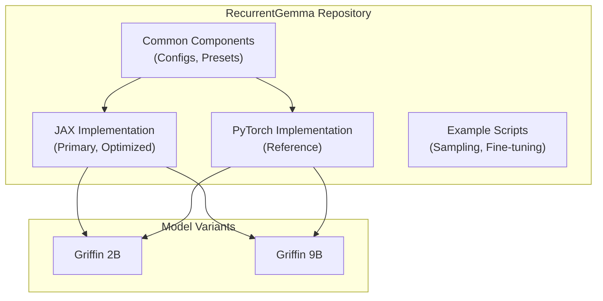
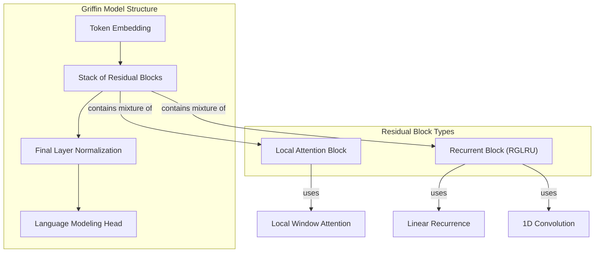
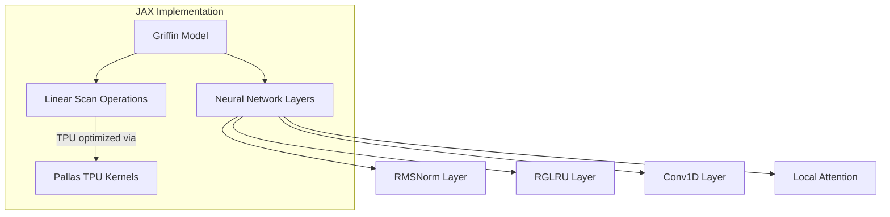
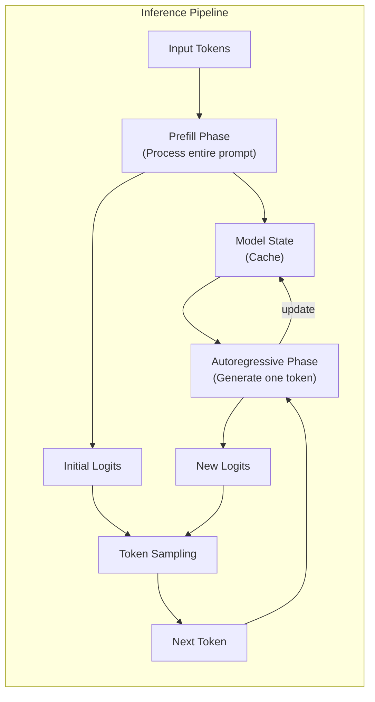

<!-- source: DeepWiki mcp.deepwiki.com · repo google-deepmind/recurrentgemma · page 1 Overview · fetched 2026-10-26 -->

# Overview

<details>
<summary>Relevant source files</summary>

The following files were used as context for generating this wiki page:

- [README.md](README.md)

</details>


This document provides a high-level introduction to RecurrentGemma, a family of open-weights Language Models developed by Google DeepMind. It covers the core architecture, implementation approaches, and key technical components. For detailed information about specific components, refer to other sections in this documentation, such as the [Griffin Model](#2.1), [Recurrent Components](#3.1), or [Usage Guide](#5).

## What is RecurrentGemma?

RecurrentGemma is a collection of language models based on the novel Griffin architecture, which achieves fast inference when generating long sequences. The key innovation is replacing traditional global attention mechanisms with a mixture of local attention and linear recurrences, making inference more efficient while maintaining quality.

The repository provides:

1. Model implementations in both JAX/Flax (optimized) and PyTorch (reference)
2. Pre-trained model weights (2B and 9B parameter variants)
3. Examples for text generation and fine-tuning
4. TPU-optimized kernels for high-performance operation



Sources: [README.md:1-5]()

## Technical Architecture

RecurrentGemma's Griffin architecture combines aspects of traditional transformer models with recurrent neural network elements. This hybrid approach delivers efficient processing of long sequences while maintaining the modeling capacity needed for language understanding and generation.

### Key Architecture Components



The core architectural innovation is the combination of:

1. **Local attention blocks** - Process information within a limited window rather than across the entire sequence
2. **Recurrent blocks** - Use linear recurrences via the Recurrent Gated Linear Recurrent Unit (RGLRU) to efficiently process long-range dependencies
3. **Residual connections** - Connect blocks in a way that information can flow through the network

This design enables efficient processing of long contexts by combining the strengths of transformers and recurrent neural networks.

Sources: [README.md:3-5]()

## Implementation Overview

RecurrentGemma provides two parallel implementations with distinct performance characteristics:

### JAX/Flax Implementation

The JAX implementation is the primary, performance-optimized version recommended for most users. It features:

- Highly optimized code for TPU acceleration
- Custom Pallas kernels for efficient linear scan operations 
- Support for both model inference and training/fine-tuning



### PyTorch Implementation

The PyTorch implementation is provided as a reference for users who prefer or require PyTorch:

- Functionally equivalent to the JAX implementation
- Less optimized for performance-critical operations
- Simpler implementation without custom kernels

### Framework Conversion

The repository also includes utilities to convert model weights between frameworks, allowing users to train in one framework and deploy in another if needed.

Sources: [README.md:5-6](), [README.md:105-107]()

## System Requirements and Performance

RecurrentGemma can run on CPU, GPU, or TPU hardware:

| Hardware            | T4  | P100 | V100 | A100 | TPUv2 | TPUv3+ |
|---------------------|:---:|:----:|:----:|:----:|:-----:|:------:|
| Sampling in JAX     | ✅  | ✅   | ✅   | ✅   | ✅    | ✅    |
| Sampling in PyTorch | ✅  | ✅   | ✅   | ✅   | ✅    | ✅    |
| Finetuning in JAX   | ✅  | ✅   | ✅   | ✅   | ❌    | ✅    |

The JAX implementation with Pallas kernels delivers the best performance on TPU hardware. The linear recurrence operation, which is a key component of the Griffin architecture, is particularly optimized in the JAX implementation.



This inference pipeline shows how RecurrentGemma processes input and generates text. The model first processes the entire prompt in a single "prefill" phase, then generates tokens one at a time in the "autoregressive" phase, updating the model state after each token.

Sources: [README.md:102-107](), [README.md:95-100]()

## Getting Started

RecurrentGemma can be installed using either Poetry or pip:

```
# Using Poetry
poetry install -E full  # For all dependencies
poetry install -E jax   # For JAX dependencies only
poetry install -E torch # For PyTorch dependencies only

# Using pip
pip install .[full]     # For all dependencies
pip install .[jax]      # For JAX dependencies only
pip install .[torch]    # For PyTorch dependencies only
```

Model weights are available through Kaggle at http://kaggle.com/models/google/recurrentgemma. The repository includes example scripts and Colab notebooks for:

1. Text generation (sampling) using both JAX and PyTorch
2. Fine-tuning using JAX
3. Model evaluation

For detailed usage instructions, refer to the [Usage Guide](#5) section.

Sources: [README.md:14-49](), [README.md:67-90]()

## Additional Resources

For more in-depth understanding of RecurrentGemma:

- [RecurrentGemma technical report](https://storage.googleapis.com/deepmind-media/gemma/recurrentgemma-report.pdf) - Details on training and evaluation
- [Griffin paper](https://arxiv.org/abs/2402.19427) - Underlying model architecture
- GitHub repository: https://github.com/google-deepmind/recurrentgemma

For specific implementation details, refer to the [Architecture](#2) and [Technical Components](#3) sections of this documentation.

Sources: [README.md:7-11]()

---

