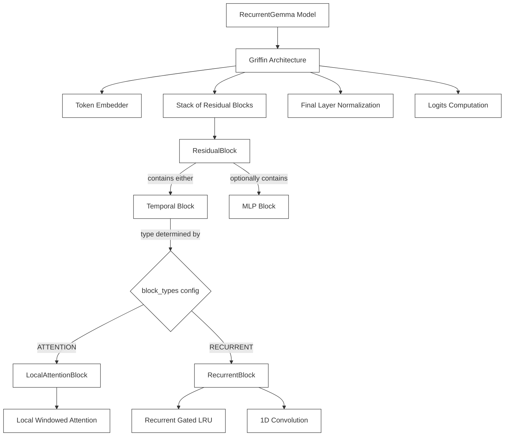
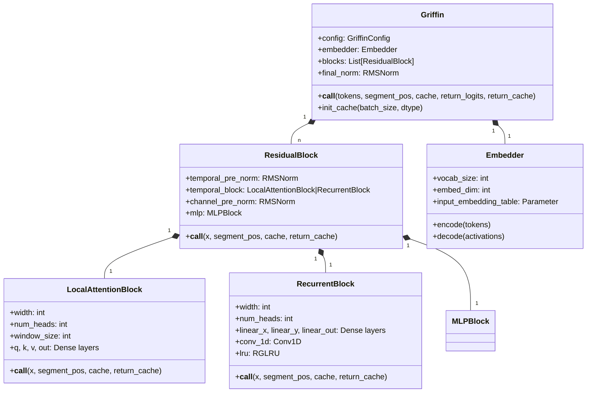
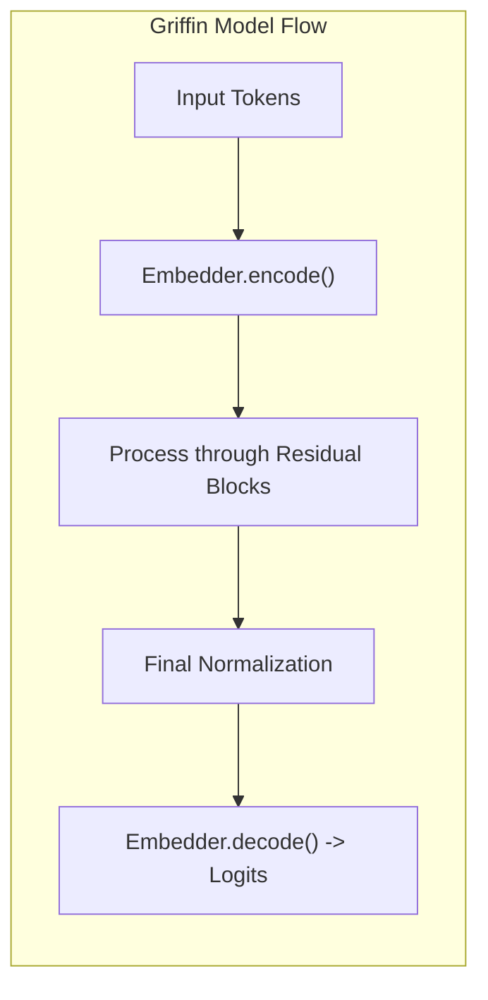
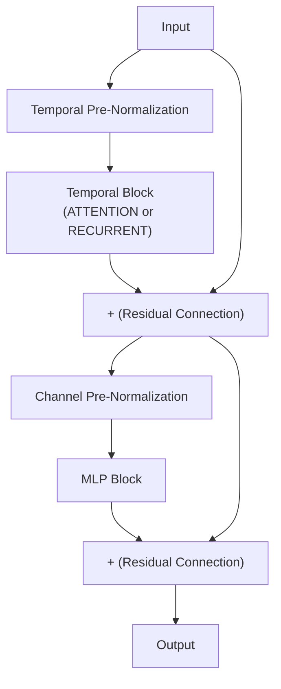
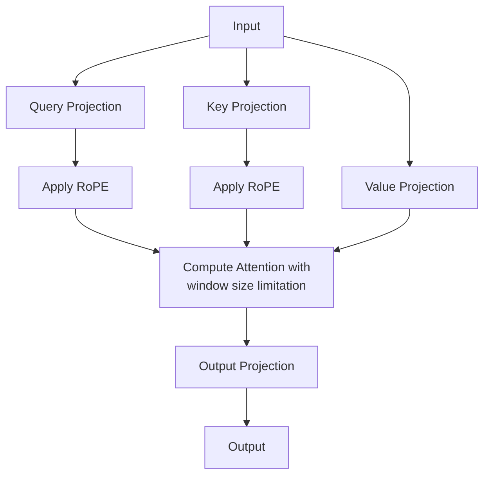
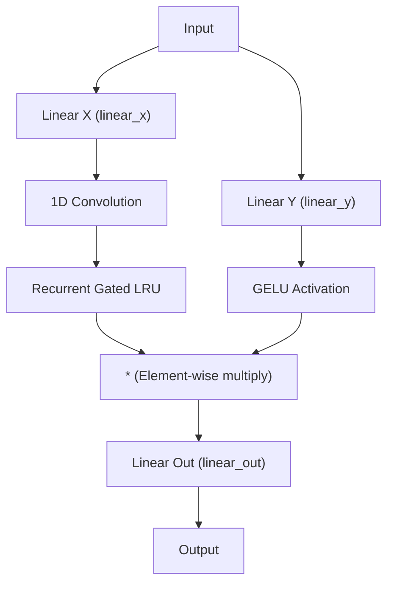
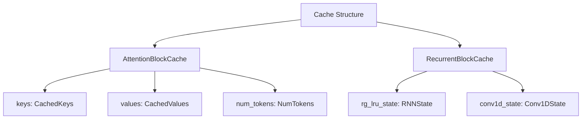
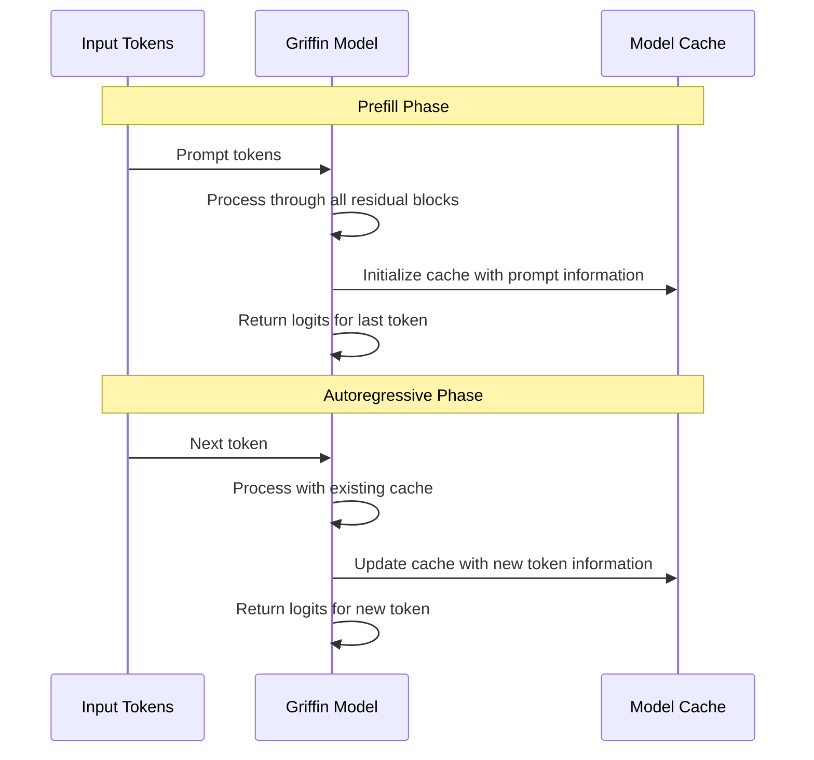

<!-- source: DeepWiki mcp.deepwiki.com · repo google-deepmind/recurrentgemma · page 2 Architecture · fetched 2026-10-26 -->

# Architecture

Relevant source files

The following files were used as context for generating this wiki page:

- [README.md](README.md)
- [recurrentgemma/jax/griffin.py](recurrentgemma/jax/griffin.py)
- [recurrentgemma/jax/modules.py](recurrentgemma/jax/modules.py)

This document outlines the overall architecture of RecurrentGemma, explaining how its components fit together to form a language model optimized for processing long sequences. RecurrentGemma is based on the novel Griffin architecture that replaces global attention with a mixture of local attention and linear recurrences for more efficient inference.

For details on specific components, see [Griffin Model](#2.1) and [Neural Network Layers](#2.2). For information about the configuration system, see [Model Configuration](#2.3).

## High-Level Architecture

RecurrentGemma provides implementations in both JAX/Flax (primary, highly-optimized) and PyTorch (reference implementation). Both implementations share the same underlying architectural principles but differ in optimization techniques.

Sources: [recurrentgemma/jax/griffin.py:31-201](), [recurrentgemma/jax/modules.py:696-888]()

The Griffin architecture consists of:
1. **Token Embedder**: Converts token IDs to embeddings
2. **Residual Blocks**: A stack of blocks that can contain either attention or recurrent mechanisms
3. **Final Layer Normalization**: Applied to the output of the last residual block
4. **Logits Computation**: Converts the normalized output back to vocabulary logits

## Model Components

The core of RecurrentGemma is the Griffin model, implemented as a `Griffin` class. It coordinates all model components and implements the forward pass logic.

Sources: [recurrentgemma/jax/griffin.py:31-201](), [recurrentgemma/jax/modules.py:251-428](), [recurrentgemma/jax/modules.py:445-630](), [recurrentgemma/jax/modules.py:633-693](), [recurrentgemma/jax/modules.py:890-941]()

### Griffin Model

The `Griffin` class is the main model class that ties all components together:

Sources: [recurrentgemma/jax/griffin.py:129-181]()

Key components in the Griffin model:

- **Embedder**: Converts input tokens to embeddings and output embeddings back to logits
- **Residual Blocks**: A sequence of blocks configured by `block_types` in the config
- **Final Normalization**: RMSNorm layer applied before computing logits
- **Cache Handling**: Manages caches for each residual block for efficient autoregressive generation

## Residual Block Architecture

The `ResidualBlock` is the fundamental building block of the Griffin architecture. Each residual block can contain either a `LocalAttentionBlock` or a `RecurrentBlock` based on the configuration.

Sources: [recurrentgemma/jax/modules.py:696-855]()

The residual block:
1. Applies RMSNorm (temporal pre-norm) to the input
2. Processes the normalized input through either a LocalAttentionBlock or RecurrentBlock
3. Adds the output back to the input (residual connection)
4. Optionally applies another RMSNorm (channel pre-norm) and processes through an MLP
5. Adds another residual connection to the output

## Temporal Blocks

RecurrentGemma uses two types of temporal blocks:

### 1. Local Attention Block

Sources: [recurrentgemma/jax/modules.py:251-428]()

The `LocalAttentionBlock` implements windowed attention:
- Only attends to a limited window of previous tokens
- Uses RoPE (Rotary Position Embeddings) for positional information
- Maintains a cache of keys and values for efficient autoregressive generation

### 2. Recurrent Block

Sources: [recurrentgemma/jax/modules.py:445-630]()

The `RecurrentBlock` combines linear projections, convolution, and recurrence:
- Processes input through parallel x and y branches
- The x branch applies 1D convolution followed by RGLRU
- The y branch applies a linear transformation and GELU activation
- The outputs are combined through element-wise multiplication
- A final linear projection produces the output

## Caching Mechanism

RecurrentGemma implements efficient caching for autoregressive generation:

Sources: [recurrentgemma/jax/modules.py:28-51](), [recurrentgemma/jax/griffin.py:28-28](), [recurrentgemma/jax/modules.py:183-248](), [recurrentgemma/jax/modules.py:429-630]()

The caching mechanism ensures efficient memory usage during text generation:

- **AttentionBlockCache**: Stores keys, values, and the count of processed tokens
- **RecurrentBlockCache**: Stores the state of the RGLRU and the Conv1D components
- **Griffin init_cache**: Creates an empty cache structure for the entire model

## Execution Flow

The execution flow of RecurrentGemma varies between the prompt processing (prefill) phase and the autoregressive generation phase:

Sources: [recurrentgemma/jax/griffin.py:129-181](), [recurrentgemma/jax/modules.py:350-427](), [recurrentgemma/jax/modules.py:558-606]()

This two-phase approach allows RecurrentGemma to process prompts efficiently and then generate tokens one at a time by reusing computation through caching.

## Optimizations

RecurrentGemma includes several optimizations for efficient computation:

1. **Gradient Checkpointing**: Optional feature to reduce memory usage during training
2. **Pallas Optimization**: For TPU-optimized kernels (particularly for the linear scan in recurrent layers)
3. **Multiple Scan Implementations**: Different scan implementations (Linear Pallas, Linear Native, Associative Native) for different hardware
4. **Efficient Caching**: Special handling for autoregressive generation vs. prompt processing

Sources: [recurrentgemma/jax/griffin.py:45-45](), [recurrentgemma/jax/modules.py:466-466](), [README.md:103-106]()

## Summary

The RecurrentGemma architecture combines transformer-like components with recurrent mechanisms to create a model that efficiently handles long sequences. By using a mixture of local attention and linear recurrences, it achieves better inference speed than traditional transformer models when generating long sequences.

Key innovations include:
- Combination of attention and recurrence in a unified architecture
- Local windowed attention for efficient computation
- Recurrent Gated LRU for linear scaling with sequence length
- Efficient caching mechanism for autoregressive generation

For more details on the specific components, see [Neural Network Layers](#2.2) and [Recurrent Components](#3.1).

---

