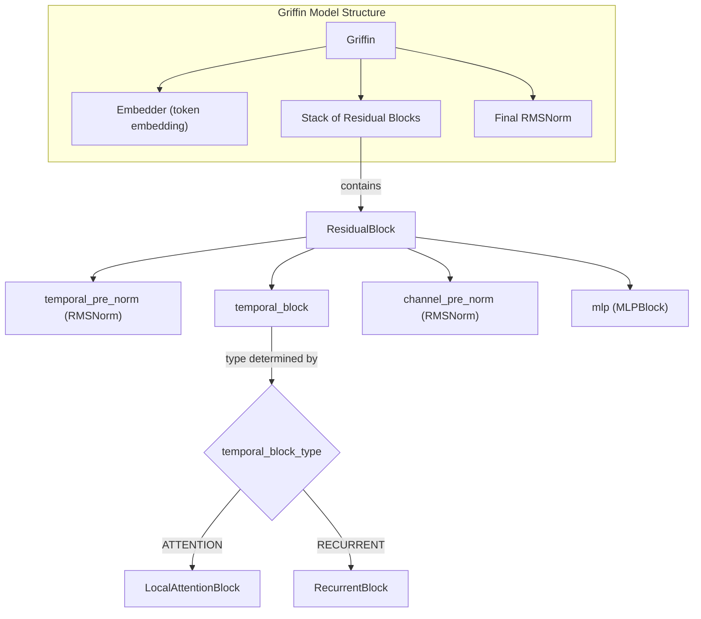
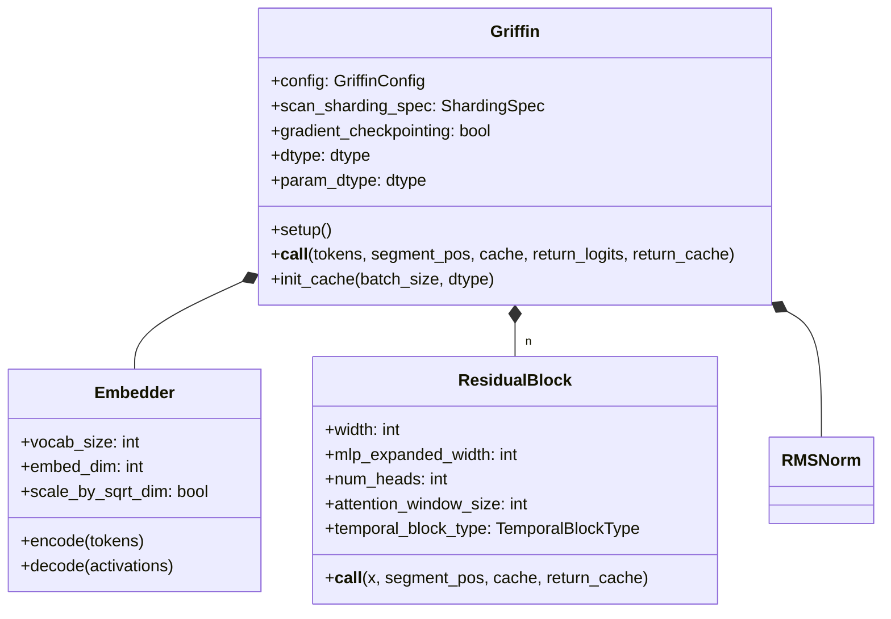
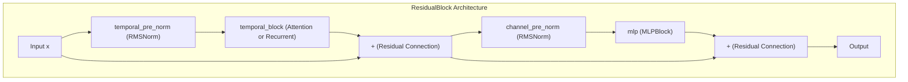
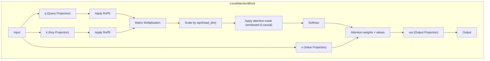
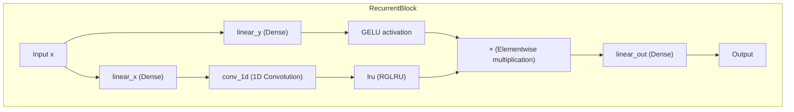
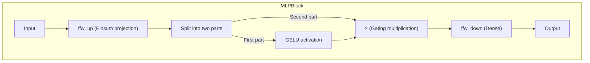
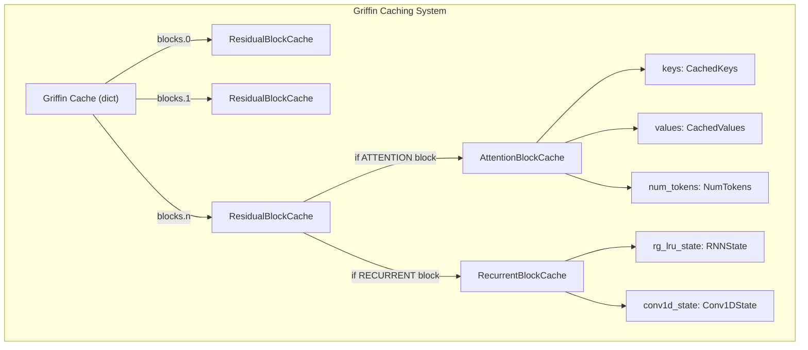
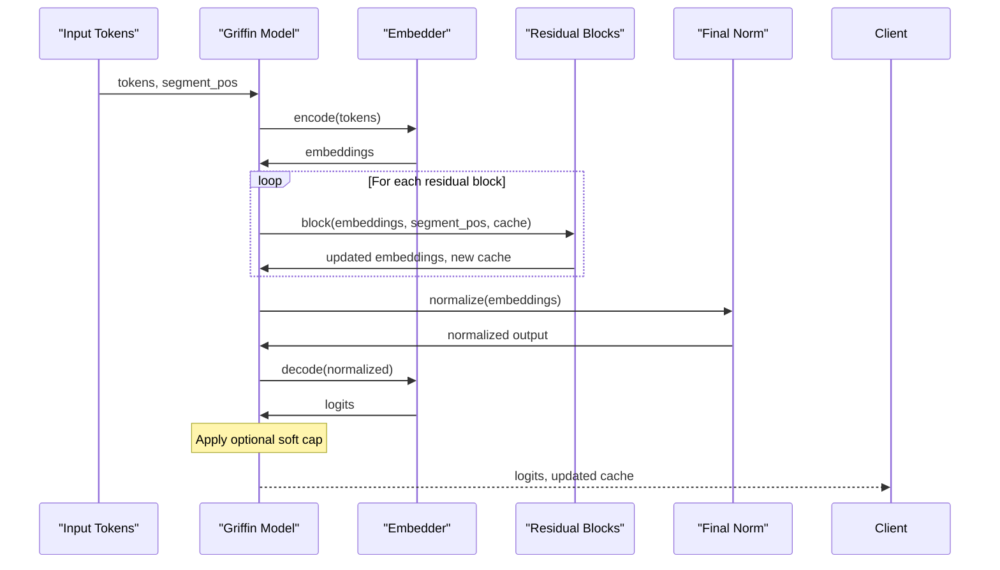

<!-- source: DeepWiki mcp.deepwiki.com · repo google-deepmind/recurrentgemma · page 2.1 Griffin Model · fetched 2026-10-26 -->

# Griffin Model

Relevant source files

The following files were used as context for generating this wiki page:

- [README.md](README.md)
- [recurrentgemma/jax/griffin.py](recurrentgemma/jax/griffin.py)
- [recurrentgemma/jax/modules.py](recurrentgemma/jax/modules.py)

The Griffin Model is the core neural network architecture behind RecurrentGemma, a family of language models designed to achieve fast inference for long sequences. This page describes the Griffin model architecture, its components, and how they work together to efficiently process text.

For information about specific neural network layers used in Griffin, see [Neural Network Layers](#2.2). For details on the recurrent mechanisms, see [Recurrent Components](#3.1).

## Overview of Griffin Architecture

The Griffin architecture represents a novel approach to language modeling that combines traditional transformer components with recurrent elements. It replaces the global attention mechanism found in standard transformers with a mixture of local attention and linear recurrences, allowing for more efficient processing of long sequences.

Sources: [recurrentgemma/jax/griffin.py:31-83](), [recurrentgemma/jax/modules.py:696-887]()

## Main Components

The Griffin model is composed of three primary components:

1. **Token Embedder** - Converts input tokens to embeddings
2. **Stack of Residual Blocks** - The main processing layers that consist of either recurrent or attention blocks
3. **Final Layer Normalization** - Normalizes the output before generating logits

Each of these components works together to form the complete Griffin model, with the implementation defined in the `Griffin` class.

Sources: [recurrentgemma/jax/griffin.py:31-201]()

## Residual Blocks

The heart of the Griffin architecture is the `ResidualBlock`, which combines sequential processing with residual connections. Each residual block contains:

1. A temporal pre-normalization layer (`RMSNorm`)
2. A temporal block (either `LocalAttentionBlock` or `RecurrentBlock`)
3. A channel pre-normalization layer (`RMSNorm`)
4. An MLP block

The type of temporal block used in each residual block is determined by the configuration parameter `temporal_block_type`, which can be either `ATTENTION` or `RECURRENT`.

Sources: [recurrentgemma/jax/modules.py:696-855]()

## Temporal Block Types

Griffin uses two types of temporal blocks that can be configured in any combination across the model's layers:

### Local Attention Block

The `LocalAttentionBlock` implements a windowed multi-head attention mechanism that attends only to a limited window of tokens around the current position, rather than the full sequence. This approach reduces computational complexity while maintaining good performance for many tasks.

Sources: [recurrentgemma/jax/modules.py:251-442]()

### Recurrent Block

The `RecurrentBlock` implements a novel approach using Recurrent Gated Linear Recurrent Units (RGLRU) combined with 1D convolution. This enables efficient processing of long-range dependencies without the quadratic complexity of traditional attention mechanisms.

Sources: [recurrentgemma/jax/modules.py:445-630]()

## MLP Block

The `MLPBlock` in Griffin follows a standard design with a few optimizations:

1. It uses a dense up-projection that produces two outputs
2. One output passes through a GELU activation
3. The activated output gates the second output via element-wise multiplication
4. The result is projected back down to the original dimension

Sources: [recurrentgemma/jax/modules.py:633-693]()

## Cache Mechanism for Efficient Inference

Griffin supports efficient autoregressive generation through a sophisticated caching mechanism. The model maintains two types of caches:

1. **AttentionBlockCache** - Stores keys and values for the local attention blocks
2. **RecurrentBlockCache** - Stores states for the recurrent blocks (RGLRU state and Conv1D state)

These caches allow the model to avoid recomputing previously processed tokens during text generation, significantly speeding up inference.

Sources: [recurrentgemma/jax/modules.py:34-50](), [recurrentgemma/jax/griffin.py:28-28](), [recurrentgemma/jax/griffin.py:183-201]()

## Model Configuration

The Griffin model is configured through the `GriffinConfig` class, which defines parameters such as:

- Model dimensions (width, number of heads, etc.)
- Block types sequence (which layers use attention vs. recurrent)
- Vocabulary size
- Window size for local attention
- Scan type for recurrent components

For detailed information about model configuration options, see [Model Configuration](#2.3).

## Forward Pass Execution

When the Griffin model is called, it executes the following sequence of operations:

1. Embed input tokens using the Embedder
2. Pass the embeddings through each ResidualBlock, maintaining cache if provided
3. Apply final layer normalization
4. Generate logits by decoding the normalized output
5. Apply optional soft cap to logits
6. Return the logits and/or updated cache based on the function arguments

Sources: [recurrentgemma/jax/griffin.py:129-181]()

## Summary

The Griffin model represents a novel architecture that combines the best aspects of transformers and recurrent neural networks. By using a mixture of local attention and linear recurrences, it achieves efficient processing of long sequences without the quadratic complexity of standard transformer models.

The core innovation lies in the `RecurrentBlock` components that incorporate the Recurrent Gated Linear Recurrent Unit (RGLRU), enabling the model to capture long-range dependencies efficiently. This design makes Griffin particularly well-suited for tasks that require processing and generating long texts while maintaining high computational efficiency.

---

