<!-- source: DeepWiki mcp.deepwiki.com · repo google-deepmind/recurrentgemma · page 2.2 Neural Network Layers · fetched 2026-10-26 -->

# Neural Network Layers

<details>
<summary>Relevant source files</summary>

The following files were used as context for generating this wiki page:

- [recurrentgemma/jax/layers.py](recurrentgemma/jax/layers.py)
- [recurrentgemma/jax/layers_test.py](recurrentgemma/jax/layers_test.py)

</details>


This document details the fundamental neural network layers that serve as building blocks for the RecurrentGemma models. These layers are primarily implemented in the JAX framework and provide the core mathematical operations required for both traditional transformer components and recurrent elements. For information about the overall architecture design, see [Architecture](#2), and for detailed information about recurrent mechanisms, see [Recurrent Components](#3.1).

## Layer Overview

RecurrentGemma implements several specialized neural network layers that together form the foundation of the Griffin model. These include normalization layers, linear transformations, and recurrent components with specific optimizations for efficient sequence processing.

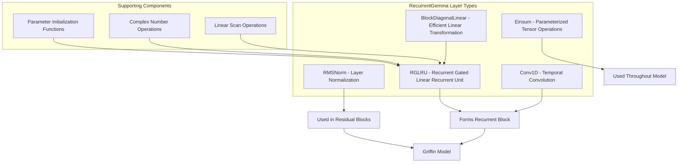

Sources: [recurrentgemma/jax/layers.py:15-788]()

## Core Layers

### RMSNorm

RMSNorm (Root Mean Square Normalization) is a normalization technique that scales inputs by the root mean square of the features. It's simpler than LayerNorm as it doesn't perform mean centering.

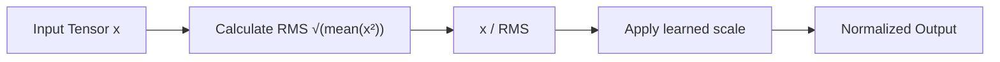

Key implementation details:
- Unlike LayerNorm, RMSNorm only performs scaling, not centering
- Includes a small epsilon term for numerical stability
- Uses a learned scale parameter initialized to zeros

**Implementation:**
```
def __call__(self, x):
    # Calculate variance (mean of squared values)
    var = jnp.mean(jnp.square(x), axis=-1, keepdims=True)
    # Normalize by root mean square
    normed_x = x * jax.lax.rsqrt(var + self.eps)
    # Apply learned scale parameter (offset by 1)
    return normed_x * (scale + 1)
```

Sources: [recurrentgemma/jax/layers.py:32-66]()

### BlockDiagonalLinear

A specialized linear transformation that uses a block-diagonal structure to reduce parameter count while maintaining expressiveness.

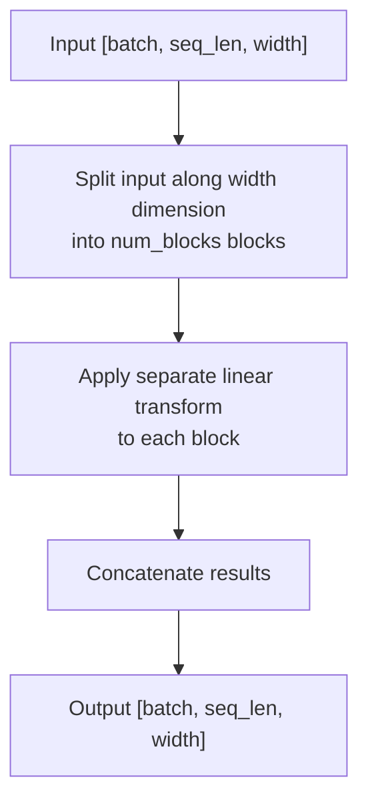

Key properties:
- Divides input/output into blocks for more efficient computation
- Each block has its own weight matrix, forming a block-diagonal structure
- Includes bias terms for each block
- Reduces parameters compared to full matrix while maintaining expressiveness

Sources: [recurrentgemma/jax/layers.py:69-139]()

### RGLRU (Recurrent Gated Linear Recurrent Unit)

RGLRU is a key innovation in RecurrentGemma that enables efficient processing of long sequences through linear recurrences. It combines gating mechanisms with linear state transitions.

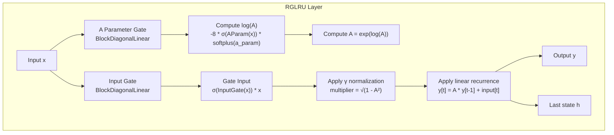

Key features:
- Uses complex number operations for certain configurations
- Applies specialized gradient stabilization techniques
- Supports both real and complex recurrent dynamics
- Manages document boundaries via segment positions
- Optimized for TPU through Pallas kernels for linear scan operations
- Maintains a persistent cache for autoregressive generation

Sources: [recurrentgemma/jax/layers.py:142-478]()

### Conv1D

A 1D temporal convolution layer that processes information across the sequence dimension.

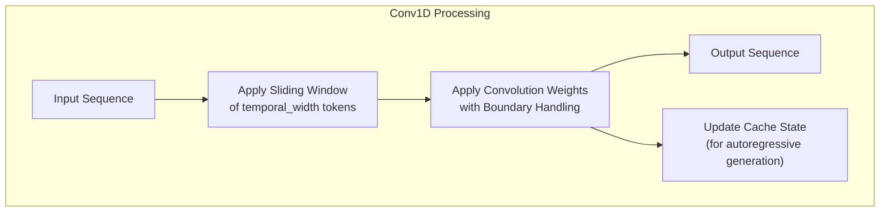

Key implementation details:
- Performs 1D convolution along the temporal dimension
- Handles document boundaries to prevent information leakage between documents
- Provides specialized caching for autoregressive generation
- Manages state for efficient decoding during inference
- Ensures proper padding for different sequence lengths

Sources: [recurrentgemma/jax/layers.py:481-735]()

### Einsum

A utility layer that implements parameterized tensor operations using Einstein summation notation.

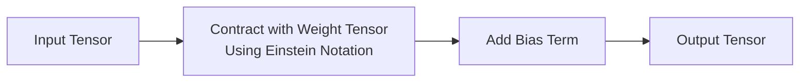

Key features:
- Flexible tensor operations through configurable Einstein summation equations
- Supports arbitrary tensor shapes through the equation specification
- Includes learned weights and bias parameters
- Simplifies implementation of custom linear transformations

Sources: [recurrentgemma/jax/layers.py:738-787]()

## Layer Integration in Griffin Architecture

The neural network layers described above are composed to build the Griffin model architecture. This diagram shows how these layers integrate into the larger model structure:

```mermaid
graph TD
    subgraph "Griffin Model"
        TokenEmb["Token Embedder"] --> ResBlocks["Stack of Residual Blocks"]
        ResBlocks --> FinalNorm["Final RMSNorm"]
        FinalNorm --> Output["Output Logits"]
    end
    
    subgraph "Residual Block"
        Input["Block Input"] --> TempNorm["Temporal RMSNorm"]
        TempNorm --> BlockType{{"Block Type?"}}
        BlockType -- "Attention Block" --> LocalAtt["Local Attention"]
        BlockType -- "Recurrent Block" --> RecBlock["Recurrent Block"]
        
        LocalAtt --> AddFirst["Residual Add"]
        RecBlock --> AddFirst
        
        AddFirst --> ChanNorm["Channel RMSNorm"]
        ChanNorm --> MLP["MLP Block<br>(uses BlockDiagonalLinear)"]
        MLP --> AddSecond["Residual Add"]
        AddSecond --> BlockOutput["Block Output"]
    end
    
    subgraph "Recurrent Block"
        RecInput["Input"] --> RGLRU_Layer["RGLRU Layer"]
        RGLRU_Layer --> Conv1D_Layer["Conv1D Layer"]
        Conv1D_Layer --> RecOutput["Output"]
    end
```

Sources: [recurrentgemma/jax/layers.py:32-788]()

## Complex Number Handling

The RGLRU layer includes specialized handling for complex numbers, which is important for certain configurations of the recurrent dynamics.

### Complex Number Implementation

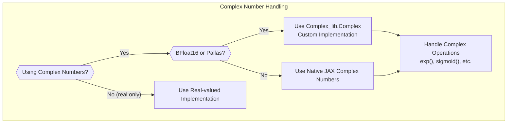

Key aspects:
- Supports both real-only and complex modes through the `only_real` flag
- Uses custom complex number implementation for bfloat16 compatibility
- Handles complex operations like exponential and sigmoid
- Includes utilities for converting between merged representation (real and imaginary parts concatenated) and complex representation

Sources: [recurrentgemma/jax/layers.py:218-322](), [recurrentgemma/jax/layers.py:347-471]()

## Parameter Initialization

The RGLRU layer uses specialized parameter initialization techniques to ensure stable recurrent dynamics.

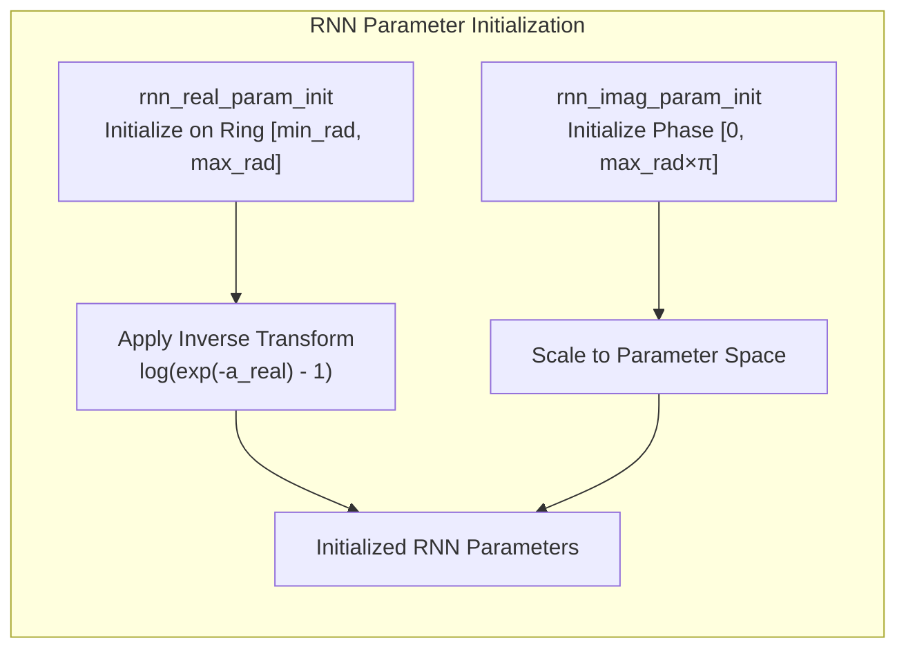

Key features:
- Initializes recurrent parameters on a ring in complex plane for stability
- Uses specialized transforms to ensure proper parameter ranges
- Separates real and imaginary parameter initialization
- Controls the magnitude of recurrent dynamics through min_rad and max_rad parameters

Sources: [recurrentgemma/jax/layers.py:142-181]()

## Gradient Control Mechanisms

RecurrentGemma implements specialized mechanisms to control gradients for numerical stability, especially in operations like square root where gradients can explode.

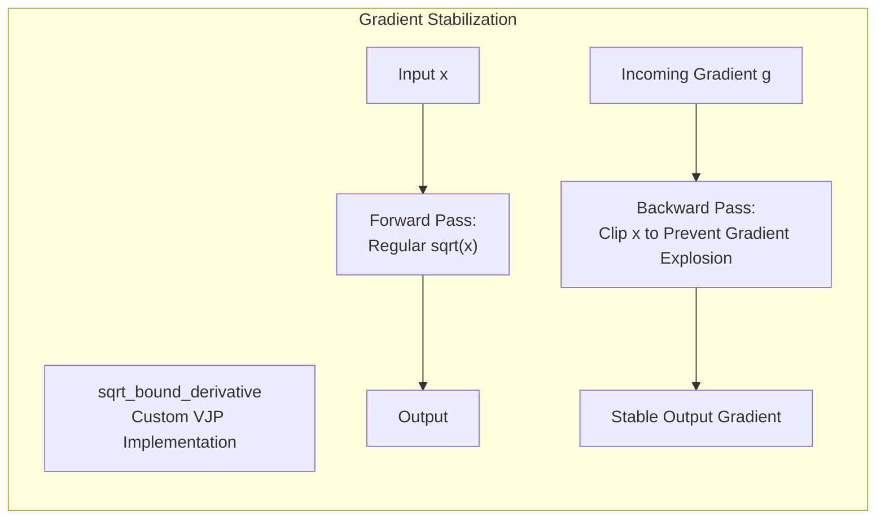

Key aspects:
- Custom VJP (vector-Jacobian product) implementation for sqrt
- Prevents gradient explosion by clipping values in backward pass
- Essential for stable training in bfloat16 precision
- Particularly used in the RGLRU normalization logic

Sources: [recurrentgemma/jax/layers.py:184-214](), [recurrentgemma/jax/layers.py:451-453]()

## Caching Mechanisms for Autoregressive Generation

Both RGLRU and Conv1D layers implement specialized caching mechanisms to support efficient autoregressive generation.

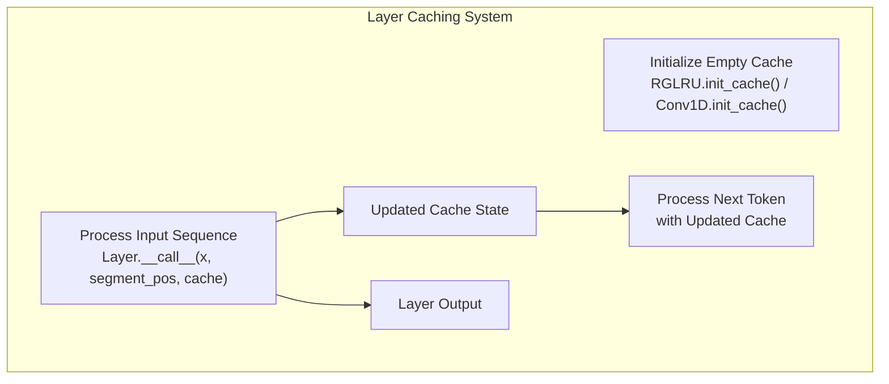

Key aspects:
- RGLRU maintains state as a compact representation of sequence history
- Conv1D stores previous `temporal_width-1` inputs for proper convolution
- Both layers handle cache initialization, updates, and propagation
- Crucial for efficient autoregressive generation with recurrent components

Sources: [recurrentgemma/jax/layers.py:474-478](), [recurrentgemma/jax/layers.py:725-735]()

## Conclusion

The neural network layers in RecurrentGemma provide a foundation for efficient sequence processing with a focus on linear recurrences and proper handling of document boundaries. The RGLRU and Conv1D layers in particular are key innovations that enable the model's strong performance on long sequences. These layers are integrated into the Griffin model architecture to form the complete RecurrentGemma system.

---

