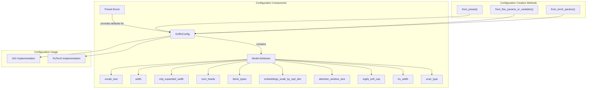
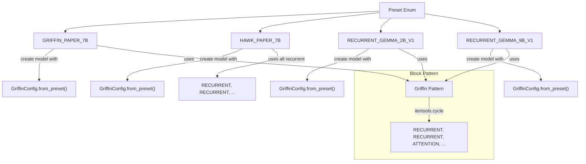
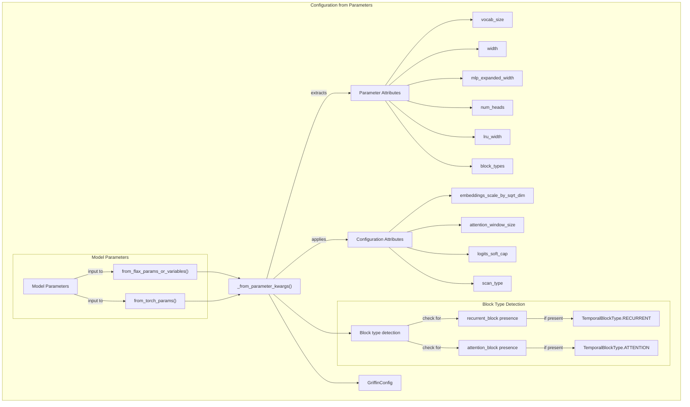
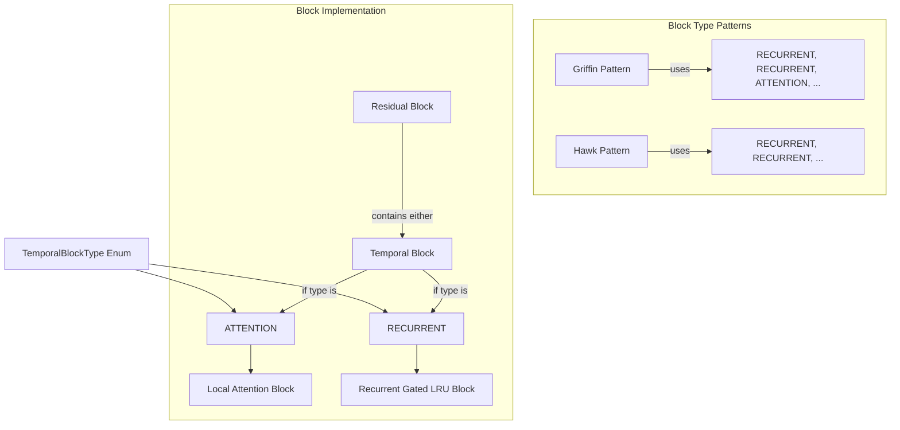
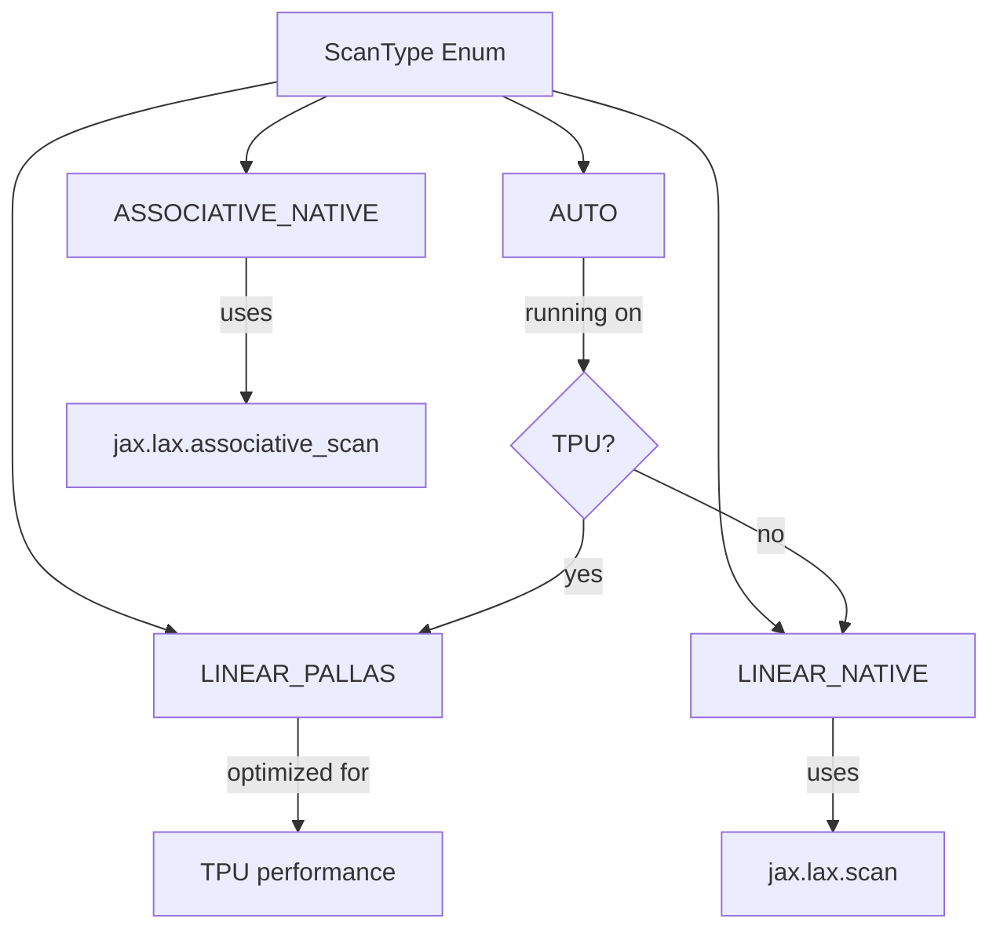
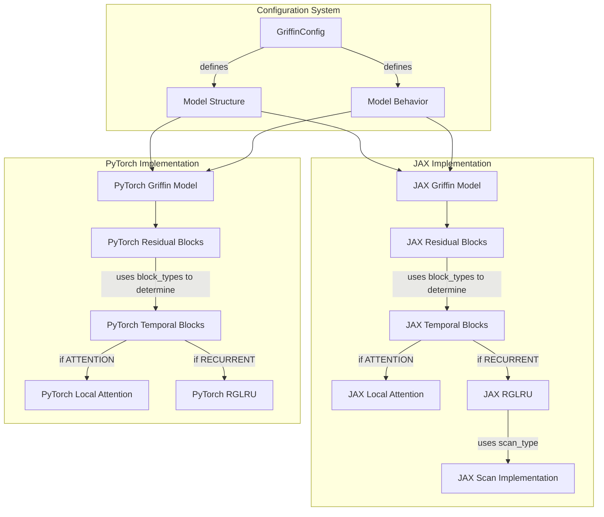

<!-- source: DeepWiki mcp.deepwiki.com · repo google-deepmind/recurrentgemma · page 2.3 Model Configuration · fetched 2026-10-26 -->

# Model Configuration

<details>
<summary>Relevant source files</summary>

The following files were used as context for generating this wiki page:

- [README.md](README.md)
- [recurrentgemma/common.py](recurrentgemma/common.py)

</details>


## Purpose and Scope

This document explains the configuration system for RecurrentGemma models, including how the default presets are defined, the structure of model configurations, and methods for creating or modifying configurations. For information about the neural network layers and components that these configurations govern, see [Neural Network Layers](#2.2) and [Griffin Model](#2.1).

## Configuration Overview

RecurrentGemma's configuration system centers around the `GriffinConfig` class, which defines all necessary parameters for instantiating models based on the Griffin architecture. The system includes predefined presets for different model sizes and provides methods to create configurations from existing model parameters.



Sources: [recurrentgemma/common.py:117-163]()

## GriffinConfig Class

The `GriffinConfig` is a NamedTuple that encapsulates all parameters required to define a Griffin model architecture. It contains the following attributes:

| Attribute | Type | Description |
|-----------|------|-------------|
| `vocab_size` | int | Number of tokens in the vocabulary |
| `width` | int | Dimensionality of the model (embeddings and output of each layer) |
| `mlp_expanded_width` | int | Width of the hidden layer in the MLP block |
| `num_heads` | int | Number of attention heads and number of blocks for block-diagonal layers in RG-LRU gates |
| `block_types` | tuple of `TemporalBlockType` | Sequence defining the type of each residual block (ATTENTION or RECURRENT) |
| `embeddings_scale_by_sqrt_dim` | bool | Whether to scale embeddings output by `sqrt(width)` |
| `attention_window_size` | int | Size of the attention window in attention blocks |
| `logits_soft_cap` | float | Caps logits values (if >0) by applying tanh |
| `lru_width` | int or None | Width of the RG-LRU if different from `width` |
| `scan_type` | ScanType | Implementation to use for the scan in the RG-LRU (for JAX) |

The class also provides two property methods:
- `max_cache_length`: Returns the maximum length of the cache used for the model (equal to `attention_window_size`)
- `num_layers`: Returns the number of layers in the model (equal to the length of `block_types`)

Sources: [recurrentgemma/common.py:117-163]()

## Model Presets

RecurrentGemma provides four predefined model presets:



Sources: [recurrentgemma/common.py:44-114]()

### Preset Configurations

The table below compares the key configurations across the available presets:

| Parameter | GRIFFIN_PAPER_7B | HAWK_PAPER_7B | RECURRENT_GEMMA_2B_V1 | RECURRENT_GEMMA_9B_V1 |
|-----------|-----------------|---------------|------------------------|------------------------|
| `width` | 4096 | 4096 | 2560 | 4096 |
| `mlp_expanded_width` | 12288 | 12288 | 7680 | 12288 |
| `num_heads` | 32 | 32 | 10 | 16 |
| `lru_width` | 5632 | 5632 | 2560 | 4096 |
| `num_layers` | 32 | 32 | 26 | 38 |
| `block_pattern` | R-R-A cycle | All Recurrent | R-R-A cycle | R-R-A cycle |
| `embeddings_scale_by_sqrt_dim` | False | False | True | True |
| `attention_window_size` | 1024 | 1024 | 2048 | 2048 |
| `logits_soft_cap` | 0.0 | 0.0 | 30.0 | 30.0 |

R-R-A cycle refers to a repeating pattern of two Recurrent blocks followed by one Attention block.

Sources: [recurrentgemma/common.py:54-114]()

## Creating Model Configurations

There are three main ways to create a `GriffinConfig`:

1. From preset:
```python
config = GriffinConfig.from_preset(
    preset=Preset.RECURRENT_GEMMA_2B_V1,
    vocab_size=256_000,  # Optional, defaults to 256,000
    max_sequence_length=None,  # Optional, limits attention window size
)
```

2. From Flax parameters:
```python
config = GriffinConfig.from_flax_params_or_variables(
    flax_params_or_variables=params,
    preset=Preset.RECURRENT_GEMMA_2B_V1,  # Optional
    embeddings_scale_by_sqrt_dim=None,  # Optional, from preset if None
    attention_window_size=None,  # Optional, from preset if None
    logits_soft_cap=None,  # Optional, from preset if None
    scan_type=ScanType.AUTO,  # Optional
    max_sequence_length=None,  # Optional
)
```

3. From PyTorch parameters:
```python
config = GriffinConfig.from_torch_params(
    params=params,
    preset=Preset.RECURRENT_GEMMA_2B_V1,  # Optional
    embeddings_scale_by_sqrt_dim=None,  # Optional, from preset if None
    attention_window_size=None,  # Optional, from preset if None
    logits_soft_cap=None,  # Optional, from preset if None
    scan_type=None,  # Optional, from preset if None
    max_sequence_length=None,  # Optional
)
```

Sources: [recurrentgemma/common.py:164-409]()

## Configuration Loading Process

The following diagram illustrates how the configuration is reconstructed from model parameters:



Sources: [recurrentgemma/common.py:179-409]()

## Using Temporal Block Types

Model configurations use the `TemporalBlockType` enum to define the pattern of blocks in the model. This determines whether each layer uses attention or recurrence for temporal mixing:



Sources: [recurrentgemma/common.py:22-28](), [recurrentgemma/common.py:56-60]()

## Scan Type Configuration

For JAX implementations, the `ScanType` enum controls which implementation to use for the scan operation in the RG-LRU:



Sources: [recurrentgemma/common.py:30-42]()

## Relationship to Other Components

The `GriffinConfig` defines the structure and behavior of model components in both the JAX and PyTorch implementations:



Sources: [recurrentgemma/common.py:117-163](), [README.md:1-128]()

---

