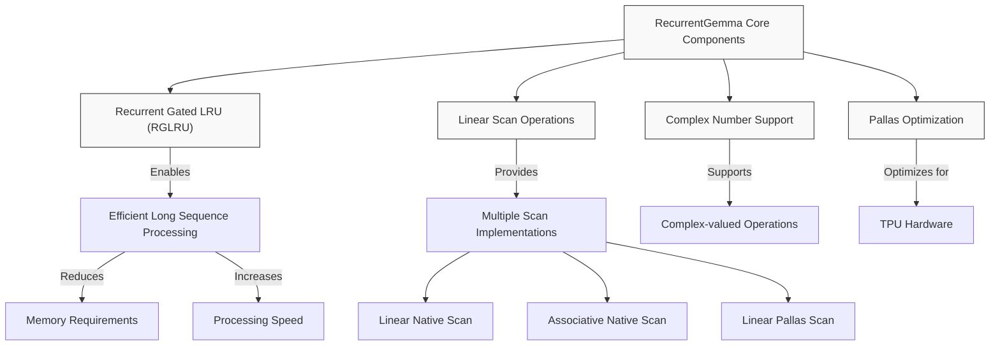
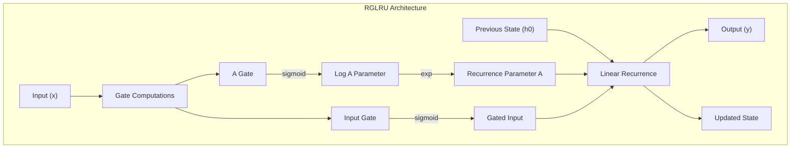
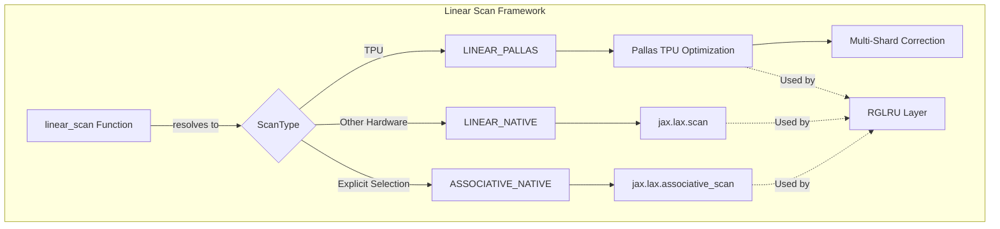
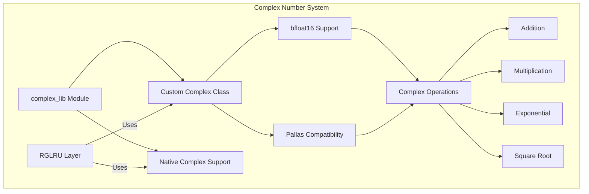
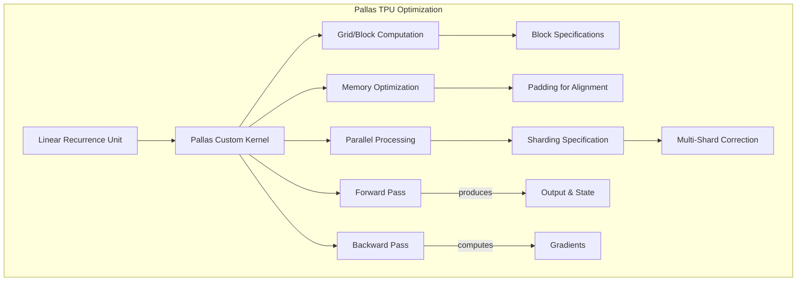

<!-- source: DeepWiki mcp.deepwiki.com · repo google-deepmind/recurrentgemma · page 3 Technical Components · fetched 2026-10-26 -->

# Technical Components

<details>
<summary>Relevant source files</summary>

The following files were used as context for generating this wiki page:

- [recurrentgemma/jax/layers.py](recurrentgemma/jax/layers.py)
- [recurrentgemma/jax/pallas.py](recurrentgemma/jax/pallas.py)
- [recurrentgemma/jax/scan.py](recurrentgemma/jax/scan.py)

</details>


This page provides an overview of the key technical innovations in RecurrentGemma that enable efficient processing of long sequences. For the high-level model architecture, see [Architecture](#2), and for detailed implementation specifics in different frameworks, see [Implementations](#4).

RecurrentGemma introduces several novel technical components that differentiate it from traditional transformer architectures, with a focus on leveraging recurrent mechanisms for efficient long-sequence processing.

## Key Innovations Overview



Sources: [recurrentgemma/jax/layers.py](), [recurrentgemma/jax/scan.py](), [recurrentgemma/jax/pallas.py]()

## Recurrent Gated LRU (RGLRU)

The RGLRU (Recurrent Gated Linear Recurrent Unit) is a core innovation in RecurrentGemma that enables efficient processing of long sequences through linear recurrence mechanisms.



Sources: [recurrentgemma/jax/layers.py:217-478]()

The RGLRU layer combines:

1. **Gating mechanisms** - Controls information flow with sigmoid gates
2. **Linear recurrence** - Enables efficient processing of arbitrary sequence lengths
3. **Complex-valued operations** - Uses complex numbers for enhanced representational capacity

Key implementation details:

- **Parameter initialization** - Special initialization methods for real and imaginary parameters on a ring
- **Gamma normalization** - Includes normalization to prevent numerical instability
- **Hidden state management** - Tracks sequence state for efficient processing

Example usage context:
```
RGLRU(
    width=model_width,                 # Hidden dimension size
    num_heads=num_recurrent_heads,     # Number of heads for block-diagonal computation
    scan_type=ScanType.AUTO,           # Automatically select scan implementation
    only_real=only_real,               # Whether to use complex numbers
    dtype=dtype                        # Computation precision
)
```

Sources: [recurrentgemma/jax/layers.py:217-478]()

## Linear Scan Operations

RecurrentGemma implements multiple scan operations for the linear recurrence, with automatic selection based on hardware platform.



Sources: [recurrentgemma/jax/scan.py:15-470](), [recurrentgemma/jax/pallas.py:15-982]()

### Scan Type Resolution

The system automatically selects the appropriate scan implementation based on the hardware platform:

```python
def resolve_scan_type(scan_type: common.ScanType) -> common.ScanType:
  match scan_type:
    case common.ScanType.AUTO:
      if jax.local_devices()[0].platform == "tpu":
        return common.ScanType.LINEAR_PALLAS
      else:
        return common.ScanType.LINEAR_NATIVE
    case _:
      return scan_type
```

The scan implementations include:

1. **LINEAR_NATIVE** - Uses `jax.lax.scan` for standard hardware
2. **ASSOCIATIVE_NATIVE** - Uses `jax.lax.associative_scan` which can be more efficient for certain sequence lengths
3. **LINEAR_PALLAS** - TPU-optimized implementation using the Pallas compiler

Sources: [recurrentgemma/jax/scan.py:33-42](), [recurrentgemma/jax/scan.py:352-470]()

### Multi-Shard Correction

For distributed computation across multiple devices, RecurrentGemma implements a multi-shard correction mechanism that ensures correct computation of the recurrence when the sequence is sharded across devices:

```python
def multi_shard_correction(
    *,
    y: complex_lib.RealOrComplex,
    a_prod: complex_lib.RealOrComplex,
    h0: complex_lib.RealOrComplex | None,
    reverse: bool,
    h_last: complex_lib.RealOrComplex | None = None,
    a_prod_last: complex_lib.RealOrComplex | None = None,
    acc_float_dtype: jnp.dtype = jnp.float32,
    seq_axis: str | None = None,
    seq_axis_index_groups: list[list[int]] | None = None,
    shift_a_prod: bool = False,
    sync_h_last: bool = True,
) -> tuple[
    complex_lib.RealOrComplex,
    complex_lib.RealOrComplex,
    complex_lib.RealOrComplex,
]:
  # Implementation details
```

This correction is a critical component for scaling recurrent computation to large sequences distributed across multiple accelerators.

Sources: [recurrentgemma/jax/pallas.py:71-193]()

## Complex Number Support

RecurrentGemma includes custom implementations for complex number operations, particularly important for the RGLRU layer which can operate in the complex domain.



Sources: [recurrentgemma/jax/layers.py:217-478]()

The complex number implementation provides:

1. Support for `bfloat16` precision, which normally cannot represent complex numbers
2. Compatibility with the Pallas TPU compiler
3. Custom implementation of complex number arithmetic operations
4. Safety mechanisms for numerical stability

Key methods in the RGLRU layer for handling complex numbers:

```python
def merged_to_complex(self, x): # Converts merged real/imag array to complex
def real_imag_complex(self, real, imag): # Creates complex from components
def complex_to_merged(self, x): # Converts complex to merged representation
def use_custom_complex(self, real_dtype): # Determines when to use custom class
```

Sources: [recurrentgemma/jax/layers.py:244-322]()

## Pallas Optimization for TPUs

RecurrentGemma uses JAX's Pallas compiler for highly optimized TPU kernels, particularly for the linear recurrence operation which is a performance bottleneck in traditional implementations.



Sources: [recurrentgemma/jax/pallas.py:15-982]()

The Pallas optimization includes:

1. **Custom kernels** - Specialized implementations for linear recurrence
2. **Grid and block computation** - Efficient tiling for TPU hardware
3. **Memory optimizations** - Padding and alignment for optimal memory access patterns
4. **Multi-device support** - Sharding and correction for distributed computation

Key components:

- **PallasKernelSpec** - Defines the grid and tile sizes for the Pallas kernel
- **ShardingSpec** - Configuration for distributed computation across TPUs
- **lru_pallas_scan** - Main entry point for the Pallas-optimized scan

The Pallas kernel includes specialized logic for both forward and backward passes to ensure efficient gradient computation during training.

Sources: [recurrentgemma/jax/pallas.py:266-982]()

## Performance Implications

The combination of these technical components enables RecurrentGemma to efficiently process long sequences with substantially reduced memory requirements compared to traditional transformer models.

| Component | Role | Performance Impact |
|-----------|------|-------------------|
| RGLRU | Recurrent processing | O(n) complexity vs O(n²) for full attention |
| Linear Scan | Efficient recurrence | Enables parallel processing of batches |
| Complex Support | Enhanced representation | Increases model capacity per parameter |
| Pallas Optimization | Hardware acceleration | Maximizes TPU throughput |

The technical innovations in RecurrentGemma allow the model to:

1. Process much longer contexts with fixed memory requirements
2. Provide faster autoregressive inference for generation tasks
3. Scale efficiently across multiple accelerator devices
4. Maintain high performance with bfloat16 precision

Sources: [recurrentgemma/jax/layers.py](), [recurrentgemma/jax/scan.py](), [recurrentgemma/jax/pallas.py]()

---

