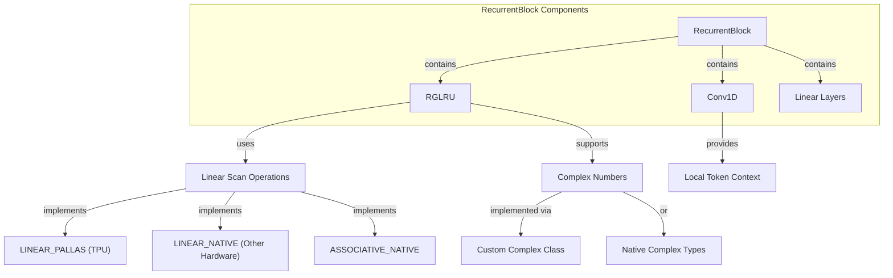
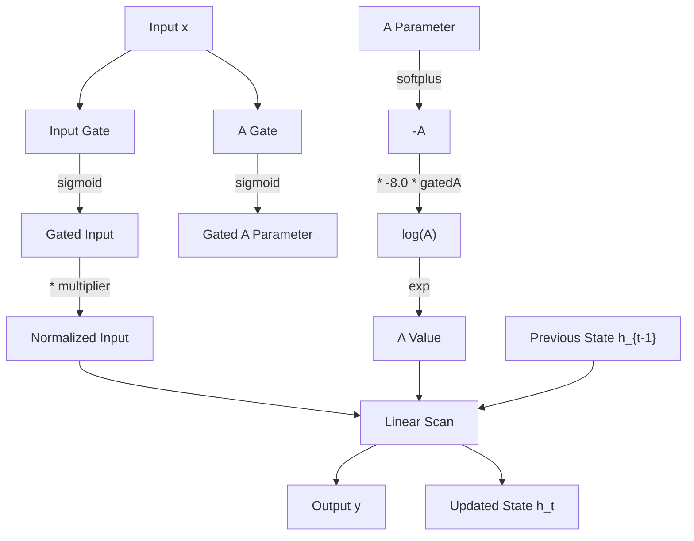
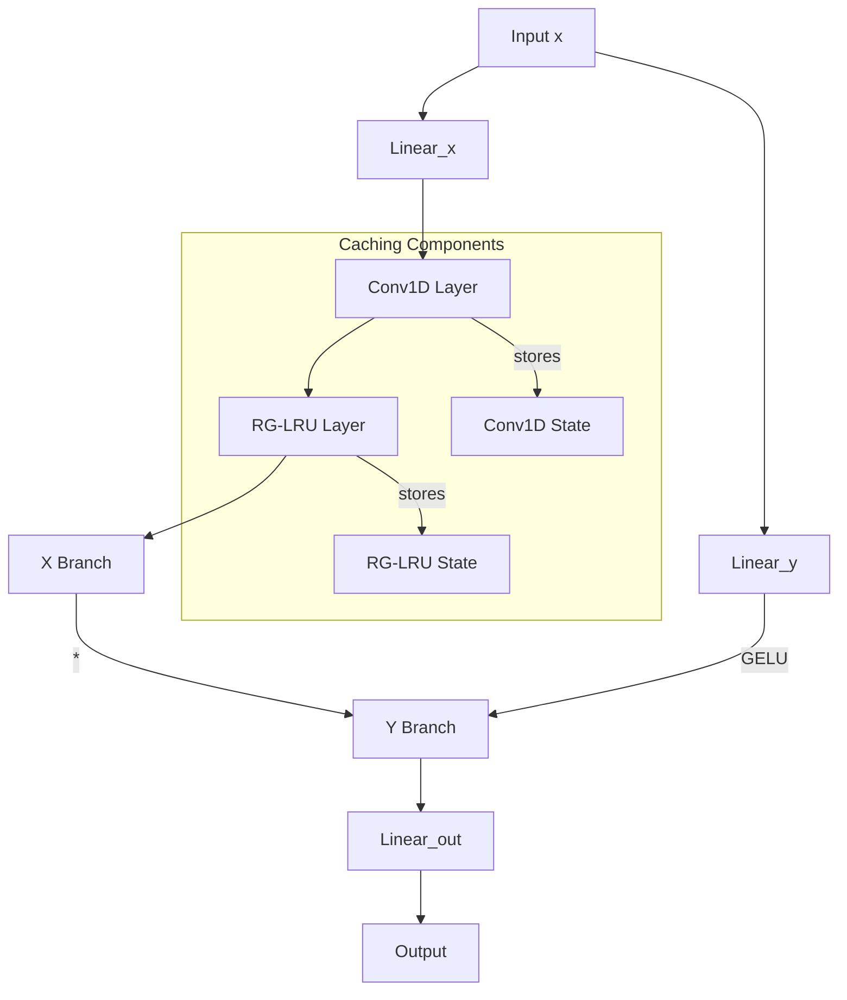
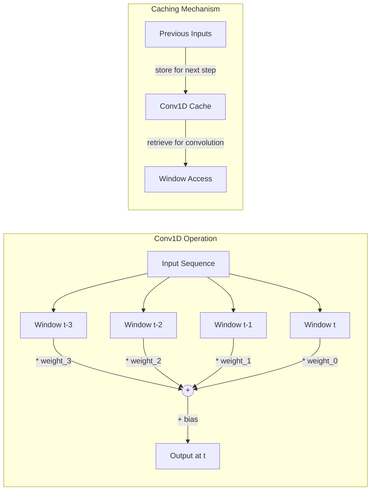
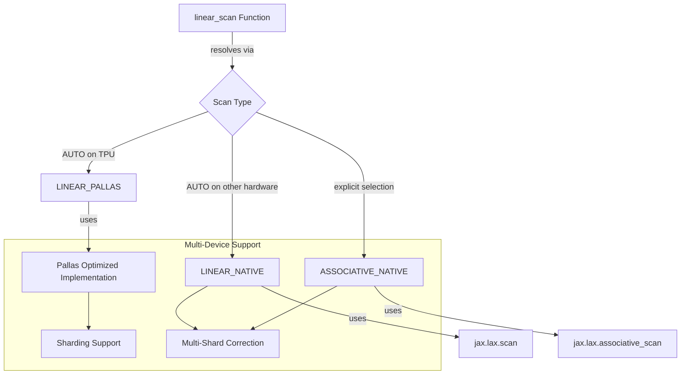
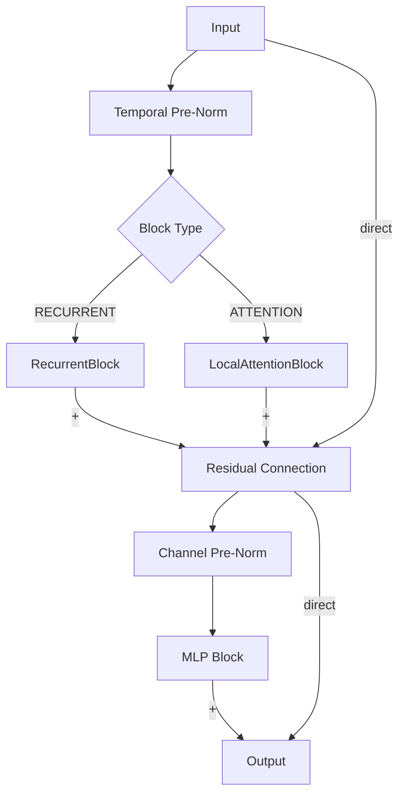

<!-- source: DeepWiki mcp.deepwiki.com · repo google-deepmind/recurrentgemma · page 3.1 Recurrent Components · fetched 2026-10-26 -->

# Recurrent Components

<details>
<summary>Relevant source files</summary>

The following files were used as context for generating this wiki page:

- [recurrentgemma/jax/layers.py](recurrentgemma/jax/layers.py)
- [recurrentgemma/jax/modules.py](recurrentgemma/jax/modules.py)
- [recurrentgemma/jax/scan.py](recurrentgemma/jax/scan.py)

</details>


This page details the recurrent mechanisms in RecurrentGemma, focusing on the Recurrent Gated Linear Recurrent Unit (RGLRU) and related components that enable efficient processing of long sequences. For information about attention mechanisms, see [Attention Mechanisms](#3.2). For complex number implementation details, see [Complex Number Support](#3.3).

## 1. Overview of Recurrent Mechanisms

RecurrentGemma uses recurrent components as a key innovation to achieve efficient processing of long sequences. Unlike traditional transformers that rely solely on attention mechanisms (which have quadratic complexity with sequence length), RecurrentGemma introduces linear recurrences that allow processing sequences with linear complexity.

The two primary recurrent components are:
- **Recurrent Gated Linear Recurrent Unit (RGLRU)**: A specialized recurrent unit that efficiently processes sequential data
- **1D Convolution (Conv1D)**: Provides local context across token sequences

These components are combined in the `RecurrentBlock`, which is used in alternate layers of the model, interspersed with attention-based blocks.



Sources: [recurrentgemma/jax/modules.py:445-630](), [recurrentgemma/jax/layers.py:217-479](), [recurrentgemma/jax/scan.py:352-470]()

## 2. RGLRU Architecture

The Recurrent Gated Linear Recurrent Unit (RGLRU) is the core recurrent component in RecurrentGemma. It implements a specialized form of gated recurrent processing that can efficiently handle long sequences.

### 2.1 Mathematical Foundation

RGLRU implements the following recurrence relation:

1. Compute gating factors for inputs and recurrence parameters
2. Apply exponential parameterization to ensure stability
3. Apply a linear recurrence with proper normalization

The general form of the linear recurrence is:
```
h_t = a_t * h_{t-1} + x_t
```

Where:
- `h_t` is the hidden state at time `t`
- `a_t` is the recurrence parameter (potentially complex-valued)
- `x_t` is the input at time `t`



Sources: [recurrentgemma/jax/layers.py:217-479]()

### 2.2 Implementation Details

The RGLRU class is implemented in `layers.py` and contains several key components:

- **Input Gate**: Controls how much of the input is passed through
- **A Gate**: Controls the recurrence parameter strength
- **Gamma Normalization**: Ensures stability of the recurrence
- **Complex Number Support**: Can operate with either real or complex numbers

The code uses block-diagonal matrices for efficiency and implements special handling for segment boundaries (document starts).

```python
# Key configuration parameters for RGLRU
class RGLRU:
  width: int                   # Dimension of input/output
  num_heads: int               # Number of diagonal blocks
  scan_type: ScanType          # Scan implementation type
  only_real: bool = True       # Whether to use complex numbers
  min_rad: float = 0.9         # Minimum radius for initialization
```

Sources: [recurrentgemma/jax/layers.py:217-228]()

## 3. The RecurrentBlock

The `RecurrentBlock` combines RGLRU with other components to form a complete recurrent processing unit. It integrates RGLRU with Conv1D and several linear transformations.

### 3.1 Architecture



Sources: [recurrentgemma/jax/modules.py:445-630]()

### 3.2 Component Interactions

The RecurrentBlock processes inputs through two parallel branches:

1. **Y-Branch**: Linear transformation followed by GELU activation
2. **X-Branch**: Linear transformation, Conv1D, and RGLRU processing

These branches are then combined through element-wise multiplication before a final linear projection.

The block maintains two types of state for caching:
- **RGLRU State**: The hidden state from the recurrent unit
- **Conv1D State**: Previous token context for convolution

```python
# RecurrentBlock forward pass (simplified):
# 1. Process y-branch 
y = linear_y(x)
y = gelu(y)

# 2. Process x-branch
x = linear_x(x)
x, conv1d_state = conv_1d(x)
x, rg_lru_state = lru(x)

# 3. Combine branches and project
x = x * y
x = linear_out(x)
```

Sources: [recurrentgemma/jax/modules.py:558-606]()

## 4. Conv1D Temporal Processing

The Conv1D component provides local context by applying a 1D convolution over the sequence dimension. This captures short-range dependencies and complements the longer-range processing of RGLRU.

### 4.1 Implementation

The Conv1D layer:
- Performs a "valid" convolution (no padding beyond sequence boundaries)
- Respects document boundaries to prevent mixing information between documents
- Implements efficient caching for autoregressive generation



Sources: [recurrentgemma/jax/layers.py:481-736]()

### 4.2 Document Boundary Handling

The Conv1D layer includes special handling for document boundaries to prevent information leakage:

```python
# Document boundary mask creation
not_a_document_boundary = (segment_pos != 0).astype(jnp.int32)
mask = jnp.ones((batch_size, end_idx - start_idx))
for shift in range(1, max_look_ahead + 1):
  # Prevent looking ahead across document boundaries
  mask *= not_a_document_boundary[:, start_idx + shift : end_idx + shift]
```

Sources: [recurrentgemma/jax/layers.py:673-702]()

## 5. Linear Scan Operations

The linear recurrence computations in RGLRU are performed through different scan implementations, selected based on hardware and configuration.

### 5.1 Scan Types

RecurrentGemma provides three scan implementations:

1. **LINEAR_PALLAS**: Optimized for TPUs using the Pallas kernel system
2. **LINEAR_NATIVE**: Uses JAX's native scan operations
3. **ASSOCIATIVE_NATIVE**: Uses JAX's associative scan for higher parallelism

The system automatically selects the appropriate implementation based on hardware, defaulting to Pallas on TPUs.



Sources: [recurrentgemma/jax/scan.py:32-43](), [recurrentgemma/jax/scan.py:352-470]()

### 5.2 Multi-Device Processing

When running on multiple devices, special handling is needed to correctly compute recurrences across device boundaries:

1. Each device computes local recurrences independently
2. The system applies a multi-shard correction to propagate states across devices
3. Final outputs and states are properly combined

For Pallas kernels, this correction is handled internally. For other scan types, explicit correction is applied.

```python
# Multi-shard correction pattern
(y, h_last), (a_prod, a_prod_last) = lru_linear_scan(...)
y, h_last, _ = pallas.multi_shard_correction(
    y=y,
    a_prod=a_prod,
    h0=h0,
    reverse=reverse,
    h_last=h_last,
    a_prod_last=a_prod_last,
    acc_float_dtype=acc_float_dtype,
    seq_axis=seq_axis,
    seq_axis_index_groups=seq_axis_index_groups,
)
```

Sources: [recurrentgemma/jax/scan.py:292-313](), [recurrentgemma/jax/scan.py:327-346]()

## 6. Integration with Griffin Model

The recurrent components are integrated into the Griffin model architecture through alternating residual blocks. Each `ResidualBlock` can contain either a `RecurrentBlock` or a `LocalAttentionBlock`.

### 6.1 Residual Block Structure



Sources: [recurrentgemma/jax/modules.py:696-854]()

### 6.2 Caching System

For autoregressive generation, the recurrent components maintain state through a caching system:

- **RGLRU State**: Contains the hidden state vector for continuing recurrences
- **Conv1D State**: Stores the previous `temporal_width-1` tokens

These caches are organized in a `RecurrentBlockCache` named tuple structure.

```python
# Cache structure
class RecurrentBlockCache(NamedTuple):
  rg_lru_state: RNNState       # State for the RGLRU
  conv1d_state: Conv1DState    # State for the Conv1D
```

Sources: [recurrentgemma/jax/modules.py:33-39]()

## 7. Performance Characteristics

The recurrent components provide several performance advantages:

1. **Linear Complexity**: O(n) with sequence length rather than O(n²) for attention
2. **Memory Efficiency**: Requires only fixed-size state regardless of sequence length
3. **Hardware Optimization**: Special implementations for TPUs using Pallas

These characteristics make RecurrentGemma particularly well-suited for processing long sequences efficiently.

Sources: [recurrentgemma/jax/scan.py:352-470](), [recurrentgemma/jax/layers.py:217-479]()

---

