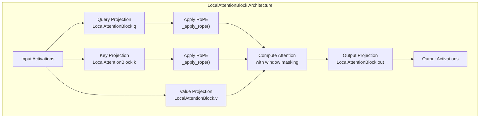
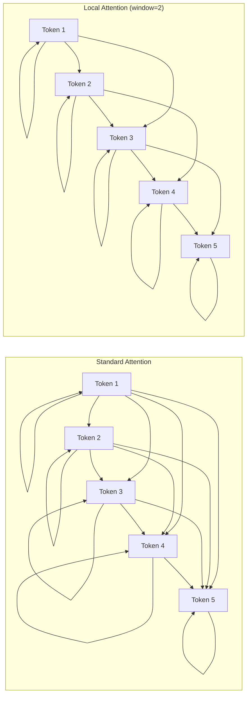
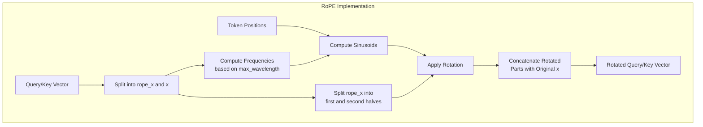
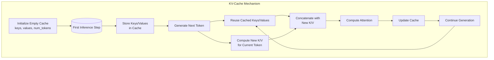
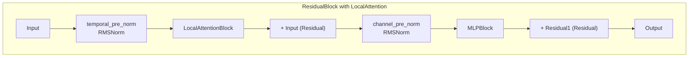

<!-- source: DeepWiki mcp.deepwiki.com · repo google-deepmind/recurrentgemma · page 3.2 Attention Mechanisms · fetched 2026-10-26 -->

# Attention Mechanisms

<details>
<summary>Relevant source files</summary>

The following files were used as context for generating this wiki page:

- [recurrentgemma/jax/modules.py](recurrentgemma/jax/modules.py)

</details>


## Purpose and Scope

This document describes the attention mechanisms implemented in RecurrentGemma, specifically focusing on the local attention implementation and how it differs from standard transformer attention mechanisms. RecurrentGemma employs a specialized windowed attention approach that enables efficient processing of long sequences with bounded computational complexity. For information about recurrent components used alongside attention, see [Recurrent Components](#3.1).

## Overview of Local Attention

RecurrentGemma implements a windowed attention mechanism called `LocalAttentionBlock` that restricts each token's attention to a fixed window of preceding tokens, rather than attending to the entire context as in standard transformer architectures. This design choice offers linear scaling with sequence length instead of quadratic scaling, enabling more efficient processing of long sequences.



Sources: [recurrentgemma/jax/modules.py:251-427]()

## Local Attention vs Standard Attention

The key difference between local attention and standard transformer attention is the attention pattern. While standard attention allows each token to attend to all previous tokens (full causal attention), local attention restricts each token to attend only to tokens within a fixed window size preceding it.



Sources: [recurrentgemma/jax/modules.py:89-178]()

## LocalAttentionBlock Implementation

The `LocalAttentionBlock` class in RecurrentGemma implements the local/windowed attention mechanism:

```mermaid
classDiagram
    class LocalAttentionBlock {
        +width: int
        +num_heads: int
        +window_size: int
        +final_w_init_variance_scale: float
        +dtype
        +param_dtype
        +setup()
        +__call__(x, segment_pos, cache, return_cache)
        +init_cache(batch_size, window_size, heads_dim, dtype)
    }
    
    LocalAttentionBlock --> "nn.Dense" : q
    LocalAttentionBlock --> "nn.Dense" : k
    LocalAttentionBlock --> "nn.Dense" : v
    LocalAttentionBlock --> "nn.Dense" : out
```

Sources: [recurrentgemma/jax/modules.py:251-427]()

### Key Parameters

| Parameter | Description |
|-----------|-------------|
| `width` | The dimension of the input/output activations |
| `num_heads` | Number of attention heads |
| `window_size` | Size of the local attention window |
| `dtype` | Data type used for computation |
| `param_dtype` | Data type used for parameters |

Sources: [recurrentgemma/jax/modules.py:251-327]()

### Query, Key, Value Projections

LocalAttentionBlock uses standard projection layers for queries, keys, and values, but with an important difference:

- The query projection produces `(num_heads, head_dim)` shaped outputs
- The key and value projections produce `(1, head_dim)` shaped outputs

This design allows for efficient implementation of the local attention mechanism with a shared key-value representation across heads.

Sources: [recurrentgemma/jax/modules.py:374-381]()

## Rotary Positional Embeddings (RoPE)

Instead of using absolute positional embeddings, RecurrentGemma implements Rotary Positional Embeddings (RoPE) which encode token positions directly into the key and query representations. The `_apply_rope` function applies rotations to the first half of the key and query vectors based on their positions in the sequence.



Sources: [recurrentgemma/jax/modules.py:54-86]()

## Attention Masking

RecurrentGemma implements several masking functions for different usage scenarios:

1. **Causal Masking**: Ensures tokens can only attend to themselves and preceding tokens
2. **Local Window Masking**: Restricts attention to tokens within the defined window size
3. **Segment Masking**: Ensures tokens only attend to tokens within the same segment

The attention matrix is computed as follows:
- The dot product between queries and keys is scaled by `1/sqrt(head_dim)`
- The appropriate mask is applied by setting masked positions to a large negative value
- The softmax operation is applied to compute attention probabilities
- These probabilities are used to weight the values

Sources: [recurrentgemma/jax/modules.py:89-178](), [recurrentgemma/jax/modules.py:417-421]()

## KV-Cache Mechanism

For efficient autoregressive generation, RecurrentGemma implements a key-value caching mechanism through the `AttentionBlockCache` class. This cache stores previously computed keys and values to avoid recomputation during autoregressive inference.



The cache is updated differently depending on the scenario:
- During prompt processing, the entire prompt's keys and values are stored
- During autoregressive generation, the cache is updated one token at a time

Sources: [recurrentgemma/jax/modules.py:183-248](), [recurrentgemma/jax/modules.py:391-399]()

## Integration with Residual Blocks

The `LocalAttentionBlock` is integrated into the RecurrentGemma architecture through the `ResidualBlock` which can contain either an attention block or a recurrent block based on the `temporal_block_type` configuration.



Sources: [recurrentgemma/jax/modules.py:696-888]()

## Forward Pass and Inference

The `LocalAttentionBlock` handles two primary modes of operation:

1. **Forward Pass** (processing a prompt): Processes the entire input sequence at once
2. **Autoregressive Inference**: Processes one token at a time, using the cache from previous tokens

The block automatically detects the mode based on whether a cache is provided and adjusts its computation accordingly.

Sources: [recurrentgemma/jax/modules.py:350-427]()

## Performance Considerations

The windowed attention approach offers several performance benefits:

- **Linear scaling** with sequence length rather than quadratic
- **Bounded memory usage** since each token only attends to a fixed window
- **Efficient caching** for autoregressive generation
- **Compatible with parallel computation** across the batch dimension

These properties make RecurrentGemma suitable for processing long sequences efficiently, a key advantage over models with standard transformer attention mechanisms.

Sources: [recurrentgemma/jax/modules.py:251-427]()

---

