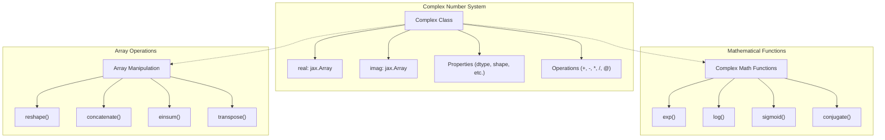
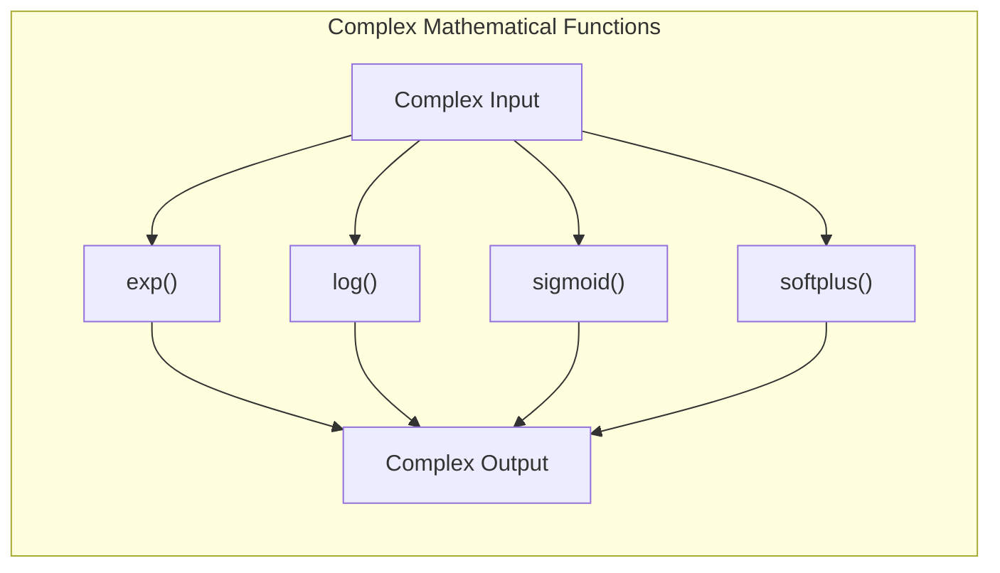
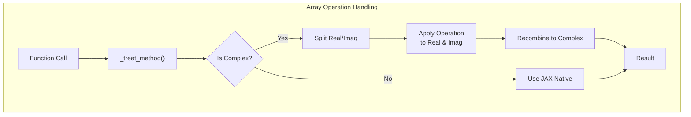
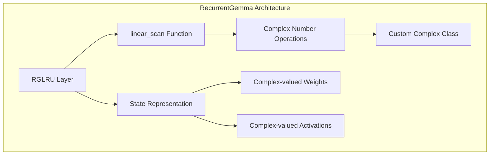

<!-- source: DeepWiki mcp.deepwiki.com · repo google-deepmind/recurrentgemma · page 3.3 Complex Number Support · fetched 2026-10-26 -->

# Complex Number Support

<details>
<summary>Relevant source files</summary>

The following files were used as context for generating this wiki page:

- [recurrentgemma/jax/complex_lib.py](recurrentgemma/jax/complex_lib.py)
- [recurrentgemma/jax/complex_lib_test.py](recurrentgemma/jax/complex_lib_test.py)

</details>


This document details the custom complex number implementation in RecurrentGemma, which provides bfloat16 compatibility for complex arithmetic operations. Unlike JAX's native complex types (which require at least 64 bits), this implementation enables memory-efficient complex number operations crucial for the recurrent components of the model. For information about the recurrent components that use these complex numbers, see [Recurrent Components](#3.1).

## 1. Overview of Complex Number Implementation

RecurrentGemma implements a custom `Complex` class that stores real and imaginary parts separately, enabling complex arithmetic with smaller precision types such as bfloat16. This approach allows the model to use complex-valued weights and activations in recurrent operations while maintaining memory efficiency.



Sources: [recurrentgemma/jax/complex_lib.py:69-217]()

## 2. The Complex Class

The core of complex number support is the `Complex` dataclass, which encapsulates real and imaginary parts as separate JAX arrays, enabling bfloat16 complex operations.

### 2.1 Class Structure and Properties

```mermaid
classDiagram
    class "Complex" {
        +jax.Array real
        +jax.Array imag
        +dtype
        +shape
        +size
        +ndim
        +astype(dtype)
        +reshape(shape)
        +to_numpy()
    }
```

The `Complex` class provides:
- Separate storage for real and imaginary components
- Common array properties (dtype, shape, size, ndim)
- Type conversion methods
- Reshaping capabilities
- Conversion to NumPy complex arrays

Sources: [recurrentgemma/jax/complex_lib.py:69-116]()

### 2.2 Arithmetic Operations

The class implements standard arithmetic operations through Python's special methods:

| Operation | Method | Description |
|-----------|--------|-------------|
| Addition | `__add__` | Adds two complex numbers |
| Subtraction | `__sub__` | Subtracts complex numbers |
| Multiplication | `__mul__` | Complex number multiplication |
| Division | `__truediv__` | Complex number division |
| Matrix Multiplication | `__matmul__` | Matrix multiplication with complex numbers |
| Negation | `__neg__` | Negates a complex number |
| Indexing | `__getitem__` | Enables array-like indexing |

Each operation is optimized to work efficiently with the separate real/imaginary structure, following standard complex arithmetic formulas.

Sources: [recurrentgemma/jax/complex_lib.py:139-216]()

## 3. Extended Functionality

In addition to the core `Complex` class, the library provides various utility functions for working with complex numbers.

### 3.1 Mathematical Functions



The library implements specialized mathematical functions for complex numbers:

- `exp`: Complex exponential function
- `log`: Complex natural logarithm
- `sigmoid`: Complex sigmoid function
- `softplus`: Complex softplus function
- `conjugate`: Complex conjugate operation
- `abs_squared`: Squared magnitude of a complex number

These functions follow the mathematical definitions for complex analysis while leveraging the dual-array representation.

Sources: [recurrentgemma/jax/complex_lib.py:287-335]()

### 3.2 Array Operations

The module provides wrappers for common JAX/NumPy array operations that work with the custom `Complex` class:



The operations are implemented through the `_treat_method` function, which:
1. Analyzes the input types
2. If complex, applies the operation to real and imaginary parts separately
3. Recombines the results into a `Complex` instance

Supported operations include:
- JAX/NumPy: `broadcast_to`, `concatenate`, `reshape`, `transpose`, etc.
- JAX LAX: `add`, `pad`, `slice_in_dim` 
- Einops: `rearrange`, `repeat`

Sources: [recurrentgemma/jax/complex_lib.py:222-284]()

### 3.3 Einsum Implementation

The module provides a special implementation of `einsum` for complex numbers that handles:
- Operations with one complex argument
- Operations with two complex arguments 
- Mixed operations with both complex and real arguments

```python
def einsum(sum_str: str, *args: jax.Array | Complex) -> jax.Array | Complex:
    # Specialized implementation for complex number Einstein summation
```

Sources: [recurrentgemma/jax/complex_lib.py:338-366]()

## 4. Integration with RecurrentGemma

The complex number support is primarily used in the recurrent components of RecurrentGemma, specifically in the RGLRU (Recurrent Gated Linear Recurrent Unit) layer.



### 4.1 Use Cases in Recurrent Components

The complex number implementation:
1. Enables efficient representation of recurrent state in complex space
2. Allows for bfloat16 precision for complex operations
3. Supports complex-valued linear recurrences in the RGLRU layer
4. Provides necessary mathematical operations for complex-valued model components

### 4.2 Memory and Performance Benefits

| Feature | Benefit |
|---------|---------|
| bfloat16 compatibility | 2x memory efficiency compared to native complex64 |
| Optimized operations | Efficient complex arithmetic without conversion overhead |
| Custom implementation | Support for complex math on platforms with limited complex number support |
| JAX compatibility | Integration with JAX transformation and compilation systems |

## 5. Testing and Validation

The complex number implementation is thoroughly tested, with verification that:
- All operations produce results consistent with JAX's native complex types
- Error handling properly validates inputs and operations
- All array manipulation functions work correctly with complex values
- Type compatibility is enforced appropriately

Sources: [recurrentgemma/jax/complex_lib_test.py:1-318]()

## 6. Usage Examples

### 6.1 Creating Complex Values

```python
# Create a Complex instance with separate real and imaginary parts
real_part = jnp.array([[0.1, 0.2], [0.3, 0.4]], dtype=jnp.bfloat16)
imag_part = jnp.array([[0.5, 0.6], [0.7, 0.8]], dtype=jnp.bfloat16) 
complex_value = Complex(real=real_part, imag=imag_part)
```

### 6.2 Complex Arithmetic

```python
# Perform arithmetic operations
result1 = complex_value * complex_value  # Multiplication
result2 = complex_value + complex_value  # Addition
result3 = complex_value @ complex_value  # Matrix multiplication
```

### 6.3 Mathematical Functions

```python
# Apply mathematical functions
exp_result = complex_lib.exp(complex_value)
log_result = complex_lib.log(complex_value)
conj_result = complex_lib.conjugate(complex_value)
```

Through this comprehensive custom complex number implementation, RecurrentGemma achieves efficient complex-valued operations that are crucial for its recurrent neural network components, particularly when operating with memory-constrained precision types like bfloat16.

---

